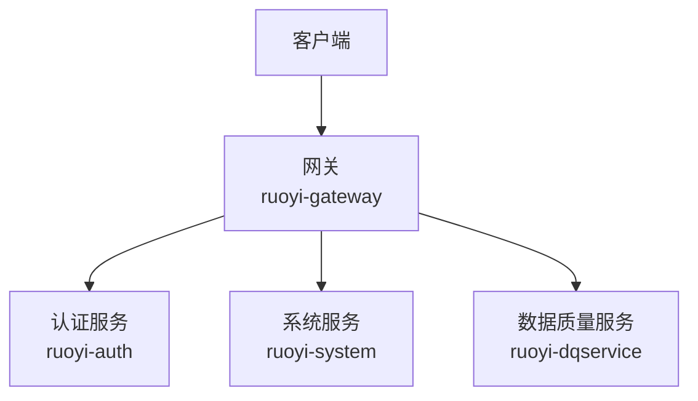
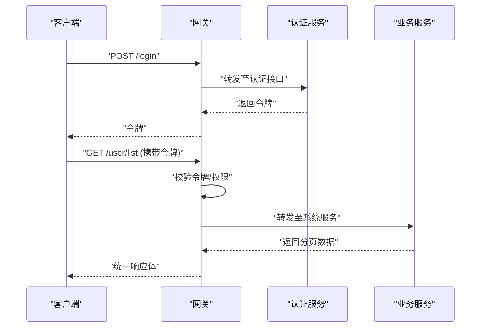
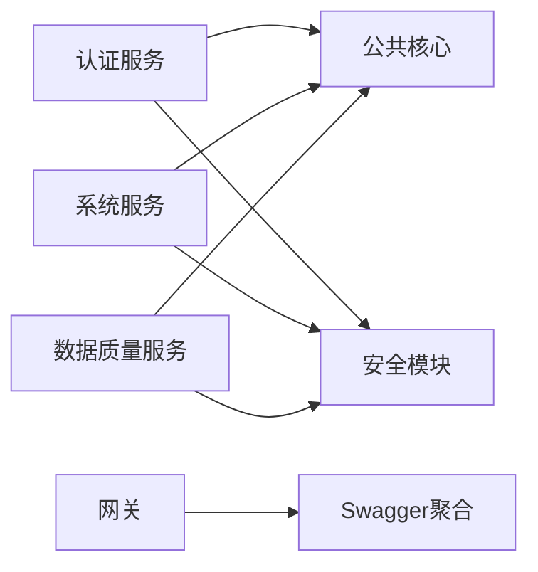

# API接口文档

<cite>
**本文引用的文件**   
- [pom.xml](file://pom.xml)
- [README.md](file://README.md)
- [TokenController.java](file://ruoyi-auth/src/main/java/com/ruoyi/auth/controller/TokenController.java)
- [SysUserController.java](file://ruoyi-modules/ruoyi-system/src/main/java/com/ruoyi/system/controller/SysUserController.java)
- [SysRoleController.java](file://ruoyi-modules/ruoyi-system/src/main/java/com/ruoyi/system/controller/SysRoleController.java)
- [SysDeptController.java](file://ruoyi-modules/ruoyi-system/src/main/java/com/ruoyi/system/controller/SysDeptController.java)
- [DataSourceController.java](file://ruoyi-modules/ruoyi-dqservice/src/main/java/com/ruoyi/dqservice/controller/DataSourceController.java)
- [DroolsRuleController.java](file://ruoyi-modules/ruoyi-dqservice/src/main/java/com/ruoyi/dqservice/controller/DroolsRuleController.java)
- [R.java](file://ruoyi-common/ruoyi-common-core/src/main/java/com/ruoyi/common/core/domain/R.java)
- [SwaggerHandler.java](file://ruoyi-gateway/src/main/java/com/ruoyi/gateway/handler/SwaggerHandler.java)
- [SwaggerWebConfiguration.java](file://ruoyi-common/ruoyi-common-swagger/src/main/java/com/ruoyi/common/swagger/config/SwaggerWebConfiguration.java)
</cite>

## 目录
1. [简介](#简介)
2. [项目结构](#项目结构)
3. [核心组件](#核心组件)
4. [架构总览](#架构总览)
5. [详细接口说明](#详细接口说明)
6. [依赖分析](#依赖分析)
7. [性能与通用约定](#性能与通用约定)
8. [故障排查指南](#故障排查指南)
9. [结论](#结论)
10. [附录](#附录)

## 简介
本文件为数据质量平台（dataquality）的RESTful API接口文档，覆盖认证授权、系统管理、数据源管理与规则引擎等模块。文档包含：
- 公开接口的URL路径、HTTP方法、请求参数、响应格式与错误码
- 认证与授权机制（JWT + 网关鉴权）
- 统一响应体规范与分页约定
- Swagger文档配置与使用方式
- 客户端集成要点与调用示例

## 项目结构
本项目采用微服务架构，主要模块包括：
- 认证服务 ruoyi-auth：提供登录、登出、刷新令牌、注册等能力
- 网关 ruoyi-gateway：统一入口、鉴权过滤、Swagger聚合
- 业务模块 ruoyi-system / ruoyi-dqservice：系统管理与数据质量相关功能
- 公共库 ruoyi-common-*：通用领域模型、安全、日志、Swagger等

图表来源
- [SwaggerHandler.java:17-55](file://ruoyi-gateway/src/main/java/com/ruoyi/gateway/handler/SwaggerHandler.java#L17-L55)
- [TokenController.java:25-78](file://ruoyi-auth/src/main/java/com/ruoyi/auth/controller/TokenController.java#L25-L78)
- [SysUserController.java:46-312](file://ruoyi-modules/ruoyi-system/src/main/java/com/ruoyi/system/controller/SysUserController.java#L46-L312)
- [DataSourceController.java:31-105](file://ruoyi-modules/ruoyi-dqservice/src/main/java/com/ruoyi/dqservice/controller/DataSourceController.java#L31-L105)

章节来源
- [pom.xml:1-286](file://pom.xml#L1-L286)
- [README.md:1-1](file://README.md#L1-L1)

## 核心组件
- 统一响应体 R<T>：包含 code、msg、data 三个字段，用于所有API返回
- 认证与授权：基于JWT，网关层校验token并透传用户上下文；控制器通过注解进行权限控制
- 分页：列表接口普遍支持分页，返回 TableDataInfo 结构
- Swagger：网关暴露聚合资源，各服务可独立生成文档

章节来源
- [R.java:11-105](file://ruoyi-common/ruoyi-common-core/src/main/java/com/ruoyi/common/core/domain/R.java#L11-L105)
- [SwaggerHandler.java:17-55](file://ruoyi-gateway/src/main/java/com/ruoyi/gateway/handler/SwaggerHandler.java#L17-L55)
- [SwaggerWebConfiguration.java:12-21](file://ruoyi-common/ruoyi-common-swagger/src/main/java/com/ruoyi/common/swagger/config/SwaggerWebConfiguration.java#L12-L21)

## 架构总览
下图展示一次典型请求从客户端到后端服务的流转过程，以及认证与权限校验的关键节点。

图表来源
- [TokenController.java:34-41](file://ruoyi-auth/src/main/java/com/ruoyi/auth/controller/TokenController.java#L34-L41)
- [SysUserController.java:68-75](file://ruoyi-modules/ruoyi-system/src/main/java/com/ruoyi/system/controller/SysUserController.java#L68-L75)

## 详细接口说明

### 认证与令牌
- 登录
  - URL: POST /login
  - 请求体: JSON，包含用户名与密码
  - 响应: 统一响应体 R，data 中包含令牌
  - 备注: 成功后将令牌保存在客户端，后续请求需携带令牌
- 登出
  - URL: DELETE /logout
  - 请求头: 需携带令牌
  - 响应: 统一响应体 R
- 刷新令牌
  - URL: POST /refresh
  - 请求头: 需携带令牌
  - 响应: 统一响应体 R
- 注册
  - URL: POST /register
  - 请求体: JSON，包含用户名与密码
  - 响应: 统一响应体 R

章节来源
- [TokenController.java:34-78](file://ruoyi-auth/src/main/java/com/ruoyi/auth/controller/TokenController.java#L34-L78)

### 系统管理
- 用户管理
  - 获取用户列表
    - URL: GET /user/list
    - 查询参数: 分页参数（页码、每页条数）、筛选条件
    - 响应: 分页对象 TableDataInfo
  - 导出用户
    - URL: POST /user/export
    - 请求体: 筛选条件
    - 响应: Excel文件流
  - 导入用户
    - URL: POST /user/importData
    - 请求体: multipart/form-data，包含Excel文件与是否更新标志
    - 响应: 统一响应体 R
  - 下载导入模板
    - URL: POST /user/importTemplate
    - 响应: Excel模板文件流
  - 当前用户信息
    - URL: GET /user/getInfo
    - 响应: 统一响应体 AjaxResult，包含用户、角色、权限
  - 根据ID获取用户详情
    - URL: GET /user/{userId}
    - 响应: 统一响应体 AjaxResult
  - 新增用户
    - URL: POST /user
    - 请求体: SysUser 对象
    - 响应: 统一响应体 AjaxResult
  - 修改用户
    - URL: PUT /user
    - 请求体: SysUser 对象
    - 响应: 统一响应体 AjaxResult
  - 删除用户
    - URL: DELETE /user/{userIds}
    - 路径参数: 用户ID数组
    - 响应: 统一响应体 AjaxResult
  - 重置密码
    - URL: PUT /user/resetPwd
    - 请求体: SysUser 对象
    - 响应: 统一响应体 AjaxResult
  - 状态修改
    - URL: PUT /user/changeStatus
    - 请求体: SysUser 对象
    - 响应: 统一响应体 AjaxResult
  - 获取用户授权角色
    - URL: GET /user/authRole/{userId}
    - 响应: 统一响应体 AjaxResult
  - 为用户授权角色
    - URL: PUT /user/authRole
    - 请求体: userId 与 roleIds 数组
    - 响应: 统一响应体 AjaxResult
- 角色管理
  - 获取角色列表
    - URL: GET /role/list
    - 查询参数: 分页参数、筛选条件
    - 响应: 分页对象 TableDataInfo
  - 导出角色
    - URL: POST /role/export
    - 请求体: 筛选条件
    - 响应: Excel文件流
  - 根据ID获取角色详情
    - URL: GET /role/{roleId}
    - 响应: 统一响应体 AjaxResult
  - 新增角色
    - URL: POST /role
    - 请求体: SysRole 对象
    - 响应: 统一响应体 AjaxResult
  - 修改角色
    - URL: PUT /role
    - 请求体: SysRole 对象
    - 响应: 统一响应体 AjaxResult
  - 修改数据权限
    - URL: PUT /role/dataScope
    - 请求体: SysRole 对象
    - 响应: 统一响应体 AjaxResult
  - 状态修改
    - URL: PUT /role/changeStatus
    - 请求体: SysRole 对象
    - 响应: 统一响应体 AjaxResult
  - 删除角色
    - URL: DELETE /role/{roleIds}
    - 路径参数: 角色ID数组
    - 响应: 统一响应体 AjaxResult
  - 角色选择框列表
    - URL: GET /role/optionselect
    - 响应: 统一响应体 AjaxResult
  - 已分配用户列表
    - URL: GET /role/authUser/allocatedList
    - 查询参数: 分页参数、筛选条件
    - 响应: 分页对象 TableDataInfo
  - 未分配用户列表
    - URL: GET /role/authUser/unallocatedList
    - 查询参数: 分页参数、筛选条件
    - 响应: 分页对象 TableDataInfo
  - 取消授权用户
    - URL: PUT /role/authUser/cancel
    - 请求体: SysUserRole 对象
    - 响应: 统一响应体 AjaxResult
  - 批量取消授权用户
    - URL: PUT /role/authUser/cancelAll
    - 请求体: roleId 与 userIds 数组
    - 响应: 统一响应体 AjaxResult
  - 批量选择用户授权
    - URL: PUT /role/authUser/selectAll
    - 请求体: roleId 与 userIds 数组
    - 响应: 统一响应体 AjaxResult
- 部门管理
  - 获取部门列表
    - URL: GET /dept/list
    - 查询参数: 筛选条件
    - 响应: 统一响应体 AjaxResult
  - 排除节点的部门列表
    - URL: GET /dept/list/exclude/{deptId}
    - 路径参数: deptId
    - 响应: 统一响应体 AjaxResult
  - 根据ID获取部门详情
    - URL: GET /dept/{deptId}
    - 响应: 统一响应体 AjaxResult
  - 部门下拉树
    - URL: GET /dept/treeselect
    - 查询参数: 筛选条件
    - 响应: 统一响应体 AjaxResult
  - 角色部门树
    - URL: GET /dept/roleDeptTreeselect/{roleId}
    - 响应: 统一响应体 AjaxResult
  - 新增部门
    - URL: POST /dept
    - 请求体: SysDept 对象
    - 响应: 统一响应体 AjaxResult
  - 修改部门
    - URL: PUT /dept
    - 请求体: SysDept 对象
    - 响应: 统一响应体 AjaxResult
  - 删除部门
    - URL: DELETE /dept/{deptId}
    - 响应: 统一响应体 AjaxResult

章节来源
- [SysUserController.java:68-312](file://ruoyi-modules/ruoyi-system/src/main/java/com/ruoyi/system/controller/SysUserController.java#L68-L312)
- [SysRoleController.java:45-221](file://ruoyi-modules/ruoyi-system/src/main/java/com/ruoyi/system/controller/SysRoleController.java#L45-L221)
- [SysDeptController.java:42-165](file://ruoyi-modules/ruoyi-system/src/main/java/com/ruoyi/system/controller/SysDeptController.java#L42-L165)

### 数据质量服务
- 数据源管理
  - 获取数据源列表
    - URL: GET /dataSource/list
    - 查询参数: 分页参数、筛选条件
    - 响应: 分页对象 TableDataInfo
  - 导出数据源列表
    - URL: POST /dataSource/export
    - 请求体: 筛选条件
    - 响应: Excel文件流
  - 获取数据源详情
    - URL: GET /dataSource/{id}
    - 响应: 统一响应体 AjaxResult
  - 新增数据源
    - URL: POST /dataSource
    - 请求体: DataSource 对象
    - 响应: 统一响应体 AjaxResult
  - 修改数据源
    - URL: PUT /dataSource
    - 请求体: DataSource 对象
    - 响应: 统一响应体 AjaxResult
  - 删除数据源
    - URL: DELETE /dataSource/{ids}
    - 路径参数: ids 数组
    - 响应: 统一响应体 AjaxResult
- Drools规则管理
  - 查询全部规则
    - URL: GET /drools/rule/findAll
    - 响应: 规则列表
  - 新增规则
    - URL: POST /drools/rule/add
    - 请求体: DroolsRule 对象
    - 响应: 字符串消息
  - 更新规则
    - URL: POST /drools/rule/update
    - 请求体: DroolsRule 对象
    - 响应: 字符串消息
  - 删除规则
    - URL: POST /drools/rule/deleteRule
    - 请求参数: ruleId, ruleName
    - 响应: 字符串消息
  - 触发规则
    - URL: GET /drools/rule/fireRule
    - 请求参数: kieBaseName, param
    - 响应: 字符串消息

章节来源
- [DataSourceController.java:41-104](file://ruoyi-modules/ruoyi-dqservice/src/main/java/com/ruoyi/dqservice/controller/DataSourceController.java#L41-L104)
- [DroolsRuleController.java:22-48](file://ruoyi-modules/ruoyi-dqservice/src/main/java/com/ruoyi/dqservice/controller/DroolsRuleController.java#L22-L48)

### 统一响应体与错误码
- 统一响应体 R<T>
  - 字段:
    - code: 状态码
    - msg: 消息
    - data: 数据
  - 常用构造方法: ok(), ok(data), fail(), fail(msg), fail(code,msg)
- 常见状态码
  - 成功: SUCCESS（由常量定义）
  - 失败: FAIL（由常量定义）
- 其他业务错误
  - 控制器中可能返回 AjaxResult 或字符串消息，具体以接口为准

章节来源
- [R.java:11-105](file://ruoyi-common/ruoyi-common-core/src/main/java/com/ruoyi/common/core/domain/R.java#L11-L105)

### 认证与授权机制
- 认证流程
  - 客户端调用登录接口获取令牌
  - 后续请求在请求头中携带令牌
  - 网关层校验令牌有效性并注入用户上下文
- 授权机制
  - 控制器方法通过权限注解进行访问控制
  - 权限标识形如 system:user:list、dqservice:dataSource:list 等

章节来源
- [TokenController.java:34-78](file://ruoyi-auth/src/main/java/com/ruoyi/auth/controller/TokenController.java#L34-L78)
- [SysUserController.java:68-75](file://ruoyi-modules/ruoyi-system/src/main/java/com/ruoyi/system/controller/SysUserController.java#L68-L75)
- [DataSourceController.java:41-48](file://ruoyi-modules/ruoyi-dqservice/src/main/java/com/ruoyi/dqservice/controller/DataSourceController.java#L41-L48)

### 数据格式与分页
- 数据格式
  - 请求体与响应体默认使用JSON
  - 文件上传使用 multipart/form-data
- 分页处理
  - 列表接口普遍支持分页，返回 TableDataInfo
  - 分页参数通常包含页码与每页条数

章节来源
- [SysUserController.java:68-75](file://ruoyi-modules/ruoyi-system/src/main/java/com/ruoyi/system/controller/SysUserController.java#L68-L75)
- [SysRoleController.java:45-52](file://ruoyi-modules/ruoyi-system/src/main/java/com/ruoyi/system/controller/SysRoleController.java#L45-L52)
- [DataSourceController.java:41-48](file://ruoyi-modules/ruoyi-dqservice/src/main/java/com/ruoyi/dqservice/controller/DataSourceController.java#L41-L48)

### Swagger文档配置与使用
- 网关聚合
  - 网关暴露 /swagger-resources 相关端点，用于聚合各服务文档资源
- 静态资源映射
  - 服务内映射 /swagger-ui/** 静态资源路径
- 使用方法
  - 启动网关与各业务服务后，访问网关地址下的Swagger UI页面查看聚合文档

章节来源
- [SwaggerHandler.java:17-55](file://ruoyi-gateway/src/main/java/com/ruoyi/gateway/handler/SwaggerHandler.java#L17-L55)
- [SwaggerWebConfiguration.java:12-21](file://ruoyi-common/ruoyi-common-swagger/src/main/java/com/ruoyi/common/swagger/config/SwaggerWebConfiguration.java#L12-L21)

## 依赖分析
- 模块依赖
  - 认证服务依赖安全与令牌工具
  - 系统服务与数据质量服务依赖公共核心与安全模块
  - 网关负责路由与Swagger聚合

图表来源
- [pom.xml:185-239](file://pom.xml#L185-L239)
- [SwaggerHandler.java:17-55](file://ruoyi-gateway/src/main/java/com/ruoyi/gateway/handler/SwaggerHandler.java#L17-L55)

章节来源
- [pom.xml:185-239](file://pom.xml#L185-L239)

## 性能与通用约定
- 分页建议
  - 合理设置每页条数，避免一次性返回过多数据
- 缓存策略
  - 对热点数据（如字典、菜单）可考虑缓存以提升性能
- 限流与熔断
  - 网关层可结合Sentinel进行流量控制与降级
- 日志记录
  - 关键操作通过日志注解记录审计信息

[本节为通用指导，不直接分析具体文件]

## 故障排查指南
- 认证失败
  - 检查令牌是否过期或无效
  - 确认网关是否正确转发并校验令牌
- 权限不足
  - 检查用户角色与权限标识是否匹配
- 分页异常
  - 检查分页参数是否传递正确
- 文件上传失败
  - 检查Content-Type是否为multipart/form-data
  - 确认文件大小限制与存储配置

[本节为通用指导，不直接分析具体文件]

## 结论
本文档梳理了数据质量平台的RESTful API接口，涵盖认证授权、系统管理、数据源与规则引擎等模块，并提供统一响应体、分页与Swagger文档的使用说明。开发者可依据本文快速对接与集成。

[本节为总结性内容，不直接分析具体文件]

## 附录
- 客户端集成要点
  - 登录后保存令牌并在后续请求头中携带
  - 统一处理响应体中的code/msg/data字段
  - 使用Swagger UI进行接口调试与验证

[本节为补充说明，不直接分析具体文件]