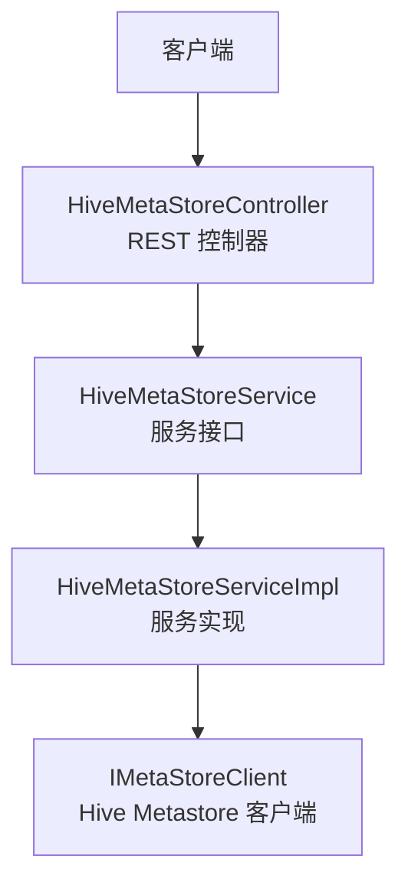
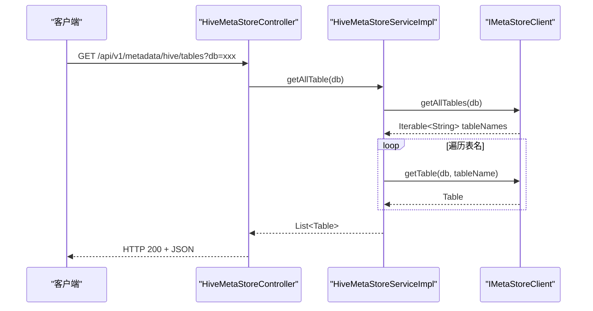
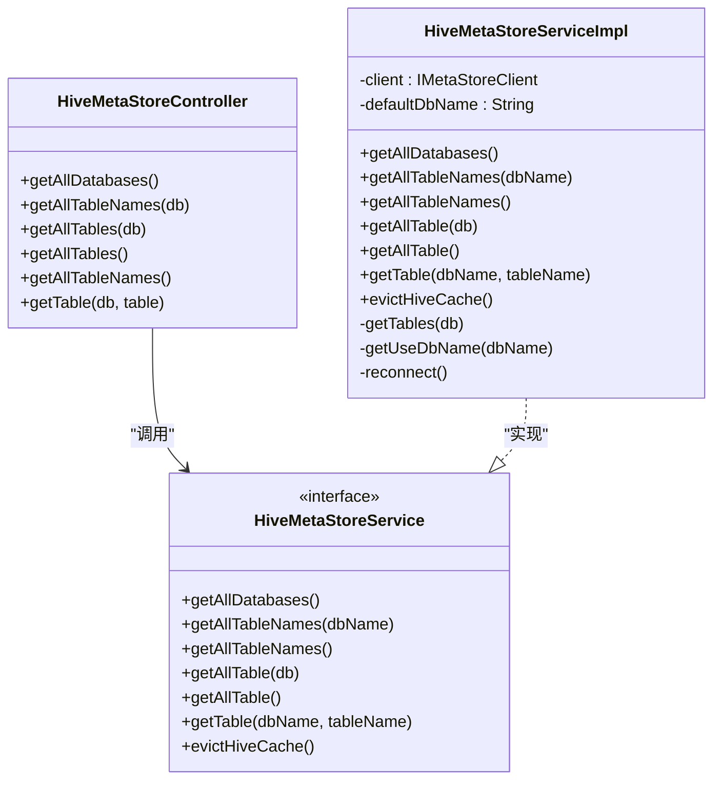
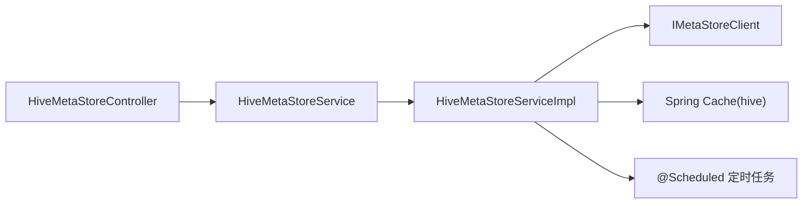

# 元数据管理API

<cite>
**本文引用的文件**   
- [HiveMetaStoreController.java](file://ruoyi-modules/ruoyi-dqservice/src/main/java/com/ruoyi/dqservice/controller/HiveMetaStoreController.java)
- [HiveMetaStoreService.java](file://ruoyi-modules/ruoyi-dqservice/src/main/java/com/ruoyi/dqservice/service/HiveMetaStoreService.java)
- [HiveMetaStoreServiceImpl.java](file://ruoyi-modules/ruoyi-dqservice/src/main/java/com/ruoyi/dqservice/service/impl/HiveMetaStoreServiceImpl.java)
</cite>

## 目录
1. [简介](#简介)
2. [项目结构](#项目结构)
3. [核心组件](#核心组件)
4. [架构总览](#架构总览)
5. [详细组件分析](#详细组件分析)
6. [依赖关系分析](#依赖关系分析)
7. [性能与缓存](#性能与缓存)
8. [故障排查指南](#故障排查指南)
9. [结论](#结论)
10. [附录：接口清单与示例](#附录接口清单与示例)

## 简介
本文件为“元数据管理模块”的RESTful API文档，聚焦于Hive元数据的自动发现、表结构查询、分区信息获取等能力，并说明元数据同步与缓存更新的管理功能。当前仓库已实现Hive元数据相关接口；MySQL元数据相关接口在现有代码中未找到对应实现，本文不虚构其URL与行为。

## 项目结构
- 控制器层：暴露HTTP接口，统一前缀/api/v1/metadata/hive
- 服务接口层：定义元数据访问契约
- 服务实现层：封装Hive Metastore客户端调用、缓存注解与定时任务

图表来源
- [HiveMetaStoreController.java:16-57](file://ruoyi-modules/ruoyi-dqservice/src/main/java/com/ruoyi/dqservice/controller/HiveMetaStoreController.java#L16-L57)
- [HiveMetaStoreService.java:8-23](file://ruoyi-modules/ruoyi-dqservice/src/main/java/com/ruoyi/dqservice/service/HiveMetaStoreService.java#L8-L23)
- [HiveMetaStoreServiceImpl.java:27-30](file://ruoyi-modules/ruoyi-dqservice/src/main/java/com/ruoyi/dqservice/service/impl/HiveMetaStoreServiceImpl.java#L27-L30)

章节来源
- [HiveMetaStoreController.java:16-57](file://ruoyi-modules/ruoyi-dqservice/src/main/java/com/ruoyi/dqservice/controller/HiveMetaStoreController.java#L16-L57)
- [HiveMetaStoreService.java:8-23](file://ruoyi-modules/ruoyi-dqservice/src/main/java/com/ruoyi/dqservice/service/HiveMetaStoreService.java#L8-L23)
- [HiveMetaStoreServiceImpl.java:27-30](file://ruoyi-modules/ruoyi-dqservice/src/main/java/com/ruoyi/dqservice/service/impl/HiveMetaStoreServiceImpl.java#L27-L30)

## 核心组件
- HiveMetaStoreController：对外暴露Hive元数据查询与管理接口
- HiveMetaStoreService：定义数据库、表名、表结构等查询方法以及缓存清理方法
- HiveMetaStoreServiceImpl：实现上述接口，使用Hive Metastore客户端进行实际读取，并通过Spring Cache注解进行结果缓存，提供定时缓存刷新

章节来源
- [HiveMetaStoreController.java:16-57](file://ruoyi-modules/ruoyi-dqservice/src/main/java/com/ruoyi/dqservice/controller/HiveMetaStoreController.java#L16-L57)
- [HiveMetaStoreService.java:8-23](file://ruoyi-modules/ruoyi-dqservice/src/main/java/com/ruoyi/dqservice/service/HiveMetaStoreService.java#L8-L23)
- [HiveMetaStoreServiceImpl.java:27-30](file://ruoyi-modules/ruoyi-dqservice/src/main/java/com/ruoyi/dqservice/service/impl/HiveMetaStoreServiceImpl.java#L27-L30)

## 架构总览
下图展示一次“按库获取表结构”的请求从浏览器到Hive Metastore的完整调用链。

图表来源
- [HiveMetaStoreController.java:35-38](file://ruoyi-modules/ruoyi-dqservice/src/main/java/com/ruoyi/dqservice/controller/HiveMetaStoreController.java#L35-L38)
- [HiveMetaStoreServiceImpl.java:88-92](file://ruoyi-modules/ruoyi-dqservice/src/main/java/com/ruoyi/dqservice/service/impl/HiveMetaStoreServiceImpl.java#L88-L92)
- [HiveMetaStoreServiceImpl.java:162-181](file://ruoyi-modules/ruoyi-dqservice/src/main/java/com/ruoyi/dqservice/service/impl/HiveMetaStoreServiceImpl.java#L162-L181)

## 详细组件分析

### Hive元数据控制器（HiveMetaStoreController）
- 作用：将Hive元数据查询能力以REST形式暴露
- 路径前缀：/api/v1/metadata/hive
- 主要端点与方法见“附录：接口清单与示例”

章节来源
- [HiveMetaStoreController.java:16-57](file://ruoyi-modules/ruoyi-dqservice/src/main/java/com/ruoyi/dqservice/controller/HiveMetaStoreController.java#L16-L57)

### 服务接口（HiveMetaStoreService）
- 定义能力：
  - 获取所有数据库
  - 获取指定库的所有表名
  - 获取所有库及其表名映射
  - 获取指定库的所有表结构
  - 获取所有库及其表结构映射
  - 获取单张表结构
  - 清除Hive缓存

章节来源
- [HiveMetaStoreService.java:8-23](file://ruoyi-modules/ruoyi-dqservice/src/main/java/com/ruoyi/dqservice/service/HiveMetaStoreService.java#L8-L23)

### 服务实现（HiveMetaStoreServiceImpl）
- 关键特性：
  - 通过IMetaStoreClient访问Hive Metastore
  - 使用@Cacheable对读方法进行缓存，键由cacheKeyGenerator生成，缓存名为hive
  - 提供定时任务@Scheduled定期清空缓存，触发元数据刷新
  - 异常时尝试reconnect()并重试日志记录
  - 默认库名通过配置项注入

图表来源
- [HiveMetaStoreController.java:16-57](file://ruoyi-modules/ruoyi-dqservice/src/main/java/com/ruoyi/dqservice/controller/HiveMetaStoreController.java#L16-L57)
- [HiveMetaStoreService.java:8-23](file://ruoyi-modules/ruoyi-dqservice/src/main/java/com/ruoyi/dqservice/service/HiveMetaStoreService.java#L8-L23)
- [HiveMetaStoreServiceImpl.java:27-30](file://ruoyi-modules/ruoyi-dqservice/src/main/java/com/ruoyi/dqservice/service/impl/HiveMetaStoreServiceImpl.java#L27-L30)

章节来源
- [HiveMetaStoreServiceImpl.java:27-30](file://ruoyi-modules/ruoyi-dqservice/src/main/java/com/ruoyi/dqservice/service/impl/HiveMetaStoreServiceImpl.java#L27-L30)
- [HiveMetaStoreServiceImpl.java:49-65](file://ruoyi-modules/ruoyi-dqservice/src/main/java/com/ruoyi/dqservice/service/impl/HiveMetaStoreServiceImpl.java#L49-L65)
- [HiveMetaStoreServiceImpl.java:68-85](file://ruoyi-modules/ruoyi-dqservice/src/main/java/com/ruoyi/dqservice/service/impl/HiveMetaStoreServiceImpl.java#L68-L85)
- [HiveMetaStoreServiceImpl.java:88-125](file://ruoyi-modules/ruoyi-dqservice/src/main/java/com/ruoyi/dqservice/service/impl/HiveMetaStoreServiceImpl.java#L88-L125)
- [HiveMetaStoreServiceImpl.java:128-145](file://ruoyi-modules/ruoyi-dqservice/src/main/java/com/ruoyi/dqservice/service/impl/HiveMetaStoreServiceImpl.java#L128-L145)
- [HiveMetaStoreServiceImpl.java:147-159](file://ruoyi-modules/ruoyi-dqservice/src/main/java/com/ruoyi/dqservice/service/impl/HiveMetaStoreServiceImpl.java#L147-L159)
- [HiveMetaStoreServiceImpl.java:162-199](file://ruoyi-modules/ruoyi-dqservice/src/main/java/com/ruoyi/dqservice/service/impl/HiveMetaStoreServiceImpl.java#L162-L199)

## 依赖关系分析
- 控制器依赖服务接口，解耦具体实现
- 服务实现依赖Hive Metastore客户端IMetaStoreClient
- 缓存机制基于Spring Cache，缓存名为hive，键生成策略由外部bean cacheKeyGenerator提供
- 定时任务依赖配置项cache.evict.hive.fixedRate.in.milliseconds控制刷新频率

图表来源
- [HiveMetaStoreController.java:16-57](file://ruoyi-modules/ruoyi-dqservice/src/main/java/com/ruoyi/dqservice/controller/HiveMetaStoreController.java#L16-L57)
- [HiveMetaStoreService.java:8-23](file://ruoyi-modules/ruoyi-dqservice/src/main/java/com/ruoyi/dqservice/service/HiveMetaStoreService.java#L8-L23)
- [HiveMetaStoreServiceImpl.java:27-30](file://ruoyi-modules/ruoyi-dqservice/src/main/java/com/ruoyi/dqservice/service/impl/HiveMetaStoreServiceImpl.java#L27-L30)
- [HiveMetaStoreServiceImpl.java:147-159](file://ruoyi-modules/ruoyi-dqservice/src/main/java/com/ruoyi/dqservice/service/impl/HiveMetaStoreServiceImpl.java#L147-L159)

章节来源
- [HiveMetaStoreServiceImpl.java:27-30](file://ruoyi-modules/ruoyi-dqservice/src/main/java/com/ruoyi/dqservice/service/impl/HiveMetaStoreServiceImpl.java#L27-L30)
- [HiveMetaStoreServiceImpl.java:147-159](file://ruoyi-modules/ruoyi-dqservice/src/main/java/com/ruoyi/dqservice/service/impl/HiveMetaStoreServiceImpl.java#L147-L159)

## 性能与缓存
- 读操作均标注@Cacheable，命中缓存时直接返回，降低Metastore压力
- 定时任务周期性清空缓存，保证元数据变更可被感知
- 建议：
  - 合理设置缓存过期策略与刷新频率
  - 在大库场景下优先使用“表名列表”接口，避免一次性拉取全量表结构
  - 对高频查询字段（如库名、表名）做本地二次缓存

章节来源
- [HiveMetaStoreServiceImpl.java:49-65](file://ruoyi-modules/ruoyi-dqservice/src/main/java/com/ruoyi/dqservice/service/impl/HiveMetaStoreServiceImpl.java#L49-L65)
- [HiveMetaStoreServiceImpl.java:68-85](file://ruoyi-modules/ruoyi-dqservice/src/main/java/com/ruoyi/dqservice/service/impl/HiveMetaStoreServiceImpl.java#L68-L85)
- [HiveMetaStoreServiceImpl.java:88-125](file://ruoyi-modules/ruoyi-dqservice/src/main/java/com/ruoyi/dqservice/service/impl/HiveMetaStoreServiceImpl.java#L88-L125)
- [HiveMetaStoreServiceImpl.java:147-159](file://ruoyi-modules/ruoyi-dqservice/src/main/java/com/ruoyi/dqservice/service/impl/HiveMetaStoreServiceImpl.java#L147-L159)

## 故障排查指南
- 现象：返回空或null
  - 可能原因：Hive客户端未正确注入或连接失败
  - 处理：检查Hive Metastore配置与网络连通性；查看日志中的警告与错误
- 现象：频繁报错后自动重连
  - 机制：捕获异常后调用reconnect()
  - 处理：关注重连日志，确认Metastore稳定性
- 现象：元数据未及时更新
  - 机制：依赖定时任务清空缓存
  - 处理：检查定时任务是否启用、配置项是否正确

章节来源
- [HiveMetaStoreServiceImpl.java:49-65](file://ruoyi-modules/ruoyi-dqservice/src/main/java/com/ruoyi/dqservice/service/impl/HiveMetaStoreServiceImpl.java#L49-L65)
- [HiveMetaStoreServiceImpl.java:68-85](file://ruoyi-modules/ruoyi-dqservice/src/main/java/com/ruoyi/dqservice/service/impl/HiveMetaStoreServiceImpl.java#L68-L85)
- [HiveMetaStoreServiceImpl.java:128-145](file://ruoyi-modules/ruoyi-dqservice/src/main/java/com/ruoyi/dqservice/service/impl/HiveMetaStoreServiceImpl.java#L128-L145)
- [HiveMetaStoreServiceImpl.java:191-197](file://ruoyi-modules/ruoyi-dqservice/src/main/java/com/ruoyi/dqservice/service/impl/HiveMetaStoreServiceImpl.java#L191-L197)

## 结论
- 当前仓库提供了完整的Hive元数据查询与管理REST接口，具备缓存与定时刷新能力
- MySQL元数据相关接口在本仓库中未见实现，如需扩展可在同目录下新增控制器与服务实现
- 建议在业务侧结合“表名列表”与“表结构详情”两类接口，按需拉取，减少带宽与延迟

## 附录：接口清单与示例

### 接口总览
- 基础路径：/api/v1/metadata/hive
- 通用参数：
  - db：数据库名（部分接口需要）
  - table：表名（部分接口需要）
- 通用响应格式：
  - 成功：HTTP 200，返回体为JSON数组或对象
  - 失败：HTTP 5xx或4xx，返回体包含错误信息（具体错误码未在控制器中显式定义）

### 接口明细

- 获取所有数据库
  - URL：GET /api/v1/metadata/hive/dbs
  - 请求参数：无
  - 响应：字符串数组（数据库名列表）
  - 备注：若客户端不可用，返回空数组

- 获取指定库的所有表名
  - URL：GET /api/v1/metadata/hive/tables/names
  - 请求参数：db（必填）
  - 响应：字符串数组（表名列表）

- 获取指定库的所有表结构
  - URL：GET /api/v1/metadata/hive/tables
  - 请求参数：db（必填）
  - 响应：Table对象数组（包含字段、类型、注释等元数据）

- 获取所有库的所有表结构
  - URL：GET /api/v1/metadata/hive/dbs/tables
  - 请求参数：无
  - 响应：Map<数据库名, List<Table>>

- 获取所有库的所有表名
  - URL：GET /api/v1/metadata/hive/dbs/tables/names
  - 请求参数：无
  - 响应：Map<数据库名, List<表名>>

- 获取单张表结构
  - URL：GET /api/v1/metadata/hive/table
  - 请求参数：db（必填）、table（必填）
  - 响应：Table对象

章节来源
- [HiveMetaStoreController.java:24-54](file://ruoyi-modules/ruoyi-dqservice/src/main/java/com/ruoyi/dqservice/controller/HiveMetaStoreController.java#L24-L54)

### 使用示例

- 示例1：获取某库的表结构
  - 请求：GET /api/v1/metadata/hive/tables?db=analytics
  - 预期响应：HTTP 200，返回该库下所有表的元数据数组

- 示例2：获取某库的表名列表
  - 请求：GET /api/v1/metadata/hive/tables/names?db=analytics
  - 预期响应：HTTP 200，返回表名数组

- 示例3：获取单张表的字段信息
  - 请求：GET /api/v1/metadata/hive/table?db=analytics&table=user_orders
  - 预期响应：HTTP 200，返回Table对象，其中包含字段列表、类型、注释等

章节来源
- [HiveMetaStoreController.java:30-54](file://ruoyi-modules/ruoyi-dqservice/src/main/java/com/ruoyi/dqservice/controller/HiveMetaStoreController.java#L30-L54)

### 元数据同步与缓存更新

- 缓存策略
  - 读接口使用@Cacheable缓存，缓存名为hive
  - 键生成策略由外部bean cacheKeyGenerator决定

- 定时刷新
  - 通过@Scheduled定时任务周期性清空缓存，触发后续请求重新加载
  - 刷新间隔由配置项cache.evict.hive.fixedRate.in.milliseconds控制

- 手动刷新
  - 服务接口定义了evictHiveCache方法，可用于主动清理缓存（当前控制器未暴露该端点）

章节来源
- [HiveMetaStoreServiceImpl.java:27-30](file://ruoyi-modules/ruoyi-dqservice/src/main/java/com/ruoyi/dqservice/service/impl/HiveMetaStoreServiceImpl.java#L27-L30)
- [HiveMetaStoreServiceImpl.java:147-159](file://ruoyi-modules/ruoyi-dqservice/src/main/java/com/ruoyi/dqservice/service/impl/HiveMetaStoreServiceImpl.java#L147-L159)
- [HiveMetaStoreService.java:22](file://ruoyi-modules/ruoyi-dqservice/src/main/java/com/ruoyi/dqservice/service/HiveMetaStoreService.java#L22)

### 元数据版本管理与变更追踪

- 现状
  - 当前实现未内置元数据版本化与变更追踪能力
  - 可通过外部系统对Table对象进行快照与差异比对，或在业务层自行维护版本表

- 建议方案
  - 在每次全量拉取后，计算内容指纹（如字段集合+类型+注释的哈希），写入版本表
  - 对比前后指纹，产生变更记录供审计与回滚

[本节为概念性说明，不涉及具体源码文件]