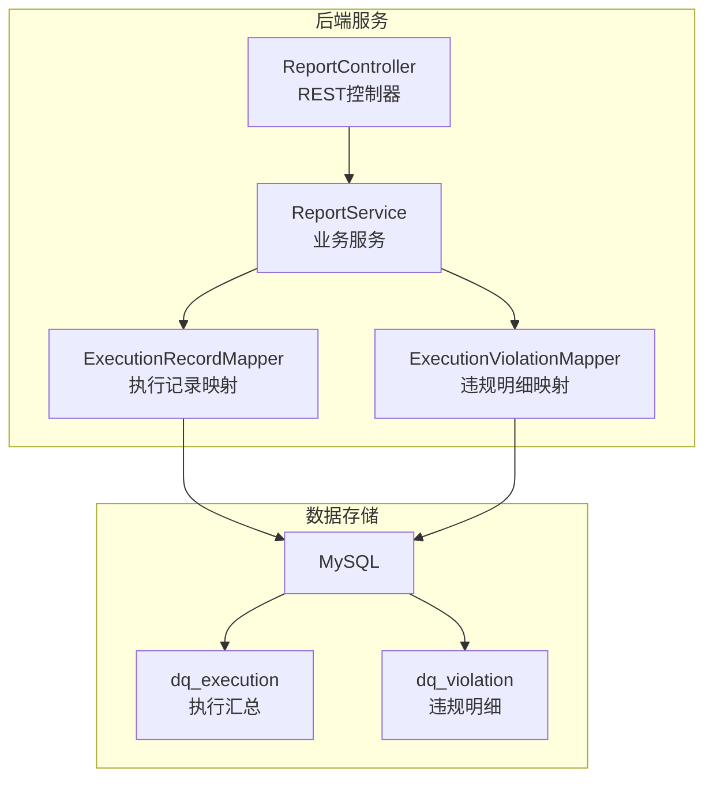
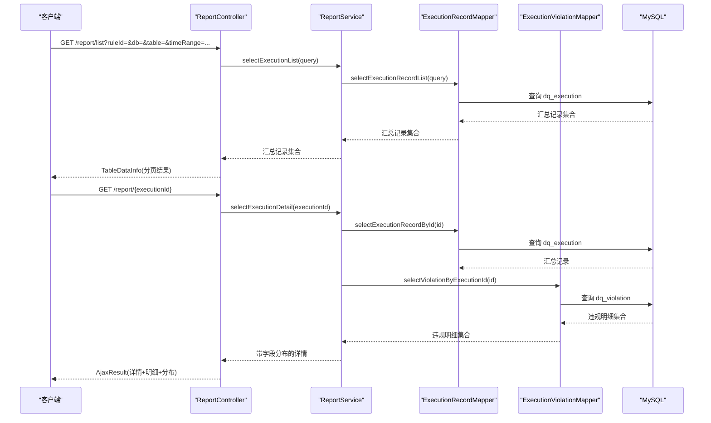
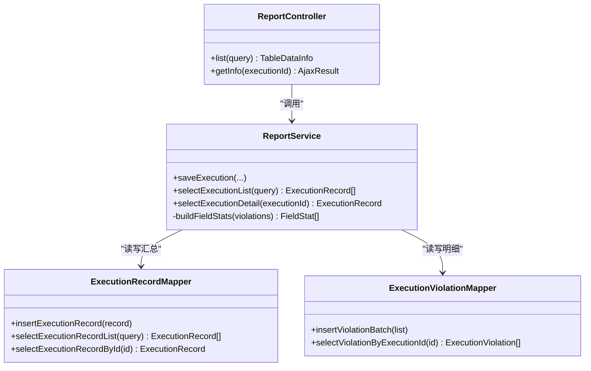

# 报告监控API

<cite>
**本文引用的文件**   
- [ReportController.java](file://ruoyi-modules/ruoyi-dqservice/src/main/java/com/ruoyi/dqservice/controller/ReportController.java)
- [ReportService.java](file://ruoyi-modules/ruoyi-dqservice/src/main/java/com/ruoyi/dqservice/service/ReportService.java)
- [ry_dq_report_20261026.sql](file://sql/ry_dq_report_20261026.sql)
- [ry_dq_report_menu_20261026.sql](file://sql/ry_dq_report_menu_20261026.sql)
</cite>

## 目录
1. [简介](#简介)
2. [项目结构](#项目结构)
3. [核心组件](#核心组件)
4. [架构总览](#架构总览)
5. [详细组件分析](#详细组件分析)
6. [依赖关系分析](#依赖关系分析)
7. [性能与优化](#性能与优化)
8. [故障排查指南](#故障排查指南)
9. [结论](#结论)
10. [附录：接口清单与示例](#附录接口清单与示例)

## 简介
本报告监控模块提供数据质量规则执行结果的持久化、查询与可视化能力，包含以下能力：
- 质量指标统计：通过率、扫描行数、违规条数、命中行数、执行耗时等汇总指标。
- 执行历史查询：按条件分页查询执行记录，以及查看某次执行的详情（含违规明细与字段分布）。
- 报告导出：基于现有Excel注解体系扩展导出功能（本节给出实现建议与调用方式）。
- 实时监控面板与趋势分析：通过列表与详情接口聚合计算，支撑前端图表展示。
- 异常告警：基于违规明细与阈值策略进行告警（本节给出接入建议）。

## 项目结构
本模块位于 ruoyi-modules/ruoyi-dqservice 下，对外暴露 RESTful API；数据库脚本位于 sql 目录。

**图示来源** 
- [ReportController.java:22-49](file://ruoyi-modules/ruoyi-dqservice/src/main/java/com/ruoyi/dqservice/controller/ReportController.java#L22-L49)
- [ReportService.java:39-109](file://ruoyi-modules/ruoyi-dqservice/src/main/java/com/ruoyi/dqservice/service/ReportService.java#L39-L109)
- [ry_dq_report_20261026.sql:11-39](file://sql/ry_dq_report_20261026.sql#L11-L39)

**章节来源**
- [ReportController.java:22-49](file://ruoyi-modules/ruoyi-dqservice/src/main/java/com/ruoyi/dqservice/controller/ReportController.java#L22-L49)
- [ry_dq_report_20261026.sql:11-39](file://sql/ry_dq_report_20261026.sql#L11-L39)

## 核心组件
- ReportController：对外暴露 /report 路径下的查询接口，负责权限校验与参数绑定。
- ReportService：封装执行记录的保存、查询、字段分布统计等逻辑。
- 数据模型：
  - dq_execution：每次规则执行的一条汇总记录。
  - dq_violation：该次执行的逐条违规明细。

**章节来源**
- [ReportController.java:22-49](file://ruoyi-modules/ruoyi-dqservice/src/main/java/com/ruoyi/dqservice/controller/ReportController.java#L22-L49)
- [ReportService.java:21-109](file://ruoyi-modules/ruoyi-dqservice/src/main/java/com/ruoyi/dqservice/service/ReportService.java#L21-L109)
- [ry_dq_report_20261026.sql:11-39](file://sql/ry_dq_report_20261026.sql#L11-L39)

## 架构总览

**图示来源** 
- [ReportController.java:32-49](file://ruoyi-modules/ruoyi-dqservice/src/main/java/com/ruoyi/dqservice/controller/ReportController.java#L32-L49)
- [ReportService.java:91-109](file://ruoyi-modules/ruoyi-dqservice/src/main/java/com/ruoyi/dqservice/service/ReportService.java#L91-L109)
- [ry_dq_report_20261026.sql:11-39](file://sql/ry_dq_report_20261026.sql#L11-L39)

## 详细组件分析

### 接口一：查询执行记录列表
- URL：GET /report/list
- 方法：GET
- 权限：需要 dqservice:report:list 权限
- 请求参数（Query）：
  - ruleId：规则ID（可选）
  - dbName：数据库名（可选）
  - tableName：表名（可选）
  - createTimeStart/createTimeEnd：时间范围（可选）
  - pageNum/pageSize：分页参数（由 BaseController.startPage 处理）
- 响应体：TableDataInfo
  - total：总数
  - rows：执行记录数组
  - ExecutionRecord 字段：
    - executionId：执行批次ID
    - ruleId：规则ID
    - ruleName：规则名称
    - dbName：数据库名
    - tableName：表名
    - totalRows：扫描行数
    - violationCount：违规条数
    - violationRows：命中行数
    - passRate：通过率(%)
    - costMs：执行耗时(毫秒)
    - createBy：执行人
    - createTime：执行时间
- 错误码：
  - 401/403：未登录或无权限
  - 500：服务端异常

**章节来源**
- [ReportController.java:32-39](file://ruoyi-modules/ruoyi-dqservice/src/main/java/com/ruoyi/dqservice/controller/ReportController.java#L32-L39)
- [ry_dq_report_20261026.sql:11-27](file://sql/ry_dq_report_20261026.sql#L11-L27)

### 接口二：查询执行记录详情（含违规明细与字段分布）
- URL：GET /report/{executionId}
- 方法：GET
- 权限：需要 dqservice:report:list 权限
- 路径参数：
  - executionId：Long，执行批次ID
- 响应体：AjaxResult
  - code：状态码
  - msg：消息
  - data：ExecutionRecord 详情对象
    - 基础字段同上
    - violations：违规明细数组
      - violationId：明细ID
      - executionId：执行批次ID
      - rowId：行号
      - recordId：记录主键值
      - fieldName：违规字段
      - ruleName：命中规则
      - fieldValue：字段值
    - fieldStats：字段分布统计
      - field：字段名
      - count：出现次数
- 错误码：
  - 404：执行记录不存在
  - 401/403：未登录或无权限
  - 500：服务端异常

**章节来源**
- [ReportController.java:44-49](file://ruoyi-modules/ruoyi-dqservice/src/main/java/com/ruoyi/dqservice/controller/ReportController.java#L44-L49)
- [ReportService.java:97-109](file://ruoyi-modules/ruoyi-dqservice/src/main/java/com/ruoyi/dqservice/service/ReportService.java#L97-L109)
- [ry_dq_report_20261026.sql:29-39](file://sql/ry_dq_report_20261026.sql#L29-L39)

### 接口三：报告导出（Excel）
当前代码库未直接提供导出接口，但系统已具备 Excel 注解与工具类，可基于现有 ExecutionRecord/ExecutionViolation 模型扩展导出。

- 推荐实现方案：
  - 在 ReportController 新增 POST /report/export 接口，接收筛选条件（同 list 接口），返回 Excel 流。
  - 使用 @Excel 注解标注 ExecutionRecord/ExecutionViolation 字段，结合通用导出工具生成 Excel。
  - 对大数据量场景采用流式写入，避免内存溢出。
- 调用示例（概念性步骤）：
  - 构造查询条件（ruleId/dbName/tableName/timeRange）
  - 调用导出接口获取二进制流
  - 前端以 Blob 下载 .xlsx 文件

说明：上述为扩展建议，具体实现需新增 Controller 方法与导出工具调用。

[本节为概念性说明，不直接分析具体文件]

### 实时监控面板与趋势分析
- 实时面板：
  - 使用 /report/list 拉取最近 N 条执行记录，计算近N次平均通过率、平均耗时、违规率等指标。
- 趋势分析：
  - 按天/周/月聚合 passRate、violationCount、costMs，绘制折线图/柱状图。
  - 字段分布 fieldStats 用于饼图/堆叠图，定位高频违规字段。

[本节为概念性说明，不直接分析具体文件]

### 异常告警
- 触发条件：
  - 单次 passRate 低于阈值（如 < 95%）
  - violationCount 超过阈值（如 > 100）
  - costMs 超过阈值（如 > 30000ms）
- 告警动作：
  - 推送通知（站内信/邮件/IM）
  - 记录告警日志，便于后续审计

[本节为概念性说明，不直接分析具体文件]

## 依赖关系分析

**图示来源** 
- [ReportController.java:22-49](file://ruoyi-modules/ruoyi-dqservice/src/main/java/com/ruoyi/dqservice/controller/ReportController.java#L22-L49)
- [ReportService.java:39-109](file://ruoyi-modules/ruoyi-dqservice/src/main/java/com/ruoyi/dqservice/service/ReportService.java#L39-L109)

**章节来源**
- [ReportController.java:22-49](file://ruoyi-modules/ruoyi-dqservice/src/main/java/com/ruoyi/dqservice/controller/ReportController.java#L22-L49)
- [ReportService.java:39-109](file://ruoyi-modules/ruoyi-dqservice/src/main/java/com/ruoyi/dqservice/service/ReportService.java#L39-L109)

## 性能与优化
- 索引优化：
  - dq_execution 已创建 idx_rule_id、idx_create_time，利于按规则与时间范围查询。
  - dq_violation 已创建 idx_execution_id，利于按批次拉取明细。
- 分页与限流：
  - 列表接口使用 startPage() 分页，避免一次性加载全量数据。
  - 建议在网关层增加限流与熔断保护。
- 批量写入：
  - 违规明细采用 insertViolationBatch 批量插入，减少IO次数。
- 字段截断：
  - 对 fieldName/ruleName/fieldValue 等字段做长度截断，防止超长导致存储异常。
- 缓存建议：
  - 对热点汇总指标（如最近1小时通过率）可引入 Redis 缓存，降低数据库压力。
- 异步化：
  - 报告导出可采用异步任务+回调通知，避免长连接阻塞。

**章节来源**
- [ry_dq_report_20261026.sql:11-39](file://sql/ry_dq_report_20261026.sql#L11-L39)
- [ReportService.java:77-85](file://ruoyi-modules/ruoyi-dqservice/src/main/java/com/ruoyi/dqservice/service/ReportService.java#L77-L85)
- [ReportService.java:156-164](file://ruoyi-modules/ruoyi-dqservice/src/main/java/com/ruoyi/dqservice/service/ReportService.java#L156-L164)

## 故障排查指南
- 401/403：检查用户是否已登录且拥有 dqservice:report:list 权限。
- 404：执行记录不存在时，检查 executionId 是否正确，确认 dq_execution 中是否存在对应记录。
- 数据不一致：
  - 若存在汇总记录但无明细，检查事务边界与批量插入逻辑。
  - 核对 dq_execution 与 dq_violation 的关联字段 executionId。
- 性能问题：
  - 检查慢查询日志，确认是否命中索引 idx_rule_id、idx_create_time、idx_execution_id。
  - 评估是否需要对大表进行分区或归档。

**章节来源**
- [ReportController.java:32-49](file://ruoyi-modules/ruoyi-dqservice/src/main/java/com/ruoyi/dqservice/controller/ReportController.java#L32-L49)
- [ReportService.java:97-109](file://ruoyi-modules/ruoyi-dqservice/src/main/java/com/ruoyi/dqservice/service/ReportService.java#L97-L109)
- [ry_dq_report_20261026.sql:11-39](file://sql/ry_dq_report_20261026.sql#L11-L39)

## 结论
报告监控模块通过简洁的 RESTful 接口提供了质量指标统计与执行历史查询能力，并预留了报告导出、实时监控与告警扩展空间。配合合理的索引与批处理策略，可在保证数据一致性的同时获得良好的查询性能。

[本节为总结性内容，不直接分析具体文件]

## 附录：接口清单与示例

### 接口清单
- GET /report/list
  - 权限：dqservice:report:list
  - 用途：分页查询执行记录
- GET /report/{executionId}
  - 权限：dqservice:report:list
  - 用途：查询执行详情（含违规明细与字段分布）
- POST /report/export（建议扩展）
  - 权限：dqservice:report:list
  - 用途：导出质量报告为 Excel

### 调用示例（概念性）
- 查询列表
  - 请求：GET /report/list?ruleId=1&dbName=test_db&tableName=user_info&createTimeStart=2026-01-01&createTimeEnd=2026-10-31&pageNum=1&pageSize=20
  - 响应：TableDataInfo(total, rows[])
- 查询详情
  - 请求：GET /report/1001
  - 响应：AjaxResult(data: ExecutionRecord{..., violations[], fieldStats[]})
- 导出Excel（建议）
  - 请求：POST /report/export（body 同 list 查询条件）
  - 响应：application/vnd.openxmlformats-officedocument.spreadsheetml.sheet 二进制流

**章节来源**
- [ReportController.java:32-49](file://ruoyi-modules/ruoyi-dqservice/src/main/java/com/ruoyi/dqservice/controller/ReportController.java#L32-L49)
- [ry_dq_report_menu_20261026.sql:10-13](file://sql/ry_dq_report_menu_20261026.sql#L10-L13)