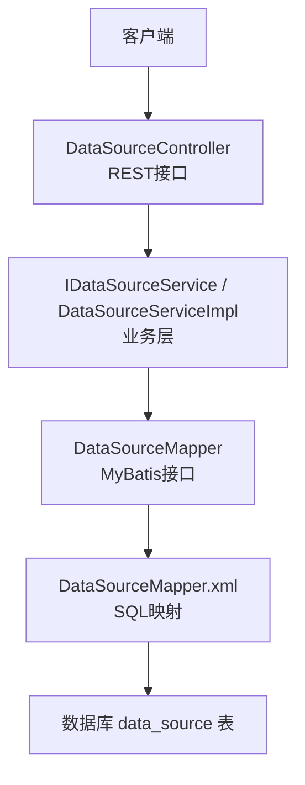
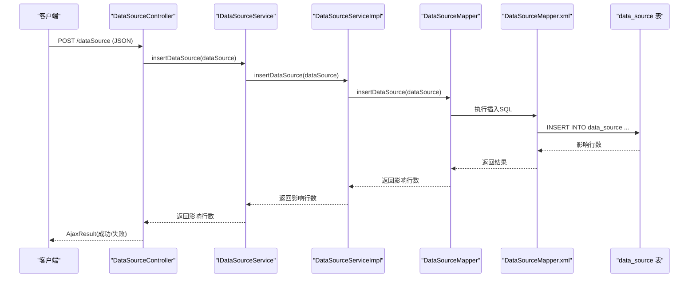
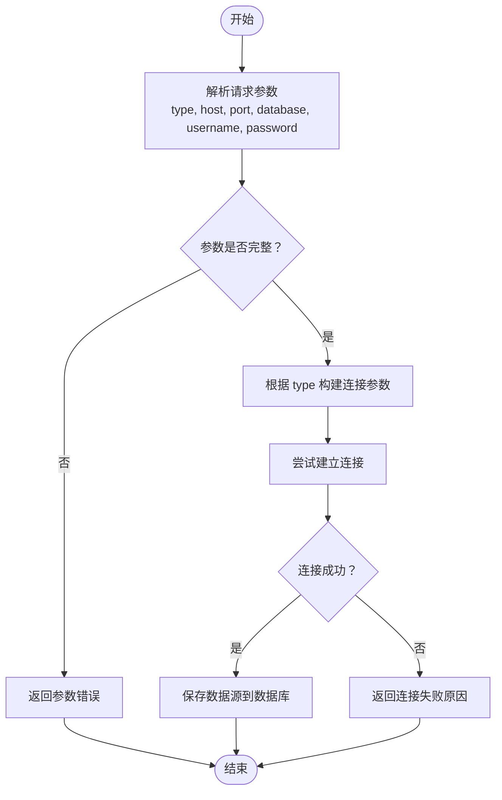
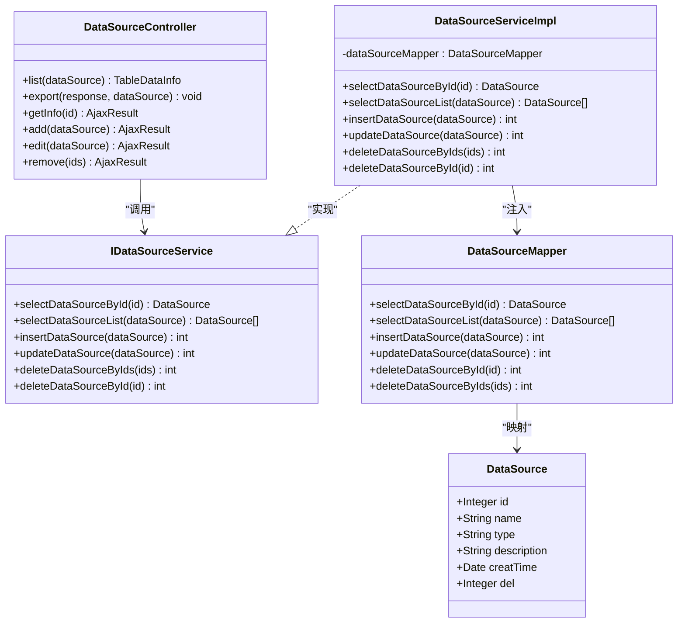

# 数据源管理API

<cite>
**本文引用的文件**   
- [DataSourceController.java](file://ruoyi-modules/ruoyi-dqservice/src/main/java/com/ruoyi/dqservice/controller/DataSourceController.java)
- [IDataSourceService.java](file://ruoyi-modules/ruoyi-dqservice/src/main/java/com/ruoyi/dqservice/service/IDataSourceService.java)
- [DataSourceServiceImpl.java](file://ruoyi-modules/ruoyi-dqservice/src/main/java/com/ruoyi/dqservice/service/impl/DataSourceServiceImpl.java)
- [DataSourceMapper.java](file://ruoyi-modules/ruoyi-dqservice/src/main/java/com/ruoyi/dqservice/mapper/DataSourceMapper.java)
- [DataSourceMapper.xml](file://ruoyi-modules/ruoyi-dqservice/src/main/resources/mapper/DataSourceMapper.xml)
- [DataSource.java](file://ruoyi-modules/ruoyi-dqservice/src/main/java/com/ruoyi/dqservice/domain/DataSource.java)
- [DBUtil.java](file://ruoyi-modules/ruoyi-dqservice/src/main/java/com/ruoyi/dqservice/connecter/DBUtil.java)
- [application.properties](file://ruoyi-modules/ruoyi-dqservice/src/main/resources/application.properties)
</cite>

## 目录
1. [简介](#简介)
2. [项目结构](#项目结构)
3. [核心组件](#核心组件)
4. [架构总览](#架构总览)
5. [接口规范与鉴权](#接口规范与鉴权)
6. [详细接口文档](#详细接口文档)
7. [依赖关系分析](#依赖关系分析)
8. [性能与扩展性](#性能与扩展性)
9. [故障排查](#故障排查)
10. [结论](#结论)

## 简介
本模块提供数据源的RESTful管理能力，包括数据源的增删改查、分页查询与导出。当前实现的数据源实体包含名称、类型、描述等基础信息；连接测试能力在代码中未以独立接口暴露，但可通过现有CRUD接口完成配置保存与校验流程。权限控制基于注解式鉴权，所有写操作均需具备相应权限标识。

## 项目结构
数据源管理相关代码集中在 dqservice 模块下，采用 Controller-Service-Mapper 分层：
- Controller 层：对外暴露 REST 接口，处理鉴权、参数绑定与统一响应封装
- Service 层：业务逻辑编排与事务边界（当前为简单委托）
- Mapper 层：MyBatis 数据访问接口与SQL映射
- Domain 层：数据模型对象，用于请求体与数据库映射

图表来源
- [DataSourceController.java:31-105](file://ruoyi-modules/ruoyi-dqservice/src/main/java/com/ruoyi/dqservice/controller/DataSourceController.java#L31-L105)
- [IDataSourceService.java:12-61](file://ruoyi-modules/ruoyi-dqservice/src/main/java/com/ruoyi/dqservice/service/IDataSourceService.java#L12-L61)
- [DataSourceServiceImpl.java:17-57](file://ruoyi-modules/ruoyi-dqservice/src/main/java/com/ruoyi/dqservice/service/impl/DataSourceServiceImpl.java#L17-L57)
- [DataSourceMapper.java:12-61](file://ruoyi-modules/ruoyi-dqservice/src/main/java/com/ruoyi/dqservice/mapper/DataSourceMapper.java#L12-L61)
- [DataSourceMapper.xml:1-82](file://ruoyi-modules/ruoyi-dqservice/src/main/resources/mapper/DataSourceMapper.xml#L1-L82)

章节来源
- [DataSourceController.java:31-105](file://ruoyi-modules/ruoyi-dqservice/src/main/java/com/ruoyi/dqservice/controller/DataSourceController.java#L31-L105)
- [DataSourceMapper.xml:1-82](file://ruoyi-modules/ruoyi-dqservice/src/main/resources/mapper/DataSourceMapper.xml#L1-L82)

## 核心组件
- DataSourceController：定义数据源管理的REST端点，统一前缀 /dataSource
- IDataSourceService/DataSourceServiceImpl：声明并实现数据源CRUD服务方法
- DataSourceMapper/DataSourceMapper.xml：数据访问抽象与SQL实现
- DataSource：数据源领域对象，包含 id、name、type、description、creatTime、del 等字段

章节来源
- [DataSourceController.java:31-105](file://ruoyi-modules/ruoyi-dqservice/src/main/java/com/ruoyi/dqservice/controller/DataSourceController.java#L31-L105)
- [IDataSourceService.java:12-61](file://ruoyi-modules/ruoyi-dqservice/src/main/java/com/ruoyi/dqservice/service/IDataSourceService.java#L12-L61)
- [DataSourceServiceImpl.java:17-57](file://ruoyi-modules/ruoyi-dqservice/src/main/java/com/ruoyi/dqservice/service/impl/DataSourceServiceImpl.java#L17-L57)
- [DataSourceMapper.java:12-61](file://ruoyi-modules/ruoyi-dqservice/src/main/java/com/ruoyi/dqservice/mapper/DataSourceMapper.java#L12-L61)
- [DataSource.java:16-111](file://ruoyi-modules/ruoyi-dqservice/src/main/java/com/ruoyi/dqservice/domain/DataSource.java#L16-L111)

## 架构总览
下图展示一次“新增数据源”的调用链路与数据流向：

图表来源
- [DataSourceController.java:73-82](file://ruoyi-modules/ruoyi-dqservice/src/main/java/com/ruoyi/dqservice/controller/DataSourceController.java#L73-L82)
- [IDataSourceService.java:30-36](file://ruoyi-modules/ruoyi-dqservice/src/main/java/com/ruoyi/dqservice/service/IDataSourceService.java#L30-L36)
- [DataSourceServiceImpl.java:47-57](file://ruoyi-modules/ruoyi-dqservice/src/main/java/com/ruoyi/dqservice/service/impl/DataSourceServiceImpl.java#L47-L57)
- [DataSourceMapper.java:30-36](file://ruoyi-modules/ruoyi-dqservice/src/main/java/com/ruoyi/dqservice/mapper/DataSourceMapper.java#L30-L36)
- [DataSourceMapper.xml:36-56](file://ruoyi-modules/ruoyi-dqservice/src/main/resources/mapper/DataSourceMapper.xml#L36-L56)

## 接口规范与鉴权
- 基础路径：/dataSource
- 认证方式：网关或安全模块统一鉴权，接口通过 @RequiresPermissions 进行细粒度权限控制
- 权限标识示例：dqservice:dataSource:list、dqservice:dataSource:add、dqservice:dataSource:edit、dqservice:dataSource:remove、dqservice:dataSource:query、dqservice:dataSource:export
- 统一响应体：AjaxResult（成功/失败封装），列表接口返回 TableDataInfo（分页）
- 日志记录：写操作通过 @Log 标注业务类型（INSERT/UPDATE/DELETE/EXPORT）

章节来源
- [DataSourceController.java:31-105](file://ruoyi-modules/ruoyi-dqservice/src/main/java/com/ruoyi/dqservice/controller/DataSourceController.java#L31-L105)

## 详细接口文档

### 通用说明
- 请求头：需携带鉴权信息（由网关/安全模块校验）
- 响应体：
  - 单条/批量操作：AjaxResult，包含 code、msg、data
  - 列表：TableDataInfo，包含 total、rows、pageNo、pageSize 等分页字段
- 错误码：遵循系统全局异常处理，常见状态码参考通用HTTP状态码（如401未授权、403无权限、404资源不存在、500服务器异常）

章节来源
- [DataSourceController.java:31-105](file://ruoyi-modules/ruoyi-dqservice/src/main/java/com/ruoyi/dqservice/controller/DataSourceController.java#L31-L105)

### 分页查询数据源
- URL：GET /dataSource/list
- 权限：dqservice:dataSource:list
- 请求参数（Query）：
  - name：模糊匹配
  - type：精确匹配
  - description：精确匹配
  - creatTime：按创建时间筛选
- 响应：TableDataInfo（分页数据）

章节来源
- [DataSourceController.java:38-48](file://ruoyi-modules/ruoyi-dqservice/src/main/java/com/ruoyi/dqservice/controller/DataSourceController.java#L38-L48)
- [DataSourceMapper.xml:21-29](file://ruoyi-modules/ruoyi-dqservice/src/main/resources/mapper/DataSourceMapper.xml#L21-L29)

### 导出数据源列表
- URL：POST /dataSource/export
- 权限：dqservice:dataSource:export
- 请求参数（Query）：同分页查询参数
- 响应：Excel 文件流（Content-Type 为 Excel 类型）

章节来源
- [DataSourceController.java:50-61](file://ruoyi-modules/ruoyi-dqservice/src/main/java/com/ruoyi/dqservice/controller/DataSourceController.java#L50-L61)

### 获取数据源详情
- URL：GET /dataSource/{id}
- 权限：dqservice:dataSource:query
- 路径参数：
  - id：数据源主键（Integer）
- 响应：AjaxResult.data 为 DataSource 对象

章节来源
- [DataSourceController.java:63-71](file://ruoyi-modules/ruoyi-dqservice/src/main/java/com/ruoyi/dqservice/controller/DataSourceController.java#L63-L71)
- [DataSourceMapper.xml:31-34](file://ruoyi-modules/ruoyi-dqservice/src/main/resources/mapper/DataSourceMapper.xml#L31-L34)

### 新增数据源
- URL：POST /dataSource
- 权限：dqservice:dataSource:add
- 请求体（JSON）：DataSource 对象
  - name：字符串，必填
  - type：字符串，必填（例如 mysql、hive 等）
  - description：字符串，可选
  - creatTime：日期，可选
  - del：删除位，可选
- 响应：AjaxResult（data 为影响行数）

章节来源
- [DataSourceController.java:73-82](file://ruoyi-modules/ruoyi-dqservice/src/main/java/com/ruoyi/dqservice/controller/DataSourceController.java#L73-L82)
- [IDataSourceService.java:30-36](file://ruoyi-modules/ruoyi-dqservice/src/main/java/com/ruoyi/dqservice/service/IDataSourceService.java#L30-L36)
- [DataSourceServiceImpl.java:47-57](file://ruoyi-modules/ruoyi-dqservice/src/main/java/com/ruoyi/dqservice/service/impl/DataSourceServiceImpl.java#L47-L57)
- [DataSourceMapper.java:30-36](file://ruoyi-modules/ruoyi-dqservice/src/main/java/com/ruoyi/dqservice/mapper/DataSourceMapper.java#L30-L36)
- [DataSourceMapper.xml:36-56](file://ruoyi-modules/ruoyi-dqservice/src/main/resources/mapper/DataSourceMapper.xml#L36-L56)
- [DataSource.java:16-111](file://ruoyi-modules/ruoyi-dqservice/src/main/java/com/ruoyi/dqservice/domain/DataSource.java#L16-L111)

### 修改数据源
- URL：PUT /dataSource
- 权限：dqservice:dataSource:edit
- 请求体（JSON）：DataSource 对象（需包含 id）
- 响应：AjaxResult（data 为影响行数）

章节来源
- [DataSourceController.java:84-93](file://ruoyi-modules/ruoyi-dqservice/src/main/java/com/ruoyi/dqservice/controller/DataSourceController.java#L84-L93)
- [IDataSourceService.java:38-44](file://ruoyi-modules/ruoyi-dqservice/src/main/java/com/ruoyi/dqservice/service/IDataSourceService.java#L38-L44)
- [DataSourceServiceImpl.java:53-57](file://ruoyi-modules/ruoyi-dqservice/src/main/java/com/ruoyi/dqservice/service/impl/DataSourceServiceImpl.java#L53-L57)
- [DataSourceMapper.java:38-44](file://ruoyi-modules/ruoyi-dqservice/src/main/java/com/ruoyi/dqservice/mapper/DataSourceMapper.java#L38-L44)
- [DataSourceMapper.xml:58-69](file://ruoyi-modules/ruoyi-dqservice/src/main/resources/mapper/DataSourceMapper.xml#L58-L69)

### 删除数据源（批量）
- URL：DELETE /dataSource/{ids}
- 权限：dqservice:dataSource:remove
- 路径参数：
  - ids：整数数组（逗号分隔或数组形式）
- 响应：AjaxResult（data 为影响行数）

章节来源
- [DataSourceController.java:95-104](file://ruoyi-modules/ruoyi-dqservice/src/main/java/com/ruoyi/dqservice/controller/DataSourceController.java#L95-L104)
- [IDataSourceService.java:46-52](file://ruoyi-modules/ruoyi-dqservice/src/main/java/com/ruoyi/dqservice/service/IDataSourceService.java#L46-L52)
- [DataSourceServiceImpl.java:53-57](file://ruoyi-modules/ruoyi-dqservice/src/main/java/com/ruoyi/dqservice/service/impl/DataSourceServiceImpl.java#L53-L57)
- [DataSourceMapper.java:54-61](file://ruoyi-modules/ruoyi-dqservice/src/main/java/com/ruoyi/dqservice/mapper/DataSourceMapper.java#L54-L61)
- [DataSourceMapper.xml:75-80](file://ruoyi-modules/ruoyi-dqservice/src/main/resources/mapper/DataSourceMapper.xml#L75-L80)

## 数据源配置与连接测试

### 数据源类型与配置参数
当前 DataSource 实体仅包含 name、type、description、creatTime、del 等元信息字段，不包含具体的连接参数（如 host、port、database、username、password）。因此：
- type 可用于区分不同数据源类型（如 mysql、hive）
- 具体连接参数未在数据源表中持久化，也未在接口中暴露

章节来源
- [DataSource.java:16-111](file://ruoyi-modules/ruoyi-dqservice/src/main/java/com/ruoyi/dqservice/domain/DataSource.java#L16-L111)

### 连接测试接口
当前代码未提供独立的“连接测试”REST接口。若需要验证数据源连接有效性，建议：
- 方案A：在新增/修改数据源时，在服务层增加连接校验逻辑（根据 type 动态构建连接参数并尝试建立连接），成功后再落库
- 方案B：新增一个 /dataSource/testConnection 接口，接收连接参数并在服务层执行连接测试后返回结果

注意：项目中存在 DBUtil 类演示了 MySQL/Hive 的连接方式，但未与数据源管理接口集成：
- DBUtil 使用 JDBC 直连，示例包含 MySQL 驱动与 Hive JDBC URL
- application.properties 中包含 hive.jdbc.url 配置项

章节来源
- [DBUtil.java:7-33](file://ruoyi-modules/ruoyi-dqservice/src/main/java/com/ruoyi/dqservice/connecter/DBUtil.java#L7-L33)
- [application.properties:8-8](file://ruoyi-modules/ruoyi-dqservice/src/main/resources/application.properties#L8-L8)

### 连接测试使用示例（概念流程）
以下为概念性流程，便于理解如何扩展连接测试能力：

[此图为概念流程图，不直接对应具体源码]

## 依赖关系分析

图表来源
- [DataSourceController.java:31-105](file://ruoyi-modules/ruoyi-dqservice/src/main/java/com/ruoyi/dqservice/controller/DataSourceController.java#L31-L105)
- [IDataSourceService.java:12-61](file://ruoyi-modules/ruoyi-dqservice/src/main/java/com/ruoyi/dqservice/service/IDataSourceService.java#L12-L61)
- [DataSourceServiceImpl.java:17-57](file://ruoyi-modules/ruoyi-dqservice/src/main/java/com/ruoyi/dqservice/service/impl/DataSourceServiceImpl.java#L17-L57)
- [DataSourceMapper.java:12-61](file://ruoyi-modules/ruoyi-dqservice/src/main/java/com/ruoyi/dqservice/mapper/DataSourceMapper.java#L12-L61)
- [DataSource.java:16-111](file://ruoyi-modules/ruoyi-dqservice/src/main/java/com/ruoyi/dqservice/domain/DataSource.java#L16-L111)

章节来源
- [DataSourceController.java:31-105](file://ruoyi-modules/ruoyi-dqservice/src/main/java/com/ruoyi/dqservice/controller/DataSourceController.java#L31-L105)
- [IDataSourceService.java:12-61](file://ruoyi-modules/ruoyi-dqservice/src/main/java/com/ruoyi/dqservice/service/IDataSourceService.java#L12-L61)
- [DataSourceServiceImpl.java:17-57](file://ruoyi-modules/ruoyi-dqservice/src/main/java/com/ruoyi/dqservice/service/impl/DataSourceServiceImpl.java#L17-L57)
- [DataSourceMapper.java:12-61](file://ruoyi-modules/ruoyi-dqservice/src/main/java/com/ruoyi/dqservice/mapper/DataSourceMapper.java#L12-L61)
- [DataSource.java:16-111](file://ruoyi-modules/ruoyi-dqservice/src/main/java/com/ruoyi/dqservice/domain/DataSource.java#L16-L111)

## 性能与扩展性
- 分页查询：Controller 层使用 startPage() 启动分页，Service 层返回 List，整体复杂度取决于底层SQL与数据量
- 导出功能：基于 ExcelUtil 导出，适合中小规模数据；大数据量建议异步任务+流式导出
- 可扩展点：
  - 在 Service 层增加连接校验逻辑，避免无效配置入库
  - 扩展 DataSource 实体以支持更多连接参数（host、port、database、username、password、driverClass 等）
  - 针对不同类型数据源（MySQL、Hive、PostgreSQL等）实现差异化连接策略

[本节为通用指导，不涉及具体源码片段]

## 故障排查
- 权限问题：若返回未授权或无权限，检查用户角色与权限标识 dqservice:dataSource:* 是否配置正确
- 参数校验：新增/修改时确保必要字段（如 name、type）已填写
- 连接测试：如需连接测试，建议在 Service 层实现连接校验逻辑，捕获异常并返回明确错误信息
- 日志定位：写操作带有 @Log 注解，可在日志中查看业务类型与操作人信息

章节来源
- [DataSourceController.java:38-104](file://ruoyi-modules/ruoyi-dqservice/src/main/java/com/ruoyi/dqservice/controller/DataSourceController.java#L38-L104)

## 结论
当前数据源管理模块提供了完整的CRUD与分页导出能力，并通过注解式权限控制保障安全性。由于 DataSource 实体未包含连接参数，尚未提供独立的连接测试接口。建议后续扩展：
- 扩展数据源实体以支持多类型连接参数
- 在服务层实现连接校验逻辑，或在控制器层新增连接测试接口
- 针对不同数据源类型（MySQL、Hive等）实现可插拔的连接策略

[本节为总结性内容，不涉及具体源码片段]