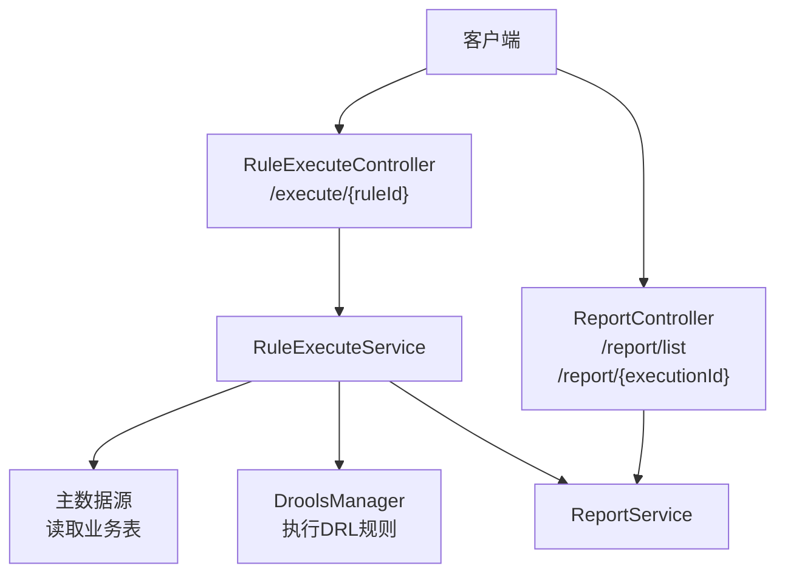
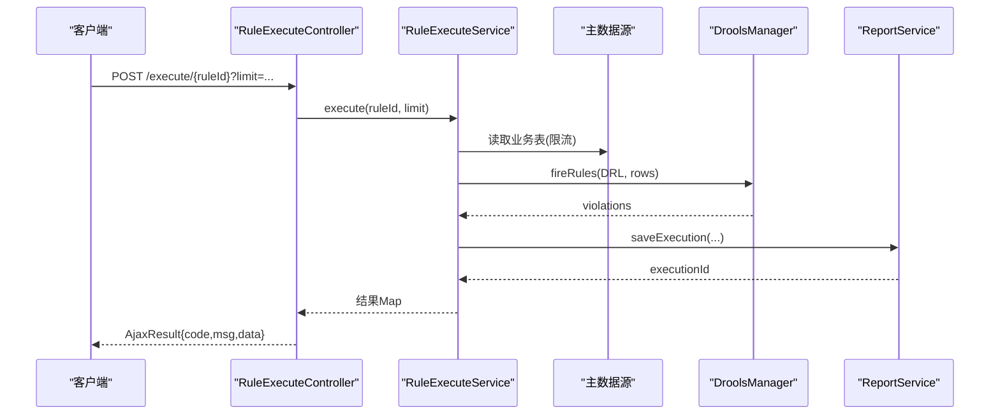
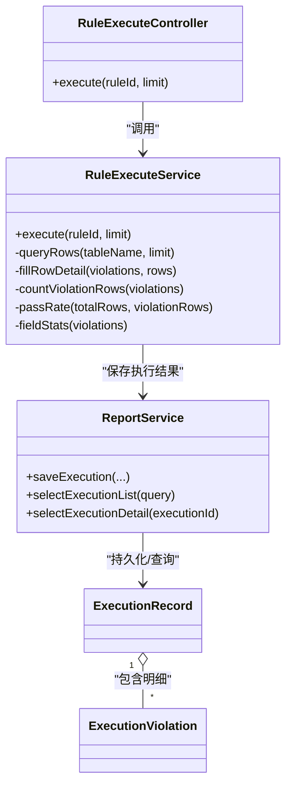
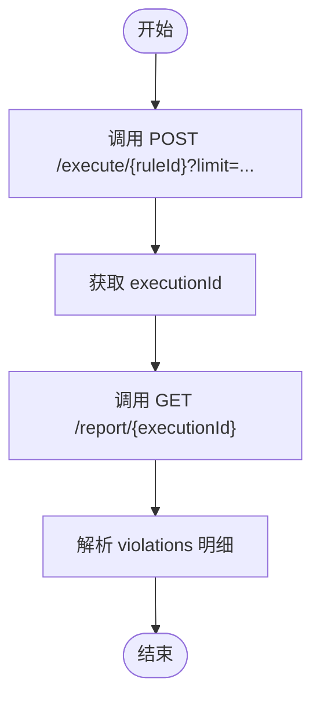

# 规则执行API

<cite>
**本文引用的文件**   
- [RuleExecuteController.java](file://ruoyi-modules/ruoyi-dqservice/src/main/java/com/ruoyi/dqservice/controller/RuleExecuteController.java)
- [RuleExecuteService.java](file://ruoyi-modules/ruoyi-dqservice/src/main/java/com/ruoyi/dqservice/service/RuleExecuteService.java)
- [ReportController.java](file://ruoyi-modules/ruoyi-dqservice/src/main/java/com/ruoyi/dqservice/controller/ReportController.java)
- [ReportService.java](file://ruoyi-modules/ruoyi-dqservice/src/main/java/com/ruoyi/dqservice/service/ReportService.java)
- [ExecutionRecord.java](file://ruoyi-modules/ruoyi-dqservice/src/main/java/com/ruoyi/dqservice/domain/ExecutionRecord.java)
- [ExecutionViolation.java](file://ruoyi-modules/ruoyi-dqservice/src/main/java/com/ruoyi/dqservice/domain/ExecutionViolation.java)
</cite>

## 目录
1. [简介](#简介)
2. [项目结构](#项目结构)
3. [核心组件](#核心组件)
4. [架构总览](#架构总览)
5. [详细接口说明](#详细接口说明)
6. [依赖关系分析](#依赖关系分析)
7. [性能与限制](#性能与限制)
8. [故障排查](#故障排查)
9. [结论](#结论)
10. [附录：调用示例](#附录调用示例)

## 简介
本章节面向“规则执行模块”的 RESTful API，覆盖以下能力：
- 规则执行触发（同步）
- 执行结果查询（列表、详情）
- 违规记录查询（通过执行批次关联）
- 异步执行接入建议（基于现有同步接口的扩展方式）

该模块由控制器层、服务层、领域模型组成，对外暴露统一的 JSON 响应格式。

## 项目结构
与本 API 直接相关的代码位于数据质量服务模块 ruoyi-dqservice 中，关键路径如下：
- 控制器：RuleExecuteController、ReportController
- 服务：RuleExecuteService、ReportService
- 领域模型：ExecutionRecord、ExecutionViolation

图示来源
- [RuleExecuteController.java:21-39](file://ruoyi-modules/ruoyi-dqservice/src/main/java/com/ruoyi/dqservice/controller/RuleExecuteController.java#L21-L39)
- [ReportController.java:30-50](file://ruoyi-modules/ruoyi-dqservice/src/main/java/com/ruoyi/dqservice/controller/ReportController.java#L30-L50)
- [RuleExecuteService.java:69-114](file://ruoyi-modules/ruoyi-dqservice/src/main/java/com/ruoyi/dqservice/service/RuleExecuteService.java#L69-L114)
- [ReportService.java:70-108](file://ruoyi-modules/ruoyi-dqservice/src/main/java/com/ruoyi/dqservice/service/ReportService.java#L70-L108)

章节来源
- [RuleExecuteController.java:21-39](file://ruoyi-modules/ruoyi-dqservice/src/main/java/com/ruoyi/dqservice/controller/RuleExecuteController.java#L21-L39)
- [ReportController.java:30-50](file://ruoyi-modules/ruoyi-dqservice/src/main/java/com/ruoyi/dqservice/controller/ReportController.java#L30-L50)

## 核心组件
- RuleExecuteController：提供规则执行的入口，接收 ruleId 与可选 limit，返回统一 AjaxResult。
- RuleExecuteService：实现规则执行的核心逻辑，包括参数校验、数据读取、DRL 执行、统计汇总与持久化。
- ReportController：提供执行记录的列表与详情查询。
- ReportService：封装执行记录的保存、查询与明细组装。
- ExecutionRecord / ExecutionViolation：执行汇总与违规明细的数据模型。

章节来源
- [RuleExecuteController.java:21-39](file://ruoyi-modules/ruoyi-dqservice/src/main/java/com/ruoyi/dqservice/controller/RuleExecuteController.java#L21-L39)
- [RuleExecuteService.java:69-114](file://ruoyi-modules/ruoyi-dqservice/src/main/java/com/ruoyi/dqservice/service/RuleExecuteService.java#L69-L114)
- [ReportController.java:30-50](file://ruoyi-modules/ruoyi-dqservice/src/main/java/com/ruoyi/dqservice/controller/ReportController.java#L30-L50)
- [ReportService.java:70-108](file://ruoyi-modules/ruoyi-dqservice/src/main/java/com/ruoyi/dqservice/service/ReportService.java#L70-L108)
- [ExecutionRecord.java:16-73](file://ruoyi-modules/ruoyi-dqservice/src/main/java/com/ruoyi/dqservice/domain/ExecutionRecord.java#L16-L73)
- [ExecutionViolation.java:12-37](file://ruoyi-modules/ruoyi-dqservice/src/main/java/com/ruoyi/dqservice/domain/ExecutionViolation.java#L12-L37)

## 架构总览
下图展示了从请求到结果落库的关键流程，以及各组件之间的职责边界。

图示来源
- [RuleExecuteController.java:32-39](file://ruoyi-modules/ruoyi-dqservice/src/main/java/com/ruoyi/dqservice/controller/RuleExecuteController.java#L32-L39)
- [RuleExecuteService.java:69-114](file://ruoyi-modules/ruoyi-dqservice/src/main/java/com/ruoyi/dqservice/service/RuleExecuteService.java#L69-L114)
- [ReportService.java:70-88](file://ruoyi-modules/ruoyi-dqservice/src/main/java/com/ruoyi/dqservice/service/ReportService.java#L70-L88)

## 详细接口说明

### 1. 执行指定规则（同步）
- URL：/execute/{ruleId}
- 方法：POST
- 权限：dqservice:rule:list
- 路径参数：
  - ruleId：Long，必填
- 查询参数：
  - limit：Integer，可选；本次最多扫描的数据行数
- 成功响应体（data 字段为 Map）：
  - executionId：Long，执行批次ID
  - ruleId：Long，规则ID
  - ruleName：String，规则名称
  - tableName：String，目标表名
  - totalRows：Integer，扫描行数
  - violationCount：Integer，违规条数
  - violationRows：Integer，命中违规的行数
  - passRate：Double，通过率（%），保留一位小数
  - costMs：Long，执行耗时（毫秒）
  - fieldStats：List<Map<String,Object>>，按字段聚合的违规条数，含 field、count
  - violations：List<Map<String,Object>>，违规明细，包含 rowId、fieldName、fieldValue、row（原始行数据）等
- 错误码：
  - 业务异常：当规则不存在、规则未绑定合法表、规则内容为空、读取数据表失败时抛出 ServiceException，网关或全局异常处理器会转换为标准错误响应
  - 鉴权失败：缺少必要权限时返回鉴权相关错误

章节来源
- [RuleExecuteController.java:32-39](file://ruoyi-modules/ruoyi-dqservice/src/main/java/com/ruoyi/dqservice/controller/RuleExecuteController.java#L32-L39)
- [RuleExecuteService.java:69-114](file://ruoyi-modules/ruoyi-dqservice/src/main/java/com/ruoyi/dqservice/service/RuleExecuteService.java#L69-L114)

### 2. 查询执行记录列表
- URL：/report/list
- 方法：GET
- 用途：分页查询执行记录，支持按规则、时间等条件筛选（具体筛选字段以 Query 对象为准）
- 成功响应体：分页数据结构，包含 records 列表与分页信息
- 错误码：无特殊业务错误

章节来源
- [ReportController.java:30-40](file://ruoyi-modules/ruoyi-dqservice/src/main/java/com/ruoyi/dqservice/controller/ReportController.java#L30-L40)
- [ReportService.java:92-96](file://ruoyi-modules/ruoyi-dqservice/src/main/java/com/ruoyi/dqservice/service/ReportService.java#L92-L96)

### 3. 查询执行记录详情
- URL：/report/{executionId}
- 方法：GET
- 路径参数：
  - executionId：Long，必填
- 成功响应体：ExecutionRecord 对象，包含汇总信息与 violations 明细列表
- 错误码：
  - 若执行记录不存在，抛出 ServiceException

章节来源
- [ReportController.java:45-50](file://ruoyi-modules/ruoyi-dqservice/src/main/java/com/ruoyi/dqservice/controller/ReportController.java#L45-L50)
- [ReportService.java:98-108](file://ruoyi-modules/ruoyi-dqservice/src/main/java/com/ruoyi/dqservice/service/ReportService.java#L98-L108)
- [ExecutionRecord.java:16-73](file://ruoyi-modules/ruoyi-dqservice/src/main/java/com/ruoyi/dqservice/domain/ExecutionRecord.java#L16-L73)

### 4. 违规记录查询
- 说明：违规明细在查询执行记录详情时随 ExecutionRecord.violations 一并返回；如需单独分页查询，可在现有基础上扩展专用接口。
- 当前获取方式：
  - 先调用“查询执行记录详情”，再从返回对象的 violations 字段获取违规明细列表
- 违规明细字段（ExecutionViolation）：
  - violationId：Long
  - executionId：Long
  - rowId：Integer，扫描行号
  - recordId：String，记录主键值
  - fieldName：String，违规字段
  - ruleName：String，命中规则
  - fieldValue：String，字段值

章节来源
- [ExecutionViolation.java:12-37](file://ruoyi-modules/ruoyi-dqservice/src/main/java/com/ruoyi/dqservice/domain/ExecutionViolation.java#L12-L37)
- [ReportService.java:98-108](file://ruoyi-modules/ruoyi-dqservice/src/main/java/com/ruoyi/dqservice/service/ReportService.java#L98-L108)

### 5. 异步执行（建议方案）
当前实现为同步执行。若需异步执行，可基于现有接口进行如下扩展：
- 新增异步入口：POST /executeAsync/{ruleId}?limit=...
- 控制器立即返回任务ID（如 taskId），后台线程或消息队列消费后调用 RuleExecuteService.execute
- 提供状态查询：GET /executeTask/{taskId}，返回执行状态与最终 executionId
- 结果获取：复用 /report/{executionId} 获取最终结果

注意：以下为扩展建议，非当前仓库已实现接口。

## 依赖关系分析

图示来源
- [RuleExecuteController.java:21-39](file://ruoyi-modules/ruoyi-dqservice/src/main/java/com/ruoyi/dqservice/controller/RuleExecuteController.java#L21-L39)
- [RuleExecuteService.java:69-219](file://ruoyi-modules/ruoyi-dqservice/src/main/java/com/ruoyi/dqservice/service/RuleExecuteService.java#L69-L219)
- [ReportService.java:70-108](file://ruoyi-modules/ruoyi-dqservice/src/main/java/com/ruoyi/dqservice/service/ReportService.java#L70-L108)
- [ExecutionRecord.java:16-73](file://ruoyi-modules/ruoyi-dqservice/src/main/java/com/ruoyi/dqservice/domain/ExecutionRecord.java#L16-L73)
- [ExecutionViolation.java:12-37](file://ruoyi-modules/ruoyi-dqservice/src/main/java/com/ruoyi/dqservice/domain/ExecutionViolation.java#L12-L37)

章节来源
- [RuleExecuteController.java:21-39](file://ruoyi-modules/ruoyi-dqservice/src/main/java/com/ruoyi/dqservice/controller/RuleExecuteController.java#L21-L39)
- [RuleExecuteService.java:69-219](file://ruoyi-modules/ruoyi-dqservice/src/main/java/com/ruoyi/dqservice/service/RuleExecuteService.java#L69-L219)
- [ReportService.java:70-108](file://ruoyi-modules/ruoyi-dqservice/src/main/java/com/ruoyi/dqservice/service/ReportService.java#L70-L108)

## 性能与限制
- 默认扫描行数：DEFAULT_LIMIT = 1000
- 最大扫描行数：MAX_LIMIT = 10000
- 表名校验：仅允许字母、数字、下划线，防止 SQL 注入
- 通过率计算：无违规记录占比，保留一位小数；空表视为 100%
- 字段违规统计：按字段聚合降序排列，便于可视化

章节来源
- [RuleExecuteService.java:40-47](file://ruoyi-modules/ruoyi-dqservice/src/main/java/com/ruoyi/dqservice/service/RuleExecuteService.java#L40-L47)
- [RuleExecuteService.java:190-219](file://ruoyi-modules/ruoyi-dqservice/src/main/java/com/ruoyi/dqservice/service/RuleExecuteService.java#L190-L219)

## 故障排查
- 规则不存在：检查 ruleId 是否正确
- 规则未绑定合法数据表：确认规则的表名字段符合白名单规则
- 规则内容为空：确认 DRL 内容不为空
- 读取数据表失败：检查数据库连接、表是否存在、权限是否足够
- 执行记录不存在：确认 executionId 有效

章节来源
- [RuleExecuteService.java:71-85](file://ruoyi-modules/ruoyi-dqservice/src/main/java/com/ruoyi/dqservice/service/RuleExecuteService.java#L71-L85)
- [RuleExecuteService.java:143-147](file://ruoyi-modules/ruoyi-dqservice/src/main/java/com/ruoyi/dqservice/service/RuleExecuteService.java#L143-L147)
- [ReportService.java:100-108](file://ruoyi-modules/ruoyi-dqservice/src/main/java/com/ruoyi/dqservice/service/ReportService.java#L100-L108)

## 结论
- 当前提供同步规则执行接口与执行结果查询接口，满足常规数据质量评估场景
- 违规明细在执行详情中返回，便于前端展示与分析
- 可通过扩展异步接口与任务状态查询接口，支撑大规模数据的异步处理

## 附录：调用示例

### 同步执行并获取结果
- 步骤一：调用执行接口
  - POST /execute/{ruleId}?limit=1000
  - 返回 data.executionId
- 步骤二：根据 executionId 查询详情
  - GET /report/{executionId}
  - 从 data.violations 获取违规明细

[本图为概念流程图，不映射具体源码文件]