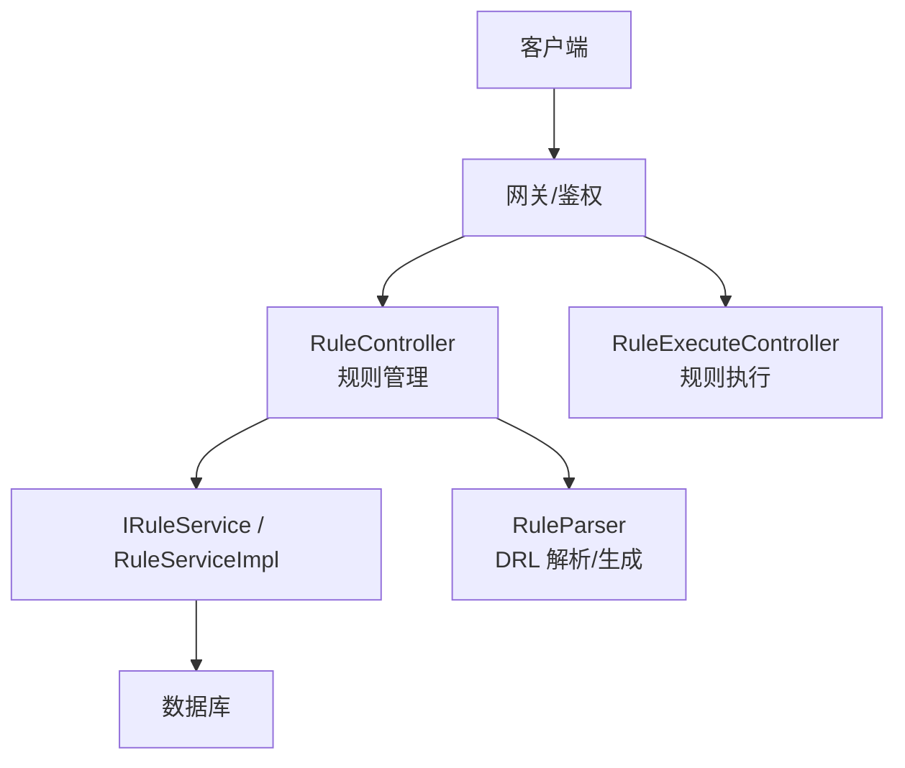
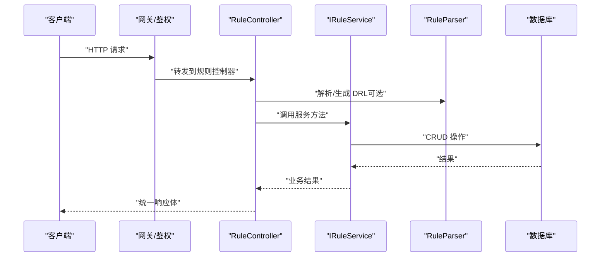
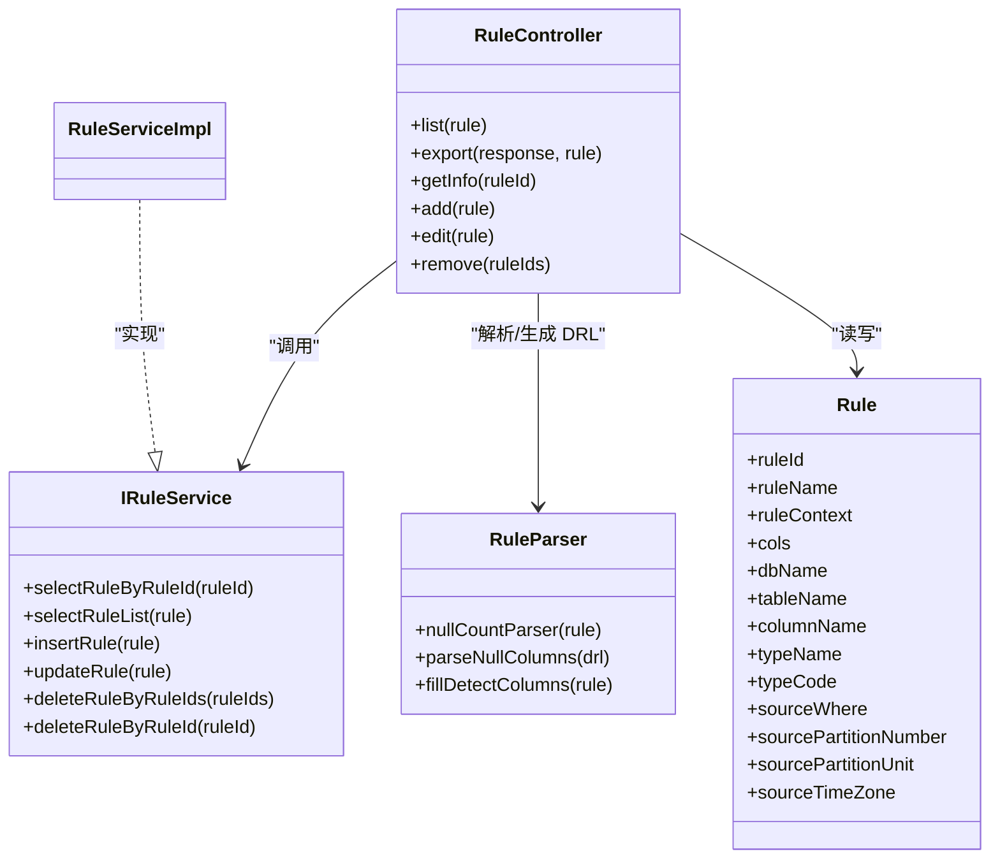

# 规则管理API

<cite>
**本文引用的文件**   
- [RuleController.java](file://ruoyi-modules/ruoyi-dqservice/src/main/java/com/ruoyi/dqservice/controller/RuleController.java)
- [RuleExecuteController.java](file://ruoyi-modules/ruoyi-dqservice/src/main/java/com/ruoyi/dqservice/controller/RuleExecuteController.java)
- [IRuleService.java](file://ruoyi-modules/ruoyi-dqservice/src/main/java/com/ruoyi/dqservice/service/IRuleService.java)
- [RuleServiceImpl.java](file://ruoyi-modules/ruoyi-dqservice/src/main/java/com/ruoyi/dqservice/service/impl/RuleServiceImpl.java)
- [Rule.java](file://ruoyi-modules/ruoyi-dqservice/src/main/java/com/ruoyi/dqservice/domain/Rule.java)
- [RuleParser.java](file://ruoyi-modules/ruoyi-dqservice/src/main/java/com/ruoyi/dqservice/util/RuleParser.java)
- [ry_dqservice_menu_20261026.sql](file://sql/ry_dqservice_menu_20261026.sql)
</cite>

## 目录
1. [简介](#简介)
2. [项目结构](#项目结构)
3. [核心组件](#核心组件)
4. [架构总览](#架构总览)
5. [接口规范](#接口规范)
6. [详细接口说明](#详细接口说明)
7. [依赖关系分析](#依赖关系分析)
8. [性能与分页排序](#性能与分页排序)
9. [错误码与排错指南](#错误码与排错指南)
10. [结论](#结论)

## 简介
本文件为“规则管理模块”的 RESTful API 文档，覆盖规则的增删改查、DRL 规则语法校验、字段映射配置、模板生成等能力，并给出分页查询、排序过滤等通用查询参数的使用方法。该模块基于 Spring MVC 控制器暴露接口，服务层封装业务逻辑，工具类负责 DRL 生成与解析。

## 项目结构
规则管理相关代码集中在数据质量服务模块中，关键路径如下：
- 控制器：规则管理与执行
- 服务接口与实现：规则 CRUD
- 领域模型：规则实体
- 工具类：DRL 生成与解析、空值检测字段回填

图表来源
- [RuleController.java:34-36](file://ruoyi-modules/ruoyi-dqservice/src/main/java/com/ruoyi/dqservice/controller/RuleController.java#L34-L36)
- [RuleExecuteController.java:21-23](file://ruoyi-modules/ruoyi-dqservice/src/main/java/com/ruoyi/dqservice/controller/RuleExecuteController.java#L21-L23)
- [IRuleService.java:12-61](file://ruoyi-modules/ruoyi-dqservice/src/main/java/com/ruoyi/dqservice/service/IRuleService.java#L12-L61)
- [RuleServiceImpl.java:60-96](file://ruoyi-modules/ruoyi-dqservice/src/main/java/com/ruoyi/dqservice/service/impl/RuleServiceImpl.java#L60-L96)
- [RuleParser.java:16-159](file://ruoyi-modules/ruoyi-dqservice/src/main/java/com/ruoyi/dqservice/util/RuleParser.java#L16-L159)

章节来源
- [RuleController.java:1-154](file://ruoyi-modules/ruoyi-dqservice/src/main/java/com/ruoyi/dqservice/controller/RuleController.java#L1-L154)
- [RuleExecuteController.java:1-40](file://ruoyi-modules/ruoyi-dqservice/src/main/java/com/ruoyi/dqservice/controller/RuleExecuteController.java#L1-L40)

## 核心组件
- 规则控制器：提供规则列表、详情、新增、修改、删除、导出以及规则执行入口。
- 规则服务接口与实现：封装规则查询、新增、更新、批量删除等持久化操作。
- 规则领域模型：承载规则名称、规则文本（DRL）、数据库/表/字段信息、分区参数等。
- 规则解析器：根据前端选择的检测字段生成 DRL，或从已有 DRL 中解析出实际生效的检测字段，用于编辑回显与一致性校验。

章节来源
- [RuleController.java:34-152](file://ruoyi-modules/ruoyi-dqservice/src/main/java/com/ruoyi/dqservice/controller/RuleController.java#L34-L152)
- [IRuleService.java:12-61](file://ruoyi-modules/ruoyi-dqservice/src/main/java/com/ruoyi/dqservice/service/IRuleService.java#L12-L61)
- [RuleServiceImpl.java:60-96](file://ruoyi-modules/ruoyi-dqservice/src/main/java/com/ruoyi/dqservice/service/impl/RuleServiceImpl.java#L60-L96)
- [Rule.java:20-86](file://ruoyi-modules/ruoyi-dqservice/src/main/java/com/ruoyi/dqservice/domain/Rule.java#L20-L86)
- [RuleParser.java:16-159](file://ruoyi-modules/ruoyi-dqservice/src/main/java/com/ruoyi/dqservice/util/RuleParser.java#L16-L159)

## 架构总览
规则管理 API 的请求处理流程如下：
- 客户端通过网关进入后端服务。
- 规则管理控制器接收请求，进行权限校验与日志记录。
- 控制器调用服务层完成业务逻辑，必要时使用解析器生成或解析 DRL。
- 服务层访问数据库完成持久化。
- 返回统一响应体。

图表来源
- [RuleController.java:44-152](file://ruoyi-modules/ruoyi-dqservice/src/main/java/com/ruoyi/dqservice/controller/RuleController.java#L44-L152)
- [IRuleService.java:12-61](file://ruoyi-modules/ruoyi-dqservice/src/main/java/com/ruoyi/dqservice/service/IRuleService.java#L12-L61)
- [RuleParser.java:41-159](file://ruoyi-modules/ruoyi-dqservice/src/main/java/com/ruoyi/dqservice/util/RuleParser.java#L41-L159)

## 接口规范
- 基础路径
  - 规则管理：`/rule`
  - 规则执行：`/execute`
- 认证与权限
  - 所有接口均受网关鉴权控制。
  - 控制器使用权限注解，如 `dqservice:rule:list`、`dqservice:rule:add`、`dqservice:rule:edit`、`dqservice:rule:remove`、`dqservice:rule:query`、`dqservice:rule:export`。
- 统一响应体
  - 成功：包含状态码、消息、数据对象。
  - 失败：包含状态码、错误消息。
- 分页与排序
  - 列表接口支持标准分页参数：页码、每页条数、排序字段、排序方向。
  - 具体参数名由框架基类提供，通常包括页码、每页大小、排序字段与方向。

章节来源
- [RuleController.java:34-51](file://ruoyi-modules/ruoyi-dqservice/src/main/java/com/ruoyi/dqservice/controller/RuleController.java#L34-L51)
- [ry_dqservice_menu_20261026.sql:21-36](file://sql/ry_dqservice_menu_20261026.sql#L21-L36)

## 详细接口说明

### 1. 查询规则列表
- URL：`GET /rule/list`
- 权限：`dqservice:rule:list`
- 请求参数（Query）
  - 分页参数：页码、每页条数、排序字段、排序方向（由框架基类提供）。
  - 过滤参数：可携带规则实体中的任意字段作为过滤条件，例如规则名称、数据库名、表名、类型代码等。
- 响应体
  - 表格分页数据结构，包含数据列表与分页信息。
- 示例
  - 获取第 1 页、每页 10 条，按创建时间倒序：
    - `GET /rule/list?pageNum=1&pageSize=10&orderByColumn=create_time&isAsc=desc`
  - 按规则名称模糊查询：
    - `GET /rule/list?ruleName=空值&orderByColumn=rule_name&isAsc=asc`

章节来源
- [RuleController.java:44-51](file://ruoyi-modules/ruoyi-dqservice/src/main/java/com/ruoyi/dqservice/controller/RuleController.java#L44-L51)
- [Rule.java:26-85](file://ruoyi-modules/ruoyi-dqservice/src/main/java/com/ruoyi/dqservice/domain/Rule.java#L26-L85)

### 2. 导出规则列表
- URL：`POST /rule/export`
- 权限：`dqservice:rule:export`
- 请求参数（Query）
  - 同列表查询，支持相同过滤条件。
- 响应体
  - 直接返回 Excel 文件流。
- 示例
  - `POST /rule/export?ruleName=空值`

章节来源
- [RuleController.java:56-64](file://ruoyi-modules/ruoyi-dqservice/src/main/java/com/ruoyi/dqservice/controller/RuleController.java#L56-L64)

### 3. 获取规则详情
- URL：`GET /rule/{ruleId}`
- 权限：`dqservice:rule:query`
- 路径参数
  - ruleId：规则主键（Long）。
- 响应体
  - 规则对象，其中会回填检测字段集合，便于编辑弹窗回显。
- 示例
  - `GET /rule/1001`

章节来源
- [RuleController.java:69-80](file://ruoyi-modules/ruoyi-dqservice/src/main/java/com/ruoyi/dqservice/controller/RuleController.java#L69-L80)
- [RuleParser.java:149-159](file://ruoyi-modules/ruoyi-dqservice/src/main/java/com/ruoyi/dqservice/util/RuleParser.java#L149-L159)

### 4. 新增规则
- URL：`POST /rule`
- 权限：`dqservice:rule:add`
- 请求体（JSON）
  - 规则对象，关键字段：
    - ruleName：规则名称。
    - ruleContext：DRL 规则文本（可选；若未提供，将根据 cols 自动生成）。
    - cols：字段映射配置数组，每个元素包含字段名与约束列表。
    - dbName、tableName：目标数据库与表。
    - sourceWhere、sourcePartitionNumber、sourcePartitionUnit、sourceTimeZone：分区与过滤参数。
- 业务行为
  - 自动填充当前用户 ID。
  - 若提供 cols，则根据约束生成 DRL，并同步写入 columnName。
- 响应体
  - 统一响应体，包含影响行数或新建规则 ID。
- 示例
  - 创建一个空值检测规则，检测字段为 user_id、email：
    - 请求体中包含 cols，其中 user_id 与 email 的 rules 包含空值检测约束。
    - 服务端将生成对应 DRL，并将检测字段写入 columnName。

章节来源
- [RuleController.java:85-93](file://ruoyi-modules/ruoyi-dqservice/src/main/java/com/ruoyi/dqservice/controller/RuleController.java#L85-L93)
- [RuleParser.java:41-68](file://ruoyi-modules/ruoyi-dqservice/src/main/java/com/ruoyi/dqservice/util/RuleParser.java#L41-L68)
- [Rule.java:26-85](file://ruoyi-modules/ruoyi-dqservice/src/main/java/com/ruoyi/dqservice/domain/Rule.java#L26-L85)

### 5. 修改规则
- URL：`PUT /rule`
- 权限：`dqservice:rule:edit`
- 请求体（JSON）
  - 规则对象，必须包含 ruleId。
  - 可选择更新 ruleContext（DRL）或 cols（字段映射）。
- 业务行为
  - 若 DRL 发生变化：解析其中的空值检测字段，若未检测到空值条件则报错。
  - 若仅调整 cols：清空旧 DRL，重新生成以保持一致性。
  - 若两者均未变化：仅更新元数据，不改动 DRL。
- 响应体
  - 统一响应体，包含影响行数。
- 示例
  - 仅调整检测字段：
    - 提交新的 cols，不提交 ruleContext。
  - 手动编辑 DRL：
    - 提交新的 ruleContext，确保包含空值检测条件。

章节来源
- [RuleController.java:95-141](file://ruoyi-modules/ruoyi-dqservice/src/main/java/com/ruoyi/dqservice/controller/RuleController.java#L95-L141)
- [RuleParser.java:131-159](file://ruoyi-modules/ruoyi-dqservice/src/main/java/com/ruoyi/dqservice/util/RuleParser.java#L131-L159)

### 6. 删除规则
- URL：`DELETE /rule/{ruleIds}`
- 权限：`dqservice:rule:remove`
- 路径参数
  - ruleIds：规则主键数组（多个 ID 用逗号分隔）。
- 响应体
  - 统一响应体，包含影响行数。
- 示例
  - `DELETE /rule/1001,1002`

章节来源
- [RuleController.java:143-152](file://ruoyi-modules/ruoyi-dqservice/src/main/java/com/ruoyi/dqservice/controller/RuleController.java#L143-L152)

### 7. 执行规则
- URL：`POST /execute/{ruleId}`
- 权限：`dqservice:rule:list`
- 路径参数
  - ruleId：规则主键。
- 查询参数
  - limit：可选，限制本次扫描的数据行数。
- 响应体
  - 违规明细与通过率等信息。
- 示例
  - `POST /execute/1001?limit=1000`

章节来源
- [RuleExecuteController.java:28-39](file://ruoyi-modules/ruoyi-dqservice/src/main/java/com/ruoyi/dqservice/controller/RuleExecuteController.java#L28-L39)

## 依赖关系分析
- 控制器依赖服务接口，服务实现负责持久化。
- 控制器在新增/修改时依赖解析器生成或解析 DRL。
- 菜单权限脚本定义了前端按钮与权限标识。

图表来源
- [RuleController.java:34-152](file://ruoyi-modules/ruoyi-dqservice/src/main/java/com/ruoyi/dqservice/controller/RuleController.java#L34-L152)
- [IRuleService.java:12-61](file://ruoyi-modules/ruoyi-dqservice/src/main/java/com/ruoyi/dqservice/service/IRuleService.java#L12-L61)
- [RuleServiceImpl.java:60-96](file://ruoyi-modules/ruoyi-dqservice/src/main/java/com/ruoyi/dqservice/service/impl/RuleServiceImpl.java#L60-L96)
- [RuleParser.java:41-159](file://ruoyi-modules/ruoyi-dqservice/src/main/java/com/ruoyi/dqservice/util/RuleParser.java#L41-L159)
- [Rule.java:20-86](file://ruoyi-modules/ruoyi-dqservice/src/main/java/com/ruoyi/dqservice/domain/Rule.java#L20-L86)

章节来源
- [RuleController.java:34-152](file://ruoyi-modules/ruoyi-dqservice/src/main/java/com/ruoyi/dqservice/controller/RuleController.java#L34-L152)
- [IRuleService.java:12-61](file://ruoyi-modules/ruoyi-dqservice/src/main/java/com/ruoyi/dqservice/service/IRuleService.java#L12-L61)
- [RuleServiceImpl.java:60-96](file://ruoyi-modules/ruoyi-dqservice/src/main/java/com/ruoyi/dqservice/service/impl/RuleServiceImpl.java#L60-L96)
- [RuleParser.java:41-159](file://ruoyi-modules/ruoyi-dqservice/src/main/java/com/ruoyi/dqservice/util/RuleParser.java#L41-L159)
- [Rule.java:20-86](file://ruoyi-modules/ruoyi-dqservice/src/main/java/com/ruoyi/dqservice/domain/Rule.java#L20-L86)

## 性能与分页排序
- 分页
  - 列表接口通过框架提供的分页方法启动分页，返回分页数据对象。
  - 建议合理设置 pageSize，避免一次性返回过多数据。
- 排序
  - 支持 orderByColumn 与 isAsc 参数，按指定字段升/降序排列。
- 导出
  - 导出接口复用列表查询条件，注意大数据量导出对内存与 IO 的影响。
- 规则执行
  - 可通过 limit 限制扫描行数，降低单次执行开销。

章节来源
- [RuleController.java:44-51](file://ruoyi-modules/ruoyi-dqservice/src/main/java/com/ruoyi/dqservice/controller/RuleController.java#L44-L51)
- [RuleExecuteController.java:28-39](file://ruoyi-modules/ruoyi-dqservice/src/main/java/com/ruoyi/dqservice/controller/RuleExecuteController.java#L28-L39)

## 错误码与排错指南
- 常见业务错误
  - 规则ID为空：修改接口要求 ruleId 不为空。
  - 规则不存在：修改接口校验规则是否存在。
  - DRL 中未找到空值检测条件：当用户直接编辑 DRL 且未包含空值检测条件时，返回错误提示。
  - 未选择检测字段：当仅调整 cols 但未包含任何空值检测约束时，返回错误提示。
- 排查建议
  - 检查请求体是否包含必要字段（ruleId、ruleName、cols 或 ruleContext）。
  - 确认 DRL 语法正确，尤其是字符串转义与字段引用格式。
  - 核对权限标识是否正确配置。
  - 查看网关与后端日志，定位鉴权或异常堆栈。

章节来源
- [RuleController.java:108-139](file://ruoyi-modules/ruoyi-dqservice/src/main/java/com/ruoyi/dqservice/controller/RuleController.java#L108-L139)

## 结论
规则管理模块提供了完整的规则生命周期管理能力，涵盖规则列表查询、详情获取、新增、修改、删除与导出，同时支持规则执行与 DRL 自动生成/解析。通过统一的权限控制与分页机制，系统具备良好的可扩展性与可维护性。建议在复杂规则场景下优先使用 cols 配置生成 DRL，以保证规则与字段映射的一致性；如需高级定制，再手动编辑 DRL，并确保包含必要的检测条件。