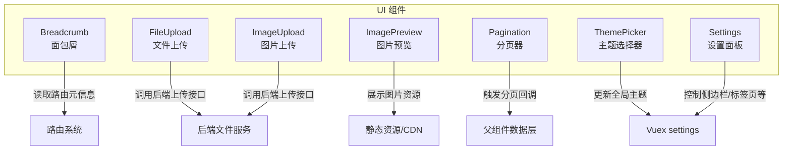
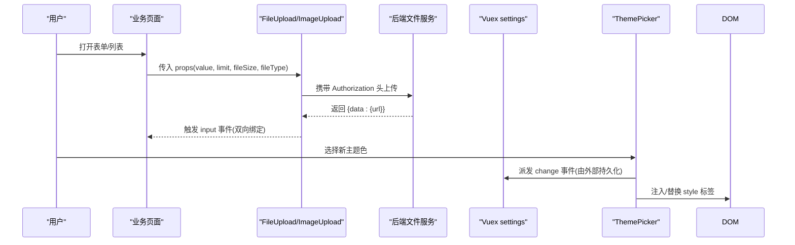
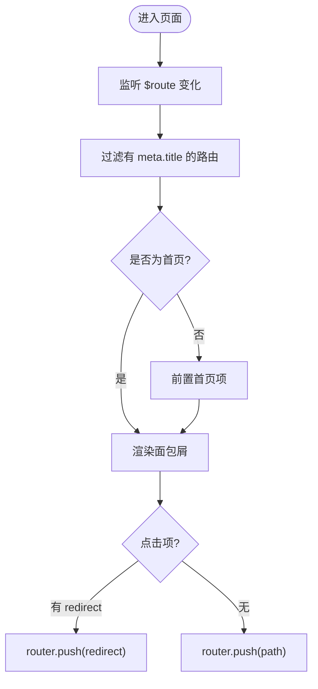
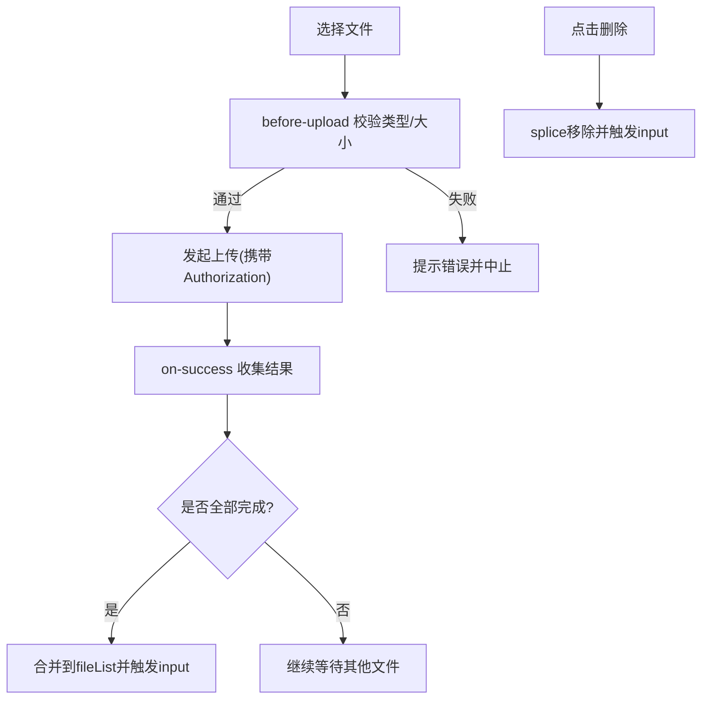
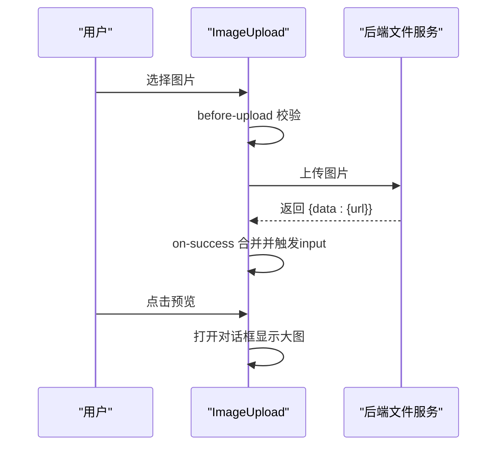
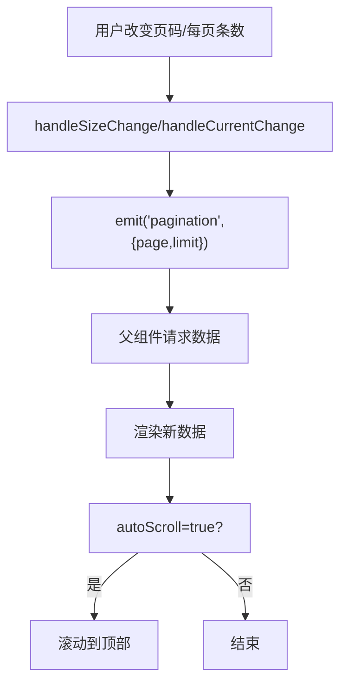
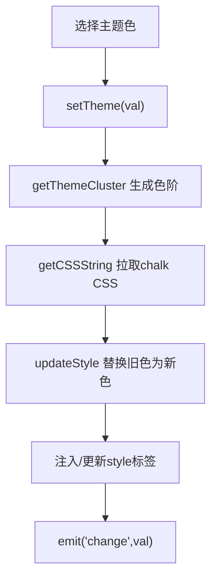
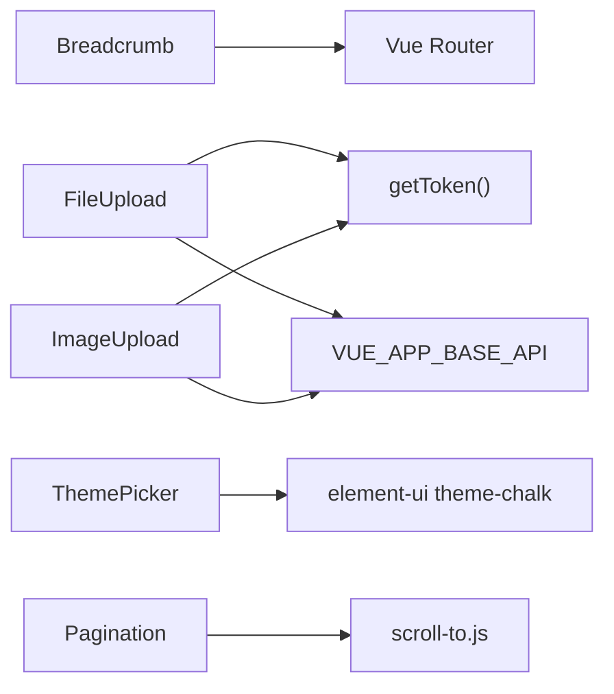

# UI组件库

<cite>
**本文引用的文件**   
- [Breadcrumb/index.vue](file://ruoyi-ui/src/components/Breadcrumb/index.vue)
- [FileUpload/index.vue](file://ruoyi-ui/src/components/FileUpload/index.vue)
- [ImageUpload/index.vue](file://ruoyi-ui/src/components/ImageUpload/index.vue)
- [ImagePreview/index.vue](file://ruoyi-ui/src/components/ImagePreview/index.vue)
- [Pagination/index.vue](file://ruoyi-ui/src/components/Pagination/index.vue)
- [ThemePicker/index.vue](file://ruoyi-ui/src/components/ThemePicker/index.vue)
- [Settings/index.vue](file://ruoyi-ui/src/layout/components/Settings/index.vue)
</cite>

## 目录
1. [简介](#简介)
2. [项目结构](#项目结构)
3. [核心组件](#核心组件)
4. [架构总览](#架构总览)
5. [组件详细分析](#组件详细分析)
6. [依赖关系分析](#依赖关系分析)
7. [性能与体验优化](#性能与体验优化)
8. [样式定制与主题切换](#样式定制与主题切换)
9. [国际化支持](#国际化支持)
10. [组合复用与最佳实践](#组合复用与最佳实践)
11. [故障排查指南](#故障排查指南)
12. [结论](#结论)

## 简介
本文件为前端 UI 组件库的技术文档，聚焦以下常用自定义组件：面包屑导航、文件上传、图片上传、图片预览、分页器，以及主题切换能力。文档从设计理念、API 接口、属性配置、事件处理、插槽使用、样式定制、主题切换与国际化等维度进行系统化说明，并提供组合复用模式与最佳实践建议，帮助开发者快速上手并稳定扩展。

## 项目结构
UI 组件位于 ruoyi-ui/src/components 目录下，采用“按功能域分目录”的组织方式，每个组件一个独立目录，包含 index.vue 主实现与可选的样式/脚本。本次文档涉及的组件如下：
- Breadcrumb：基于路由元信息动态渲染的面包屑导航
- FileUpload：通用文件上传（文本/表格/文档等）
- ImageUpload：图片卡片式上传，内置预览对话框
- ImagePreview：图片展示与全屏预览
- Pagination：封装 Element 分页，统一交互与滚动行为
- ThemePicker：Element 主题色在线替换
- Settings：设置面板入口，集成主题与布局开关

图表来源
- [Breadcrumb/index.vue:1-75](file://ruoyi-ui/src/components/Breadcrumb/index.vue#L1-L75)
- [FileUpload/index.vue:1-208](file://ruoyi-ui/src/components/FileUpload/index.vue#L1-L208)
- [ImageUpload/index.vue:1-208](file://ruoyi-ui/src/components/ImageUpload/index.vue#L1-L208)
- [ImagePreview/index.vue:1-77](file://ruoyi-ui/src/components/ImagePreview/index.vue#L1-L77)
- [Pagination/index.vue:1-115](file://ruoyi-ui/src/components/Pagination/index.vue#L1-L115)
- [ThemePicker/index.vue:1-174](file://ruoyi-ui/src/components/ThemePicker/index.vue#L1-L174)
- [Settings/index.vue:1-138](file://ruoyi-ui/src/layout/components/Settings/index.vue#L1-L138)

章节来源
- [Breadcrumb/index.vue:1-75](file://ruoyi-ui/src/components/Breadcrumb/index.vue#L1-L75)
- [FileUpload/index.vue:1-208](file://ruoyi-ui/src/components/FileUpload/index.vue#L1-L208)
- [ImageUpload/index.vue:1-208](file://ruoyi-ui/src/components/ImageUpload/index.vue#L1-L208)
- [ImagePreview/index.vue:1-77](file://ruoyi-ui/src/components/ImagePreview/index.vue#L1-L77)
- [Pagination/index.vue:1-115](file://ruoyi-ui/src/components/Pagination/index.vue#L1-L115)
- [ThemePicker/index.vue:1-174](file://ruoyi-ui/src/components/ThemePicker/index.vue#L1-L174)
- [Settings/index.vue:1-138](file://ruoyi-ui/src/layout/components/Settings/index.vue#L1-L138)

## 核心组件
本节概述各组件的职责边界与对外暴露的能力，便于快速定位与选型。

- 面包屑导航（Breadcrumb）
  - 职责：根据当前路由自动生成可点击的面包屑，支持首页前缀与重定向跳转
  - 关键能力：监听路由变化、过滤无标题路由、支持 redirect 字段跳转
- 文件上传（FileUpload）
  - 职责：通用文件上传，支持多文件、大小/类型校验、删除、列表展示
  - 关键能力：双向绑定 value、限制数量/大小/类型、错误提示、成功回调
- 图片上传（ImageUpload）
  - 职责：图片卡片式上传，内置预览对话框与移除逻辑
  - 关键能力：多图上传、尺寸/类型校验、预览、移除、双向绑定
- 图片预览（ImagePreview）
  - 职责：图片缩略图展示与大图预览
  - 关键能力：单/多图预览、宽高自适应、加载失败占位
- 分页器（Pagination）
  - 职责：统一分页交互，自动滚动到顶部
  - 关键能力：双向绑定 page/limit、自定义每页条数、隐藏/显示控制
- 主题选择器（ThemePicker）
  - 职责：运行时替换 Element 主题色
  - 关键能力：预设颜色、动态注入样式、变更事件
- 设置面板（Settings）
  - 职责：提供主题风格、侧边栏、标签页等全局设置入口
  - 关键能力：联动 Vuex settings，驱动界面行为

章节来源
- [Breadcrumb/index.vue:1-75](file://ruoyi-ui/src/components/Breadcrumb/index.vue#L1-L75)
- [FileUpload/index.vue:1-208](file://ruoyi-ui/src/components/FileUpload/index.vue#L1-L208)
- [ImageUpload/index.vue:1-208](file://ruoyi-ui/src/components/ImageUpload/index.vue#L1-L208)
- [ImagePreview/index.vue:1-77](file://ruoyi-ui/src/components/ImagePreview/index.vue#L1-L77)
- [Pagination/index.vue:1-115](file://ruoyi-ui/src/components/Pagination/index.vue#L1-L115)
- [ThemePicker/index.vue:1-174](file://ruoyi-ui/src/components/ThemePicker/index.vue#L1-L174)
- [Settings/index.vue:1-138](file://ruoyi-ui/src/layout/components/Settings/index.vue#L1-L138)

## 架构总览
组件之间通过 props/events 解耦，部分组件与路由、存储、后端服务存在耦合点：
- Breadcrumb 依赖路由元信息与 router.push
- FileUpload/ImageUpload 依赖鉴权 token 与后端 /file/upload 接口
- ImagePreview 依赖浏览器原生图片预览能力
- Pagination 向上抛出分页事件，由父组件驱动数据刷新
- ThemePicker 通过 DOM 注入 style 标签替换主题变量
- Settings 读写 Vuex settings，影响全局布局与主题

图表来源
- [FileUpload/index.vue:42-185](file://ruoyi-ui/src/components/FileUpload/index.vue#L42-L185)
- [ImageUpload/index.vue:45-188](file://ruoyi-ui/src/components/ImageUpload/index.vue#L45-L188)
- [ThemePicker/index.vue:43-153](file://ruoyi-ui/src/components/ThemePicker/index.vue#L43-L153)
- [Settings/index.vue:81-138](file://ruoyi-ui/src/layout/components/Settings/index.vue#L81-L138)

## 组件详细分析

### 面包屑导航（Breadcrumb）
- 设计要点
  - 基于 $route.matched 过滤出带 meta.title 的路由项
  - 非首页时自动拼接“首页”项
  - 支持 item.redirect 直接跳转，否则跳转到 item.path
  - 对 /redirect/ 开头的路由不更新面包屑
- API 概览
  - 无需显式 props，内部读取路由元信息
  - 无对外事件
- 使用注意
  - 路由需配置 meta.title，必要时设置 meta.breadcrumb=false 隐藏
  - 如需强制跳转至某路径，可在路由中配置 redirect 字段

图表来源
- [Breadcrumb/index.vue:19-57](file://ruoyi-ui/src/components/Breadcrumb/index.vue#L19-L57)

章节来源
- [Breadcrumb/index.vue:1-75](file://ruoyi-ui/src/components/Breadcrumb/index.vue#L1-L75)

### 文件上传（FileUpload）
- 设计要点
  - 支持多文件上传，限制数量/大小/类型
  - 上传前校验并显示 loading，成功后合并结果并触发 input
  - 支持删除单个文件，实时同步 value
- API 概览
  - props
    - value: String/Object/Array，双向绑定
    - limit: Number，默认 5
    - fileSize: Number(MB)，默认 5
    - fileType: Array，默认 ["doc","xls","ppt","txt","pdf"]
    - isShowTip: Boolean，默认 true
  - events
    - input: 值变化时触发
  - slots
    - tip: 自定义上传提示文案
- 数据流
  - before-upload 校验 -> 上传 -> success 合并 -> 触发 input
  - 删除 -> 更新 fileList -> 触发 input

图表来源
- [FileUpload/index.vue:112-184](file://ruoyi-ui/src/components/FileUpload/index.vue#L112-L184)

章节来源
- [FileUpload/index.vue:1-208](file://ruoyi-ui/src/components/FileUpload/index.vue#L1-L208)

### 图片上传（ImageUpload）
- 设计要点
  - 卡片式多图上传，内置预览对话框
  - 支持移除图片，限制数量/大小/类型
  - 上传前校验并显示 loading，成功后合并结果并触发 input
- API 概览
  - props
    - value: String/Object/Array，双向绑定
    - limit: Number，默认 5
    - fileSize: Number(MB)，默认 5
    - fileType: Array，默认 ["png","jpg","jpeg"]
    - isShowTip: Boolean，默认 true
  - events
    - input: 值变化时触发
  - slots
    - tip: 自定义上传提示文案
- 数据流
  - before-upload 校验 -> 上传 -> success 合并 -> 触发 input
  - remove -> 更新 fileList -> 触发 input
  - preview -> 打开对话框预览

图表来源
- [ImageUpload/index.vue:114-188](file://ruoyi-ui/src/components/ImageUpload/index.vue#L114-L188)

章节来源
- [ImageUpload/index.vue:1-208](file://ruoyi-ui/src/components/ImageUpload/index.vue#L1-L208)

### 图片预览（ImagePreview）
- 设计要点
  - 基于 el-image 的预览能力，支持单图或多图预览
  - 计算真实 src 与预览列表，支持宽高自适应
  - 加载失败显示占位图标
- API 概览
  - props
    - src: String，必填，支持逗号分隔的多图
    - width: Number/String，默认空
    - height: Number/String，默认空
  - 无对外事件
- 使用注意
  - 若传入多图，以逗号分隔；组件会自动拆分用于预览列表

章节来源
- [ImagePreview/index.vue:1-77](file://ruoyi-ui/src/components/ImagePreview/index.vue#L1-L77)

### 分页器（Pagination）
- 设计要点
  - 封装 el-pagination，统一 page/limit 的双向绑定
  - 支持移动端 pagerCount 自适应
  - 翻页后自动滚动到页面顶部
- API 概览
  - props
    - total: Number，必填
    - page: Number，默认 1
    - limit: Number，默认 20
    - pageSizes: Array，默认 [10,20,30,50]
    - pagerCount: Number，移动端默认 5
    - layout: String，默认 'total, sizes, prev, pager, next, jumper'
    - background: Boolean，默认 true
    - autoScroll: Boolean，默认 true
    - hidden: Boolean，默认 false
  - events
    - pagination({page, limit}): 分页变化时触发
    - update:page / update:limit: 双向绑定
- 交互流程
  - size-change/current-change -> 触发 pagination -> 父组件拉取数据 -> 可选滚动到顶部

图表来源
- [Pagination/index.vue:86-101](file://ruoyi-ui/src/components/Pagination/index.vue#L86-L101)

章节来源
- [Pagination/index.vue:1-115](file://ruoyi-ui/src/components/Pagination/index.vue#L1-L115)

### 主题选择器（ThemePicker）
- 设计要点
  - 基于 el-color-picker，动态从 CDN 拉取 element-ui 主题 CSS
  - 生成主题色阶，替换现有 style 标签中的颜色变量
  - 监听 store.settings.theme，支持初始化应用主题
- API 概览
  - props: 无
  - events
    - change(color): 主题色变更时触发
- 关键流程
  - setTheme -> 获取 chalk CSS -> 生成新旧色阶 -> 替换 style 内容 -> emit change

图表来源
- [ThemePicker/index.vue:43-153](file://ruoyi-ui/src/components/ThemePicker/index.vue#L43-L153)

章节来源
- [ThemePicker/index.vue:1-174](file://ruoyi-ui/src/components/ThemePicker/index.vue#L1-L174)

### 设置面板（Settings）
- 设计要点
  - 提供主题风格、固定头部、顶部导航、标签页、侧边栏 Logo、动态标题等开关
  - 通过 Vuex settings 管理状态，驱动全局布局与行为
- API 概览
  - 作为容器组件，内部调用 ThemePicker 与各项开关
  - 通过 dispatch('settings/changeSetting') 更新配置

章节来源
- [Settings/index.vue:1-138](file://ruoyi-ui/src/layout/components/Settings/index.vue#L1-L138)

## 依赖关系分析
- 组件内聚性
  - 各组件职责单一，props/events 清晰，利于复用与维护
- 外部依赖
  - Breadcrumb 依赖 Vue Router 与路由元信息
  - FileUpload/ImageUpload 依赖鉴权与后端文件服务
  - ThemePicker 依赖 element-ui 主题样式与网络资源
  - Pagination 依赖滚动工具函数
- 潜在耦合点
  - 上传组件均依赖 getToken() 与 VUE_APP_BASE_API 环境变量
  - 主题切换依赖 element-ui 版本与 CDN 可用性

图表来源
- [FileUpload/index.vue:42-80](file://ruoyi-ui/src/components/FileUpload/index.vue#L42-L80)
- [ImageUpload/index.vue:45-84](file://ruoyi-ui/src/components/ImageUpload/index.vue#L45-L84)
- [ThemePicker/index.vue:10-12](file://ruoyi-ui/src/components/ThemePicker/index.vue#L10-L12)
- [Pagination/index.vue:18-19](file://ruoyi-ui/src/components/Pagination/index.vue#L18-L19)

章节来源
- [FileUpload/index.vue:1-208](file://ruoyi-ui/src/components/FileUpload/index.vue#L1-L208)
- [ImageUpload/index.vue:1-208](file://ruoyi-ui/src/components/ImageUpload/index.vue#L1-L208)
- [ThemePicker/index.vue:1-174](file://ruoyi-ui/src/components/ThemePicker/index.vue#L1-L174)
- [Pagination/index.vue:1-115](file://ruoyi-ui/src/components/Pagination/index.vue#L1-L115)

## 性能与体验优化
- 上传体验
  - 上传前校验避免无效请求，减少带宽浪费
  - 批量上传计数合并结果，减少多次 state 更新
  - 失败时关闭 loading，保证 UI 一致性
- 分页体验
  - 翻页后自动滚动到顶部，提升阅读连贯性
  - 移动端 pagerCount 自适应，优化小屏操作
- 图片预览
  - 使用 el-image 内置懒加载与预览能力，降低首屏压力
- 主题切换
  - 按需拉取 chalk CSS，避免重复下载
  - 仅替换相关样式节点，最小化 DOM 操作

[本节为通用指导，不涉及具体文件分析]

## 样式定制与主题切换
- 组件级样式
  - 各组件使用 scoped 样式，避免污染全局
  - 可通过 ::v-deep 或 CSS 变量覆盖第三方组件样式
- 主题切换
  - ThemePicker 动态替换 element-ui 主题色，适合需要品牌色的场景
  - 结合 Settings 面板，将主题色持久化到 Vuex/settings，并在应用启动时恢复
- 建议
  - 在业务组件中尽量使用 CSS 变量或主题色类名，配合 ThemePicker 实现整体换肤
  - 对于复杂主题，建议构建阶段替换主题变量，而非运行时替换

章节来源
- [ThemePicker/index.vue:43-153](file://ruoyi-ui/src/components/ThemePicker/index.vue#L43-L153)
- [Settings/index.vue:81-138](file://ruoyi-ui/src/layout/components/Settings/index.vue#L81-L138)

## 国际化支持
- 现状
  - 组件内部文案（如上传提示、错误提示）目前为中文硬编码
  - 未引入 i18n 框架，也未见 locale 配置文件
- 建议方案
  - 引入 vue-i18n，集中管理文案键值
  - 将组件内提示文案抽离为 key，并通过 this.$t(key) 渲染
  - 在路由 meta 中使用 i18n key，Breadcrumb 渲染时解析显示
  - 对上传组件的错误提示也改为 i18n key，确保多语言一致

[本节为通用指导，不涉及具体文件分析]

## 组合复用与最佳实践
- 表单场景
  - 使用 FileUpload/ImageUpload 的 v-model 双向绑定，简化表单提交逻辑
  - 通过 limit/fileSize/fileType 约束上传行为，减少后端校验压力
- 列表场景
  - 使用 Pagination 统一分页交互，父组件负责数据请求与缓存策略
  - 结合 ImagePreview 展示缩略图，点击预览大图
- 导航场景
  - 在路由 meta 中维护 title/breadcrumb，Breadcrumb 自动渲染
  - 对不需要面包屑的页面，设置 breadcrumb=false
- 主题与布局
  - 通过 Settings 面板统一管理主题与布局开关，并将配置持久化
  - 业务组件尽量遵循主题色规范，避免硬编码颜色

[本节为通用指导，不涉及具体文件分析]

## 故障排查指南
- 上传失败
  - 检查 Authorization 头是否正确注入（getToken）
  - 确认 VUE_APP_BASE_API 环境变量指向正确的后端地址
  - 查看 on-error 回调与 $modal.msgError 提示信息
- 文件类型/大小校验不生效
  - 检查 fileType/fileSize 配置是否与业务需求一致
  - 确认 before-upload 返回值与提示逻辑
- 分页不刷新
  - 确认父组件监听 pagination 事件并重新拉取数据
  - 检查 total/page/limit 是否同步更新
- 面包屑不显示
  - 检查路由 meta.title 是否存在
  - 确认未设置 breadcrumb=false
- 主题切换无效
  - 检查 CDN 是否可访问（element-ui theme-chalk）
  - 确认 getCSSString 成功且 style 标签已注入

章节来源
- [FileUpload/index.vue:112-184](file://ruoyi-ui/src/components/FileUpload/index.vue#L112-L184)
- [ImageUpload/index.vue:114-188](file://ruoyi-ui/src/components/ImageUpload/index.vue#L114-L188)
- [Breadcrumb/index.vue:32-57](file://ruoyi-ui/src/components/Breadcrumb/index.vue#L32-L57)
- [ThemePicker/index.vue:96-108](file://ruoyi-ui/src/components/ThemePicker/index.vue#L96-L108)

## 结论
本 UI 组件库围绕常见业务场景提供了高内聚、低耦合的组件实现，涵盖导航、上传、预览、分页与主题切换等能力。通过清晰的 props/events 契约、完善的校验与错误提示、以及可扩展的主题机制，开发者可以快速搭建一致的后台界面。建议在项目中引入 i18n 完善多语言支持，并结合 Settings 面板实现更灵活的个性化配置。