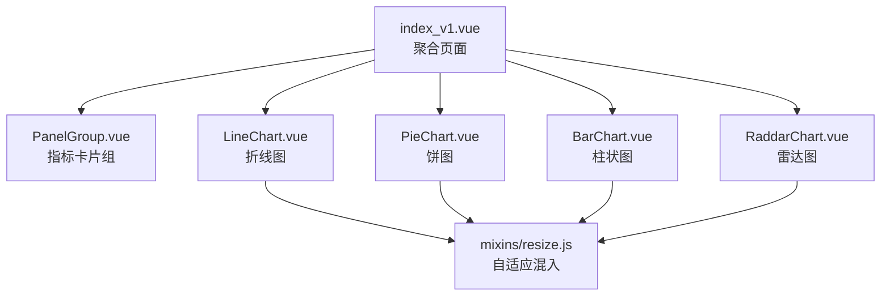
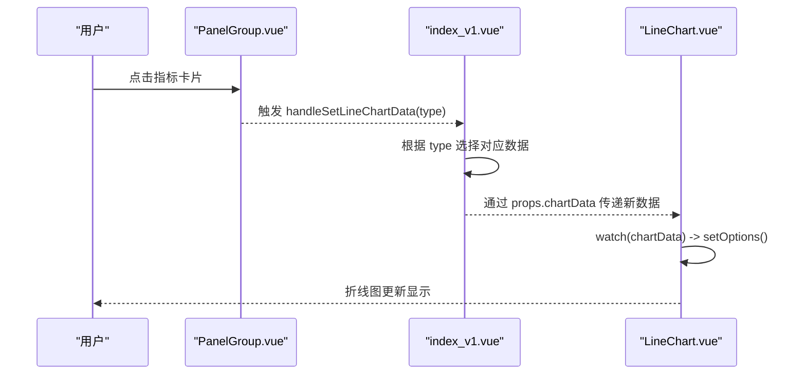
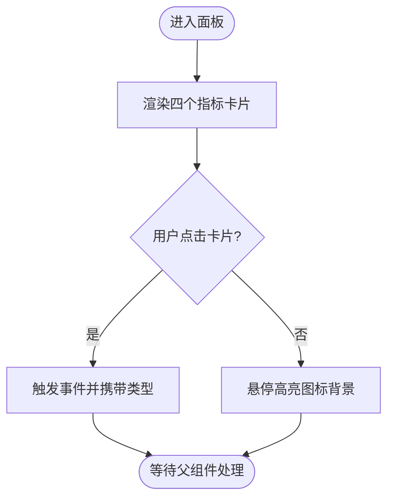
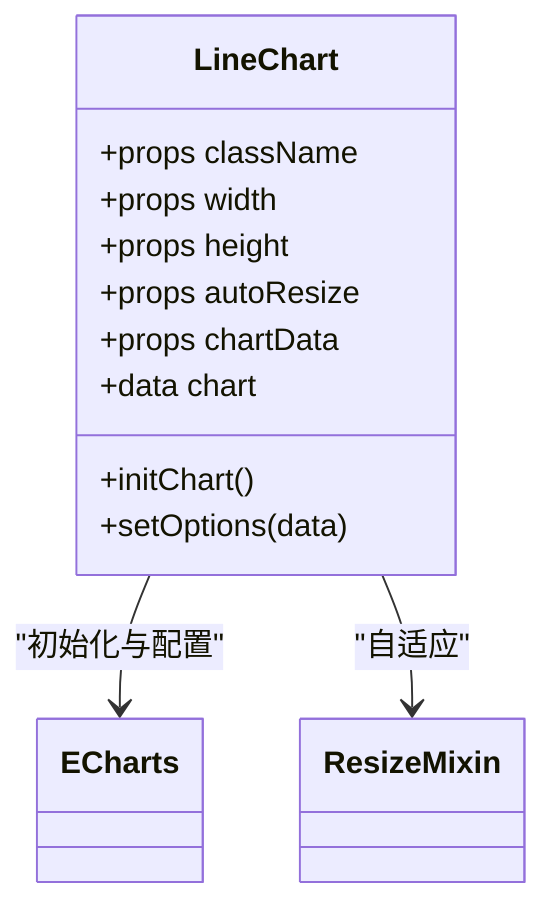
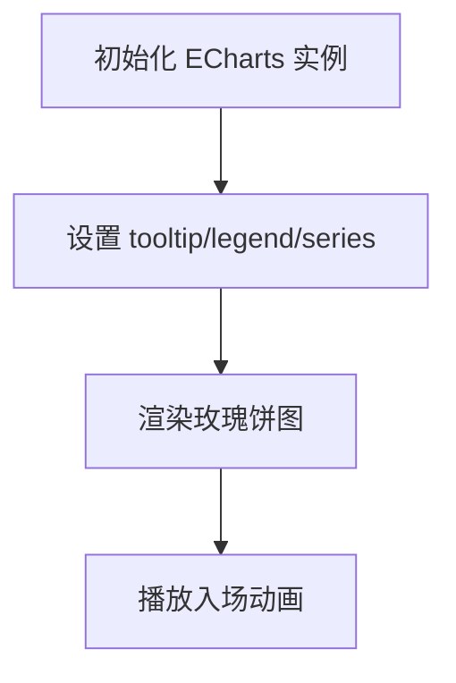
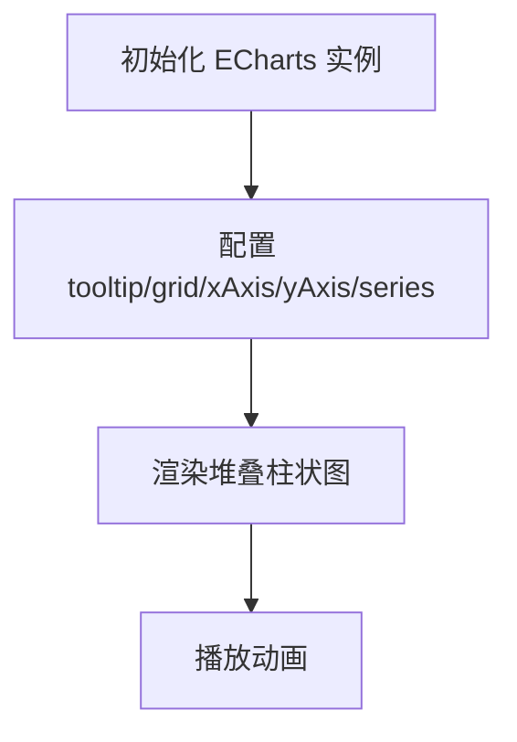
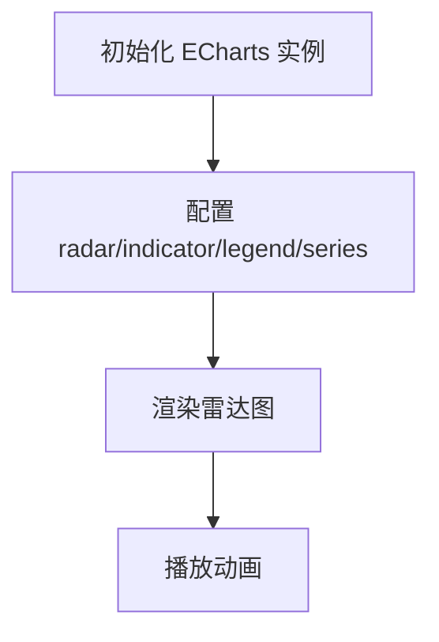
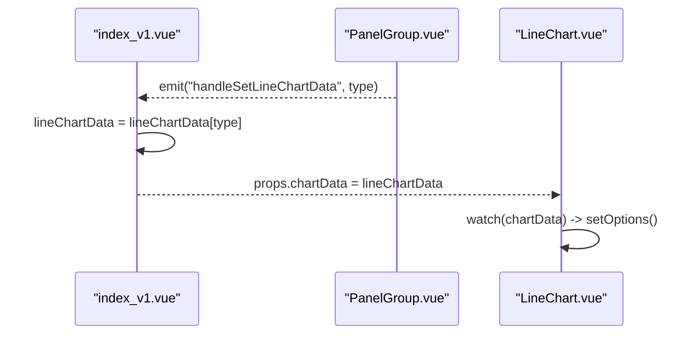
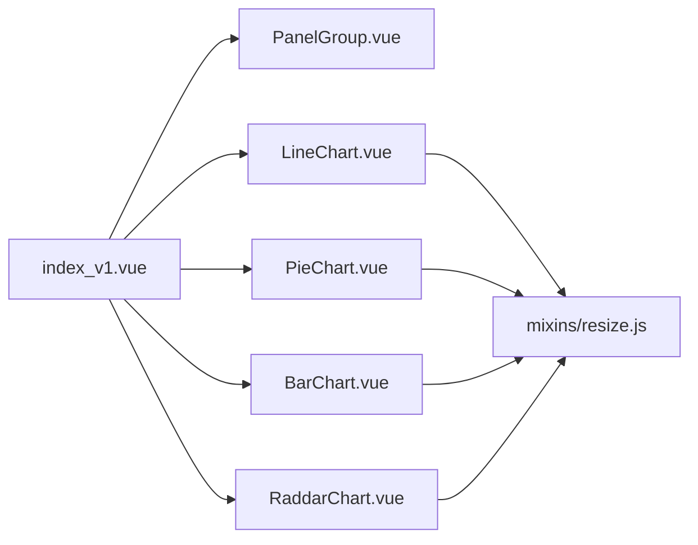

# 仪表盘页面

<cite>
**本文引用的文件**   
- [index_v1.vue](file://ruoyi-ui/src/views/index_v1.vue)
- [PanelGroup.vue](file://ruoyi-ui/src/views/dashboard/PanelGroup.vue)
- [LineChart.vue](file://ruoyi-ui/src/views/dashboard/LineChart.vue)
- [PieChart.vue](file://ruoyi-ui/src/views/dashboard/PieChart.vue)
- [BarChart.vue](file://ruoyi-ui/src/views/dashboard/BarChart.vue)
- [RaddarChart.vue](file://ruoyi-ui/src/views/dashboard/RaddarChart.vue)
- [resize.js](file://ruoyi-ui/src/views/dashboard/mixins/resize.js)
</cite>

## 目录
1. [简介](#简介)
2. [项目结构](#项目结构)
3. [核心组件](#核心组件)
4. [架构总览](#架构总览)
5. [详细组件分析](#详细组件分析)
6. [依赖关系分析](#依赖关系分析)
7. [性能与实时性](#性能与实时性)
8. [故障排查](#故障排查)
9. [结论](#结论)

## 简介
本文件面向“数据质量监控仪表板”的前端实现，聚焦于仪表盘页面的界面布局、可视化图表组件（柱状图、折线图、饼图、雷达图）的配置与定制、指标统计卡片、交互联动、数据绑定与响应式布局等关键技术点。文档基于前端源码进行逐层拆解，帮助读者快速理解并扩展该仪表板。

## 项目结构
仪表板由一个聚合页面与多个子组件构成：
- 聚合页负责整体布局、指标卡片展示、以及将数据传递给各图表组件。
- 图表组件各自封装 ECharts 初始化、配置项设置、销毁与自适应逻辑。
- 公共 mixin 提供窗口尺寸变化时的图表自适应能力。

图示来源
- [index_v1.vue:1-30](file://ruoyi-ui/src/views/index_v1.vue#L1-L30)
- [PanelGroup.vue:1-56](file://ruoyi-ui/src/views/dashboard/PanelGroup.vue#L1-L56)
- [LineChart.vue:1-136](file://ruoyi-ui/src/views/dashboard/LineChart.vue#L1-L136)
- [PieChart.vue:1-80](file://ruoyi-ui/src/views/dashboard/PieChart.vue#L1-L80)
- [BarChart.vue:1-103](file://ruoyi-ui/src/views/dashboard/BarChart.vue#L1-L103)
- [RaddarChart.vue:1-117](file://ruoyi-ui/src/views/dashboard/RaddarChart.vue#L1-L117)
- [resize.js:1-57](file://ruoyi-ui/src/views/dashboard/mixins/resize.js#L1-L57)

章节来源
- [index_v1.vue:1-30](file://ruoyi-ui/src/views/index_v1.vue#L1-L30)

## 核心组件
- 指标卡片组 PanelGroup：展示访客、消息、金额、订单等关键指标，点击可切换折线图的数据维度。
- 折线图 LineChart：展示期望值与实际值的对比趋势，支持动画与区域填充。
- 饼图 PieChart：以玫瑰半径模式展示分类占比。
- 柱状图 BarChart：堆叠柱状图展示多类别的周度分布。
- 雷达图 RaddarChart：多维度指标对比。
- 自适应 resize.js：监听窗口与侧边栏变化，调用图表实例 resize。

章节来源
- [PanelGroup.vue:1-70](file://ruoyi-ui/src/views/dashboard/PanelGroup.vue#L1-L70)
- [LineChart.vue:1-136](file://ruoyi-ui/src/views/dashboard/LineChart.vue#L1-L136)
- [PieChart.vue:1-80](file://ruoyi-ui/src/views/dashboard/PieChart.vue#L1-L80)
- [BarChart.vue:1-103](file://ruoyi-ui/src/views/dashboard/BarChart.vue#L1-L103)
- [RaddarChart.vue:1-117](file://ruoyi-ui/src/views/dashboard/RaddarChart.vue#L1-L117)
- [resize.js:1-57](file://ruoyi-ui/src/views/dashboard/mixins/resize.js#L1-L57)

## 架构总览
仪表板采用“父组件管理状态 + 子组件渲染图表”的模式。父组件维护统一的图表数据源，并通过 props 下发给各图表组件；指标卡片通过事件冒泡触发父组件切换数据，从而联动折线图更新。

图示来源
- [PanelGroup.vue:65-68](file://ruoyi-ui/src/views/dashboard/PanelGroup.vue#L65-L68)
- [index_v1.vue:32-77](file://ruoyi-ui/src/views/index_v1.vue#L32-L77)
- [LineChart.vue:39-45](file://ruoyi-ui/src/views/dashboard/LineChart.vue#L39-L45)

## 详细组件分析

### 指标卡片组 PanelGroup
- 功能要点
  - 使用 Element UI 栅格布局，适配不同屏幕宽度。
  - 每个卡片包含图标、标题与数字计数器（CountTo）。
  - 点击卡片向上抛出事件，通知父组件切换折线图数据维度。
- 交互设计
  - 悬停时图标背景色高亮，增强可点击反馈。
  - 小屏下隐藏描述文本，仅保留图标与数值。
- 技术要点
  - 通过 $emit 向父组件传递类型标识，解耦子组件与数据源。
  - 样式中使用 SCSS 嵌套与媒体查询，保证响应式体验。

图示来源
- [PanelGroup.vue:1-56](file://ruoyi-ui/src/views/dashboard/PanelGroup.vue#L1-L56)
- [PanelGroup.vue:73-181](file://ruoyi-ui/src/views/dashboard/PanelGroup.vue#L73-L181)

章节来源
- [PanelGroup.vue:1-70](file://ruoyi-ui/src/views/dashboard/PanelGroup.vue#L1-L70)

### 折线图 LineChart
- 功能要点
  - 接收 chartData 对象，包含 expectedData 与 actualData 两个数组。
  - 使用 ECharts 主题 macarons，双系列平滑折线，带面积填充与动画。
  - 监听 chartData 深度变化，自动更新图表。
- 配置要点
  - xAxis 为类目轴，yAxis 为数值轴，tooltip 启用十字准线与轴触发。
  - legend 显示两条系列名称，grid 控制内边距与标签包含。
- 生命周期
  - mounted 后初始化图表，beforeDestroy 释放实例避免内存泄漏。
- 响应式
  - 混入 resize.js，在窗口或侧边栏变化时调用 chart.resize()。

图示来源
- [LineChart.vue:1-136](file://ruoyi-ui/src/views/dashboard/LineChart.vue#L1-L136)
- [resize.js:1-57](file://ruoyi-ui/src/views/dashboard/mixins/resize.js#L1-L57)

章节来源
- [LineChart.vue:1-136](file://ruoyi-ui/src/views/dashboard/LineChart.vue#L1-L136)

### 饼图 PieChart
- 功能要点
  - 使用玫瑰半径模式的饼图，展示分类占比。
  - tooltip 显示类别、数值与百分比。
  - legend 居中底部，便于识别分类。
- 配置要点
  - radius 控制内外半径，center 控制中心位置。
  - animationEasing 与 animationDuration 控制入场动画。

图示来源
- [PieChart.vue:1-80](file://ruoyi-ui/src/views/dashboard/PieChart.vue#L1-L80)

章节来源
- [PieChart.vue:1-80](file://ruoyi-ui/src/views/dashboard/PieChart.vue#L1-L80)

### 柱状图 BarChart
- 功能要点
  - 堆叠柱状图，展示多类别在一周内的分布。
  - tooltip 使用阴影指示器，xAxis 类目轴，yAxis 数值轴。
- 配置要点
  - barWidth 控制柱宽，stack 使柱子堆叠。
  - 统一动画时长，提升视觉一致性。

图示来源
- [BarChart.vue:1-103](file://ruoyi-ui/src/views/dashboard/BarChart.vue#L1-L103)

章节来源
- [BarChart.vue:1-103](file://ruoyi-ui/src/views/dashboard/BarChart.vue#L1-L103)

### 雷达图 RaddarChart
- 功能要点
  - 多维度指标对比，适合数据质量的多维评估。
  - radar 配置 indicator 定义维度与最大值，series 展示多组数据。
- 配置要点
  - splitArea 设置网格区域样式，areaStyle 设置填充阴影效果。
  - legend 居中底部，便于区分多组数据。

图示来源
- [RaddarChart.vue:1-117](file://ruoyi-ui/src/views/dashboard/RaddarChart.vue#L1-L117)

章节来源
- [RaddarChart.vue:1-117](file://ruoyi-ui/src/views/dashboard/RaddarChart.vue#L1-L117)

### 聚合页面 index_v1.vue
- 功能要点
  - 引入并组合 PanelGroup、LineChart、RaddarChart、PieChart、BarChart。
  - 维护 lineChartData 状态，根据 PanelGroup 的事件切换数据。
  - 使用 Element UI 栅格布局，三列等分展示三个图表。
- 数据流
  - 本地静态数据对象 lineChartData 按类型组织，handleSetLineChartData 方法根据传入类型赋值。
  - 通过 props 将当前数据传给 LineChart。

图示来源
- [index_v1.vue:32-77](file://ruoyi-ui/src/views/index_v1.vue#L32-L77)
- [PanelGroup.vue:65-68](file://ruoyi-ui/src/views/dashboard/PanelGroup.vue#L65-L68)
- [LineChart.vue:39-45](file://ruoyi-ui/src/views/dashboard/LineChart.vue#L39-L45)

章节来源
- [index_v1.vue:1-98](file://ruoyi-ui/src/views/index_v1.vue#L1-L98)

## 依赖关系分析
- 外部依赖
  - ECharts：所有图表组件均依赖 ECharts 进行渲染。
  - vue-count-to：用于指标卡片的数字滚动动画。
  - Element UI：栅格布局与基础 UI 组件。
- 内部依赖
  - 所有图表组件混入 resize.js，实现响应式自适应。
  - 聚合页面依赖各图表组件与指标卡片组件。

图示来源
- [index_v1.vue:1-30](file://ruoyi-ui/src/views/index_v1.vue#L1-L30)
- [PanelGroup.vue:1-56](file://ruoyi-ui/src/views/dashboard/PanelGroup.vue#L1-L56)
- [LineChart.vue:1-136](file://ruoyi-ui/src/views/dashboard/LineChart.vue#L1-L136)
- [PieChart.vue:1-80](file://ruoyi-ui/src/views/dashboard/PieChart.vue#L1-L80)
- [BarChart.vue:1-103](file://ruoyi-ui/src/views/dashboard/BarChart.vue#L1-L103)
- [RaddarChart.vue:1-117](file://ruoyi-ui/src/views/dashboard/RaddarChart.vue#L1-L117)
- [resize.js:1-57](file://ruoyi-ui/src/views/dashboard/mixins/resize.js#L1-L57)

章节来源
- [index_v1.vue:1-30](file://ruoyi-ui/src/views/index_v1.vue#L1-L30)
- [resize.js:1-57](file://ruoyi-ui/src/views/dashboard/mixins/resize.js#L1-L57)

## 性能与实时性
- 性能优化
  - 图表组件在 beforeDestroy 中释放 ECharts 实例，避免内存泄漏。
  - resize.js 使用防抖函数减少频繁 resize 带来的重绘开销。
  - 动画时长统一配置，避免过度动画导致卡顿。
- 实时数据接入建议
  - 将静态数据替换为接口请求返回的动态数据，并在 watch 中监听数据变化以刷新图表。
  - 对于高频更新场景，建议使用增量更新策略（如只更新 series.data），避免整图重建。
  - 结合 WebSocket 或轮询机制，定时拉取最新指标数据并注入到各图表组件。

[本节为通用指导，不直接分析具体文件]

## 故障排查
- 图表不显示或空白
  - 检查容器是否有宽高，确保 ECharts 初始化前 DOM 已就绪。
  - 确认 theme 是否正确引入（macarons）。
- 图表未自适应
  - 确认组件是否混入 resize.js，且 window resize 事件未被移除。
  - 检查 keep-alive 激活时是否调用 resize。
- 数据未更新
  - 检查父组件是否正确传递 props.chartData。
  - 确认子组件 watch 是否对 chartData 进行深度监听。
- 内存泄漏
  - 确认 beforeDestroy 中是否调用 chart.dispose()。

章节来源
- [LineChart.vue:47-58](file://ruoyi-ui/src/views/dashboard/LineChart.vue#L47-L58)
- [PieChart.vue:31-42](file://ruoyi-ui/src/views/dashboard/PieChart.vue#L31-L42)
- [BarChart.vue:33-44](file://ruoyi-ui/src/views/dashboard/BarChart.vue#L33-L44)
- [RaddarChart.vue:33-44](file://ruoyi-ui/src/views/dashboard/RaddarChart.vue#L33-L44)
- [resize.js:10-27](file://ruoyi-ui/src/views/dashboard/mixins/resize.js#L10-L27)

## 结论
该仪表板通过清晰的组件拆分与数据流向，实现了指标卡片与多种图表的联动展示。借助 ECharts 与 Element UI，提供了丰富的可视化能力与良好的用户体验。通过混入 resize.js 实现了响应式布局，保证了在不同设备上的表现一致。未来可在数据源层面接入真实业务数据，并结合实时更新策略进一步提升监控时效性与交互体验。