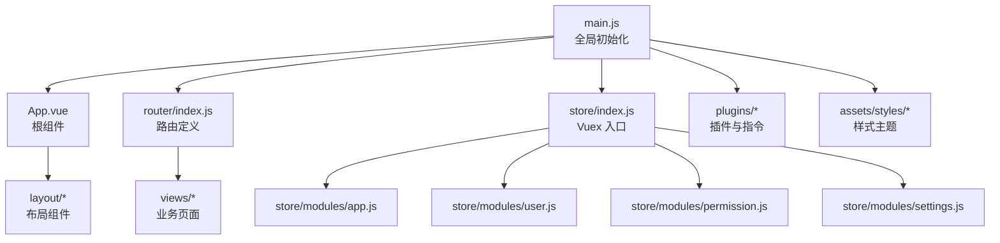
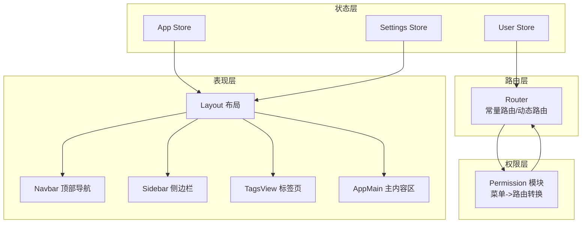
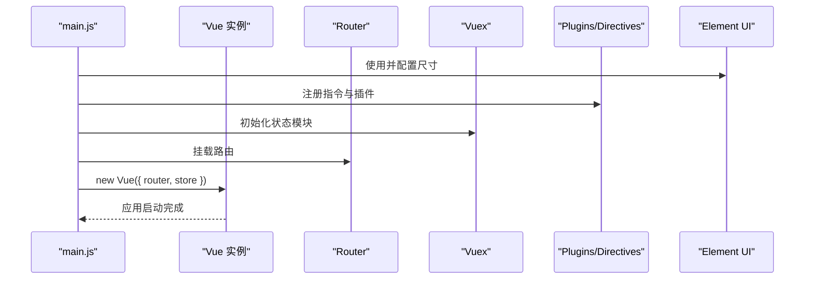
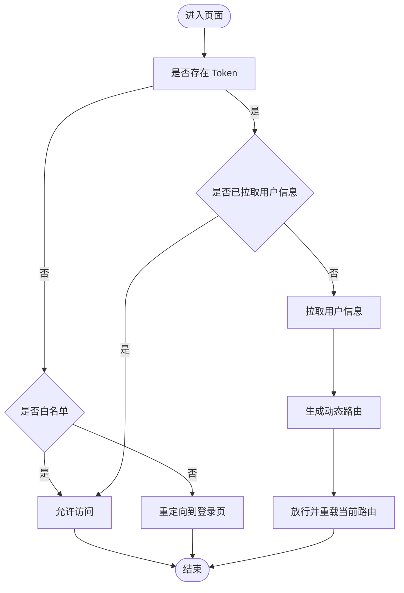
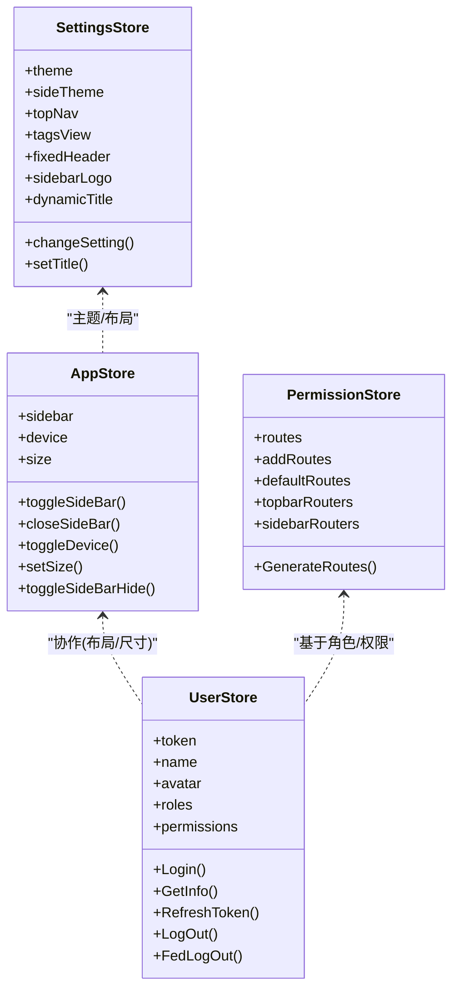
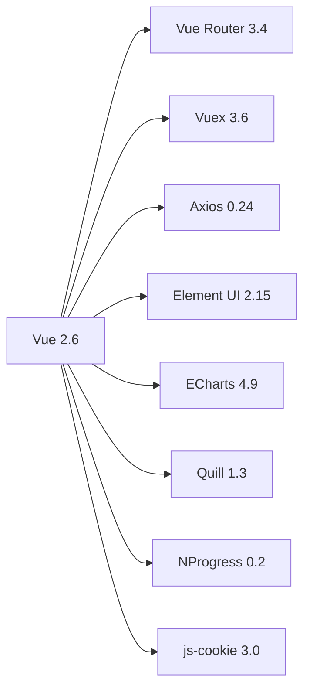

# 前端应用

<cite>
**本文引用的文件**   
- [package.json](file://ruoyi-ui/package.json)
- [README.md](file://ruoyi-ui/README.md)
- [main.js](file://ruoyi-ui/src/main.js)
- [App.vue](file://ruoyi-ui/src/App.vue)
- [permission.js](file://ruoyi-ui/src/permission.js)
- [index.js（路由）](file://ruoyi-ui/src/router/index.js)
- [app.js（状态模块）](file://ruoyi-ui/src/store/modules/app.js)
- [user.js（状态模块）](file://ruoyi-ui/src/store/modules/user.js)
- [permission.js（权限模块）](file://ruoyi-ui/src/store/modules/permission.js)
- [settings.js（设置模块）](file://ruoyi-ui/src/store/modules/settings.js)
</cite>

## 目录
1. [简介](#简介)
2. [项目结构](#项目结构)
3. [核心组件](#核心组件)
4. [架构总览](#架构总览)
5. [详细组件分析](#详细组件分析)
6. [依赖关系分析](#依赖关系分析)
7. [性能与可维护性](#性能与可维护性)
8. [故障排查指南](#故障排查指南)
9. [结论](#结论)
10. [附录](#附录)

## 简介
本文件面向数据质量管理系统的前端应用，基于 Vue 2 + Element UI 构建，采用模块化布局、动态路由与权限控制，提供仪表盘、规则编辑器、数据源配置、监控报表等页面能力。文档从系统架构、组件组织、路由与权限、状态管理、UI 与样式、响应式适配等方面进行全面说明，并给出开发规范与最佳实践建议。

## 项目结构
前端工程位于 ruoyi-ui 目录，采用典型的前后端分离结构：
- 入口与全局初始化：main.js、App.vue
- 路由与权限：router/index.js、permission.js
- 状态管理：store/modules/*
- 视图与业务页面：views/*
- 公共组件与工具：components/*、utils/*、assets/*
- 构建与脚本：package.json、README.md

图表来源
- [main.js:1-87](file://ruoyi-ui/src/main.js#L1-L87)
- [App.vue:1-20](file://ruoyi-ui/src/App.vue#L1-L20)
- [index.js（路由）:1-178](file://ruoyi-ui/src/router/index.js#L1-L178)
- [app.js（状态模块）:1-67](file://ruoyi-ui/src/store/modules/app.js#L1-L67)
- [user.js（状态模块）:1-116](file://ruoyi-ui/src/store/modules/user.js#L1-L116)
- [permission.js（权限模块）:1-134](file://ruoyi-ui/src/store/modules/permission.js#L1-L134)
- [settings.js（设置模块）:1-43](file://ruoyi-ui/src/store/modules/settings.js#L1-L43)

章节来源
- [README.md:1-30](file://ruoyi-ui/README.md#L1-L30)
- [package.json:1-91](file://ruoyi-ui/package.json#L1-L91)

## 核心组件
- 全局初始化与插件挂载
  - 引入 Element UI 并注入尺寸策略；注册全局方法、全局组件、指令与插件；初始化 vue-meta 与字典数据。
  - 关键路径：[main.js:1-87](file://ruoyi-ui/src/main.js#L1-L87)
- 根组件与标题模板
  - App.vue 通过 vue-meta 动态设置浏览器标题，支持动态标题开关。
  - 关键路径：[App.vue:1-20](file://ruoyi-ui/src/App.vue#L1-L20)
- 路由与导航
  - 常量路由与动态路由分离；支持 history 模式、滚动行为、懒加载与重定向。
  - 关键路径：[index.js（路由）:1-178](file://ruoyi-ui/src/router/index.js#L1-L178)
- 权限与访问控制
  - 全局前置守卫：校验 token、白名单、拉取用户信息、生成动态路由、跳转登录。
  - 关键路径：[permission.js:1-57](file://ruoyi-ui/src/permission.js#L1-L57)
- 状态管理（Vuex）
  - app：侧边栏展开、设备类型、Element 尺寸、隐藏控制
  - user：登录、登出、获取用户信息、刷新 token
  - permission：根据后端菜单生成路由、过滤动态路由、懒加载视图
  - settings：主题、顶栏、标签页、固定头部、侧边栏 Logo、动态标题等
  - 关键路径：
    - [app.js（状态模块）:1-67](file://ruoyi-ui/src/store/modules/app.js#L1-L67)
    - [user.js（状态模块）:1-116](file://ruoyi-ui/src/store/modules/user.js#L1-L116)
    - [permission.js（权限模块）:1-134](file://ruoyi-ui/src/store/modules/permission.js#L1-L134)
    - [settings.js（设置模块）:1-43](file://ruoyi-ui/src/store/modules/settings.js#L1-L43)

章节来源
- [main.js:1-87](file://ruoyi-ui/src/main.js#L1-L87)
- [App.vue:1-20](file://ruoyi-ui/src/App.vue#L1-L20)
- [index.js（路由）:1-178](file://ruoyi-ui/src/router/index.js#L1-L178)
- [permission.js:1-57](file://ruoyi-ui/src/permission.js#L1-L57)
- [app.js（状态模块）:1-67](file://ruoyi-ui/src/store/modules/app.js#L1-L67)
- [user.js（状态模块）:1-116](file://ruoyi-ui/src/store/modules/user.js#L1-L116)
- [permission.js（权限模块）:1-134](file://ruoyi-ui/src/store/modules/permission.js#L1-L134)
- [settings.js（设置模块）:1-43](file://ruoyi-ui/src/store/modules/settings.js#L1-L43)

## 架构总览
前端采用“布局 + 路由 + 权限 + 状态”的分层架构：
- 表现层：Layout 布局容器承载 Navbar、Sidebar、TagsView、AppMain 等子组件
- 路由层：常量路由 + 动态路由，结合权限模块进行按需渲染
- 权限层：基于角色/权限码的菜单与路由过滤
- 状态层：Vuex 管理应用级状态（用户、布局、设置、侧边栏等）
- 资源层：Element UI 组件库、ECharts 图表、富文本、上传组件等

图表来源
- [index.js（路由）:1-178](file://ruoyi-ui/src/router/index.js#L1-L178)
- [permission.js（权限模块）:1-134](file://ruoyi-ui/src/store/modules/permission.js#L1-L134)
- [user.js（状态模块）:1-116](file://ruoyi-ui/src/store/modules/user.js#L1-L116)
- [app.js（状态模块）:1-67](file://ruoyi-ui/src/store/modules/app.js#L1-L67)
- [settings.js（设置模块）:1-43](file://ruoyi-ui/src/store/modules/settings.js#L1-L43)

## 详细组件分析

### 启动流程与全局初始化
- 初始化顺序
  - 引入 Element UI 与全局样式
  - 注册全局方法与组件（分页、富文本、上传、预览、字典标签等）
  - 安装指令、插件、vue-meta、字典数据
  - 创建 Vue 实例并挂载 router、store
- 关键点
  - Element 尺寸由 Cookie 决定，便于用户偏好持久化
  - 全局方法挂载到 Vue.prototype，方便在任意组件中调用
  - 字典数据与系统配置在启动时可通过 API 预取

图表来源
- [main.js:1-87](file://ruoyi-ui/src/main.js#L1-L87)

章节来源
- [main.js:1-87](file://ruoyi-ui/src/main.js#L1-L87)

### 路由与权限控制
- 路由设计
  - 常量路由：登录、注册、错误页、首页、个人中心等
  - 动态路由：按用户权限动态生成，支持懒加载与嵌套
  - 路由元信息：title、icon、breadcrumb、activeMenu、noCache 等
- 权限流程
  - beforeEach 拦截：检查 token、白名单、用户信息、动态路由生成
  - 无 token 且非白名单：重定向至 /login?redirect=...
  - 有 token 但无角色：拉取用户信息后生成路由表并放行
- 懒加载
  - 生产环境使用 import()，开发环境使用 require()

图表来源
- [permission.js:1-57](file://ruoyi-ui/src/permission.js#L1-L57)
- [index.js（路由）:1-178](file://ruoyi-ui/src/router/index.js#L1-L178)
- [permission.js（权限模块）:1-134](file://ruoyi-ui/src/store/modules/permission.js#L1-L134)

章节来源
- [permission.js:1-57](file://ruoyi-ui/src/permission.js#L1-L57)
- [index.js（路由）:1-178](file://ruoyi-ui/src/router/index.js#L1-L178)
- [permission.js（权限模块）:1-134](file://ruoyi-ui/src/store/modules/permission.js#L1-L134)

### 状态管理（Vuex）
- app 模块
  - 管理侧边栏展开/收起、设备类型、Element 尺寸、隐藏控制
  - 变更持久化至 Cookie
- user 模块
  - 登录/登出、获取用户信息、刷新 token、前端本地登出
  - 将 token、过期时间、角色、权限码写入 state
- permission 模块
  - 根据后端菜单数据转换为可执行路由
  - 过滤动态路由（基于权限码或角色）
  - 懒加载视图组件
- settings 模块
  - 主题色、顶栏、标签页、固定头部、侧边栏 Logo、动态标题等
  - 变更持久化至 localStorage

图表来源
- [app.js（状态模块）:1-67](file://ruoyi-ui/src/store/modules/app.js#L1-L67)
- [user.js（状态模块）:1-116](file://ruoyi-ui/src/store/modules/user.js#L1-L116)
- [permission.js（权限模块）:1-134](file://ruoyi-ui/src/store/modules/permission.js#L1-L134)
- [settings.js（设置模块）:1-43](file://ruoyi-ui/src/store/modules/settings.js#L1-L43)

章节来源
- [app.js（状态模块）:1-67](file://ruoyi-ui/src/store/modules/app.js#L1-L67)
- [user.js（状态模块）:1-116](file://ruoyi-ui/src/store/modules/user.js#L1-L116)
- [permission.js（权限模块）:1-134](file://ruoyi-ui/src/store/modules/permission.js#L1-L134)
- [settings.js（设置模块）:1-43](file://ruoyi-ui/src/store/modules/settings.js#L1-L43)

### 页面功能概览
- 仪表盘
  - 展示关键指标与图表（柱状图、折线图、饼图、雷达图等），数据来源通过 API 拉取
  - 图表组件复用 ECharts，支持主题切换与自适应
- 规则编辑器
  - 可视化编辑数据质量规则，支持条件组合、表达式编辑、保存与预览
  - 表单校验与富文本辅助说明
- 数据源配置
  - 配置数据库连接、参数校验、连通性测试、加密存储
  - 支持多数据源管理与切换
- 监控报表
  - 任务调度、运行日志、在线会话查看
  - 列表分页、筛选、导出、详情弹窗

注：以上为功能层面的说明，具体实现细节请参考对应 views 下的页面组件与 api 接口封装。

## 依赖关系分析
- 运行时依赖
  - Vue 2.6、Vue Router、Vuex、Axios、Element UI、ECharts、Quill、NProgress、js-cookie 等
- 开发依赖
  - Vue CLI、ESLint、Sass、SVG Sprite Loader、Compression 等
- 构建与脚本
  - dev/build:prod/build:stage/preview/lint

图表来源
- [package.json:38-62](file://ruoyi-ui/package.json#L38-L62)

章节来源
- [package.json:1-91](file://ruoyi-ui/package.json#L1-L91)

## 性能与可维护性
- 路由懒加载
  - 动态路由与视图组件按需加载，减少首屏体积
- 代码分割与压缩
  - 生产构建启用压缩与分包，提升加载速度
- 主题与样式
  - 基于 SCSS 变量与 Element 主题定制，统一风格
- 组件化与复用
  - 通用组件（分页、上传、富文本、图标选择等）集中管理，降低重复代码
- 权限与路由解耦
  - 菜单与路由映射逻辑集中在权限模块，便于扩展与维护

## 故障排查指南
- 无法进入页面或白屏
  - 检查 token 是否存在且有效；确认白名单配置是否正确
  - 查看用户信息与角色是否成功拉取；动态路由是否生成
- 路由跳转异常
  - 检查路由 meta 配置与权限码匹配；确认 addRoutes 是否执行完成
- 样式不生效或主题不一致
  - 检查 Element 主题变量覆盖是否正确；SCSS 编译是否正常
- 图表不显示
  - 检查 ECharts 实例初始化时机与容器尺寸变化监听
- 登录态失效
  - 检查 token 刷新逻辑与过期时间处理；必要时触发重新登录

章节来源
- [permission.js:1-57](file://ruoyi-ui/src/permission.js#L1-L57)
- [permission.js（权限模块）:1-134](file://ruoyi-ui/src/store/modules/permission.js#L1-L134)
- [user.js（状态模块）:1-116](file://ruoyi-ui/src/store/modules/user.js#L1-L116)

## 结论
该前端应用以 Vue 2 + Element UI 为基础，采用清晰的层次化架构与完善的权限控制机制，具备良好的可扩展性与可维护性。通过动态路由、状态管理与组件化设计，能够快速支撑仪表盘、规则编辑器、数据源配置、监控报表等业务场景。建议在后续迭代中持续优化首屏性能、完善单元测试与接口契约校验，进一步提升用户体验与工程质量。

## 附录
- 快速开始
  - 克隆项目、安装依赖、启动服务、构建发布
  - 参考：[README.md:1-30](file://ruoyi-ui/README.md#L1-L30)
- 常用命令
  - npm run dev / build:prod / build:stage / preview / lint
  - 参考：[package.json:7-12](file://ruoyi-ui/package.json#L7-L12)