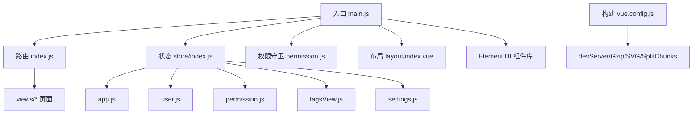
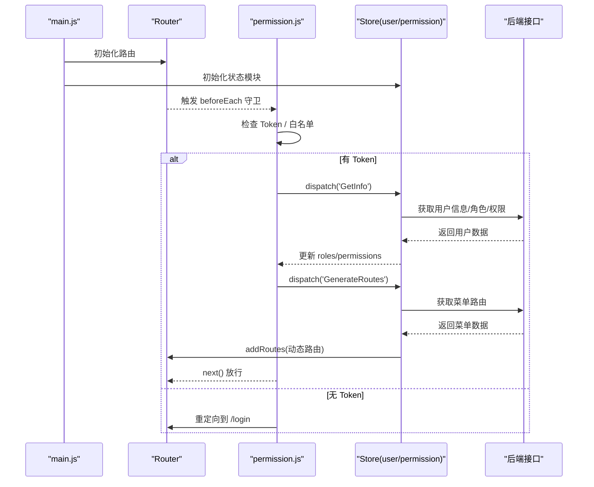
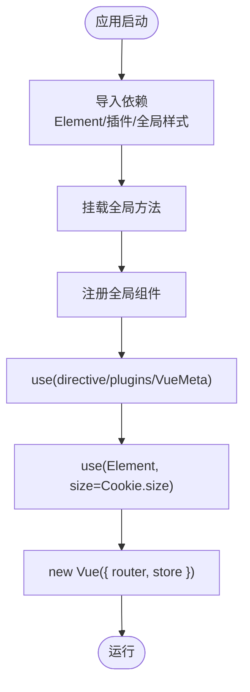
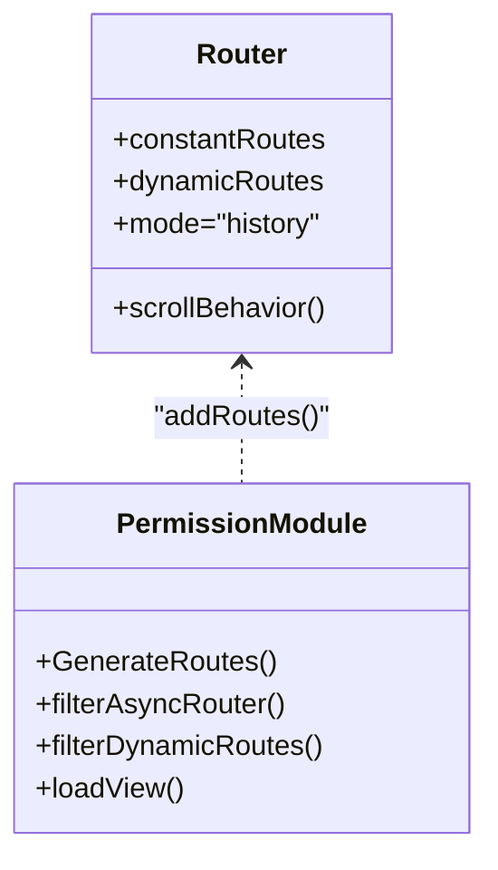
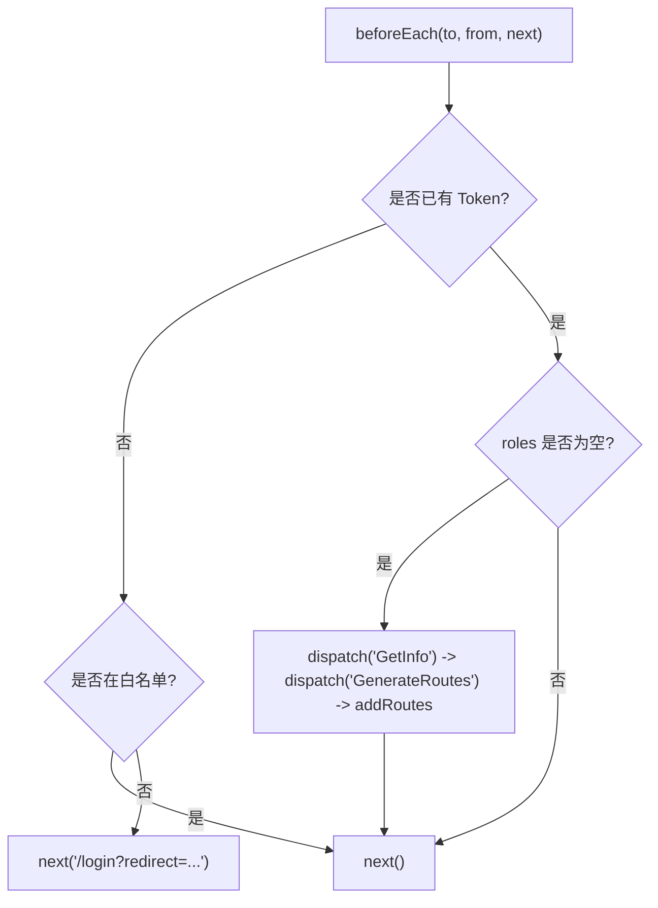
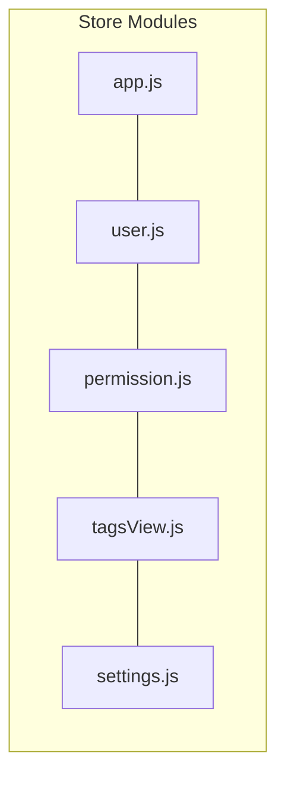
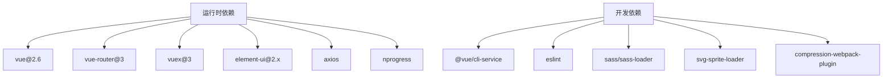
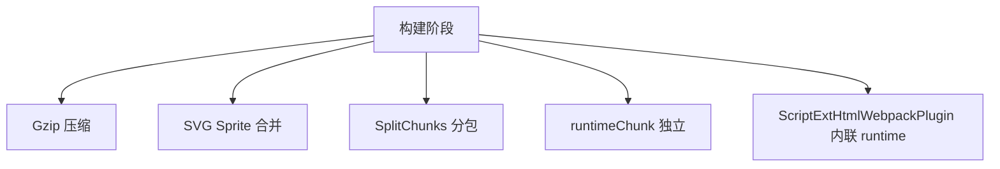

# 前端架构设计

<cite>
**本文引用的文件**   
- [package.json](file://ruoyi-ui/package.json)
- [main.js](file://ruoyi-ui/src/main.js)
- [App.vue](file://ruoyi-ui/src/App.vue)
- [permission.js](file://ruoyi-ui/src/permission.js)
- [vue.config.js](file://ruoyi-ui/vue.config.js)
- [index.js（路由）](file://ruoyi-ui/src/router/index.js)
- [index.js（状态管理入口）](file://ruoyi-ui/src/store/index.js)
- [app.js（应用状态模块）](file://ruoyi-ui/src/store/modules/app.js)
- [user.js（用户状态模块）](file://ruoyi-ui/src/store/modules/user.js)
- [permission.js（权限与动态路由模块）](file://ruoyi-ui/src/store/modules/permission.js)
- [tagsView.js（标签页缓存模块）](file://ruoyi-ui/src/store/modules/tagsView.js)
- [settings.js（设置模块）](file://ruoyi-ui/src/store/modules/settings.js)
</cite>

## 目录
1. [简介](#简介)
2. [项目结构](#项目结构)
3. [核心组件](#核心组件)
4. [架构总览](#架构总览)
5. [详细组件分析](#详细组件分析)
6. [依赖关系分析](#依赖关系分析)
7. [性能与构建优化](#性能与构建优化)
8. [故障排查指南](#故障排查指南)
9. [结论](#结论)
10. [附录：扩展与最佳实践](#附录扩展与最佳实践)

## 简介
本文件面向若依 Vue 前端工程，系统性梳理其整体架构模式、技术栈选择、项目结构组织，并深入解析应用初始化流程、路由配置策略、状态管理方案、组件库集成等关键决策。同时给出构建配置、开发环境设置、代码分割策略等技术实现细节，以及架构扩展指南与最佳实践建议，帮助团队在保持现有稳定性的前提下进行有序演进。

## 项目结构
前端采用 Vue 2 + Element UI 的管理后台模板风格，以模块化方式组织代码：
- 入口与全局装配：main.js 负责插件、全局组件与方法挂载、Element UI 主题尺寸初始化，并注入路由与状态管理。
- 视图与布局：views 下按业务域划分页面；layout 提供统一布局壳层。
- 路由：router/index.js 定义公共路由与动态路由常量，配合权限模块动态生成可访问路由表。
- 状态管理：store 使用 Vuex，按功能拆分为 app、user、permission、tagsView、settings 等模块。
- 工具与指令：utils、directive、plugins 提供通用能力封装。
- 构建与开发：vue.config.js 集中配置 devServer、Gzip、SVG Sprite、SplitChunks 等。

图表来源
- [main.js:1-87](file://ruoyi-ui/src/main.js#L1-L87)
- [index.js（路由）:1-178](file://ruoyi-ui/src/router/index.js#L1-L178)
- [index.js（状态管理入口）:1-24](file://ruoyi-ui/src/store/index.js#L1-L24)
- [permission.js:1-57](file://ruoyi-ui/src/permission.js#L1-L57)
- [vue.config.js:1-136](file://ruoyi-ui/vue.config.js#L1-L136)

章节来源
- [main.js:1-87](file://ruoyi-ui/src/main.js#L1-L87)
- [package.json:1-91](file://ruoyi-ui/package.json#L1-L91)

## 核心组件
- 应用初始化与全局装配
  - 全局方法挂载：字典获取、时间格式化、表单重置、树形处理、下载等。
  - 全局组件注册：分页、富文本、上传、预览、字典标签等。
  - 插件与元信息：指令、插件、VueMeta 启用，Element UI 尺寸从 Cookie 读取。
- 路由与权限
  - 公共路由：登录、注册、错误页、首页、个人中心等。
  - 动态路由：基于后端菜单数据生成，结合权限过滤与懒加载。
  - 导航守卫：根据 Token 与角色拉取用户信息与菜单，动态添加路由并放行。
- 状态管理（Vuex）
  - app：侧边栏开关、设备类型、尺寸等界面态。
  - user：Token、用户信息、角色与权限、刷新与登出。
  - permission：动态路由生成、侧边栏/顶栏路由映射、组件懒加载器。
  - tagsView：已访问与缓存的标签页集合及增删改操作。
  - settings：主题、导航模式、标签页开关、动态标题等。

章节来源
- [main.js:1-87](file://ruoyi-ui/src/main.js#L1-L87)
- [index.js（路由）:1-178](file://ruoyi-ui/src/router/index.js#L1-L178)
- [permission.js:1-57](file://ruoyi-ui/src/permission.js#L1-L57)
- [index.js（状态管理入口）:1-24](file://ruoyi-ui/src/store/index.js#L1-L24)
- [app.js:1-67](file://ruoyi-ui/src/store/modules/app.js#L1-L67)
- [user.js:1-116](file://ruoyi-ui/src/store/modules/user.js#L1-L116)
- [permission.js（权限模块）:1-134](file://ruoyi-ui/src/store/modules/permission.js#L1-L134)
- [tagsView.js:1-208](file://ruoyi-ui/src/store/modules/tagsView.js#L1-L208)
- [settings.js:1-43](file://ruoyi-ui/src/store/modules/settings.js#L1-L43)

## 架构总览
该前端采用“单页应用 + 模块化状态 + 动态路由”的经典管理后台架构：
- 运行时由 main.js 启动，装配 Element UI、插件、全局方法与组件，挂载 Router 与 Store。
- 路由层通过 permission.js 守卫控制鉴权与动态菜单渲染。
- 状态层按职责拆分模块，解耦界面态、用户态、权限态、标签页态与设置态。
- 构建层通过 vue.config.js 完成开发代理、资源压缩、图标雪碧图与分包策略。

图表来源
- [main.js:1-87](file://ruoyi-ui/src/main.js#L1-L87)
- [permission.js:1-57](file://ruoyi-ui/src/permission.js#L1-L57)
- [user.js:1-116](file://ruoyi-ui/src/store/modules/user.js#L1-L116)
- [permission.js（权限模块）:1-134](file://ruoyi-ui/src/store/modules/permission.js#L1-L134)
- [index.js（路由）:1-178](file://ruoyi-ui/src/router/index.js#L1-L178)

## 详细组件分析

### 应用初始化流程（main.js）
- 引入并注册 Element UI，尺寸来自 Cookie。
- 注册全局方法与组件，便于在任意组件中直接调用。
- 启用指令、插件与 VueMeta，完成 SEO 与元信息管理。
- 创建 Vue 实例，挂载 router 与 store。

图表来源
- [main.js:1-87](file://ruoyi-ui/src/main.js#L1-L87)

章节来源
- [main.js:1-87](file://ruoyi-ui/src/main.js#L1-L87)

### 路由配置策略（router/index.js）
- 公共路由 constantRoutes：登录、注册、错误页、首页、个人中心等。
- 动态路由 dynamicRoutes：带权限标识的隐藏路由，供权限模块过滤后注入。
- 路由模式 history，滚动行为归零，避免跳转时滚动位置异常。
- 对 push 进行二次包装，防止连续点击报错。

图表来源
- [index.js（路由）:1-178](file://ruoyi-ui/src/router/index.js#L1-L178)
- [permission.js（权限模块）:1-134](file://ruoyi-ui/src/store/modules/permission.js#L1-L134)

章节来源
- [index.js（路由）:1-178](file://ruoyi-ui/src/router/index.js#L1-L178)

### 权限与动态路由（permission.js 守卫 + permission.js 模块）
- 守卫逻辑：
  - 存在 Token：优先设置页面标题，若进入登录页则重定向至首页。
  - 未拉取过用户信息：调用 GetInfo 获取角色/权限，再 GenerateRoutes 拉取菜单并 addRoutes。
  - 无 Token：白名单放行，否则重定向到登录页。
- 动态路由生成：
  - 将后端菜单字符串转换为组件对象，特殊组件 Layout/ParentView/InnerLink 映射为实际组件。
  - 过滤动态路由中的权限/角色标记，仅保留当前用户可访问的路由。
  - 生产环境使用 import() 实现懒加载，开发环境使用 require.ensure 兼容写法。

图表来源
- [permission.js:1-57](file://ruoyi-ui/src/permission.js#L1-L57)
- [permission.js（权限模块）:1-134](file://ruoyi-ui/src/store/modules/permission.js#L1-L134)

章节来源
- [permission.js:1-57](file://ruoyi-ui/src/permission.js#L1-L57)
- [permission.js（权限模块）:1-134](file://ruoyi-ui/src/store/modules/permission.js#L1-L134)

### 状态管理方案（Vuex 模块）
- app：侧边栏展开/收起、设备类型、尺寸大小等界面态，持久化到 Cookie。
- user：登录、获取用户信息、刷新 Token、登出等动作，维护 token、name、avatar、roles、permissions。
- permission：动态路由生成、侧边栏/顶栏路由映射、组件懒加载器 loadView。
- tagsView：维护 visitedViews 与 cachedViews，支持新增、删除、清空、左右裁剪等操作。
- settings：主题、顶部导航、标签页、固定头部、侧边栏 Logo、动态标题等设置项，持久化到 localStorage。

图表来源
- [index.js（状态管理入口）:1-24](file://ruoyi-ui/src/store/index.js#L1-L24)
- [app.js:1-67](file://ruoyi-ui/src/store/modules/app.js#L1-L67)
- [user.js:1-116](file://ruoyi-ui/src/store/modules/user.js#L1-L116)
- [permission.js（权限模块）:1-134](file://ruoyi-ui/src/store/modules/permission.js#L1-L134)
- [tagsView.js:1-208](file://ruoyi-ui/src/store/modules/tagsView.js#L1-L208)
- [settings.js:1-43](file://ruoyi-ui/src/store/modules/settings.js#L1-L43)

章节来源
- [index.js（状态管理入口）:1-24](file://ruoyi-ui/src/store/index.js#L1-L24)
- [app.js:1-67](file://ruoyi-ui/src/store/modules/app.js#L1-L67)
- [user.js:1-116](file://ruoyi-ui/src/store/modules/user.js#L1-L116)
- [permission.js（权限模块）:1-134](file://ruoyi-ui/src/store/modules/permission.js#L1-L134)
- [tagsView.js:1-208](file://ruoyi-ui/src/store/modules/tagsView.js#L1-L208)
- [settings.js:1-43](file://ruoyi-ui/src/store/modules/settings.js#L1-L43)

### 组件库集成（Element UI）
- 在 main.js 中全局 use(Element)，并通过 Cookie 读取默认尺寸，保证多端一致体验。
- 通过 SCSS 变量覆盖与自定义样式文件，统一主题与品牌色。

章节来源
- [main.js:1-87](file://ruoyi-ui/src/main.js#L1-L87)

### 页面标题与元信息（App.vue + settings.js）
- App.vue 通过 vue-meta 动态设置 title 与 titleTemplate，结合 settings 模块的 dynamicTitle 控制。
- settings.js 提供 setTitle action，在路由守卫中根据 meta.title 设置页面标题。

章节来源
- [App.vue:1-20](file://ruoyi-ui/src/App.vue#L1-L20)
- [settings.js:1-43](file://ruoyi-ui/src/store/modules/settings.js#L1-L43)
- [permission.js:1-57](file://ruoyi-ui/src/permission.js#L1-L57)

## 依赖关系分析
- 运行时依赖
  - Vue 2.6、Vue Router 3、Vuex 3、Element UI 2.x、Axios、NProgress、ECharts、Quill 等。
- 开发依赖
  - @vue/cli-service、ESLint、Sass、svg-sprite-loader、compression-webpack-plugin、script-ext-html-webpack-plugin 等。

图表来源
- [package.json:1-91](file://ruoyi-ui/package.json#L1-L91)

章节来源
- [package.json:1-91](file://ruoyi-ui/package.json#L1-L91)

## 性能与构建优化
- 开发服务器
  - 监听 0.0.0.0，端口可配置，自动打开浏览器，开启跨域代理，重写基础路径。
- 静态资源
  - 输出目录 dist，静态资源目录 static，关闭生产 source map。
- 资源压缩
  - 启用 Gzip 压缩 js/css/html，降低传输体积。
- 图标优化
  - 使用 svg-sprite-loader 将 src/assets/icons 下的 SVG 编译为雪碧图，减少请求数。
- 代码分割
  - 非开发环境启用 splitChunks，分离第三方库、Element UI、公共组件，提升缓存命中与首屏速度。
  - 启用 runtimeChunk 单独打包运行时。
- 脚本内联
  - 非开发环境将 runtime 脚本内联到 HTML，减少一次请求。

图表来源
- [vue.config.js:1-136](file://ruoyi-ui/vue.config.js#L1-L136)

章节来源
- [vue.config.js:1-136](file://ruoyi-ui/vue.config.js#L1-L136)

## 故障排查指南
- 路由重复或报错
  - 现象：频繁点击路由出现 Promise 拒绝。
  - 原因：多次 push 导致未捕获异常。
  - 解决：已在路由原型上包装 push 捕获异常，确保稳定。
- 登录后无法进入系统
  - 现象：进入系统后空白或停留在登录页。
  - 排查：确认 Token 是否存在；检查 GetInfo 与 GenerateRoutes 是否成功；查看 addRoutes 是否执行。
- 菜单不显示
  - 现象：侧边栏为空。
  - 排查：确认后端返回菜单数据格式；检查 filterAsyncRouter 与 loadView 是否正确转换组件路径。
- 页面标题不生效
  - 现象：浏览器标题未随路由变化。
  - 排查：检查 settings.dynamicTitle 与 setTitle action；确认 App.vue 的 metaInfo 配置。
- 构建产物过大
  - 现象：首屏加载慢。
  - 排查：确认 SplitChunks 与 Gzip 是否启用；检查是否有大体积第三方库未按需引入。

章节来源
- [index.js（路由）:167-178](file://ruoyi-ui/src/router/index.js#L167-L178)
- [permission.js:1-57](file://ruoyi-ui/src/permission.js#L1-L57)
- [permission.js（权限模块）:1-134](file://ruoyi-ui/src/store/modules/permission.js#L1-L134)
- [App.vue:1-20](file://ruoyi-ui/src/App.vue#L1-L20)
- [vue.config.js:1-136](file://ruoyi-ui/vue.config.js#L1-L136)

## 结论
本项目采用成熟的 Vue 2 管理后台架构，通过模块化状态、动态路由与权限控制，实现了高内聚低耦合的前端体系。构建层针对开发体验与生产性能做了充分优化，包括 Gzip、SVG Sprite、SplitChunks 与 runtimeChunk 等。在此基础上，团队可按需扩展业务模块、接入新组件库与监控埋点，并保持清晰的边界与稳定的演进路径。

## 附录：扩展与最佳实践
- 新增业务模块
  - 在 views 下新建页面，并在 router/index.js 的 dynamicRoutes 中添加对应路由（如需权限控制）。
  - 在 store/modules 下新增模块，遵循 state/mutations/actions 规范，必要时在 getters.js 暴露计算属性。
- 接入新组件库
  - 在 main.js 中按需引入并使用，避免全量引入造成包体膨胀。
  - 对于大型图表库（如 ECharts），建议使用按需引入或异步加载。
- 路由与权限
  - 所有需要权限控制的页面，建议在后端菜单中配置 permissions 字段，由 permission 模块统一过滤。
  - 对敏感操作在前端做二次校验，并结合后端权限验证。
- 性能优化
  - 合理使用 keep-alive 与 noCache 控制组件缓存。
  - 图片与静态资源走 CDN，减少主站带宽压力。
  - 对大体积第三方库进行分包与懒加载。
- 可观测性
  - 接入前端日志上报与错误监控，结合 NProgress 与路由守卫记录关键路径耗时。
- 安全与合规
  - 严格校验输入，防范 XSS；对导出/下载等敏感操作增加二次确认与权限校验。

[本节为概念性指导，不涉及具体源码文件]