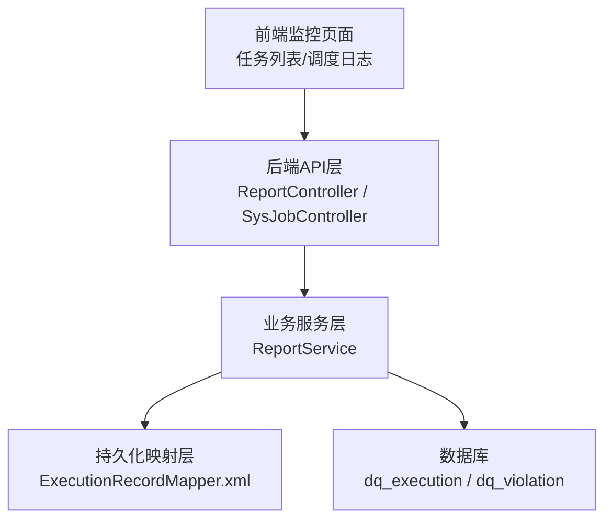
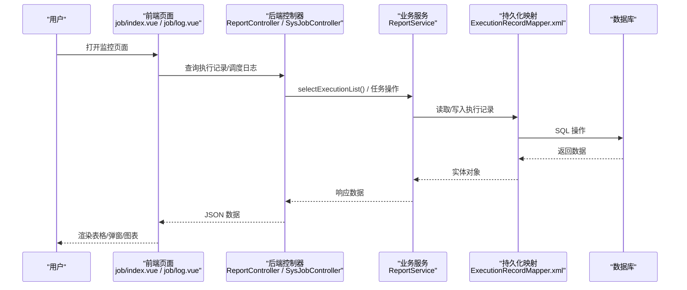
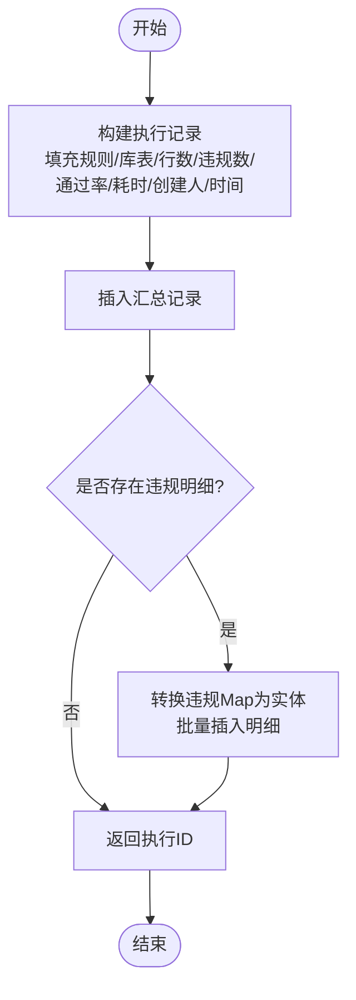
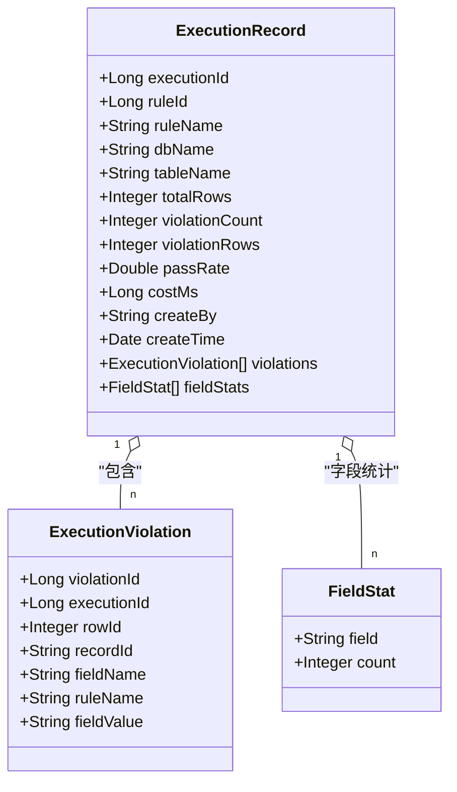
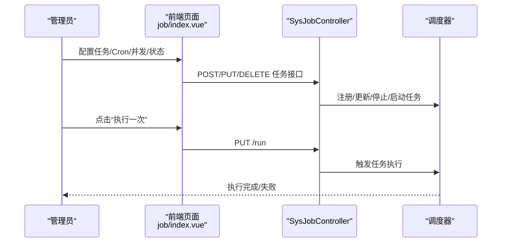
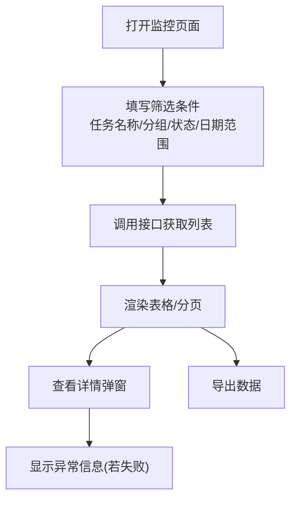
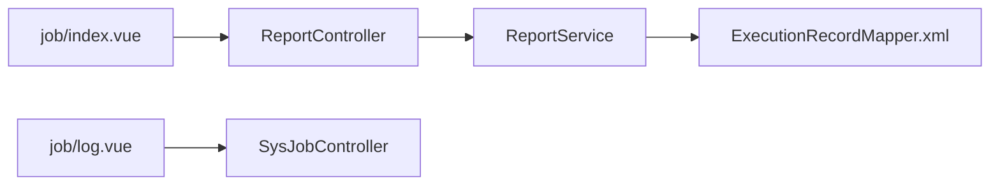

# 执行监控页面

<cite>
**本文引用的文件**   
- [ReportService.java](file://ruoyi-modules/ruoyi-dqservice/src/main/java/com/ruoyi/dqservice/service/ReportService.java)
- [ExecutionRecord.java](file://ruoyi-modules/ruoyi-dqservice/src/main/java/com/ruoyi/dqservice/domain/ExecutionRecord.java)
- [ExecutionViolation.java](file://ruoyi-modules/ruoyi-dqservice/src/main/java/com/ruoyi/dqservice/domain/ExecutionViolation.java)
- [Rule.java](file://ruoyi-modules/ruoyi-dqservice/src/main/java/com/ruoyi/dqservice/domain/Rule.java)
- [ReportController.java](file://ruoyi-modules/ruoyi-dqservice/src/main/java/com/ruoyi/dqservice/controller/ReportController.java)
- [ExecutionRecordMapper.xml](file://ruoyi-modules/ruoyi-dqservice/src/main/resources/mapper/dqservice/ExecutionRecordMapper.xml)
- [SysJobController.java](file://ruoyi-modules/ruoyi-job/src/main/java/com/ruoyi/job/controller/SysJobController.java)
- [job/index.vue](file://ruoyi-ui/src/views/monitor/job/index.vue)
- [job/log.vue](file://ruoyi-ui/src/views/monitor/job/log.vue)
- [jobLog.js](file://ruoyi-ui/src/api/monitor/jobLog.js)
</cite>

## 目录
1. [简介](#简介)
2. [项目结构](#项目结构)
3. [核心组件](#核心组件)
4. [架构总览](#架构总览)
5. [详细组件分析](#详细组件分析)
6. [依赖关系分析](#依赖关系分析)
7. [性能与并发特性](#性能与并发特性)
8. [故障排查指南](#故障排查指南)
9. [结论](#结论)
10. [附录](#附录)

## 简介
本文件面向“规则执行监控页面”的完整实现说明，覆盖以下能力：
- 实时监控：执行状态、进度条、耗时统计等关键指标展示。
- 结果查看：违规记录明细、统计数据图表、字段分布与趋势可视化。
- 批量任务管理：任务调度、优先级设置、并发控制（基于系统定时任务）。
- 运维监控：执行日志查看、异常告警、性能分析。
- 数据分析：历史执行记录查询对比、结果导出、报告生成。

## 项目结构
围绕“规则执行监控页面”，代码主要分布在数据质量服务模块（后端）与前端监控页面中：
- 后端：数据质量执行记录的保存、查询与聚合统计；定时任务调度接口。
- 前端：任务列表与调度日志查看界面，提供搜索、分页、详情弹窗、导出等功能。

图示来源
- [ReportController.java](file://ruoyi-modules/ruoyi-dqservice/src/main/java/com/ruoyi/dqservice/controller/ReportController.java)
- [ReportService.java:58-109](file://ruoyi-modules/ruoyi-dqservice/src/main/java/com/ruoyi/dqservice/service/ReportService.java#L58-L109)
- [ExecutionRecordMapper.xml](file://ruoyi-modules/ruoyi-dqservice/src/main/resources/mapper/dqservice/ExecutionRecordMapper.xml)

章节来源
- [ReportService.java:58-109](file://ruoyi-modules/ruoyi-dqservice/src/main/java/com/ruoyi/dqservice/service/ReportService.java#L58-L109)
- [job/index.vue:116-154](file://ruoyi-ui/src/views/monitor/job/index.vue#L116-L154)
- [job/log.vue:146-178](file://ruoyi-ui/src/views/monitor/job/log.vue#L146-L178)

## 核心组件
- 执行记录模型 ExecutionRecord：承载每次规则执行的汇总指标（扫描行数、违规条数、通过率、耗时、执行人、时间等），并包含违规明细与字段分布的非表字段。
- 违规明细模型 ExecutionViolation：记录每条违规的具体信息（行号、记录主键、字段名、命中规则、字段值）。
- 规则模型 Rule：描述规则元数据（名称、库表、分区策略等），用于执行上下文与结果落库。
- 报表服务 ReportService：封装执行结果的保存、查询与聚合统计逻辑，保证汇总与明细在同一事务内写入。
- 报表控制器 ReportController：对外暴露执行记录列表与详情查询接口。
- 定时任务控制器 SysJobController：提供任务的增删改查、状态切换、立即执行、删除等操作。
- 前端监控页面 job/index.vue 与 job/log.vue：提供任务管理与调度日志查看界面。

章节来源
- [ExecutionRecord.java:1-74](file://ruoyi-modules/ruoyi-dqservice/src/main/java/com/ruoyi/dqservice/domain/ExecutionRecord.java#L1-L74)
- [ExecutionViolation.java:1-38](file://ruoyi-modules/ruoyi-dqservice/src/main/java/com/ruoyi/dqservice/domain/ExecutionViolation.java#L1-L38)
- [Rule.java:1-87](file://ruoyi-modules/ruoyi-dqservice/src/main/java/com/ruoyi/dqservice/domain/Rule.java#L1-L87)
- [ReportService.java:58-109](file://ruoyi-modules/ruoyi-dqservice/src/main/java/com/ruoyi/dqservice/service/ReportService.java#L58-L109)
- [ReportController.java](file://ruoyi-modules/ruoyi-dqservice/src/main/java/com/ruoyi/dqservice/controller/ReportController.java)
- [SysJobController.java:78-186](file://ruoyi-modules/ruoyi-job/src/main/java/com/ruoyi/job/controller/SysJobController.java#L78-L186)
- [job/index.vue:116-154](file://ruoyi-ui/src/views/monitor/job/index.vue#L116-L154)
- [job/log.vue:146-178](file://ruoyi-ui/src/views/monitor/job/log.vue#L146-L178)

## 架构总览
规则执行监控的整体流程如下：
- 用户在前端操作任务或查看日志。
- 后端通过控制器接收请求，调用服务层进行数据处理。
- 服务层将执行结果持久化到数据库，并提供查询与聚合统计。
- 前端渲染表格、弹窗、分页与导出功能。

图示来源
- [ReportController.java](file://ruoyi-modules/ruoyi-dqservice/src/main/java/com/ruoyi/dqservice/controller/ReportController.java)
- [ReportService.java:91-109](file://ruoyi-modules/ruoyi-dqservice/src/main/java/com/ruoyi/dqservice/service/ReportService.java#L91-L109)
- [ExecutionRecordMapper.xml](file://ruoyi-modules/ruoyi-dqservice/src/main/resources/mapper/dqservice/ExecutionRecordMapper.xml)
- [job/index.vue:116-154](file://ruoyi-ui/src/views/monitor/job/index.vue#L116-L154)
- [job/log.vue:146-178](file://ruoyi-ui/src/views/monitor/job/log.vue#L146-L178)

## 详细组件分析

### 执行结果保存与查询（ReportService）
- 保存执行结果：在事务中先写汇总记录，再批量写入违规明细，确保一致性。
- 查询执行记录：支持按条件查询列表。
- 查询执行详情：返回汇总记录、违规明细与字段分布统计。

图示来源
- [ReportService.java:58-89](file://ruoyi-modules/ruoyi-dqservice/src/main/java/com/ruoyi/dqservice/service/ReportService.java#L58-L89)

章节来源
- [ReportService.java:58-109](file://ruoyi-modules/ruoyi-dqservice/src/main/java/com/ruoyi/dqservice/service/ReportService.java#L58-L109)

### 执行记录与违规明细模型（ExecutionRecord / ExecutionViolation）
- ExecutionRecord：包含执行批次ID、规则ID/名称、库名/表名、扫描行数、违规条数、命中行数、通过率、耗时、创建人与时间；非表字段 violations 与 fieldStats 用于详情视图。
- ExecutionViolation：包含违规明细ID、执行批次ID、行号、记录主键、字段名、命中规则、字段值。

图示来源
- [ExecutionRecord.java:1-74](file://ruoyi-modules/ruoyi-dqservice/src/main/java/com/ruoyi/dqservice/domain/ExecutionRecord.java#L1-L74)
- [ExecutionViolation.java:1-38](file://ruoyi-modules/ruoyi-dqservice/src/main/java/com/ruoyi/dqservice/domain/ExecutionViolation.java#L1-L38)

章节来源
- [ExecutionRecord.java:1-74](file://ruoyi-modules/ruoyi-dqservice/src/main/java/com/ruoyi/dqservice/domain/ExecutionRecord.java#L1-L74)
- [ExecutionViolation.java:1-38](file://ruoyi-modules/ruoyi-dqservice/src/main/java/com/ruoyi/dqservice/domain/ExecutionViolation.java#L1-L38)

### 规则模型（Rule）
- Rule 描述规则元数据，包括规则名称、创建者、规则文本、库名、表名、字段名、类型、分区策略等，用于执行上下文与结果落库。

章节来源
- [Rule.java:1-87](file://ruoyi-modules/ruoyi-dqservice/src/main/java/com/ruoyi/dqservice/domain/Rule.java#L1-L87)

### 定时任务与批量执行（SysJobController）
- 提供定时任务的增删改查、状态修改、立即执行一次、删除等操作。
- 支持并发控制（是否允许并发）与状态管理，便于批量执行任务的管理。

图示来源
- [SysJobController.java:78-186](file://ruoyi-modules/ruoyi-job/src/main/java/com/ruoyi/job/controller/SysJobController.java#L78-L186)
- [job/index.vue:116-154](file://ruoyi-ui/src/views/monitor/job/index.vue#L116-L154)

章节来源
- [SysJobController.java:78-186](file://ruoyi-modules/ruoyi-job/src/main/java/com/ruoyi/job/controller/SysJobController.java#L78-L186)
- [job/index.vue:116-154](file://ruoyi-ui/src/views/monitor/job/index.vue#L116-L154)

### 前端监控界面（job/index.vue / job/log.vue）
- 任务列表页：支持编辑、删除、更多操作（执行一次、任务详细、调度日志）、分页。
- 调度日志页：支持按任务名称/分组/状态/日期范围筛选，查看日志详情（含异常信息），支持删除与清空，提供导出功能。

图示来源
- [job/log.vue:146-178](file://ruoyi-ui/src/views/monitor/job/log.vue#L146-L178)
- [jobLog.js:1-26](file://ruoyi-ui/src/api/monitor/jobLog.js#L1-L26)

章节来源
- [job/index.vue:116-154](file://ruoyi-ui/src/views/monitor/job/index.vue#L116-L154)
- [job/log.vue:146-178](file://ruoyi-ui/src/views/monitor/job/log.vue#L146-L178)
- [jobLog.js:1-26](file://ruoyi-ui/src/api/monitor/jobLog.js#L1-L26)

## 依赖关系分析
- 控制器依赖服务层：ReportController 调用 ReportService 提供的查询与保存方法。
- 服务层依赖映射层：ReportService 通过 ExecutionRecordMapper 访问数据库。
- 前端依赖后端API：job/index.vue 与 job/log.vue 通过 axios 封装的请求调用后端接口。

图示来源
- [ReportController.java](file://ruoyi-modules/ruoyi-dqservice/src/main/java/com/ruoyi/dqservice/controller/ReportController.java)
- [ReportService.java:91-109](file://ruoyi-modules/ruoyi-dqservice/src/main/java/com/ruoyi/dqservice/service/ReportService.java#L91-L109)
- [ExecutionRecordMapper.xml](file://ruoyi-modules/ruoyi-dqservice/src/main/resources/mapper/dqservice/ExecutionRecordMapper.xml)
- [job/index.vue:116-154](file://ruoyi-ui/src/views/monitor/job/index.vue#L116-L154)
- [job/log.vue:146-178](file://ruoyi-ui/src/views/monitor/job/log.vue#L146-L178)

章节来源
- [ReportController.java](file://ruoyi-modules/ruoyi-dqservice/src/main/java/com/ruoyi/dqservice/controller/ReportController.java)
- [ReportService.java:91-109](file://ruoyi-modules/ruoyi-dqservice/src/main/java/com/ruoyi/dqservice/service/ReportService.java#L91-L109)
- [ExecutionRecordMapper.xml](file://ruoyi-modules/ruoyi-dqservice/src/main/resources/mapper/dqservice/ExecutionRecordMapper.xml)
- [job/index.vue:116-154](file://ruoyi-ui/src/views/monitor/job/index.vue#L116-L154)
- [job/log.vue:146-178](file://ruoyi-ui/src/views/monitor/job/log.vue#L146-L178)

## 性能与并发特性
- 事务一致性：保存执行结果时，汇总与明细在同一事务内写入，避免不一致的报告。
- 批量写入：违规明细采用批量插入，减少数据库往返开销。
- 字段分布统计：在服务端对违规明细按字段聚合计数，降低前端计算压力。
- 并发控制：通过定时任务的“是否并发”选项控制任务并行度，避免资源争用。

章节来源
- [ReportService.java:58-89](file://ruoyi-modules/ruoyi-dqservice/src/main/java/com/ruoyi/dqservice/service/ReportService.java#L58-L89)
- [ReportService.java:131-149](file://ruoyi-modules/ruoyi-dqservice/src/main/java/com/ruoyi/dqservice/service/ReportService.java#L131-L149)
- [SysJobController.java:78-186](file://ruoyi-modules/ruoyi-job/src/main/java/com/ruoyi/job/controller/SysJobController.java#L78-L186)

## 故障排查指南
- 执行记录不存在：当查询详情时未找到对应执行ID，会抛出服务异常，需检查执行ID是否正确或记录是否被清理。
- 调度日志异常：日志详情页在失败状态下显示异常信息，便于定位问题原因。
- 任务执行失败：可通过“执行一次”触发任务后查看调度日志，确认任务目标方法与Cron表达式是否正确。

章节来源
- [ReportService.java:98-109](file://ruoyi-modules/ruoyi-dqservice/src/main/java/com/ruoyi/dqservice/service/ReportService.java#L98-L109)
- [job/log.vue:146-178](file://ruoyi-ui/src/views/monitor/job/log.vue#L146-L178)
- [SysJobController.java:150-173](file://ruoyi-modules/ruoyi-job/src/main/java/com/ruoyi/job/controller/SysJobController.java#L150-L173)

## 结论
该执行监控页面以清晰的分层架构实现了规则执行的实时监控、结果查看、批量任务管理与运维监控能力。通过事务一致性与批量写入保障数据准确性，借助前端交互提升用户体验，同时提供导出与分析能力支撑数据决策。

## 附录
- 关键指标说明：
  - 执行状态：正常/失败（调度日志与任务状态）。
  - 进度条：可结合扫描行数与违规行数在前端展示执行进度。
  - 耗时统计：costMs 毫秒级耗时，便于性能分析与优化。
  - 违规记录：明细列表与字段分布统计，辅助定位问题字段。
  - 趋势分析：可按时间维度聚合通过率与违规数量，形成趋势图。