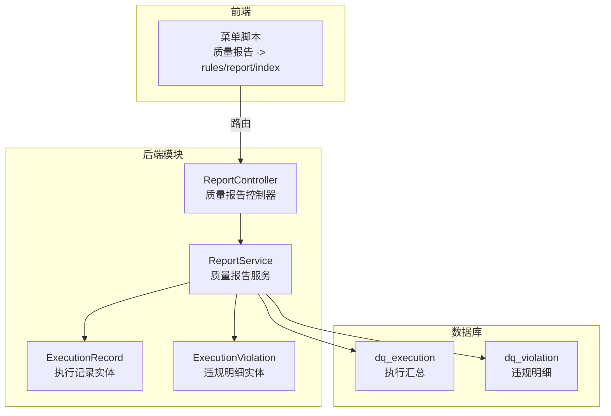
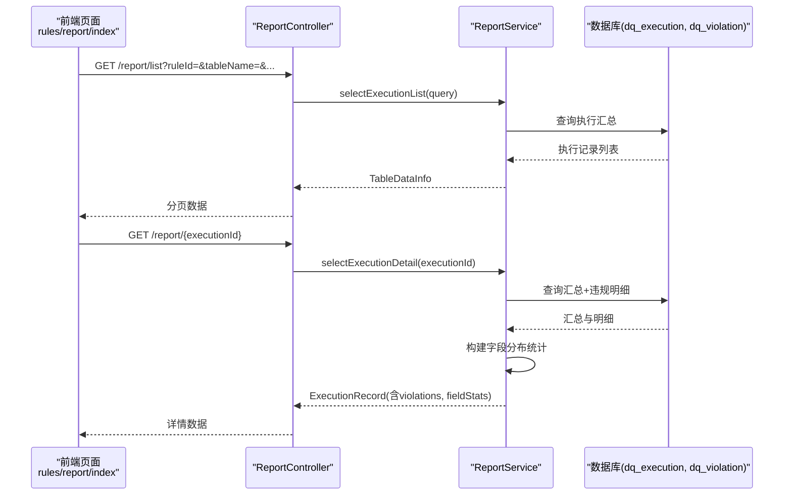
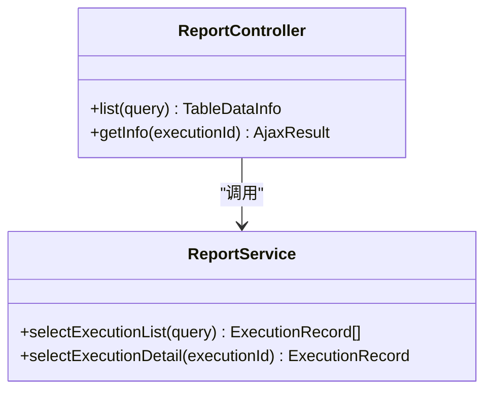
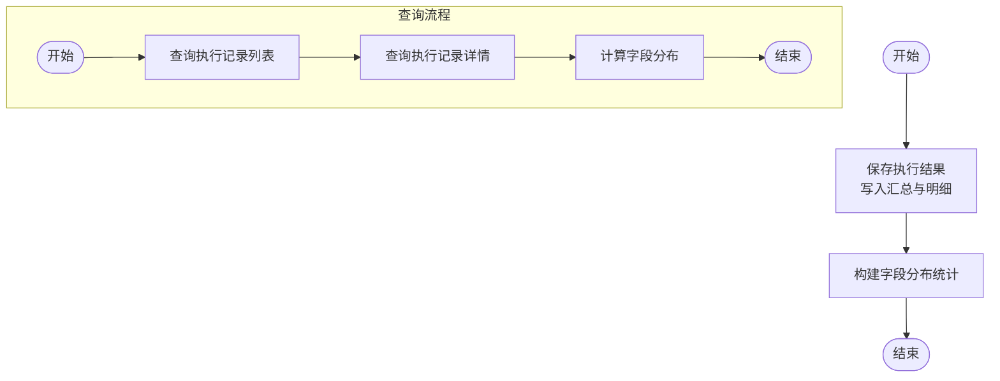
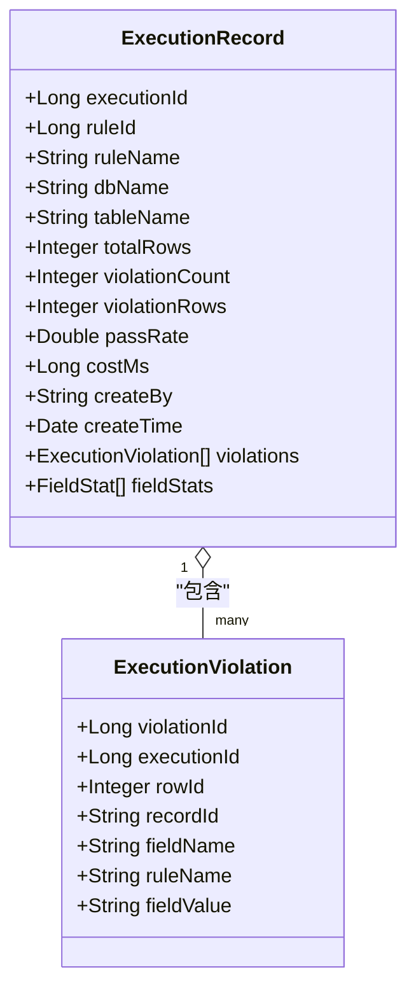
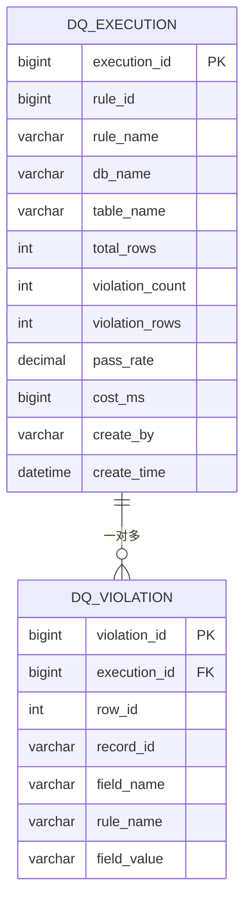
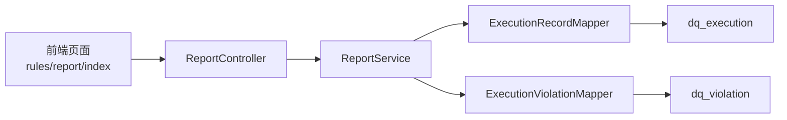

# 报告生成页面

<cite>
**本文引用的文件**   
- [ReportController.java](file://ruoyi-modules/ruoyi-dqservice/src/main/java/com/ruoyi/dqservice/controller/ReportController.java)
- [ReportService.java](file://ruoyi-modules/ruoyi-dqservice/src/main/java/com/ruoyi/dqservice/service/ReportService.java)
- [ExecutionRecord.java](file://ruoyi-modules/ruoyi-dqservice/src/main/java/com/ruoyi/dqservice/domain/ExecutionRecord.java)
- [ExecutionViolation.java](file://ruoyi-modules/ruoyi-dqservice/src/main/java/com/ruoyi/dqservice/domain/ExecutionViolation.java)
- [ry_dq_report_20261026.sql](file://sql/ry_dq_report_20261026.sql)
- [ry_dq_report_menu_20261026.sql](file://sql/ry_dq_report_menu_20261026.sql)
</cite>

## 目录
1. [简介](#简介)
2. [项目结构](#项目结构)
3. [核心组件](#核心组件)
4. [架构总览](#架构总览)
5. [详细组件分析](#详细组件分析)
6. [依赖关系分析](#依赖关系分析)
7. [性能考虑](#性能考虑)
8. [故障排查指南](#故障排查指南)
9. [结论](#结论)
10. [附录](#附录)

## 简介
本章节面向“质量报告自动生成”与“报告生成页面”的使用与实现说明。该功能用于在数据质量规则执行后，自动沉淀执行结果与违规明细，并提供查询、详情查看等能力，为前端“质量报告”页面提供数据支撑。当前仓库已包含后端接口、领域模型与数据库表结构；前端页面路由通过菜单脚本注册到“rules/report/index”。

## 项目结构
围绕“报告生成页面”的后端相关代码位于 ruoyi-dqservice 模块中，主要包含控制器、服务、领域对象与映射器；数据库脚本定义执行汇总与违规明细两张表；菜单脚本将“质量报告”挂载到系统菜单并指向前端页面路径。

图表来源
- [ReportController.java:22-49](file://ruoyi-modules/ruoyi-dqservice/src/main/java/com/ruoyi/dqservice/controller/ReportController.java#L22-L49)
- [ReportService.java:28-109](file://ruoyi-modules/ruoyi-dqservice/src/main/java/com/ruoyi/dqservice/service/ReportService.java#L28-L109)
- [ry_dq_report_20261026.sql:11-39](file://sql/ry_dq_report_20261026.sql#L11-L39)
- [ry_dq_report_menu_20261026.sql:12-13](file://sql/ry_dq_report_menu_20261026.sql#L12-L13)

章节来源
- [ReportController.java:22-49](file://ruoyi-modules/ruoyi-dqservice/src/main/java/com/ruoyi/dqservice/controller/ReportController.java#L22-L49)
- [ry_dq_report_menu_20261026.sql:12-13](file://sql/ry_dq_report_menu_20261026.sql#L12-L13)

## 核心组件
- 质量报告控制器：对外暴露“执行记录列表”和“执行记录详情”两个接口，支持权限控制与分页返回。
- 质量报告服务：负责保存一次规则执行的汇总与明细（事务内），以及查询执行记录的聚合统计与字段分布。
- 执行记录实体：表示 dq_execution 表的行数据，同时携带违规明细与字段统计等非持久化字段。
- 违规明细实体：表示 dq_violation 表的行数据，用于展示具体违规记录。

章节来源
- [ReportController.java:22-49](file://ruoyi-modules/ruoyi-dqservice/src/main/java/com/ruoyi/dqservice/controller/ReportController.java#L22-L49)
- [ReportService.java:28-109](file://ruoyi-modules/ruoyi-dqservice/src/main/java/com/ruoyi/dqservice/service/ReportService.java#L28-L109)
- [ExecutionRecord.java:16-73](file://ruoyi-modules/ruoyi-dqservice/src/main/java/com/ruoyi/dqservice/domain/ExecutionRecord.java#L16-L73)
- [ExecutionViolation.java:12-37](file://ruoyi-modules/ruoyi-dqservice/src/main/java/com/ruoyi/dqservice/domain/ExecutionViolation.java#L12-L37)

## 架构总览
下图展示了从前端菜单到后端接口、再到数据库的调用链路，以及报告生成的关键数据流。

图表来源
- [ReportController.java:32-49](file://ruoyi-modules/ruoyi-dqservice/src/main/java/com/ruoyi/dqservice/controller/ReportController.java#L32-L49)
- [ReportService.java:91-109](file://ruoyi-modules/ruoyi-dqservice/src/main/java/com/ruoyi/dqservice/service/ReportService.java#L91-L109)
- [ry_dq_report_20261026.sql:11-39](file://sql/ry_dq_report_20261026.sql#L11-L39)

## 详细组件分析

### 质量报告控制器（ReportController）
- 职责
  - 提供“执行记录列表”接口，支持分页与条件查询。
  - 提供“执行记录详情”接口，返回汇总、违规明细与字段分布。
- 权限
  - 两个接口均受权限注解保护，需具备 dqservice:report:list 权限。
- 输入输出
  - 列表接口接收 ExecutionRecord 作为查询参数，返回 TableDataInfo。
  - 详情接口接收 executionId 路径参数，返回 AjaxResult 包裹的 ExecutionRecord。

图表来源
- [ReportController.java:22-49](file://ruoyi-modules/ruoyi-dqservice/src/main/java/com/ruoyi/dqservice/controller/ReportController.java#L22-L49)
- [ReportService.java:91-109](file://ruoyi-modules/ruoyi-dqservice/src/main/java/com/ruoyi/dqservice/service/ReportService.java#L91-L109)

章节来源
- [ReportController.java:22-49](file://ruoyi-modules/ruoyi-dqservice/src/main/java/com/ruoyi/dqservice/controller/ReportController.java#L22-L49)

### 质量报告服务（ReportService）
- 保存执行结果（saveExecution）
  - 在事务内写入 dq_execution 汇总与 dq_violation 明细，保证一致性。
  - 对 Drools 产出的 Map 违规明细进行字段截断与类型转换，避免超长或类型不匹配导致入库失败。
  - 使用当前用户上下文记录 createBy，若不存在则回退为 system。
- 查询执行记录（selectExecutionList/selectExecutionDetail）
  - 列表查询直接委托 Mapper 层。
  - 详情查询组装违规明细与字段分布统计，并按违规次数降序排列。
- 字段分布统计（buildFieldStats）
  - 基于违规明细按 fieldName 聚合计数，形成可视化所需的统计数据。

图表来源
- [ReportService.java:58-89](file://ruoyi-modules/ruoyi-dqservice/src/main/java/com/ruoyi/dqservice/service/ReportService.java#L58-L89)
- [ReportService.java:91-149](file://ruoyi-modules/ruoyi-dqservice/src/main/java/com/ruoyi/dqservice/service/ReportService.java#L91-L149)

章节来源
- [ReportService.java:58-149](file://ruoyi-modules/ruoyi-dqservice/src/main/java/com/ruoyi/dqservice/service/ReportService.java#L58-L149)

### 领域模型（ExecutionRecord / ExecutionViolation）
- ExecutionRecord
  - 持久化字段：执行批次ID、规则ID/名称、数据库名、表名、扫描行数、违规条数、命中行数、通过率、耗时、执行人、执行时间。
  - 非持久化字段：violations（违规明细列表）、fieldStats（字段分布统计）。
- ExecutionViolation
  - 字段包括：违规明细ID、执行批次ID、扫描行号、记录主键值、违规字段、命中规则、字段值。

图表来源
- [ExecutionRecord.java:16-73](file://ruoyi-modules/ruoyi-dqservice/src/main/java/com/ruoyi/dqservice/domain/ExecutionRecord.java#L16-L73)
- [ExecutionViolation.java:12-37](file://ruoyi-modules/ruoyi-dqservice/src/main/java/com/ruoyi/dqservice/domain/ExecutionViolation.java#L12-L37)

章节来源
- [ExecutionRecord.java:16-73](file://ruoyi-modules/ruoyi-dqservice/src/main/java/com/ruoyi/dqservice/domain/ExecutionRecord.java#L16-L73)
- [ExecutionViolation.java:12-37](file://ruoyi-modules/ruoyi-dqservice/src/main/java/com/ruoyi/dqservice/domain/ExecutionViolation.java#L12-L37)

### 数据库设计（dq_execution / dq_violation）
- dq_execution
  - 存储每次规则执行的汇总信息，包括规则、库表、扫描行数、违规情况、通过率、耗时、执行人与时间等。
  - 索引：主键 execution_id，rule_id、create_time 建索引以优化查询。
- dq_violation
  - 存储每次执行的逐条违规明细，便于前端展示与导出。
  - 索引：主键 violation_id，execution_id 建索引以加速关联查询。

图表来源
- [ry_dq_report_20261026.sql:11-39](file://sql/ry_dq_report_20261026.sql#L11-L39)

章节来源
- [ry_dq_report_20261026.sql:11-39](file://sql/ry_dq_report_20261026.sql#L11-L39)

### 前端菜单与页面入口
- 菜单脚本将“质量报告”挂在系统菜单下，路径为 report，组件路径为 rules/report/index，权限标识为 dqservice:report:list。
- 前端页面可通过该路由进入报告列表与详情视图，调用后端接口完成数据加载与展示。

章节来源
- [ry_dq_report_menu_20261026.sql:12-13](file://sql/ry_dq_report_menu_20261026.sql#L12-L13)

## 依赖关系分析
- 控制器依赖服务：ReportController 仅做请求转发与权限校验，业务逻辑集中在 ReportService。
- 服务依赖领域对象与Mapper：ReportService 通过 ExecutionRecordMapper 与 ExecutionViolationMapper 访问数据库。
- 领域对象与数据库表一一对应：ExecutionRecord 对应 dq_execution，ExecutionViolation 对应 dq_violation。
- 前端依赖菜单配置：菜单脚本定义了“质量报告”的路由与权限，确保前端可访问对应页面。

图表来源
- [ReportController.java:22-49](file://ruoyi-modules/ruoyi-dqservice/src/main/java/com/ruoyi/dqservice/controller/ReportController.java#L22-L49)
- [ReportService.java:39-43](file://ruoyi-modules/ruoyi-dqservice/src/main/java/com/ruoyi/dqservice/service/ReportService.java#L39-L43)
- [ry_dq_report_20261026.sql:11-39](file://sql/ry_dq_report_20261026.sql#L11-L39)

章节来源
- [ReportController.java:22-49](file://ruoyi-modules/ruoyi-dqservice/src/main/java/com/ruoyi/dqservice/controller/ReportController.java#L22-L49)
- [ReportService.java:39-43](file://ruoyi-modules/ruoyi-dqservice/src/main/java/com/ruoyi/dqservice/service/ReportService.java#L39-L43)

## 性能考虑
- 事务边界：保存执行结果时，汇总与明细在同一事务内写入，避免部分写入导致的报告不一致。
- 批量写入：违规明细采用批量插入，减少数据库往返开销。
- 字符串截断：对可能超长的字段进行截断，防止入库异常与索引失效。
- 索引优化：对 rule_id、create_time、execution_id 建立索引，提升列表与详情查询效率。
- 统计计算：字段分布统计在服务端内存中完成，避免额外数据库查询。

[本节为通用性能建议，不直接分析具体文件]

## 故障排查指南
- 执行记录不存在
  - 现象：查询详情时报错提示“执行记录不存在”。
  - 原因：传入的 executionId 无效或已被清理。
  - 处理：确认 executionId 是否正确，检查 dq_execution 是否存在对应记录。
- 权限不足
  - 现象：访问列表或详情接口被拒绝。
  - 原因：当前用户缺少 dqservice:report:list 权限。
  - 处理：在系统管理中为用户分配相应权限。
- 明细缺失
  - 现象：详情中 violations 为空但 violationCount > 0。
  - 原因：保存明细时出现异常或数据截断导致入库失败。
  - 处理：检查日志与 dq_violation 表，确认是否因字段长度或类型问题导致写入失败。

章节来源
- [ReportService.java:97-109](file://ruoyi-modules/ruoyi-dqservice/src/main/java/com/ruoyi/dqservice/service/ReportService.java#L97-L109)

## 结论
当前“质量报告”功能在后端提供了完整的执行结果落库与查询能力，并通过菜单脚本将“质量报告”页面接入系统。前端可在该页面中展示执行历史、违规明细与字段分布统计，满足质量报告的自动化生成与查看需求。后续可扩展导出、定时任务与模板定制等功能。

[本节为总结性内容，不直接分析具体文件]

## 附录

### 接口清单
- 获取执行记录列表
  - 方法：GET
  - 路径：/report/list
  - 权限：dqservice:report:list
  - 入参：ExecutionRecord（分页与过滤条件）
  - 出参：TableDataInfo（分页数据）
- 获取执行记录详情
  - 方法：GET
  - 路径：/report/{executionId}
  - 权限：dqservice:report:list
  - 入参：executionId（路径参数）
  - 出参：AjaxResult（包含 ExecutionRecord，内含 violations 与 fieldStats）

章节来源
- [ReportController.java:32-49](file://ruoyi-modules/ruoyi-dqservice/src/main/java/com/ruoyi/dqservice/controller/ReportController.java#L32-L49)