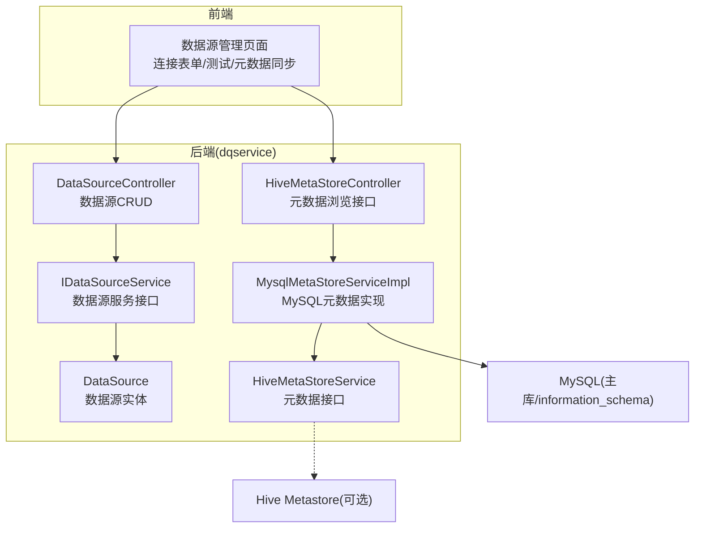
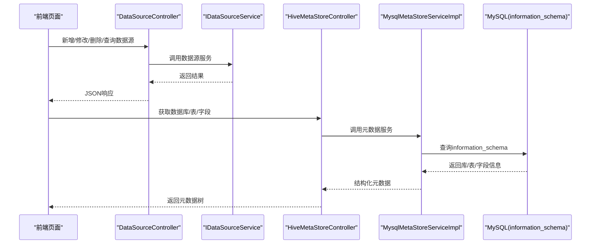
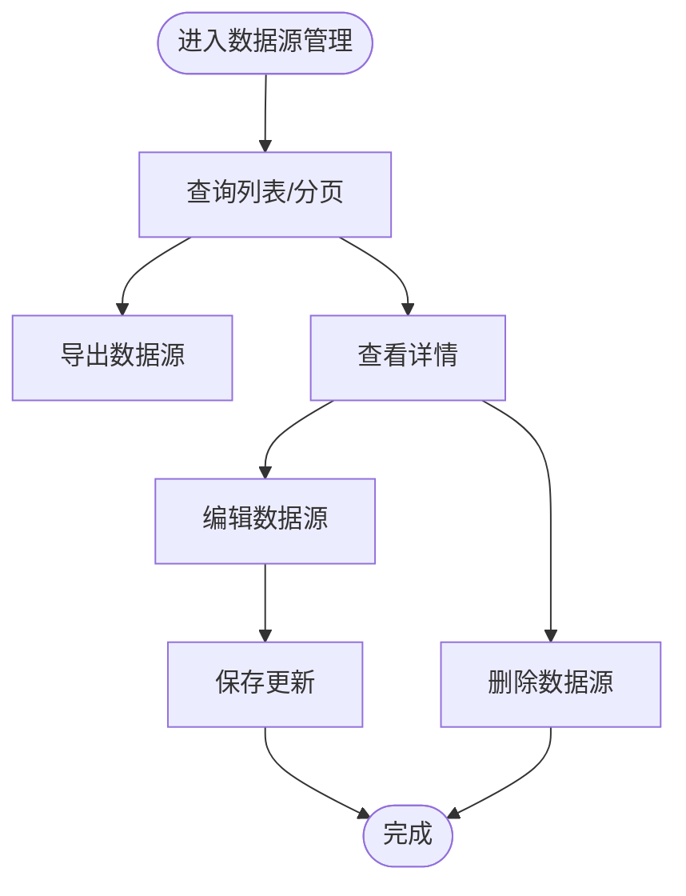
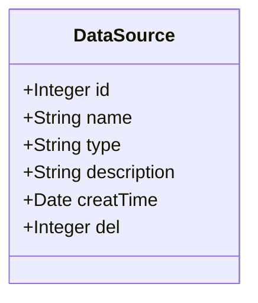
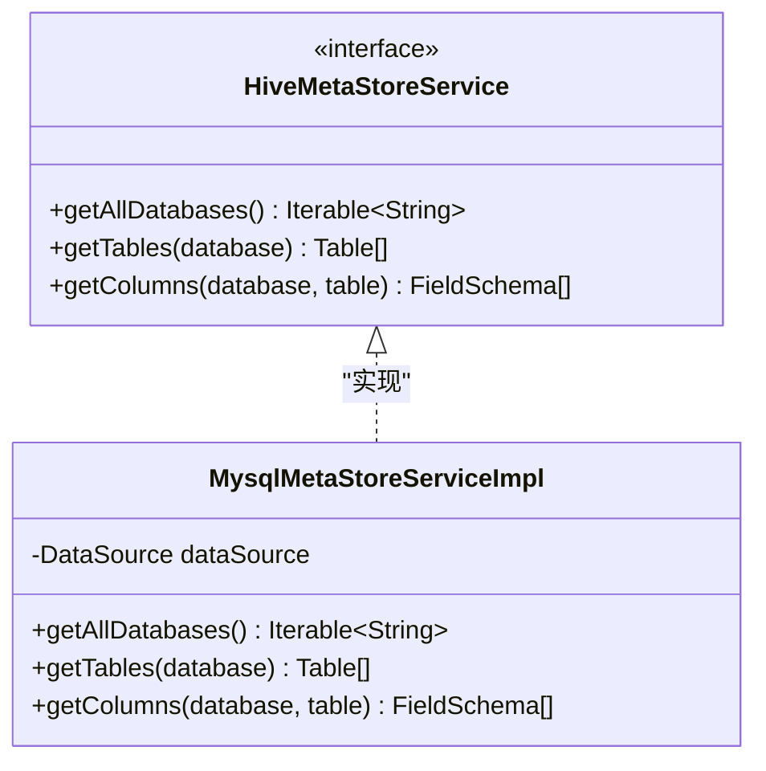
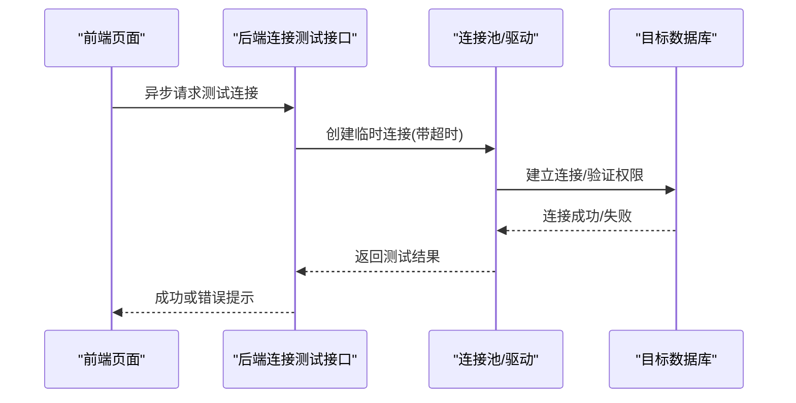
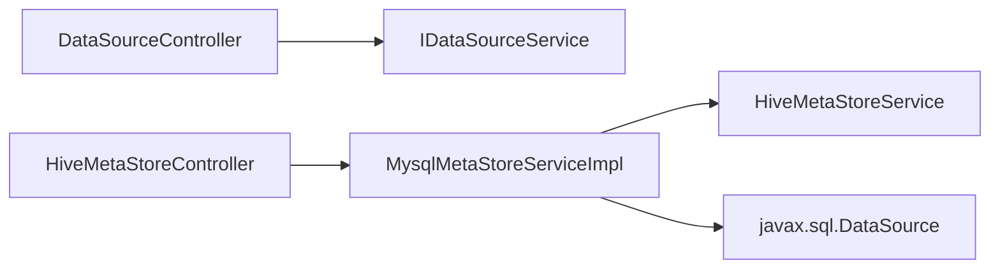

# 数据源管理页面

<cite>
**本文引用的文件**   
- [DataSourceController.java](file://ruoyi-modules/ruoyi-dqservice/src/main/java/com/ruoyi/dqservice/controller/DataSourceController.java)
- [IDataSourceService.java](file://ruoyi-modules/ruoyi-dqservice/src/main/java/com/ruoyi/dqservice/service/IDataSourceService.java)
- [DataSource.java](file://ruoyi-modules/ruoyi-dqservice/src/main/java/com/ruoyi/dqservice/domain/DataSource.java)
- [MysqlMetaStoreServiceImpl.java](file://ruoyi-modules/ruoyi-dqservice/src/main/java/com/ruoyi/dqservice/service/impl/MysqlMetaStoreServiceImpl.java)
- [HiveMetaStoreService.java](file://ruoyi-modules/ruoyi-dqservice/src/main/java/com/ruoyi/dqservice/service/HiveMetaStoreService.java)
- [HiveMetaStoreController.java](file://ruoyi-modules/ruoyi-dqservice/src/main/java/com/ruoyi/dqservice/controller/HiveMetaStoreController.java)
</cite>

## 目录
1. [简介](#简介)
2. [项目结构](#项目结构)
3. [核心组件](#核心组件)
4. [架构总览](#架构总览)
5. [详细组件分析](#详细组件分析)
6. [依赖关系分析](#依赖关系分析)
7. [性能与连接池配置](#性能与连接池配置)
8. [故障诊断与排错](#故障诊断与排错)
9. [结论](#结论)

## 简介
本文件面向“数据源管理页面”的完整实现说明，覆盖多类型数据源（MySQL、Hive 等）的连接配置表单、连接测试（异步检测、超时处理、错误提示）、元数据同步（表结构自动发现、分区信息、字段类型映射）、权限控制、分组管理与状态监控，以及连接池与性能参数调优的高级配置界面。文档以代码为依据，结合架构图与时序图帮助读者快速理解前后端交互与后端服务职责。

## 项目结构
本项目为 RuoYi 微服务架构下的数据质量模块（dqservice），数据源管理相关能力集中在 dqservice 模块中：
- 控制器层：提供数据源 CRUD 与元数据浏览接口
- 服务层：封装数据源业务逻辑与元数据访问策略
- 领域模型：定义数据源实体及通用基类
- 元数据服务：抽象 Hive 元数据访问接口，并提供 MySQL 实现

图表来源
- [DataSourceController.java:31-105](file://ruoyi-modules/ruoyi-dqservice/src/main/java/com/ruoyi/dqservice/controller/DataSourceController.java#L31-L105)
- [IDataSourceService.java:12-61](file://ruoyi-modules/ruoyi-dqservice/src/main/java/com/ruoyi/dqservice/service/IDataSourceService.java#L12-L61)
- [DataSource.java:16-110](file://ruoyi-modules/ruoyi-dqservice/src/main/java/com/ruoyi/dqservice/domain/DataSource.java#L16-L110)
- [MysqlMetaStoreServiceImpl.java:35-56](file://ruoyi-modules/ruoyi-dqservice/src/main/java/com/ruoyi/dqservice/service/impl/MysqlMetaStoreServiceImpl.java#L35-L56)
- [HiveMetaStoreService.java](file://ruoyi-modules/ruoyi-dqservice/src/main/java/com/ruoyi/dqservice/service/HiveMetaStoreService.java)
- [HiveMetaStoreController.java](file://ruoyi-modules/ruoyi-dqservice/src/main/java/com/ruoyi/dqservice/controller/HiveMetaStoreController.java)

章节来源
- [DataSourceController.java:31-105](file://ruoyi-modules/ruoyi-dqservice/src/main/java/com/ruoyi/dqservice/controller/DataSourceController.java#L31-L105)
- [IDataSourceService.java:12-61](file://ruoyi-modules/ruoyi-dqservice/src/main/java/com/ruoyi/dqservice/service/IDataSourceService.java#L12-L61)
- [DataSource.java:16-110](file://ruoyi-modules/ruoyi-dqservice/src/main/java/com/ruoyi/dqservice/domain/DataSource.java#L16-L110)
- [MysqlMetaStoreServiceImpl.java:35-56](file://ruoyi-modules/ruoyi-dqservice/src/main/java/com/ruoyi/dqservice/service/impl/MysqlMetaStoreServiceImpl.java#L35-L56)

## 核心组件
- 数据源控制器 DataSourceController：暴露数据源的列表查询、导出、详情获取、新增、修改、删除等 REST 接口，并集成权限注解与操作日志。
- 数据源服务 IDataSourceService：定义数据源增删改查与分页查询的业务方法。
- 数据源实体 DataSource：承载数据源名称、类型、描述、创建时间、删除位等基础属性，支持 Excel 导出注解。
- 元数据服务接口 HiveMetaStoreService：统一抽象元数据访问能力（数据库/表/字段）。
- MySQL 元数据实现 MysqlMetaStoreServiceImpl：基于 MySQL information_schema 提供库、表、字段读取，屏蔽 Hive Metastore 依赖差异，保持返回结构与 Hive 一致。

章节来源
- [DataSourceController.java:31-105](file://ruoyi-modules/ruoyi-dqservice/src/main/java/com/ruoyi/dqservice/controller/DataSourceController.java#L31-L105)
- [IDataSourceService.java:12-61](file://ruoyi-modules/ruoyi-dqservice/src/main/java/com/ruoyi/dqservice/service/IDataSourceService.java#L12-L61)
- [DataSource.java:16-110](file://ruoyi-modules/ruoyi-dqservice/src/main/java/com/ruoyi/dqservice/domain/DataSource.java#L16-L110)
- [HiveMetaStoreService.java](file://ruoyi-modules/ruoyi-dqservice/src/main/java/com/ruoyi/dqservice/service/HiveMetaStoreService.java)
- [MysqlMetaStoreServiceImpl.java:35-56](file://ruoyi-modules/ruoyi-dqservice/src/main/java/com/ruoyi/dqservice/service/impl/MysqlMetaStoreServiceImpl.java#L35-L56)

## 架构总览
数据源管理页面通过前后端分离的方式工作：
- 前端负责渲染多类型数据源配置表单、发起连接测试请求、展示元数据树与字段信息。
- 后端通过 DataSourceController 提供数据源管理接口；通过 HiveMetaStoreController 暴露元数据浏览接口；由 MysqlMetaStoreServiceImpl 实现基于 MySQL 的元数据读取。

图表来源
- [DataSourceController.java:31-105](file://ruoyi-modules/ruoyi-dqservice/src/main/java/com/ruoyi/dqservice/controller/DataSourceController.java#L31-L105)
- [HiveMetaStoreController.java](file://ruoyi-modules/ruoyi-dqservice/src/main/java/com/ruoyi/dqservice/controller/HiveMetaStoreController.java)
- [MysqlMetaStoreServiceImpl.java:35-56](file://ruoyi-modules/ruoyi-dqservice/src/main/java/com/ruoyi/dqservice/service/impl/MysqlMetaStoreServiceImpl.java#L35-L56)

## 详细组件分析

### 数据源管理接口（CRUD）
- 列表查询：支持分页与条件过滤，返回 TableDataInfo。
- 导出：将数据源列表导出为 Excel。
- 详情：根据 id 获取数据源对象。
- 新增/修改/删除：分别对应 POST/PUT/DELETE，带权限校验与操作日志。

图表来源
- [DataSourceController.java:31-105](file://ruoyi-modules/ruoyi-dqservice/src/main/java/com/ruoyi/dqservice/controller/DataSourceController.java#L31-L105)

章节来源
- [DataSourceController.java:31-105](file://ruoyi-modules/ruoyi-dqservice/src/main/java/com/ruoyi/dqservice/controller/DataSourceController.java#L31-L105)

### 数据源实体与扩展点
- DataSource 包含名称、类型、描述、创建时间、删除位等字段，便于前端表单绑定与后端持久化。
- 类型字段 type 用于区分不同数据库（如 MySQL、Hive），前端可据此动态渲染连接表单。

图表来源
- [DataSource.java:16-110](file://ruoyi-modules/ruoyi-dqservice/src/main/java/com/ruoyi/dqservice/domain/DataSource.java#L16-L110)

章节来源
- [DataSource.java:16-110](file://ruoyi-modules/ruoyi-dqservice/src/main/java/com/ruoyi/dqservice/domain/DataSource.java#L16-L110)

### 元数据同步（表结构自动发现、分区信息、字段类型映射）
- 接口抽象：HiveMetaStoreService 定义了统一的元数据访问能力（如 getAllDatabases、getTables、getColumns）。
- MySQL 实现：MysqlMetaStoreServiceImpl 基于 MySQL information_schema 查询 schema/table/column，过滤系统库，返回与 Hive 一致的 Table/StorageDescriptor/FieldSchema 结构，使前端无需改动。
- 分区信息：当前 MySQL 实现未直接暴露分区元数据；如需分区信息，可在该实现中扩展 SQL 或引入分区元数据表。

图表来源
- [HiveMetaStoreService.java](file://ruoyi-modules/ruoyi-dqservice/src/main/java/com/ruoyi/dqservice/service/HiveMetaStoreService.java)
- [MysqlMetaStoreServiceImpl.java:35-56](file://ruoyi-modules/ruoyi-dqservice/src/main/java/com/ruoyi/dqservice/service/impl/MysqlMetaStoreServiceImpl.java#L35-L56)

章节来源
- [MysqlMetaStoreServiceImpl.java:35-56](file://ruoyi-modules/ruoyi-dqservice/src/main/java/com/ruoyi/dqservice/service/impl/MysqlMetaStoreServiceImpl.java#L35-L56)

### 连接测试功能（异步检测、超时处理、错误提示）
- 前端在用户点击“测试连接”后，向后端发起异步请求，避免阻塞 UI。
- 后端建议通过独立线程或任务队列执行连接探测，设置超时阈值，捕获异常并返回统一错误码与消息。
- 前端根据返回结果展示成功/失败提示，并在失败时给出常见原因与建议（如网络不通、账号密码错误、驱动缺失等）。

说明
- 当前仓库未提供具体连接测试接口实现，上述流程为推荐实现方案，便于前端获得良好用户体验。

### 权限控制、分组管理与状态监控
- 权限控制：控制器使用 @RequiresPermissions 注解进行细粒度权限校验，确保只有具备相应权限的用户才能访问数据源管理功能。
- 分组管理：可在 DataSource 实体扩展 groupCode/groupName 字段，前端增加分组选择器，后端按分组筛选与统计。
- 状态监控：可增加 lastConnectTime、status、errorCount 等字段，配合定时任务刷新状态，前端以列表或仪表盘形式展示。

章节来源
- [DataSourceController.java:31-105](file://ruoyi-modules/ruoyi-dqservice/src/main/java/com/ruoyi/dqservice/controller/DataSourceController.java#L31-L105)

### 高级配置：连接池与性能参数调优
- 连接池参数：建议在前端“高级配置”区域暴露最小/最大连接数、空闲超时、连接超时、语句超时等参数，提交至后端进行动态配置或写入配置中心。
- 性能优化：针对大库元数据扫描，建议启用分页、延迟加载、缓存热点库/表信息，减少重复 IO。
- 安全加固：对敏感字段（如密码）加密存储，传输过程使用 HTTPS。

说明
- 本节为通用实践建议，不直接对应仓库中的具体实现文件。

## 依赖关系分析
- DataSourceController 依赖 IDataSourceService 进行数据源业务处理。
- MysqlMetaStoreServiceImpl 实现 HiveMetaStoreService 接口，依赖 javax.sql.DataSource 访问 MySQL information_schema。
- HiveMetaStoreController 作为元数据浏览的统一入口，委托给具体的元数据服务实现。

图表来源
- [DataSourceController.java:31-105](file://ruoyi-modules/ruoyi-dqservice/src/main/java/com/ruoyi/dqservice/controller/DataSourceController.java#L31-L105)
- [IDataSourceService.java:12-61](file://ruoyi-modules/ruoyi-dqservice/src/main/java/com/ruoyi/dqservice/service/IDataSourceService.java#L12-L61)
- [MysqlMetaStoreServiceImpl.java:35-56](file://ruoyi-modules/ruoyi-dqservice/src/main/java/com/ruoyi/dqservice/service/impl/MysqlMetaStoreServiceImpl.java#L35-L56)
- [HiveMetaStoreService.java](file://ruoyi-modules/ruoyi-dqservice/src/main/java/com/ruoyi/dqservice/service/HiveMetaStoreService.java)
- [HiveMetaStoreController.java](file://ruoyi-modules/ruoyi-dqservice/src/main/java/com/ruoyi/dqservice/controller/HiveMetaStoreController.java)

章节来源
- [DataSourceController.java:31-105](file://ruoyi-modules/ruoyi-dqservice/src/main/java/com/ruoyi/dqservice/controller/DataSourceController.java#L31-L105)
- [IDataSourceService.java:12-61](file://ruoyi-modules/ruoyi-dqservice/src/main/java/com/ruoyi/dqservice/service/IDataSourceService.java#L12-L61)
- [MysqlMetaStoreServiceImpl.java:35-56](file://ruoyi-modules/ruoyi-dqservice/src/main/java/com/ruoyi/dqservice/service/impl/MysqlMetaStoreServiceImpl.java#L35-L56)

## 性能与连接池配置
- 元数据扫描优化：
  - 对 large database 场景采用分页与懒加载，避免一次性加载全量库/表/字段。
  - 缓存常用库/表结构，降低频繁查询开销。
- 连接池调优：
  - 合理设置最小/最大连接数，避免连接耗尽或资源浪费。
  - 调整连接超时与语句超时，防止长事务或慢查询拖垮服务。
- 并发与限流：
  - 对元数据同步与连接测试接口进行并发限制，避免瞬时压力过大。
- 监控告警：
  - 记录连接池使用率、慢查询、失败重试次数，结合告警规则及时预警。

说明
- 本节为通用性能优化建议，不直接对应仓库中的具体实现文件。

## 故障诊断与排错
- 连接失败：
  - 检查网络连通性、端口与防火墙策略。
  - 核对用户名、密码、数据库名与驱动版本。
- 权限不足：
  - 确认账号具备 SELECT 权限（元数据读取）与必要 DDL/DML 权限（若需写回）。
- 元数据为空或异常：
  - 检查是否命中系统库过滤逻辑（如 information_schema、mysql、performance_schema、sys）。
  - 确认表类型过滤条件（仅 BASE TABLE）。
- 性能问题：
  - 观察慢查询与连接池指标，适当扩容或优化 SQL。
- 日志定位：
  - 开启后端调试日志，查看异常堆栈与关键步骤耗时。

章节来源
- [MysqlMetaStoreServiceImpl.java:35-56](file://ruoyi-modules/ruoyi-dqservice/src/main/java/com/ruoyi/dqservice/service/impl/MysqlMetaStoreServiceImpl.java#L35-L56)

## 结论
数据源管理页面围绕“多类型数据源配置—连接测试—元数据同步—权限与监控—性能调优”形成闭环。后端通过 DataSourceController 与 IDataSourceService 提供数据源管理能力，通过 HiveMetaStoreService 与 MysqlMetaStoreServiceImpl 提供统一的元数据访问能力，屏蔽底层差异。建议在现有基础上完善连接测试接口、扩展分组与状态字段，并结合连接池与监控手段提升系统的稳定性与可观测性。