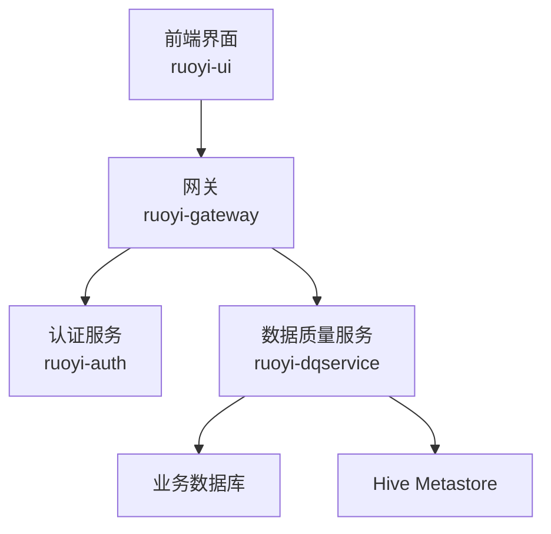
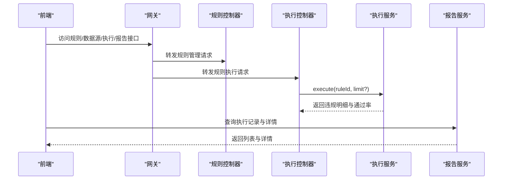
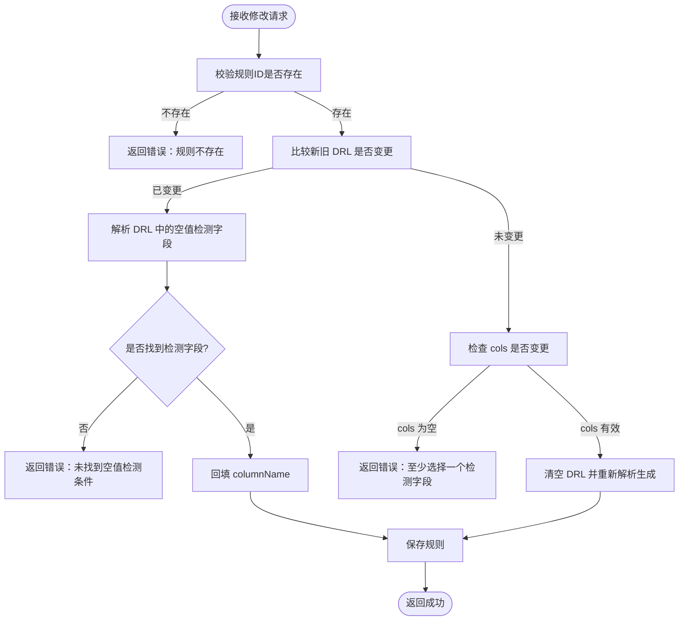
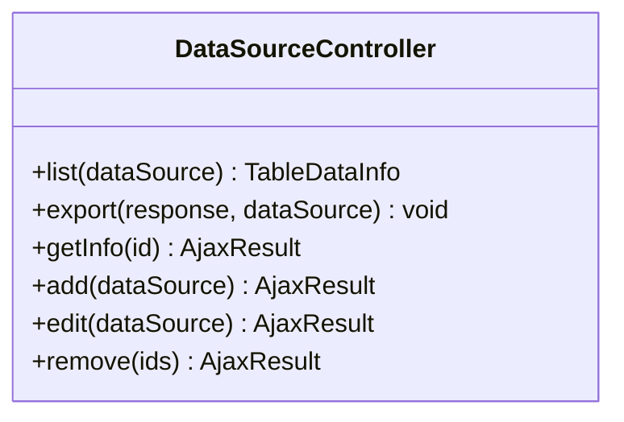
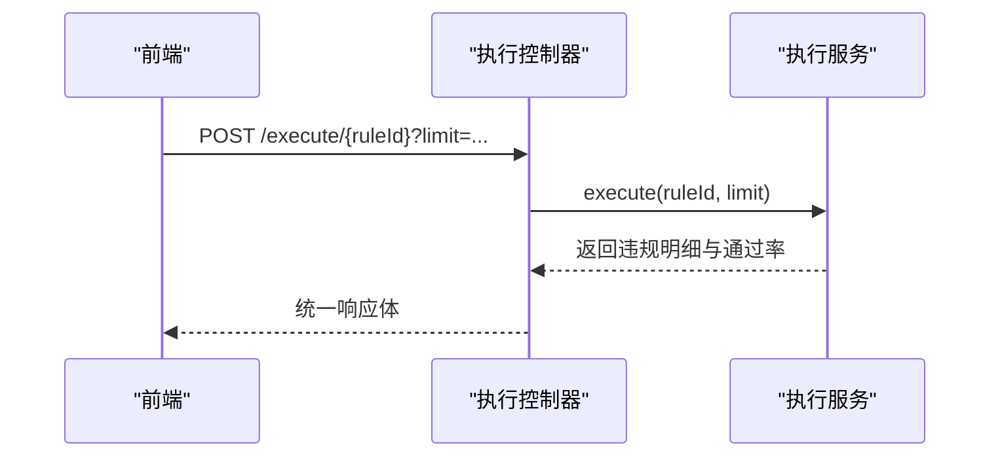
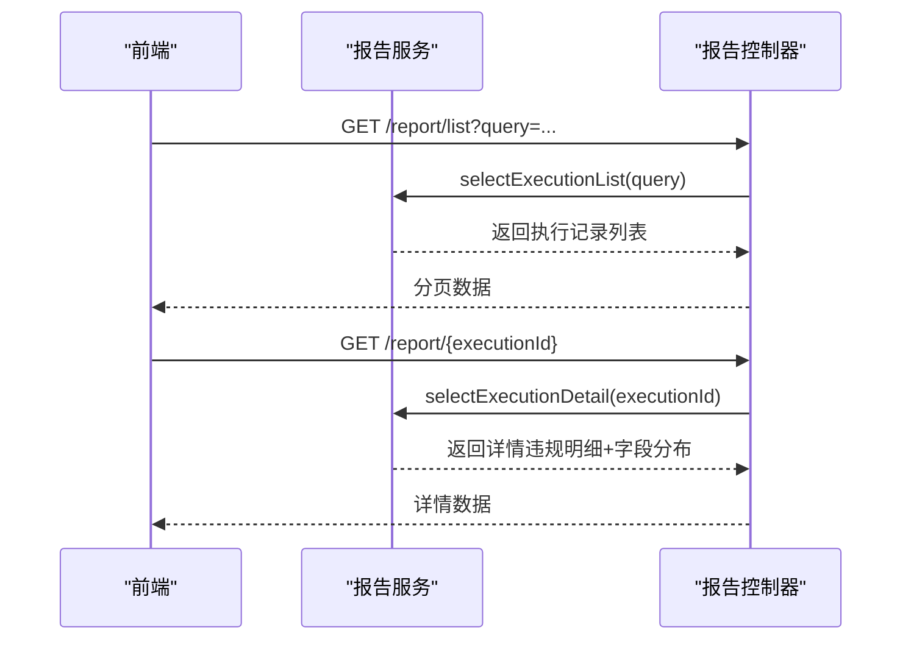
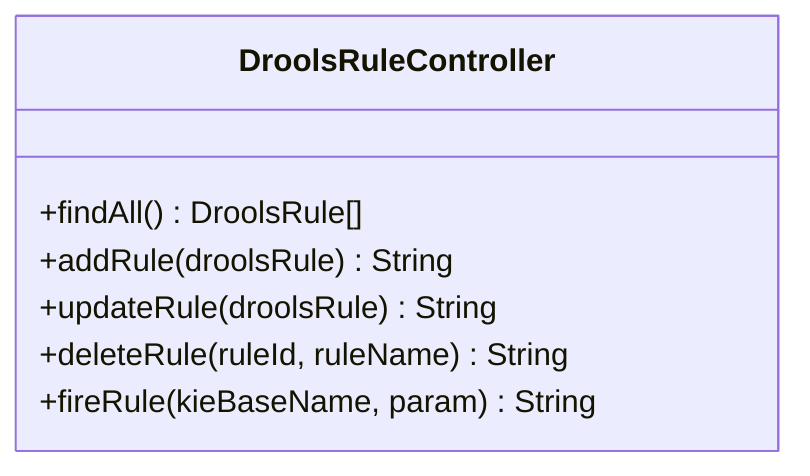
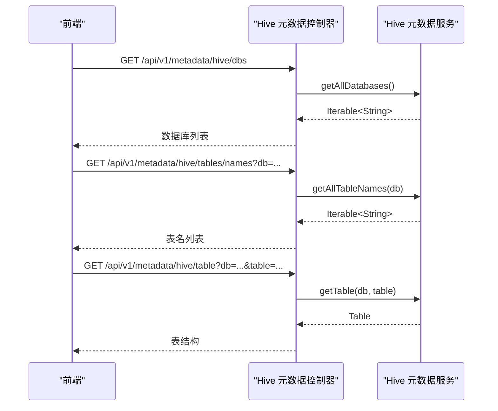
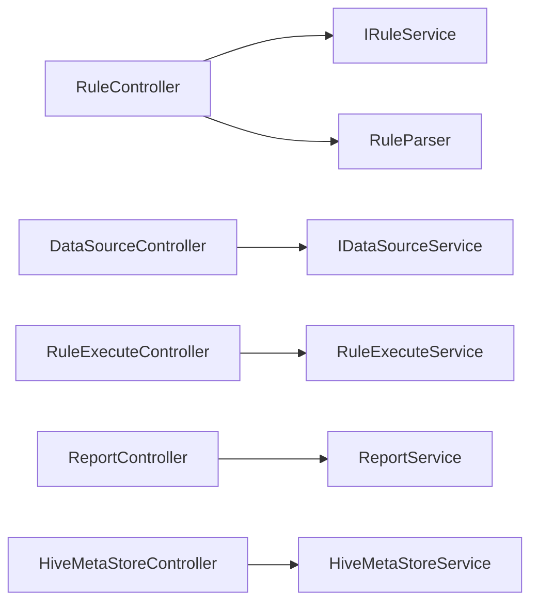

# 数据质量管理页面

<cite>
**本文引用的文件**   
- [README.md](file://README.md)
- [start-backend.ps1](file://bin/start-backend.ps1)
- [RuleController.java](file://ruoyi-modules/ruoyi-dqservice/src/main/java/com/ruoyi/dqservice/controller/RuleController.java)
- [DataSourceController.java](file://ruoyi-modules/ruoyi-dqservice/src/main/java/com/ruoyi/dqservice/controller/DataSourceController.java)
- [ReportController.java](file://ruoyi-modules/ruoyi-dqservice/src/main/java/com/ruoyi/dqservice/controller/ReportController.java)
- [RuleExecuteController.java](file://ruoyi-modules/ruoyi-dqservice/src/main/java/com/ruoyi/dqservice/controller/RuleExecuteController.java)
- [DroolsRuleController.java](file://ruoyi-modules/ruoyi-dqservice/src/main/java/com/ruoyi/dqservice/controller/DroolsRuleController.java)
- [HiveMetaStoreController.java](file://ruoyi-modules/ruoyi-dqservice/src/main/java/com/ruoyi/dqservice/controller/HiveMetaStoreController.java)
</cite>

## 目录
1. [引言](#引言)
2. [项目结构](#项目结构)
3. [核心组件](#核心组件)
4. [架构总览](#架构总览)
5. [详细组件分析](#详细组件分析)
6. [依赖关系分析](#依赖关系分析)
7. [性能与体验优化](#性能与体验优化)
8. [故障排查指南](#故障排查指南)
9. [结论](#结论)

## 引言
本文件面向“数据质量管理”相关页面的后端实现，覆盖规则管理、数据源配置、执行监控、报告生成等核心业务。重点说明：
- 规则管理：规则的增删改查、导出、字段映射回填、DRL 内容校验与重建
- 数据源配置：数据源的增删改查、导出
- 执行监控：按规则执行并返回违规明细与通过率
- 报告生成：执行记录列表与详情（含违规明细与字段分布）
- 元数据同步：Hive Metastore 数据库与表信息读取接口
- DRL 规则引擎：Drools 规则查询、新增、更新、删除与触发

## 项目结构
本项目采用前后端分离的 RuoYi 微服务架构，数据质量能力集中在 ruoyi-dqservice 模块中，提供 REST API；前端在 ruoyi-ui 中通过菜单与页面调用这些接口。启动脚本包含 dqservice 后端服务的运行入口。

图表来源
- [start-backend.ps1:11-34](file://bin/start-backend.ps1#L11-L34)

章节来源
- [README.md:1-1](file://README.md#L1-L1)
- [start-backend.ps1:11-34](file://bin/start-backend.ps1#L11-L34)

## 核心组件
- 规则管理 Controller：提供规则列表、导出、详情、新增、修改、删除接口，并在编辑时进行 DRL 解析与字段映射回填。
- 数据源管理 Controller：提供数据源列表、导出、详情、新增、修改、删除接口。
- 规则执行 Controller：根据规则 ID 执行规则，支持可选 limit 限制扫描行数，返回违规明细与通过率。
- 报告 Controller：提供执行记录列表与详情（含违规明细与字段分布）。
- Drools 规则 Controller：提供 Drools 规则的查询、新增、更新、删除与触发接口。
- Hive 元数据 Controller：提供 Hive 数据库、表名、表结构等元数据读取接口。

章节来源
- [RuleController.java:34-153](file://ruoyi-modules/ruoyi-dqservice/src/main/java/com/ruoyi/dqservice/controller/RuleController.java#L34-L153)
- [DataSourceController.java:31-105](file://ruoyi-modules/ruoyi-dqservice/src/main/java/com/ruoyi/dqservice/controller/DataSourceController.java#L31-L105)
- [RuleExecuteController.java:21-40](file://ruoyi-modules/ruoyi-dqservice/src/main/java/com/ruoyi/dqservice/controller/RuleExecuteController.java#L21-L40)
- [ReportController.java:22-50](file://ruoyi-modules/ruoyi-dqservice/src/main/java/com/ruoyi/dqservice/controller/ReportController.java#L22-L50)
- [DroolsRuleController.java:13-49](file://ruoyi-modules/ruoyi-dqservice/src/main/java/com/ruoyi/dqservice/controller/DroolsRuleController.java#L13-L49)
- [HiveMetaStoreController.java:16-57](file://ruoyi-modules/ruoyi-dqservice/src/main/java/com/ruoyi/dqservice/controller/HiveMetaStoreController.java#L16-L57)

## 架构总览
数据质量管理的端到端流程如下：
- 前端页面发起请求到网关，路由至对应后端服务
- 规则管理、数据源管理、执行与报告均通过 Spring MVC Controller 暴露 REST 接口
- 规则执行依赖 RuleExecuteService 完成数据扫描与规则判定
- 报告展示依赖 ReportService 聚合执行结果
- Hive 元数据通过 HiveMetaStoreService 对接 Hive Metastore

图表来源
- [RuleController.java:34-153](file://ruoyi-modules/ruoyi-dqservice/src/main/java/com/ruoyi/dqservice/controller/RuleController.java#L34-L153)
- [RuleExecuteController.java:21-40](file://ruoyi-modules/ruoyi-dqservice/src/main/java/com/ruoyi/dqservice/controller/RuleExecuteController.java#L21-L40)
- [ReportController.java:22-50](file://ruoyi-modules/ruoyi-dqservice/src/main/java/com/ruoyi/dqservice/controller/ReportController.java#L22-L50)

## 详细组件分析

### 规则管理（RuleController）
职责与要点：
- 列表查询与分页：支持按条件筛选规则
- 导出 Excel：将规则列表导出为 Excel
- 详情获取：回填空值检测字段，便于编辑器展示
- 新增规则：自动解析空值检测列并写入
- 修改规则：区分三种情况处理 DRL 与字段映射一致性
  - 用户直接修改 DRL：解析并回填检测字段
  - 仅调整检测字段：清空 DRL 后由解析器重建
  - 两者均未变化：仅更新元数据
- 删除规则：批量删除

图表来源
- [RuleController.java:103-141](file://ruoyi-modules/ruoyi-dqservice/src/main/java/com/ruoyi/dqservice/controller/RuleController.java#L103-L141)

章节来源
- [RuleController.java:34-153](file://ruoyi-modules/ruoyi-dqservice/src/main/java/com/ruoyi/dqservice/controller/RuleController.java#L34-L153)

### 数据源管理（DataSourceController）
职责与要点：
- 列表查询与分页：支持按条件筛选数据源
- 导出 Excel：将数据源列表导出为 Excel
- 详情获取：按 ID 查询数据源
- 新增/修改/删除：标准 CRUD 操作

图表来源
- [DataSourceController.java:31-105](file://ruoyi-modules/ruoyi-dqservice/src/main/java/com/ruoyi/dqservice/controller/DataSourceController.java#L31-L105)

章节来源
- [DataSourceController.java:31-105](file://ruoyi-modules/ruoyi-dqservice/src/main/java/com/ruoyi/dqservice/controller/DataSourceController.java#L31-L105)

### 规则执行（RuleExecuteController）
职责与要点：
- 执行指定规则：支持可选 limit 参数限制扫描行数
- 返回结果：违规明细与通过率

图表来源
- [RuleExecuteController.java:21-40](file://ruoyi-modules/ruoyi-dqservice/src/main/java/com/ruoyi/dqservice/controller/RuleExecuteController.java#L21-L40)

章节来源
- [RuleExecuteController.java:21-40](file://ruoyi-modules/ruoyi-dqservice/src/main/java/com/ruoyi/dqservice/controller/RuleExecuteController.java#L21-L40)

### 报告生成（ReportController）
职责与要点：
- 执行记录列表：分页查询执行历史
- 执行详情：包含违规明细与字段分布

图表来源
- [ReportController.java:22-50](file://ruoyi-modules/ruoyi-dqservice/src/main/java/com/ruoyi/dqservice/controller/ReportController.java#L22-L50)

章节来源
- [ReportController.java:22-50](file://ruoyi-modules/ruoyi-dqservice/src/main/java/com/ruoyi/dqservice/controller/ReportController.java#L22-L50)

### Drools 规则管理（DroolsRuleController）
职责与要点：
- 查询所有 Drools 规则
- 新增/更新/删除 Drools 规则
- 触发规则执行（fireRule）

图表来源
- [DroolsRuleController.java:13-49](file://ruoyi-modules/ruoyi-dqservice/src/main/java/com/ruoyi/dqservice/controller/DroolsRuleController.java#L13-L49)

章节来源
- [DroolsRuleController.java:13-49](file://ruoyi-modules/ruoyi-dqservice/src/main/java/com/ruoyi/dqservice/controller/DroolsRuleController.java#L13-L49)

### Hive 元数据同步（HiveMetaStoreController）
职责与要点：
- 获取所有数据库
- 获取某库下所有表名
- 获取某库下所有表结构
- 获取某库下表名映射
- 获取指定库表的详细信息

图表来源
- [HiveMetaStoreController.java:16-57](file://ruoyi-modules/ruoyi-dqservice/src/main/java/com/ruoyi/dqservice/controller/HiveMetaStoreController.java#L16-L57)

章节来源
- [HiveMetaStoreController.java:16-57](file://ruoyi-modules/ruoyi-dqservice/src/main/java/com/ruoyi/dqservice/controller/HiveMetaStoreController.java#L16-L57)

## 依赖关系分析
- Controller 层依赖 Service 层完成业务逻辑
- 规则管理依赖 RuleParser 进行 DRL 解析与字段映射回填
- 执行与报告分别依赖 RuleExecuteService 与 ReportService
- Hive 元数据通过 HiveMetaStoreService 对接外部 Hive Metastore

图表来源
- [RuleController.java:34-153](file://ruoyi-modules/ruoyi-dqservice/src/main/java/com/ruoyi/dqservice/controller/RuleController.java#L34-L153)
- [DataSourceController.java:31-105](file://ruoyi-modules/ruoyi-dqservice/src/main/java/com/ruoyi/dqservice/controller/DataSourceController.java#L31-L105)
- [RuleExecuteController.java:21-40](file://ruoyi-modules/ruoyi-dqservice/src/main/java/com/ruoyi/dqservice/controller/RuleExecuteController.java#L21-L40)
- [ReportController.java:22-50](file://ruoyi-modules/ruoyi-dqservice/src/main/java/com/ruoyi/dqservice/controller/ReportController.java#L22-L50)
- [HiveMetaStoreController.java:16-57](file://ruoyi-modules/ruoyi-dqservice/src/main/java/com/ruoyi/dqservice/controller/HiveMetaStoreController.java#L16-L57)

章节来源
- [RuleController.java:34-153](file://ruoyi-modules/ruoyi-dqservice/src/main/java/com/ruoyi/dqservice/controller/RuleController.java#L34-L153)
- [DataSourceController.java:31-105](file://ruoyi-modules/ruoyi-dqservice/src/main/java/com/ruoyi/dqservice/controller/DataSourceController.java#L31-L105)
- [RuleExecuteController.java:21-40](file://ruoyi-modules/ruoyi-dqservice/src/main/java/com/ruoyi/dqservice/controller/RuleExecuteController.java#L21-L40)
- [ReportController.java:22-50](file://ruoyi-modules/ruoyi-dqservice/src/main/java/com/ruoyi/dqservice/controller/ReportController.java#L22-L50)
- [HiveMetaStoreController.java:16-57](file://ruoyi-modules/ruoyi-dqservice/src/main/java/com/ruoyi/dqservice/controller/HiveMetaStoreController.java#L16-L57)

## 性能与体验优化
- 分页与导出：列表接口使用分页，导出使用 ExcelUtil 流式导出，避免一次性加载大数据集
- 规则编辑一致性：在修改规则时区分 DRL 与字段映射变更，减少不必要的重建与解析开销
- 执行限流：执行接口支持 limit 参数，控制单次扫描数据量，降低执行压力
- 权限控制：关键接口使用权限注解，保障数据安全与访问可控

[本节为通用指导，不直接分析具体文件]

## 故障排查指南
- 规则修改失败
  - 现象：提示“未找到空值检测条件”或“请至少选择一个检测字段”
  - 排查：检查 DRL 中是否包含空值检测条件，或 cols 是否至少选择一个字段
  - 参考路径：[RuleController.java:118-139](file://ruoyi-modules/ruoyi-dqservice/src/main/java/com/ruoyi/dqservice/controller/RuleController.java#L118-L139)
- 规则详情回填异常
  - 现象：编辑器未显示检测字段
  - 排查：确认 getInfo 接口是否正确调用 fillDetectColumns
  - 参考路径：[RuleController.java:69-80](file://ruoyi-modules/ruoyi-dqservice/src/main/java/com/ruoyi/dqservice/controller/RuleController.java#L69-L80)
- 执行无结果或超时
  - 现象：执行接口长时间无响应或返回空结果
  - 排查：检查 limit 参数设置是否过小或过大；确认规则与数据源配置正确
  - 参考路径：[RuleExecuteController.java:32-39](file://ruoyi-modules/ruoyi-dqservice/src/main/java/com/ruoyi/dqservice/controller/RuleExecuteController.java#L32-L39)
- Hive 元数据不可用
  - 现象：数据库或表名接口返回空或报错
  - 排查：检查 Hive Metastore 连接与服务状态
  - 参考路径：[HiveMetaStoreController.java:24-53](file://ruoyi-modules/ruoyi-dqservice/src/main/java/com/ruoyi/dqservice/controller/HiveMetaStoreController.java#L24-L53)

章节来源
- [RuleController.java:69-139](file://ruoyi-modules/ruoyi-dqservice/src/main/java/com/ruoyi/dqservice/controller/RuleController.java#L69-L139)
- [RuleExecuteController.java:32-39](file://ruoyi-modules/ruoyi-dqservice/src/main/java/com/ruoyi/dqservice/controller/RuleExecuteController.java#L32-L39)
- [HiveMetaStoreController.java:24-53](file://ruoyi-modules/ruoyi-dqservice/src/main/java/com/ruoyi/dqservice/controller/HiveMetaStoreController.java#L24-L53)

## 结论
数据质量管理模块通过清晰的 Controller 分层与明确的职责划分，实现了规则管理、数据源配置、执行监控与报告生成的完整闭环。规则编辑器的 DRL 解析与字段映射回填保证了规则定义的一致性与可维护性；执行接口支持限流与结果可视化；Hive 元数据接口为字段映射与数据探查提供了基础能力。整体架构具备良好的扩展性与可观测性，适合在生产环境中持续演进。