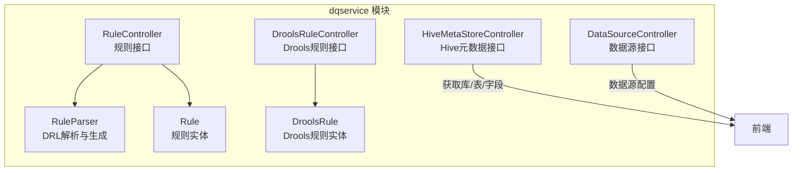
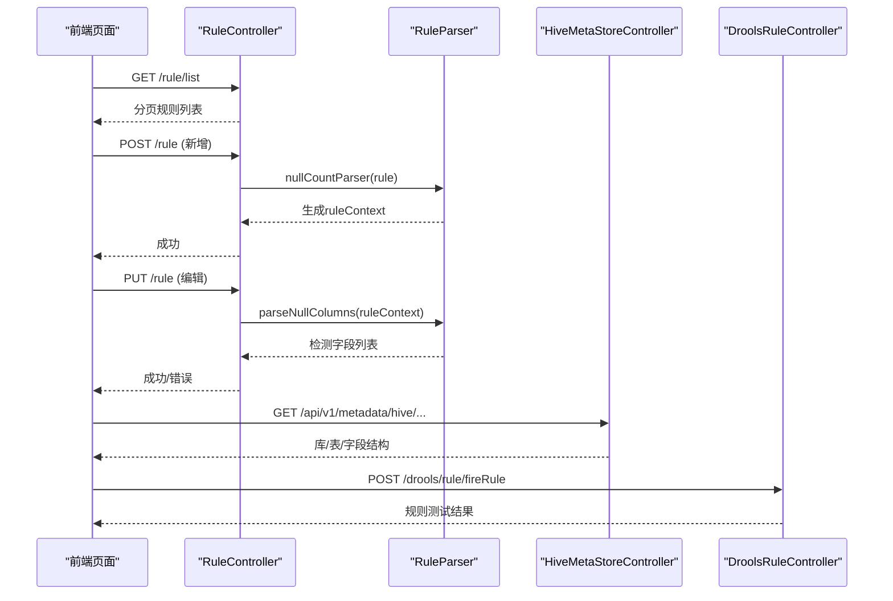
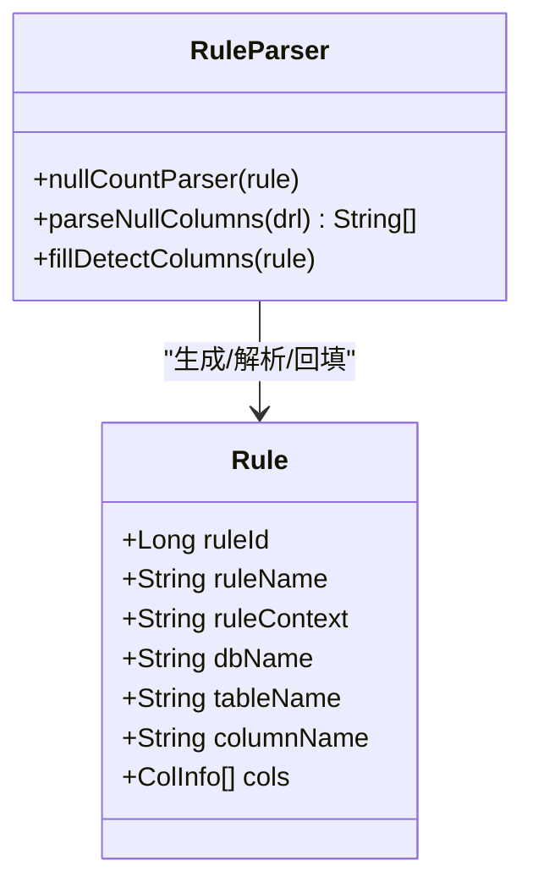
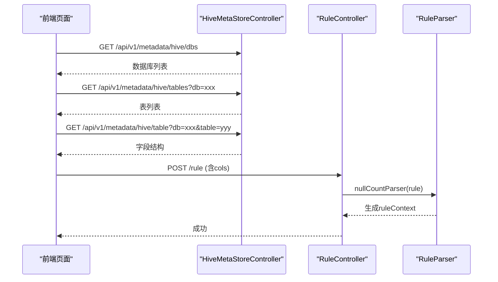
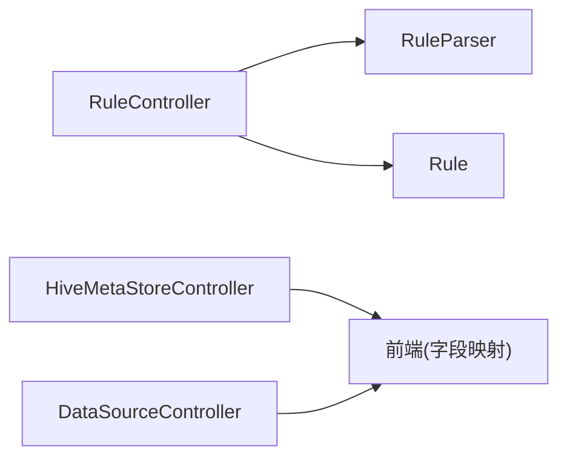

# 规则管理页面

<cite>
**本文引用的文件**   
- [RuleController.java](file://ruoyi-modules/ruoyi-dqservice/src/main/java/com/ruoyi/dqservice/controller/RuleController.java)
- [Rule.java](file://ruoyi-modules/ruoyi-dqservice/src/main/java/com/ruoyi/dqservice/domain/Rule.java)
- [RuleParser.java](file://ruoyi-modules/ruoyi-dqservice/src/main/java/com/ruoyi/dqservice/util/RuleParser.java)
- [DroolsRuleController.java](file://ruoyi-modules/ruoyi-dqservice/src/main/java/com/ruoyi/dqservice/controller/DroolsRuleController.java)
- [DroolsRule.java](file://ruoyi-modules/ruoyi-dqservice/src/main/java/com/ruoyi/dqservice/domain/DroolsRule.java)
- [DataSourceController.java](file://ruoyi-modules/ruoyi-dqservice/src/main/java/com/ruoyi/dqservice/controller/DataSourceController.java)
- [HiveMetaStoreController.java](file://ruoyi-modules/ruoyi-dqservice/src/main/java/com/ruoyi/dqservice/controller/HiveMetaStoreController.java)
</cite>

## 目录
1. [引言](#引言)
2. [项目结构](#项目结构)
3. [核心组件](#核心组件)
4. [架构总览](#架构总览)
5. [详细组件分析](#详细组件分析)
6. [依赖关系分析](#依赖关系分析)
7. [性能与可用性考虑](#性能与可用性考虑)
8. [故障排查指南](#故障排查指南)
9. [结论](#结论)

## 引言
本文件面向“规则管理页面”的前后端实现与交互设计，聚焦以下目标：
- 规则CRUD的界面实现：列表展示、新增/编辑表单、删除确认等。
- DRL规则编辑器：语法高亮、代码提示、错误检查等专业特性在前后端协作中的落地方案。
- 字段映射配置界面：数据源表结构获取、字段选择、类型匹配等能力。
- 高级功能：规则模板管理、批量操作、导入导出等。
- 交互体验优化：复杂表单验证、动态字段显示、实时预览等。

## 项目结构
规则管理相关后端能力集中在 dqservice 模块中，包含控制器、领域模型与解析工具；元数据与数据源能力由对应控制器提供，供前端在字段映射时拉取数据库结构信息。



图表来源
- [RuleController.java:1-154](file://ruoyi-modules/ruoyi-dqservice/src/main/java/com/ruoyi/dqservice/controller/RuleController.java#L1-L154)
- [DroolsRuleController.java:1-50](file://ruoyi-modules/ruoyi-dqservice/src/main/java/com/ruoyi/dqservice/controller/DroolsRuleController.java#L1-L50)
- [HiveMetaStoreController.java:1-58](file://ruoyi-modules/ruoyi-dqservice/src/main/java/com/ruoyi/dqservice/controller/HiveMetaStoreController.java#L1-L58)
- [DataSourceController.java:1-106](file://ruoyi-modules/ruoyi-dqservice/src/main/java/com/ruoyi/dqservice/controller/DataSourceController.java#L1-L106)
- [Rule.java:1-87](file://ruoyi-modules/ruoyi-dqservice/src/main/java/com/ruoyi/dqservice/domain/Rule.java#L1-L87)
- [DroolsRule.java:1-33](file://ruoyi-modules/ruoyi-dqservice/src/main/java/com/ruoyi/dqservice/domain/DroolsRule.java#L1-L33)
- [RuleParser.java:1-241](file://ruoyi-modules/ruoyi-dqservice/src/main/java/com/ruoyi/dqservice/util/RuleParser.java#L1-L241)

章节来源
- [RuleController.java:1-154](file://ruoyi-modules/ruoyi-dqservice/src/main/java/com/ruoyi/dqservice/controller/RuleController.java#L1-L154)
- [Rule.java:1-87](file://ruoyi-modules/ruoyi-dqservice/src/main/java/com/ruoyi/dqservice/domain/Rule.java#L1-L87)
- [RuleParser.java:1-241](file://ruoyi-modules/ruoyi-dqservice/src/main/java/com/ruoyi/dqservice/util/RuleParser.java#L1-L241)

## 核心组件
- 规则控制器（RuleController）
  - 提供规则列表查询、分页、导出、详情获取、新增、修改、删除等标准REST接口。
  - 新增/修改流程中调用 RuleParser 进行 DRL 生成或校验，确保 ruleContext 与检测字段一致。
- 规则实体（Rule）
  - 承载规则名称、规则文本（ruleContext）、数据库名、表名、字段名、分区参数、创建者信息等。
  - 包含 cols 数组用于前端字段映射配置的回显与提交。
- DRL解析器（RuleParser）
  - 根据 cols 生成空值检测 DRL，并回填 columnName。
  - 从已有 DRL 中解析实际生效的检测字段，支持编辑回显与一致性校验。
- Drools规则控制器与实体（DroolsRuleController / DroolsRule）
  - 提供对 Drools 规则的增删改查与触发测试接口，便于规则调试与验证。
- Hive元数据控制器（HiveMetaStoreController）
  - 暴露库、表、字段等元数据查询接口，支撑字段映射配置。
- 数据源控制器（DataSourceController）
  - 提供数据源的CRUD能力，为规则绑定数据源提供基础。

章节来源
- [RuleController.java:41-153](file://ruoyi-modules/ruoyi-dqservice/src/main/java/com/ruoyi/dqservice/controller/RuleController.java#L41-L153)
- [Rule.java:20-86](file://ruoyi-modules/ruoyi-dqservice/src/main/java/com/ruoyi/dqservice/domain/Rule.java#L20-L86)
- [RuleParser.java:18-159](file://ruoyi-modules/ruoyi-dqservice/src/main/java/com/ruoyi/dqservice/util/RuleParser.java#L18-L159)
- [DroolsRuleController.java:13-49](file://ruoyi-modules/ruoyi-dqservice/src/main/java/com/ruoyi/dqservice/controller/DroolsRuleController.java#L13-L49)
- [DroolsRule.java:5-32](file://ruoyi-modules/ruoyi-dqservice/src/main/java/com/ruoyi/dqservice/domain/DroolsRule.java#L5-L32)
- [HiveMetaStoreController.java:16-57](file://ruoyi-modules/ruoyi-dqservice/src/main/java/com/ruoyi/dqservice/controller/HiveMetaStoreController.java#L16-L57)
- [DataSourceController.java:31-104](file://ruoyi-modules/ruoyi-dqservice/src/main/java/com/ruoyi/dqservice/controller/DataSourceController.java#L31-L104)

## 架构总览
规则管理页面的端到端流程如下：
- 列表页：前端调用规则列表接口，后端分页返回规则集合。
- 新增/编辑：
  - 若通过字段映射配置生成规则，后端使用 RuleParser 生成 DRL 并校验。
  - 若直接编辑 DRL，后端解析 DRL 以同步检测字段，保证一致性。
- 删除：支持批量删除，后端执行物理/逻辑删除。
- 元数据：字段映射时，前端调用 Hive 元数据接口获取库/表/字段结构。
- 规则测试：通过 Drools 接口触发规则，验证规则行为。



图表来源
- [RuleController.java:41-153](file://ruoyi-modules/ruoyi-dqservice/src/main/java/com/ruoyi/dqservice/controller/RuleController.java#L41-L153)
- [RuleParser.java:41-159](file://ruoyi-modules/ruoyi-dqservice/src/main/java/com/ruoyi/dqservice/util/RuleParser.java#L41-L159)
- [HiveMetaStoreController.java:24-57](file://ruoyi-modules/ruoyi-dqservice/src/main/java/com/ruoyi/dqservice/controller/HiveMetaStoreController.java#L24-L57)
- [DroolsRuleController.java:22-49](file://ruoyi-modules/ruoyi-dqservice/src/main/java/com/ruoyi/dqservice/controller/DroolsRuleController.java#L22-L49)

## 详细组件分析

### 规则CRUD界面与后端对接
- 列表展示
  - 前端分页请求规则列表，后端基于 RuleController.list 返回 TableDataInfo。
  - 支持按规则名称、数据库名、表名等条件筛选。
- 新增规则
  - 前端可两种方式提交：
    - 通过字段映射配置（cols），后端 RuleParser.nullCountParser 自动生成 DRL。
    - 直接编辑 DRL（ruleContext），后端保留用户输入。
  - 成功后返回统一结果。
- 编辑规则
  - 后端优先判断是否直接修改了 DRL：
    - 若修改了 DRL，则解析其中的 this["字段"] == null 模式，提取检测字段并回填到 columnName。
    - 若未修改 DRL 但调整了 cols，则清空 ruleContext 后重新生成，保证 DRL 与最新约束一致。
  - 校验失败时返回明确错误信息（如未找到空值检测条件、未选择检测字段）。
- 删除规则
  - 支持批量删除，传入 ruleIds 数组。
- 导出规则
  - 后端使用 ExcelUtil 将规则列表导出为 Excel。

```mermaid
flowchart TD
Start(["进入新增/编辑"]) --> Mode{"提交方式"}
Mode --> |字段映射(cols)| GenDRL["RuleParser.nullCountParser<br/>生成DRL"]
Mode --> |直接编辑DRL| KeepDRL["保留用户输入的ruleContext"]
GenDRL --> ValidateCols["校验至少一个检测字段"]
KeepDRL --> ParseDRL["RuleParser.parseNullColumns<br/>解析检测字段"]
ValidateCols --> Save["保存规则"]
ParseDRL --> Save
Save --> End(["完成"])
```

图表来源
- [RuleController.java:82-141](file://ruoyi-modules/ruoyi-dqservice/src/main/java/com/ruoyi/dqservice/controller/RuleController.java#L82-L141)
- [RuleParser.java:41-159](file://ruoyi-modules/ruoyi-dqservice/src/main/java/com/ruoyi/dqservice/util/RuleParser.java#L41-L159)

章节来源
- [RuleController.java:41-153](file://ruoyi-modules/ruoyi-dqservice/src/main/java/com/ruoyi/dqservice/controller/RuleController.java#L41-L153)
- [RuleParser.java:41-159](file://ruoyi-modules/ruoyi-dqservice/src/main/java/com/ruoyi/dqservice/util/RuleParser.java#L41-L159)

### DRL规则编辑器组件使用方案
- 编辑器能力建议
  - 语法高亮：针对 DRL 关键字、字符串、注释等进行着色。
  - 代码提示：提供规则片段、函数、变量补全。
  - 错误检查：实时校验语法错误，并在编辑器底部展示诊断信息。
- 与后端协作
  - 前端保存时同时提交 ruleContext 与 cols：
    - 若仅修改 ruleContext，后端解析该 DRL 以同步检测字段。
    - 若仅修改 cols，后端重新生成 DRL，避免描述不一致。
  - 编辑详情加载时，后端通过 RuleParser.fillDetectColumns 回填 cols，以便弹窗回显。
- 实时预览
  - 可在前端对 DRL 做轻量级静态检查（如匹配 this["字段"] == null 的模式），即时反馈可用字段范围。



图表来源
- [Rule.java:20-86](file://ruoyi-modules/ruoyi-dqservice/src/main/java/com/ruoyi/dqservice/domain/Rule.java#L20-L86)
- [RuleParser.java:41-159](file://ruoyi-modules/ruoyi-dqservice/src/main/java/com/ruoyi/dqservice/util/RuleParser.java#L41-L159)

章节来源
- [RuleParser.java:41-159](file://ruoyi-modules/ruoyi-dqservice/src/main/java/com/ruoyi/dqservice/util/RuleParser.java#L41-L159)
- [Rule.java:20-86](file://ruoyi-modules/ruoyi-dqservice/src/main/java/com/ruoyi/dqservice/domain/Rule.java#L20-L86)

### 字段映射配置界面实现
- 数据源表结构获取
  - 通过 HiveMetaStoreController 提供的接口获取数据库、表、字段结构，用于前端下拉选择与类型展示。
- 字段选择与类型匹配
  - 前端根据元数据结构渲染字段树，支持多选作为检测字段（cols）。
  - 类型匹配建议：对数值型字段提示非空校验、对日期字段提示格式校验等。
- 与规则生成的联动
  - 当用户选择“空值检测”约束时，后端 RuleParser.nullCountParser 会生成对应的 DRL，并将选中字段写入 columnName。



图表来源
- [HiveMetaStoreController.java:24-57](file://ruoyi-modules/ruoyi-dqservice/src/main/java/com/ruoyi/dqservice/controller/HiveMetaStoreController.java#L24-L57)
- [RuleController.java:82-93](file://ruoyi-modules/ruoyi-dqservice/src/main/java/com/ruoyi/dqservice/controller/RuleController.java#L82-L93)
- [RuleParser.java:41-68](file://ruoyi-modules/ruoyi-dqservice/src/main/java/com/ruoyi/dqservice/util/RuleParser.java#L41-L68)

章节来源
- [HiveMetaStoreController.java:24-57](file://ruoyi-modules/ruoyi-dqservice/src/main/java/com/ruoyi/dqservice/controller/HiveMetaStoreController.java#L24-L57)
- [RuleController.java:82-93](file://ruoyi-modules/ruoyi-dqservice/src/main/java/com/ruoyi/dqservice/controller/RuleController.java#L82-L93)
- [RuleParser.java:41-68](file://ruoyi-modules/ruoyi-dqservice/src/main/java/com/ruoyi/dqservice/util/RuleParser.java#L41-L68)

### 规则模板管理与批量操作
- 规则模板
  - 可将常用规则（如空值检测、唯一性校验）保存为模板，前端快速复用。
  - 模板内容即 DRL 片段，结合字段映射自动填充 ruleContext。
- 批量操作
  - 批量启用/停用、批量删除、批量导出。
  - 后端 RuleController.remove 已支持批量删除；批量导出可通过现有 export 接口扩展过滤条件。

章节来源
- [RuleController.java:53-64](file://ruoyi-modules/ruoyi-dqservice/src/main/java/com/ruoyi/dqservice/controller/RuleController.java#L53-L64)
- [RuleController.java:143-153](file://ruoyi-modules/ruoyi-dqservice/src/main/java/com/ruoyi/dqservice/controller/RuleController.java#L143-L153)

### 导入导出与规则测试
- 导入
  - 支持从 Excel 导入规则，后端可扩展 import 接口，复用 ExcelUtil 进行解析。
- 导出
  - 后端已提供规则导出接口，前端调用即可下载。
- 规则测试
  - 通过 DroolsRuleController.fireRule 触发规则，传入 kieBaseName 与参数，验证规则行为。

章节来源
- [RuleController.java:53-64](file://ruoyi-modules/ruoyi-dqservice/src/main/java/com/ruoyi/dqservice/controller/RuleController.java#L53-L64)
- [DroolsRuleController.java:45-49](file://ruoyi-modules/ruoyi-dqservice/src/main/java/com/ruoyi/dqservice/controller/DroolsRuleController.java#L45-L49)

## 依赖关系分析
- RuleController 依赖 RuleParser 进行 DRL 的生成与解析，确保 ruleContext 与 cols 的一致性。
- RuleParser 依赖正则表达式解析 DRL 中的空值检测条件，并生成符合规范的 DRL。
- HiveMetaStoreController 为字段映射提供元数据能力，是前端字段选择的依赖。
- DataSourceController 提供数据源管理能力，与规则绑定数据源的场景配合使用。



图表来源
- [RuleController.java:1-154](file://ruoyi-modules/ruoyi-dqservice/src/main/java/com/ruoyi/dqservice/controller/RuleController.java#L1-L154)
- [RuleParser.java:1-241](file://ruoyi-modules/ruoyi-dqservice/src/main/java/com/ruoyi/dqservice/util/RuleParser.java#L1-L241)
- [HiveMetaStoreController.java:1-58](file://ruoyi-modules/ruoyi-dqservice/src/main/java/com/ruoyi/dqservice/controller/HiveMetaStoreController.java#L1-L58)
- [DataSourceController.java:1-106](file://ruoyi-modules/ruoyi-dqservice/src/main/java/com/ruoyi/dqservice/controller/DataSourceController.java#L1-L106)

章节来源
- [RuleController.java:1-154](file://ruoyi-modules/ruoyi-dqservice/src/main/java/com/ruoyi/dqservice/controller/RuleController.java#L1-L154)
- [RuleParser.java:1-241](file://ruoyi-modules/ruoyi-dqservice/src/main/java/com/ruoyi/dqservice/util/RuleParser.java#L1-L241)
- [HiveMetaStoreController.java:1-58](file://ruoyi-modules/ruoyi-dqservice/src/main/java/com/ruoyi/dqservice/controller/HiveMetaStoreController.java#L1-L58)
- [DataSourceController.java:1-106](file://ruoyi-modules/ruoyi-dqservice/src/main/java/com/ruoyi/dqservice/controller/DataSourceController.java#L1-L106)

## 性能与可用性考虑
- 列表分页
  - 后端使用分页查询，前端合理设置每页条数，避免大数据量一次性加载。
- DRL 生成与解析
  - RuleParser 仅在新增/编辑时执行，避免频繁解析影响性能。
  - 对于大量规则导出，建议分批处理或异步任务。
- 元数据获取
  - Hive 元数据接口可能较慢，前端应加入缓存与懒加载策略。
- 编辑器体验
  - 对 DRL 的实时检查建议采用防抖与增量校验，减少计算开销。

[本节为通用指导，不直接分析具体文件]

## 故障排查指南
- 编辑规则时报错“规则内容中未找到空值检测条件”
  - 原因：用户直接修改了 DRL，但未包含 this["字段"] == null 模式。
  - 处理：在前端编辑器增加语法检查提示，或在后端给出更明确的修复建议。
- 编辑规则时报错“请至少选择一个检测字段”
  - 原因：用户仅调整了 cols，但未选择任何空值检测字段。
  - 处理：前端在提交前校验 cols 至少包含一个空值检测约束。
- 规则导出为空或字段缺失
  - 原因：导出条件过滤过严或实体字段未正确标注导出注解。
  - 处理：检查 Rule 实体的 @Excel 注解与前端筛选条件。

章节来源
- [RuleController.java:118-140](file://ruoyi-modules/ruoyi-dqservice/src/main/java/com/ruoyi/dqservice/controller/RuleController.java#L118-L140)
- [Rule.java:29-85](file://ruoyi-modules/ruoyi-dqservice/src/main/java/com/ruoyi/dqservice/domain/Rule.java#L29-L85)

## 结论
规则管理页面围绕 RuleController、RuleParser 与元数据接口构建，实现了从字段映射到 DRL 生成、从规则编辑到规则测试的完整闭环。通过前后端协同校验与回显机制，保证了规则定义的一致性与可维护性。建议在编辑器侧增强语法检查与智能提示，在数据源侧引入缓存与分页，以提升整体用户体验与系统性能。