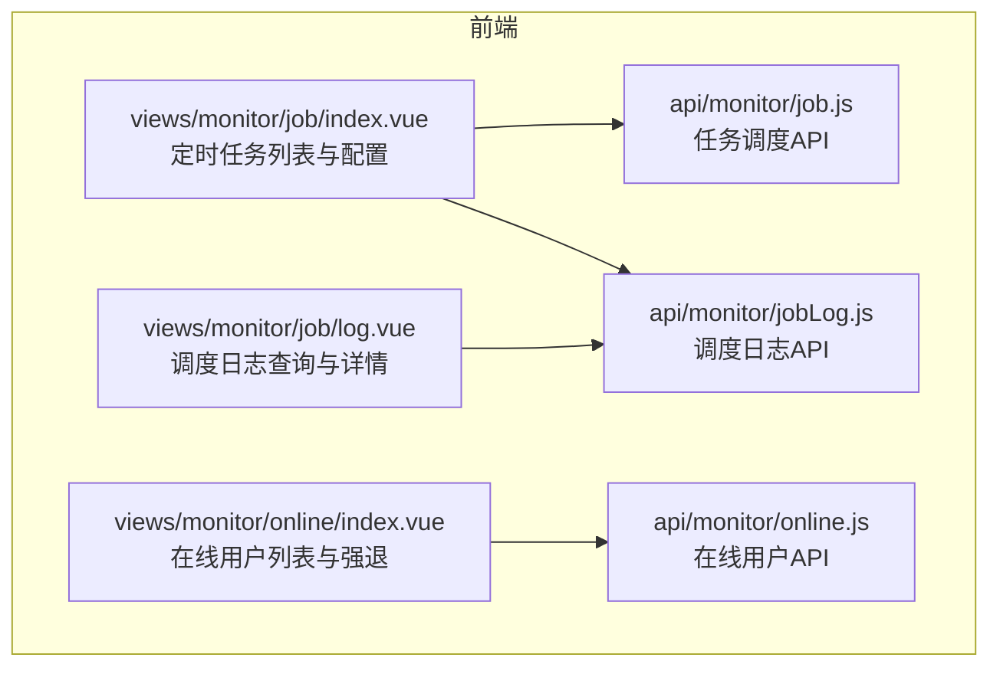
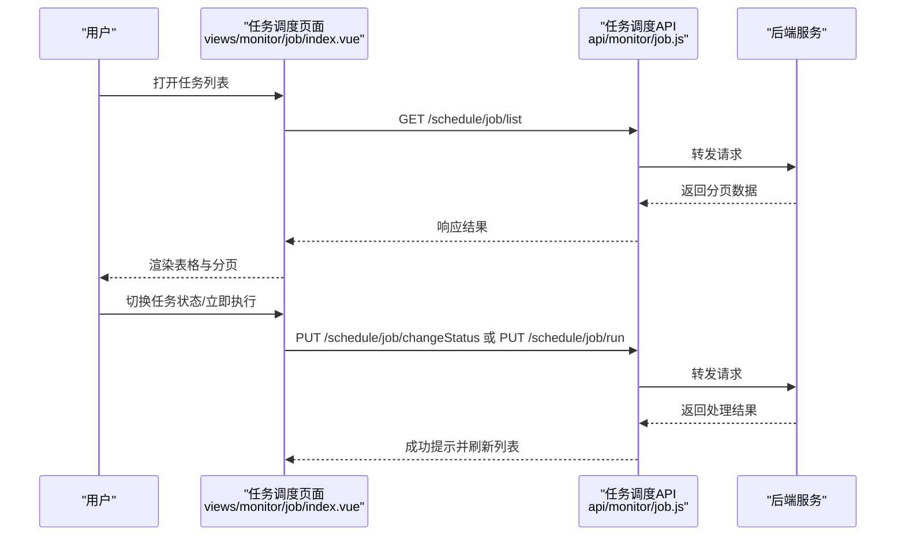
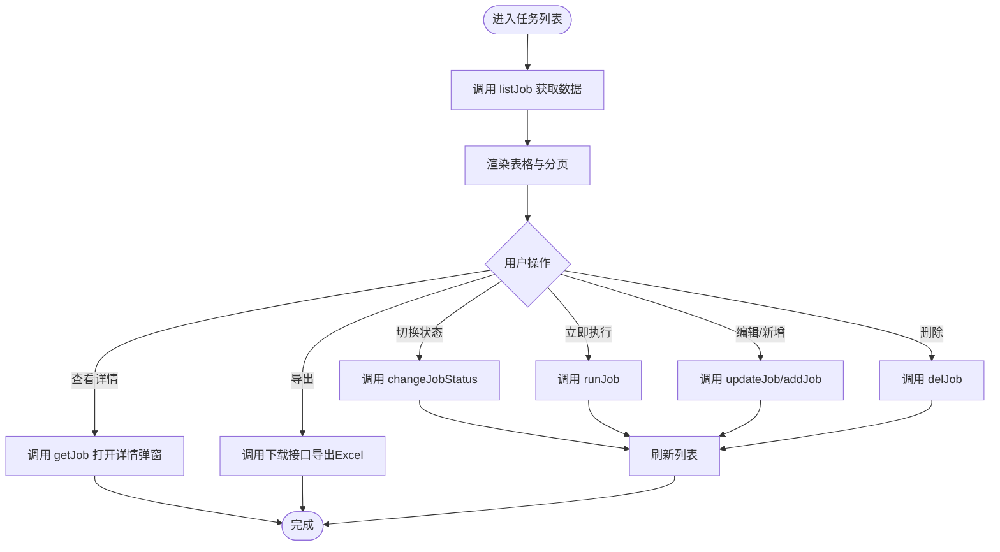
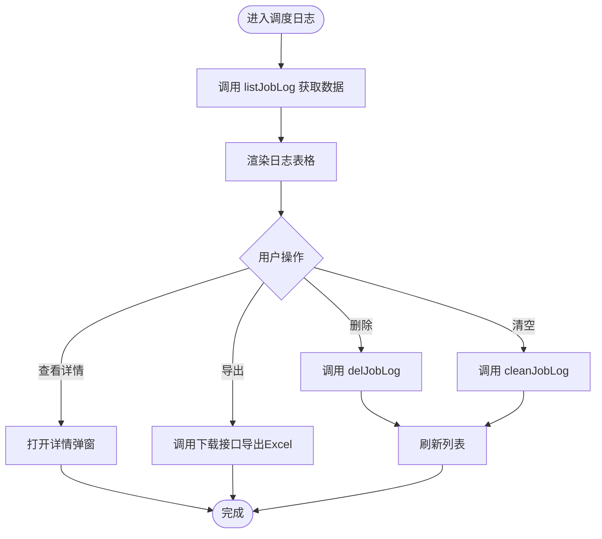
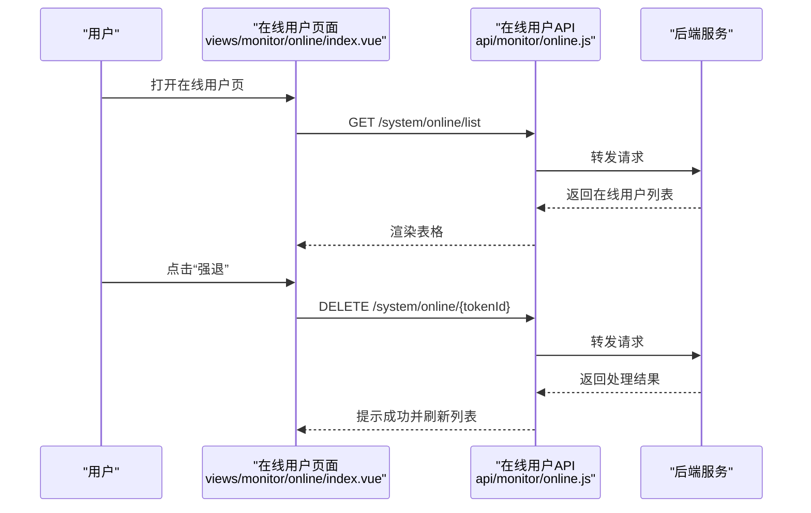
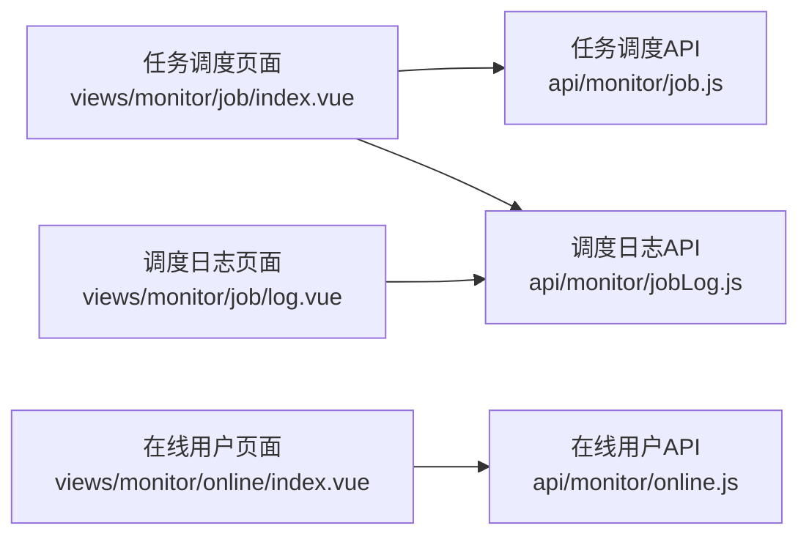

# 监控管理页面

<cite>
**本文引用的文件**   
- [job.js](file://ruoyi-ui/src/api/monitor/job.js)
- [jobLog.js](file://ruoyi-ui/src/api/monitor/jobLog.js)
- [online.js](file://ruoyi-ui/src/api/monitor/online.js)
- [index.vue（任务调度）](file://ruoyi-ui/src/views/monitor/job/index.vue)
- [log.vue（调度日志）](file://ruoyi-ui/src/views/monitor/job/log.vue)
- [index.vue（在线用户）](file://ruoyi-ui/src/views/monitor/online/index.vue)
</cite>

## 目录
1. [简介](#简介)
2. [项目结构](#项目结构)
3. [核心组件](#核心组件)
4. [架构总览](#架构总览)
5. [详细组件分析](#详细组件分析)
6. [依赖关系分析](#依赖关系分析)
7. [性能与实时性](#性能与实时性)
8. [故障排查指南](#故障排查指南)
9. [结论](#结论)

## 简介
本章节面向运维人员，系统化说明“监控管理”相关页面的前端实现与交互流程，覆盖定时任务管理、在线用户监控、调度日志查看等能力。文档重点包括：
- 任务调度配置与状态控制
- 执行日志的查询、详情查看、清理与导出
- 在线用户的检索与强退
- 权限控制与审计记录机制
- 界面实时刷新与异常告警体验

## 项目结构
监控管理模块由前后端分离的前端页面与接口组成，主要位于 ruoyi-ui 下：
- API 层：封装对后端的 HTTP 请求
- 视图层：提供可视化操作界面
- 路由与菜单：在系统菜单中挂载监控功能入口（不在本文展开）

图表来源
- [index.vue（任务调度）:1-515](file://ruoyi-ui/src/views/monitor/job/index.vue#L1-L515)
- [log.vue（调度日志）:1-295](file://ruoyi-ui/src/views/monitor/job/log.vue#L1-L295)
- [index.vue（在线用户）:1-119](file://ruoyi-ui/src/views/monitor/online/index.vue#L1-L119)
- [job.js:1-71](file://ruoyi-ui/src/api/monitor/job.js#L1-L71)
- [jobLog.js:1-27](file://ruoyi-ui/src/api/monitor/jobLog.js#L1-L27)
- [online.js:1-19](file://ruoyi-ui/src/api/monitor/online.js#L1-L19)

章节来源
- [index.vue（任务调度）:1-515](file://ruoyi-ui/src/views/monitor/job/index.vue#L1-L515)
- [log.vue（调度日志）:1-295](file://ruoyi-ui/src/views/monitor/job/log.vue#L1-L295)
- [index.vue（在线用户）:1-119](file://ruoyi-ui/src/views/monitor/online/index.vue#L1-L119)

## 核心组件
- 定时任务管理页：支持任务的增删改查、状态切换、立即执行、Cron 表达式生成器、任务详情查看、跳转日志页、导出。
- 调度日志页：支持按任务名称、分组、执行状态、时间范围筛选；支持删除、清空、导出与查看详情。
- 在线用户页：支持按登录地址、用户名检索；支持分页展示与会话强退。

章节来源
- [index.vue（任务调度）:1-515](file://ruoyi-ui/src/views/monitor/job/index.vue#L1-L515)
- [log.vue（调度日志）:1-295](file://ruoyi-ui/src/views/monitor/job/log.vue#L1-L295)
- [index.vue（在线用户）:1-119](file://ruoyi-ui/src/views/monitor/online/index.vue#L1-L119)

## 架构总览
以下序列图展示了“定时任务管理”的关键交互路径：从页面发起请求到后端返回数据，再到 UI 渲染与用户反馈。

图表来源
- [index.vue（任务调度）:357-438](file://ruoyi-ui/src/views/monitor/job/index.vue#L357-L438)
- [job.js:4-70](file://ruoyi-ui/src/api/monitor/job.js#L4-L70)

## 详细组件分析

### 定时任务管理（views/monitor/job/index.vue）
- 功能要点
  - 条件查询：任务名称、任务组名、任务状态
  - 批量操作：新增、修改、删除、导出
  - 行内操作：修改、删除、更多（执行一次、任务详细、调度日志）
  - 状态切换：通过开关控件直接启用/停用任务
  - Cron 表达式：内置生成器辅助配置
  - 任务详情弹窗：展示任务编号、名称、分组、创建时间、cron、下次执行时间、调用目标、并发策略、执行策略等
  - 跳转日志：点击“调度日志”跳转到日志页并携带 jobId
- 关键交互
  - 列表加载：调用 listJob 获取分页数据
  - 状态变更：调用 changeJobStatus 并二次确认
  - 立即执行：调用 runJob 并二次确认
  - 详情查看：调用 getJob 填充表单
  - 新增/修改：调用 addJob/updateJob 提交表单
  - 删除：调用 delJob 并二次确认
  - 导出：调用通用下载方法导出 Excel

图表来源
- [index.vue（任务调度）:357-512](file://ruoyi-ui/src/views/monitor/job/index.vue#L357-L512)
- [job.js:4-70](file://ruoyi-ui/src/api/monitor/job.js#L4-L70)

章节来源
- [index.vue（任务调度）:1-515](file://ruoyi-ui/src/views/monitor/job/index.vue#L1-L515)
- [job.js:1-71](file://ruoyi-ui/src/api/monitor/job.js#L1-L71)

### 调度日志（views/monitor/job/log.vue）
- 功能要点
  - 条件查询：任务名称、任务组名、执行状态、时间范围
  - 列表展示：日志编号、任务名称、任务组名、调用目标、日志信息、执行状态、执行时间
  - 详情弹窗：显示日志序号、任务名称、任务分组、执行时间、调用方法、日志信息、执行状态、异常信息（失败时）
  - 批量操作：删除选中日志、清空全部日志、导出
  - 关闭按钮：关闭当前标签页
- 关键交互
  - 列表加载：调用 listJobLog 并附加日期范围参数
  - 详情查看：使用行数据填充详情弹窗
  - 删除：调用 delJobLog 并二次确认
  - 清空：调用 cleanJobLog 并二次确认
  - 导出：调用通用下载方法导出 Excel

图表来源
- [log.vue（调度日志）:232-292](file://ruoyi-ui/src/views/monitor/job/log.vue#L232-L292)
- [jobLog.js:4-26](file://ruoyi-ui/src/api/monitor/jobLog.js#L4-L26)

章节来源
- [log.vue（调度日志）:1-295](file://ruoyi-ui/src/views/monitor/job/log.vue#L1-L295)
- [jobLog.js:1-27](file://ruoyi-ui/src/api/monitor/jobLog.js#L1-L27)

### 在线用户（views/monitor/online/index.vue）
- 功能要点
  - 条件查询：登录地址、用户名
  - 列表展示：序号、会话编号、登录名称、主机、登录时间
  - 行内操作：强退指定用户会话
  - 分页：前端分页展示
- 关键交互
  - 列表加载：调用 list 获取在线用户数据
  - 强退：调用 forceLogout 并二次确认

图表来源
- [index.vue（在线用户）:86-114](file://ruoyi-ui/src/views/monitor/online/index.vue#L86-L114)
- [online.js:4-18](file://ruoyi-ui/src/api/monitor/online.js#L4-L18)

章节来源
- [index.vue（在线用户）:1-119](file://ruoyi-ui/src/views/monitor/online/index.vue#L1-L119)
- [online.js:1-19](file://ruoyi-ui/src/api/monitor/online.js#L1-L19)

## 依赖关系分析
- 页面与 API 的耦合关系清晰：每个页面仅依赖对应的 API 模块，便于维护与扩展。
- 复用组件：Cron 表达式生成器、字典标签、分页、右侧工具栏等通用组件被多处复用。
- 权限控制：通过指令 v-hasPermi 控制按钮可见性与可操作范围，确保最小权限原则。

图表来源
- [index.vue（任务调度）:295-300](file://ruoyi-ui/src/views/monitor/job/index.vue#L295-L300)
- [log.vue（调度日志）:182-184](file://ruoyi-ui/src/views/monitor/job/log.vue#L182-L184)
- [index.vue（在线用户）:61-62](file://ruoyi-ui/src/views/monitor/online/index.vue#L61-L62)

章节来源
- [index.vue（任务调度）:1-515](file://ruoyi-ui/src/views/monitor/job/index.vue#L1-L515)
- [log.vue（调度日志）:1-295](file://ruoyi-ui/src/views/monitor/job/log.vue#L1-L295)
- [index.vue（在线用户）:1-119](file://ruoyi-ui/src/views/monitor/online/index.vue#L1-L119)

## 性能与实时性
- 列表加载
  - 任务调度与在线用户均通过分页接口减少单次数据传输量，提升首屏渲染速度。
  - 调度日志支持时间范围过滤，有助于缩小数据集规模。
- 实时刷新
  - 任务状态切换、立即执行、删除、清空等操作成功后会触发列表刷新，保证界面与后端状态一致。
  - 在线用户页采用前端分页，适合中小规模会话数场景；若会话量大，建议改为服务端分页以提升性能。
- 用户体验
  - 所有写操作均包含二次确认，避免误操作。
  - 错误处理通过统一提示组件反馈，便于快速定位问题。

[本节为通用指导，不直接分析具体文件]

## 故障排查指南
- 无法加载任务列表
  - 检查网络请求是否成功，确认后端 /schedule/job/list 接口可用。
  - 检查权限是否正确，确认具备 monitor:job:query 权限。
- 切换任务状态无效
  - 确认后端 /schedule/job/changeStatus 接口正常。
  - 检查浏览器控制台是否有权限或业务校验错误。
- 调度日志为空
  - 确认任务已执行且日志已落库。
  - 检查时间范围筛选条件是否过窄。
- 在线用户无法强退
  - 确认后端 /system/online/{tokenId} 接口可用。
  - 检查 token 是否有效以及会话是否存在。

章节来源
- [index.vue（任务调度）:421-438](file://ruoyi-ui/src/views/monitor/job/index.vue#L421-L438)
- [log.vue（调度日志）:268-285](file://ruoyi-ui/src/views/monitor/job/log.vue#L268-L285)
- [index.vue（在线用户）:106-114](file://ruoyi-ui/src/views/monitor/online/index.vue#L106-L114)

## 结论
监控管理页面围绕“定时任务管理、调度日志、在线用户”三大核心能力，提供了完整的可视化运维工具链。通过清晰的 API 分层、完善的权限控制与二次确认机制，保障了操作的准确性与安全性。建议在后续迭代中：
- 引入服务端分页以支撑更大规模的在线用户与日志数据
- 增加更丰富的监控指标与告警通知能力
- 完善审计日志的关联查询与导出能力，提升可追溯性

[本节为总结性内容，不直接分析具体文件]