# 用户管理

<cite>
**本文引用的文件**   
- [index.vue](file://ruoyi-ui/src/views/system/user/index.vue)
- [user.js](file://ruoyi-ui/src/api/system/user.js)
- [SysUserController.java](file://ruoyi-modules/ruoyi-system/src/main/java/com/ruoyi/system/controller/SysUserController.java)
- [SysUserServiceImpl.java](file://ruoyi-modules/ruoyi-system/src/main/java/com/ruoyi/system/service/impl/SysUserServiceImpl.java)
- [SysUser.java](file://ruoyi-api/ruoyi-api-system/src/main/java/com/ruoyi/system/api/domain/SysUser.java)
</cite>

## 目录
1. [简介](#简介)
2. [项目结构](#项目结构)
3. [核心组件](#核心组件)
4. [架构总览](#架构总览)
5. [详细组件分析](#详细组件分析)
6. [依赖关系分析](#依赖关系分析)
7. [性能与可维护性](#性能与可维护性)
8. [故障排查指南](#故障排查指南)
9. [结论](#结论)

## 简介
本页面为系统“用户管理”功能的前后端实现文档，覆盖用户列表展示、新增、修改、删除、批量操作、导入导出、密码重置、状态切换、部门树筛选、角色与岗位分配等能力。文档从前端交互到后端接口再到服务层处理进行全链路说明，并给出关键流程图与数据模型关系图，帮助读者快速理解并扩展该模块。

## 项目结构
用户管理涉及前后端多个文件：
- 前端页面：views/system/user/index.vue
- 前端 API：api/system/user.js
- 后端控制器：system.controller.SysUserController
- 后端服务实现：system.service.impl.SysUserServiceImpl
- 领域模型：api.system.domain.SysUser

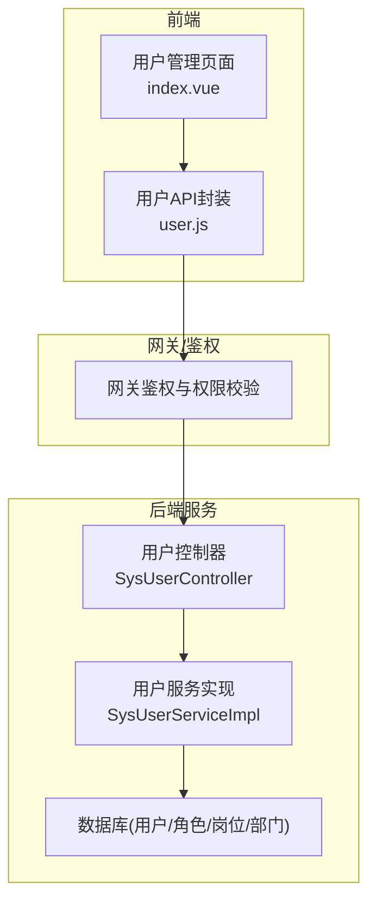

图表来源
- [index.vue:1-671](file://ruoyi-ui/src/views/system/user/index.vue#L1-L671)
- [user.js:1-128](file://ruoyi-ui/src/api/system/user.js#L1-L128)
- [SysUserController.java:46-312](file://ruoyi-modules/ruoyi-system/src/main/java/com/ruoyi/system/controller/SysUserController.java#L46-L312)
- [SysUserServiceImpl.java:38-564](file://ruoyi-modules/ruoyi-system/src/main/java/com/ruoyi/system/service/impl/SysUserServiceImpl.java#L38-L564)

章节来源
- [index.vue:1-671](file://ruoyi-ui/src/views/system/user/index.vue#L1-L671)
- [user.js:1-128](file://ruoyi-ui/src/api/system/user.js#L1-L128)
- [SysUserController.java:46-312](file://ruoyi-modules/ruoyi-system/src/main/java/com/ruoyi/system/controller/SysUserController.java#L46-L312)
- [SysUserServiceImpl.java:38-564](file://ruoyi-modules/ruoyi-system/src/main/java/com/ruoyi/system/service/impl/SysUserServiceImpl.java#L38-L564)

## 核心组件
- 用户列表与查询：支持按用户名、手机号、状态、创建时间范围、部门树筛选；分页加载。
- 用户表单：包含昵称、归属部门（树选择）、手机号、邮箱、账号/密码（新增时）、性别、状态、岗位多选、角色多选、备注；含前端校验规则。
- 用户CRUD：新增、修改、删除（单条/批量）；状态切换；密码重置；授权角色。
- 导入导出：Excel模板下载、导入（支持更新已存在用户）、导出当前查询结果。
- 权限控制：按钮级权限控制（新增/修改/删除/导入/导出/重置密码/分配角色），后端接口使用注解进行权限校验。

章节来源
- [index.vue:30-309](file://ruoyi-ui/src/views/system/user/index.vue#L30-L309)
- [SysUserController.java:68-311](file://ruoyi-modules/ruoyi-system/src/main/java/com/ruoyi/system/controller/SysUserController.java#L68-L311)

## 架构总览
用户管理的请求链路如下：
- 前端通过 user.js 调用 /system/user/* 接口
- 网关层完成鉴权与权限校验
- 控制器接收参数，调用服务层执行业务逻辑
- 服务层负责唯一性校验、数据权限校验、事务性写入（用户、角色、岗位关联）
- 返回统一响应给前端

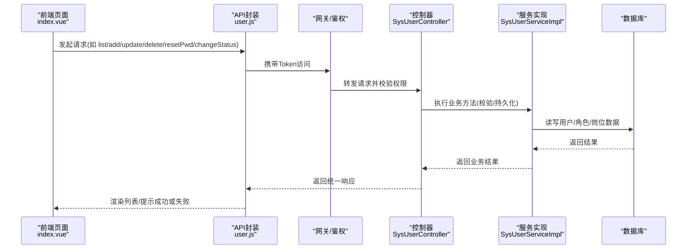

图表来源
- [user.js:1-128](file://ruoyi-ui/src/api/system/user.js#L1-L128)
- [SysUserController.java:68-311](file://ruoyi-modules/ruoyi-system/src/main/java/com/ruoyi/system/controller/SysUserController.java#L68-L311)
- [SysUserServiceImpl.java:248-313](file://ruoyi-modules/ruoyi-system/src/main/java/com/ruoyi/system/service/impl/SysUserServiceImpl.java#L248-L313)

## 详细组件分析

### 用户列表与搜索过滤
- 表格字段：用户编号、名称、昵称、部门、手机号、状态、创建时间、操作列。
- 搜索条件：用户名、手机号、状态、创建时间范围、部门树节点。
- 分页：使用分页组件绑定 pageNum/pageSize，后端通过分页工具类返回 rows/total。
- 部门树：左侧树形结构支持按名称过滤，点击节点设置 deptId 并触发查询。

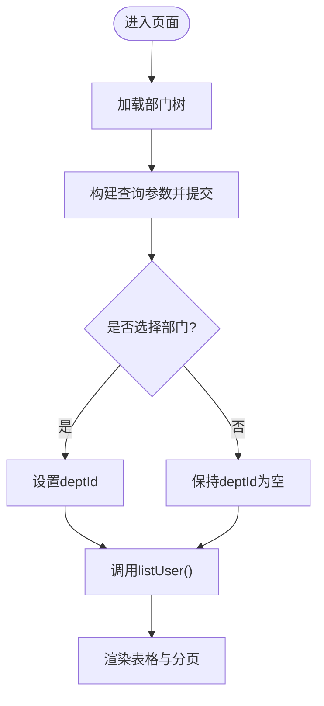

图表来源
- [index.vue:137-201](file://ruoyi-ui/src/views/system/user/index.vue#L137-L201)
- [index.vue:456-495](file://ruoyi-ui/src/views/system/user/index.vue#L456-L495)
- [user.js:5-11](file://ruoyi-ui/src/api/system/user.js#L5-L11)

章节来源
- [index.vue:137-201](file://ruoyi-ui/src/views/system/user/index.vue#L137-L201)
- [index.vue:456-495](file://ruoyi-ui/src/views/system/user/index.vue#L456-L495)
- [user.js:5-11](file://ruoyi-ui/src/api/system/user.js#L5-L11)

### 新增用户
- 表单字段：昵称、归属部门（树选择）、手机号、邮箱、用户名、密码（新增必填）、性别、状态、岗位多选、角色多选、备注。
- 校验规则：用户名必填且长度限制；昵称必填；密码必填且长度限制；邮箱格式校验；手机号正则校验。
- 提交逻辑：根据是否存在 userId 决定调用新增或修改接口；成功后刷新列表。

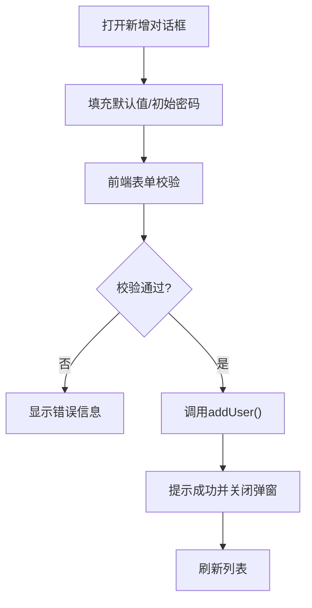

图表来源
- [index.vue:205-309](file://ruoyi-ui/src/views/system/user/index.vue#L205-L309)
- [index.vue:560-571](file://ruoyi-ui/src/views/system/user/index.vue#L560-L571)
- [index.vue:607-626](file://ruoyi-ui/src/views/system/user/index.vue#L607-L626)
- [user.js:21-28](file://ruoyi-ui/src/api/system/user.js#L21-L28)
- [SysUserController.java:191-215](file://ruoyi-modules/ruoyi-system/src/main/java/com/ruoyi/system/controller/SysUserController.java#L191-L215)
- [SysUserServiceImpl.java:248-265](file://ruoyi-modules/ruoyi-system/src/main/java/com/ruoyi/system/service/impl/SysUserServiceImpl.java#L248-L265)

章节来源
- [index.vue:205-309](file://ruoyi-ui/src/views/system/user/index.vue#L205-L309)
- [index.vue:560-571](file://ruoyi-ui/src/views/system/user/index.vue#L560-L571)
- [index.vue:607-626](file://ruoyi-ui/src/views/system/user/index.vue#L607-L626)
- [user.js:21-28](file://ruoyi-ui/src/api/system/user.js#L21-L28)
- [SysUserController.java:191-215](file://ruoyi-modules/ruoyi-system/src/main/java/com/ruoyi/system/controller/SysUserController.java#L191-L215)
- [SysUserServiceImpl.java:248-265](file://ruoyi-modules/ruoyi-system/src/main/java/com/ruoyi/system/service/impl/SysUserServiceImpl.java#L248-L265)

### 修改用户
- 预填充：根据 userId 获取用户详情、岗位ID数组、角色ID数组。
- 校验与保存：同新增，但密码字段不强制；更新后刷新列表。

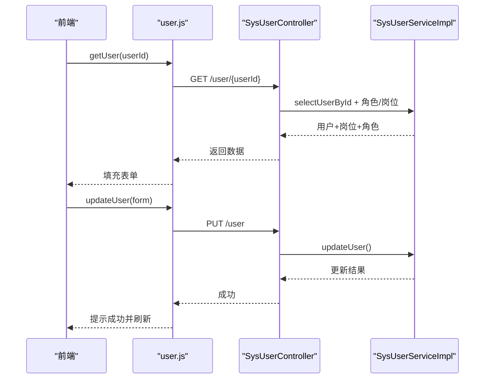

图表来源
- [index.vue:572-587](file://ruoyi-ui/src/views/system/user/index.vue#L572-L587)
- [index.vue:607-626](file://ruoyi-ui/src/views/system/user/index.vue#L607-L626)
- [user.js:13-19](file://ruoyi-ui/src/api/system/user.js#L13-L19)
- [user.js:30-37](file://ruoyi-ui/src/api/system/user.js#L30-L37)
- [SysUserController.java:168-188](file://ruoyi-modules/ruoyi-system/src/main/java/com/ruoyi/system/controller/SysUserController.java#L168-L188)
- [SysUserController.java:217-239](file://ruoyi-modules/ruoyi-system/src/main/java/com/ruoyi/system/controller/SysUserController.java#L217-L239)
- [SysUserServiceImpl.java:279-299](file://ruoyi-modules/ruoyi-system/src/main/java/com/ruoyi/system/service/impl/SysUserServiceImpl.java#L279-L299)

章节来源
- [index.vue:572-587](file://ruoyi-ui/src/views/system/user/index.vue#L572-L587)
- [index.vue:607-626](file://ruoyi-ui/src/views/system/user/index.vue#L607-L626)
- [user.js:13-19](file://ruoyi-ui/src/api/system/user.js#L13-L19)
- [user.js:30-37](file://ruoyi-ui/src/api/system/user.js#L30-L37)
- [SysUserController.java:168-188](file://ruoyi-modules/ruoyi-system/src/main/java/com/ruoyi/system/controller/SysUserController.java#L168-L188)
- [SysUserController.java:217-239](file://ruoyi-modules/ruoyi-system/src/main/java/com/ruoyi/system/controller/SysUserController.java#L217-L239)
- [SysUserServiceImpl.java:279-299](file://ruoyi-modules/ruoyi-system/src/main/java/com/ruoyi/system/service/impl/SysUserServiceImpl.java#L279-L299)

### 删除用户（单条/批量）
- 单条删除：行内操作触发，确认后调用 delUser。
- 批量删除：勾选多行后点击删除，传入 userIds 数组。
- 安全限制：禁止删除当前登录用户；超级管理员用户不可被删除（由服务层保护）。

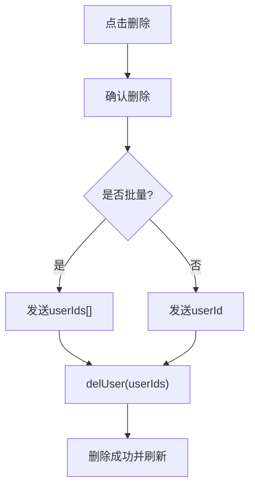

图表来源
- [index.vue:627-636](file://ruoyi-ui/src/views/system/user/index.vue#L627-L636)
- [user.js:39-45](file://ruoyi-ui/src/api/system/user.js#L39-L45)
- [SysUserController.java:241-254](file://ruoyi-modules/ruoyi-system/src/main/java/com/ruoyi/system/controller/SysUserController.java#L241-L254)
- [SysUserServiceImpl.java:455-492](file://ruoyi-modules/ruoyi-system/src/main/java/com/ruoyi/system/service/impl/SysUserServiceImpl.java#L455-L492)

章节来源
- [index.vue:627-636](file://ruoyi-ui/src/views/system/user/index.vue#L627-L636)
- [user.js:39-45](file://ruoyi-ui/src/api/system/user.js#L39-L45)
- [SysUserController.java:241-254](file://ruoyi-modules/ruoyi-system/src/main/java/com/ruoyi/system/controller/SysUserController.java#L241-L254)
- [SysUserServiceImpl.java:455-492](file://ruoyi-modules/ruoyi-system/src/main/java/com/ruoyi/system/service/impl/SysUserServiceImpl.java#L455-L492)

### 用户状态切换
- 表格内开关直接切换状态，确认后调用 changeUserStatus。
- 若失败则回滚前端状态。

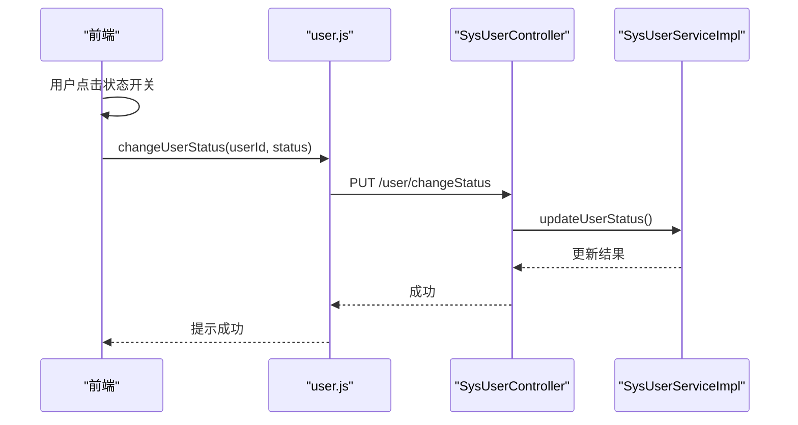

图表来源
- [index.vue:144-152](file://ruoyi-ui/src/views/system/user/index.vue#L144-L152)
- [index.vue:496-506](file://ruoyi-ui/src/views/system/user/index.vue#L496-L506)
- [user.js:60-71](file://ruoyi-ui/src/api/system/user.js#L60-L71)
- [SysUserController.java:271-283](file://ruoyi-modules/ruoyi-system/src/main/java/com/ruoyi/system/controller/SysUserController.java#L271-L283)
- [SysUserServiceImpl.java:315-325](file://ruoyi-modules/ruoyi-system/src/main/java/com/ruoyi/system/service/impl/SysUserServiceImpl.java#L315-L325)

章节来源
- [index.vue:144-152](file://ruoyi-ui/src/views/system/user/index.vue#L144-L152)
- [index.vue:496-506](file://ruoyi-ui/src/views/system/user/index.vue#L496-L506)
- [user.js:60-71](file://ruoyi-ui/src/api/system/user.js#L60-L71)
- [SysUserController.java:271-283](file://ruoyi-modules/ruoyi-system/src/main/java/com/ruoyi/system/controller/SysUserController.java#L271-L283)
- [SysUserServiceImpl.java:315-325](file://ruoyi-modules/ruoyi-system/src/main/java/com/ruoyi/system/service/impl/SysUserServiceImpl.java#L315-L325)

### 密码重置
- 行内“更多”菜单触发，弹出输入框校验密码长度，调用 resetUserPwd。
- 成功后提示新密码。

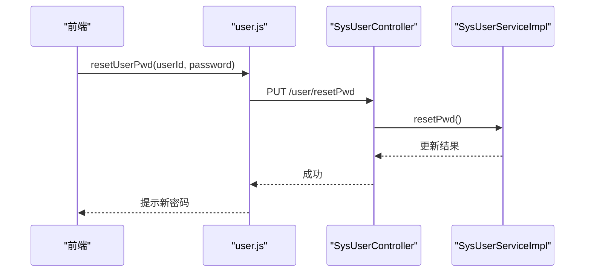

图表来源
- [index.vue:588-601](file://ruoyi-ui/src/views/system/user/index.vue#L588-L601)
- [user.js:47-58](file://ruoyi-ui/src/api/system/user.js#L47-L58)
- [SysUserController.java:256-269](file://ruoyi-modules/ruoyi-system/src/main/java/com/ruoyi/system/controller/SysUserController.java#L256-L269)
- [SysUserServiceImpl.java:352-362](file://ruoyi-modules/ruoyi-system/src/main/java/com/ruoyi/system/service/impl/SysUserServiceImpl.java#L352-L362)

章节来源
- [index.vue:588-601](file://ruoyi-ui/src/views/system/user/index.vue#L588-L601)
- [user.js:47-58](file://ruoyi-ui/src/api/system/user.js#L47-L58)
- [SysUserController.java:256-269](file://ruoyi-modules/ruoyi-system/src/main/java/com/ruoyi/system/controller/SysUserController.java#L256-L269)
- [SysUserServiceImpl.java:352-362](file://ruoyi-modules/ruoyi-system/src/main/java/com/ruoyi/system/service/impl/SysUserServiceImpl.java#L352-L362)

### 部门树选择与筛选
- 新增/修改表单中的“归属部门”使用 Treeselect 组件，数据来自部门树接口。
- 左侧部门树支持按名称过滤，点击节点设置查询条件 deptId。

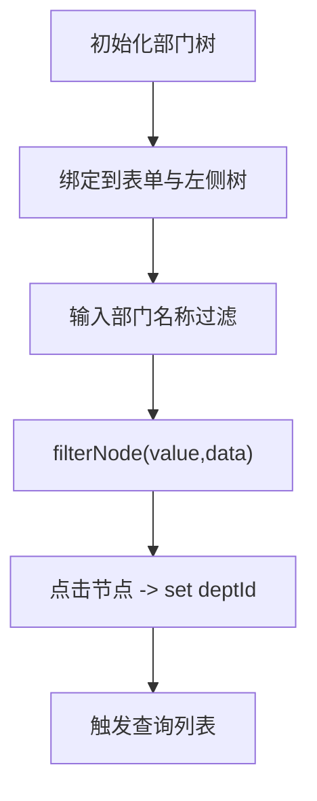

图表来源
- [index.vue:16-26](file://ruoyi-ui/src/views/system/user/index.vue#L16-L26)
- [index.vue:214-218](file://ruoyi-ui/src/views/system/user/index.vue#L214-L218)
- [index.vue:456-495](file://ruoyi-ui/src/views/system/user/index.vue#L456-L495)

章节来源
- [index.vue:16-26](file://ruoyi-ui/src/views/system/user/index.vue#L16-L26)
- [index.vue:214-218](file://ruoyi-ui/src/views/system/user/index.vue#L214-L218)
- [index.vue:456-495](file://ruoyi-ui/src/views/system/user/index.vue#L456-L495)

### 角色与岗位分配
- 新增/修改表单中提供岗位多选、角色多选下拉框。
- 分配角色可通过“分配角色”跳转至授权页面，后端提供授权接口。

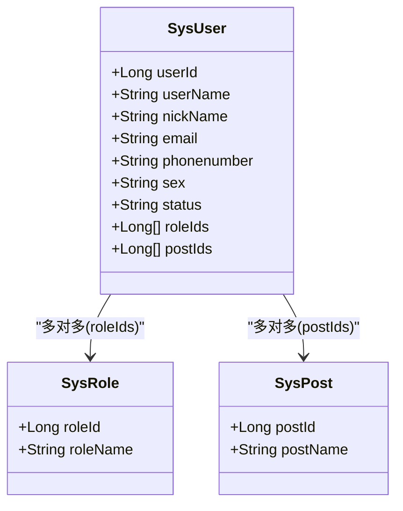

图表来源
- [SysUser.java:81-88](file://ruoyi-api/ruoyi-api-system/src/main/java/com/ruoyi/system/api/domain/SysUser.java#L81-L88)
- [index.vue:269-296](file://ruoyi-ui/src/views/system/user/index.vue#L269-L296)
- [SysUserController.java:285-311](file://ruoyi-modules/ruoyi-system/src/main/java/com/ruoyi/system/controller/SysUserController.java#L285-L311)
- [SysUserServiceImpl.java:377-453](file://ruoyi-modules/ruoyi-system/src/main/java/com/ruoyi/system/service/impl/SysUserServiceImpl.java#L377-L453)

章节来源
- [SysUser.java:81-88](file://ruoyi-api/ruoyi-api-system/src/main/java/com/ruoyi/system/api/domain/SysUser.java#L81-L88)
- [index.vue:269-296](file://ruoyi-ui/src/views/system/user/index.vue#L269-L296)
- [SysUserController.java:285-311](file://ruoyi-modules/ruoyi-system/src/main/java/com/ruoyi/system/controller/SysUserController.java#L285-L311)
- [SysUserServiceImpl.java:377-453](file://ruoyi-modules/ruoyi-system/src/main/java/com/ruoyi/system/service/impl/SysUserServiceImpl.java#L377-L453)

### 导入与导出
- 导出：将当前查询条件下的用户数据导出为 Excel。
- 导入：上传 Excel，支持“是否更新已存在用户”，后端逐行处理并返回汇总消息。

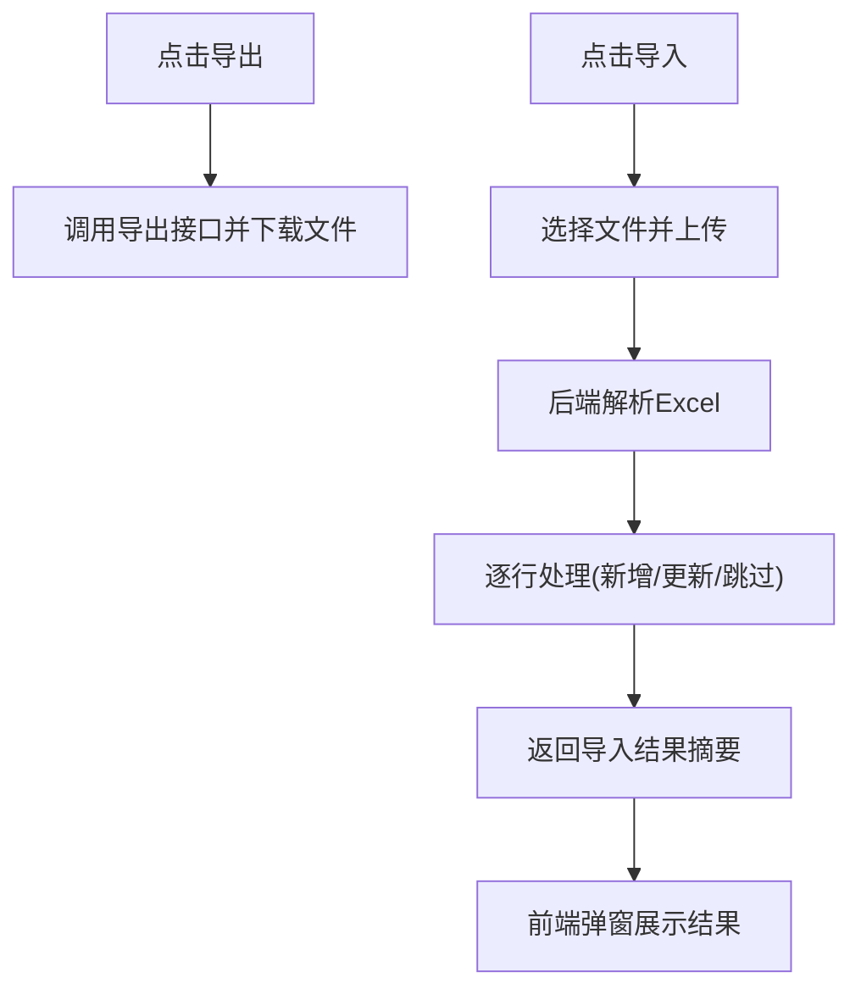

图表来源
- [index.vue:637-668](file://ruoyi-ui/src/views/system/user/index.vue#L637-L668)
- [SysUserController.java:77-104](file://ruoyi-modules/ruoyi-system/src/main/java/com/ruoyi/system/controller/SysUserController.java#L77-L104)
- [SysUserServiceImpl.java:494-561](file://ruoyi-modules/ruoyi-system/src/main/java/com/ruoyi/system/service/impl/SysUserServiceImpl.java#L494-L561)

章节来源
- [index.vue:637-668](file://ruoyi-ui/src/views/system/user/index.vue#L637-L668)
- [SysUserController.java:77-104](file://ruoyi-modules/ruoyi-system/src/main/java/com/ruoyi/system/controller/SysUserController.java#L77-L104)
- [SysUserServiceImpl.java:494-561](file://ruoyi-modules/ruoyi-system/src/main/java/com/ruoyi/system/service/impl/SysUserServiceImpl.java#L494-L561)

### 表单验证规则
- 用户名：必填，长度限制。
- 昵称：必填。
- 密码：新增时必填，长度限制。
- 邮箱：格式校验。
- 手机号：正则校验。
- 后端同时使用 Bean Validation 注解进行服务端校验。

章节来源
- [index.vue:426-453](file://ruoyi-ui/src/views/system/user/index.vue#L426-L453)
- [SysUser.java:133-179](file://ruoyi-api/ruoyi-api-system/src/main/java/com/ruoyi/system/api/domain/SysUser.java#L133-L179)

## 依赖关系分析
- 前端依赖：Element UI 组件库、Treeselect 组件、字典数据、权限指令 v-hasPermi。
- 后端依赖：Spring MVC、权限注解 @RequiresPermissions、日志注解 @Log、数据权限注解 @DataScope、事务注解 @Transactional。
- 数据模型：SysUser 包含角色组与岗位组数组，用于多对多关联。

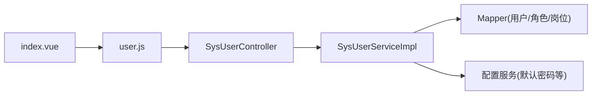

图表来源
- [index.vue:343-353](file://ruoyi-ui/src/views/system/user/index.vue#L343-L353)
- [user.js:1-128](file://ruoyi-ui/src/api/system/user.js#L1-L128)
- [SysUserController.java:46-64](file://ruoyi-modules/ruoyi-system/src/main/java/com/ruoyi/system/controller/SysUserController.java#L46-L64)
- [SysUserServiceImpl.java:43-62](file://ruoyi-modules/ruoyi-system/src/main/java/com/ruoyi/system/service/impl/SysUserServiceImpl.java#L43-L62)

章节来源
- [index.vue:343-353](file://ruoyi-ui/src/views/system/user/index.vue#L343-L353)
- [user.js:1-128](file://ruoyi-ui/src/api/system/user.js#L1-L128)
- [SysUserController.java:46-64](file://ruoyi-modules/ruoyi-system/src/main/java/com/ruoyi/system/controller/SysUserController.java#L46-L64)
- [SysUserServiceImpl.java:43-62](file://ruoyi-modules/ruoyi-system/src/main/java/com/ruoyi/system/service/impl/SysUserServiceImpl.java#L43-L62)

## 性能与可维护性
- 列表分页：前端分页组件与后端分页工具配合，避免一次性加载大量数据。
- 部门树懒加载：按需展开与过滤，减少 DOM 与网络压力。
- 导入优化：后端逐行处理并记录成功/失败统计，便于定位问题。
- 事务边界：新增/修改/删除均使用事务保证一致性。
- 可维护性：统一的异常与成功响应封装，日志注解记录关键操作。

[本节为通用建议，不直接分析具体文件]

## 故障排查指南
- 无法新增/修改：检查前端表单校验与后端唯一性校验（用户名/手机/邮箱）；查看后端返回的错误信息。
- 删除失败：确认未尝试删除当前登录用户或超级管理员；检查数据权限是否允许操作目标用户。
- 状态切换无效：确认权限与数据权限；失败时前端会回滚状态。
- 导入失败：查看导入结果弹窗中的失败明细；检查 Excel 格式与必填字段。
- 权限不足：确认用户具备对应权限标识（如 system:user:add/edit/remove/import/export/resetPwd）。

章节来源
- [SysUserController.java:191-215](file://ruoyi-modules/ruoyi-system/src/main/java/com/ruoyi/system/controller/SysUserController.java#L191-L215)
- [SysUserController.java:217-239](file://ruoyi-modules/ruoyi-system/src/main/java/com/ruoyi/system/controller/SysUserController.java#L217-L239)
- [SysUserController.java:241-254](file://ruoyi-modules/ruoyi-system/src/main/java/com/ruoyi/system/controller/SysUserController.java#L241-L254)
- [SysUserServiceImpl.java:214-246](file://ruoyi-modules/ruoyi-system/src/main/java/com/ruoyi/system/service/impl/SysUserServiceImpl.java#L214-L246)
- [SysUserServiceImpl.java:494-561](file://ruoyi-modules/ruoyi-system/src/main/java/com/ruoyi/system/service/impl/SysUserServiceImpl.java#L494-L561)

## 结论
用户管理模块在前端提供了完善的交互体验与校验机制，在后端实现了严格的权限控制、数据权限校验与事务一致性保障。通过部门树筛选、角色与岗位的多对多分配、导入导出与批量操作，满足了常见的企业级用户管理场景。建议在后续迭代中继续完善错误提示的本地化、导入模板的可配置性以及大数据量下的性能优化策略。