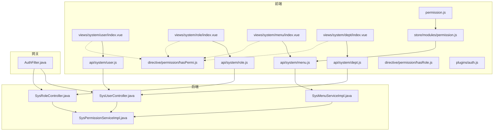
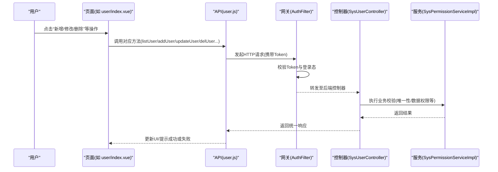
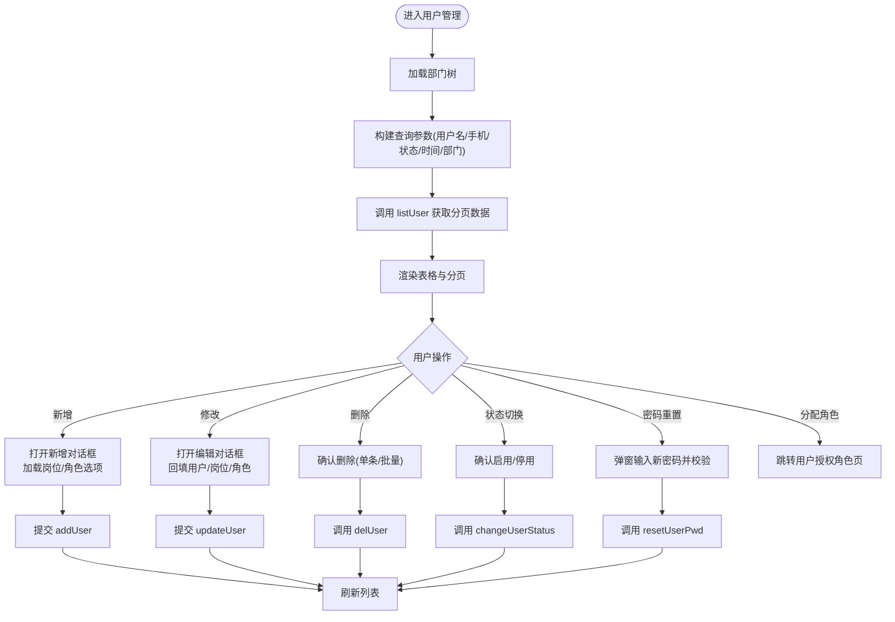
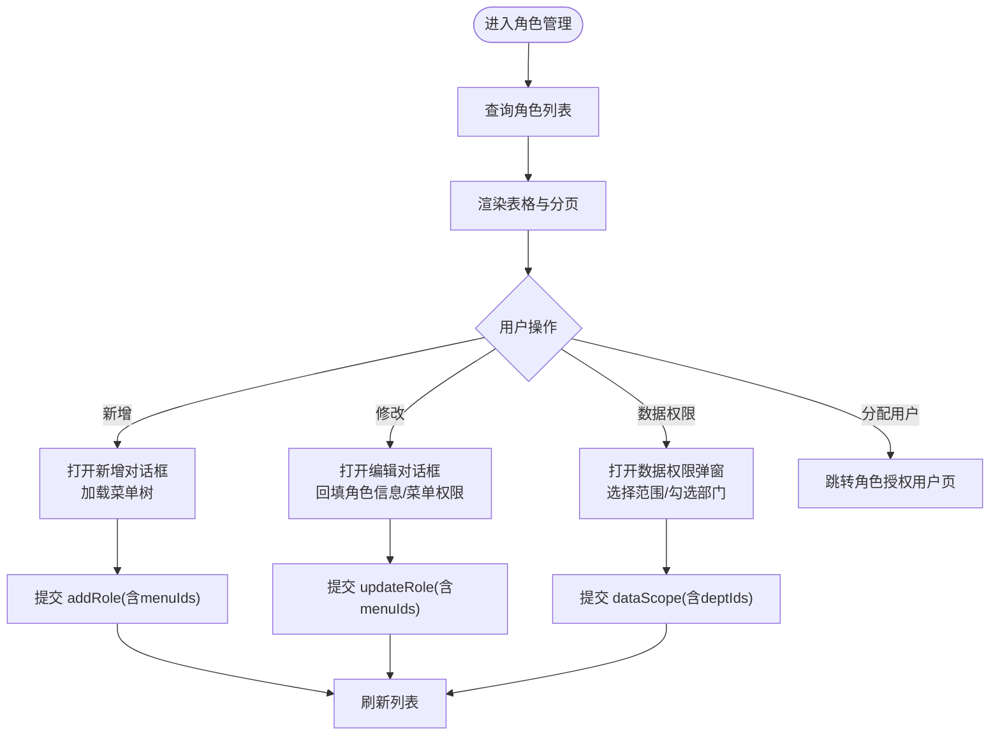
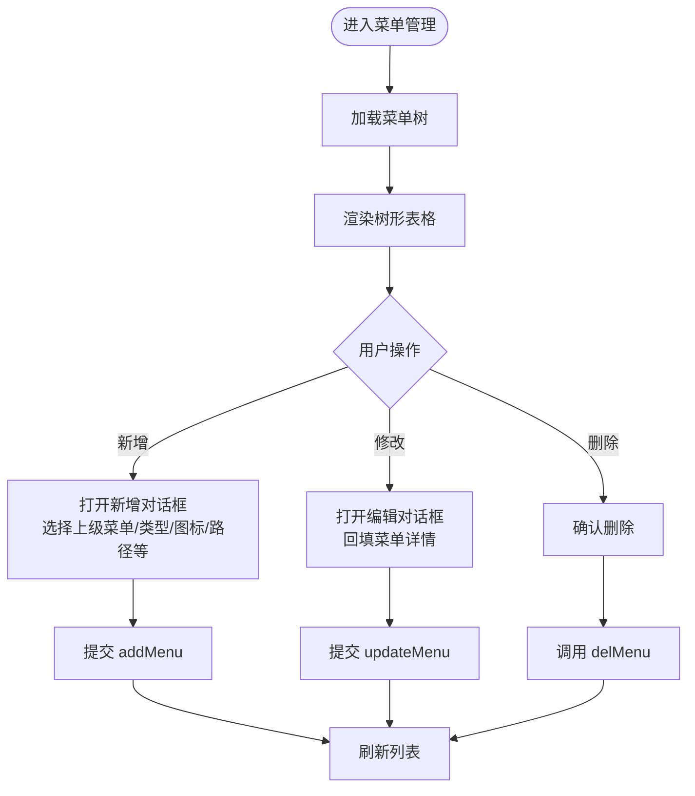
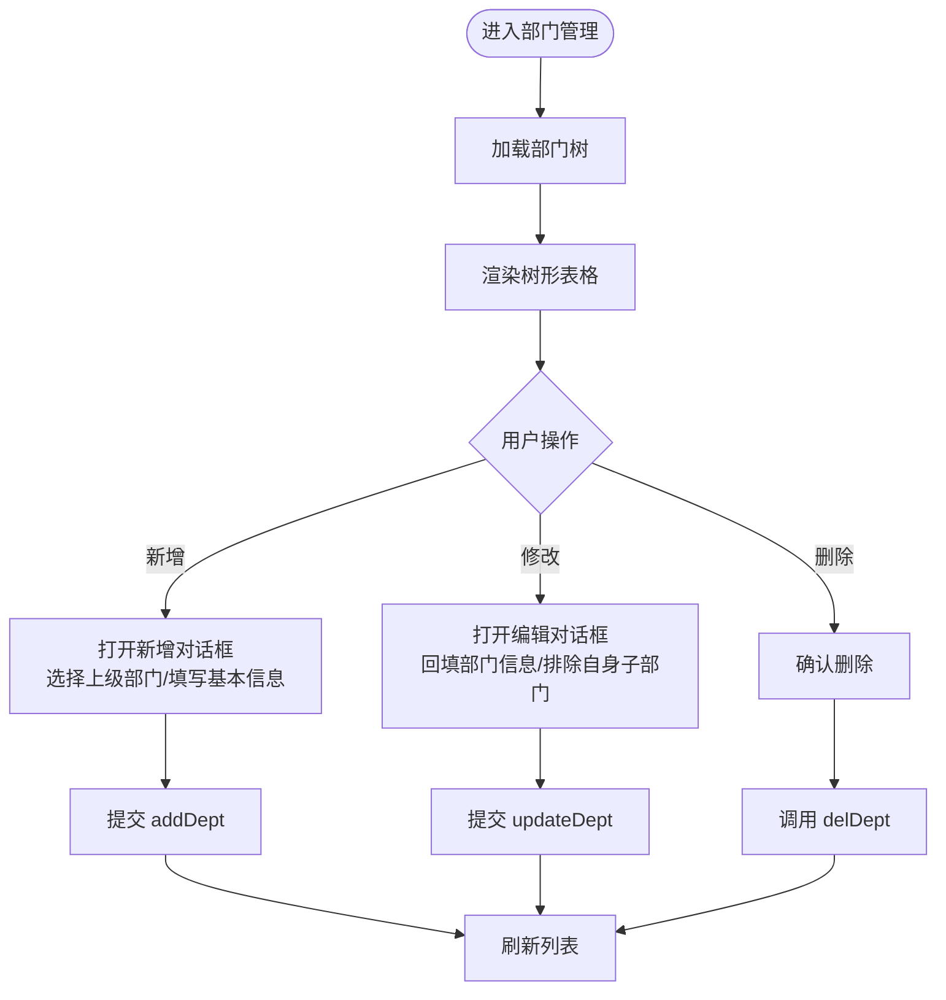
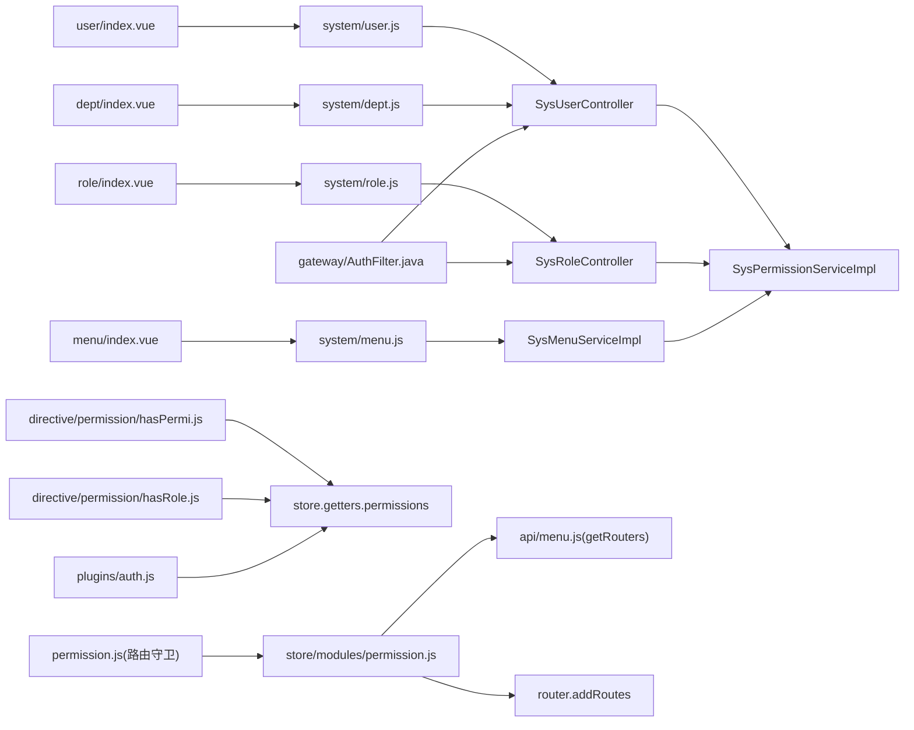

# 系统管理页面

<cite>
**本文引用的文件**   
- [用户列表页面](file://ruoyi-ui/src/views/system/user/index.vue)
- [角色列表页面](file://ruoyi-ui/src/views/system/role/index.vue)
- [菜单列表页面](file://ruoyi-ui/src/views/system/menu/index.vue)
- [部门列表页面](file://ruoyi-ui/src/views/system/dept/index.vue)
- [用户 API](file://ruoyi-ui/src/api/system/user.js)
- [角色 API](file://ruoyi-ui/src/api/system/role.js)
- [菜单 API](file://ruoyi-ui/src/api/system/menu.js)
- [部门 API](file://ruoyi-ui/src/api/system/dept.js)
- [权限指令 hasPermi](file://ruoyi-ui/src/directive/permission/hasPermi.js)
- [权限指令 hasRole](file://ruoyi-ui/src/directive/permission/hasRole.js)
- [权限工具 auth](file://ruoyi-ui/src/plugins/auth.js)
- [权限校验工具](file://ruoyi-ui/src/utils/permission.js)
- [动态路由与菜单生成](file://ruoyi-ui/src/store/modules/permission.js)
- [获取路由 API](file://ruoyi-ui/src/api/menu.js)
- [前端路由守卫](file://ruoyi-ui/src/permission.js)
- [用户控制器（后端）](file://ruoyi-modules/ruoyi-system/src/main/java/com/ruoyi/system/controller/SysUserController.java)
- [角色控制器（后端）](file://ruoyi-modules/ruoyi-system/src/main/java/com/ruoyi/system/controller/SysRoleController.java)
- [权限服务实现（后端）](file://ruoyi-modules/ruoyi-system/src/main/java/com/ruoyi/system/service/impl/SysPermissionServiceImpl.java)
- [菜单服务实现（后端）](file://ruoyi-modules/ruoyi-system/src/main/java/com/ruoyi/system/service/impl/SysMenuServiceImpl.java)
- [网关鉴权过滤器](file://ruoyi-gateway/src/main/java/com/ruoyi/gateway/filter/AuthFilter.java)
</cite>

## 目录
1. [简介](#简介)
2. [项目结构](#项目结构)
3. [核心组件](#核心组件)
4. [架构总览](#架构总览)
5. [详细组件分析](#详细组件分析)
6. [依赖关系分析](#依赖关系分析)
7. [性能考虑](#性能考虑)
8. [故障排查指南](#故障排查指南)
9. [结论](#结论)
10. [附录](#附录)

## 简介
本文件面向“系统管理”相关后台页面的实现说明，覆盖用户管理、角色权限、菜单配置、部门管理等模块。文档从前后端协同角度，梳理各管理页面的 CRUD 操作、表单验证、权限控制、表格分页、搜索过滤、批量操作等交互逻辑，并深入讲解权限指令、动态菜单、路由守卫等安全机制的实现细节。

## 项目结构
系统管理功能由前端 Vue 页面与后端 Spring Boot 控制器共同构成：
- 前端页面：位于 ruoyi-ui/src/views/system 下，分别提供用户、角色、菜单、部门的可视化操作界面。
- 前端 API：位于 ruoyi-ui/src/api/system 下，封装对后端的 HTTP 请求。
- 后端控制器：位于 ruoyi-modules/ruoyi-system 下，提供 RESTful 接口，承载业务校验与数据持久化。
- 权限与安全：前端通过指令与工具函数进行按钮级权限控制；后端通过注解与拦截器进行接口级权限校验；网关层负责令牌校验与登录态检查。

图表来源
- [用户列表页面:1-671](file://ruoyi-ui/src/views/system/user/index.vue#L1-L671)
- [角色列表页面:1-614](file://ruoyi-ui/src/views/system/role/index.vue#L1-L614)
- [菜单列表页面:1-454](file://ruoyi-ui/src/views/system/menu/index.vue#L1-L454)
- [部门列表页面:1-337](file://ruoyi-ui/src/views/system/dept/index.vue#L1-L337)
- [用户 API:1-128](file://ruoyi-ui/src/api/system/user.js#L1-L128)
- [角色 API:1-111](file://ruoyi-ui/src/api/system/role.js#L1-L111)
- [菜单 API:1-60](file://ruoyi-ui/src/api/system/menu.js#L1-L60)
- [部门 API:1-68](file://ruoyi-ui/src/api/system/dept.js#L1-L68)
- [权限指令 hasPermi:1-29](file://ruoyi-ui/src/directive/permission/hasPermi.js#L1-L29)
- [权限指令 hasRole:1-29](file://ruoyi-ui/src/directive/permission/hasRole.js#L1-L29)
- [权限工具 auth:1-60](file://ruoyi-ui/src/plugins/auth.js#L1-L60)
- [动态路由与菜单生成:1-134](file://ruoyi-ui/src/store/modules/permission.js#L1-L134)
- [获取路由 API:1-9](file://ruoyi-ui/src/api/menu.js#L1-L9)
- [前端路由守卫:1-56](file://ruoyi-ui/src/permission.js#L1-L56)
- [用户控制器（后端）:87-254](file://ruoyi-modules/ruoyi-system/src/main/java/com/ruoyi/system/controller/SysUserController.java#L87-L254)
- [角色控制器（后端）:131-175](file://ruoyi-modules/ruoyi-system/src/main/java/com/ruoyi/system/controller/SysRoleController.java#L131-L175)
- [权限服务实现（后端）:1-64](file://ruoyi-modules/ruoyi-system/src/main/java/com/ruoyi/system/service/impl/SysPermissionServiceImpl.java#L1-L64)
- [菜单服务实现（后端）:137-169](file://ruoyi-modules/ruoyi-system/src/main/java/com/ruoyi/system/service/impl/SysMenuServiceImpl.java#L137-L169)
- [网关鉴权过滤器:38-75](file://ruoyi-gateway/src/main/java/com/ruoyi/gateway/filter/AuthFilter.java#L38-L75)

章节来源
- [用户列表页面:1-671](file://ruoyi-ui/src/views/system/user/index.vue#L1-L671)
- [角色列表页面:1-614](file://ruoyi-ui/src/views/system/role/index.vue#L1-L614)
- [菜单列表页面:1-454](file://ruoyi-ui/src/views/system/menu/index.vue#L1-L454)
- [部门列表页面:1-337](file://ruoyi-ui/src/views/system/dept/index.vue#L1-L337)

## 核心组件
- 用户管理页面：提供用户查询、新增、修改、删除、状态切换、密码重置、分配角色、导入导出等功能，左侧支持按部门树筛选。
- 角色管理页面：提供角色查询、新增、修改、删除、状态切换、菜单权限勾选、数据权限范围设置、分配用户等功能。
- 菜单管理页面：以树形表格展示菜单，支持新增子菜单、编辑、删除、展开/折叠、图标选择、外链与缓存配置等。
- 部门管理页面：以树形表格展示部门，支持新增、编辑、删除、展开/折叠、负责人与联系方式维护等。

章节来源
- [用户列表页面:1-671](file://ruoyi-ui/src/views/system/user/index.vue#L1-L671)
- [角色列表页面:1-614](file://ruoyi-ui/src/views/system/role/index.vue#L1-L614)
- [菜单列表页面:1-454](file://ruoyi-ui/src/views/system/menu/index.vue#L1-L454)
- [部门列表页面:1-337](file://ruoyi-ui/src/views/system/dept/index.vue#L1-L337)

## 架构总览
系统管理的前后端交互遵循“页面调用 API -> 网关鉴权 -> 控制器处理 -> 服务层校验 -> 返回结果”的链路。前端通过 v-hasPermi/v-hasRole 指令控制按钮可见性，并通过 store 中的动态路由生成侧边栏菜单。

图表来源
- [用户列表页面:343-671](file://ruoyi-ui/src/views/system/user/index.vue#L343-L671)
- [用户 API:1-128](file://ruoyi-ui/src/api/system/user.js#L1-L128)
- [网关鉴权过滤器:38-75](file://ruoyi-gateway/src/main/java/com/ruoyi/gateway/filter/AuthFilter.java#L38-L75)
- [用户控制器（后端）:87-254](file://ruoyi-modules/ruoyi-system/src/main/java/com/ruoyi/system/controller/SysUserController.java#L87-L254)
- [权限服务实现（后端）:1-64](file://ruoyi-modules/ruoyi-system/src/main/java/com/ruoyi/system/service/impl/SysPermissionServiceImpl.java#L1-L64)

## 详细组件分析

### 用户管理页面
- 表格与分页：使用 Element UI 表格与分页组件，支持多选、列显示控制、排序与时间格式化。
- 搜索与过滤：顶部表单支持用户名、手机号、状态、创建时间范围查询；左侧部门树支持名称过滤与节点点击筛选。
- 表单验证：包含必填、长度、邮箱格式、手机号正则等规则；提交前执行表单校验。
- 权限控制：按钮与下拉菜单通过 v-hasPermi 指令控制可见性，如 system:user:add/edit/remove/resetPwd/import/export。
- 批量操作：支持批量删除、批量导入导出；状态开关在行内直接切换。
- 交互流程：新增/修改打开对话框，加载岗位与角色选项；修改时回填已选岗位与角色；密码重置使用弹窗输入并校验长度。

图表来源
- [用户列表页面:1-671](file://ruoyi-ui/src/views/system/user/index.vue#L1-L671)
- [用户 API:1-128](file://ruoyi-ui/src/api/system/user.js#L1-L128)

章节来源
- [用户列表页面:1-671](file://ruoyi-ui/src/views/system/user/index.vue#L1-L671)
- [用户 API:1-128](file://ruoyi-ui/src/api/system/user.js#L1-L128)
- [用户控制器（后端）:87-254](file://ruoyi-modules/ruoyi-system/src/main/java/com/ruoyi/system/controller/SysUserController.java#L87-L254)

### 角色管理页面
- 表格与分页：支持角色名称、权限字符、状态、创建时间范围查询；分页与列显隐控制。
- 表单验证：角色名称、权限字符、顺序必填；菜单权限通过树形复选框选择，支持父子联动与全选/全不选。
- 数据权限：提供“全部/自定义/本部门/本部门及以下/仅本人”等数据范围；自定义范围可勾选部门树。
- 权限控制：按钮与下拉菜单通过 v-hasPermi 指令控制，如 system:role:add/edit/remove/export。
- 交互流程：新增/修改打开对话框，加载菜单树；修改时根据角色ID回填已选菜单；数据权限弹窗中加载部门树并回填已选部门。

图表来源
- [角色列表页面:1-614](file://ruoyi-ui/src/views/system/role/index.vue#L1-L614)
- [角色 API:1-111](file://ruoyi-ui/src/api/system/role.js#L1-L111)
- [菜单 API:1-60](file://ruoyi-ui/src/api/system/menu.js#L1-L60)
- [部门 API:1-68](file://ruoyi-ui/src/api/system/dept.js#L1-L68)

章节来源
- [角色列表页面:1-614](file://ruoyi-ui/src/views/system/role/index.vue#L1-L614)
- [角色 API:1-111](file://ruoyi-ui/src/api/system/role.js#L1-L111)
- [角色控制器（后端）:131-175](file://ruoyi-modules/ruoyi-system/src/main/java/com/ruoyi/system/controller/SysRoleController.java#L131-L175)

### 菜单管理页面
- 表格与树形展示：以树形表格展示菜单层级，支持展开/折叠、图标选择、外链与缓存配置、显示状态与菜单状态。
- 表单验证：菜单名称、排序、路由地址必填；根据菜单类型（目录/菜单/按钮）动态显示字段。
- 权限控制：按钮与操作项通过 v-hasPermi 指令控制，如 system:menu:add/edit/remove。
- 交互流程：新增子菜单时自动设置父级；修改时加载菜单详情；删除需二次确认。

图表来源
- [菜单列表页面:1-454](file://ruoyi-ui/src/views/system/menu/index.vue#L1-L454)
- [菜单 API:1-60](file://ruoyi-ui/src/api/system/menu.js#L1-L60)

章节来源
- [菜单列表页面:1-454](file://ruoyi-ui/src/views/system/menu/index.vue#L1-L454)
- [菜单 API:1-60](file://ruoyi-ui/src/api/system/menu.js#L1-L60)

### 部门管理页面
- 表格与树形展示：以树形表格展示部门层级，支持展开/折叠、负责人与联系方式维护。
- 表单验证：上级部门、部门名称、排序必填；邮箱与手机号格式校验。
- 权限控制：按钮与操作项通过 v-hasPermi 指令控制，如 system:dept:add/edit/remove。
- 交互流程：新增时可选上级部门；修改时排除自身及子部门作为上级；删除需二次确认。

图表来源
- [部门列表页面:1-337](file://ruoyi-ui/src/views/system/dept/index.vue#L1-L337)
- [部门 API:1-68](file://ruoyi-ui/src/api/system/dept.js#L1-L68)

章节来源
- [部门列表页面:1-337](file://ruoyi-ui/src/views/system/dept/index.vue#L1-L337)
- [部门 API:1-68](file://ruoyi-ui/src/api/system/dept.js#L1-L68)

## 依赖关系分析
- 前端页面依赖各自 API 模块进行数据交互。
- 权限控制依赖指令与工具函数：v-hasPermi/v-hasRole 基于 store 中的 permissions/roles 判断元素是否渲染；auth 插件提供 hasPermi/hasRole 等方法供路由与组件使用。
- 动态菜单与路由：permission store 调用 getRouters 获取后端菜单树，转换为前端路由并注入到 router，同时生成侧边栏导航。
- 后端控制器依赖权限服务：SysPermissionServiceImpl 提供角色与菜单权限集合；SysMenuServiceImpl 构建前端路由所需菜单结构。
- 网关层 AuthFilter 负责 Token 解析与登录态校验，未通过则拒绝访问。

图表来源
- [用户列表页面:1-671](file://ruoyi-ui/src/views/system/user/index.vue#L1-L671)
- [角色列表页面:1-614](file://ruoyi-ui/src/views/system/role/index.vue#L1-L614)
- [菜单列表页面:1-454](file://ruoyi-ui/src/views/system/menu/index.vue#L1-L454)
- [部门列表页面:1-337](file://ruoyi-ui/src/views/system/dept/index.vue#L1-L337)
- [用户 API:1-128](file://ruoyi-ui/src/api/system/user.js#L1-L128)
- [角色 API:1-111](file://ruoyi-ui/src/api/system/role.js#L1-L111)
- [菜单 API:1-60](file://ruoyi-ui/src/api/system/menu.js#L1-L60)
- [部门 API:1-68](file://ruoyi-ui/src/api/system/dept.js#L1-L68)
- [动态路由与菜单生成:1-134](file://ruoyi-ui/src/store/modules/permission.js#L1-L134)
- [获取路由 API:1-9](file://ruoyi-ui/src/api/menu.js#L1-L9)
- [前端路由守卫:1-56](file://ruoyi-ui/src/permission.js#L1-L56)
- [权限指令 hasPermi:1-29](file://ruoyi-ui/src/directive/permission/hasPermi.js#L1-L29)
- [权限指令 hasRole:1-29](file://ruoyi-ui/src/directive/permission/hasRole.js#L1-L29)
- [权限工具 auth:1-60](file://ruoyi-ui/src/plugins/auth.js#L1-L60)
- [用户控制器（后端）:87-254](file://ruoyi-modules/ruoyi-system/src/main/java/com/ruoyi/system/controller/SysUserController.java#L87-L254)
- [角色控制器（后端）:131-175](file://ruoyi-modules/ruoyi-system/src/main/java/com/ruoyi/system/controller/SysRoleController.java#L131-L175)
- [权限服务实现（后端）:1-64](file://ruoyi-modules/ruoyi-system/src/main/java/com/ruoyi/system/service/impl/SysPermissionServiceImpl.java#L1-L64)
- [菜单服务实现（后端）:137-169](file://ruoyi-modules/ruoyi-system/src/main/java/com/ruoyi/system/service/impl/SysMenuServiceImpl.java#L137-L169)
- [网关鉴权过滤器:38-75](file://ruoyi-gateway/src/main/java/com/ruoyi/gateway/filter/AuthFilter.java#L38-L75)

章节来源
- [动态路由与菜单生成:1-134](file://ruoyi-ui/src/store/modules/permission.js#L1-L134)
- [权限指令 hasPermi:1-29](file://ruoyi-ui/src/directive/permission/hasPermi.js#L1-L29)
- [权限指令 hasRole:1-29](file://ruoyi-ui/src/directive/permission/hasRole.js#L1-L29)
- [权限工具 auth:1-60](file://ruoyi-ui/src/plugins/auth.js#L1-L60)
- [前端路由守卫:1-56](file://ruoyi-ui/src/permission.js#L1-L56)
- [用户控制器（后端）:87-254](file://ruoyi-modules/ruoyi-system/src/main/java/com/ruoyi/system/controller/SysUserController.java#L87-L254)
- [角色控制器（后端）:131-175](file://ruoyi-modules/ruoyi-system/src/main/java/com/ruoyi/system/controller/SysRoleController.java#L131-L175)
- [权限服务实现（后端）:1-64](file://ruoyi-modules/ruoyi-system/src/main/java/com/ruoyi/system/service/impl/SysPermissionServiceImpl.java#L1-L64)
- [菜单服务实现（后端）:137-169](file://ruoyi-modules/ruoyi-system/src/main/java/com/ruoyi/system/service/impl/SysMenuServiceImpl.java#L137-L169)
- [网关鉴权过滤器:38-75](file://ruoyi-gateway/src/main/java/com/ruoyi/gateway/filter/AuthFilter.java#L38-L75)

## 性能考虑
- 表格与树形数据：菜单与部门采用树形表格，建议在数据量较大时启用懒加载或虚拟滚动（当前实现为一次性加载）。
- 分页与查询：所有列表均支持分页与条件查询，避免一次性拉取大量数据。
- 路由懒加载：动态路由通过 loadView 实现按需加载，减少首屏体积。
- 上传与下载：导入导出使用流式下载与分片上传（前端限制文件大小与类型），建议在后端增加限流与异步任务队列以提升稳定性。

[本节为通用指导，无需具体文件引用]

## 故障排查指南
- 按钮不可见：检查 v-hasPermi 指令绑定的权限码是否与后端返回的 permissions 一致；确认 store.getters.permissions 是否正确加载。
- 菜单不显示：确认后端返回的菜单树结构与前端 filterAsyncRouter 转换逻辑匹配；检查路由 path 与 component 映射是否正确。
- 接口被拒：检查网关 AuthFilter 的 Token 解析与 Redis 登录态校验；确认请求头 Authorization 是否正确携带。
- 表单校验失败：核对 rules 中的必填、长度、邮箱、手机号正则是否符合预期；确保提交前调用 validate。
- 数据权限异常：检查角色数据范围与部门树勾选是否正确；确认后端数据权限注解与 SQL 拼接逻辑生效。

章节来源
- [权限指令 hasPermi:1-29](file://ruoyi-ui/src/directive/permission/hasPermi.js#L1-L29)
- [权限指令 hasRole:1-29](file://ruoyi-ui/src/directive/permission/hasRole.js#L1-L29)
- [动态路由与菜单生成:1-134](file://ruoyi-ui/src/store/modules/permission.js#L1-L134)
- [前端路由守卫:1-56](file://ruoyi-ui/src/permission.js#L1-L56)
- [网关鉴权过滤器:38-75](file://ruoyi-gateway/src/main/java/com/ruoyi/gateway/filter/AuthFilter.java#L38-L75)

## 结论
系统管理页面通过前后端分离与完善的权限体系，实现了用户、角色、菜单、部门的完整管理能力。前端以指令与工具函数保障按钮级权限，后端通过注解与服务层校验保障接口级安全；动态菜单与路由守卫确保不同角色的菜单可见性与访问控制。整体架构清晰、扩展性强，便于后续功能迭代与权限细化。

[本节为总结性内容，无需具体文件引用]

## 附录
- 常用权限标识示例：system:user:list/add/edit/remove/resetPwd/import/export；system:role:list/add/edit/remove/export；system:menu:list/add/edit/remove；system:dept:list/add/edit/remove。
- 数据权限范围：全部数据权限、自定义数据权限、本部门数据权限、本部门及以下数据权限、仅本人数据权限。
- 菜单类型：目录(M)、菜单(C)、按钮(F)。

[本节为补充信息，无需具体文件引用]