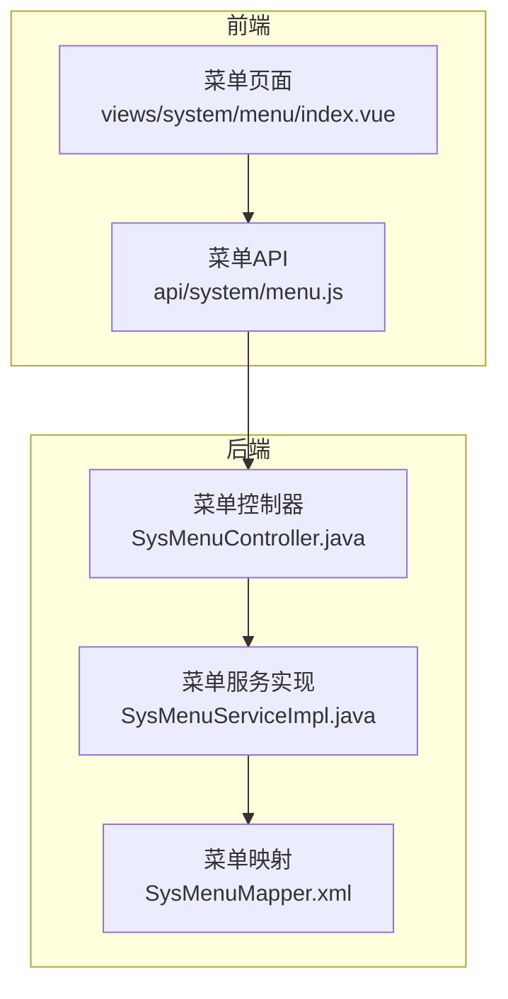
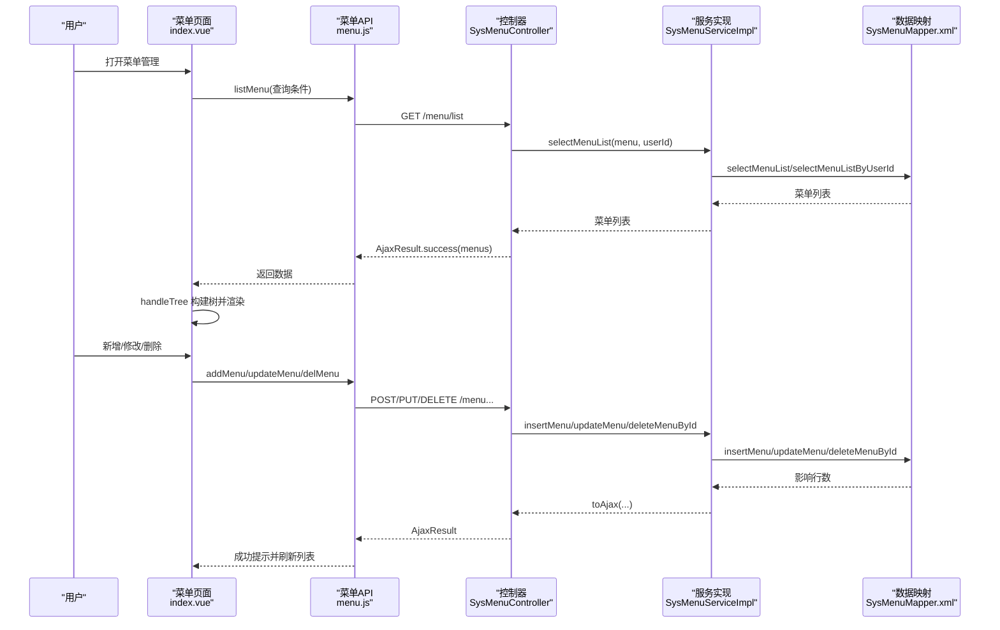
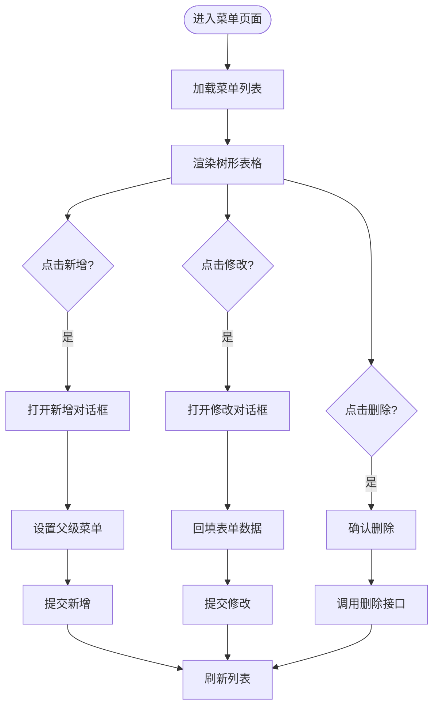
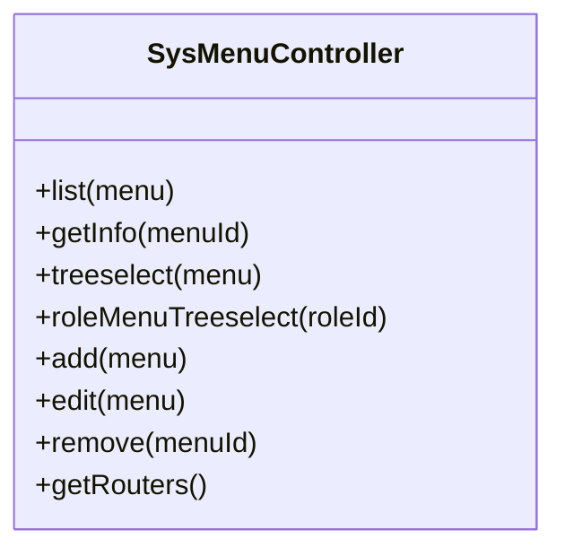
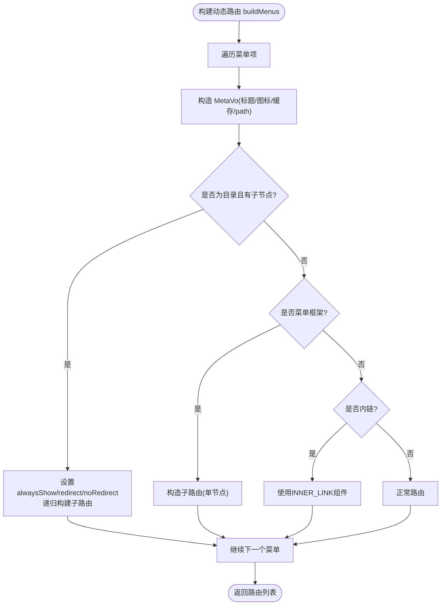
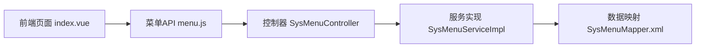

# 菜单管理

<cite>
**本文引用的文件**   
- [index.vue](file://ruoyi-ui/src/views/system/menu/index.vue)
- [menu.js](file://ruoyi-ui/src/api/system/menu.js)
- [SysMenuController.java](file://ruoyi-modules/ruoyi-system/src/main/java/com/ruoyi/system/controller/SysMenuController.java)
- [SysMenuServiceImpl.java](file://ruoyi-modules/ruoyi-system/src/main/java/com/ruoyi/system/service/impl/SysMenuServiceImpl.java)
- [SysMenuMapper.xml](file://ruoyi-modules/ruoyi-system/src/main/resources/mapper/system/SysMenuMapper.xml)
</cite>

## 目录
1. [简介](#简介)
2. [项目结构](#项目结构)
3. [核心组件](#核心组件)
4. [架构总览](#架构总览)
5. [详细组件分析](#详细组件分析)
6. [依赖关系分析](#依赖关系分析)
7. [性能与扩展性](#性能与扩展性)
8. [故障排查指南](#故障排查指南)
9. [结论](#结论)

## 简介
本文件面向“菜单管理”页面，系统性说明前端树形展示、新增/修改/删除等 CRUD 流程，以及后端接口、权限控制、动态路由生成等实现细节。重点覆盖：
- 菜单类型区分（目录 M、菜单 C、按钮 F）
- 图标选择、路由配置、权限标识设置
- 树形展开/折叠、层级关系维护
- 动态路由生成（RouterVo/MetaVo）
- 权限控制（前端指令 v-hasPermi、后端注解 @RequiresPermissions）

## 项目结构
菜单管理涉及前后端协作：
- 前端页面：系统菜单列表与表单弹窗
- 前端 API：封装 HTTP 请求
- 后端控制器：暴露 REST 接口
- 后端服务：业务逻辑、树构建、权限与路由转换
- 数据访问层：SQL 映射

图表来源
- [index.vue:1-275](file://ruoyi-ui/src/views/system/menu/index.vue#L1-L275)
- [menu.js:1-60](file://ruoyi-ui/src/api/system/menu.js#L1-L60)
- [SysMenuController.java:30-159](file://ruoyi-modules/ruoyi-system/src/main/java/com/ruoyi/system/controller/SysMenuController.java#L30-L159)
- [SysMenuServiceImpl.java:137-193](file://ruoyi-modules/ruoyi-system/src/main/java/com/ruoyi/system/service/impl/SysMenuServiceImpl.java#L137-L193)
- [SysMenuMapper.xml:30-195](file://ruoyi-modules/ruoyi-system/src/main/resources/mapper/system/SysMenuMapper.xml#L30-L195)

章节来源
- [index.vue:1-454](file://ruoyi-ui/src/views/system/menu/index.vue#L1-L454)
- [menu.js:1-60](file://ruoyi-ui/src/api/system/menu.js#L1-L60)
- [SysMenuController.java:1-159](file://ruoyi-modules/ruoyi-system/src/main/java/com/ruoyi/system/controller/SysMenuController.java#L1-L159)
- [SysMenuServiceImpl.java:1-515](file://ruoyi-modules/ruoyi-system/src/main/java/com/ruoyi/system/service/impl/SysMenuServiceImpl.java#L1-L515)
- [SysMenuMapper.xml:1-195](file://ruoyi-modules/ruoyi-system/src/main/resources/mapper/system/SysMenuMapper.xml#L1-L195)

## 核心组件
- 菜单页面 index.vue
  - 树形表格展示菜单，支持展开/折叠、搜索过滤
  - 对话框表单包含上级菜单、菜单类型、图标、名称、排序、是否外链、路由地址、组件路径、权限字符、路由参数、缓存、显示状态、状态等字段
  - 调用 API 完成新增、修改、删除、查询
- 菜单 API menu.js
  - 封装 listMenu/getMenu/addMenu/updateMenu/delMenu/treeselect/roleMenuTreeselect 等方法
- 控制器 SysMenuController.java
  - 提供 /menu/list、/menu/{id}、/menu/treeselect、/menu/roleMenuTreeselect/{roleId}、/menu、/menu/{menuId}、/menu/getRouters 等接口
- 服务实现 SysMenuServiceImpl.java
  - 菜单树构建、权限集合计算、动态路由构建（buildMenus）、内链处理、父子节点递归
- 数据映射 SysMenuMapper.xml
  - 菜单增删改查 SQL、按用户/角色查询、唯一性校验、子节点判断等

章节来源
- [index.vue:105-273](file://ruoyi-ui/src/views/system/menu/index.vue#L105-L273)
- [menu.js:1-60](file://ruoyi-ui/src/api/system/menu.js#L1-L60)
- [SysMenuController.java:37-159](file://ruoyi-modules/ruoyi-system/src/main/java/com/ruoyi/system/controller/SysMenuController.java#L37-L159)
- [SysMenuServiceImpl.java:137-193](file://ruoyi-modules/ruoyi-system/src/main/java/com/ruoyi/system/service/impl/SysMenuServiceImpl.java#L137-L193)
- [SysMenuMapper.xml:30-195](file://ruoyi-modules/ruoyi-system/src/main/resources/mapper/system/SysMenuMapper.xml#L30-L195)

## 架构总览
菜单管理的端到端流程如下：

图表来源
- [index.vue:334-450](file://ruoyi-ui/src/views/system/menu/index.vue#L334-L450)
- [menu.js:1-60](file://ruoyi-ui/src/api/system/menu.js#L1-L60)
- [SysMenuController.java:37-159](file://ruoyi-modules/ruoyi-system/src/main/java/com/ruoyi/system/controller/SysMenuController.java#L37-L159)
- [SysMenuServiceImpl.java:284-312](file://ruoyi-modules/ruoyi-system/src/main/java/com/ruoyi/system/service/impl/SysMenuServiceImpl.java#L284-L312)
- [SysMenuMapper.xml:128-195](file://ruoyi-modules/ruoyi-system/src/main/resources/mapper/system/SysMenuMapper.xml#L128-L195)

## 详细组件分析

### 菜单页面（index.vue）
- 树形表格
  - 使用 Element Table 的 tree 属性，row-key 为 menuId，children 由后端返回或前端 handleTree 转换
  - 支持“展开/折叠”一键切换
- 查询与筛选
  - 支持按菜单名称模糊查询、按可见性筛选
- 表单字段与规则
  - 上级菜单：通过 Treeselect 下拉树选择 parentId
  - 菜单类型：M 目录、C 菜单、F 按钮
  - 图标：IconSelect 组件选择 icon
  - 名称、排序：必填校验
  - 是否外链：isFrame（0 是外链，1 否）
  - 路由地址：path（外链需 http(s)://）
  - 组件路径：component（仅菜单类型）
  - 权限字符：perms（非按钮）
  - 路由参数：query（仅菜单类型）
  - 是否缓存：isCache（仅菜单类型）
  - 显示状态：visible（非按钮）
  - 状态：status（非按钮）
- 交互流程
  - 新增：handleAdd 初始化表单并打开对话框
  - 修改：handleUpdate 获取详情后填充表单
  - 提交：submitForm 根据是否存在 menuId 调用 updateMenu 或 addMenu
  - 删除：handleDelete 确认后调用 delMenu

图表来源
- [index.vue:334-450](file://ruoyi-ui/src/views/system/menu/index.vue#L334-L450)

章节来源
- [index.vue:1-454](file://ruoyi-ui/src/views/system/menu/index.vue#L1-L454)

### 菜单 API（menu.js）
- 方法清单
  - listMenu(query): GET /system/menu/list
  - getMenu(menuId): GET /system/menu/{menuId}
  - treeselect(): GET /system/menu/treeselect
  - roleMenuTreeselect(roleId): GET /system/menu/roleMenuTreeselect/{roleId}
  - addMenu(data): POST /system/menu
  - updateMenu(data): PUT /system/menu
  - delMenu(menuId): DELETE /system/menu/{menuId}

章节来源
- [menu.js:1-60](file://ruoyi-ui/src/api/system/menu.js#L1-L60)

### 控制器（SysMenuController.java）
- 接口职责
  - /menu/list：按用户权限返回菜单列表
  - /menu/{menuId}：获取菜单详情
  - /menu/treeselect：返回可用作下拉树的菜单树
  - /menu/roleMenuTreeselect/{roleId}：返回角色已选菜单键值对
  - /menu（POST/PUT）：新增/修改菜单，含名称唯一性与外链格式校验
  - /menu/{menuId}（DELETE）：删除菜单，含子节点与角色占用检查
  - /menu/getRouters：返回前端动态路由所需结构
- 权限控制
  - 使用 @RequiresPermissions 控制访问权限
- 日志记录
  - 使用 @Log 记录操作日志

图表来源
- [SysMenuController.java:37-159](file://ruoyi-modules/ruoyi-system/src/main/java/com/ruoyi/system/controller/SysMenuController.java#L37-L159)

章节来源
- [SysMenuController.java:1-159](file://ruoyi-modules/ruoyi-system/src/main/java/com/ruoyi/system/controller/SysMenuController.java#L1-L159)

### 服务实现（SysMenuServiceImpl.java）
- 关键能力
  - 按用户/管理员分别查询菜单列表
  - 计算用户权限集合（perms）
  - 构建前端路由（buildMenus），将菜单转换为 RouterVo/MetaVo
  - 构建菜单树（buildMenuTree/buildMenuTreeSelect）
  - 校验菜单名称唯一性
  - 删除前检查子节点与角色占用
  - 内链替换与组件选择策略（Layout/ParentView/InnerLink）
- 动态路由生成要点
  - 隐藏：visible=1 时隐藏
  - 名称：基于 path 首字母大写
  - 路径：根据是否外链、是否一级目录、是否菜单框架调整
  - 组件：默认 Layout，按场景替换
  - 元信息：标题、图标、缓存、path
  - 子路由：目录类型且存在子节点时 alwaysShow/redirect/noRedirect

图表来源
- [SysMenuServiceImpl.java:137-193](file://ruoyi-modules/ruoyi-system/src/main/java/com/ruoyi/system/service/impl/SysMenuServiceImpl.java#L137-L193)

章节来源
- [SysMenuServiceImpl.java:47-122](file://ruoyi-modules/ruoyi-system/src/main/java/com/ruoyi/system/service/impl/SysMenuServiceImpl.java#L47-L122)
- [SysMenuServiceImpl.java:137-193](file://ruoyi-modules/ruoyi-system/src/main/java/com/ruoyi/system/service/impl/SysMenuServiceImpl.java#L137-L193)
- [SysMenuServiceImpl.java:201-238](file://ruoyi-modules/ruoyi-system/src/main/java/com/ruoyi/system/service/impl/SysMenuServiceImpl.java#L201-L238)
- [SysMenuServiceImpl.java:315-330](file://ruoyi-modules/ruoyi-system/src/main/java/com/ruoyi/system/service/impl/SysMenuServiceImpl.java#L315-L330)
- [SysMenuServiceImpl.java:332-433](file://ruoyi-modules/ruoyi-system/src/main/java/com/ruoyi/system/service/impl/SysMenuServiceImpl.java#L332-L433)

### 数据映射（SysMenuMapper.xml）
- 查询
  - selectMenuList：基础查询，支持名称、可见性、状态过滤
  - selectMenuListByUserId：按用户关联角色/角色菜单，返回授权菜单
  - selectMenuTreeAll/selectMenuTreeByUserId：用于动态路由生成
  - selectMenuListByRoleId：角色菜单勾选回显
  - selectMenuPerms/selectMenuPermsByUserId：权限标识集合
- 写入
  - insertMenu/updateMenu：动态字段更新
- 其他
  - hasChildByMenuId：删除前子节点检查
  - checkMenuNameUnique：名称唯一性校验

章节来源
- [SysMenuMapper.xml:30-195](file://ruoyi-modules/ruoyi-system/src/main/resources/mapper/system/SysMenuMapper.xml#L30-L195)

## 依赖关系分析
- 前端依赖
  - Element UI（Table、Dialog、Form、Select、InputNumber、Popover）
  - vue-treeselect（上级菜单下拉树）
  - IconSelect（图标选择器）
  - 自定义组件 SvgIcon、DictTag、RightToolbar
- 后端依赖
  - Spring MVC、MyBatis
  - 安全注解 @RequiresPermissions
  - 日志注解 @Log
  - 常量 UserConstants（类型、内外链标记等）

图表来源
- [index.vue:277-286](file://ruoyi-ui/src/views/system/menu/index.vue#L277-L286)
- [menu.js:1-60](file://ruoyi-ui/src/api/system/menu.js#L1-L60)
- [SysMenuController.java:30-159](file://ruoyi-modules/ruoyi-system/src/main/java/com/ruoyi/system/controller/SysMenuController.java#L30-L159)
- [SysMenuServiceImpl.java:1-515](file://ruoyi-modules/ruoyi-system/src/main/java/com/ruoyi/system/service/impl/SysMenuServiceImpl.java#L1-L515)
- [SysMenuMapper.xml:1-195](file://ruoyi-modules/ruoyi-system/src/main/resources/mapper/system/SysMenuMapper.xml#L1-L195)

## 性能与扩展性
- 树形渲染
  - 前端使用 Element Table 的 tree 模式，大数据量建议分页或懒加载；当前实现一次性加载全量菜单
- 查询优化
  - 后端按用户维度查询，避免全表扫描；管理员走全量查询
- 动态路由
  - 服务端构建 RouterVo，减少前端复杂度；注意菜单数量增长时的序列化开销
- 可扩展点
  - 增加菜单字段（如 sort、remark）需在实体、Mapper XML、前端表单同步扩展
  - 权限粒度可在 perms 字段配合后端注解细粒度控制

[本节为通用指导，不直接分析具体文件]

## 故障排查指南
- 新增/修改失败
  - 名称重复：后端会返回“菜单名称已存在”，请更换名称
  - 外链格式错误：isFrame=0 时 path 必须以 http(s):// 开头
  - 自引用父级：parentId 不能等于 menuId
- 删除失败
  - 存在子菜单：不允许删除，请先删除子菜单
  - 已被角色分配：不允许删除，先解除角色绑定
- 前端无权限按钮
  - 检查 v-hasPermi 指令与后端 @RequiresPermissions 是否一致
- 动态路由异常
  - 检查 visible、isFrame、menuType、component 配置是否符合 buildMenus 的规则
  - 外链菜单需确保 path 以 http(s):// 开头

章节来源
- [SysMenuController.java:87-145](file://ruoyi-modules/ruoyi-system/src/main/java/com/ruoyi/system/controller/SysMenuController.java#L87-L145)
- [SysMenuServiceImpl.java:315-330](file://ruoyi-modules/ruoyi-system/src/main/java/com/ruoyi/system/service/impl/SysMenuServiceImpl.java#L315-L330)
- [SysMenuServiceImpl.java:419-422](file://ruoyi-modules/ruoyi-system/src/main/java/com/ruoyi/system/service/impl/SysMenuServiceImpl.java#L419-L422)

## 结论
菜单管理模块通过前后端协同实现了完整的菜单 CRUD、树形展示、权限控制与动态路由生成。前端负责交互与表单校验，后端负责权限过滤、数据一致性校验与路由结构构建。遵循本文的配置规范与排错建议，可稳定扩展菜单体系并保障系统安全性与可维护性。