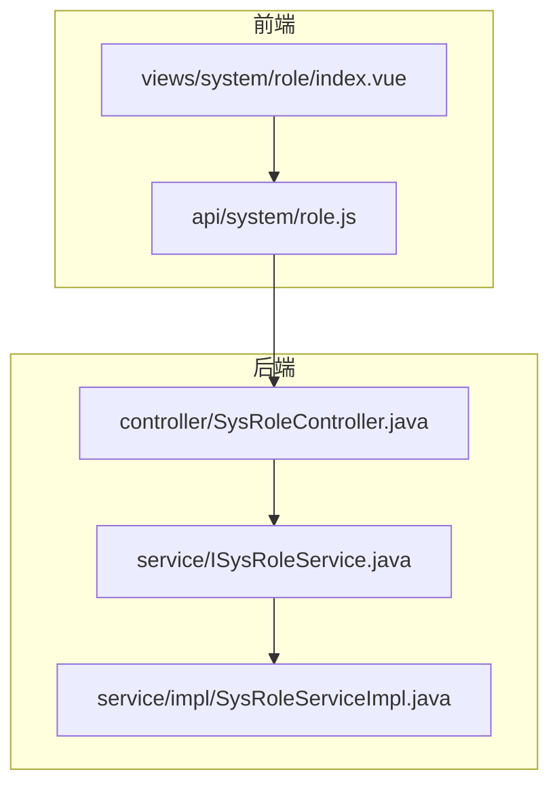
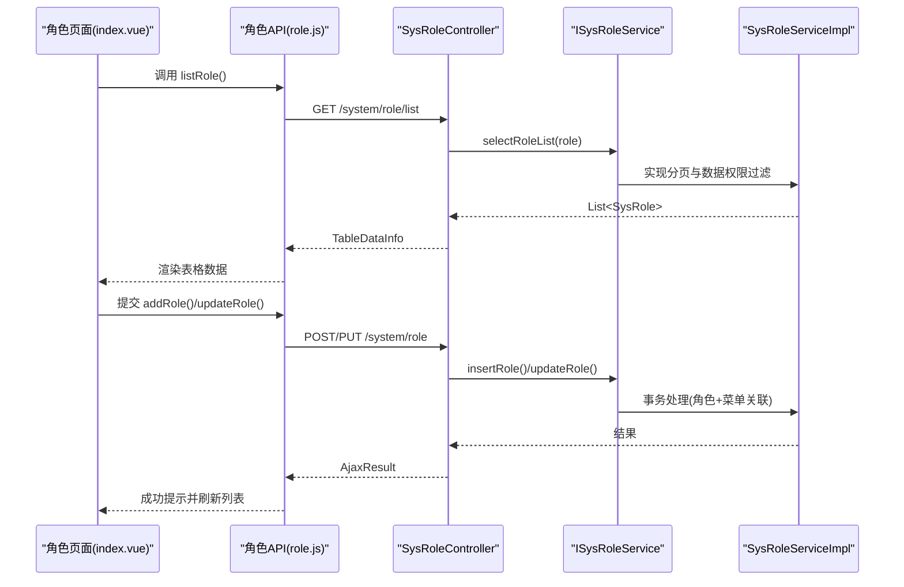
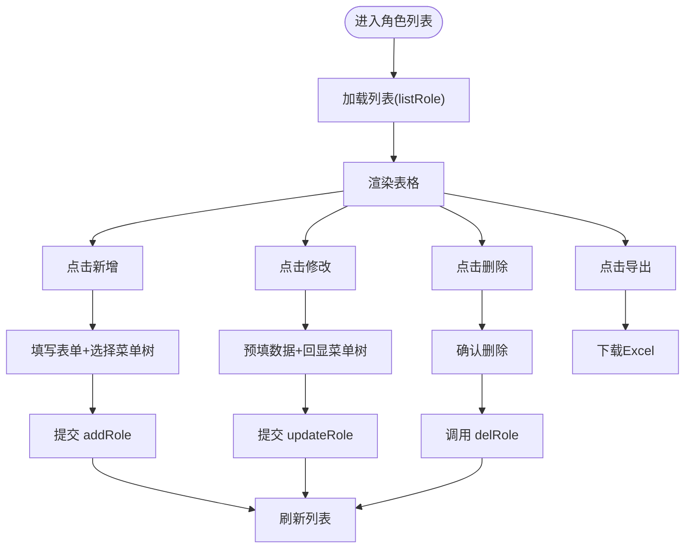
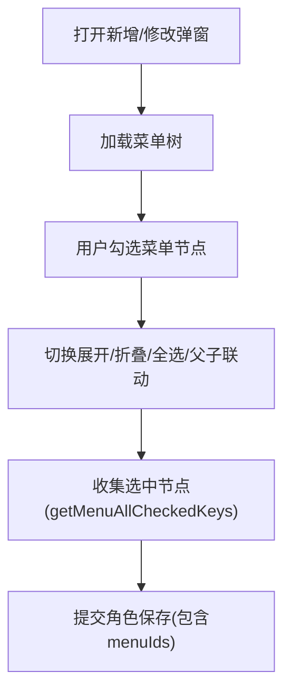
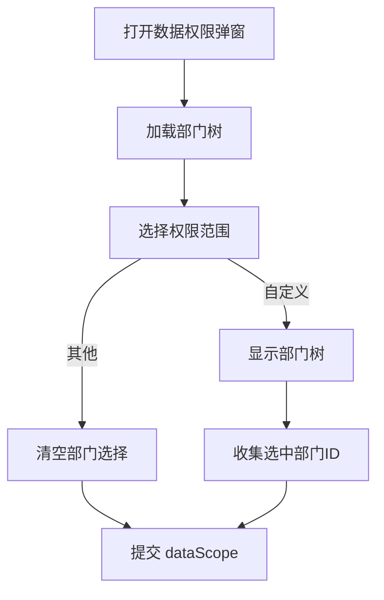
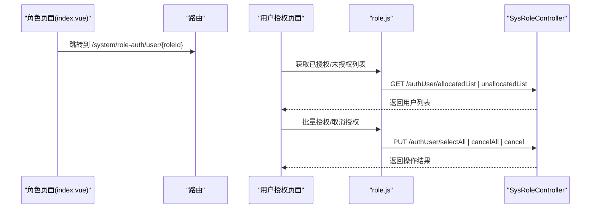
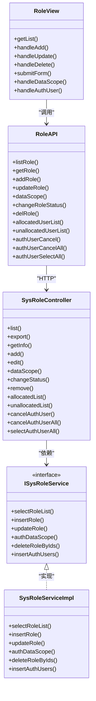

# 角色管理

<cite>
**本文引用的文件**   
- [index.vue](file://ruoyi-ui/src/views/system/role/index.vue)
- [role.js](file://ruoyi-ui/src/api/system/role.js)
- [SysRoleController.java](file://ruoyi-modules/ruoyi-system/src/main/java/com/ruoyi/system/controller/SysRoleController.java)
- [ISysRoleService.java](file://ruoyi-modules/ruoyi-system/src/main/java/com/ruoyi/system/service/ISysRoleService.java)
- [SysRoleServiceImpl.java](file://ruoyi-modules/ruoyi-system/src/main/java/com/ruoyi/system/service/impl/SysRoleServiceImpl.java)
</cite>

## 目录
1. [简介](#简介)
2. [项目结构](#项目结构)
3. [核心组件](#核心组件)
4. [架构总览](#架构总览)
5. [详细组件分析](#详细组件分析)
6. [依赖关系分析](#依赖关系分析)
7. [性能考虑](#性能考虑)
8. [故障排查指南](#故障排查指南)
9. [结论](#结论)

## 简介
本章节面向“角色管理”页面，系统性说明角色CRUD、菜单权限分配、用户授权管理、数据权限等高级特性的前后端实现与交互流程。文档覆盖：
- 角色列表展示、新增、修改、删除、导出
- 菜单权限树选择（父子联动、全选/全不选、展开/折叠）
- 数据权限范围配置（全部、自定义、本部门、本部门及以下、仅本人）
- 用户授权管理（已授权/未授权列表、批量授权/取消授权）
- 权限指令集成、动态菜单生成、路由守卫等安全机制的关联点

## 项目结构
围绕角色管理的代码分布在前后端多个模块：
- 前端视图层：views/system/role/index.vue 负责角色页面的UI与交互
- 前端API层：api/system/role.js 封装后端接口调用
- 后端控制层：system.controller.SysRoleController 暴露REST接口
- 后端服务层：system.service.ISysRoleService 与 impl.SysRoleServiceImpl 实现业务逻辑

图表来源
- [index.vue:257-259](file://ruoyi-ui/src/views/system/role/index.vue#L257-L259)
- [role.js:1-111](file://ruoyi-ui/src/api/system/role.js#L1-L111)
- [SysRoleController.java:35-222](file://ruoyi-modules/ruoyi-system/src/main/java/com/ruoyi/system/controller/SysRoleController.java#L35-L222)
- [ISysRoleService.java:13-174](file://ruoyi-modules/ruoyi-system/src/main/java/com/ruoyi/system/service/ISysRoleService.java#L13-L174)
- [SysRoleServiceImpl.java:33-425](file://ruoyi-modules/ruoyi-system/src/main/java/com/ruoyi/system/service/impl/SysRoleServiceImpl.java#L33-L425)

章节来源
- [index.vue:1-614](file://ruoyi-ui/src/views/system/role/index.vue#L1-L614)
- [role.js:1-111](file://ruoyi-ui/src/api/system/role.js#L1-L111)
- [SysRoleController.java:35-222](file://ruoyi-modules/ruoyi-system/src/main/java/com/ruoyi/system/controller/SysRoleController.java#L35-L222)
- [ISysRoleService.java:13-174](file://ruoyi-modules/ruoyi-system/src/main/java/com/ruoyi/system/service/ISysRoleService.java#L13-L174)
- [SysRoleServiceImpl.java:33-425](file://ruoyi-modules/ruoyi-system/src/main/java/com/ruoyi/system/service/impl/SysRoleServiceImpl.java#L33-L425)

## 核心组件
- 角色列表页（index.vue）
  - 查询条件：角色名称、权限字符、状态、创建时间范围
  - 操作按钮：新增、修改、删除、导出；行内操作：修改、删除、更多（数据权限、分配用户）
  - 表格列：编号、名称、权限字符、排序、状态开关、创建时间、操作
  - 弹窗表单：角色基本信息 + 菜单权限树 + 备注
  - 数据权限弹窗：权限范围选择 + 部门树（当选择“自定义”时显示）
- 角色API（role.js）
  - 提供 list/get/add/update/dataScope/changeStatus/del 以及用户授权相关接口封装
- 控制器（SysRoleController.java）
  - REST接口：list/export/info/add/edit/dataScope/changeStatus/remove/optionselect/authUser/*
  - 权限注解：@RequiresPermissions 控制访问权限
  - 日志注解：@Log 记录操作日志
- 服务接口（ISysRoleService.java）
  - 定义角色CRUD、数据权限、用户授权、唯一性校验、数据权限校验等方法
- 服务实现（SysRoleServiceImpl.java）
  - 实现角色增删改查、菜单/部门关联维护、用户授权维护、事务控制、数据权限过滤等

章节来源
- [index.vue:100-253](file://ruoyi-ui/src/views/system/role/index.vue#L100-L253)
- [role.js:1-111](file://ruoyi-ui/src/api/system/role.js#L1-L111)
- [SysRoleController.java:45-222](file://ruoyi-modules/ruoyi-system/src/main/java/com/ruoyi/system/controller/SysRoleController.java#L45-L222)
- [ISysRoleService.java:13-174](file://ruoyi-modules/ruoyi-system/src/main/java/com/ruoyi/system/service/ISysRoleService.java#L13-L174)
- [SysRoleServiceImpl.java:48-425](file://ruoyi-modules/ruoyi-system/src/main/java/com/ruoyi/system/service/impl/SysRoleServiceImpl.java#L48-L425)

## 架构总览
角色管理的前后端交互遵循典型分层架构：前端页面通过API层调用后端控制器，控制器委托服务层执行业务逻辑，必要时持久化到数据库。

图表来源
- [index.vue:351-359](file://ruoyi-ui/src/views/system/role/index.vue#L351-L359)
- [role.js:4-10](file://ruoyi-ui/src/api/system/role.js#L4-L10)
- [SysRoleController.java:45-52](file://ruoyi-modules/ruoyi-system/src/main/java/com/ruoyi/system/controller/SysRoleController.java#L45-L52)
- [ISysRoleService.java:15-21](file://ruoyi-modules/ruoyi-system/src/main/java/com/ruoyi/system/service/ISysRoleService.java#L15-L21)
- [SysRoleServiceImpl.java:54-59](file://ruoyi-modules/ruoyi-system/src/main/java/com/ruoyi/system/service/impl/SysRoleServiceImpl.java#L54-L59)

## 详细组件分析

### 角色列表与基础CRUD
- 列表加载
  - 前端在 created 钩子中调用 getList，请求 /system/role/list，接收分页数据并渲染表格
  - 支持按角色名称、权限字符、状态、创建时间范围筛选
- 新增角色
  - 打开新增弹窗，填写角色名称、权限字符、排序、状态、菜单权限树、备注
  - 提交时收集菜单树选中节点（含半选），调用 addRole 接口
- 修改角色
  - 打开编辑弹窗，预填充角色信息，异步加载该角色的菜单权限树并回显选中项
  - 提交时更新角色信息与菜单关联
- 删除角色
  - 支持单选/多选删除，调用 delRole 接口
- 导出
  - 调用导出接口，下载Excel

图表来源
- [index.vue:347-359](file://ruoyi-ui/src/views/system/role/index.vue#L347-L359)
- [index.vue:509-584](file://ruoyi-ui/src/views/system/role/index.vue#L509-L584)
- [index.vue:596-611](file://ruoyi-ui/src/views/system/role/index.vue#L596-L611)
- [role.js:4-66](file://ruoyi-ui/src/api/system/role.js#L4-L66)

章节来源
- [index.vue:100-253](file://ruoyi-ui/src/views/system/role/index.vue#L100-L253)
- [index.vue:347-359](file://ruoyi-ui/src/views/system/role/index.vue#L347-L359)
- [index.vue:509-584](file://ruoyi-ui/src/views/system/role/index.vue#L509-L584)
- [index.vue:596-611](file://ruoyi-ui/src/views/system/role/index.vue#L596-L611)
- [role.js:4-66](file://ruoyi-ui/src/api/system/role.js#L4-L66)
- [SysRoleController.java:45-154](file://ruoyi-modules/ruoyi-system/src/main/java/com/ruoyi/system/controller/SysRoleController.java#L45-L154)
- [ISysRoleService.java:15-146](file://ruoyi-modules/ruoyi-system/src/main/java/com/ruoyi/system/service/ISysRoleService.java#L15-L146)
- [SysRoleServiceImpl.java:224-376](file://ruoyi-modules/ruoyi-system/src/main/java/com/ruoyi/system/service/impl/SysRoleServiceImpl.java#L224-L376)

### 菜单权限分配（权限树组件使用）
- 树控件能力
  - 展开/折叠、全选/全不选、父子联动（check-strictly）
  - 获取选中节点（含半选）用于提交
- 新增/修改时的菜单树
  - 新增：加载完整菜单树
  - 修改：根据角色ID加载已分配的菜单并回显选中项
- 交互细节
  - handleCheckedTreeExpand：批量展开/折叠
  - handleCheckedTreeNodeAll：全选/全不选
  - handleCheckedTreeConnect：切换父子联动
  - getMenuAllCheckedKeys：合并选中与半选节点

图表来源
- [index.vue:187-201](file://ruoyi-ui/src/views/system/role/index.vue#L187-L201)
- [index.vue:361-404](file://ruoyi-ui/src/views/system/role/index.vue#L361-L404)
- [index.vue:479-508](file://ruoyi-ui/src/views/system/role/index.vue#L479-L508)
- [index.vue:564-584](file://ruoyi-ui/src/views/system/role/index.vue#L564-L584)

章节来源
- [index.vue:187-201](file://ruoyi-ui/src/views/system/role/index.vue#L187-L201)
- [index.vue:361-404](file://ruoyi-ui/src/views/system/role/index.vue#L361-L404)
- [index.vue:479-508](file://ruoyi-ui/src/views/system/role/index.vue#L479-L508)
- [index.vue:564-584](file://ruoyi-ui/src/views/system/role/index.vue#L564-L584)

### 数据权限（部门树与权限范围）
- 权限范围选项
  - 全部数据权限、自定数据权限、本部门数据权限、本部门及以下数据权限、仅本人数据权限
- 自定义数据权限
  - 选择“自定数据权限”时显示部门树，支持展开/折叠、全选/全不选、父子联动
  - 提交时收集部门ID集合（含半选）
- 后端校验
  - 非管理员需具备角色数据权限才能操作
  - 数据权限变更会清理旧关联并写入新关联

图表来源
- [index.vue:212-252](file://ruoyi-ui/src/views/system/role/index.vue#L212-L252)
- [index.vue:537-557](file://ruoyi-ui/src/views/system/role/index.vue#L537-L557)
- [index.vue:585-595](file://ruoyi-ui/src/views/system/role/index.vue#L585-L595)
- [SysRoleController.java:118-129](file://ruoyi-modules/ruoyi-system/src/main/java/com/ruoyi/system/controller/SysRoleController.java#L118-L129)
- [SysRoleServiceImpl.java:268-332](file://ruoyi-modules/ruoyi-system/src/main/java/com/ruoyi/system/service/impl/SysRoleServiceImpl.java#L268-L332)

章节来源
- [index.vue:212-252](file://ruoyi-ui/src/views/system/role/index.vue#L212-L252)
- [index.vue:537-557](file://ruoyi-ui/src/views/system/role/index.vue#L537-L557)
- [index.vue:585-595](file://ruoyi-ui/src/views/system/role/index.vue#L585-L595)
- [SysRoleController.java:118-129](file://ruoyi-modules/ruoyi-system/src/main/java/com/ruoyi/system/controller/SysRoleController.java#L118-L129)
- [SysRoleServiceImpl.java:268-332](file://ruoyi-modules/ruoyi-system/src/main/java/com/ruoyi/system/service/impl/SysRoleServiceImpl.java#L268-L332)

### 用户授权管理（角色-用户关联）
- 入口
  - 角色列表“更多”菜单中的“分配用户”，跳转至用户授权页面（/system/role-auth/user/:roleId）
- 后端接口
  - 已授权用户列表：GET /system/role/authUser/allocatedList
  - 未授权用户列表：GET /system/role/authUser/unallocatedList
  - 取消授权：PUT /system/role/authUser/cancel
  - 批量取消授权：PUT /system/role/authUser/cancelAll
  - 批量选择授权：PUT /system/role/authUser/selectAll
- 前端API
  - role.js 封装了上述接口的调用方法

图表来源
- [index.vue:558-562](file://ruoyi-ui/src/views/system/role/index.vue#L558-L562)
- [role.js:68-111](file://ruoyi-ui/src/api/system/role.js#L68-L111)
- [SysRoleController.java:165-221](file://ruoyi-modules/ruoyi-system/src/main/java/com/ruoyi/system/controller/SysRoleController.java#L165-L221)

章节来源
- [index.vue:558-562](file://ruoyi-ui/src/views/system/role/index.vue#L558-L562)
- [role.js:68-111](file://ruoyi-ui/src/api/system/role.js#L68-L111)
- [SysRoleController.java:165-221](file://ruoyi-modules/ruoyi-system/src/main/java/com/ruoyi/system/controller/SysRoleController.java#L165-L221)

### 权限指令集成、动态菜单与路由守卫
- 权限指令
  - 页面按钮通过 v-hasPermi 指令控制可见性，如 system:role:add/edit/remove/export
- 动态菜单与路由守卫
  - 角色权限字符参与前端动态菜单生成与路由守卫校验（由系统权限体系支撑）
  - 角色权限字符在服务层聚合为用户权限集，供前端鉴权使用

章节来源
- [index.vue:54-97](file://ruoyi-ui/src/views/system/role/index.vue#L54-L97)
- [SysRoleServiceImpl.java:92-105](file://ruoyi-modules/ruoyi-system/src/main/java/com/ruoyi/system/service/impl/SysRoleServiceImpl.java#L92-L105)

## 依赖关系分析
- 前端依赖
  - index.vue 依赖 role.js 提供的API方法
  - 依赖 Element UI 的 Tree、Form、Table、Dialog 等组件
- 后端依赖
  - SysRoleController 依赖 ISysRoleService 接口
  - SysRoleServiceImpl 依赖 Mapper 进行数据持久化，并使用事务保证一致性
  - 使用 @DataScope 注解对查询进行数据权限过滤

图表来源
- [index.vue:257-259](file://ruoyi-ui/src/views/system/role/index.vue#L257-L259)
- [role.js:1-111](file://ruoyi-ui/src/api/system/role.js#L1-L111)
- [SysRoleController.java:35-222](file://ruoyi-modules/ruoyi-system/src/main/java/com/ruoyi/system/controller/SysRoleController.java#L35-L222)
- [ISysRoleService.java:13-174](file://ruoyi-modules/ruoyi-system/src/main/java/com/ruoyi/system/service/ISysRoleService.java#L13-L174)
- [SysRoleServiceImpl.java:33-425](file://ruoyi-modules/ruoyi-system/src/main/java/com/ruoyi/system/service/impl/SysRoleServiceImpl.java#L33-L425)

章节来源
- [index.vue:257-259](file://ruoyi-ui/src/views/system/role/index.vue#L257-L259)
- [role.js:1-111](file://ruoyi-ui/src/api/system/role.js#L1-L111)
- [SysRoleController.java:35-222](file://ruoyi-modules/ruoyi-system/src/main/java/com/ruoyi/system/controller/SysRoleController.java#L35-L222)
- [ISysRoleService.java:13-174](file://ruoyi-modules/ruoyi-system/src/main/java/com/ruoyi/system/service/ISysRoleService.java#L13-L174)
- [SysRoleServiceImpl.java:33-425](file://ruoyi-modules/ruoyi-system/src/main/java/com/ruoyi/system/service/impl/SysRoleServiceImpl.java#L33-L425)

## 性能考虑
- 列表分页
  - 前端通过 pageNum/pageSize 分页，后端 startPage 分页，避免一次性加载大量数据
- 树形数据
  - 菜单/部门树按需加载，减少首屏渲染压力
- 批量操作
  - 批量授权/取消授权采用批量SQL，降低网络与数据库往返次数
- 事务边界
  - 角色CRUD与关联表操作使用事务，确保一致性的同时避免长事务

[本节为通用指导，不涉及具体文件分析]

## 故障排查指南
- 无法新增/修改角色
  - 检查角色名称/权限字符是否重复（后端唯一性校验）
  - 检查当前用户是否具备 system:role:add/edit 权限
- 数据权限不生效
  - 确认选择了正确的权限范围
  - 若选择“自定义”，确认部门树是否正确勾选
  - 非管理员需具备角色数据权限
- 用户授权失败
  - 检查角色是否已被分配给用户（删除前会校验）
  - 检查批量授权/取消授权参数是否正确

章节来源
- [SysRoleController.java:78-116](file://ruoyi-modules/ruoyi-system/src/main/java/com/ruoyi/system/controller/SysRoleController.java#L78-L116)
- [SysRoleServiceImpl.java:142-176](file://ruoyi-modules/ruoyi-system/src/main/java/com/ruoyi/system/service/impl/SysRoleServiceImpl.java#L142-L176)
- [SysRoleServiceImpl.java:192-210](file://ruoyi-modules/ruoyi-system/src/main/java/com/ruoyi/system/service/impl/SysRoleServiceImpl.java#L192-L210)
- [SysRoleServiceImpl.java:357-376](file://ruoyi-modules/ruoyi-system/src/main/java/com/ruoyi/system/service/impl/SysRoleServiceImpl.java#L357-L376)

## 结论
角色管理模块在前端以Vue组件为核心，结合Element UI的表单与树组件完成交互；在后端以Spring MVC控制器与服务层实现完整的角色CRUD、菜单/部门关联与用户授权管理。通过权限指令、数据权限注解与事务控制，实现了细粒度的功能与数据安全控制。整体架构清晰、职责明确，便于扩展与维护。