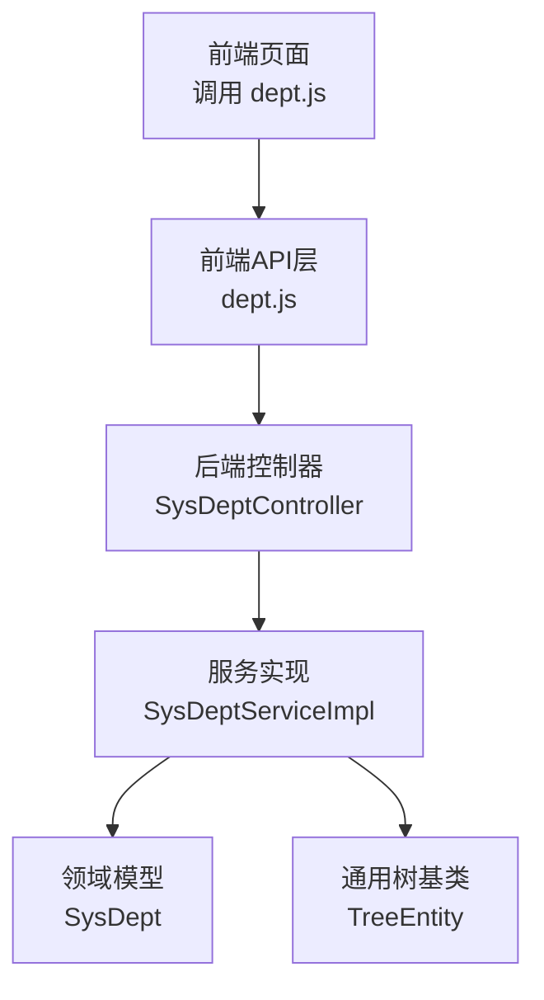
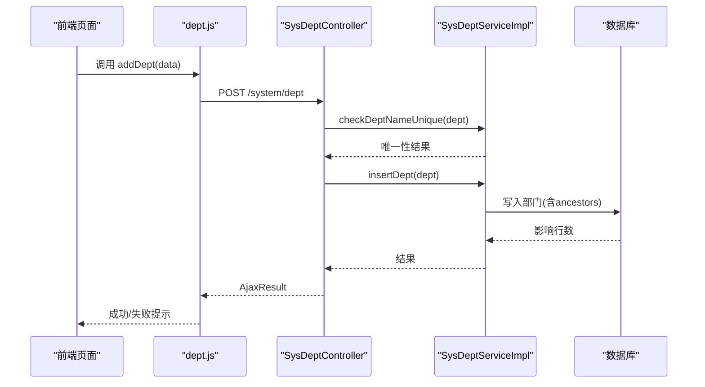
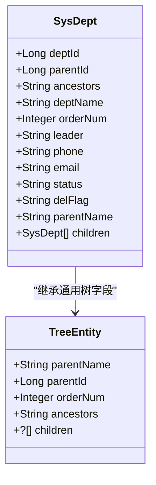
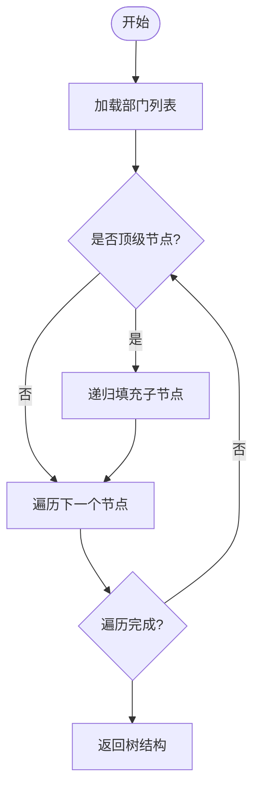
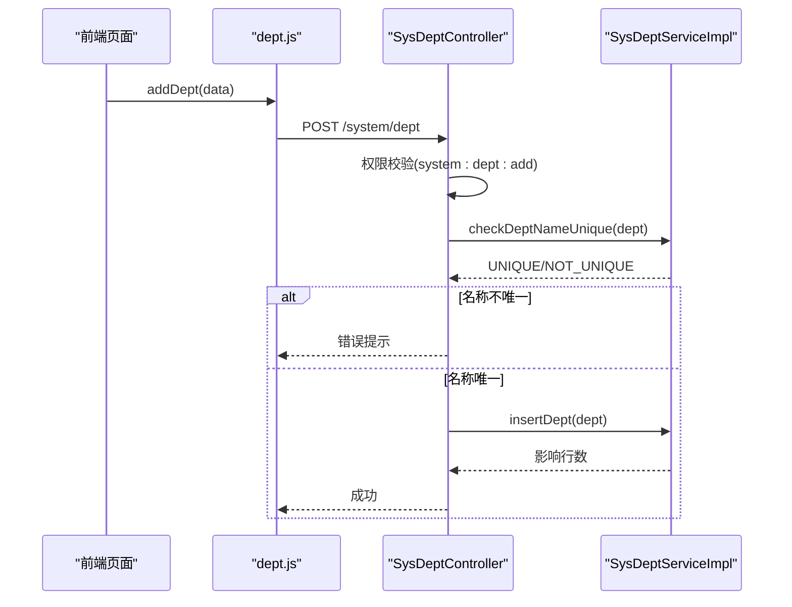
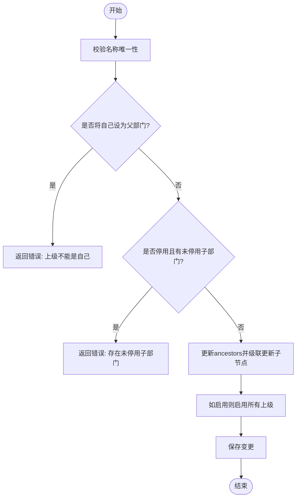
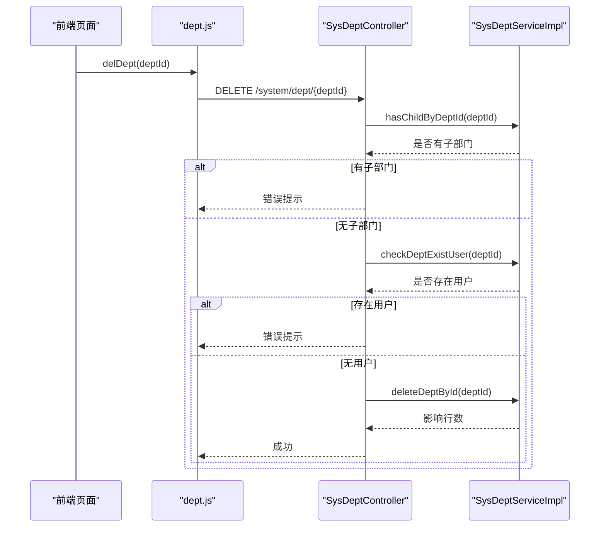
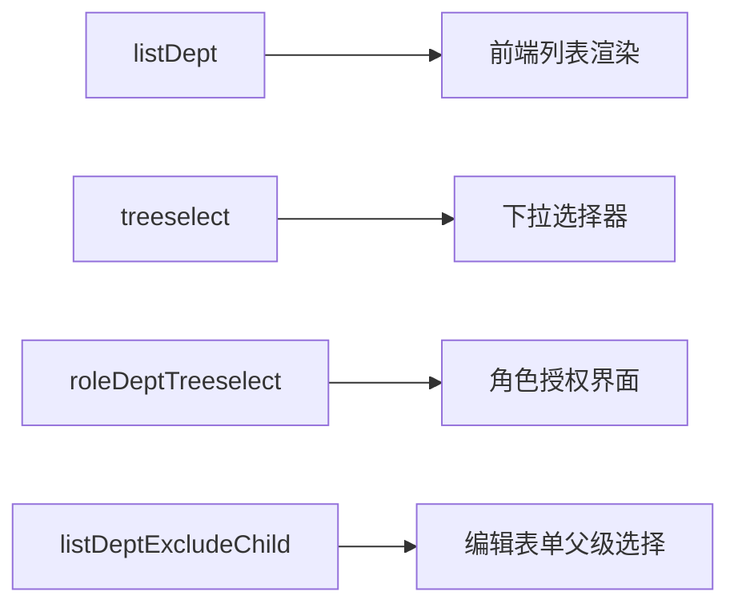
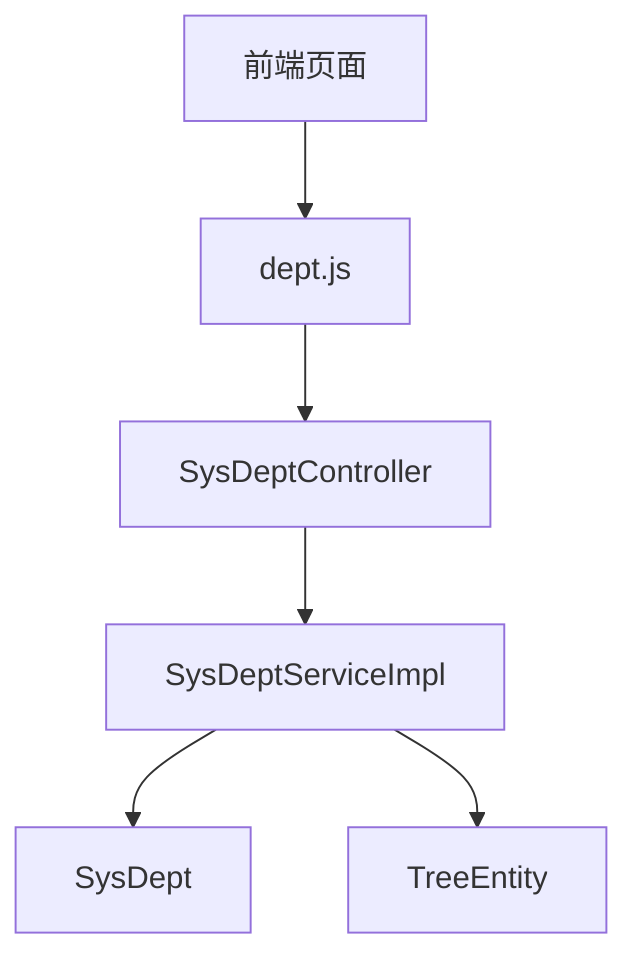

# 部门管理

<cite>
**本文引用的文件**   
- [dept.js](file://ruoyi-ui/src/api/system/dept.js)
- [SysDeptController.java](file://ruoyi-modules/ruoyi-system/src/main/java/com/ruoyi/system/controller/SysDeptController.java)
- [SysDeptServiceImpl.java](file://ruoyi-modules/ruoyi-system/src/main/java/com/ruoyi/system/service/impl/SysDeptServiceImpl.java)
- [SysDept.java](file://ruoyi-api/ruoyi-api-system/src/main/java/com/ruoyi/system/api/domain/SysDept.java)
- [TreeEntity.java](file://ruoyi-common/ruoyi-common-core/src/main/java/com/ruoyi/common/core/web/domain/TreeEntity.java)
</cite>

## 目录
1. [简介](#简介)
2. [项目结构](#项目结构)
3. [核心组件](#核心组件)
4. [架构总览](#架构总览)
5. [详细组件分析](#详细组件分析)
6. [依赖关系分析](#依赖关系分析)
7. [性能与扩展性](#性能与扩展性)
8. [故障排查指南](#故障排查指南)
9. [结论](#结论)

## 简介
本章节面向“部门管理”页面，围绕部门树形展示、新增、修改、删除等核心功能进行系统化说明。文档涵盖前后端接口契约、数据模型字段含义、树形结构构建与维护、级联状态更新、权限与数据范围控制、以及前端树组件配置与数据绑定要点，帮助读者快速理解并正确扩展该模块。

## 项目结构
部门管理涉及前端 API 调用、后端控制器与服务实现、领域模型与通用树基类：
- 前端 API 封装：提供列表、详情、下拉树、排除节点、新增、修改、删除等接口方法
- 后端控制器：暴露 REST 接口，负责参数校验、权限控制、日志记录与结果封装
- 服务实现：实现业务规则（唯一性校验、层级祖先链维护、子节点状态联动、树构建）
- 领域模型：定义部门实体字段及树形子节点集合
- 通用树基类：提供父ID、排序、祖级列表、子节点等通用属性

图表来源
- [dept.js:1-68](file://ruoyi-ui/src/api/system/dept.js#L1-L68)
- [SysDeptController.java:32-166](file://ruoyi-modules/ruoyi-system/src/main/java/com/ruoyi/system/controller/SysDeptController.java#L32-L166)
- [SysDeptServiceImpl.java:29-329](file://ruoyi-modules/ruoyi-system/src/main/java/com/ruoyi/system/service/impl/SysDeptServiceImpl.java#L29-L329)
- [SysDept.java:18-203](file://ruoyi-api/ruoyi-api-system/src/main/java/com/ruoyi/system/api/domain/SysDept.java#L18-L203)
- [TreeEntity.java:11-79](file://ruoyi-common/ruoyi-common-core/src/main/java/com/ruoyi/common/core/web/domain/TreeEntity.java#L11-L79)

章节来源
- [dept.js:1-68](file://ruoyi-ui/src/api/system/dept.js#L1-L68)
- [SysDeptController.java:32-166](file://ruoyi-modules/ruoyi-system/src/main/java/com/ruoyi/system/controller/SysDeptController.java#L32-L166)
- [SysDeptServiceImpl.java:29-329](file://ruoyi-modules/ruoyi-system/src/main/java/com/ruoyi/system/service/impl/SysDeptServiceImpl.java#L29-L329)
- [SysDept.java:18-203](file://ruoyi-api/ruoyi-api-system/src/main/java/com/ruoyi/system/api/domain/SysDept.java#L18-L203)
- [TreeEntity.java:11-79](file://ruoyi-common/ruoyi-common-core/src/main/java/com/ruoyi/common/core/web/domain/TreeEntity.java#L11-L79)

## 核心组件
- 前端 API 封装（dept.js）
  - 列表查询、详情查询、下拉树、按角色返回选中部门树、新增、修改、删除
- 后端控制器（SysDeptController）
  - 暴露 /system/dept/* 接口，统一权限校验、日志记录、异常提示
- 服务实现（SysDeptServiceImpl）
  - 树构建、祖先链维护、子节点状态联动、唯一性校验、数据权限检查
- 领域模型（SysDept）
  - 部门基础信息与树形结构字段
- 通用树基类（TreeEntity）
  - 提供 parentId、orderNum、ancestors、children 等通用字段

章节来源
- [dept.js:1-68](file://ruoyi-ui/src/api/system/dept.js#L1-L68)
- [SysDeptController.java:32-166](file://ruoyi-modules/ruoyi-system/src/main/java/com/ruoyi/system/controller/SysDeptController.java#L32-L166)
- [SysDeptServiceImpl.java:29-329](file://ruoyi-modules/ruoyi-system/src/main/java/com/ruoyi/system/service/impl/SysDeptServiceImpl.java#L29-L329)
- [SysDept.java:18-203](file://ruoyi-api/ruoyi-api-system/src/main/java/com/ruoyi/system/api/domain/SysDept.java#L18-L203)
- [TreeEntity.java:11-79](file://ruoyi-common/ruoyi-common-core/src/main/java/com/ruoyi/common/core/web/domain/TreeEntity.java#L11-L79)

## 架构总览
本节以时序图展示一次“新增部门”的完整调用链路，体现前后端协作与关键校验点。

图表来源
- [dept.js:44-51](file://ruoyi-ui/src/api/system/dept.js#L44-L51)
- [SysDeptController.java:108-119](file://ruoyi-modules/ruoyi-system/src/main/java/com/ruoyi/system/controller/SysDeptController.java#L108-L119)
- [SysDeptServiceImpl.java:196-213](file://ruoyi-modules/ruoyi-system/src/main/java/com/ruoyi/system/service/impl/SysDeptServiceImpl.java#L196-L213)

## 详细组件分析

### 数据模型与字段语义
- 部门ID deptId：主键标识
- 父部门ID parentId：用于构建树形结构
- 祖级列表 ancestors：逗号分隔的祖先ID序列，便于快速定位层级路径
- 部门名称 deptName：显示名称，需唯一且长度受限
- 显示顺序 orderNum：同级排序依据
- 负责人 leader：部门负责人信息
- 联系电话 phone：长度限制
- 邮箱 email：格式校验与长度限制
- 状态 status：正常/停用
- 删除标志 delFlag：逻辑删除标记
- 父部门名称 parentName：展示用冗余字段
- 子部门 children：树形结构子节点集合

图表来源
- [SysDept.java:18-203](file://ruoyi-api/ruoyi-api-system/src/main/java/com/ruoyi/system/api/domain/SysDept.java#L18-L203)
- [TreeEntity.java:11-79](file://ruoyi-common/ruoyi-common-core/src/main/java/com/ruoyi/common/core/web/domain/TreeEntity.java#L11-L79)

章节来源
- [SysDept.java:18-203](file://ruoyi-api/ruoyi-api-system/src/main/java/com/ruoyi/system/api/domain/SysDept.java#L18-L203)
- [TreeEntity.java:11-79](file://ruoyi-common/ruoyi-common-core/src/main/java/com/ruoyi/common/core/web/domain/TreeEntity.java#L11-L79)

### 树形结构构建与维护
- 树构建流程
  - 从平铺列表筛选顶级节点（无父ID或父ID不在列表中）
  - 递归为每个节点填充子节点集合
  - 若未找到顶级节点则回退使用原列表
- 祖先链维护
  - 新增时根据父节点 ancestors 追加当前父ID
  - 修改父节点时批量更新子孙节点的 ancestors
  - 启用部门时向上追溯 ancestors 并启用所有上级部门
- 下拉树转换
  - 将树结构映射为前端下拉树所需的数据结构

图表来源
- [SysDeptServiceImpl.java:51-93](file://ruoyi-modules/ruoyi-system/src/main/java/com/ruoyi/system/service/impl/SysDeptServiceImpl.java#L51-L93)
- [SysDeptServiceImpl.java:287-329](file://ruoyi-modules/ruoyi-system/src/main/java/com/ruoyi/system/service/impl/SysDeptServiceImpl.java#L287-L329)

章节来源
- [SysDeptServiceImpl.java:51-93](file://ruoyi-modules/ruoyi-system/src/main/java/com/ruoyi/system/service/impl/SysDeptServiceImpl.java#L51-L93)
- [SysDeptServiceImpl.java:287-329](file://ruoyi-modules/ruoyi-system/src/main/java/com/ruoyi/system/service/impl/SysDeptServiceImpl.java#L287-L329)

### 新增部门
- 前端调用 addDept(data)，后端接收并校验
- 唯一性校验：同父下部门名称不可重复
- 权限校验：需要 system:dept:add 权限
- 业务处理：设置创建人、计算 ancestors、插入数据库
- 返回统一结果对象

图表来源
- [dept.js:44-51](file://ruoyi-ui/src/api/system/dept.js#L44-L51)
- [SysDeptController.java:108-119](file://ruoyi-modules/ruoyi-system/src/main/java/com/ruoyi/system/controller/SysDeptController.java#L108-L119)
- [SysDeptServiceImpl.java:196-213](file://ruoyi-modules/ruoyi-system/src/main/java/com/ruoyi/system/service/impl/SysDeptServiceImpl.java#L196-L213)

章节来源
- [dept.js:44-51](file://ruoyi-ui/src/api/system/dept.js#L44-L51)
- [SysDeptController.java:108-119](file://ruoyi-modules/ruoyi-system/src/main/java/com/ruoyi/system/controller/SysDeptController.java#L108-L119)
- [SysDeptServiceImpl.java:196-213](file://ruoyi-modules/ruoyi-system/src/main/java/com/ruoyi/system/service/impl/SysDeptServiceImpl.java#L196-L213)

### 修改部门
- 前端调用 updateDept(data)，后端接收并校验
- 唯一性校验：同父下部门名称不可重复
- 自引用校验：不允许将自身设为父部门
- 停用联动：若停用当前部门，需确保无未停用的子部门
- 权限校验：需要 system:dept:edit 权限
- 业务处理：更新 ancestors、级联更新子节点 ancestors、必要时启用上级部门

图表来源
- [SysDeptController.java:121-145](file://ruoyi-modules/ruoyi-system/src/main/java/com/ruoyi/system/controller/SysDeptController.java#L121-L145)
- [SysDeptServiceImpl.java:215-253](file://ruoyi-modules/ruoyi-system/src/main/java/com/ruoyi/system/service/impl/SysDeptServiceImpl.java#L215-L253)

章节来源
- [SysDeptController.java:121-145](file://ruoyi-modules/ruoyi-system/src/main/java/com/ruoyi/system/controller/SysDeptController.java#L121-L145)
- [SysDeptServiceImpl.java:215-253](file://ruoyi-modules/ruoyi-system/src/main/java/com/ruoyi/system/service/impl/SysDeptServiceImpl.java#L215-L253)

### 删除部门
- 前端调用 delDept(deptId)，后端接收并校验
- 前置校验：存在子部门或部门下有用户时禁止删除
- 权限校验：需要 system:dept:remove 权限
- 业务处理：执行删除（通常为逻辑删除）

图表来源
- [dept.js:62-68](file://ruoyi-ui/src/api/system/dept.js#L62-L68)
- [SysDeptController.java:147-165](file://ruoyi-modules/ruoyi-system/src/main/java/com/ruoyi/system/controller/SysDeptController.java#L147-L165)
- [SysDeptServiceImpl.java:275-285](file://ruoyi-modules/ruoyi-system/src/main/java/com/ruoyi/system/service/impl/SysDeptServiceImpl.java#L275-L285)

章节来源
- [dept.js:62-68](file://ruoyi-ui/src/api/system/dept.js#L62-L68)
- [SysDeptController.java:147-165](file://ruoyi-modules/ruoyi-system/src/main/java/com/ruoyi/system/controller/SysDeptController.java#L147-L165)
- [SysDeptServiceImpl.java:275-285](file://ruoyi-modules/ruoyi-system/src/main/java/com/ruoyi/system/service/impl/SysDeptServiceImpl.java#L275-L285)

### 树形结构展示与选择器集成
- 列表接口 listDept：返回平铺部门列表，前端可转换为树或直接使用后端提供的树接口
- 下拉树接口 treeselect：返回可直接用于下拉树的扁平化树结构
- 按角色返回选中部门 roleDeptTreeselect：返回选中部门ID集合与树结构，供角色授权界面使用
- 排除节点接口 listDeptExcludeChild：在编辑/新增时排除指定节点及其子节点，避免循环引用

图表来源
- [dept.js:3-42](file://ruoyi-ui/src/api/system/dept.js#L3-L42)
- [SysDeptController.java:42-103](file://ruoyi-modules/ruoyi-system/src/main/java/com/ruoyi/system/controller/SysDeptController.java#L42-L103)

章节来源
- [dept.js:3-42](file://ruoyi-ui/src/api/system/dept.js#L3-L42)
- [SysDeptController.java:42-103](file://ruoyi-modules/ruoyi-system/src/main/java/com/ruoyi/system/controller/SysDeptController.java#L42-L103)

### 权限与数据范围
- 权限注解：各接口通过 @RequiresPermissions 控制访问权限
- 数据范围：@DataScope 注解在服务层对查询进行数据范围过滤，非管理员仅能访问其权限范围内的部门
- 数据权限检查：checkDeptDataScope 在非管理员情况下校验操作目标是否在权限范围内

章节来源
- [SysDeptController.java:42-103](file://ruoyi-modules/ruoyi-system/src/main/java/com/ruoyi/system/controller/SysDeptController.java#L42-L103)
- [SysDeptServiceImpl.java:44-49](file://ruoyi-modules/ruoyi-system/src/main/java/com/ruoyi/system/service/impl/SysDeptServiceImpl.java#L44-L49)
- [SysDeptServiceImpl.java:176-194](file://ruoyi-modules/ruoyi-system/src/main/java/com/ruoyi/system/service/impl/SysDeptServiceImpl.java#L176-L194)

## 依赖关系分析
- 前端依赖后端REST接口，通过统一的 request 工具发起请求
- 控制器依赖服务接口，解耦业务逻辑
- 服务依赖Mapper进行数据访问（未在本文展开），并通过工具类进行字符串与数组转换
- 领域模型与通用树基类提供数据结构支撑

图表来源
- [dept.js:1-68](file://ruoyi-ui/src/api/system/dept.js#L1-L68)
- [SysDeptController.java:32-166](file://ruoyi-modules/ruoyi-system/src/main/java/com/ruoyi/system/controller/SysDeptController.java#L32-L166)
- [SysDeptServiceImpl.java:29-329](file://ruoyi-modules/ruoyi-system/src/main/java/com/ruoyi/system/service/impl/SysDeptServiceImpl.java#L29-L329)
- [SysDept.java:18-203](file://ruoyi-api/ruoyi-api-system/src/main/java/com/ruoyi/system/api/domain/SysDept.java#L18-L203)
- [TreeEntity.java:11-79](file://ruoyi-common/ruoyi-common-core/src/main/java/com/ruoyi/common/core/web/domain/TreeEntity.java#L11-L79)

章节来源
- [dept.js:1-68](file://ruoyi-ui/src/api/system/dept.js#L1-L68)
- [SysDeptController.java:32-166](file://ruoyi-modules/ruoyi-system/src/main/java/com/ruoyi/system/controller/SysDeptController.java#L32-L166)
- [SysDeptServiceImpl.java:29-329](file://ruoyi-modules/ruoyi-system/src/main/java/com/ruoyi/system/service/impl/SysDeptServiceImpl.java#L29-L329)
- [SysDept.java:18-203](file://ruoyi-api/ruoyi-api-system/src/main/java/com/ruoyi/system/api/domain/SysDept.java#L18-L203)
- [TreeEntity.java:11-79](file://ruoyi-common/ruoyi-common-core/src/main/java/com/ruoyi/common/core/web/domain/TreeEntity.java#L11-L79)

## 性能与扩展性
- 树构建复杂度：基于平铺列表的递归组装，时间复杂度近似 O(n^2)，适用于中小规模组织；当部门数量较大时可考虑在数据库层直接返回树或使用缓存
- 祖先链维护：修改父节点时批量更新子节点 ancestors，注意事务一致性与批量更新效率
- 下拉树优化：对于频繁使用的下拉树，可在服务端或前端做短期缓存
- 扩展建议
  - 增加排序策略：支持拖拽排序后批量更新 orderNum
  - 增加软删除联动：删除部门时级联清理关联数据（如用户、岗位）
  - 增加审计字段：记录操作历史与变更轨迹

[本节为通用指导，不涉及具体文件分析]

## 故障排查指南
- 新增失败：部门名称已存在
  - 检查同父下是否已有同名部门
  - 查看后端唯一性校验返回值
- 修改失败：上级部门不能是自己
  - 确认表单中父部门未选择自身
- 修改失败：存在未停用的子部门
  - 先停用或迁移子部门后再停用当前部门
- 删除失败：存在下级部门
  - 先删除或迁移子部门
- 删除失败：部门存在用户
  - 先将用户调离该部门
- 权限不足：没有权限访问部门数据
  - 检查当前用户权限与数据范围配置

章节来源
- [SysDeptController.java:108-165](file://ruoyi-modules/ruoyi-system/src/main/java/com/ruoyi/system/controller/SysDeptController.java#L108-L165)
- [SysDeptServiceImpl.java:158-194](file://ruoyi-modules/ruoyi-system/src/main/java/com/ruoyi/system/service/impl/SysDeptServiceImpl.java#L158-L194)

## 结论
部门管理模块通过清晰的前后端分层与严谨的业务校验，实现了安全的树形部门维护能力。核心在于祖先链维护、级联状态更新与权限控制。前端可通过下拉树接口快速集成到各类表单中。建议在大规模组织场景下引入缓存与更高效的树构建策略，以提升整体性能与用户体验。