# 认证授权流程

<cite>
**本文引用的文件**   
- [login.vue](file://ruoyi-ui/src/views/login.vue)
- [register.vue](file://ruoyi-ui/src/views/register.vue)
- [login.js](file://ruoyi-ui/src/api/login.js)
- [request.js](file://ruoyi-ui/src/utils/request.js)
- [auth.js](file://ruoyi-ui/src/utils/auth.js)
- [permission.js](file://ruoyi-ui/src/permission.js)
- [user.js](file://ruoyi-ui/src/store/modules/user.js)
- [hasPermi.js](file://ruoyi-ui/src/directive/permission/hasPermi.js)
- [hasRole.js](file://ruoyi-ui/src/directive/permission/hasRole.js)
- [AuthFilter.java](file://ruoyi-gateway/src/main/java/com/ruoyi/gateway/filter/AuthFilter.java)
- [JwtUtils.java](file://ruoyi-common/ruoyi-common-core/src/main/java/com/ruoyi/common/core/utils/JwtUtils.java)
- [TokenController.java](file://ruoyi-auth/src/main/java/com/ruoyi/auth/controller/TokenController.java)
</cite>

## 目录
1. [简介](#简介)
2. [项目结构](#项目结构)
3. [核心组件](#核心组件)
4. [架构总览](#架构总览)
5. [详细组件分析](#详细组件分析)
6. [依赖关系分析](#依赖关系分析)
7. [性能与安全性考量](#性能与安全性考量)
8. [故障排查指南](#故障排查指南)
9. [结论](#结论)

## 简介
本文件面向前端实现，系统性说明用户登录、注册、权限验证等安全机制，包括：
- JWT 令牌管理（获取、存储、携带、过期处理）
- 路由权限控制（全局守卫、动态路由）
- 按钮级权限控制（角色指令、权限指令）
- 验证码处理（生成、校验、刷新）
- 密码加密（前端 RSA 加密）
- 会话管理（Cookie/本地缓存、登出清理）
- 网关拦截器（统一鉴权、用户信息注入）

## 项目结构
本项目为前后端分离架构。前端基于 Vue + Element UI，后端基于 Spring Cloud Gateway + 微服务模块。认证相关的关键位置如下：
- 前端页面：登录/注册视图
- 前端 API：登录、注册、验证码、用户信息等接口封装
- 前端工具：请求拦截器、JWT 存取、错误码处理
- 前端权限：路由守卫、角色/权限指令
- 网关：全局鉴权过滤器
- 认证服务：令牌签发、登录逻辑

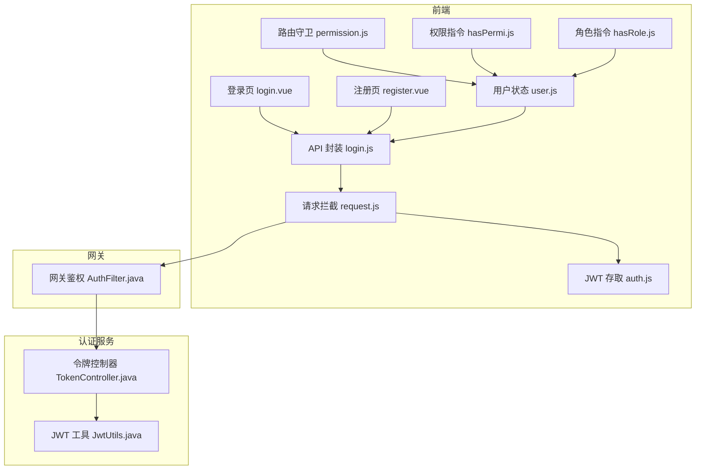

**图表来源**
- [login.vue:1-220](file://ruoyi-ui/src/views/login.vue#L1-L220)
- [register.vue:1-210](file://ruoyi-ui/src/views/register.vue#L1-L210)
- [login.js:1-61](file://ruoyi-ui/src/api/login.js#L1-L61)
- [request.js:1-159](file://ruoyi-ui/src/utils/request.js#L1-L159)
- [auth.js:1-29](file://ruoyi-ui/src/utils/auth.js#L1-L29)
- [permission.js:1-57](file://ruoyi-ui/src/permission.js#L1-L57)
- [user.js:1-116](file://ruoyi-ui/src/store/modules/user.js#L1-L116)
- [hasPermi.js:1-29](file://ruoyi-ui/src/directive/permission/hasPermi.js#L1-L29)
- [hasRole.js:1-29](file://ruoyi-ui/src/directive/permission/hasRole.js#L1-L29)
- [AuthFilter.java:1-135](file://ruoyi-gateway/src/main/java/com/ruoyi/gateway/filter/AuthFilter.java#L1-L135)
- [JwtUtils.java:1-124](file://ruoyi-common/ruoyi-common-core/src/main/java/com/ruoyi/common/core/utils/JwtUtils.java#L1-L124)
- [TokenController.java:1-41](file://ruoyi-auth/src/main/java/com/ruoyi/auth/controller/TokenController.java#L1-L41)

**章节来源**
- [login.vue:1-220](file://ruoyi-ui/src/views/login.vue#L1-L220)
- [register.vue:1-210](file://ruoyi-ui/src/views/register.vue#L1-L210)
- [login.js:1-61](file://ruoyi-ui/src/api/login.js#L1-L61)
- [request.js:1-159](file://ruoyi-ui/src/utils/request.js#L1-L159)
- [auth.js:1-29](file://ruoyi-ui/src/utils/auth.js#L1-L29)
- [permission.js:1-57](file://ruoyi-ui/src/permission.js#L1-L57)
- [user.js:1-116](file://ruoyi-ui/src/store/modules/user.js#L1-L116)
- [hasPermi.js:1-29](file://ruoyi-ui/src/directive/permission/hasPermi.js#L1-L29)
- [hasRole.js:1-29](file://ruoyi-ui/src/directive/permission/hasRole.js#L1-L29)
- [AuthFilter.java:1-135](file://ruoyi-gateway/src/main/java/com/ruoyi/gateway/filter/AuthFilter.java#L1-L135)
- [JwtUtils.java:1-124](file://ruoyi-common/ruoyi-common-core/src/main/java/com/ruoyi/common/core/utils/JwtUtils.java#L1-L124)
- [TokenController.java:1-41](file://ruoyi-auth/src/main/java/com/ruoyi/auth/controller/TokenController.java#L1-L41)

## 核心组件
- 登录/注册页面：负责表单校验、验证码获取、密码加密、调用后端接口、跳转路由。
- API 层：封装登录、注册、验证码、用户信息、登出、刷新令牌等接口。
- 请求拦截器：自动附加 Authorization 头、重复提交防护、统一错误处理、401 重登提示。
- JWT 存取：通过 Cookie 持久化 access_token 与 expires_in。
- 路由守卫：白名单放行、未登录重定向、已登录拉取用户信息与动态路由。
- 权限指令：v-hasRole 与 v-hasPermi 控制按钮/元素可见性。
- 网关鉴权：解析并校验 JWT，校验 Redis 会话，注入用户信息到下游服务。
- JWT 工具：签名、解析、提取 Claims。

**章节来源**
- [login.vue:1-220](file://ruoyi-ui/src/views/login.vue#L1-L220)
- [register.vue:1-210](file://ruoyi-ui/src/views/register.vue#L1-L210)
- [login.js:1-61](file://ruoyi-ui/src/api/login.js#L1-L61)
- [request.js:1-159](file://ruoyi-ui/src/utils/request.js#L1-L159)
- [auth.js:1-29](file://ruoyi-ui/src/utils/auth.js#L1-L29)
- [permission.js:1-57](file://ruoyi-ui/src/permission.js#L1-L57)
- [hasPermi.js:1-29](file://ruoyi-ui/src/directive/permission/hasPermi.js#L1-L29)
- [hasRole.js:1-29](file://ruoyi-ui/src/directive/permission/hasRole.js#L1-L29)
- [AuthFilter.java:1-135](file://ruoyi-gateway/src/main/java/com/ruoyi/gateway/filter/AuthFilter.java#L1-L135)
- [JwtUtils.java:1-124](file://ruoyi-common/ruoyi-common-core/src/main/java/com/ruoyi/common/core/utils/JwtUtils.java#L1-L124)

## 架构总览
下图展示从前端发起登录到网关鉴权的完整链路，以及后续受保护接口的访问流程。

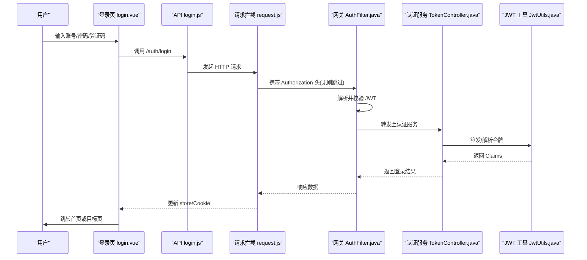

**图表来源**
- [login.vue:106-153](file://ruoyi-ui/src/views/login.vue#L106-L153)
- [login.js:3-13](file://ruoyi-ui/src/api/login.js#L3-L13)
- [request.js:23-66](file://ruoyi-ui/src/utils/request.js#L23-L66)
- [AuthFilter.java:42-84](file://ruoyi-gateway/src/main/java/com/ruoyi/gateway/filter/AuthFilter.java#L42-L84)
- [TokenController.java:34-41](file://ruoyi-auth/src/main/java/com/ruoyi/auth/controller/TokenController.java#L34-L41)
- [JwtUtils.java:26-41](file://ruoyi-common/ruoyi-common-core/src/main/java/com/ruoyi/common/core/utils/JwtUtils.java#L26-L41)

## 详细组件分析

### 登录流程（含验证码与密码加密）
- 页面初始化时加载验证码图片与开关配置；支持“记住密码”，使用 RSA 加密后存入 Cookie。
- 提交时进行表单校验，必要时刷新验证码；成功后将 access_token 与 expires_in 写入 Cookie，并更新 Vuex 状态。
- 根据 redirect 参数跳转到目标页面。

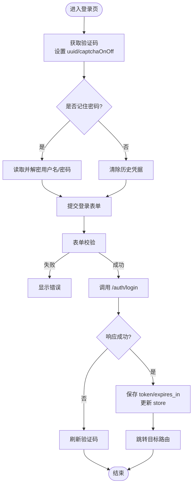

**图表来源**
- [login.vue:106-153](file://ruoyi-ui/src/views/login.vue#L106-L153)
- [login.js:3-13](file://ruoyi-ui/src/api/login.js#L3-L13)
- [user.js:34-53](file://ruoyi-ui/src/store/modules/user.js#L34-L53)

**章节来源**
- [login.vue:1-220](file://ruoyi-ui/src/views/login.vue#L1-L220)
- [login.js:1-61](file://ruoyi-ui/src/api/login.js#L1-L61)
- [user.js:1-116](file://ruoyi-ui/src/store/modules/user.js#L1-L116)

### 注册流程（含验证码校验）
- 页面加载时获取验证码；提交前进行账号长度、密码强度、确认密码一致性校验。
- 成功后弹出提示并跳转登录页。

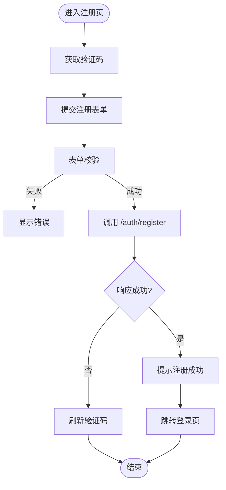

**图表来源**
- [register.vue:110-143](file://ruoyi-ui/src/views/register.vue#L110-L143)
- [login.js:15-25](file://ruoyi-ui/src/api/login.js#L15-L25)

**章节来源**
- [register.vue:1-210](file://ruoyi-ui/src/views/register.vue#L1-L210)
- [login.js:1-61](file://ruoyi-ui/src/api/login.js#L1-L61)

### JWT 令牌管理（前端）
- 存取：通过 Cookie 存储 access_token 与 expires_in，提供 get/set/remove 方法。
- 携带：请求拦截器在每次请求中自动附加 Authorization: Bearer <token>，除非显式关闭。
- 过期处理：当后端返回 401 时，弹窗提示并触发登出流程，清空状态与 Cookie。

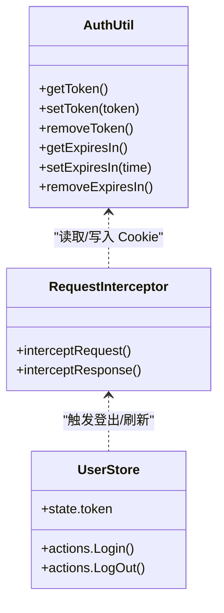

**图表来源**
- [auth.js:1-29](file://ruoyi-ui/src/utils/auth.js#L1-L29)
- [request.js:23-129](file://ruoyi-ui/src/utils/request.js#L23-L129)
- [user.js:34-111](file://ruoyi-ui/src/store/modules/user.js#L34-L111)

**章节来源**
- [auth.js:1-29](file://ruoyi-ui/src/utils/auth.js#L1-L29)
- [request.js:1-159](file://ruoyi-ui/src/utils/request.js#L1-L159)
- [user.js:1-116](file://ruoyi-ui/src/store/modules/user.js#L1-L116)

### 路由权限控制（全局守卫与动态路由）
- 白名单：允许 /login、/register 等路径无需登录即可访问。
- 有 Token：若当前用户尚未拉取用户信息，先调用 getInfo 获取 roles/permissions，再动态添加路由表。
- 无 Token：非白名单路径一律重定向到登录页，并附带 redirect 参数以便登录后回跳。

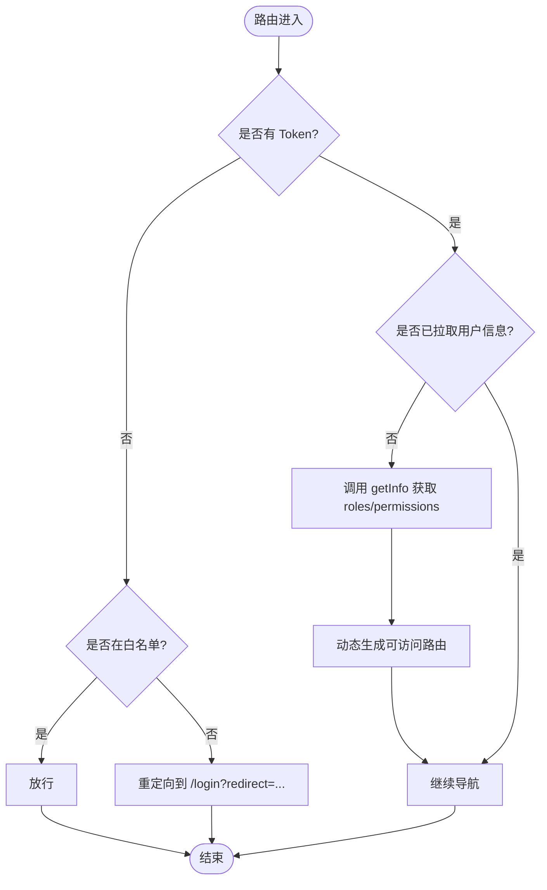

**图表来源**
- [permission.js:11-51](file://ruoyi-ui/src/permission.js#L11-L51)
- [user.js:55-73](file://ruoyi-ui/src/store/modules/user.js#L55-L73)

**章节来源**
- [permission.js:1-57](file://ruoyi-ui/src/permission.js#L1-L57)
- [user.js:1-116](file://ruoyi-ui/src/store/modules/user.js#L1-L116)

### 按钮级权限控制（角色指令与权限指令）
- v-hasRole：当用户具备 admin 角色或包含指定角色数组中的任意一个时显示元素，否则移除 DOM 节点。
- v-hasPermi：当用户具备 *:*:* 全量权限或包含指定权限标识数组中的任意一个时显示元素，否则移除 DOM 节点。

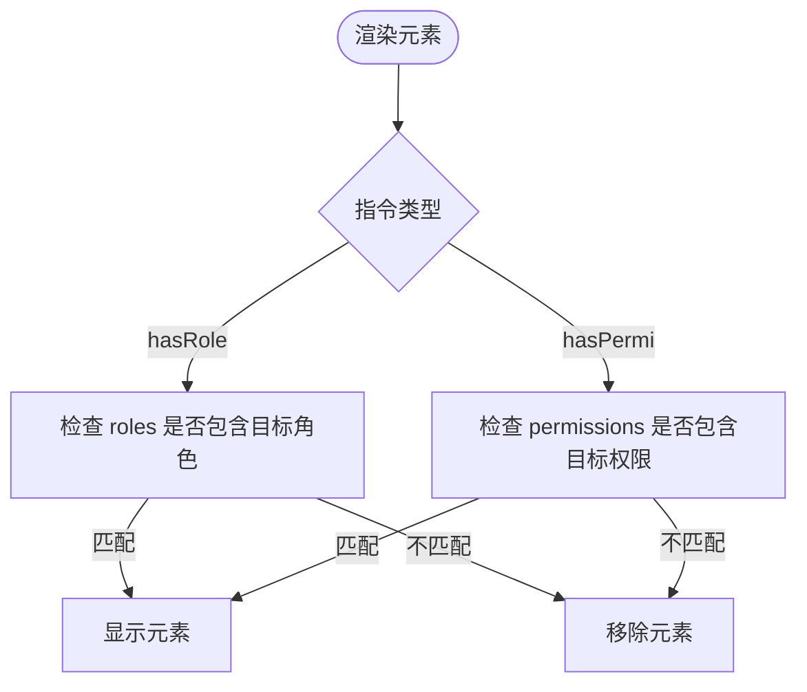

**图表来源**
- [hasRole.js:8-27](file://ruoyi-ui/src/directive/permission/hasRole.js#L8-L27)
- [hasPermi.js:8-27](file://ruoyi-ui/src/directive/permission/hasPermi.js#L8-L27)

**章节来源**
- [hasRole.js:1-29](file://ruoyi-ui/src/directive/permission/hasRole.js#L1-L29)
- [hasPermi.js:1-29](file://ruoyi-ui/src/directive/permission/hasPermi.js#L1-L29)

### 验证码处理
- 前端：调用 /code 接口获取验证码图片与 uuid，并根据返回的 captchaOnOff 决定是否显示验证码输入框。
- 登录/注册：提交时携带 code 与 uuid，由后端统一校验。

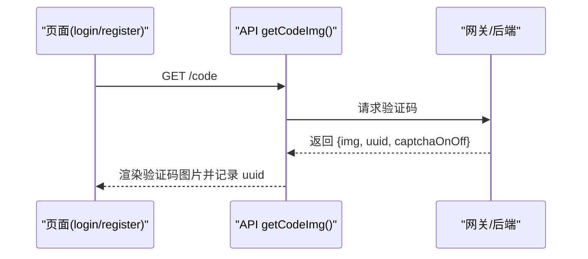

**图表来源**
- [login.js:51-61](file://ruoyi-ui/src/api/login.js#L51-L61)
- [login.vue:110-118](file://ruoyi-ui/src/views/login.vue#L110-L118)
- [register.vue:114-121](file://ruoyi-ui/src/views/register.vue#L114-L121)

**章节来源**
- [login.js:1-61](file://ruoyi-ui/src/api/login.js#L1-L61)
- [login.vue:1-220](file://ruoyi-ui/src/views/login.vue#L1-L220)
- [register.vue:1-210](file://ruoyi-ui/src/views/register.vue#L1-L210)

### 密码加密与会话管理
- 密码加密：登录页在“记住密码”场景下对密码进行 RSA 加密后再写入 Cookie，避免明文泄露。
- 会话管理：
  - 前端：通过 Cookie 持久化 access_token 与 expires_in；登出时清空状态与 Cookie。
  - 网关：校验 JWT 有效性，并在 Redis 中校验登录态，防止令牌被篡改或失效。

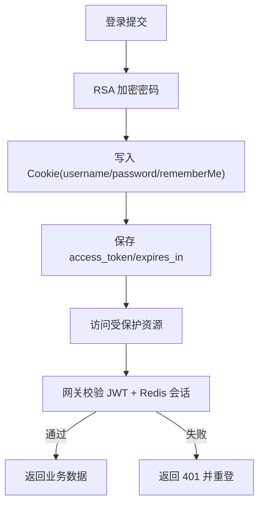

**图表来源**
- [login.vue:130-153](file://ruoyi-ui/src/views/login.vue#L130-L153)
- [user.js:34-53](file://ruoyi-ui/src/store/modules/user.js#L34-L53)
- [AuthFilter.java:42-84](file://ruoyi-gateway/src/main/java/com/ruoyi/gateway/filter/AuthFilter.java#L42-L84)

**章节来源**
- [login.vue:1-220](file://ruoyi-ui/src/views/login.vue#L1-L220)
- [user.js:1-116](file://ruoyi-ui/src/store/modules/user.js#L1-L116)
- [AuthFilter.java:1-135](file://ruoyi-gateway/src/main/java/com/ruoyi/gateway/filter/AuthFilter.java#L1-L135)

### 网关拦截器（统一鉴权）
- 白名单过滤：忽略不需要鉴权的路径。
- 令牌校验：解析 JWT，校验用户 key、用户 ID、用户名是否存在且有效。
- 会话校验：通过 Redis 校验登录态是否有效。
- 用户信息注入：将 userkey、userId、userName 注入请求头供下游服务使用。

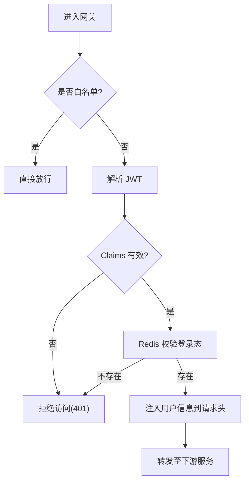

**图表来源**
- [AuthFilter.java:42-84](file://ruoyi-gateway/src/main/java/com/ruoyi/gateway/filter/AuthFilter.java#L42-L84)
- [JwtUtils.java:38-122](file://ruoyi-common/ruoyi-common-core/src/main/java/com/ruoyi/common/core/utils/JwtUtils.java#L38-L122)

**章节来源**
- [AuthFilter.java:1-135](file://ruoyi-gateway/src/main/java/com/ruoyi/gateway/filter/AuthFilter.java#L1-L135)
- [JwtUtils.java:1-124](file://ruoyi-common/ruoyi-common-core/src/main/java/com/ruoyi/common/core/utils/JwtUtils.java#L1-L124)

### 令牌签发与登录服务（后端）
- 登录接口：接收用户名与密码，调用登录服务完成认证，随后签发 JWT 令牌。
- JWT 工具：使用 HS512 算法签名，支持创建令牌与解析 Claims。

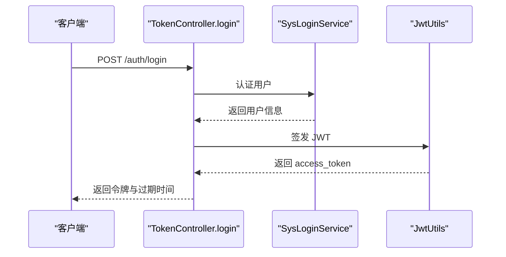

**图表来源**
- [TokenController.java:34-41](file://ruoyi-auth/src/main/java/com/ruoyi/auth/controller/TokenController.java#L34-L41)
- [JwtUtils.java:26-41](file://ruoyi-common/ruoyi-common-core/src/main/java/com/ruoyi/common/core/utils/JwtUtils.java#L26-L41)

**章节来源**
- [TokenController.java:1-41](file://ruoyi-auth/src/main/java/com/ruoyi/auth/controller/TokenController.java#L1-L41)
- [JwtUtils.java:1-124](file://ruoyi-common/ruoyi-common-core/src/main/java/com/ruoyi/common/core/utils/JwtUtils.java#L1-L124)

## 依赖关系分析
- 前端登录/注册页面依赖 API 层；API 层依赖请求拦截器；请求拦截器依赖 JWT 存取工具。
- 路由守卫依赖用户状态模块；用户状态模块依赖 API 层。
- 权限指令依赖用户状态模块。
- 网关鉴权依赖 JWT 工具与 Redis 会话服务。
- 认证服务依赖 JWT 工具。

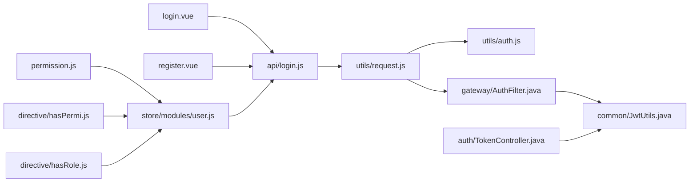

**图表来源**
- [login.vue:1-220](file://ruoyi-ui/src/views/login.vue#L1-L220)
- [register.vue:1-210](file://ruoyi-ui/src/views/register.vue#L1-L210)
- [login.js:1-61](file://ruoyi-ui/src/api/login.js#L1-L61)
- [request.js:1-159](file://ruoyi-ui/src/utils/request.js#L1-L159)
- [auth.js:1-29](file://ruoyi-ui/src/utils/auth.js#L1-L29)
- [permission.js:1-57](file://ruoyi-ui/src/permission.js#L1-L57)
- [user.js:1-116](file://ruoyi-ui/src/store/modules/user.js#L1-L116)
- [hasPermi.js:1-29](file://ruoyi-ui/src/directive/permission/hasPermi.js#L1-L29)
- [hasRole.js:1-29](file://ruoyi-ui/src/directive/permission/hasRole.js#L1-L29)
- [AuthFilter.java:1-135](file://ruoyi-gateway/src/main/java/com/ruoyi/gateway/filter/AuthFilter.java#L1-L135)
- [JwtUtils.java:1-124](file://ruoyi-common/ruoyi-common-core/src/main/java/com/ruoyi/common/core/utils/JwtUtils.java#L1-L124)
- [TokenController.java:1-41](file://ruoyi-auth/src/main/java/com/ruoyi/auth/controller/TokenController.java#L1-L41)

**章节来源**
- [login.js:1-61](file://ruoyi-ui/src/api/login.js#L1-L61)
- [request.js:1-159](file://ruoyi-ui/src/utils/request.js#L1-L159)
- [auth.js:1-29](file://ruoyi-ui/src/utils/auth.js#L1-L29)
- [permission.js:1-57](file://ruoyi-ui/src/permission.js#L1-L57)
- [user.js:1-116](file://ruoyi-ui/src/store/modules/user.js#L1-L116)
- [hasPermi.js:1-29](file://ruoyi-ui/src/directive/permission/hasPermi.js#L1-L29)
- [hasRole.js:1-29](file://ruoyi-ui/src/directive/permission/hasRole.js#L1-L29)
- [AuthFilter.java:1-135](file://ruoyi-gateway/src/main/java/com/ruoyi/gateway/filter/AuthFilter.java#L1-L135)
- [JwtUtils.java:1-124](file://ruoyi-common/ruoyi-common-core/src/main/java/com/ruoyi/common/core/utils/JwtUtils.java#L1-L124)
- [TokenController.java:1-41](file://ruoyi-auth/src/main/java/com/ruoyi/auth/controller/TokenController.java#L1-L41)

## 性能与安全性考量
- 重复提交防护：请求拦截器对相同 URL 与数据的短时间重复请求进行拦截，减少后端压力与脏数据。
- 令牌安全：JWT 使用强签名算法，网关侧二次校验 Redis 会话，确保令牌未被篡改且会话有效。
- 密码安全：前端对“记住密码”场景下的密码进行加密存储，降低敏感信息泄露风险。
- 验证码：强制验证码开关可控，结合 uuid 防重放，提升暴力破解防护能力。
- 错误处理：统一错误提示与 401 重登流程，提升用户体验与系统健壮性。

[本节为通用指导，不直接分析具体文件]

## 故障排查指南
- 无法获取验证码：
  - 检查 /code 接口是否可达，captchaOnOff 是否为 true。
  - 参考：[login.js:51-61](file://ruoyi-ui/src/api/login.js#L51-L61)、[login.vue:110-118](file://ruoyi-ui/src/views/login.vue#L110-L118)、[register.vue:114-121](file://ruoyi-ui/src/views/register.vue#L114-L121)
- 登录后仍被重定向到登录页：
  - 检查 Authorization 头是否正确携带，网关是否放行白名单。
  - 参考：[request.js:23-31](file://ruoyi-ui/src/utils/request.js#L23-L31)、[AuthFilter.java:42-84](file://ruoyi-gateway/src/main/java/com/ruoyi/gateway/filter/AuthFilter.java#L42-L84)
- 401 频繁出现：
  - 检查 Redis 会话是否过期，JWT 是否有效。
  - 参考：[request.js:78-95](file://ruoyi-ui/src/utils/request.js#L78-L95)、[AuthFilter.java:54-84](file://ruoyi-gateway/src/main/java/com/ruoyi/gateway/filter/AuthFilter.java#L54-L84)
- 按钮不可见：
  - 检查 v-hasRole/v-hasPermi 的值是否与后端返回的 roles/permissions 匹配。
  - 参考：[hasRole.js:8-27](file://ruoyi-ui/src/directive/permission/hasRole.js#L8-L27)、[hasPermi.js:8-27](file://ruoyi-ui/src/directive/permission/hasPermi.js#L8-L27)

**章节来源**
- [login.js:51-61](file://ruoyi-ui/src/api/login.js#L51-L61)
- [login.vue:110-118](file://ruoyi-ui/src/views/login.vue#L110-L118)
- [register.vue:114-121](file://ruoyi-ui/src/views/register.vue#L114-L121)
- [request.js:23-31](file://ruoyi-ui/src/utils/request.js#L23-L31)
- [request.js:78-95](file://ruoyi-ui/src/utils/request.js#L78-L95)
- [AuthFilter.java:42-84](file://ruoyi-gateway/src/main/java/com/ruoyi/gateway/filter/AuthFilter.java#L42-L84)
- [hasRole.js:8-27](file://ruoyi-ui/src/directive/permission/hasRole.js#L8-L27)
- [hasPermi.js:8-27](file://ruoyi-ui/src/directive/permission/hasPermi.js#L8-L27)

## 结论
该认证授权方案在前端实现了完整的登录、注册、权限控制与安全策略，并通过网关统一鉴权保障整体安全。建议在生产环境中：
- 严格配置白名单与忽略路径
- 合理设置 JWT 有效期与刷新策略
- 强化验证码与防爆破策略
- 完善日志与审计，便于问题定位与合规审计

[本节为总结性内容，不直接分析具体文件]