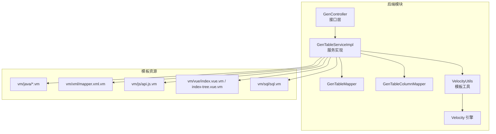
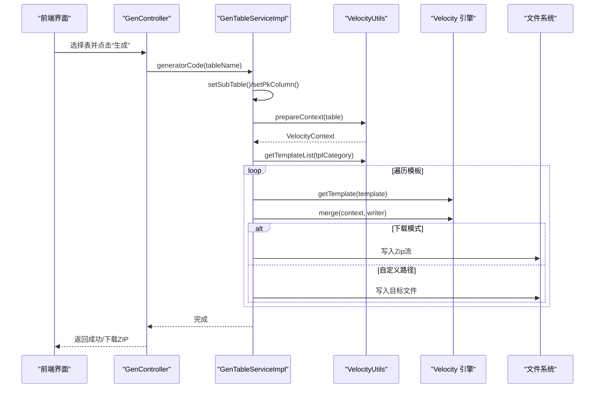
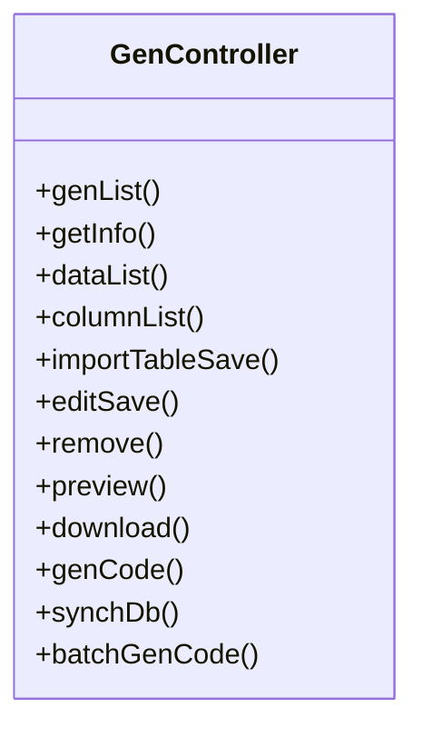
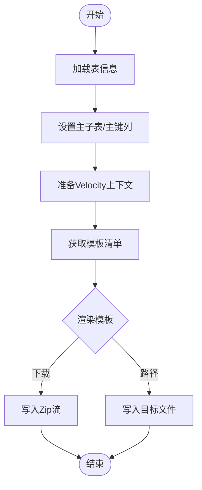
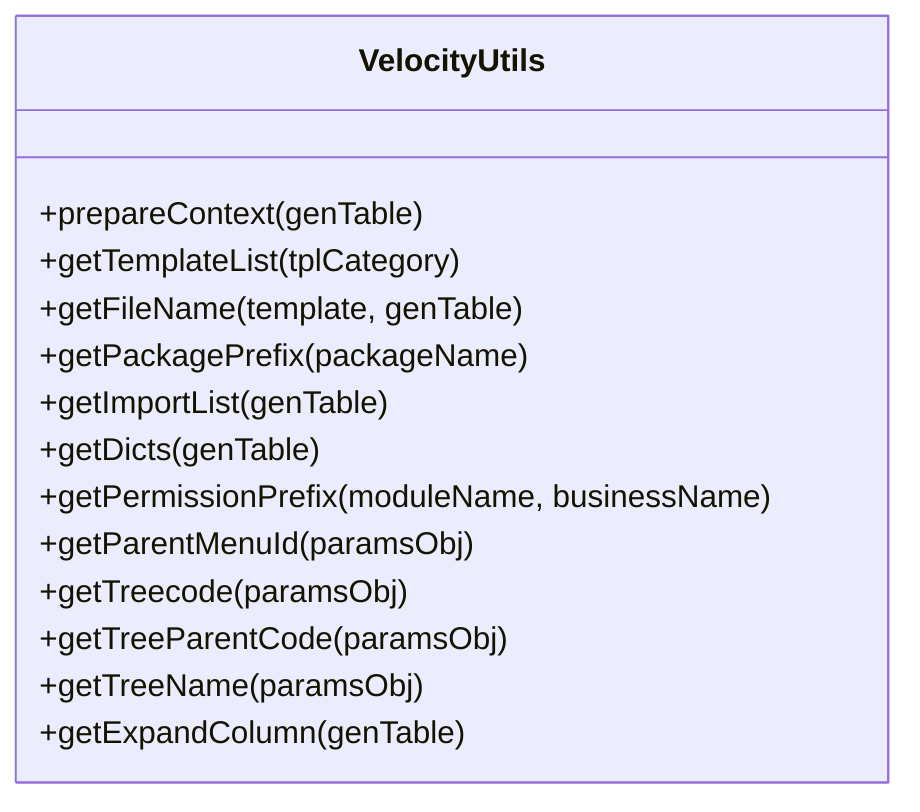
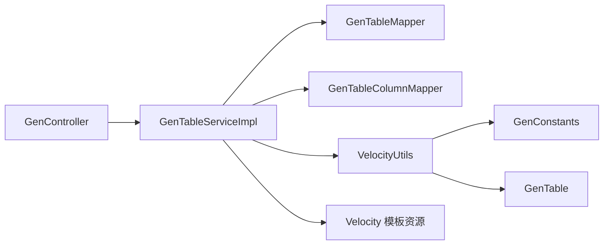
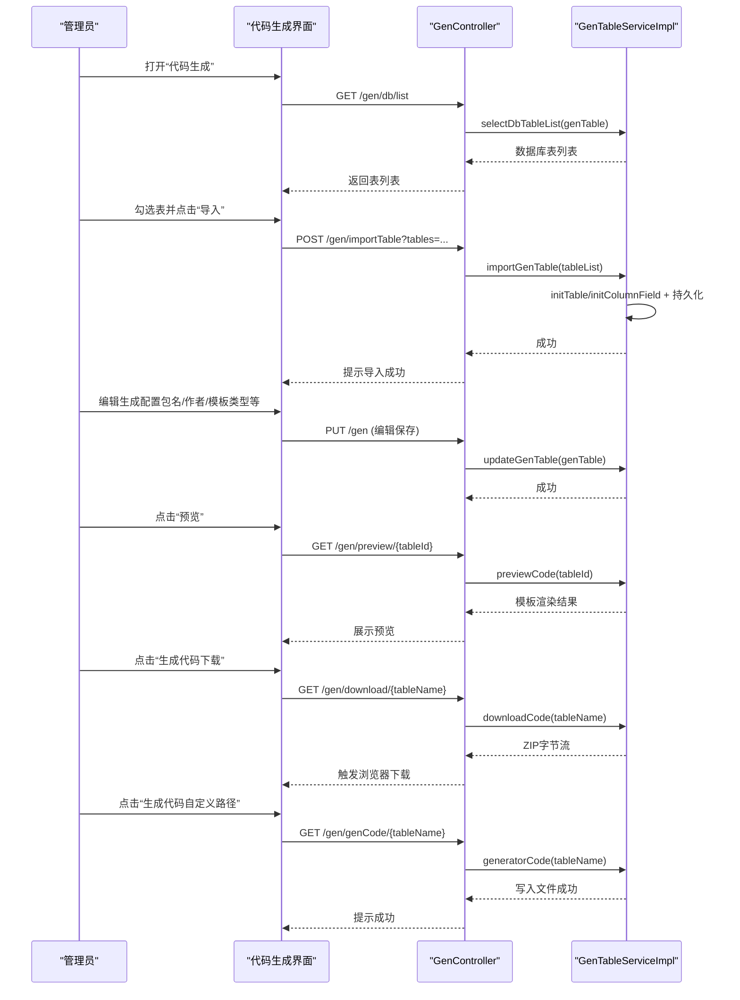
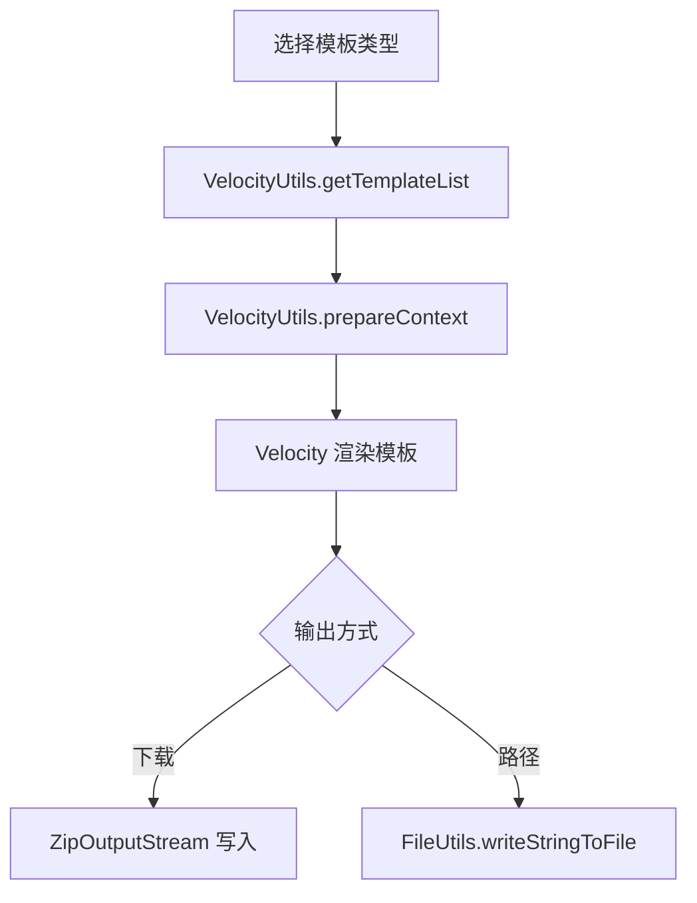

# 代码生成器

<cite>
**本文引用的文件**   
- [GenController.java](file://ruoyi-modules/ruoyi-gen/src/main/java/com/ruoyi/gen/controller/GenController.java)
- [GenTableServiceImpl.java](file://ruoyi-modules/ruoyi-gen/src/main/java/com/ruoyi/gen/service/GenTableServiceImpl.java)
- [VelocityUtils.java](file://ruoyi-modules/ruoyi-gen/src/main/java/com/ruoyi/gen/util/VelocityUtils.java)
- [GenConstants.java](file://ruoyi-common/ruoyi-common-core/src/main/java/com/ruoyi/common/core/constant/GenConstants.java)
- [GenTable.java](file://ruoyi-modules/ruoyi-gen/src/main/java/com/ruoyi/gen/domain/GenTable.java)
- [controller.java.vm](file://ruoyi-modules/ruoyi-gen/src/main/resources/vm/java/controller.java.vm)
- [domain.java.vm](file://ruoyi-modules/ruoyi-gen/src/main/resources/vm/java/domain.java.vm)
- [mapper.java.vm](file://ruoyi-modules/ruoyi-gen/src/main/resources/vm/java/mapper.java.vm)
- [service.java.vm](file://ruoyi-modules/ruoyi-gen/src/main/resources/vm/java/service.java.vm)
- [serviceImpl.java.vm](file://ruoyi-modules/ruoyi-gen/src/main/resources/vm/java/serviceImpl.java.vm)
- [sub-domain.java.vm](file://ruoyi-modules/ruoyi-gen/src/main/resources/vm/java/sub-domain.java.vm)
- [mapper.xml.vm](file://ruoyi-modules/ruoyi-gen/src/main/resources/vm/xml/mapper.xml.vm)
- [sql.sql.vm](file://ruoyi-modules/ruoyi-gen/src/main/resources/vm/sql/sql.vm)
- [api.js.vm](file://ruoyi-modules/ruoyi-gen/src/main/resources/vm/js/api.js.vm)
- [index.vue.vm](file://ruoyi-modules/ruoyi-gen/src/main/resources/vm/vue/index.vue.vm)
- [index-tree.vue.vm](file://ruoyi-modules/ruoyi-gen/src/main/resources/vm/vue/index-tree.vue.vm)
</cite>

## 目录
1. [简介](#简介)
2. [项目结构](#项目结构)
3. [核心组件](#核心组件)
4. [架构总览](#架构总览)
5. [详细组件分析](#详细组件分析)
6. [依赖关系分析](#依赖关系分析)
7. [性能与扩展性](#性能与扩展性)
8. [使用示例：从导入表结构到生成代码](#使用示例从导入表结构到生成代码)
9. [模板引擎与自定义模板开发](#模板引擎与自定义模板开发)
10. [配置选项与参数说明](#配置选项与参数说明)
11. [故障排查](#故障排查)
12. [结论](#结论)

## 简介
本代码生成器基于数据库表结构，自动生成前后端代码，包括实体、Mapper、Service、Controller、Vue 页面、JS API、SQL 菜单脚本等。它支持单表 CRUD、树表、主子表三种模板类型，内置 Velocity 模板引擎，提供预览、下载 ZIP、按路径写入等多种生成方式，并支持分页、查询条件、字典等常用功能。

## 项目结构
代码生成器位于模块 ruoyi-gen，主要包含控制器、服务、领域模型、工具类以及 Velocity 模板资源。

**图示来源** 
- [GenController.java:36-212](file://ruoyi-modules/ruoyi-gen/src/main/java/com/ruoyi/gen/controller/GenController.java#L36-L212)
- [GenTableServiceImpl.java:45-521](file://ruoyi-modules/ruoyi-gen/src/main/java/com/ruoyi/gen/service/GenTableServiceImpl.java#L45-L521)
- [VelocityUtils.java:128-220](file://ruoyi-modules/ruoyi-gen/src/main/java/com/ruoyi/gen/util/VelocityUtils.java#L128-L220)

**章节来源**
- [GenController.java:36-212](file://ruoyi-modules/ruoyi-gen/src/main/java/com/ruoyi/gen/controller/GenController.java#L36-L212)
- [GenTableServiceImpl.java:45-521](file://ruoyi-modules/ruoyi-gen/src/main/java/com/ruoyi/gen/service/GenTableServiceImpl.java#L45-L521)

## 核心组件
- GenController：暴露代码生成的 REST 接口，包括导入表结构、预览、下载、按路径生成、同步数据库等。
- GenTableServiceImpl：封装生成逻辑，负责读取表信息、准备 Velocity 上下文、渲染模板、输出文件或压缩包。
- VelocityUtils：模板变量装配、模板清单管理、文件名计算、包前缀与权限前缀计算、字典集合提取等。
- GenConstants：定义模板类型、HTML 控件类型、Java 类型、查询类型等常量。
- GenTable：代码生成业务对象，承载表名、包名、模块名、业务名、作者、模板类型、生成路径、列信息等。

**章节来源**
- [GenController.java:36-212](file://ruoyi-modules/ruoyi-gen/src/main/java/com/ruoyi/gen/controller/GenController.java#L36-L212)
- [GenTableServiceImpl.java:45-521](file://ruoyi-modules/ruoyi-gen/src/main/java/com/ruoyi/gen/service/GenTableServiceImpl.java#L45-L521)
- [VelocityUtils.java:20-402](file://ruoyi-modules/ruoyi-gen/src/main/java/com/ruoyi/gen/util/VelocityUtils.java#L20-L402)
- [GenConstants.java:8-118](file://ruoyi-common/ruoyi-common-core/src/main/java/com/ruoyi/common/core/constant/GenConstants.java#L8-L118)
- [GenTable.java:16-371](file://ruoyi-modules/ruoyi-gen/src/main/java/com/ruoyi/gen/domain/GenTable.java#L16-L371)

## 架构总览
代码生成流程由控制器接收请求，服务层组装数据并调用 Velocity 引擎渲染模板，最终输出为文件写入或 ZIP 下载。

**图示来源** 
- [GenController.java:151-173](file://ruoyi-modules/ruoyi-gen/src/main/java/com/ruoyi/gen/controller/GenController.java#L151-L173)
- [GenTableServiceImpl.java:237-277](file://ruoyi-modules/ruoyi-gen/src/main/java/com/ruoyi/gen/service/GenTableServiceImpl.java#L237-L277)
- [VelocityUtils.java:36-73](file://ruoyi-modules/ruoyi-gen/src/main/java/com/ruoyi/gen/util/VelocityUtils.java#L36-L73)

## 详细组件分析

### 控制器层 GenController
- 提供以下关键接口：
  - 列表查询、字段查询、导入表结构、编辑保存、删除
  - 预览代码、下载 ZIP、按路径生成、批量生成、同步数据库
- 权限控制通过注解实现，日志记录统一接入。

**图示来源** 
- [GenController.java:36-212](file://ruoyi-modules/ruoyi-gen/src/main/java/com/ruoyi/gen/controller/GenController.java#L36-L212)

**章节来源**
- [GenController.java:36-212](file://ruoyi-modules/ruoyi-gen/src/main/java/com/ruoyi/gen/controller/GenController.java#L36-L212)

### 服务层 GenTableServiceImpl
- 核心职责：
  - 导入表结构：初始化表与列信息并持久化
  - 预览代码：渲染所有模板到内存
  - 生成代码（下载）：将模板渲染结果打包为 ZIP
  - 生成代码（自定义路径）：根据模板映射写出具体文件
  - 同步数据库：对比 DB 与已导入列差异，增量更新
- 关键方法：
  - previewCode：构建 Velocity 上下文并渲染模板
  - downloadCode/generatorCode：分别处理 ZIP 与本地文件输出
  - synchDb：保留用户编辑的显示/查询/必填等配置

**图示来源** 
- [GenTableServiceImpl.java:188-277](file://ruoyi-modules/ruoyi-gen/src/main/java/com/ruoyi/gen/service/GenTableServiceImpl.java#L188-L277)

**章节来源**
- [GenTableServiceImpl.java:153-332](file://ruoyi-modules/ruoyi-gen/src/main/java/com/ruoyi/gen/service/GenTableServiceImpl.java#L153-L332)
- [GenTableServiceImpl.java:353-391](file://ruoyi-modules/ruoyi-gen/src/main/java/com/ruoyi/gen/service/GenTableServiceImpl.java#L353-L391)

### 模板工具 VelocityUtils
- 负责：
  - 准备 Velocity 上下文变量（包名、模块名、业务名、作者、日期、权限前缀、列集合、字典集合、树/主子表相关变量等）
  - 根据模板类型返回模板清单
  - 根据模板与 GenTable 计算输出文件名
  - 计算包前缀、导入集合、字典集合、权限前缀、上级菜单 ID、树字段、展开列序号等

**图示来源** 
- [VelocityUtils.java:20-402](file://ruoyi-modules/ruoyi-gen/src/main/java/com/ruoyi/gen/util/VelocityUtils.java#L20-L402)

**章节来源**
- [VelocityUtils.java:36-73](file://ruoyi-modules/ruoyi-gen/src/main/java/com/ruoyi/gen/util/VelocityUtils.java#L36-L73)
- [VelocityUtils.java:128-220](file://ruoyi-modules/ruoyi-gen/src/main/java/com/ruoyi/gen/util/VelocityUtils.java#L128-L220)
- [VelocityUtils.java:240-312](file://ruoyi-modules/ruoyi-gen/src/main/java/com/ruoyi/gen/util/VelocityUtils.java#L240-L312)
- [VelocityUtils.java:320-400](file://ruoyi-modules/ruoyi-gen/src/main/java/com/ruoyi/gen/util/VelocityUtils.java#L320-L400)

### 常量 GenConstants
- 定义模板类型：crud、tree、sub
- 定义 HTML 控件类型：input、textarea、select、radio、checkbox、datetime、imageUpload、fileUpload、editor
- 定义 Java 类型：String、Integer、Long、Double、BigDecimal、Date
- 定义查询类型：LIKE、EQ
- 定义列过滤规则：不需要编辑/列表/查询的字段、基类字段、树基类字段

**章节来源**
- [GenConstants.java:8-118](file://ruoyi-common/ruoyi-common-core/src/main/java/com/ruoyi/common/core/constant/GenConstants.java#L8-L118)

### 领域模型 GenTable
- 关键字段：
  - 表名、表注释、实体类名、模板类型、包名、模块名、业务名、功能名、作者
  - 生成方式（zip/自定义路径）、生成路径
  - 主键列、子表信息、列集合
  - 其他选项（JSON），树编码/父编码/名称、上级菜单ID/名称
- 辅助方法：判断是否 tree/sub/crud，是否为基类字段等

**章节来源**
- [GenTable.java:16-371](file://ruoyi-modules/ruoyi-gen/src/main/java/com/ruoyi/gen/domain/GenTable.java#L16-L371)

## 依赖关系分析
- 控制器依赖服务接口，服务依赖 Mapper 与工具类。
- 工具类依赖常量与领域模型，不直接依赖持久层。
- 模板资源通过 Velocity 引擎在运行时被加载与渲染。

**图示来源** 
- [GenController.java:36-212](file://ruoyi-modules/ruoyi-gen/src/main/java/com/ruoyi/gen/controller/GenController.java#L36-L212)
- [GenTableServiceImpl.java:45-521](file://ruoyi-modules/ruoyi-gen/src/main/java/com/ruoyi/gen/service/GenTableServiceImpl.java#L45-L521)
- [VelocityUtils.java:20-402](file://ruoyi-modules/ruoyi-gen/src/main/java/com/ruoyi/gen/util/VelocityUtils.java#L20-L402)
- [GenConstants.java:8-118](file://ruoyi-common/ruoyi-common-core/src/main/java/com/ruoyi/common/core/constant/GenConstants.java#L8-L118)

**章节来源**
- [GenController.java:36-212](file://ruoyi-modules/ruoyi-gen/src/main/java/com/ruoyi/gen/controller/GenController.java#L36-L212)
- [GenTableServiceImpl.java:45-521](file://ruoyi-modules/ruoyi-gen/src/main/java/com/ruoyi/gen/service/GenTableServiceImpl.java#L45-L521)
- [VelocityUtils.java:20-402](file://ruoyi-modules/ruoyi-gen/src/main/java/com/ruoyi/gen/util/VelocityUtils.java#L20-L402)

## 性能与扩展性
- 性能要点：
  - 预览模式仅渲染到内存，适合快速校验；生产生成建议使用下载 ZIP 或自定义路径写入。
  - 批量生成时复用 ZipOutputStream，减少 IO 开销。
- 扩展点：
  - 新增模板类型：在 VelocityUtils.getTemplateList 中追加模板清单，并在 GenTableServiceImpl 中按需跳过特定模板（如 SQL、前端模板）。
  - 自定义输出路径：通过 GenTable.genPath 指定绝对路径或相对路径。
  - 扩展上下文变量：在 VelocityUtils.prepareContext 中添加新变量供模板使用。

[本节为通用指导，不直接分析具体文件]

## 使用示例：从导入表结构到生成代码
以下为标准操作流程，涵盖从导入表结构到生成前后端代码的关键步骤。

**图示来源** 
- [GenController.java:75-173](file://ruoyi-modules/ruoyi-gen/src/main/java/com/ruoyi/gen/controller/GenController.java#L75-L173)
- [GenTableServiceImpl.java:153-277](file://ruoyi-modules/ruoyi-gen/src/main/java/com/ruoyi/gen/service/GenTableServiceImpl.java#L153-L277)

**章节来源**
- [GenController.java:75-173](file://ruoyi-modules/ruoyi-gen/src/main/java/com/ruoyi/gen/controller/GenController.java#L75-L173)
- [GenTableServiceImpl.java:153-277](file://ruoyi-modules/ruoyi-gen/src/main/java/com/ruoyi/gen/service/GenTableServiceImpl.java#L153-L277)

## 模板引擎与自定义模板开发
- 模板清单与输出路径：
  - VelocityUtils.getTemplateList 根据模板类型返回模板清单，包含后端 Java、XML、JS、Vue、SQL 等模板。
  - VelocityUtils.getFileName 根据模板与 GenTable 计算输出文件名与目录。
- 上下文变量：
  - VelocityUtils.prepareContext 注入模板所需变量，如 tableName、className、businessName、packageName、author、columns、dicts、permissionPrefix、treeCode/treeParentCode/treeName 等。
- 模板资源位置：
  - vm/java/*.vm：实体、Mapper、Service、ServiceImpl、Controller、子表实体
  - vm/xml/mapper.xml.vm：MyBatis XML
  - vm/js/api.js.vm：前端 JS API
  - vm/vue/index.vue.vm / index-tree.vue.vm：前端页面
  - vm/sql/sql.vm：菜单 SQL

**图示来源** 
- [VelocityUtils.java:128-220](file://ruoyi-modules/ruoyi-gen/src/main/java/com/ruoyi/gen/util/VelocityUtils.java#L128-L220)
- [GenTableServiceImpl.java:237-277](file://ruoyi-modules/ruoyi-gen/src/main/java/com/ruoyi/gen/service/GenTableServiceImpl.java#L237-L277)

**章节来源**
- [VelocityUtils.java:128-220](file://ruoyi-modules/ruoyi-gen/src/main/java/com/ruoyi/gen/util/VelocityUtils.java#L128-L220)
- [GenTableServiceImpl.java:237-277](file://ruoyi-modules/ruoyi-gen/src/main/java/com/ruoyi/gen/service/GenTableServiceImpl.java#L237-L277)

## 配置选项与参数说明
- 模板类型（tplCategory）：
  - crud：单表增删改查
  - tree：树表增删改查
  - sub：主子表增删改查
- HTML 控件类型（htmlType）：
  - input、textarea、select、radio、checkbox、datetime、imageUpload、fileUpload、editor
- Java 类型（javaType）：
  - String、Integer、Long、Double、BigDecimal、Date
- 查询类型（queryType）：
  - LIKE、EQ
- 其他选项（options，JSON）：
  - treeCode、treeParentCode、treeName：树表字段
  - parentMenuId、parentMenuName：上级菜单
- 生成配置：
  - packageName：包路径
  - moduleName：模块名
  - businessName：业务名
  - functionName：功能名
  - functionAuthor：作者
  - genType：生成方式（zip/自定义路径）
  - genPath：自定义路径（为空默认项目路径）

**章节来源**
- [GenConstants.java:8-118](file://ruoyi-common/ruoyi-common-core/src/main/java/com/ruoyi/common/core/constant/GenConstants.java#L8-L118)
- [GenTable.java:41-96](file://ruoyi-modules/ruoyi-gen/src/main/java/com/ruoyi/gen/domain/GenTable.java#L41-L96)
- [VelocityUtils.java:36-73](file://ruoyi-modules/ruoyi-gen/src/main/java/com/ruoyi/gen/util/VelocityUtils.java#L36-L73)

## 故障排查
- 预览失败：
  - 检查模板是否存在且语法正确
  - 确认 Velocity 上下文变量是否完整（如 columns、dicts、permissionPrefix）
- 生成失败（自定义路径）：
  - 检查 genPath 是否可写
  - 确认模板渲染未抛出异常（IO 异常会被包装为 Service 异常）
- 同步数据库失败：
  - 原表结构不存在会抛异常
  - 列差异处理需确保用户编辑的配置（如 dictType、queryType、isRequired、htmlType）被保留

**章节来源**
- [GenTableServiceImpl.java:284-332](file://ruoyi-modules/ruoyi-gen/src/main/java/com/ruoyi/gen/service/GenTableServiceImpl.java#L284-L332)
- [GenTableServiceImpl.java:260-277](file://ruoyi-modules/ruoyi-gen/src/main/java/com/ruoyi/gen/service/GenTableServiceImpl.java#L260-L277)

## 结论
该代码生成器以 Velocity 为核心，结合完善的模板清单与上下文装配，实现了从数据库表结构到前后端代码的一键生成。通过灵活的配置项与可扩展的模板机制，能够覆盖常见的 CRUD、树表、主子表场景，并提供预览、下载、路径写入等多种输出方式，满足日常开发与二次扩展需求。