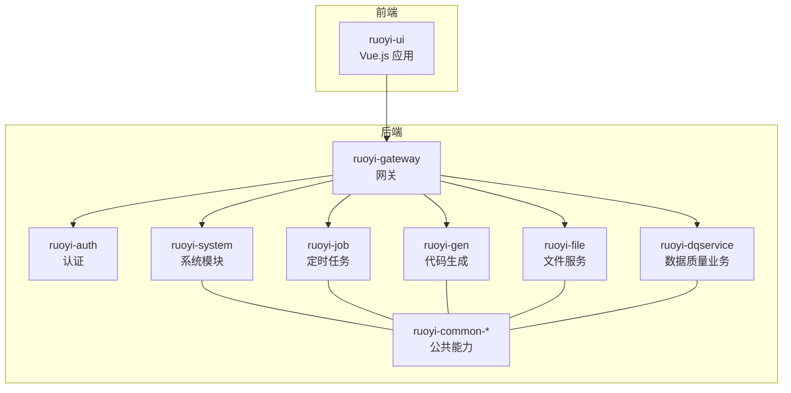
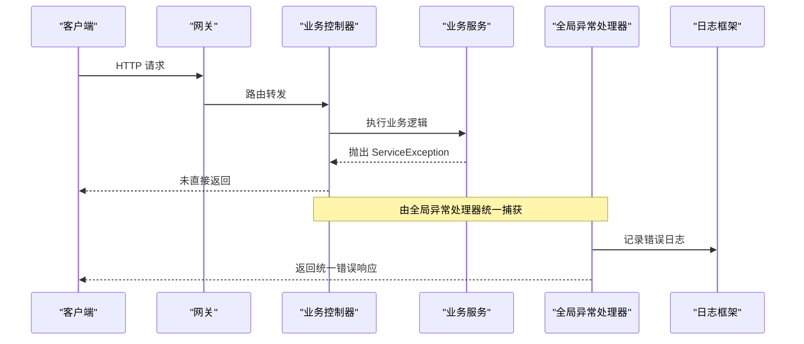
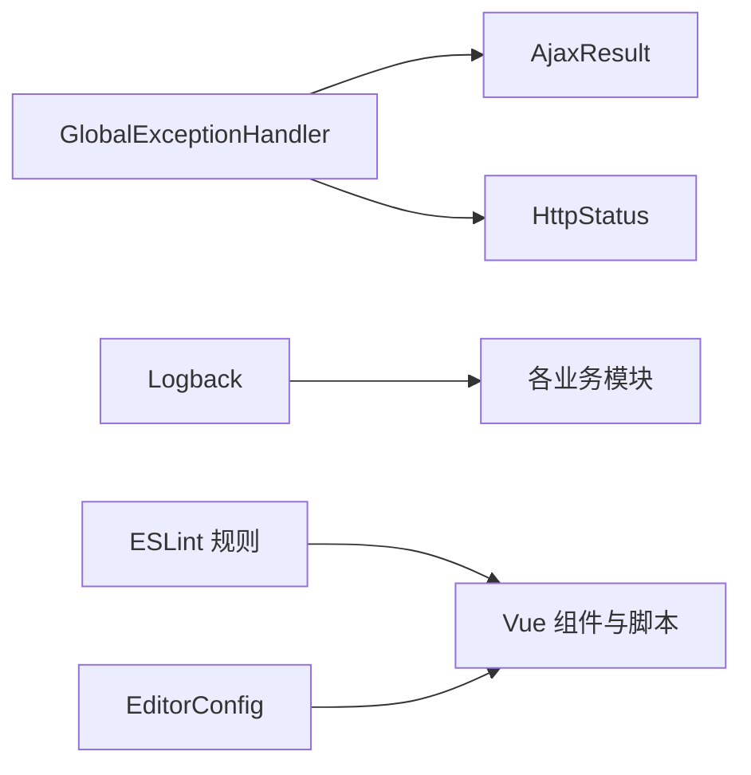

# 代码规范

<cite>
**本文引用的文件**   
- [README.md](file://README.md)
- [.eslintrc.js](file://ruoyi-ui/.eslintrc.js)
- [.editorconfig](file://ruoyi-ui/.editorconfig)
- [ServiceException.java](file://ruoyi-common/ruoyi-common-core/src/main/java/com/ruoyi/common/core/exception/ServiceException.java)
- [GlobalExceptionHandler.java](file://ruoyi-common/ruoyi-common-security/src/main/java/com/ruoyi/common/security/handler/GlobalExceptionHandler.java)
- [logback.xml（dqservice）](file://ruoyi-modules/ruoyi-dqservice/src/main/resources/logback.xml)
- [DataSourceController.java](file://ruoyi-modules/ruoyi-dqservice/src/main/java/com/ruoyi/dqservice/controller/DataSourceController.java)
- [RuleController.java](file://ruoyi-modules/ruoyi-dqservice/src/main/java/com/ruoyi/dqservice/controller/RuleController.java)
- [SysJobController.java](file://ruoyi-modules/ruoyi-job/src/main/java/com/ruoyi/job/controller/SysJobController.java)
- [StringUtils.java](file://ruoyi-common/ruoyi-common-core/src/main/java/com/ruoyi/common/core/utils/StringUtils.java)
- [GenUtils.java](file://ruoyi-modules/ruoyi-gen/src/main/java/com/ruoyi/gen/util/GenUtils.java)
</cite>

## 目录
1. [引言](#引言)
2. [项目结构](#项目结构)
3. [核心组件](#核心组件)
4. [架构总览](#架构总览)
5. [详细组件分析](#详细组件分析)
6. [依赖关系分析](#依赖关系分析)
7. [性能与可维护性考虑](#性能与可维护性考虑)
8. [故障排查指南](#故障排查指南)
9. [结论](#结论)
10. [附录：Git 提交信息与审查流程](#附录git-提交信息与审查流程)

## 引言
本规范面向 Java 后端与 Vue.js 前端，统一命名约定、注释风格、异常处理、日志记录、ESLint 配置与样式组织等实践，并给出 Git 提交信息与代码审查流程。目标是提升可读性、一致性与可维护性，降低协作成本。

## 项目结构
本项目为前后端分离的微服务架构：
- 后端：基于 Spring Boot 的多模块工程，包含认证、网关、系统、任务、代码生成、文件、可视化监控以及数据质量业务模块。
- 前端：Vue.js + Element UI 管理后台，使用 ESLint 与 EditorConfig 统一代码风格。

**图表来源**
- [logback.xml（dqservice）:1-75](file://ruoyi-modules/ruoyi-dqservice/src/main/resources/logback.xml#L1-L75)

**章节来源**
- [README.md:1-1](file://README.md#L1-L1)

## 核心组件
- 全局异常处理：统一捕获业务异常、参数校验异常、权限异常等，并返回标准响应体。
- 日志框架：Logback 按 INFO/ERROR 分文件滚动输出，统一日志格式。
- 前端代码规范：ESLint 规则与 EditorConfig 约束缩进、引号、逗号、行尾等。
- 命名工具：提供下划线转驼峰等工具方法，保证类名、字段名一致性。

**章节来源**
- [GlobalExceptionHandler.java:1-137](file://ruoyi-common/ruoyi-common-security/src/main/java/com/ruoyi/common/security/handler/GlobalExceptionHandler.java#L1-L137)
- [logback.xml（dqservice）:1-75](file://ruoyi-modules/ruoyi-dqservice/src/main/resources/logback.xml#L1-L75)
- [.eslintrc.js:1-200](file://ruoyi-ui/.eslintrc.js#L1-L200)
- [.editorconfig:1-23](file://ruoyi-ui/.editorconfig#L1-L23)
- [StringUtils.java:368-402](file://ruoyi-common/ruoyi-common-core/src/main/java/com/ruoyi/common/core/utils/StringUtils.java#L368-L402)

## 架构总览
下图展示一次典型请求从网关到业务模块的异常与日志流转。

**图表来源**
- [GlobalExceptionHandler.java:64-95](file://ruoyi-common/ruoyi-common-security/src/main/java/com/ruoyi/common/security/handler/GlobalExceptionHandler.java#L64-L95)
- [logback.xml（dqservice）:1-75](file://ruoyi-modules/ruoyi-dqservice/src/main/resources/logback.xml#L1-L75)

## 详细组件分析

### Java 后端编码规范

#### 命名约定
- 包名全小写，类名采用大驼峰，方法与变量采用小驼峰。
- 常量使用全大写下划线分隔；枚举值使用大写+下划线。
- 数据库表名与列名建议下划线命名，Java 侧通过工具转换为驼峰。

参考实现：
- 下划线转驼峰工具方法用于将表名转为类名，保证类名一致性。
- 代码生成器根据表前缀与类型映射生成导入列表与类名。

**章节来源**
- [StringUtils.java:368-402](file://ruoyi-common/ruoyi-common-core/src/main/java/com/ruoyi/common/core/utils/StringUtils.java#L368-L402)
- [GenUtils.java:171-219](file://ruoyi-modules/ruoyi-gen/src/main/java/com/ruoyi/gen/util/GenUtils.java#L171-L219)

#### 注释规范
- 类与方法需具备清晰的 Javadoc，说明职责、参数与返回值。
- 关键业务逻辑处补充行内注释，解释“为什么”而非“是什么”。
- 对异常信息、错误码进行明确标注，便于前端提示与排障。

示例位置：
- 业务异常类包含错误码、消息与明细字段的注释。
- 全局异常处理器对各类异常的捕获与日志记录有清晰注释。

**章节来源**
- [ServiceException.java:1-73](file://ruoyi-common/ruoyi-common-core/src/main/java/com/ruoyi/common/core/exception/ServiceException.java#L1-L73)
- [GlobalExceptionHandler.java:20-28](file://ruoyi-common/ruoyi-common-security/src/main/java/com/ruoyi/common/security/handler/GlobalExceptionHandler.java#L20-L28)

#### 异常处理
- 业务异常统一继承 ServiceException，携带 code/message/detailMessage。
- 全局异常处理器集中处理：
  - 权限相关异常（角色/权限缺失）
  - 参数绑定与校验异常
  - 运行时异常与系统异常兜底
- 所有异常均记录日志并返回统一 AjaxResult。

最佳实践：
- 在 Service 层抛出 ServiceException，避免在 Controller 层处理具体业务错误。
- 对于需要区分错误码的场景，务必设置 code，便于前端差异化处理。

反例对比：
- 反例：在 Controller 中 try-catch 后直接返回字符串或自定义对象。
- 正例：抛出 ServiceException，交由全局异常处理器统一封装与记录。

**章节来源**
- [ServiceException.java:1-73](file://ruoyi-common/ruoyi-common-core/src/main/java/com/ruoyi/common/core/exception/ServiceException.java#L1-L73)
- [GlobalExceptionHandler.java:30-136](file://ruoyi-common/ruoyi-common-security/src/main/java/com/ruoyi/common/security/handler/GlobalExceptionHandler.java#L30-L136)

#### 日志记录
- 使用 Logback 输出控制台与文件日志，INFO/ERROR 分文件滚动保存。
- 日志格式包含时间、线程、级别、logger、方法、行号与消息。
- 业务操作日志通过 @Log 注解配合 AOP 切面自动采集。

建议：
- 关键业务流程使用 info 级别记录上下文；异常使用 error 级别记录堆栈。
- 敏感信息脱敏后再记录。

**章节来源**
- [logback.xml（dqservice）:1-75](file://ruoyi-modules/ruoyi-dqservice/src/main/resources/logback.xml#L1-L75)
- [DataSourceController.java:54-99](file://ruoyi-modules/ruoyi-dqservice/src/main/java/com/ruoyi/dqservice/controller/DataSourceController.java#L54-L99)
- [RuleController.java:57-147](file://ruoyi-modules/ruoyi-dqservice/src/main/java/com/ruoyi/dqservice/controller/RuleController.java#L57-L147)
- [SysJobController.java:59-179](file://ruoyi-modules/ruoyi-job/src/main/java/com/ruoyi/job/controller/SysJobController.java#L59-L179)

### Vue.js 前端开发规范

#### 组件命名
- 组件文件名与组件名使用 PascalCase。
- 页面级组件放在 views 下，通用组件放在 components 下。
- 图标与 SVG 资源集中管理，按需引入。

参考：
- ESLint 强制组件 name 属性为 PascalCase。
- 图标全局注册脚本统一加载 svg 资源。

**章节来源**
- [.eslintrc.js:27-27](file://ruoyi-ui/.eslintrc.js#L27-L27)
- [index.js（icons）:1-9](file://ruoyi-ui/src/assets/icons/index.js#L1-L9)

#### 样式组织
- 全局样式集中在 assets/styles，模块化 SCSS 变量与 mixin。
- 组件样式尽量使用 scoped，避免污染全局。
- 主题变量统一管理，便于切换与扩展。

建议：
- 优先复用已有 mixin 与变量，减少重复定义。
- 复杂页面样式拆分为局部样式文件，保持单一职责。

**章节来源**
- [.eslintrc.js:1-200](file://ruoyi-ui/.eslintrc.js#L1-L200)

#### ESLint 配置
- 启用 vue/recommended 与 eslint:recommended。
- 强制单引号、禁止分号、严格比较、缩进 2 空格、行尾换行 LF。
- 关闭 console 在生产环境外的告警，但生产构建时禁用 debugger。

要点：
- 使用 EditorConfig 统一编辑器行为，确保团队一致。
- 新增规则需谨慎评估影响范围，逐步收敛。

**章节来源**
- [.eslintrc.js:1-200](file://ruoyi-ui/.eslintrc.js#L1-L200)
- [.editorconfig:1-23](file://ruoyi-ui/.editorconfig#L1-L23)

### 代码示例与反例对比

#### 异常处理
- 正例：Service 层抛出 ServiceException(code, message)，由全局异常处理器统一返回 AjaxResult。
- 反例：Controller 层自行 try-catch 并返回非标准对象，导致前端解析不一致。

参考路径：
- [ServiceException.java:1-73](file://ruoyi-common/ruoyi-common-core/src/main/java/com/ruoyi/common/core/exception/ServiceException.java#L1-L73)
- [GlobalExceptionHandler.java:64-95](file://ruoyi-common/ruoyi-common-security/src/main/java/com/ruoyi/common/security/handler/GlobalExceptionHandler.java#L64-L95)

#### 日志记录
- 正例：使用 @Log 注解标记业务操作，结合 Logback 输出结构化日志。
- 反例：仅在异常时打印日志，缺少关键业务节点的可观测性。

参考路径：
- [DataSourceController.java:54-99](file://ruoyi-modules/ruoyi-dqservice/src/main/java/com/ruoyi/dqservice/controller/DataSourceController.java#L54-L99)
- [logback.xml（dqservice）:1-75](file://ruoyi-modules/ruoyi-dqservice/src/main/resources/logback.xml#L1-L75)

#### 命名转换
- 正例：通过 StringUtils.convertToCamelCase 将表名转为类名，保持一致性。
- 反例：硬编码类名或随意大小写，增加维护成本。

参考路径：
- [StringUtils.java:368-402](file://ruoyi-common/ruoyi-common-core/src/main/java/com/ruoyi/common/core/utils/StringUtils.java#L368-L402)
- [GenUtils.java:171-219](file://ruoyi-modules/ruoyi-gen/src/main/java/com/ruoyi/gen/util/GenUtils.java#L171-L219)

## 依赖关系分析
- 全局异常处理器依赖统一响应体与状态码常量，屏蔽各模块差异。
- 日志框架在各模块独立配置，但遵循统一的 pattern 与滚动策略。
- 前端 ESLint 与 EditorConfig 作为基础规范，贯穿所有 JS/Vue 文件。

**图表来源**
- [GlobalExceptionHandler.java:1-137](file://ruoyi-common/ruoyi-common-security/src/main/java/com/ruoyi/common/security/handler/GlobalExceptionHandler.java#L1-L137)
- [logback.xml（dqservice）:1-75](file://ruoyi-modules/ruoyi-dqservice/src/main/resources/logback.xml#L1-L75)
- [.eslintrc.js:1-200](file://ruoyi-ui/.eslintrc.js#L1-L200)
- [.editorconfig:1-23](file://ruoyi-ui/.editorconfig#L1-L23)

**章节来源**
- [GlobalExceptionHandler.java:1-137](file://ruoyi-common/ruoyi-common-security/src/main/java/com/ruoyi/common/security/handler/GlobalExceptionHandler.java#L1-L137)
- [logback.xml（dqservice）:1-75](file://ruoyi-modules/ruoyi-dqservice/src/main/resources/logback.xml#L1-L75)
- [.eslintrc.js:1-200](file://ruoyi-ui/.eslintrc.js#L1-L200)
- [.editorconfig:1-23](file://ruoyi-ui/.editorconfig#L1-L23)

## 性能与可维护性考虑
- 异常处理集中化，减少重复代码，提高可维护性。
- 日志分级与滚动策略避免磁盘占用过大，便于快速定位问题。
- 前端 ESLint 规则严格但不阻塞开发体验，渐进式改进。
- 命名工具与代码生成器降低样板代码，提升一致性。

[本节为通用指导，不直接分析具体文件]

## 故障排查指南
- 遇到业务异常：查看 ServiceException 的 code 与 message，并在日志中检索对应请求 URI。
- 参数校验失败：检查 BindException 或 MethodArgumentNotValidException 的处理分支，确认入参是否符合校验规则。
- 权限不足：核对 NotPermissionException/NotRoleException 的日志与用户权限配置。
- 日志定位：根据 logback 输出的 file_info/file_error 文件，结合时间戳与方法行号定位问题。

**章节来源**
- [GlobalExceptionHandler.java:30-136](file://ruoyi-common/ruoyi-common-security/src/main/java/com/ruoyi/common/security/handler/GlobalExceptionHandler.java#L30-L136)
- [logback.xml（dqservice）:1-75](file://ruoyi-modules/ruoyi-dqservice/src/main/resources/logback.xml#L1-L75)

## 结论
通过统一的异常处理、日志规范与前端 ESLint/EditorConfig 配置，项目在可读性、一致性与可维护性上得到显著提升。建议在后续迭代中持续完善业务日志覆盖度，并逐步收敛 ESLint 规则以进一步提升代码质量。

[本节为总结性内容，不直接分析具体文件]

## 附录：Git 提交信息与审查流程

### Git 提交信息规范
- 类型限定：feat/fix/docs/style/refactor/test/chore/build/ci/perf
- 格式要求：<type>(scope): <subject>
- 主题简洁明了，必要时在正文描述动机与变更点。
- 关联需求或缺陷编号，便于追溯。

示例：
- feat(system): 新增用户分页查询接口
- fix(auth): 修复登录令牌过期重试逻辑
- docs(api): 更新 Swagger 文档版本

### 代码审查流程
- 提交前自检：运行 ESLint、单元测试，确保无阻断性错误。
- 发起 MR/PR：填写变更说明、影响范围、测试用例。
- 审查重点：
  - 是否遵循命名与注释规范
  - 异常处理是否正确抛出与统一返回
  - 日志是否充分且敏感信息已脱敏
  - 前端样式是否模块化、是否存在全局污染
- 通过后合并：CI 流水线验证构建与基础测试。

[本节为流程性内容，不直接分析具体文件]