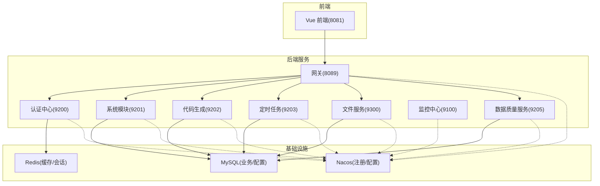
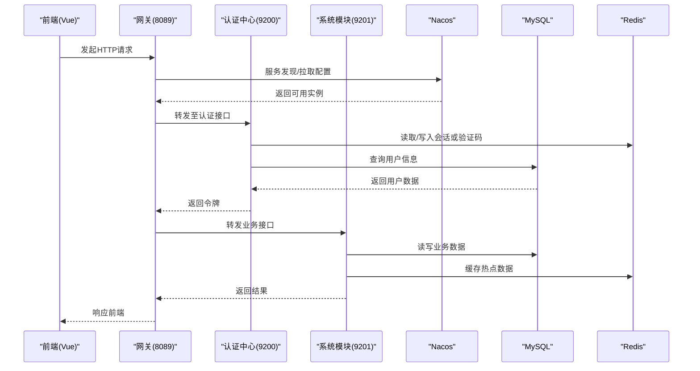
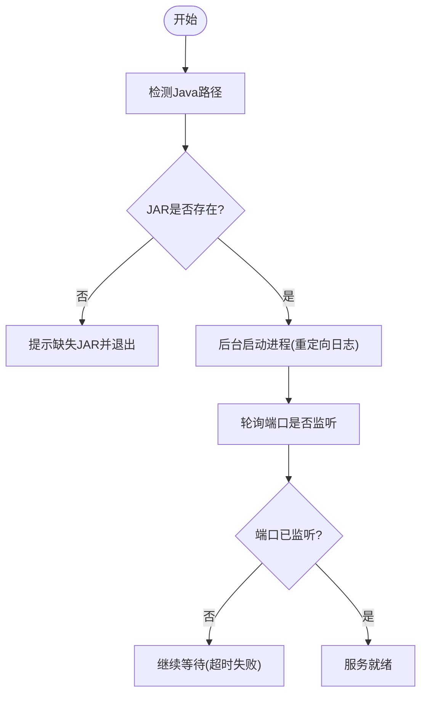
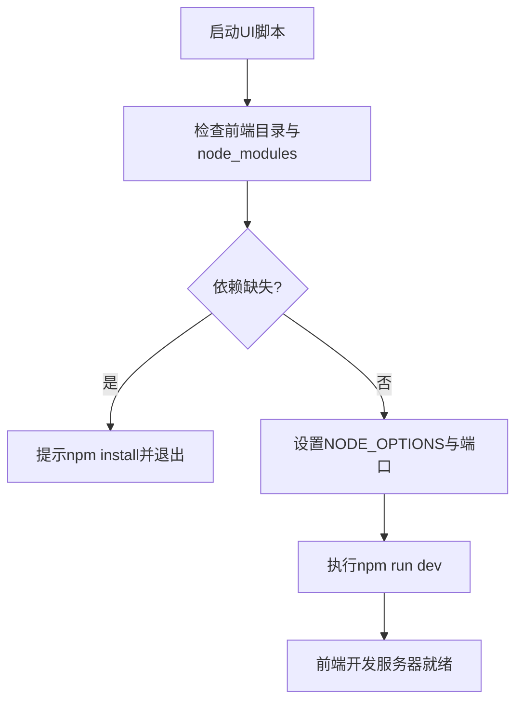
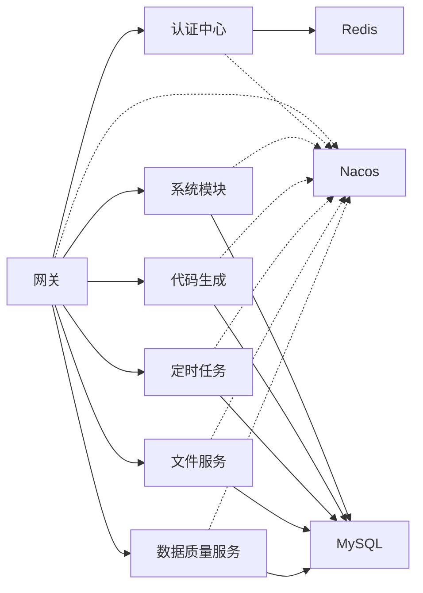

# 开发工作流

<cite>
**本文引用的文件**   
- [pom.xml](file://pom.xml)
- [docker-compose.yml](file://docker/docker-compose.yml)
- [start-backend.ps1](file://bin/start-backend.ps1)
- [start-ui.ps1](file://bin/start-ui.ps1)
- [package.json](file://ruoyi-ui/package.json)
- [bootstrap.yml（认证中心）](file://ruoyi-auth/src/main/resources/bootstrap.yml)
- [bootstrap.yml（网关）](file://ruoyi-gateway/src/main/resources/bootstrap.yml)
- [bootstrap.yml（系统模块）](file://ruoyi-modules/ruoyi-system/src/main/resources/bootstrap.yml)
- [bootstrap.yml（代码生成）](file://ruoyi-modules/ruoyi-gen/src/main/resources/bootstrap.yml)
- [bootstrap.yml（定时任务）](file://ruoyi-modules/ruoyi-job/src/main/resources/bootstrap.yml)
- [bootstrap.yml（数据质量服务）](file://ruoyi-modules/ruoyi-dqservice/src/main/resources/bootstrap.yml)
- [bootstrap.yml（文件服务）](file://ruoyi-modules/ruoyi-file/src/main/resources/bootstrap.yml)
- [bootstrap.yml（监控中心）](file://ruoyi-visual/ruoyi-monitor/src/main/resources/bootstrap.yml)
- [ry_20210908.sql](file://sql/ry_20210908.sql)
- [quartz.sql](file://sql/quartz.sql)
- [ry_config_20220424.sql](file://sql/ry_config_20220424.sql)
- [RedisConfig.java](file://ruoyi-common/ruoyi-common-redis/src/main/java/com/ruoyi/common/redis/configure/RedisConfig.java)
</cite>

## 目录
1. [简介](#简介)
2. [项目结构](#项目结构)
3. [核心组件](#核心组件)
4. [架构总览](#架构总览)
5. [详细组件分析](#详细组件分析)
6. [依赖关系分析](#依赖关系分析)
7. [性能与启动优化](#性能与启动优化)
8. [故障排查指南](#故障排查指南)
9. [结论](#结论)
10. [附录：IDE 配置建议](#附录：ide-配置建议)

## 简介
本文件面向本地开发者，提供从环境准备、依赖安装、数据库初始化到前后端服务启动的完整工作流说明。同时给出分支管理、提交规范、合并流程的建议，以及常见问题的定位方法与调试技巧，并附带 IDE 配置建议，帮助快速搭建高效稳定的开发环境。

## 项目结构
本项目为微服务架构，后端基于 Spring Cloud + Nacos，前端为 Vue 2 应用。关键目录与职责如下：
- 根 pom：统一版本管理与模块聚合
- docker：Nacos、MySQL、Redis、Nginx 等中间件容器编排
- bin：Windows 下一键启停脚本（PowerShell）
- ruoyi-*：各后端服务模块（认证、网关、系统、代码生成、定时任务、文件、监控、数据质量服务等）
- ruoyi-ui：前端工程（Vue CLI）
- sql：数据库初始化脚本（业务库、调度表、Nacos 配置库）

图表来源
- [docker-compose.yml:3-140](file://docker/docker-compose.yml#L3-L140)
- [bootstrap.yml（认证中心）:1-25](file://ruoyi-auth/src/main/resources/bootstrap.yml#L1-L25)
- [bootstrap.yml（网关）:1-43](file://ruoyi-gateway/src/main/resources/bootstrap.yml#L1-L43)
- [bootstrap.yml（系统模块）:1-25](file://ruoyi-modules/ruoyi-system/src/main/resources/bootstrap.yml#L1-L25)
- [bootstrap.yml（代码生成）:1-25](file://ruoyi-modules/ruoyi-gen/src/main/resources/bootstrap.yml#L1-L25)
- [bootstrap.yml（定时任务）:1-25](file://ruoyi-modules/ruoyi-job/src/main/resources/bootstrap.yml#L1-L25)
- [bootstrap.yml（文件服务）:1-25](file://ruoyi-modules/ruoyi-file/src/main/resources/bootstrap.yml#L1-L25)
- [bootstrap.yml（监控中心）:1-25](file://ruoyi-visual/ruoyi-monitor/src/main/resources/bootstrap.yml#L1-L25)
- [bootstrap.yml（数据质量服务）:1-25](file://ruoyi-modules/ruoyi-dqservice/src/main/resources/bootstrap.yml#L1-L25)

章节来源
- [pom.xml:1-286](file://pom.xml#L1-L286)
- [docker-compose.yml:1-140](file://docker/docker-compose.yml#L1-L140)

## 核心组件
- 认证中心（ruoyi-auth）：负责登录、令牌签发与校验
- 网关（ruoyi-gateway）：统一入口、路由转发、鉴权过滤、限流
- 系统模块（ruoyi-system）：用户、角色、菜单、字典等基础能力
- 代码生成（ruoyi-gen）：根据数据库表生成前后端代码
- 定时任务（ruoyi-job）：基于 Quartz 的任务调度
- 文件服务（ruoyi-file）：文件上传下载
- 监控中心（ruoyi-monitor）：Spring Boot Admin 监控
- 数据质量服务（ruoyi-dqservice）：数据质量相关业务能力
- 中间件：Nacos（注册/配置）、MySQL（持久化）、Redis（缓存/会话）

章节来源
- [bootstrap.yml（认证中心）:1-25](file://ruoyi-auth/src/main/resources/bootstrap.yml#L1-L25)
- [bootstrap.yml（网关）:1-43](file://ruoyi-gateway/src/main/resources/bootstrap.yml#L1-L43)
- [bootstrap.yml（系统模块）:1-25](file://ruoyi-modules/ruoyi-system/src/main/resources/bootstrap.yml#L1-L25)
- [bootstrap.yml（代码生成）:1-25](file://ruoyi-modules/ruoyi-gen/src/main/resources/bootstrap.yml#L1-L25)
- [bootstrap.yml（定时任务）:1-25](file://ruoyi-modules/ruoyi-job/src/main/resources/bootstrap.yml#L1-L25)
- [bootstrap.yml（文件服务）:1-25](file://ruoyi-modules/ruoyi-file/src/main/resources/bootstrap.yml#L1-L25)
- [bootstrap.yml（监控中心）:1-25](file://ruoyi-visual/ruoyi-monitor/src/main/resources/bootstrap.yml#L1-L25)
- [bootstrap.yml（数据质量服务）:1-25](file://ruoyi-modules/ruoyi-dqservice/src/main/resources/bootstrap.yml#L1-L25)

## 架构总览
下图展示本地开发时，前端通过网关访问后端各服务的请求链路，以及服务对 Nacos、MySQL、Redis 的依赖关系。

图表来源
- [bootstrap.yml（网关）:1-43](file://ruoyi-gateway/src/main/resources/bootstrap.yml#L1-L43)
- [bootstrap.yml（认证中心）:1-25](file://ruoyi-auth/src/main/resources/bootstrap.yml#L1-L25)
- [bootstrap.yml（系统模块）:1-25](file://ruoyi-modules/ruoyi-system/src/main/resources/bootstrap.yml#L1-L25)
- [docker-compose.yml:3-140](file://docker/docker-compose.yml#L3-L140)

## 详细组件分析

### 本地环境准备
- JDK：项目使用 Java 8（由根 POM 指定），建议使用 Eclipse Adoptium JDK 8 或兼容发行版
- Maven：用于构建后端多模块项目
- Node.js：前端使用 Vue CLI，Node 版本需满足 engines 要求；若使用较新 Node，需要启用 OpenSSL 兼容参数以避免构建错误
- 数据库：MySQL 5.7（推荐），端口 3306，字符集 utf8mb4
- 缓存：Redis，端口 6379
- 注册与配置中心：Nacos，端口 8848（单机模式）

章节来源
- [pom.xml:15-42](file://pom.xml#L15-L42)
- [package.json:82-85](file://ruoyi-ui/package.json#L82-L85)
- [docker-compose.yml:18-50](file://docker/docker-compose.yml#L18-L50)

### 依赖安装与初始化
- 后端依赖：在仓库根目录执行 Maven 构建，拉取依赖并编译所有模块
- 前端依赖：进入 ruoyi-ui 目录，安装 npm 依赖（可使用国内镜像加速）
- 数据库初始化：
  - 业务库：导入 ry_20210908.sql（包含部门、用户、岗位、角色、菜单等基础数据）
  - 调度库：导入 quartz.sql（Quartz 调度表）
  - Nacos 配置库：导入 ry_config_20220424.sql（Nacos 元数据与默认配置）
- 中间件：可通过 docker-compose 一键拉起 Nacos、MySQL、Redis、Nginx 等

章节来源
- [ry_20210908.sql:1-200](file://sql/ry_20210908.sql#L1-L200)
- [quartz.sql:1-174](file://sql/quartz.sql#L1-L174)
- [ry_config_20220424.sql:1-200](file://sql/ry_config_20220424.sql#L1-L200)
- [docker-compose.yml:1-140](file://docker/docker-compose.yml#L1-L140)

### 后端服务启动
推荐使用 PowerShell 脚本一键启动后端服务：
- 启动：运行 start-backend.ps1，默认启动 auth、system、dqservice、gateway
- 停止：运行 start-backend.ps1 -Stop
- 日志：输出到 logs 目录下的对应 .out.log/.err.log
- 端口检查：脚本会等待各服务监听端口就绪

也可通过 Docker Compose 启动全部服务（含中间件）。

图表来源
- [start-backend.ps1:1-112](file://bin/start-backend.ps1#L1-L112)

章节来源
- [start-backend.ps1:1-112](file://bin/start-backend.ps1#L1-L112)
- [docker-compose.yml:67-140](file://docker/docker-compose.yml#L67-L140)

### 前端开发服务器启动
- 使用 start-ui.ps1 启动前端开发服务器，默认端口 8081
- 首次运行会自动检查 node_modules 是否存在，不存在则提示先执行 npm install
- 针对新版 Node 的 OpenSSL 兼容问题，脚本已自动设置环境变量

图表来源
- [start-ui.ps1:1-46](file://bin/start-ui.ps1#L1-L46)
- [package.json:7-12](file://ruoyi-ui/package.json#L7-L12)

章节来源
- [start-ui.ps1:1-46](file://bin/start-ui.ps1#L1-L46)
- [package.json:1-91](file://ruoyi-ui/package.json#L1-L91)

### 数据库与中间件初始化
- 业务库（ry-cloud）：导入 ry_20210908.sql，包含用户、角色、菜单等基础数据
- 调度库：导入 quartz.sql，为定时任务提供持久化支持
- Nacos 配置库（ry-config）：导入 ry_config_20220424.sql，预置各模块 dev 配置
- 中间件：通过 docker-compose 启动 Nacos、MySQL、Redis，确保端口与默认配置一致

章节来源
- [ry_20210908.sql:1-200](file://sql/ry_20210908.sql#L1-L200)
- [quartz.sql:1-174](file://sql/quartz.sql#L1-L174)
- [ry_config_20220424.sql:1-200](file://sql/ry_config_20220424.sql#L1-L200)
- [docker-compose.yml:3-50](file://docker/docker-compose.yml#L3-L50)

### 代码分支管理策略与合并流程
- 分支模型
  - main/master：稳定分支，仅接受经过测试的变更
  - develop：集成开发分支，日常功能在此合并
  - feature/*：功能分支，从 develop 切出，完成后合并回 develop
  - hotfix/*：紧急修复分支，从 main 切出，完成后合并回 main 与 develop
- 提交规范
  - 提交消息采用约定式提交格式：type(scope): subject
  - type 包括 feat、fix、docs、style、refactor、perf、test、chore 等
  - 每个提交尽量保持原子性，避免无关改动混入
- 合并流程
  - 功能分支通过 Pull Request/Merge Request 合并至 develop
  - 合并前需通过 CI 检查（编译、单元测试、静态扫描）
  - 发布前将 develop 合并至 main，并进行打标签与发布

[本节为通用实践建议，不直接分析具体文件]

### 常见开发问题与调试技巧
- 端口占用
  - 后端：脚本会检测端口占用并跳过已启动服务；如冲突可手动释放端口或更换端口
  - 前端：脚本会检测端口占用并提示 PID；可关闭占用进程后重试
- 依赖缺失
  - 后端：Maven 构建失败时检查网络与镜像源；必要时清理本地仓库后重试
  - 前端：缺少 node_modules 时按脚本提示执行 npm install（可使用国内镜像）
- 中间件连接失败
  - Nacos：确认 8848 端口可达，且 ry-config 库已初始化
  - MySQL：确认 3306 端口可达，账号密码与字符集正确
  - Redis：确认 6379 端口可达，无密码或密码一致
- 日志定位
  - 后端：查看 logs 目录下各服务的 out/err 日志
  - 前端：浏览器控制台与 Network 面板查看请求与错误

章节来源
- [start-backend.ps1:38-112](file://bin/start-backend.ps1#L38-L112)
- [start-ui.ps1:16-46](file://bin/start-ui.ps1#L16-L46)

## 依赖关系分析
后端服务通过 Nacos 进行服务发现与配置拉取，网关作为统一入口转发请求至各业务服务；部分服务依赖 Redis 做缓存与会话，业务服务依赖 MySQL 做持久化。

图表来源
- [bootstrap.yml（网关）:1-43](file://ruoyi-gateway/src/main/resources/bootstrap.yml#L1-L43)
- [bootstrap.yml（认证中心）:1-25](file://ruoyi-auth/src/main/resources/bootstrap.yml#L1-L25)
- [bootstrap.yml（系统模块）:1-25](file://ruoyi-modules/ruoyi-system/src/main/resources/bootstrap.yml#L1-L25)
- [bootstrap.yml（代码生成）:1-25](file://ruoyi-modules/ruoyi-gen/src/main/resources/bootstrap.yml#L1-L25)
- [bootstrap.yml（定时任务）:1-25](file://ruoyi-modules/ruoyi-job/src/main/resources/bootstrap.yml#L1-L25)
- [bootstrap.yml（文件服务）:1-25](file://ruoyi-modules/ruoyi-file/src/main/resources/bootstrap.yml#L1-L25)
- [bootstrap.yml（数据质量服务）:1-25](file://ruoyi-modules/ruoyi-dqservice/src/main/resources/bootstrap.yml#L1-L25)

章节来源
- [pom.xml:244-251](file://pom.xml#L244-L251)
- [docker-compose.yml:3-140](file://docker/docker-compose.yml#L3-L140)

## 性能与启动优化
- 后端内存参数：脚本中为各服务设置了合理的堆大小（例如 -Xms512m -Xmx1024m），可根据机器性能调整
- 启动顺序：网关最后启动，确保上游服务已注册完成
- 前端构建：Node 新版本需启用 OpenSSL 兼容参数，避免 md4 哈希报错
- 缓存序列化：Redis 使用 FastJSON 序列化对象，注意对象类型安全与兼容性

章节来源
- [start-backend.ps1:86-90](file://bin/start-backend.ps1#L86-L90)
- [start-ui.ps1:37-40](file://bin/start-ui.ps1#L37-L40)
- [RedisConfig.java:25-49](file://ruoyi-common/ruoyi-common-redis/src/main/java/com/ruoyi/common/redis/configure/RedisConfig.java#L25-L49)

## 故障排查指南
- 认证失败或令牌异常
  - 检查认证中心是否启动成功（端口 9200）
  - 检查 Redis 是否可写（验证码/会话）
  - 查看认证中心日志
- 网关无法路由
  - 检查 Nacos 是否可用（端口 8848）
  - 检查各下游服务是否注册成功
  - 查看网关日志与 Sentinel 控制台（如有）
- 数据库连接失败
  - 检查 MySQL 是否启动（端口 3306）
  - 核对账号密码与数据库名
  - 确认字符集与时区配置
- 定时任务不执行
  - 检查 Quartz 表是否初始化
  - 检查定时任务服务是否启动（端口 9203）
  - 查看任务日志与调度状态

章节来源
- [bootstrap.yml（认证中心）:1-25](file://ruoyi-auth/src/main/resources/bootstrap.yml#L1-L25)
- [bootstrap.yml（网关）:1-43](file://ruoyi-gateway/src/main/resources/bootstrap.yml#L1-L43)
- [quartz.sql:1-174](file://sql/quartz.sql#L1-L174)

## 结论
通过本工作流文档，开发者可以快速完成本地环境搭建、依赖安装、数据库与中间件初始化，并使用脚本一键启动前后端服务。结合规范的分支与提交流程，配合 IDE 优化与常见问题排查方法，能够显著提升开发与协作效率。

## 附录：IDE 配置建议
- IntelliJ IDEA
  - 安装 Lombok、MyBatisX、Alibaba Java Coding Guidelines 插件
  - 设置 Maven 运行参数：-Dfile.encoding=UTF-8
  - 开启注解处理与自动导入
  - 配置远程调试端口（如需）
- VS Code
  - 安装 Extension Pack for Java、Vue Language Features、ESLint、Prettier
  - 设置 Java 编译器与 Maven 路径
  - 配置 ESLint 自动修复与保存格式化
  - 前端调试：Chrome DevTools 与 Vue Devtools

[本节为通用实践建议，不直接分析具体文件]