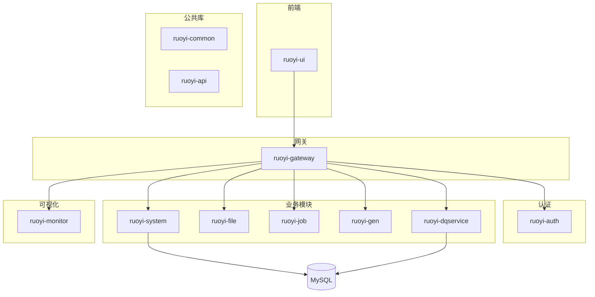
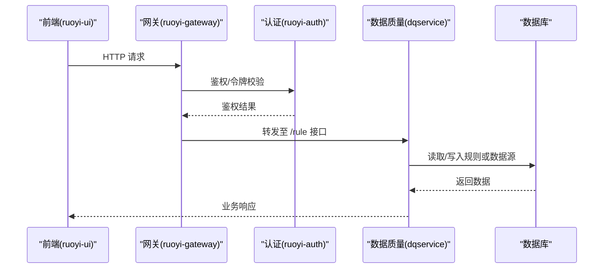
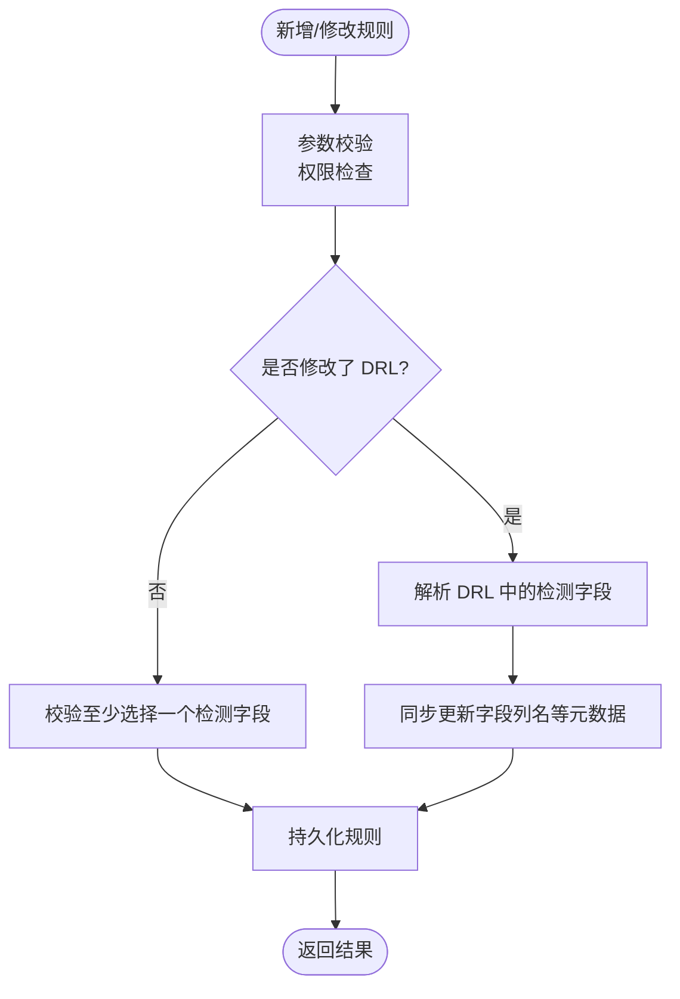
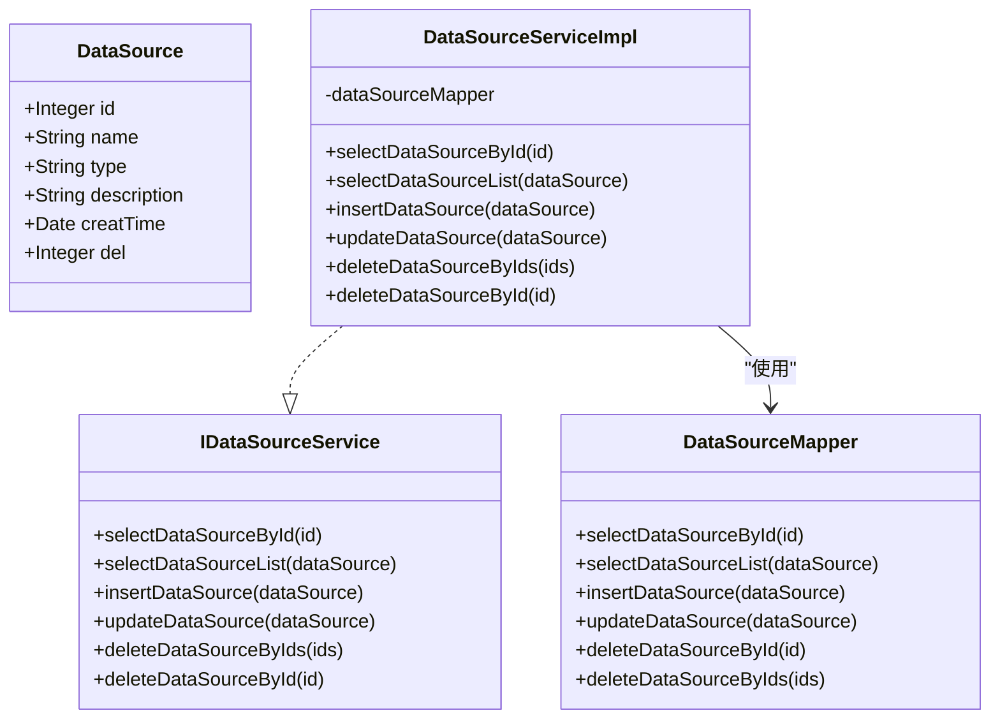
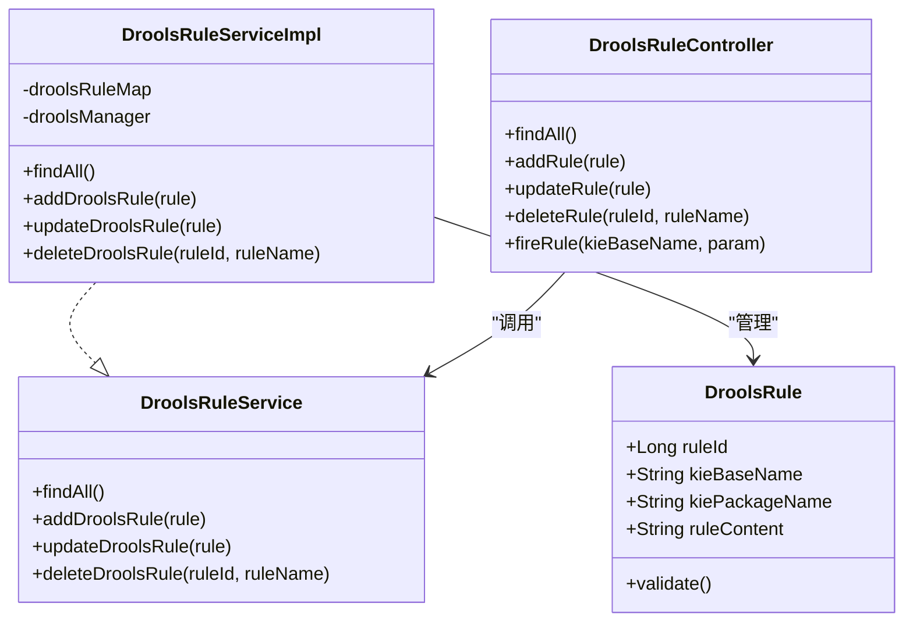
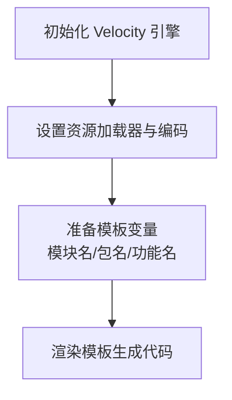
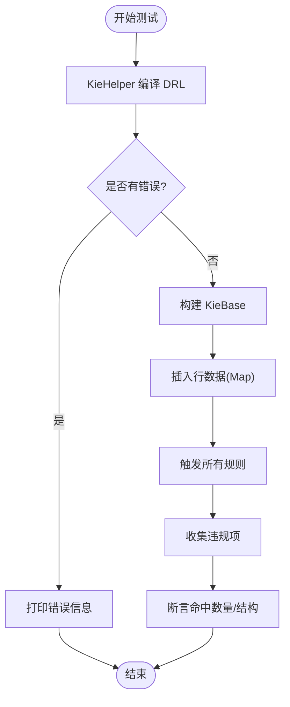
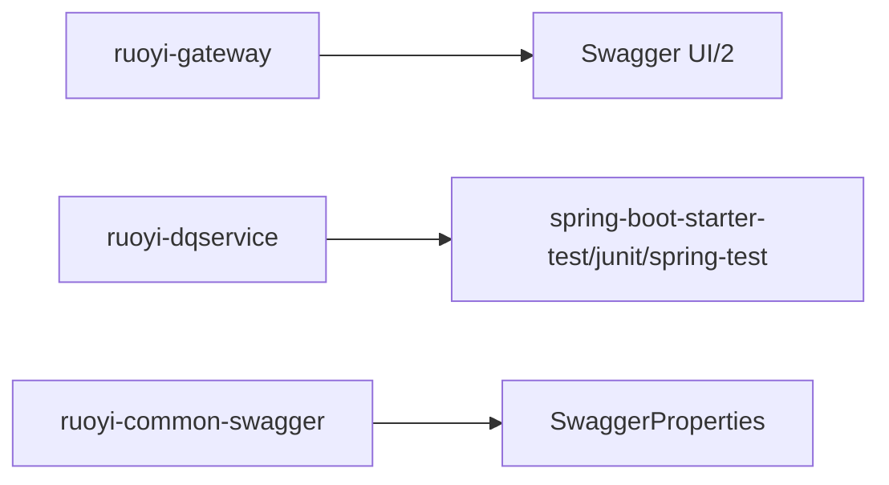

# 开发指南

<cite>
**本文引用的文件**   
- [README.md](file://README.md)
- [ruoyi-ui/README.md](file://ruoyi-ui/README.md)
- [pom.xml](file://pom.xml)
- [ruoyi-modules/ruoyi-dqservice/pom.xml](file://ruoyi-modules/ruoyi-dqservice/pom.xml)
- [sql/ry_dqservice_20261026.sql](file://sql/ry_dqservice_20261026.sql)
- [sql/ry_dqservice_menu_20261026.sql](file://sql/ry_dqservice_menu_20261026.sql)
- [ruoyi-modules/ruoyi-dqservice/src/main/java/com/ruoyi/dqservice/controller/RuleController.java](file://ruoyi-modules/ruoyi-dqservice/src/main/java/com/ruoyi/dqservice/controller/RuleController.java)
- [ruoyi-modules/ruoyi-dqservice/src/main/java/com/ruoyi/dqservice/domain/Rule.java](file://ruoyi-modules/ruoyi-dqservice/src/main/java/com/ruoyi/dqservice/domain/Rule.java)
- [ruoyi-modules/ruoyi-dqservice/src/main/resources/mapper/dqservice/RuleMapper.xml](file://ruoyi-modules/ruoyi-dqservice/src/main/resources/mapper/dqservice/RuleMapper.xml)
- [ruoyi-modules/ruoyi-dqservice/src/main/java/com/ruoyi/dqservice/service/impl/DataSourceServiceImpl.java](file://ruoyi-modules/ruoyi-dqservice/src/main/java/com/ruoyi/dqservice/service/impl/DataSourceServiceImpl.java)
- [ruoyi-modules/ruoyi-dqservice/src/main/java/com/ruoyi/dqservice/service/IDataSourceService.java](file://ruoyi-modules/ruoyi-dqservice/src/main/java/com/ruoyi/dqservice/service/IDataSourceService.java)
- [ruoyi-modules/ruoyi-dqservice/src/main/java/com/ruoyi/dqservice/domain/DataSource.java](file://ruoyi-modules/ruoyi-dqservice/src/main/java/com/ruoyi/dqservice/domain/DataSource.java)
- [ruoyi-modules/ruoyi-dqservice/src/main/java/com/ruoyi/dqservice/mapper/DataSourceMapper.java](file://ruoyi-modules/ruoyi-dqservice/src/main/java/com/ruoyi/dqservice/mapper/DataSourceMapper.java)
- [ruoyi-modules/ruoyi-dqservice/src/main/resources/mapper/DataSourceMapper.xml](file://ruoyi-modules/ruoyi-dqservice/src/main/resources/mapper/DataSourceMapper.xml)
- [ruoyi-modules/ruoyi-dqservice/src/main/java/com/ruoyi/dqservice/domain/DroolsRule.java](file://ruoyi-modules/ruoyi-dqservice/src/main/java/com/ruoyi/dqservice/domain/DroolsRule.java)
- [ruoyi-modules/ruoyi-dqservice/src/main/java/com/ruoyi/dqservice/service/impl/DroolsRuleServiceImpl.java](file://ruoyi-modules/ruoyi-dqservice/src/main/java/com/ruoyi/dqservice/service/impl/DroolsRuleServiceImpl.java)
- [ruoyi-modules/ruoyi-dqservice/src/main/java/com/ruoyi/dqservice/controller/DroolsRuleController.java](file://ruoyi-modules/ruoyi-dqservice/src/main/java/com/ruoyi/dqservice/controller/DroolsRuleController.java)
- [ruoyi-modules/ruoyi-dqservice/src/test/java/com/ruoyi/dqservice/DrlSyntaxTest.java](file://ruoyi-modules/ruoyi-dqservice/src/test/java/com/ruoyi/dqservice/DrlSyntaxTest.java)
- [ruoyi-modules/ruoyi-gen/src/main/java/com/ruoyi/gen/util/VelocityInitializer.java](file://ruoyi-modules/ruoyi-gen/src/main/java/com/ruoyi/gen/util/VelocityInitializer.java)
- [ruoyi-modules/ruoyi-gen/src/main/java/com/ruoyi/gen/util/VelocityUtils.java](file://ruoyi-modules/ruoyi-gen/src/main/java/com/ruoyi/gen/util/VelocityUtils.java)
- [ruoyi-gateway/pom.xml](file://ruoyi-gateway/pom.xml)
- [ruoyi-common/ruoyi-common-swagger/src/main/java/com/ruoyi/common/swagger/config/SwaggerProperties.java](file://ruoyi-common/ruoyi-common-swagger/src/main/java/com/ruoyi/common/swagger/config/SwaggerProperties.java)
- [ruoyi-auth/src/main/resources/logback.xml](file://ruoyi-auth/src/main/resources/logback.xml)
- [ruoyi-gateway/src/main/resources/logback.xml](file://ruoyi-gateway/src/main/resources/logback.xml)
- [ruoyi-modules/ruoyi-file/src/main/resources/logback.xml](file://ruoyi-modules/ruoyi-file/src/main/resources/logback.xml)
- [ruoyi-modules/ruoyi-system/src/main/resources/logback.xml](file://ruoyi-modules/ruoyi-system/src/main/resources/logback.xml)
- [ruoyi-modules/ruoyi-job/src/main/resources/logback.xml](file://ruoyi-modules/ruoyi-job/src/main/resources/logback.xml)
- [ruoyi-modules/ruoyi-dqservice/src/main/resources/logback.xml](file://ruoyi-modules/ruoyi-dqservice/src/main/resources/logback.xml)
</cite>

## 目录
1. [引言](#引言)
2. [项目结构](#项目结构)
3. [核心组件](#核心组件)
4. [架构总览](#架构总览)
5. [详细组件分析](#详细组件分析)
6. [依赖分析](#依赖分析)
7. [性能考虑](#性能考虑)
8. [故障排查指南](#故障排查指南)
9. [结论](#结论)
10. [附录](#附录)

## 引言
本开发指南面向后端与前端开发者，覆盖代码规范、开发流程、Git工作流、代码生成器使用、单元测试编写、调试技巧以及扩展开发（新数据源接入、自定义规则类型、前端组件开发）等主题。项目基于 RuoYi-Vue 微服务架构，包含认证、网关、系统模块、通用能力库、可视化监控以及数据质量服务模块（dqservice）。

## 项目结构
- 多模块 Maven 工程：ruoyi-api、ruoyi-auth、ruoyi-gateway、ruoyi-common、ruoyi-modules（system/file/job/gen/dqservice）、ruoyi-visual、ruoyi-ui。
- 数据库脚本集中在 sql 目录，含系统初始化与 dqservice 相关表结构与菜单权限。
- 前端位于 ruoyi-ui，遵循 Vue + Element UI 的常规组织方式。
- 日志统一采用 Logback，各子模块独立配置。

图表来源
- [ruoyi-gateway/pom.xml:79-90](file://ruoyi-gateway/pom.xml#L79-L90)
- [ruoyi-modules/ruoyi-dqservice/pom.xml:367-410](file://ruoyi-modules/ruoyi-dqservice/pom.xml#L367-L410)

章节来源
- [README.md:1-1](file://README.md#L1-L1)
- [ruoyi-ui/README.md:1-30](file://ruoyi-ui/README.md#L1-L30)
- [pom.xml](file://pom.xml)

## 核心组件
- 规则管理（dqservice）
  - Controller：提供规则增删改查与导出接口，内置权限校验与操作日志。
  - Domain：规则实体，包含名称、上下文、目标库表字段、类型等信息。
  - Mapper：MyBatis XML 实现动态查询与 CRUD。
- 数据源管理（dqservice）
  - Service/Mapper/Domain：标准三层结构，支持数据源的增删改查与分页查询。
- Drools 规则引擎集成
  - DroolsRule：封装 KieBase/KiePackage 信息，用于动态加载与执行规则。
  - DroolsRuleService：内存缓存 + DroolsManager 联动，完成规则的增删改与触发。
  - DroolsRuleController：对外暴露规则管理与触发的 REST 接口。
- 代码生成器（gen）
  - VelocityInitializer/VelocityUtils：初始化 Velocity 引擎并准备模板变量，用于根据数据库元数据生成前后端代码。

章节来源
- [ruoyi-modules/ruoyi-dqservice/src/main/java/com/ruoyi/dqservice/controller/RuleController.java:1-153](file://ruoyi-modules/ruoyi-dqservice/src/main/java/com/ruoyi/dqservice/controller/RuleController.java#L1-L153)
- [ruoyi-modules/ruoyi-dqservice/src/main/java/com/ruoyi/dqservice/domain/Rule.java:1-63](file://ruoyi-modules/ruoyi-dqservice/src/main/java/com/ruoyi/dqservice/domain/Rule.java#L1-L63)
- [ruoyi-modules/ruoyi-dqservice/src/main/resources/mapper/dqservice/RuleMapper.xml:31-70](file://ruoyi-modules/ruoyi-dqservice/src/main/resources/mapper/dqservice/RuleMapper.xml#L31-L70)
- [ruoyi-modules/ruoyi-dqservice/src/main/java/com/ruoyi/dqservice/service/impl/DataSourceServiceImpl.java:1-95](file://ruoyi-modules/ruoyi-dqservice/src/main/java/com/ruoyi/dqservice/service/impl/DataSourceServiceImpl.java#L1-L95)
- [ruoyi-modules/ruoyi-dqservice/src/main/java/com/ruoyi/dqservice/service/IDataSourceService.java:1-61](file://ruoyi-modules/ruoyi-dqservice/src/main/java/com/ruoyi/dqservice/service/IDataSourceService.java#L1-L61)
- [ruoyi-modules/ruoyi-dqservice/src/main/java/com/ruoyi/dqservice/domain/DataSource.java:1-73](file://ruoyi-modules/ruoyi-dqservice/src/main/java/com/ruoyi/dqservice/domain/DataSource.java#L1-L73)
- [ruoyi-modules/ruoyi-dqservice/src/main/java/com/ruoyi/dqservice/mapper/DataSourceMapper.java:1-61](file://ruoyi-modules/ruoyi-dqservice/src/main/java/com/ruoyi/dqservice/mapper/DataSourceMapper.java#L1-L61)
- [ruoyi-modules/ruoyi-dqservice/src/main/resources/mapper/DataSourceMapper.xml:1-81](file://ruoyi-modules/ruoyi-dqservice/src/main/resources/mapper/DataSourceMapper.xml#L1-L81)
- [ruoyi-modules/ruoyi-dqservice/src/main/java/com/ruoyi/dqservice/domain/DroolsRule.java:1-32](file://ruoyi-modules/ruoyi-dqservice/src/main/java/com/ruoyi/dqservice/domain/DroolsRule.java#L1-L32)
- [ruoyi-modules/ruoyi-dqservice/src/main/java/com/ruoyi/dqservice/service/impl/DroolsRuleServiceImpl.java:1-48](file://ruoyi-modules/ruoyi-dqservice/src/main/java/com/ruoyi/dqservice/service/impl/DroolsRuleServiceImpl.java#L1-L48)
- [ruoyi-modules/ruoyi-dqservice/src/main/java/com/ruoyi/dqservice/controller/DroolsRuleController.java:1-49](file://ruoyi-modules/ruoyi-dqservice/src/main/java/com/ruoyi/dqservice/controller/DroolsRuleController.java#L1-L49)
- [ruoyi-modules/ruoyi-gen/src/main/java/com/ruoyi/gen/util/VelocityInitializer.java:1-34](file://ruoyi-modules/ruoyi-gen/src/main/java/com/ruoyi/gen/util/VelocityInitializer.java#L1-L34)
- [ruoyi-modules/ruoyi-gen/src/main/java/com/ruoyi/gen/util/VelocityUtils.java:1-42](file://ruoyi-modules/ruoyi-gen/src/main/java/com/ruoyi/gen/util/VelocityUtils.java#L1-L42)

## 架构总览
下图展示从前端到后端的请求链路，以及 dqservice 中规则管理的典型调用链。

图表来源
- [ruoyi-gateway/pom.xml:79-90](file://ruoyi-gateway/pom.xml#L79-L90)
- [ruoyi-modules/ruoyi-dqservice/src/main/java/com/ruoyi/dqservice/controller/RuleController.java:1-153](file://ruoyi-modules/ruoyi-dqservice/src/main/java/com/ruoyi/dqservice/controller/RuleController.java#L1-L153)
- [ruoyi-modules/ruoyi-dqservice/src/main/resources/mapper/dqservice/RuleMapper.xml:31-70](file://ruoyi-modules/ruoyi-dqservice/src/main/resources/mapper/dqservice/RuleMapper.xml#L31-L70)

## 详细组件分析

### 规则管理（Rule）
- 职责
  - 提供规则列表、新增、修改、删除、导出的 REST 接口。
  - 在新增时进行空值检测条件解析；在修改时区分“仅调整字段”和“手改 DRL”两种情况，保证 ruleContext 与字段描述一致。
- 关键类与方法
  - RuleController：add/edit/remove 等方法，结合权限注解与日志注解。
  - Rule：规则领域模型，包含规则名、上下文、库表字段、类型等。
  - RuleMapper.xml：动态 SQL 构建查询条件，支持按名称、用户、库表字段、类型等多维度筛选。
- 数据流
  - 前端提交 Rule -> Controller 参数校验与上下文解析 -> Service 持久化 -> MyBatis 写入数据库。

图表来源
- [ruoyi-modules/ruoyi-dqservice/src/main/java/com/ruoyi/dqservice/controller/RuleController.java:82-141](file://ruoyi-modules/ruoyi-dqservice/src/main/java/com/ruoyi/dqservice/controller/RuleController.java#L82-L141)
- [ruoyi-modules/ruoyi-dqservice/src/main/resources/mapper/dqservice/RuleMapper.xml:31-70](file://ruoyi-modules/ruoyi-dqservice/src/main/resources/mapper/dqservice/RuleMapper.xml#L31-L70)

章节来源
- [ruoyi-modules/ruoyi-dqservice/src/main/java/com/ruoyi/dqservice/controller/RuleController.java:1-153](file://ruoyi-modules/ruoyi-dqservice/src/main/java/com/ruoyi/dqservice/controller/RuleController.java#L1-L153)
- [ruoyi-modules/ruoyi-dqservice/src/main/java/com/ruoyi/dqservice/domain/Rule.java:1-63](file://ruoyi-modules/ruoyi-dqservice/src/main/java/com/ruoyi/dqservice/domain/Rule.java#L1-L63)
- [ruoyi-modules/ruoyi-dqservice/src/main/resources/mapper/dqservice/RuleMapper.xml:31-70](file://ruoyi-modules/ruoyi-dqservice/src/main/resources/mapper/dqservice/RuleMapper.xml#L31-L70)

### 数据源管理（DataSource）
- 职责
  - 提供数据源的增删改查与批量删除能力。
  - 通过 Service 层封装业务逻辑，Mapper 层负责 SQL 映射。
- 关键类与方法
  - DataSourceServiceImpl：CRUD 方法实现，更新时间戳等。
  - IDataSourceService：定义数据源服务接口。
  - DataSource：数据源领域模型，包含名称、类型、描述、创建时间、删除位等。
  - DataSourceMapper/DataSourceMapper.xml：SQL 映射与动态查询。

图表来源
- [ruoyi-modules/ruoyi-dqservice/src/main/java/com/ruoyi/dqservice/domain/DataSource.java:1-73](file://ruoyi-modules/ruoyi-dqservice/src/main/java/com/ruoyi/dqservice/domain/DataSource.java#L1-L73)
- [ruoyi-modules/ruoyi-dqservice/src/main/java/com/ruoyi/dqservice/service/IDataSourceService.java:1-61](file://ruoyi-modules/ruoyi-dqservice/src/main/java/com/ruoyi/dqservice/service/IDataSourceService.java#L1-L61)
- [ruoyi-modules/ruoyi-dqservice/src/main/java/com/ruoyi/dqservice/service/impl/DataSourceServiceImpl.java:1-95](file://ruoyi-modules/ruoyi-dqservice/src/main/java/com/ruoyi/dqservice/service/impl/DataSourceServiceImpl.java#L1-L95)
- [ruoyi-modules/ruoyi-dqservice/src/main/java/com/ruoyi/dqservice/mapper/DataSourceMapper.java:1-61](file://ruoyi-modules/ruoyi-dqservice/src/main/java/com/ruoyi/dqservice/mapper/DataSourceMapper.java#L1-L61)
- [ruoyi-modules/ruoyi-dqservice/src/main/resources/mapper/DataSourceMapper.xml:1-81](file://ruoyi-modules/ruoyi-dqservice/src/main/resources/mapper/DataSourceMapper.xml#L1-L81)

章节来源
- [ruoyi-modules/ruoyi-dqservice/src/main/java/com/ruoyi/dqservice/service/impl/DataSourceServiceImpl.java:1-95](file://ruoyi-modules/ruoyi-dqservice/src/main/java/com/ruoyi/dqservice/service/impl/DataSourceServiceImpl.java#L1-L95)
- [ruoyi-modules/ruoyi-dqservice/src/main/java/com/ruoyi/dqservice/service/IDataSourceService.java:1-61](file://ruoyi-modules/ruoyi-dqservice/src/main/java/com/ruoyi/dqservice/service/IDataSourceService.java#L1-L61)
- [ruoyi-modules/ruoyi-dqservice/src/main/java/com/ruoyi/dqservice/domain/DataSource.java:1-73](file://ruoyi-modules/ruoyi-dqservice/src/main/java/com/ruoyi/dqservice/domain/DataSource.java#L1-L73)
- [ruoyi-modules/ruoyi-dqservice/src/main/java/com/ruoyi/dqservice/mapper/DataSourceMapper.java:1-61](file://ruoyi-modules/ruoyi-dqservice/src/main/java/com/ruoyi/dqservice/mapper/DataSourceMapper.java#L1-L61)
- [ruoyi-modules/ruoyi-dqservice/src/main/resources/mapper/DataSourceMapper.xml:1-81](file://ruoyi-modules/ruoyi-dqservice/src/main/resources/mapper/DataSourceMapper.xml#L1-L81)

### Drools 规则引擎集成
- 职责
  - 将规则内容（DRL）与 KieBase/KiePackage 关联，支持动态添加、更新、删除与触发。
  - 提供简单 REST 接口用于规则管理与触发。
- 关键类与方法
  - DroolsRule：封装规则 ID、KieBase 名称、包名与规则内容，并提供基础校验。
  - DroolsRuleServiceImpl：内存 Map 缓存 + DroolsManager 联动，实现规则生命周期管理。
  - DroolsRuleController：对外暴露 findAll/add/update/delete/fireRule 接口。

图表来源
- [ruoyi-modules/ruoyi-dqservice/src/main/java/com/ruoyi/dqservice/domain/DroolsRule.java:1-32](file://ruoyi-modules/ruoyi-dqservice/src/main/java/com/ruoyi/dqservice/domain/DroolsRule.java#L1-L32)
- [ruoyi-modules/ruoyi-dqservice/src/main/java/com/ruoyi/dqservice/service/impl/DroolsRuleServiceImpl.java:1-48](file://ruoyi-modules/ruoyi-dqservice/src/main/java/com/ruoyi/dqservice/service/impl/DroolsRuleServiceImpl.java#L1-L48)
- [ruoyi-modules/ruoyi-dqservice/src/main/java/com/ruoyi/dqservice/controller/DroolsRuleController.java:1-49](file://ruoyi-modules/ruoyi-dqservice/src/main/java/com/ruoyi/dqservice/controller/DroolsRuleController.java#L1-L49)

章节来源
- [ruoyi-modules/ruoyi-dqservice/src/main/java/com/ruoyi/dqservice/domain/DroolsRule.java:1-32](file://ruoyi-modules/ruoyi-dqservice/src/main/java/com/ruoyi/dqservice/domain/DroolsRule.java#L1-L32)
- [ruoyi-modules/ruoyi-dqservice/src/main/java/com/ruoyi/dqservice/service/impl/DroolsRuleServiceImpl.java:1-48](file://ruoyi-modules/ruoyi-dqservice/src/main/java/com/ruoyi/dqservice/service/impl/DroolsRuleServiceImpl.java#L1-L48)
- [ruoyi-modules/ruoyi-dqservice/src/main/java/com/ruoyi/dqservice/controller/DroolsRuleController.java:1-49](file://ruoyi-modules/ruoyi-dqservice/src/main/java/com/ruoyi/dqservice/controller/DroolsRuleController.java#L1-L49)

### 代码生成器（Gen）
- 职责
  - 初始化 Velocity 引擎，设置资源加载器与字符集。
  - 准备模板变量（模块名、包名、功能名等），驱动模板生成前后端代码。
- 关键类与方法
  - VelocityInitializer：initVelocity 初始化引擎。
  - VelocityUtils：prepareContext 准备模板上下文。

图表来源
- [ruoyi-modules/ruoyi-gen/src/main/java/com/ruoyi/gen/util/VelocityInitializer.java:1-34](file://ruoyi-modules/ruoyi-gen/src/main/java/com/ruoyi/gen/util/VelocityInitializer.java#L1-L34)
- [ruoyi-modules/ruoyi-gen/src/main/java/com/ruoyi/gen/util/VelocityUtils.java:1-42](file://ruoyi-modules/ruoyi-gen/src/main/java/com/ruoyi/gen/util/VelocityUtils.java#L1-L42)

章节来源
- [ruoyi-modules/ruoyi-gen/src/main/java/com/ruoyi/gen/util/VelocityInitializer.java:1-34](file://ruoyi-modules/ruoyi-gen/src/main/java/com/ruoyi/gen/util/VelocityInitializer.java#L1-L34)
- [ruoyi-modules/ruoyi-gen/src/main/java/com/ruoyi/gen/util/VelocityUtils.java:1-42](file://ruoyi-modules/ruoyi-gen/src/main/java/com/ruoyi/gen/util/VelocityUtils.java#L1-L42)

### 单元测试与语法验证
- 目标
  - 在不启动 Spring 上下文的情况下，验证 DRL 语法与执行路径。
  - 针对 Map fact 的动态表结构场景，测试多种语法写法（MVEL 索引访问、属性访问糖、eval 写法）。
- 关键用例
  - DrlSyntaxTest：编译验证、规则命中统计、违规详情构造等。

图表来源
- [ruoyi-modules/ruoyi-dqservice/src/test/java/com/ruoyi/dqservice/DrlSyntaxTest.java:1-179](file://ruoyi-modules/ruoyi-dqservice/src/test/java/com/ruoyi/dqservice/DrlSyntaxTest.java#L1-L179)

章节来源
- [ruoyi-modules/ruoyi-dqservice/src/test/java/com/ruoyi/dqservice/DrlSyntaxTest.java:1-179](file://ruoyi-modules/ruoyi-dqservice/src/test/java/com/ruoyi/dqservice/DrlSyntaxTest.java#L1-L179)

## 依赖分析
- 网关依赖 Swagger UI/2，便于接口文档浏览。
- dqservice 模块引入 Spring Boot Test、Junit、Spring Test 等测试依赖。
- Swagger 配置通过 SwaggerProperties 集中管理开关、包扫描、路径白名单等。

图表来源
- [ruoyi-gateway/pom.xml:79-90](file://ruoyi-gateway/pom.xml#L79-L90)
- [ruoyi-modules/ruoyi-dqservice/pom.xml:367-410](file://ruoyi-modules/ruoyi-dqservice/pom.xml#L367-L410)
- [ruoyi-common/ruoyi-common-swagger/src/main/java/com/ruoyi/common/swagger/config/SwaggerProperties.java:77-160](file://ruoyi-common/ruoyi-common-swagger/src/main/java/com/ruoyi/common/swagger/config/SwaggerProperties.java#L77-L160)

章节来源
- [ruoyi-gateway/pom.xml:79-110](file://ruoyi-gateway/pom.xml#L79-L110)
- [ruoyi-modules/ruoyi-dqservice/pom.xml:367-410](file://ruoyi-modules/ruoyi-dqservice/pom.xml#L367-L410)
- [ruoyi-common/ruoyi-common-swagger/src/main/java/com/ruoyi/common/swagger/config/SwaggerProperties.java:77-160](file://ruoyi-common/ruoyi-common-swagger/src/main/java/com/ruoyi/common/swagger/config/SwaggerProperties.java#L77-L160)

## 性能考虑
- 规则执行
  - 避免频繁重建 KieSession；复用 KieContainer/KieBase，按需创建 Session。
  - 对大数据集采用分批处理与并行评估，减少单次会话压力。
- 数据库访问
  - 合理使用索引与分页，避免全表扫描；复杂查询拆分与缓存热点数据。
- 日志与监控
  - 控制日志级别与输出量，避免 IO 瓶颈；生产环境关闭 DEBUG 日志。
- 前端交互
  - 列表分页与懒加载，减少首屏体积；静态资源 CDN 加速。

## 故障排查指南
- 日志定位
  - 各模块均配置 Logback，统一输出 info/error 日志文件，便于问题回溯。
  - 建议开启对应模块的 debug 日志，定位异常堆栈与慢查询。
- 常见问题
  - 规则编辑后 DRL 与字段不一致：检查 RuleController 的编辑分支逻辑，确保 DRL 变更时同步字段列名。
  - Drools 规则不生效：确认 DroolsRule.validate 通过后，DroolsManager 是否正确 addOrUpdateRule。
  - 数据源查询为空：检查 DataSourceMapper.xml 的动态条件与入参匹配。

章节来源
- [ruoyi-auth/src/main/resources/logback.xml:38-74](file://ruoyi-auth/src/main/resources/logback.xml#L38-L74)
- [ruoyi-gateway/src/main/resources/logback.xml:38-74](file://ruoyi-gateway/src/main/resources/logback.xml#L38-L74)
- [ruoyi-modules/ruoyi-file/src/main/resources/logback.xml:38-74](file://ruoyi-modules/ruoyi-file/src/main/resources/logback.xml#L38-L74)
- [ruoyi-modules/ruoyi-system/src/main/resources/logback.xml:38-74](file://ruoyi-modules/ruoyi-system/src/main/resources/logback.xml#L38-L74)
- [ruoyi-modules/ruoyi-job/src/main/resources/logback.xml:38-74](file://ruoyi-modules/ruoyi-job/src/main/resources/logback.xml#L38-L74)
- [ruoyi-modules/ruoyi-dqservice/src/main/resources/logback.xml:38-74](file://ruoyi-modules/ruoyi-dqservice/src/main/resources/logback.xml#L38-L74)

## 结论
本项目以 RuoYi 微服务为基础，围绕数据质量规则管理构建了完整的前后端与规则引擎集成方案。通过清晰的三层架构、完善的日志与测试支撑，以及可扩展的数据源与规则类型机制，为后续功能扩展提供了坚实基础。建议在新增功能时严格遵循现有分层与命名约定，完善单元测试与日志埋点，确保可维护性与稳定性。

## 附录

### 开发环境与运行
- 前端开发
  - 安装依赖与启动命令见前端 README。
- 后端运行
  - 使用 Maven 构建各子模块，或通过提供的脚本启动服务。

章节来源
- [ruoyi-ui/README.md:1-30](file://ruoyi-ui/README.md#L1-L30)

### Git 工作流与提交规范
- 分支策略
  - main：稳定版本；develop：开发主线；feature/*：功能分支；hotfix/*：紧急修复。
- 提交规范
  - 使用语义化提交信息（feat/fix/docs/style/refactor/test/chore），保持历史清晰。
- 合并流程
  - 功能分支合并至 develop，经 Code Review 与 CI 通过后合并至 main。

### 新功能开发步骤
- 需求分析与设计
  - 明确输入输出、边界条件与异常处理。
- 后端实现
  - 新增 Controller/Service/Mapper/Domain，遵循现有分层与命名。
  - 编写单元测试，覆盖正常与异常路径。
- 前端实现
  - 新增页面与组件，对接后端 API，完善表单校验与提示。
- 联调与验收
  - 本地联调通过后，提交 PR 并等待审核与自动化测试。

### 单元测试编写要点
- 使用 JUnit 5 与 Spring Boot Test 框架。
- 针对规则引擎，优先使用 KieHelper 进行无上下文编译与执行测试。
- 对数据库交互使用内存库或 Mock，确保测试隔离性。

章节来源
- [ruoyi-modules/ruoyi-dqservice/src/test/java/com/ruoyi/dqservice/DrlSyntaxTest.java:1-179](file://ruoyi-modules/ruoyi-dqservice/src/test/java/com/ruoyi/dqservice/DrlSyntaxTest.java#L1-L179)

### 调试技巧
- 后端
  - 启用 debug 日志，关注异常堆栈与慢查询。
  - 使用 Swagger 进行接口快速验证。
- 前端
  - 浏览器控制台查看网络请求与状态；Element UI 表单校验反馈。

### 扩展开发指南
- 新数据源接入
  - 在 data_source 表中增加类型标识，扩展 DataSourceServiceImpl 与 Mapper 的查询逻辑。
  - 如需连接不同数据库，可在 Service 层注入相应连接配置与工具类。
- 自定义规则类型
  - 在 Rule 域对象中扩展类型字段，并在 RuleController 的编辑逻辑中适配新的规则生成策略。
  - 若涉及 DRL 语法差异，参考 DrlSyntaxTest 的语法验证方式。
- 前端组件开发
  - 在 ruoyi-ui 下新增组件与页面，遵循现有目录结构与命名规范。
  - 通过 API 模块对接后端接口，统一错误处理与加载状态。

章节来源
- [sql/ry_dqservice_20261026.sql:26-39](file://sql/ry_dqservice_20261026.sql#L26-L39)
- [sql/ry_dqservice_menu_20261026.sql:21-36](file://sql/ry_dqservice_menu_20261026.sql#L21-L36)
- [ruoyi-modules/ruoyi-dqservice/src/main/java/com/ruoyi/dqservice/controller/RuleController.java:82-141](file://ruoyi-modules/ruoyi-dqservice/src/main/java/com/ruoyi/dqservice/controller/RuleController.java#L82-L141)
- [ruoyi-modules/ruoyi-dqservice/src/test/java/com/ruoyi/dqservice/DrlSyntaxTest.java:1-179](file://ruoyi-modules/ruoyi-dqservice/src/test/java/com/ruoyi/dqservice/DrlSyntaxTest.java#L1-L179)