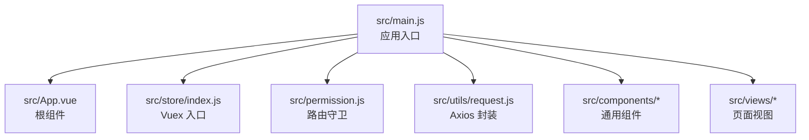
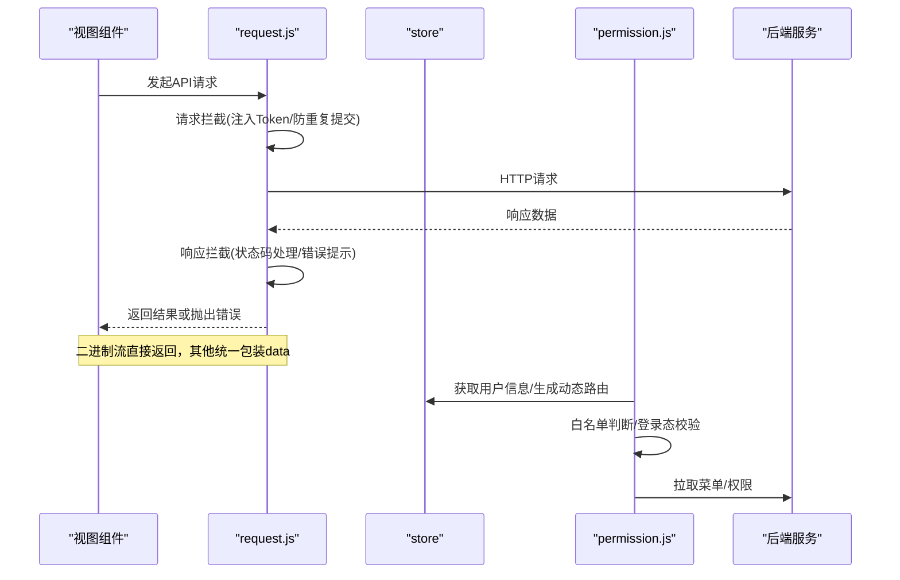
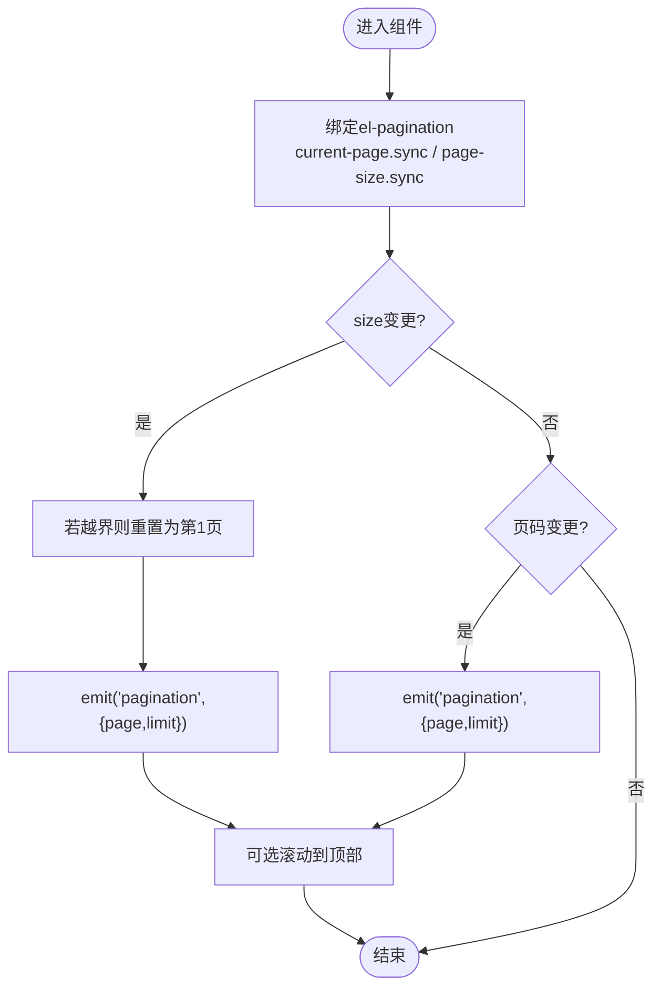
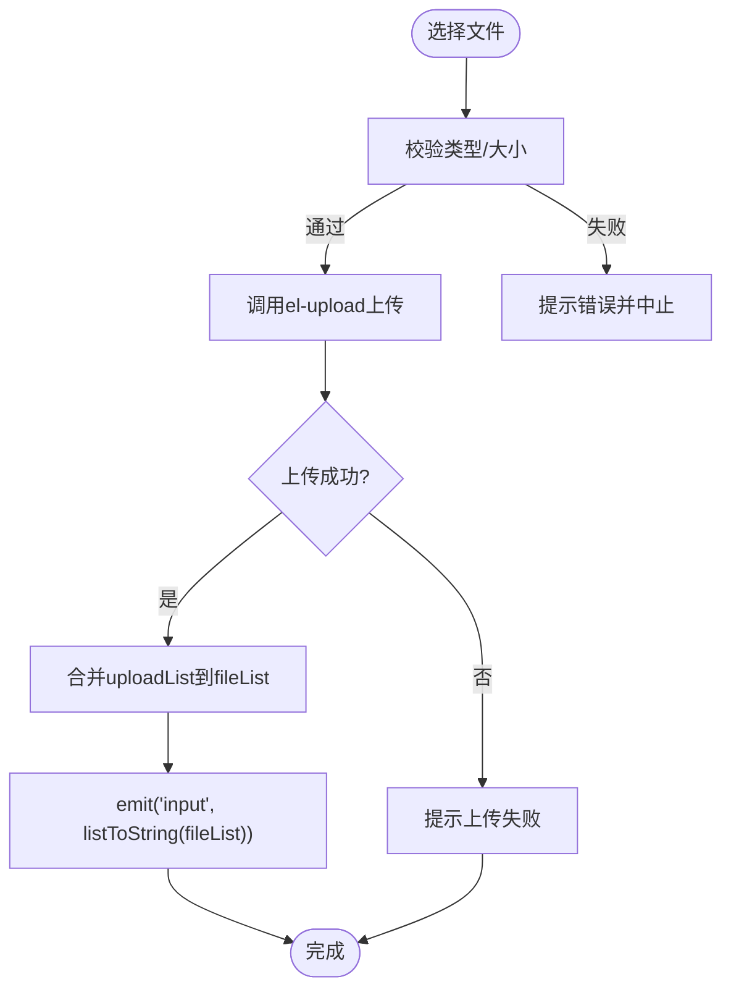
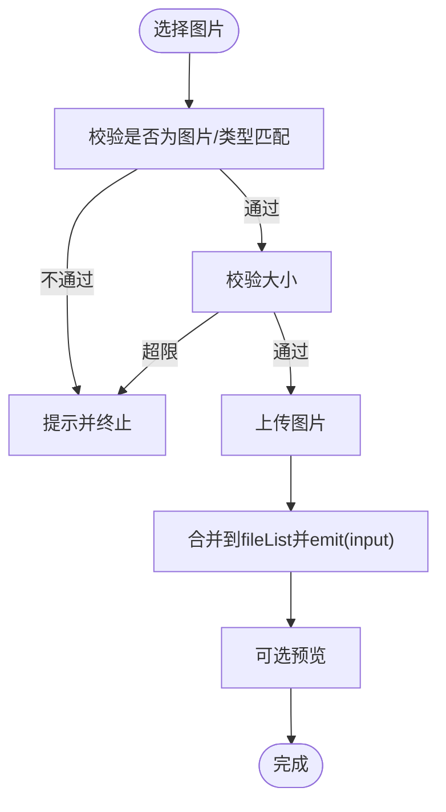
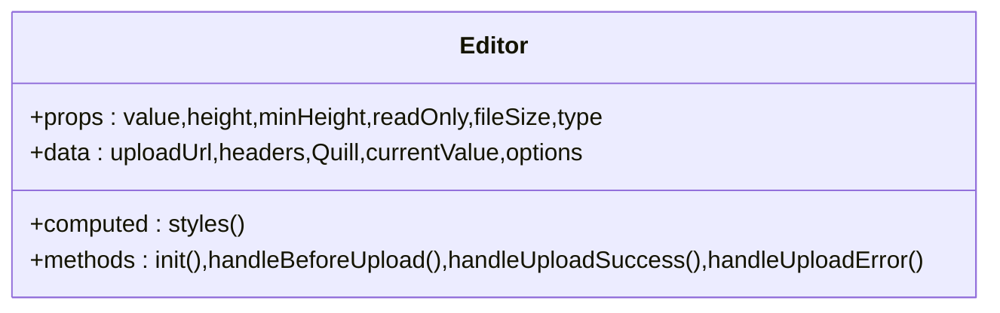
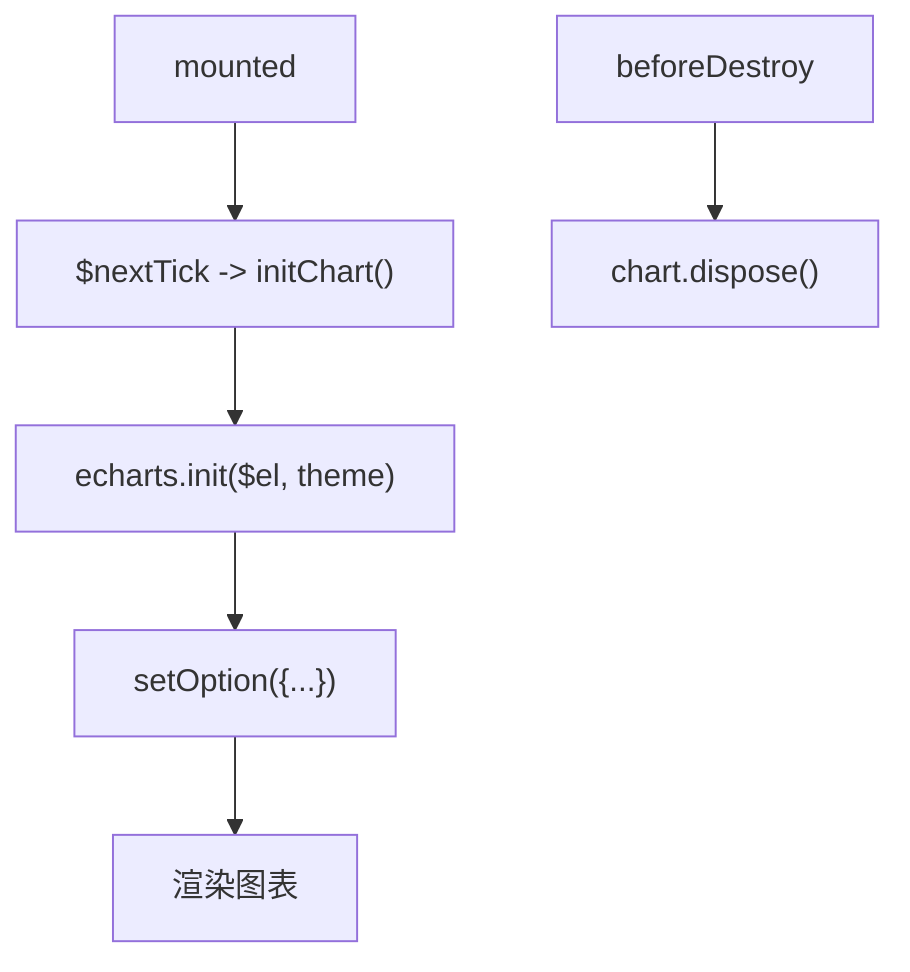
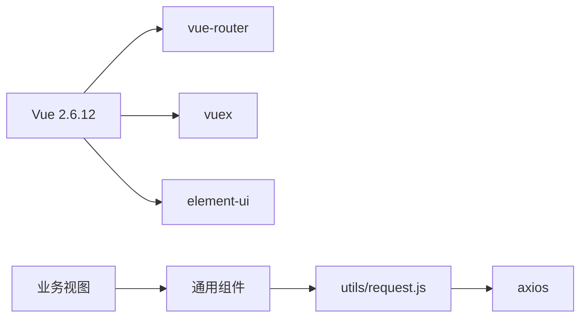

# 前端组件扩展

<cite>
**本文引用的文件**   
- [main.js](file://ruoyi-ui/src/main.js)
- [App.vue](file://ruoyi-ui/src/App.vue)
- [request.js](file://ruoyi-ui/src/utils/request.js)
- [permission.js](file://ruoyi-ui/src/permission.js)
- [index.js](file://ruoyi-ui/src/store/index.js)
- [Pagination/index.vue](file://ruoyi-ui/src/components/Pagination/index.vue)
- [FileUpload/index.vue](file://ruoyi-ui/src/components/FileUpload/index.vue)
- [ImageUpload/index.vue](file://ruoyi-ui/src/components/ImageUpload/index.vue)
- [Editor/index.vue](file://ruoyi-ui/src/components/Editor/index.vue)
- [BarChart.vue](file://ruoyi-ui/src/views/dashboard/BarChart.vue)
- [package.json](file://ruoyi-ui/package.json)
</cite>

## 目录
1. [简介](#简介)
2. [项目结构](#项目结构)
3. [核心组件](#核心组件)
4. [架构总览](#架构总览)
5. [详细组件分析](#详细组件分析)
6. [依赖关系分析](#依赖关系分析)
7. [性能与优化建议](#性能与优化建议)
8. [故障排查指南](#故障排查指南)
9. [结论](#结论)

## 简介
本指南面向在该项目中扩展和开发 Vue.js 前端组件的工程师，覆盖以下主题：
- 组件结构设计、Props 定义、事件处理、样式组织规范
- API 调用封装（请求拦截、响应处理、错误统一）
- 组件与后端服务集成（路由、权限、状态管理）
- 常用 UI 组件示例（表单、表格、图表等）
- 组件测试方法与性能优化建议

本项目基于 Vue 2 + Element UI + Vuex + Vue Router，采用模块化目录组织，提供统一的网络请求、权限控制与全局工具方法。

## 项目结构
前端代码位于 ruoyi-ui 目录，关键目录与职责如下：
- src/api：按业务域组织的接口函数
- src/assets：静态资源与全局样式
- src/components：可复用通用组件
- src/directive：自定义指令
- src/layout：布局与子模块
- src/plugins：插件与全局能力
- src/router：路由配置
- src/store：Vuex 状态管理
- src/utils：工具函数与请求封装
- src/views：页面级视图

**图示来源**
- [main.js:1-87](file://ruoyi-ui/src/main.js#L1-L87)
- [App.vue:1-20](file://ruoyi-ui/src/App.vue#L1-L20)
- [index.js:1-24](file://ruoyi-ui/src/store/index.js#L1-L24)
- [permission.js:1-57](file://ruoyi-ui/src/permission.js#L1-L57)
- [request.js:1-159](file://ruoyi-ui/src/utils/request.js#L1-L159)

**章节来源**
- [main.js:1-87](file://ruoyi-ui/src/main.js#L1-L87)
- [App.vue:1-20](file://ruoyi-ui/src/App.vue#L1-L20)
- [index.js:1-24](file://ruoyi-ui/src/store/index.js#L1-L24)
- [permission.js:1-57](file://ruoyi-ui/src/permission.js#L1-L57)
- [request.js:1-159](file://ruoyi-ui/src/utils/request.js#L1-L159)

## 核心组件
项目中已内置若干通用组件，可作为扩展参考：
- 分页组件 Pagination：封装 el-pagination，支持双向绑定页码与每页条数，自动滚动到顶部
- 文件上传 FileUpload：支持多文件、类型与大小校验、删除、列表展示
- 图片上传 ImageUpload：卡片式多图上传、预览、限制数量与格式
- 富文本 Editor：基于 Quill，支持图片上传、只读模式、高度/最小高度配置

这些组件体现了良好的 Props 设计、事件发射与样式隔离实践，适合作为新增组件的模板。

**章节来源**
- [Pagination/index.vue:1-115](file://ruoyi-ui/src/components/Pagination/index.vue#L1-L115)
- [FileUpload/index.vue:1-208](file://ruoyi-ui/src/components/FileUpload/index.vue#L1-L208)
- [ImageUpload/index.vue:1-208](file://ruoyi-ui/src/components/ImageUpload/index.vue#L1-L208)
- [Editor/index.vue:1-273](file://ruoyi-ui/src/components/Editor/index.vue#L1-L273)

## 架构总览
前端整体架构遵循“视图层 + 组件层 + 状态层 + 网络层”的分层模型：
- 视图层：views 下的页面组件负责业务编排
- 组件层：components 提供可复用的 UI 能力
- 状态层：store 通过 modules 划分 app/user/tagsView/permission/settings
- 网络层：utils/request.js 统一封装 Axios，实现请求/响应拦截、错误提示、下载等

**图示来源**
- [request.js:23-130](file://ruoyi-ui/src/utils/request.js#L23-L130)
- [permission.js:11-52](file://ruoyi-ui/src/permission.js#L11-L52)
- [index.js:12-21](file://ruoyi-ui/src/store/index.js#L12-L21)

## 详细组件分析

### 分页组件 Pagination
- 设计要点
  - 使用 v-model 的双向绑定模式，通过 computed 的 getter/setter 将 page/limit 与 el-pagination 的 current-page/page-size 同步
  - 对外暴露 pagination 事件，携带 {page, limit}，由父组件触发数据刷新
  - 支持移动端自适应 pagerCount，并提供 autoScroll 自动滚动到顶部
- 数据结构与复杂度
  - props 均为基础类型，计算属性 O(1)，事件派发 O(1)
- 错误处理
  - 无复杂异常路径；若 total 变化导致当前页越界，会在 size-change 时重置为第1页
- 样式组织
  - 使用 scoped 样式，容器类名隐藏逻辑通过 class 绑定

**图示来源**
- [Pagination/index.vue:68-101](file://ruoyi-ui/src/components/Pagination/index.vue#L68-L101)

**章节来源**
- [Pagination/index.vue:1-115](file://ruoyi-ui/src/components/Pagination/index.vue#L1-L115)

### 文件上传组件 FileUpload
- 设计要点
  - 支持 value 为字符串、对象或数组，内部统一转换为 fileList 对象数组
  - 上传前进行类型与大小校验，失败时通过 $modal 提示
  - 成功后合并 uploadList 并回写 value，支持删除操作
- 数据结构与复杂度
  - fileList 维护本地文件列表；uploadList 暂存并发上传结果；listToString 线性遍历拼接
- 错误处理
  - handleExceed/handleUploadError 统一提示；handleBeforeUpload 阻止非法文件
- 样式组织
  - 使用 scoped SCSS，列表项与操作按钮布局清晰

**图示来源**
- [FileUpload/index.vue:112-184](file://ruoyi-ui/src/components/FileUpload/index.vue#L112-L184)

**章节来源**
- [FileUpload/index.vue:1-208](file://ruoyi-ui/src/components/FileUpload/index.vue#L1-L208)

### 图片上传组件 ImageUpload
- 设计要点
  - 卡片式多图上传，支持预览对话框
  - 支持限制数量、类型与大小；失败时提示并关闭 loading
  - 与 FileUpload 类似，但更侧重图片场景的交互体验
- 数据结构与复杂度
  - fileList 存储图片对象；dialogImageUrl/dialogVisible 控制预览
- 错误处理
  - 统一通过 $modal.msgError 提示，并在失败时关闭 loading
- 样式组织
  - 使用 ::v-deep 调整 Element 内部样式，隐藏多余动画

**图示来源**
- [ImageUpload/index.vue:114-187](file://ruoyi-ui/src/components/ImageUpload/index.vue#L114-L187)

**章节来源**
- [ImageUpload/index.vue:1-208](file://ruoyi-ui/src/components/ImageUpload/index.vue#L1-L208)

### 富文本编辑器 Editor
- 设计要点
  - 基于 Quill，支持 base64/url 两种图片插入模式
  - 支持只读、高度/最小高度、placeholder 等配置
  - 监听 text-change/selection-change/editor-change 等事件，向上透传
- 数据结构与复杂度
  - options 配置工具栏与行为；styles 根据 props 动态计算
- 错误处理
  - 图片上传失败时提示；文件大小超限时阻止上传
- 样式组织
  - 针对 Quill 的主题样式进行局部覆盖，保证中文文案一致性

**图示来源**
- [Editor/index.vue:27-158](file://ruoyi-ui/src/components/Editor/index.vue#L27-L158)

**章节来源**
- [Editor/index.vue:1-273](file://ruoyi-ui/src/components/Editor/index.vue#L1-L273)

### 图表组件 BarChart
- 设计要点
  - 基于 ECharts，封装 className/width/height 等 props
  - 在 mounted 后初始化图表，beforeDestroy 销毁实例避免内存泄漏
  - 使用 mixin resize 监听容器尺寸变化
- 数据结构与复杂度
  - chart 实例持有图表对象；setOption 配置系列数据
- 错误处理
  - 未初始化时跳过销毁逻辑
- 样式组织
  - 通过内联 style 设置宽高，className 便于外部样式覆盖

**图示来源**
- [BarChart.vue:33-44](file://ruoyi-ui/src/views/dashboard/BarChart.vue#L33-L44)
- [BarChart.vue:46-99](file://ruoyi-ui/src/views/dashboard/BarChart.vue#L46-L99)

**章节来源**
- [BarChart.vue:1-103](file://ruoyi-ui/src/views/dashboard/BarChart.vue#L1-L103)

## 依赖关系分析
- 运行时依赖
  - Vue 2.6.12、Element UI、Vue Router、Vuex、ECharts、Quill 等
- 构建与质量
  - ESLint + eslint-plugin-vue 规范代码风格
  - Sass/Sass-loader 支持 SCSS
  - svg-sprite-loader 用于图标优化

**图示来源**
- [package.json:55-90](file://ruoyi-ui/package.json#L55-L90)
- [request.js:1-21](file://ruoyi-ui/src/utils/request.js#L1-L21)

**章节来源**
- [package.json:55-90](file://ruoyi-ui/package.json#L55-L90)

## 性能与优化建议
- 组件层面
  - 分页组件 Pagination：仅在必要时触发滚动，避免频繁 DOM 操作
  - 图表组件 BarChart：确保 beforeDestroy 中销毁实例，防止内存泄漏
  - 上传组件：合理设置 limit/fileSize，减少大文件传输开销
- 网络层
  - request.js 已实现防重复提交与超时处理，建议在高频操作中复用同一实例
  - 对大文件下载使用 responseType: 'blob'，并通过统一 download 方法处理
- 构建与打包
  - 按需引入 Element UI 组件，减小包体积
  - 合理使用懒加载与路由分割，降低首屏时间
- 样式与渲染
  - 使用 scoped 样式，避免全局污染
  - 对长列表使用虚拟滚动或分页加载

[本节为通用指导，无需具体文件引用]

## 故障排查指南
- 网络请求
  - 检查 baseURL 是否配置正确（process.env.VUE_APP_BASE_API）
  - 确认 Authorization 头是否正确注入（Bearer Token）
  - 关注响应拦截中的状态码分支：401 跳转登录、500 消息提示、非 200 通知
- 权限与路由
  - 白名单路径是否包含登录相关路由
  - 首次进入页面时是否正确拉取用户信息与动态路由
- 组件问题
  - 上传失败：检查 before-upload 校验逻辑与后端返回结构
  - 图表空白：确认 mounted 时机与容器尺寸变化监听
- 调试建议
  - 使用浏览器 Network 面板查看请求头与响应体
  - 在拦截器中打印日志定位问题阶段

**章节来源**
- [request.js:23-130](file://ruoyi-ui/src/utils/request.js#L23-L130)
- [permission.js:11-52](file://ruoyi-ui/src/permission.js#L11-L52)

## 结论
本项目的前端架构清晰、组件化程度高，提供了完善的网络请求封装、权限控制与通用组件库。在扩展新组件时，建议：
- 遵循现有组件的 Props/Events 约定，保持 API 一致
- 使用 utils/request.js 进行所有后端交互，集中处理错误与鉴权
- 在 store 中划分清晰的模块，避免状态耦合
- 重视组件生命周期与资源清理，保障性能与稳定性

[本节为总结性内容，无需具体文件引用]