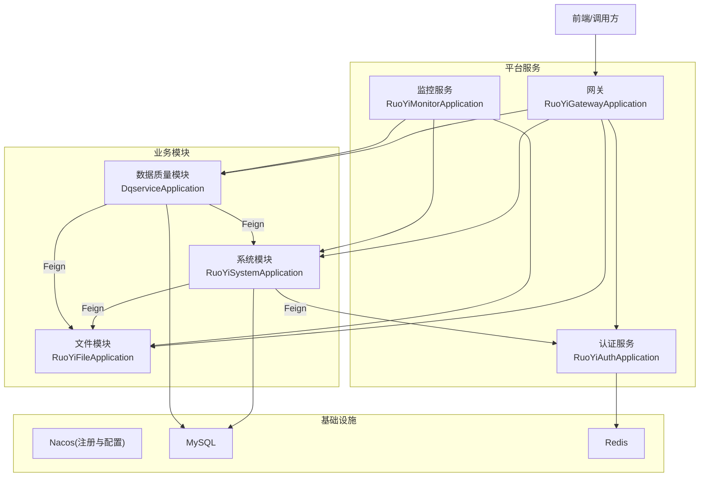
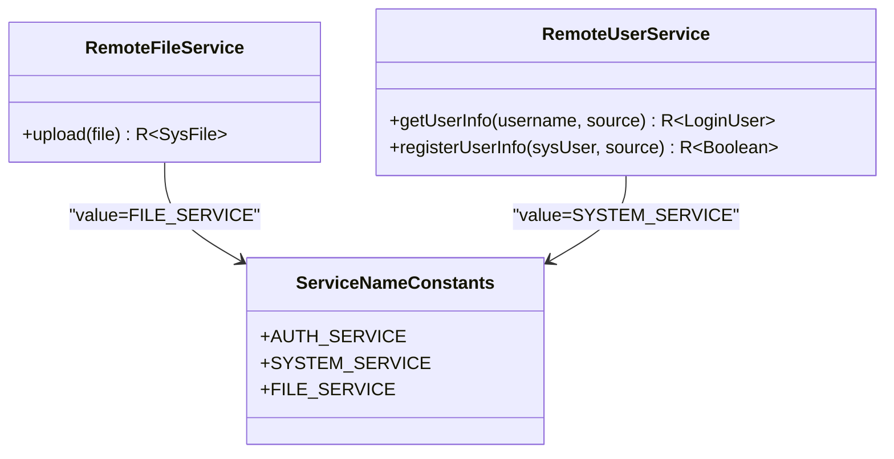
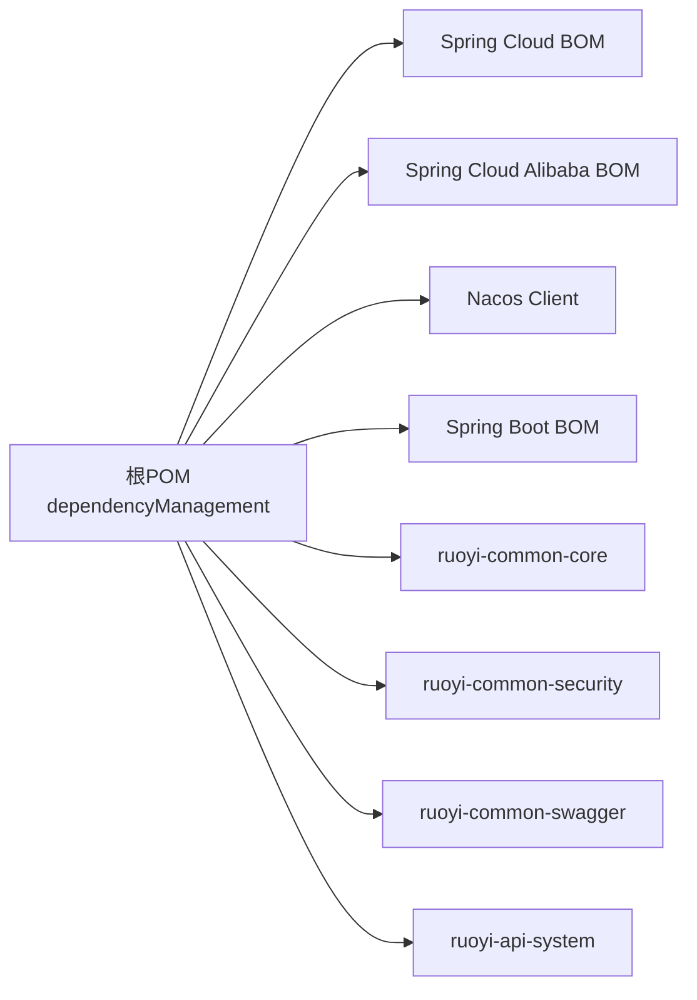

# 微服务扩展

<cite>
**本文引用的文件**   
- [pom.xml](file://pom.xml)
- [ruoyi-modules/ruoyi-dqservice/pom.xml](file://ruoyi-modules/ruoyi-dqservice/pom.xml)
- [ruoyi-modules/ruoyi-dqservice/src/main/resources/bootstrap.yml](file://ruoyi-modules/ruoyi-dqservice/src/main/resources/bootstrap.yml)
- [ruoyi-api/ruoyi-api-system/src/main/java/com/ruoyi/system/api/RemoteFileService.java](file://ruoyi-api/ruoyi-api-system/src/main/java/com/ruoyi/system/api/RemoteFileService.java)
- [ruoyi-api/ruoyi-api-system/src/main/java/com/ruoyi/system/api/RemoteUserService.java](file://ruoyi-api/ruoyi-api-system/src/main/java/com/ruoyi/system/api/RemoteUserService.java)
- [ruoyi-common/ruoyi-common-core/src/main/java/com/ruoyi/common/core/constant/ServiceNameConstants.java](file://ruoyi-common/ruoyi-common-core/src/main/java/com/ruoyi/common/core/constant/ServiceNameConstants.java)
- [docker/nacos/conf/application.properties](file://docker/nacos/conf/application.properties)
- [ruoyi-auth/src/main/java/com/ruoyi/auth/RuoYiAuthApplication.java](file://ruoyi-auth/src/main/java/com/ruoyi/auth/RuoYiAuthApplication.java)
- [ruoyi-gateway/src/main/java/com/ruoyi/gateway/RuoYiGatewayApplication.java](file://ruoyi-gateway/src/main/java/com/ruoyi/gateway/RuoYiGatewayApplication.java)
- [ruoyi-modules/ruoyi-file/src/main/java/com/ruoyi/file/RuoYiFileApplication.java](file://ruoyi-modules/ruoyi-file/src/main/java/com/ruoyi/file/RuoYiFileApplication.java)
- [ruoyi-modules/ruoyi-system/src/main/java/com/ruoyi/system/RuoYiSystemApplication.java](file://ruoyi-modules/ruoyi-system/src/main/java/com/ruoyi/system/RuoYiSystemApplication.java)
- [ruoyi-visual/ruoyi-monitor/src/main/java/com/ruoyi/modules/monitor/RuoYiMonitorApplication.java](file://ruoyi-visual/ruoyi-monitor/src/main/java/com/ruoyi/modules/monitor/RuoYiMonitorApplication.java)
</cite>

## 目录
1. [简介](#简介)
2. [项目结构](#项目结构)
3. [核心组件](#核心组件)
4. [架构总览](#架构总览)
5. [详细组件分析](#详细组件分析)
6. [依赖分析](#依赖分析)
7. [性能考虑](#性能考虑)
8. [故障排查指南](#故障排查指南)
9. [结论](#结论)
10. [附录](#附录)

## 简介
本指南面向希望在当前若依微服务基础上进行“微服务扩展”的开发者，目标是：
- 从零搭建一个新的微服务模块（以 ruoyi-dqservice 为例）
- 配置服务注册与配置中心（Nacos）
- 使用 Feign 客户端实现服务间调用、负载均衡与服务发现
- 说明服务间通信机制（同步 HTTP、异步消息、数据同步与事务管理建议）
- 提供部署与监控配置要点
- 给出扩展示例与最佳实践

## 项目结构
仓库采用多模块 Maven 工程，顶层 pom.xml 统一管理版本与依赖。业务模块位于 ruoyi-modules，公共能力在 ruoyi-common，API 契约在 ruoyi-api，网关与认证分别在 ruoyi-gateway 与 ruoyi-auth，可视化监控在 ruoyi-visual。



图表来源
- [ruoyi-gateway/src/main/java/com/ruoyi/gateway/RuoYiGatewayApplication.java](file://ruoyi-gateway/src/main/java/com/ruoyi/gateway/RuoYiGatewayApplication.java)
- [ruoyi-auth/src/main/java/com/ruoyi/auth/RuoYiAuthApplication.java](file://ruoyi-auth/src/main/java/com/ruoyi/auth/RuoYiAuthApplication.java)
- [ruoyi-modules/ruoyi-system/src/main/java/com/ruoyi/system/RuoYiSystemApplication.java](file://ruoyi-modules/ruoyi-system/src/main/java/com/ruoyi/system/RuoYiSystemApplication.java)
- [ruoyi-modules/ruoyi-file/src/main/java/com/ruoyi/file/RuoYiFileApplication.java](file://ruoyi-modules/ruoyi-file/src/main/java/com/ruoyi/file/RuoYiFileApplication.java)
- [ruoyi-visual/ruoyi-monitor/src/main/java/com/ruoyi/modules/monitor/RuoYiMonitorApplication.java](file://ruoyi-visual/ruoyi-monitor/src/main/java/com/ruoyi/modules/monitor/RuoYiMonitorApplication.java)

章节来源
- [pom.xml:44-251](file://pom.xml#L44-L251)

## 核心组件
- 服务注册与配置中心：基于 Spring Cloud Alibaba Nacos，用于服务发现与动态配置
- API 契约层：通过 ruoyi-api-system 暴露远程接口，供其他服务通过 Feign 调用
- 网关：统一入口，鉴权、限流、路由转发
- 业务模块：system、file、job、gen、dqservice 等
- 监控：Spring Boot Admin 客户端接入，集中监控各服务健康与指标

章节来源
- [pom.xml:44-251](file://pom.xml#L44-L251)
- [ruoyi-modules/ruoyi-dqservice/pom.xml:18-40](file://ruoyi-modules/ruoyi-dqservice/pom.xml#L18-L40)

## 架构总览
下图展示了典型请求链路：客户端经网关进入具体业务服务，业务服务之间通过 Feign 调用，所有服务向 Nacos 注册并拉取配置。

```mermaid
sequenceDiagram
participant C as "客户端"
participant G as "网关"
participant S as "系统服务"
participant F as "文件服务"
participant N as "Nacos"
C->>G : "HTTP 请求"
G->>S : "路由到目标服务"
S->>F : "Feign 调用 /upload"
F-->>S : "返回结果"
S-->>C : "响应"
Note over S,F,N : "服务启动时向 Nacos 注册，Feign 通过 Nacos 发现实例并负载均衡"
```

图表来源
- [ruoyi-api/ruoyi-api-system/src/main/java/com/ruoyi/system/api/RemoteFileService.java:18-28](file://ruoyi-api/ruoyi-api-system/src/main/java/com/ruoyi/system/api/RemoteFileService.java#L18-L28)
- [ruoyi-common/ruoyi-common-core/src/main/java/com/ruoyi/common/core/constant/ServiceNameConstants.java:10-23](file://ruoyi-common/ruoyi-common-core/src/main/java/com/ruoyi/common/core/constant/ServiceNameConstants.java#L10-L23)

## 详细组件分析

### 新建微服务模块（以 ruoyi-dqservice 为例）
步骤概览：
- 创建 Maven 子模块，继承父 POM，引入必要依赖
- 编写应用启动类（包名与主类名需与约定一致）
- 配置 bootstrap.yml 连接 Nacos（服务发现与配置中心）
- 按需添加 Controller/Service/Mapper 等分层代码
- 将模块加入父 POM 的 modules 列表（如需要）

关键要点：
- 依赖：Nacos Discovery、Nacos Config、Sentinel、Actuator、Swagger、数据库驱动、通用模块（datasource/datascope/log/swagger）
- 配置：spring.application.name 为服务名；nacos.discovery/config.server-addr 指向 Nacos 地址；可配置共享配置项
- 启动类：确保被 Spring Boot 扫描到

章节来源
- [ruoyi-modules/ruoyi-dqservice/pom.xml:16-77](file://ruoyi-modules/ruoyi-dqservice/pom.xml#L16-L77)
- [ruoyi-modules/ruoyi-dqservice/src/main/resources/bootstrap.yml:1-26](file://ruoyi-modules/ruoyi-dqservice/src/main/resources/bootstrap.yml#L1-L26)

### Feign 客户端创建与使用
- 接口定义：在 ruoyi-api-system 中定义远程接口，使用 @FeignClient 指定服务名与 fallbackFactory
- 服务发现与负载均衡：由 OpenFeign + Nacos 自动完成，无需手动维护地址
- 熔断降级：通过 fallbackFactory 提供降级逻辑，提升系统韧性
- 安全头透传：通过 SecurityConstants.FROM_SOURCE 等常量传递来源标识

示例路径：
- 文件服务 Feign 接口：[RemoteFileService.java:18-28](file://ruoyi-api/ruoyi-api-system/src/main/java/com/ruoyi/system/api/RemoteFileService.java#L18-L28)
- 用户服务 Feign 接口：[RemoteUserService.java:21-42](file://ruoyi-api/ruoyi-api-system/src/main/java/com/ruoyi/system/api/RemoteUserService.java#L21-L42)
- 服务名常量：[ServiceNameConstants.java:10-23](file://ruoyi-common/ruoyi-common-core/src/main/java/com/ruoyi/common/core/constant/ServiceNameConstants.java#L10-L23)



图表来源
- [ruoyi-api/ruoyi-api-system/src/main/java/com/ruoyi/system/api/RemoteFileService.java:18-28](file://ruoyi-api/ruoyi-api-system/src/main/java/com/ruoyi/system/api/RemoteFileService.java#L18-L28)
- [ruoyi-api/ruoyi-api-system/src/main/java/com/ruoyi/system/api/RemoteUserService.java:21-42](file://ruoyi-api/ruoyi-api-system/src/main/java/com/ruoyi/system/api/RemoteUserService.java#L21-L42)
- [ruoyi-common/ruoyi-common-core/src/main/java/com/ruoyi/common/core/constant/ServiceNameConstants.java:10-23](file://ruoyi-common/ruoyi-common-core/src/main/java/com/ruoyi/common/core/constant/ServiceNameConstants.java#L10-L23)

### 服务间通信机制
- 同步 HTTP 调用：通过 Feign 调用 REST 接口，适合强一致性场景
- 异步消息：可选 RabbitMQ/Kafka 等中间件解耦流程（本项目未内置，可按需引入）
- 数据同步：跨库数据同步建议使用 CDC 或定时任务（结合 MyBatis/动态数据源）
- 分布式事务：可集成 Seata（仓库含相关 SQL），按业务选择 AT/TCC/SAGA 模式

提示：
- 对于大文件或批量处理，优先异步化，避免阻塞主线程
- 对幂等性、重试、超时、熔断进行统一治理

### 服务注册与配置中心（Nacos）
- 服务注册：每个服务在启动时向 Nacos 注册自身实例
- 配置中心：bootstrap.yml 中指定 server-addr 与 file-extension，支持共享配置
- Nacos 服务端配置：参考 docker/nacos/conf/application.properties，包含数据库、鉴权、日志等

章节来源
- [ruoyi-modules/ruoyi-dqservice/src/main/resources/bootstrap.yml:13-25](file://ruoyi-modules/ruoyi-dqservice/src/main/resources/bootstrap.yml#L13-L25)
- [docker/nacos/conf/application.properties:1-33](file://docker/nacos/conf/application.properties#L1-L33)

### 微服务部署与监控
- 部署：
  - 构建各模块 jar，分别启动
  - 或通过 docker-compose 一键拉起 Nacos、MySQL、Redis、网关与各业务模块
- 监控：
  - 各服务引入 Actuator 与 Spring Boot Admin 客户端
  - 在监控服务中聚合查看各服务健康状态、JVM、线程、慢查询等

章节来源
- [ruoyi-modules/ruoyi-dqservice/pom.xml:36-47](file://ruoyi-modules/ruoyi-dqservice/pom.xml#L36-L47)
- [pom.xml:82-87](file://pom.xml#L82-L87)

## 依赖分析
顶层 POM 统一管理 Spring Cloud、Spring Cloud Alibaba、Nacos、MyBatis、Swagger、FastJSON、JWT 等依赖版本，并通过 dependencyManagement 收敛版本冲突。



图表来源
- [pom.xml:44-241](file://pom.xml#L44-L241)

章节来源
- [pom.xml:44-241](file://pom.xml#L44-L241)

## 性能考虑
- 连接池与缓存：合理配置数据库连接池、Redis 缓存命中率
- 限流与熔断：启用 Sentinel，设置 QPS/线程数阈值与降级策略
- 序列化与传输：控制 JSON 字段大小，避免大对象直传
- 异步化：耗时任务走异步队列，缩短主链路 RTT
- 监控与告警：开启 Actuator 端点，配合监控平台观察热点接口与慢查询

## 故障排查指南
常见问题与定位思路：
- 服务无法注册到 Nacos：检查 nacos.discovery.server-addr、网络连通性与 Nacos 服务状态
- 配置不生效：确认 bootstrap.yml 中的 nacos.config.server-addr 与 file-extension，以及共享配置是否加载
- Feign 调用失败：检查 @FeignClient.value 是否为正确的服务名，fallbackFactory 是否生效，目标服务是否已注册
- 网关鉴权失败：检查网关过滤器与安全头 FROM_SOURCE 是否正确透传
- 监控无数据：确认 Actuator 暴露端点与 Spring Boot Admin 客户端配置正确

章节来源
- [ruoyi-modules/ruoyi-dqservice/src/main/resources/bootstrap.yml:13-25](file://ruoyi-modules/ruoyi-dqservice/src/main/resources/bootstrap.yml#L13-L25)
- [docker/nacos/conf/application.properties:1-33](file://docker/nacos/conf/application.properties#L1-L33)
- [ruoyi-api/ruoyi-api-system/src/main/java/com/ruoyi/system/api/RemoteFileService.java:18-28](file://ruoyi-api/ruoyi-api-system/src/main/java/com/ruoyi/system/api/RemoteFileService.java#L18-L28)

## 结论
通过本指南，您可以：
- 快速搭建新的微服务模块并接入 Nacos
- 使用 Feign 实现服务间调用与负载均衡
- 建立统一的监控与治理能力
- 在现有若依微服务生态中平滑扩展业务能力

## 附录

### 扩展示例：新增一个“报表服务”
- 创建模块：ruoyi-report（Maven 子模块）
- 引入依赖：Nacos Discovery/Config、Actuator、Swagger、通用模块
- 配置 bootstrap.yml：application.name=ruoyi-report，nacos.server-addr=127.0.0.1:8848
- 定义 Feign 客户端：在 ruoyi-api-system 中新增 RemoteReportService，调用报表生成接口
- 提供服务：在 ruoyi-report 中实现 Controller/Service，对外暴露 REST 接口
- 接入监控：开启 Actuator，并在监控平台查看健康与指标

### 最佳实践清单
- 服务命名规范：遵循 ruoyi-xxx 风格，便于识别
- 接口契约先行：先在 API 层定义接口与 DTO，再实现服务
- 安全头透传：统一使用 SecurityConstants.FROM_SOURCE 标识来源
- 降级与重试：Feign 配置合理的超时与重试策略，配合 Sentinel 做熔断
- 配置外置：敏感信息通过 Nacos 配置中心管理，避免硬编码
- 可观测性：全链路日志、指标采集、错误告警一体化