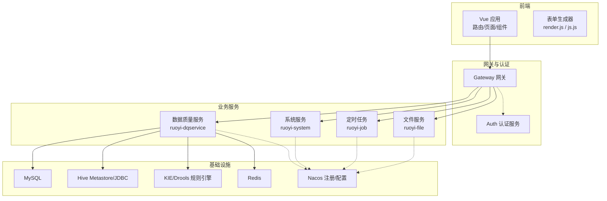
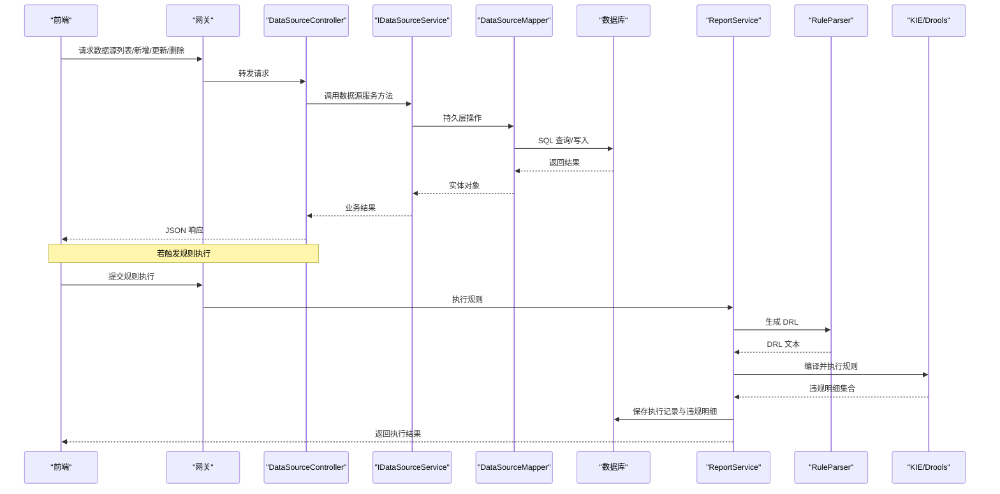
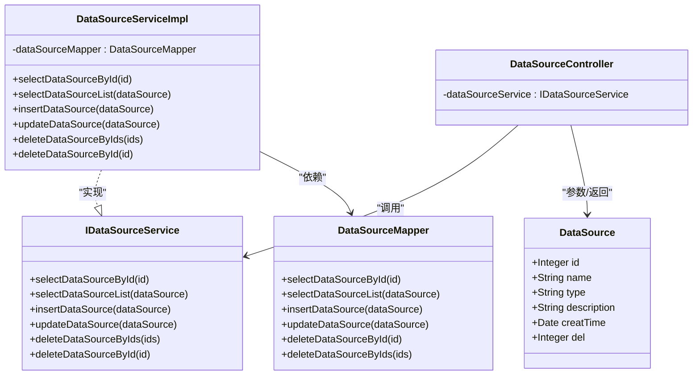
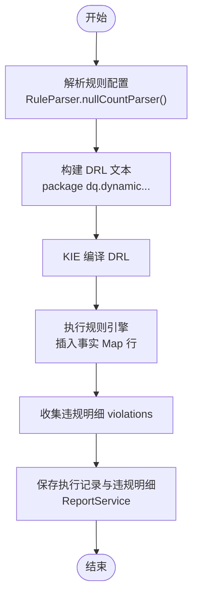
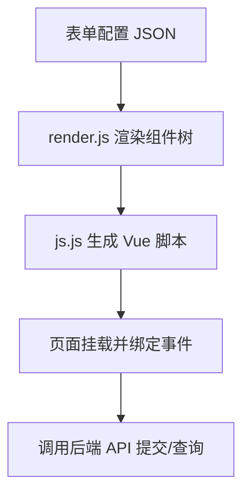
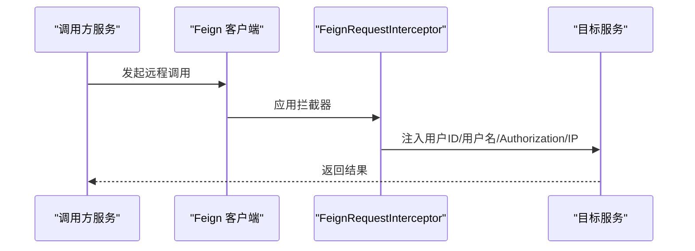
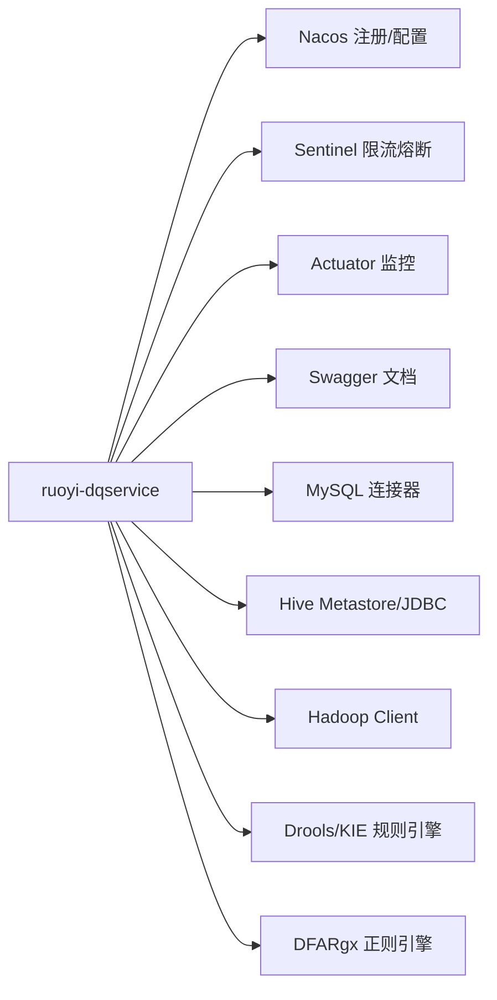

# 扩展开发

<cite>
**本文引用的文件**   
- [ruoyi-modules/ruoyi-dqservice/pom.xml](file://ruoyi-modules/ruoyi-dqservice/pom.xml)
- [ruoyi-modules/ruoyi-dqservice/src/main/java/com/ruoyi/dqservice/domain/DataSource.java](file://ruoyi-modules/ruoyi-dqservice/src/main/java/com/ruoyi/dqservice/domain/DataSource.java)
- [ruoyi-modules/ruoyi-dqservice/src/main/java/com/ruoyi/dqservice/mapper/DataSourceMapper.java](file://ruoyi-modules/ruoyi-dqservice/src/main/java/com/ruoyi/dqservice/mapper/DataSourceMapper.java)
- [ruoyi-modules/ruoyi-dqservice/src/main/java/com/ruoyi/dqservice/service/IDataSourceService.java](file://ruoyi-modules/ruoyi-dqservice/src/main/java/com/ruoyi/dqservice/service/IDataSourceService.java)
- [ruoyi-modules/ruoyi-dqservice/src/main/java/com/ruoyi/dqservice/service/impl/DataSourceServiceImpl.java](file://ruoyi-modules/ruoyi-dqservice/src/main/java/com/ruoyi/dqservice/service/impl/DataSourceServiceImpl.java)
- [ruoyi-modules/ruoyi-dqservice/src/main/java/com/ruoyi/dqservice/controller/DataSourceController.java](file://ruoyi-modules/ruoyi-dqservice/src/main/java/com/ruoyi/dqservice/controller/DataSourceController.java)
- [ruoyi-modules/ruoyi-dqservice/src/main/java/com/ruoyi/dqservice/util/RuleParser.java](file://ruoyi-modules/ruoyi-dqservice/src/main/java/com/ruoyi/dqservice/util/RuleParser.java)
- [ruoyi-modules/ruoyi-dqservice/src/test/java/com/ruoyi/dqservice/DrlSyntaxTest.java](file://ruoyi-modules/ruoyi-dqservice/src/test/java/com/ruoyi/dqservice/DrlSyntaxTest.java)
- [ruoyi-modules/ruoyi-dqservice/src/main/java/com/ruoyi/dqservice/service/ReportService.java](file://ruoyi-modules/ruoyi-dqservice/src/main/java/com/ruoyi/dqservice/service/ReportService.java)
- [ruoyi-common/ruoyi-common-security/src/main/java/com/ruoyi/common/security/feign/FeignAutoConfiguration.java](file://ruoyi-common/ruoyi-common-security/src/main/java/com/ruoyi/common/security/feign/FeignAutoConfiguration.java)
- [ruoyi-common/ruoyi-common-security/src/main/java/com/ruoyi/common/security/annotation/EnableRyFeignClients.java](file://ruoyi-common/ruoyi-common-security/src/main/java/com/ruoyi/common/security/annotation/EnableRyFeignClients.java)
- [ruoyi-common/ruoyi-common-security/src/main/java/com/ruoyi/common/security/feign/FeignRequestInterceptor.java](file://ruoyi-common/ruoyi-common-security/src/main/java/com/ruoyi/common/security/feign/FeignRequestInterceptor.java)
- [ruoyi-ui/src/utils/generator/render.js](file://ruoyi-ui/src/utils/generator/render.js)
- [ruoyi-ui/src/utils/generator/js.js](file://ruoyi-ui/src/utils/generator/js.js)
</cite>

## 目录
1. [引言](#引言)
2. [项目结构](#项目结构)
3. [核心组件](#核心组件)
4. [架构总览](#架构总览)
5. [详细组件分析](#详细组件分析)
6. [依赖关系分析](#依赖关系分析)
7. [性能与可扩展性](#性能与可扩展性)
8. [故障排查指南](#故障排查指南)
9. [结论](#结论)
10. [附录：扩展清单与最佳实践](#附录扩展清单与最佳实践)

## 引言
本指南面向需要在数据质量平台中进行二次开发的工程师，覆盖以下扩展主题：
- 新增数据源类型：适配器接口、连接配置、元数据获取
- 自定义规则类型：规则验证逻辑、执行引擎集成
- 前端组件规范：Vue 组件结构、API 调用封装、样式组织
- 微服务扩展：新服务模块创建、Feign 客户端定义、服务间通信
文档以现有代码为依据，提供可操作的步骤、图示与参考路径，帮助你在不破坏既有架构的前提下完成扩展。

## 项目结构
本项目采用前后端分离的微服务架构：
- 后端：Spring Boot + Spring Cloud Alibaba（Nacos/Sentinel），使用 MyBatis 进行数据访问，Drools/KIE 作为规则引擎，Hive/Hadoop 用于大数据场景
- 前端：Vue 2 + Element UI，包含表单生成器与通用组件库
- 公共能力：认证鉴权、日志、Swagger、Redis、数据权限等通过 common 模块复用

[无图表来源；该图为概念性架构图]

## 核心组件
围绕“扩展开发”目标，以下组件最为关键：
- 数据源管理：领域模型、Mapper、Service、Controller 构成标准分层
- 规则引擎：基于 Drools/KIE 的动态 DRL 生成与执行
- 报告与执行记录：保存执行结果与违规明细
- Feign 安全拦截：跨服务调用时透传用户上下文与 IP
- 前端表单生成器：根据配置动态渲染 Vue 组件并生成 JS

**章节来源**
- [ruoyi-modules/ruoyi-dqservice/src/main/java/com/ruoyi/dqservice/domain/DataSource.java:1-73](file://ruoyi-modules/ruoyi-dqservice/src/main/java/com/ruoyi/dqservice/domain/DataSource.java#L1-L73)
- [ruoyi-modules/ruoyi-dqservice/src/main/java/com/ruoyi/dqservice/mapper/DataSourceMapper.java:1-61](file://ruoyi-modules/ruoyi-dqservice/src/main/java/com/ruoyi/dqservice/mapper/DataSourceMapper.java#L1-L61)
- [ruoyi-modules/ruoyi-dqservice/src/main/java/com/ruoyi/dqservice/service/IDataSourceService.java:1-61](file://ruoyi-modules/ruoyi-dqservice/src/main/java/com/ruoyi/dqservice/service/IDataSourceService.java#L1-L61)
- [ruoyi-modules/ruoyi-dqservice/src/main/java/com/ruoyi/dqservice/service/impl/DataSourceServiceImpl.java:1-95](file://ruoyi-modules/ruoyi-dqservice/src/main/java/com/ruoyi/dqservice/service/impl/DataSourceServiceImpl.java#L1-L95)
- [ruoyi-modules/ruoyi-dqservice/src/main/java/com/ruoyi/dqservice/controller/DataSourceController.java:1-36](file://ruoyi-modules/ruoyi-dqservice/src/main/java/com/ruoyi/dqservice/controller/DataSourceController.java#L1-L36)
- [ruoyi-modules/ruoyi-dqservice/src/main/java/com/ruoyi/dqservice/util/RuleParser.java:28-98](file://ruoyi-modules/ruoyi-dqservice/src/main/java/com/ruoyi/dqservice/util/RuleParser.java#L28-L98)
- [ruoyi-modules/ruoyi-dqservice/src/main/java/com/ruoyi/dqservice/service/ReportService.java:70-103](file://ruoyi-modules/ruoyi-dqservice/src/main/java/com/ruoyi/dqservice/service/ReportService.java#L70-L103)
- [ruoyi-common/ruoyi-common-security/src/main/java/com/ruoyi/common/security/feign/FeignRequestInterceptor.java:13-49](file://ruoyi-common/ruoyi-common-security/src/main/java/com/ruoyi/common/security/feign/FeignRequestInterceptor.java#L13-L49)
- [ruoyi-ui/src/utils/generator/render.js:1-126](file://ruoyi-ui/src/utils/generator/render.js#L1-L126)
- [ruoyi-ui/src/utils/generator/js.js:1-192](file://ruoyi-ui/src/utils/generator/js.js#L1-L192)

## 架构总览
下图展示数据源管理与规则执行的端到端流程，以及微服务间的调用链路。

**图表来源**
- [ruoyi-modules/ruoyi-dqservice/src/main/java/com/ruoyi/dqservice/controller/DataSourceController.java:1-36](file://ruoyi-modules/ruoyi-dqservice/src/main/java/com/ruoyi/dqservice/controller/DataSourceController.java#L1-L36)
- [ruoyi-modules/ruoyi-dqservice/src/main/java/com/ruoyi/dqservice/service/IDataSourceService.java:1-61](file://ruoyi-modules/ruoyi-dqservice/src/main/java/com/ruoyi/dqservice/service/IDataSourceService.java#L1-L61)
- [ruoyi-modules/ruoyi-dqservice/src/main/java/com/ruoyi/dqservice/mapper/DataSourceMapper.java:1-61](file://ruoyi-modules/ruoyi-dqservice/src/main/java/com/ruoyi/dqservice/mapper/DataSourceMapper.java#L1-L61)
- [ruoyi-modules/ruoyi-dqservice/src/main/java/com/ruoyi/dqservice/service/ReportService.java:70-103](file://ruoyi-modules/ruoyi-dqservice/src/main/java/com/ruoyi/dqservice/service/ReportService.java#L70-L103)
- [ruoyi-modules/ruoyi-dqservice/src/main/java/com/ruoyi/dqservice/util/RuleParser.java:28-98](file://ruoyi-modules/ruoyi-dqservice/src/main/java/com/ruoyi/dqservice/util/RuleParser.java#L28-L98)

## 详细组件分析

### 数据源管理（CRUD）
数据源管理遵循 Controller → Service → Mapper → DB 的标准分层。领域模型 DataSource 承载基础字段，Service 实现业务编排，Mapper 负责持久化。

**图表来源**
- [ruoyi-modules/ruoyi-dqservice/src/main/java/com/ruoyi/dqservice/domain/DataSource.java:1-73](file://ruoyi-modules/ruoyi-dqservice/src/main/java/com/ruoyi/dqservice/domain/DataSource.java#L1-L73)
- [ruoyi-modules/ruoyi-dqservice/src/main/java/com/ruoyi/dqservice/service/IDataSourceService.java:1-61](file://ruoyi-modules/ruoyi-dqservice/src/main/java/com/ruoyi/dqservice/service/IDataSourceService.java#L1-L61)
- [ruoyi-modules/ruoyi-dqservice/src/main/java/com/ruoyi/dqservice/service/impl/DataSourceServiceImpl.java:1-95](file://ruoyi-modules/ruoyi-dqservice/src/main/java/com/ruoyi/dqservice/service/impl/DataSourceServiceImpl.java#L1-L95)
- [ruoyi-modules/ruoyi-dqservice/src/main/java/com/ruoyi/dqservice/mapper/DataSourceMapper.java:1-61](file://ruoyi-modules/ruoyi-dqservice/src/main/java/com/ruoyi/dqservice/mapper/DataSourceMapper.java#L1-L61)
- [ruoyi-modules/ruoyi-dqservice/src/main/java/com/ruoyi/dqservice/controller/DataSourceController.java:1-36](file://ruoyi-modules/ruoyi-dqservice/src/main/java/com/ruoyi/dqservice/controller/DataSourceController.java#L1-L36)

**章节来源**
- [ruoyi-modules/ruoyi-dqservice/src/main/java/com/ruoyi/dqservice/domain/DataSource.java:1-73](file://ruoyi-modules/ruoyi-dqservice/src/main/java/com/ruoyi/dqservice/domain/DataSource.java#L1-L73)
- [ruoyi-modules/ruoyi-dqservice/src/main/java/com/ruoyi/dqservice/mapper/DataSourceMapper.java:1-61](file://ruoyi-modules/ruoyi-dqservice/src/main/java/com/ruoyi/dqservice/mapper/DataSourceMapper.java#L1-L61)
- [ruoyi-modules/ruoyi-dqservice/src/main/java/com/ruoyi/dqservice/service/IDataSourceService.java:1-61](file://ruoyi-modules/ruoyi-dqservice/src/main/java/com/ruoyi/dqservice/service/IDataSourceService.java#L1-L61)
- [ruoyi-modules/ruoyi-dqservice/src/main/java/com/ruoyi/dqservice/service/impl/DataSourceServiceImpl.java:1-95](file://ruoyi-modules/ruoyi-dqservice/src/main/java/com/ruoyi/dqservice/service/impl/DataSourceServiceImpl.java#L1-L95)
- [ruoyi-modules/ruoyi-dqservice/src/main/java/com/ruoyi/dqservice/controller/DataSourceController.java:1-36](file://ruoyi-modules/ruoyi-dqservice/src/main/java/com/ruoyi/dqservice/controller/DataSourceController.java#L1-L36)

#### 如何添加新的数据源类型
- 在 DataSource.type 中登记新类型标识（例如 “hive”、“kafka”、“es”）
- 在 Service 层增加针对新类型的校验与连接测试逻辑（如 JDBC URL、用户名密码、驱动类名等）
- 如需元数据获取（表/列信息），可在 Service 或独立 DataMetaProvider 中实现对应逻辑，并在前端表单中暴露相应字段
- 在 Controller 中暴露新增的元数据 API（如 /dataSource/meta/{id}）

**章节来源**
- [ruoyi-modules/ruoyi-dqservice/src/main/java/com/ruoyi/dqservice/domain/DataSource.java:1-73](file://ruoyi-modules/ruoyi-dqservice/src/main/java/com/ruoyi/dqservice/domain/DataSource.java#L1-L73)
- [ruoyi-modules/ruoyi-dqservice/src/main/java/com/ruoyi/dqservice/service/IDataSourceService.java:1-61](file://ruoyi-modules/ruoyi-dqservice/src/main/java/com/ruoyi/dqservice/service/IDataSourceService.java#L1-L61)
- [ruoyi-modules/ruoyi-dqservice/src/main/java/com/ruoyi/dqservice/service/impl/DataSourceServiceImpl.java:1-95](file://ruoyi-modules/ruoyi-dqservice/src/main/java/com/ruoyi/dqservice/service/impl/DataSourceServiceImpl.java#L1-L95)
- [ruoyi-modules/ruoyi-dqservice/src/main/java/com/ruoyi/dqservice/controller/DataSourceController.java:1-36](file://ruoyi-modules/ruoyi-dqservice/src/main/java/com/ruoyi/dqservice/controller/DataSourceController.java#L1-L36)

### 规则引擎与自定义规则
规则引擎基于 Drools/KIE，支持动态生成 DRL 并执行。RuleParser 将规则配置转换为 DRL 文本，ReportService 负责执行与结果落库。

**图表来源**
- [ruoyi-modules/ruoyi-dqservice/src/main/java/com/ruoyi/dqservice/util/RuleParser.java:28-98](file://ruoyi-modules/ruoyi-dqservice/src/main/java/com/ruoyi/dqservice/util/RuleParser.java#L28-L98)
- [ruoyi-modules/ruoyi-dqservice/src/main/java/com/ruoyi/dqservice/service/ReportService.java:70-103](file://ruoyi-modules/ruoyi-dqservice/src/main/java/com/ruoyi/dqservice/service/ReportService.java#L70-L103)

#### 如何添加自定义规则类型
- 在 RuleParser 中新增解析方法，将规则配置转换为 DRL 片段
- 在 ReportService 中集成新的规则执行分支，确保 violations 集合被正确填充
- 编写单元测试验证 DRL 语法与执行结果（参考 DrlSyntaxTest）

**章节来源**
- [ruoyi-modules/ruoyi-dqservice/src/main/java/com/ruoyi/dqservice/util/RuleParser.java:28-98](file://ruoyi-modules/ruoyi-dqservice/src/main/java/com/ruoyi/dqservice/util/RuleParser.java#L28-L98)
- [ruoyi-modules/ruoyi-dqservice/src/main/java/com/ruoyi/dqservice/service/ReportService.java:70-103](file://ruoyi-modules/ruoyi-dqservice/src/main/java/com/ruoyi/dqservice/service/ReportService.java#L70-L103)
- [ruoyi-modules/ruoyi-dqservice/src/test/java/com/ruoyi/dqservice/DrlSyntaxTest.java:136-178](file://ruoyi-modules/ruoyi-dqservice/src/test/java/com/ruoyi/dqservice/DrlSyntaxTest.java#L136-L178)

### 前端组件与表单生成器
前端通过 render.js 和 js.js 实现表单配置的动态渲染与脚本生成，支持多种 Element UI 组件及上传、选项动态加载等特性。

**图表来源**
- [ruoyi-ui/src/utils/generator/render.js:1-126](file://ruoyi-ui/src/utils/generator/render.js#L1-L126)
- [ruoyi-ui/src/utils/generator/js.js:1-192](file://ruoyi-ui/src/utils/generator/js.js#L1-L192)

#### 前端组件开发规范
- 组件结构：单文件 .vue，模板/脚本/样式分离，优先使用 Element UI 组件
- API 调用：统一在 src/api 下按模块组织，封装 request 工具处理错误与鉴权
- 样式组织：全局样式放在 assets/styles，局部样式使用 scoped 或模块化 SCSS
- 表单生成：通过 render.js/js.js 的配置驱动方式快速搭建复杂表单

**章节来源**
- [ruoyi-ui/src/utils/generator/render.js:1-126](file://ruoyi-ui/src/utils/generator/render.js#L1-L126)
- [ruoyi-ui/src/utils/generator/js.js:1-192](file://ruoyi-ui/src/utils/generator/js.js#L1-L192)

### 微服务扩展与 Feign 客户端
微服务间通过 OpenFeign 调用，common-security 模块提供自动装配与请求拦截，保证用户上下文与 IP 透传。

**图表来源**
- [ruoyi-common/ruoyi-common-security/src/main/java/com/ruoyi/common/security/feign/FeignAutoConfiguration.java:1-20](file://ruoyi-common/ruoyi-common-security/src/main/java/com/ruoyi/common/security/feign/FeignAutoConfiguration.java#L1-L20)
- [ruoyi-common/ruoyi-common-security/src/main/java/com/ruoyi/common/security/annotation/EnableRyFeignClients.java:1-27](file://ruoyi-common/ruoyi-common-security/src/main/java/com/ruoyi/common/security/annotation/EnableRyFeignClients.java#L1-L27)
- [ruoyi-common/ruoyi-common-security/src/main/java/com/ruoyi/common/security/feign/FeignRequestInterceptor.java:13-49](file://ruoyi-common/ruoyi-common-security/src/main/java/com/ruoyi/common/security/feign/FeignRequestInterceptor.java#L13-L49)

#### 如何创建新服务模块与 Feign 客户端
- 新建 Spring Boot 子模块（参考 ruoyi-modules 下的其他服务）
- 在启动类上添加 @EnableRyFeignClients 注解启用 Feign 扫描
- 定义 Feign 接口并标注 @FeignClient，指定服务名与路径
- 在拦截器中已自动注入用户上下文与 IP，无需手动传递

**章节来源**
- [ruoyi-common/ruoyi-common-security/src/main/java/com/ruoyi/common/security/annotation/EnableRyFeignClients.java:1-27](file://ruoyi-common/ruoyi-common-security/src/main/java/com/ruoyi/common/security/annotation/EnableRyFeignClients.java#L1-L27)
- [ruoyi-common/ruoyi-common-security/src/main/java/com/ruoyi/common/security/feign/FeignAutoConfiguration.java:1-20](file://ruoyi-common/ruoyi-common-security/src/main/java/com/ruoyi/common/security/feign/FeignAutoConfiguration.java#L1-L20)
- [ruoyi-common/ruoyi-common-security/src/main/java/com/ruoyi/common/security/feign/FeignRequestInterceptor.java:13-49](file://ruoyi-common/ruoyi-common-security/src/main/java/com/ruoyi/common/security/feign/FeignRequestInterceptor.java#L13-L49)

## 依赖关系分析
ruoyi-dqservice 模块依赖包括 Nacos、Sentinel、Actuator、Swagger、MySQL、Hive/Hadoop、Drools/KIE、DFARgx 等，支撑数据源接入、规则执行与可视化。

**图表来源**
- [ruoyi-modules/ruoyi-dqservice/pom.xml:16-41](file://ruoyi-modules/ruoyi-dqservice/pom.xml#L16-L41)
- [ruoyi-modules/ruoyi-dqservice/pom.xml:49-77](file://ruoyi-modules/ruoyi-dqservice/pom.xml#L49-L77)
- [ruoyi-modules/ruoyi-dqservice/pom.xml:79-238](file://ruoyi-modules/ruoyi-dqservice/pom.xml#L79-L238)
- [ruoyi-modules/ruoyi-dqservice/pom.xml:240-319](file://ruoyi-modules/ruoyi-dqservice/pom.xml#L240-L319)
- [ruoyi-modules/ruoyi-dqservice/pom.xml:327-365](file://ruoyi-modules/ruoyi-dqservice/pom.xml#L327-L365)

**章节来源**
- [ruoyi-modules/ruoyi-dqservice/pom.xml:16-41](file://ruoyi-modules/ruoyi-dqservice/pom.xml#L16-L41)
- [ruoyi-modules/ruoyi-dqservice/pom.xml:49-77](file://ruoyi-modules/ruoyi-dqservice/pom.xml#L49-L77)
- [ruoyi-modules/ruoyi-dqservice/pom.xml:79-238](file://ruoyi-modules/ruoyi-dqservice/pom.xml#L79-L238)
- [ruoyi-modules/ruoyi-dqservice/pom.xml:240-319](file://ruoyi-modules/ruoyi-dqservice/pom.xml#L240-L319)
- [ruoyi-modules/ruoyi-dqservice/pom.xml:327-365](file://ruoyi-modules/ruoyi-dqservice/pom.xml#L327-L365)

## 性能与可扩展性
- 规则引擎：每条规则使用独立 KieHelper 编译，避免命名冲突；建议对热点规则进行缓存与预热
- 数据源连接：连接池与超时参数应结合具体数据源类型调优；Hive/JDBC 在高并发场景需关注 Metastore 压力
- 前端渲染：表单生成器按需渲染组件，避免一次性生成过多 DOM；大表单分页或懒加载
- 微服务通信：Feign 默认重试与超时策略需与服务 SLA 匹配；必要时引入熔断降级

[本节为通用指导，不涉及具体文件分析]

## 故障排查指南
- 规则执行失败：检查 DRL 语法与字段转义是否正确；确认 violations 集合是否被正确注入与收集
- 数据源连接异常：核对 type 与连接参数；在服务层增加连接测试与错误码映射
- 跨服务调用丢失用户上下文：确认已启用 @EnableRyFeignClients 且拦截器生效；检查 Authorization 头是否透传
- 前端表单不渲染：检查 render.js/js.js 配置项是否完整；浏览器控制台查看组件 props 与事件绑定

**章节来源**
- [ruoyi-modules/ruoyi-dqservice/src/test/java/com/ruoyi/dqservice/DrlSyntaxTest.java:136-178](file://ruoyi-modules/ruoyi-dqservice/src/test/java/com/ruoyi/dqservice/DrlSyntaxTest.java#L136-L178)
- [ruoyi-modules/ruoyi-dqservice/src/main/java/com/ruoyi/dqservice/util/RuleParser.java:28-98](file://ruoyi-modules/ruoyi-dqservice/src/main/java/com/ruoyi/dqservice/util/RuleParser.java#L28-L98)
- [ruoyi-common/ruoyi-common-security/src/main/java/com/ruoyi/common/security/feign/FeignRequestInterceptor.java:13-49](file://ruoyi-common/ruoyi-common-security/src/main/java/com/ruoyi/common/security/feign/FeignRequestInterceptor.java#L13-L49)

## 结论
通过在现有分层架构中扩展数据源类型、自定义规则类型、前端组件与微服务模块，可以低成本地增强数据质量平台的业务能力。建议在扩展过程中遵循既有的分层与约定，完善单元测试与文档，确保可维护性与可观测性。

[本节为总结性内容，不涉及具体文件分析]

## 附录：扩展清单与最佳实践
- 新增数据源类型
  - 在 DataSource.type 登记新类型
  - 在 Service 层实现连接校验与元数据获取
  - 在 Controller 暴露元数据 API
  - 在前端表单中新增对应字段与校验
- 自定义规则类型
  - 在 RuleParser 新增解析方法
  - 在 ReportService 集成执行与结果落库
  - 编写 DRL 单元测试用例
- 前端组件规范
  - 使用 render.js/js.js 配置驱动生成表单
  - API 调用集中管理，统一错误处理
  - 样式模块化，避免全局污染
- 微服务扩展
  - 新建子模块，添加 @EnableRyFeignClients
  - 定义 Feign 接口并调用
  - 利用拦截器透传用户上下文与 IP

[本节为通用指导，不涉及具体文件分析]