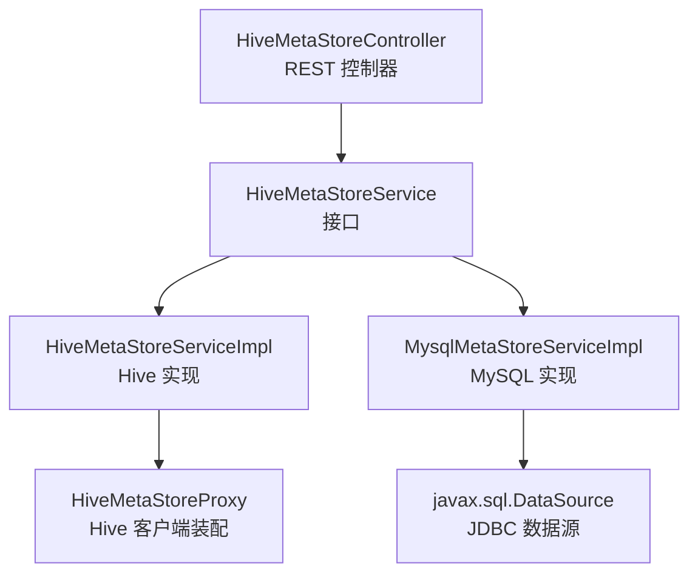
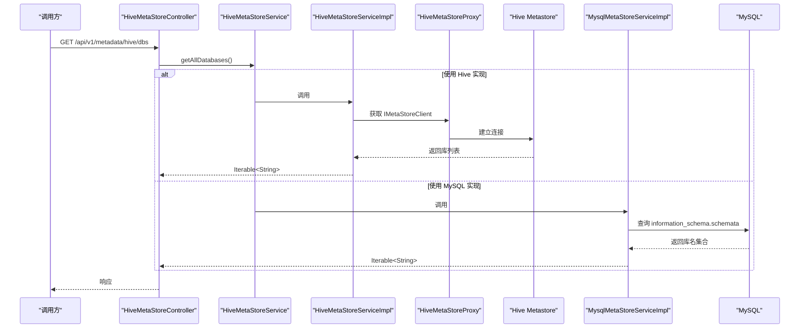
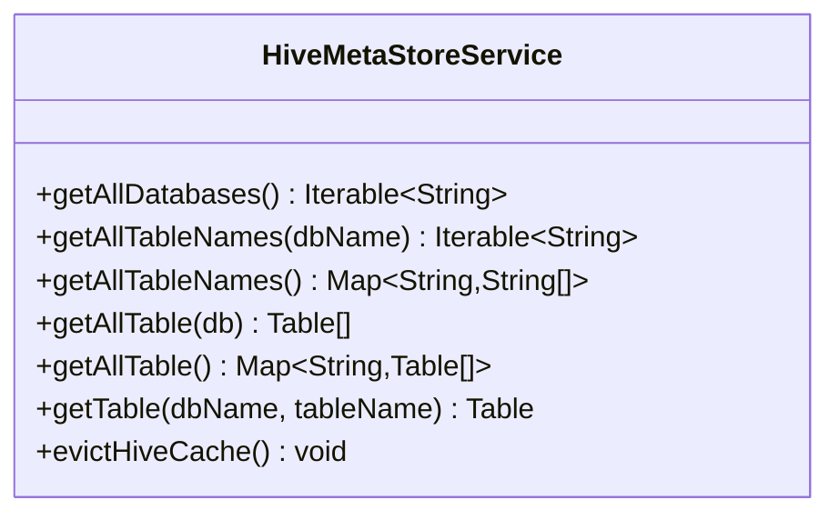
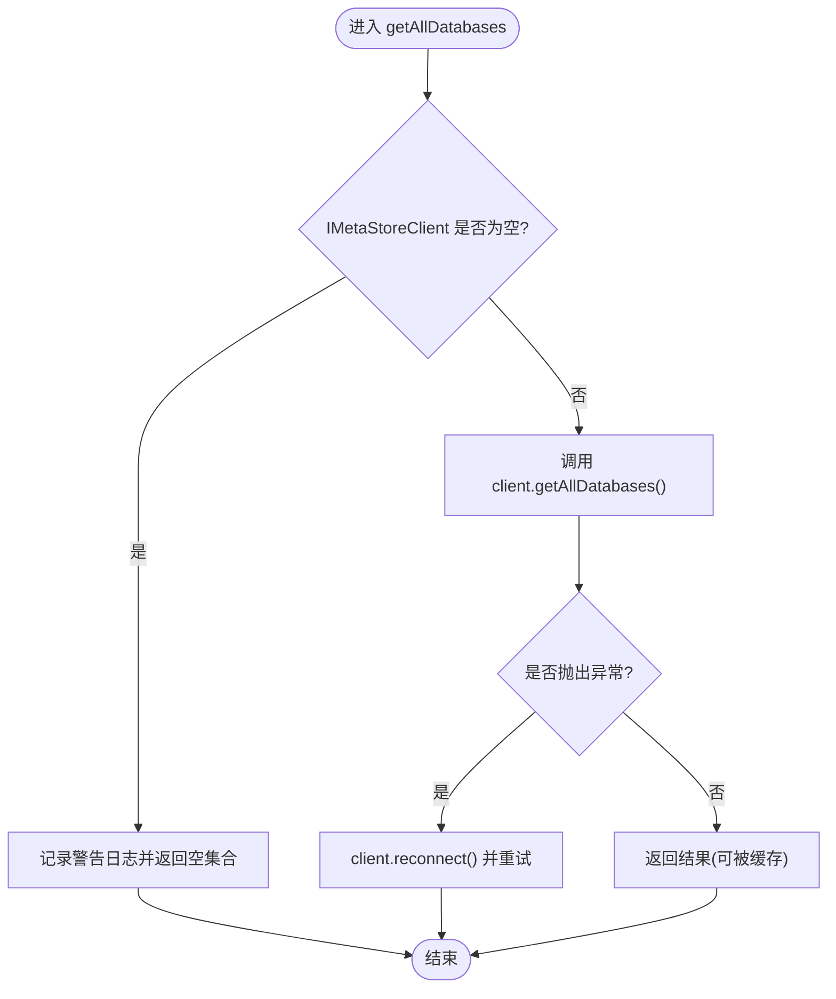
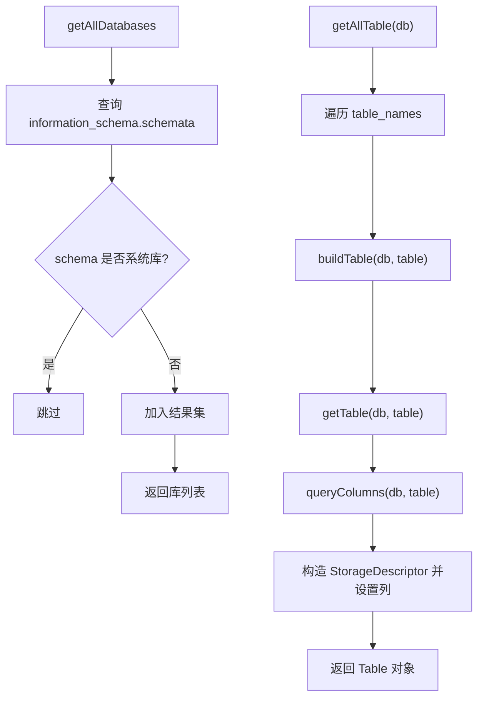
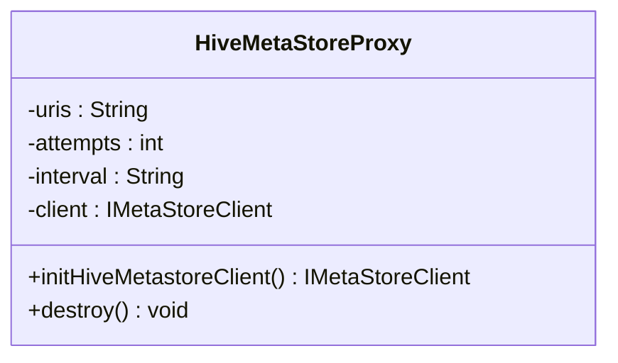
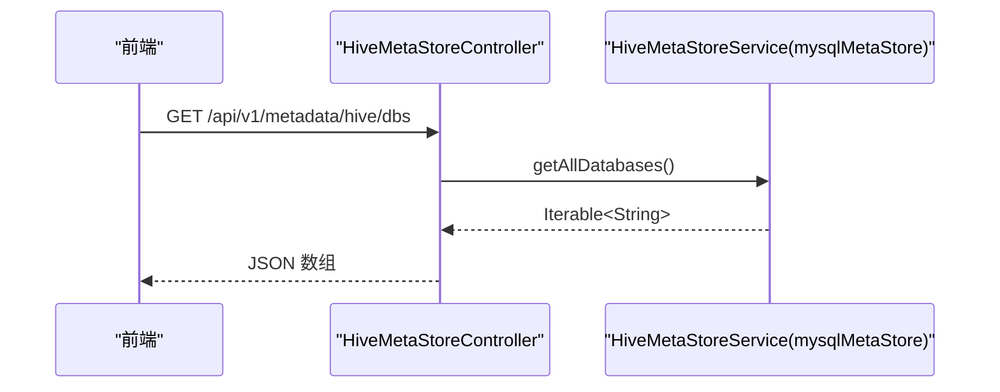
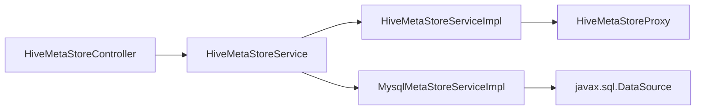
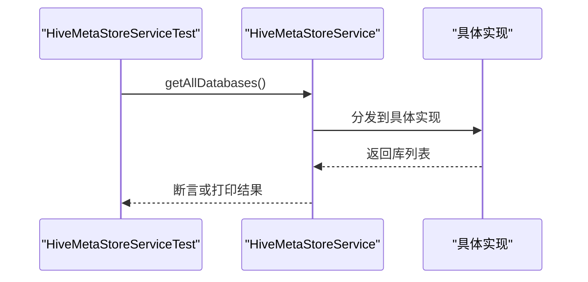

# 数据源扩展

<cite>
**本文引用的文件**   
- [HiveMetaStoreService.java](file://ruoyi-modules/ruoyi-dqservice/src/main/java/com/ruoyi/dqservice/service/HiveMetaStoreService.java)
- [HiveMetaStoreServiceImpl.java](file://ruoyi-modules/ruoyi-dqservice/src/main/java/com/ruoyi/dqservice/service/impl/HiveMetaStoreServiceImpl.java)
- [MysqlMetaStoreServiceImpl.java](file://ruoyi-modules/ruoyi-dqservice/src/main/java/com/ruoyi/dqservice/service/impl/MysqlMetaStoreServiceImpl.java)
- [HiveMetaStoreProxy.java](file://ruoyi-modules/ruoyi-dqservice/src/main/java/com/ruoyi/dqservice/connecter/HiveMetaStoreProxy.java)
- [HiveMetaStoreController.java](file://ruoyi-modules/ruoyi-dqservice/src/main/java/com/ruoyi/dqservice/controller/HiveMetaStoreController.java)
- [bootstrap.yml](file://ruoyi-modules/ruoyi-dqservice/src/main/resources/bootstrap.yml)
- [DataSource.java](file://ruoyi-modules/ruoyi-dqservice/src/main/java/com/ruoyi/dqservice/domain/DataSource.java)
- [DataSourceMapper.xml](file://ruoyi-modules/ruoyi-dqservice/src/main/resources/mapper/DataSourceMapper.xml)
- [DBUtil.java](file://ruoyi-modules/ruoyi-dqservice/src/main/java/com/ruoyi/dqservice/connecter/DBUtil.java)
- [HiveMetaStoreServiceTest.java](file://ruoyi-modules/ruoyi-dqservice/src/test/java/com/ruoyi/dqservice/service/HiveMetaStoreServiceTest.java)
</cite>

## 目录
1. [简介](#简介)
2. [项目结构](#项目结构)
3. [核心组件](#核心组件)
4. [架构总览](#架构总览)
5. [详细组件分析](#详细组件分析)
6. [依赖关系分析](#依赖关系分析)
7. [性能与缓存](#性能与缓存)
8. [测试与调试](#测试与调试)
9. [常见问题与排错](#常见问题与排错)
10. [最佳实践](#最佳实践)
11. [结论](#结论)

## 简介
本指南面向需要在当前质量数据服务中扩展“数据源适配器”的开发者。文档围绕 Hive 元数据访问抽象，说明如何：
- 继承并实现 HiveMetaStoreService 接口
- 编写新的数据库类型适配实现（以 MySQL 为例）
- 配置连接参数、认证信息与性能相关参数
- 通过 REST 接口暴露元数据能力
- 编写测试与调试方法
- 总结常见问题与最佳实践

## 项目结构
与数据源扩展直接相关的代码集中在 ruoyi-dqservice 模块中，关键路径如下：
- 接口定义：com.ruoyi.dqservice.service.HiveMetaStoreService
- 默认 Hive 实现：com.ruoyi.dqservice.service.impl.HiveMetaStoreServiceImpl
- MySQL 示例实现：com.ruoyi.dqservice.service.impl.MysqlMetaStoreServiceImpl
- Hive 客户端代理：com.ruoyi.dqservice.connecter.HiveMetaStoreProxy
- 控制器：com.ruoyi.dqservice.controller.HiveMetaStoreController
- 应用启动配置：src/main/resources/bootstrap.yml
- 数据源领域模型与映射：domain/DataSource.java、mapper/DataSourceMapper.xml
- 简单 JDBC 工具类：connecter/DBUtil.java
- 单元测试：test/.../HiveMetaStoreServiceTest.java

图表来源
- [HiveMetaStoreController.java:16-57](file://ruoyi-modules/ruoyi-dqservice/src/main/java/com/ruoyi/dqservice/controller/HiveMetaStoreController.java#L16-L57)
- [HiveMetaStoreService.java:8-23](file://ruoyi-modules/ruoyi-dqservice/src/main/java/com/ruoyi/dqservice/service/HiveMetaStoreService.java#L8-L23)
- [HiveMetaStoreServiceImpl.java:27-47](file://ruoyi-modules/ruoyi-dqservice/src/main/java/com/ruoyi/dqservice/service/impl/HiveMetaStoreServiceImpl.java#L27-L47)
- [MysqlMetaStoreServiceImpl.java:35-56](file://ruoyi-modules/ruoyi-dqservice/src/main/java/com/ruoyi/dqservice/service/impl/MysqlMetaStoreServiceImpl.java#L35-L56)
- [HiveMetaStoreProxy.java:14-55](file://ruoyi-modules/ruoyi-dqservice/src/main/java/com/ruoyi/dqservice/connecter/HiveMetaStoreProxy.java#L14-L55)

章节来源
- [HiveMetaStoreController.java:16-57](file://ruoyi-modules/ruoyi-dqservice/src/main/java/com/ruoyi/dqservice/controller/HiveMetaStoreController.java#L16-L57)
- [bootstrap.yml:1-26](file://ruoyi-modules/ruoyi-dqservice/src/main/resources/bootstrap.yml#L1-L26)

## 核心组件
- HiveMetaStoreService：统一的数据源元数据访问抽象，定义了获取库、表、字段等能力。
- HiveMetaStoreServiceImpl：基于 Hive Metastore 的默认实现，使用 IMetaStoreClient 访问远程 Hive 元数据，包含缓存与定时清理逻辑。
- MysqlMetaStoreServiceImpl：基于 MySQL information_schema 的轻量实现，直接通过 JDBC 查询元数据，返回结构与 Hive 一致，便于前端复用。
- HiveMetaStoreProxy：负责创建和注入 IMetaStoreClient，读取 hive.metastore.uris 等配置，处理重试与生命周期管理。
- HiveMetaStoreController：对外暴露 /api/v1/metadata/hive 系列接口，默认注入名为 mysqlMetaStore 的实现。

章节来源
- [HiveMetaStoreService.java:8-23](file://ruoyi-modules/ruoyi-dqservice/src/main/java/com/ruoyi/dqservice/service/HiveMetaStoreService.java#L8-L23)
- [HiveMetaStoreServiceImpl.java:27-47](file://ruoyi-modules/ruoyi-dqservice/src/main/java/com/ruoyi/dqservice/service/impl/HiveMetaStoreServiceImpl.java#L27-L47)
- [MysqlMetaStoreServiceImpl.java:35-56](file://ruoyi-modules/ruoyi-dqservice/src/main/java/com/ruoyi/dqservice/service/impl/MysqlMetaStoreServiceImpl.java#L35-L56)
- [HiveMetaStoreProxy.java:14-55](file://ruoyi-modules/ruoyi-dqservice/src/main/java/com/ruoyi/dqservice/connecter/HiveMetaStoreProxy.java#L14-L55)
- [HiveMetaStoreController.java:16-57](file://ruoyi-modules/ruoyi-dqservice/src/main/java/com/ruoyi/dqservice/controller/HiveMetaStoreController.java#L16-L57)

## 架构总览
下图展示了从控制器到不同实现的调用链路，以及外部依赖（Hive Metastore、MySQL）。

图表来源
- [HiveMetaStoreController.java:24-27](file://ruoyi-modules/ruoyi-dqservice/src/main/java/com/ruoyi/dqservice/controller/HiveMetaStoreController.java#L24-L27)
- [HiveMetaStoreServiceImpl.java:49-65](file://ruoyi-modules/ruoyi-dqservice/src/main/java/com/ruoyi/dqservice/service/impl/HiveMetaStoreServiceImpl.java#L49-L65)
- [HiveMetaStoreProxy.java:39-55](file://ruoyi-modules/ruoyi-dqservice/src/main/java/com/ruoyi/dqservice/connecter/HiveMetaStoreProxy.java#L39-L55)
- [MysqlMetaStoreServiceImpl.java:58-80](file://ruoyi-modules/ruoyi-dqservice/src/main/java/com/ruoyi/dqservice/service/impl/MysqlMetaStoreServiceImpl.java#L58-L80)

## 详细组件分析

### 接口设计：HiveMetaStoreService
该接口统一了元数据访问语义，包括：
- 获取所有数据库
- 获取指定库的所有表名
- 获取所有库及其表名映射
- 获取指定库的表对象集合
- 获取全量库与表对象映射
- 获取单张表的完整元数据
- 清空或刷新缓存（由具体实现决定）

图表来源
- [HiveMetaStoreService.java:8-23](file://ruoyi-modules/ruoyi-dqservice/src/main/java/com/ruoyi/dqservice/service/HiveMetaStoreService.java#L8-L23)

章节来源
- [HiveMetaStoreService.java:8-23](file://ruoyi-modules/ruoyi-dqservice/src/main/java/com/ruoyi/dqservice/service/HiveMetaStoreService.java#L8-L23)

### Hive 默认实现：HiveMetaStoreServiceImpl
- 通过 @Autowired(required = false) 注入 IMetaStoreClient，若未配置则返回空结果并记录告警日志。
- 使用 Spring Cache 注解对常用方法进行缓存，并通过定时任务定期清理缓存。
- 提供 getUseDbName 默认库名回退逻辑，支持从配置项读取默认库名。
- 异常时尝试 reconnect，增强容错性。

图表来源
- [HiveMetaStoreServiceImpl.java:49-65](file://ruoyi-modules/ruoyi-dqservice/src/main/java/com/ruoyi/dqservice/service/impl/HiveMetaStoreServiceImpl.java#L49-L65)
- [HiveMetaStoreServiceImpl.java:191-197](file://ruoyi-modules/ruoyi-dqservice/src/main/java/com/ruoyi/dqservice/service/impl/HiveMetaStoreServiceImpl.java#L191-L197)

章节来源
- [HiveMetaStoreServiceImpl.java:27-47](file://ruoyi-modules/ruoyi-dqservice/src/main/java/com/ruoyi/dqservice/service/impl/HiveMetaStoreServiceImpl.java#L27-L47)
- [HiveMetaStoreServiceImpl.java:49-65](file://ruoyi-modules/ruoyi-dqservice/src/main/java/com/ruoyi/dqservice/service/impl/HiveMetaStoreServiceImpl.java#L49-L65)
- [HiveMetaStoreServiceImpl.java:88-125](file://ruoyi-modules/ruoyi-dqservice/src/main/java/com/ruoyi/dqservice/service/impl/HiveMetaStoreServiceImpl.java#L88-L125)
- [HiveMetaStoreServiceImpl.java:128-145](file://ruoyi-modules/ruoyi-dqservice/src/main/java/com/ruoyi/dqservice/service/impl/HiveMetaStoreServiceImpl.java#L128-L145)
- [HiveMetaStoreServiceImpl.java:147-159](file://ruoyi-modules/ruoyi-dqservice/src/main/java/com/ruoyi/dqservice/service/impl/HiveMetaStoreServiceImpl.java#L147-L159)
- [HiveMetaStoreServiceImpl.java:162-189](file://ruoyi-modules/ruoyi-dqservice/src/main/java/com/ruoyi/dqservice/service/impl/HiveMetaStoreServiceImpl.java#L162-L189)
- [HiveMetaStoreServiceImpl.java:191-197](file://ruoyi-modules/ruoyi-dqservice/src/main/java/com/ruoyi/dqservice/service/impl/HiveMetaStoreServiceImpl.java#L191-L197)

### MySQL 示例实现：MysqlMetaStoreServiceImpl
- 通过 javax.sql.DataSource 直接访问 MySQL 的 information_schema，无需外部 Hive。
- 过滤系统库（如 information_schema、mysql、performance_schema、sys），避免干扰业务视图。
- 分别查询 schema、table、column 信息，构造 Hive Metastore 的 Table/StorageDescriptor/FieldSchema 对象，保持与 Hive 实现一致的返回结构。
- evictHiveCache 为空实现，因为该实现采用实时查询，不依赖缓存。

图表来源
- [MysqlMetaStoreServiceImpl.java:58-80](file://ruoyi-modules/ruoyi-dqservice/src/main/java/com/ruoyi/dqservice/service/impl/MysqlMetaStoreServiceImpl.java#L58-L80)
- [MysqlMetaStoreServiceImpl.java:99-129](file://ruoyi-modules/ruoyi-dqservice/src/main/java/com/ruoyi/dqservice/service/impl/MysqlMetaStoreServiceImpl.java#L99-L129)
- [MysqlMetaStoreServiceImpl.java:137-189](file://ruoyi-modules/ruoyi-dqservice/src/main/java/com/ruoyi/dqservice/service/impl/MysqlMetaStoreServiceImpl.java#L137-L189)

章节来源
- [MysqlMetaStoreServiceImpl.java:35-56](file://ruoyi-modules/ruoyi-dqservice/src/main/java/com/ruoyi/dqservice/service/impl/MysqlMetaStoreServiceImpl.java#L35-L56)
- [MysqlMetaStoreServiceImpl.java:58-80](file://ruoyi-modules/ruoyi-dqservice/src/main/java/com/ruoyi/dqservice/service/impl/MysqlMetaStoreServiceImpl.java#L58-L80)
- [MysqlMetaStoreServiceImpl.java:82-129](file://ruoyi-modules/ruoyi-dqservice/src/main/java/com/ruoyi/dqservice/service/impl/MysqlMetaStoreServiceImpl.java#L82-L129)
- [MysqlMetaStoreServiceImpl.java:137-189](file://ruoyi-modules/ruoyi-dqservice/src/main/java/com/ruoyi/dqservice/service/impl/MysqlMetaStoreServiceImpl.java#L137-L189)

### Hive 客户端代理：HiveMetaStoreProxy
- 从配置读取 hive.metastore.uris、hive.hmshandler.retry.attempts、hive.hmshandler.retry.interval。
- 构建 HiveConf 并初始化 IMetaStoreClient，设置重试次数与间隔。
- 在容器销毁时关闭客户端连接。

图表来源
- [HiveMetaStoreProxy.java:14-55](file://ruoyi-modules/ruoyi-dqservice/src/main/java/com/ruoyi/dqservice/connecter/HiveMetaStoreProxy.java#L14-L55)
- [HiveMetaStoreProxy.java:57-62](file://ruoyi-modules/ruoyi-dqservice/src/main/java/com/ruoyi/dqservice/connecter/HiveMetaStoreProxy.java#L57-L62)

章节来源
- [HiveMetaStoreProxy.java:14-55](file://ruoyi-modules/ruoyi-dqservice/src/main/java/com/ruoyi/dqservice/connecter/HiveMetaStoreProxy.java#L14-L55)
- [HiveMetaStoreProxy.java:57-62](file://ruoyi-modules/ruoyi-dqservice/src/main/java/com/ruoyi/dqservice/connecter/HiveMetaStoreProxy.java#L57-L62)

### 控制器与接口契约
- 控制器将请求转发至 HiveMetaStoreService，默认注入名为 mysqlMetaStore 的实现。
- 暴露以下接口：
  - GET /api/v1/metadata/hive/dbs
  - GET /api/v1/metadata/hive/tables/names?db=xxx
  - GET /api/v1/metadata/hive/tables?db=xxx
  - GET /api/v1/metadata/hive/dbs/tables
  - GET /api/v1/metadata/hive/dbs/tables/names
  - GET /api/v1/metadata/hive/table?db=xxx&table=yyy

图表来源
- [HiveMetaStoreController.java:16-57](file://ruoyi-modules/ruoyi-dqservice/src/main/java/com/ruoyi/dqservice/controller/HiveMetaStoreController.java#L16-L57)

章节来源
- [HiveMetaStoreController.java:16-57](file://ruoyi-modules/ruoyi-dqservice/src/main/java/com/ruoyi/dqservice/controller/HiveMetaStoreController.java#L16-L57)

## 依赖关系分析
- 控制器依赖 HiveMetaStoreService 接口，默认注入 mysqlMetaStore 实现。
- Hive 实现依赖 IMetaStoreClient，由 HiveMetaStoreProxy 装配。
- MySQL 实现依赖 javax.sql.DataSource，通过 JDBC 访问 MySQL。
- 配置项通过 @Value 注入，如 hive.metastore.uris、hive.hmshandler.retry.*、hive.metastore.dbname。

图表来源
- [HiveMetaStoreController.java:20-22](file://ruoyi-modules/ruoyi-dqservice/src/main/java/com/ruoyi/dqservice/controller/HiveMetaStoreController.java#L20-L22)
- [HiveMetaStoreServiceImpl.java:35-39](file://ruoyi-modules/ruoyi-dqservice/src/main/java/com/ruoyi/dqservice/service/impl/HiveMetaStoreServiceImpl.java#L35-L39)
- [MysqlMetaStoreServiceImpl.java:54-56](file://ruoyi-modules/ruoyi-dqservice/src/main/java/com/ruoyi/dqservice/service/impl/MysqlMetaStoreServiceImpl.java#L54-L56)
- [HiveMetaStoreProxy.java:39-55](file://ruoyi-modules/ruoyi-dqservice/src/main/java/com/ruoyi/dqservice/connecter/HiveMetaStoreProxy.java#L39-L55)

章节来源
- [HiveMetaStoreController.java:20-22](file://ruoyi-modules/ruoyi-dqservice/src/main/java/com/ruoyi/dqservice/controller/HiveMetaStoreController.java#L20-L22)
- [HiveMetaStoreServiceImpl.java:35-39](file://ruoyi-modules/ruoyi-dqservice/src/main/java/com/ruoyi/dqservice/service/impl/HiveMetaStoreServiceImpl.java#L35-L39)
- [MysqlMetaStoreServiceImpl.java:54-56](file://ruoyi-modules/ruoyi-dqservice/src/main/java/com/ruoyi/dqservice/service/impl/MysqlMetaStoreServiceImpl.java#L54-L56)
- [HiveMetaStoreProxy.java:39-55](file://ruoyi-modules/ruoyi-dqservice/src/main/java/com/ruoyi/dqservice/connecter/HiveMetaStoreProxy.java#L39-L55)

## 性能与缓存
- Hive 实现使用 Spring Cache 注解进行缓存，减少频繁访问 Hive Metastore 的压力。
- 定时任务按固定频率清理缓存，保证元数据变更后可刷新。
- MySQL 实现采用实时查询，无缓存；适合本地演示环境，避免引入额外缓存复杂度。

优化建议：
- 对于高频访问的库/表元数据，可在 MySQL 实现中增加本地缓存（如 Caffeine/Guava），并设置合理的过期策略。
- 合理调整 Hive 缓存清理周期，平衡一致性与性能。
- 对大库/大表场景，按需分页或延迟加载字段信息，避免一次性拉取过多元数据。

章节来源
- [HiveMetaStoreServiceImpl.java:27-29](file://ruoyi-modules/ruoyi-dqservice/src/main/java/com/ruoyi/dqservice/service/impl/HiveMetaStoreServiceImpl.java#L27-L29)
- [HiveMetaStoreServiceImpl.java:147-159](file://ruoyi-modules/ruoyi-dqservice/src/main/java/com/ruoyi/dqservice/service/impl/HiveMetaStoreServiceImpl.java#L147-L159)
- [MysqlMetaStoreServiceImpl.java:131-135](file://ruoyi-modules/ruoyi-dqservice/src/main/java/com/ruoyi/dqservice/service/impl/MysqlMetaStoreServiceImpl.java#L131-L135)

## 测试与调试
- 单元测试示例：HiveMetaStoreServiceTest 展示了如何通过 SpringBootTest 注入 HiveMetaStoreService 并调用 getAllDatabases。
- 调试建议：
  - 在 Hive 实现中检查 IMetaStoreClient 是否为 null，确认 Hive 配置是否正确。
  - 在 MySQL 实现中检查 SQL 语句与权限，确保能访问 information_schema。
  - 查看日志输出，定位连接失败、SQL 错误或缓存问题。

图表来源
- [HiveMetaStoreServiceTest.java:11-22](file://ruoyi-modules/ruoyi-dqservice/src/test/java/com/ruoyi/dqservice/service/HiveMetaStoreServiceTest.java#L11-L22)

章节来源
- [HiveMetaStoreServiceTest.java:11-22](file://ruoyi-modules/ruoyi-dqservice/src/test/java/com/ruoyi/dqservice/service/HiveMetaStoreServiceTest.java#L11-L22)

## 常见问题与排错
- Hive 客户端为 null：
  - 检查 hive.metastore.uris 配置是否正确。
  - 确认 HiveMetaStoreProxy 成功创建 IMetaStoreClient。
  - 查看日志中的警告与错误信息。
- 无法列出数据库或表：
  - Hive 实现：检查网络连通性与 Metastore 服务状态。
  - MySQL 实现：检查 JDBC 连接、用户名密码、权限及 SQL 语法。
- 缓存不一致：
  - 调整缓存清理周期或手动触发 evictHiveCache。
- 前端显示异常：
  - 确保实现返回的 Table/StorageDescriptor/FieldSchema 结构与前端期望一致。

章节来源
- [HiveMetaStoreServiceImpl.java:49-65](file://ruoyi-modules/ruoyi-dqservice/src/main/java/com/ruoyi/dqservice/service/impl/HiveMetaStoreServiceImpl.java#L49-L65)
- [HiveMetaStoreProxy.java:39-55](file://ruoyi-modules/ruoyi-dqservice/src/main/java/com/ruoyi/dqservice/connecter/HiveMetaStoreProxy.java#L39-L55)
- [MysqlMetaStoreServiceImpl.java:75-79](file://ruoyi-modules/ruoyi-dqservice/src/main/java/com/ruoyi/dqservice/service/impl/MysqlMetaStoreServiceImpl.java#L75-L79)

## 最佳实践
- 优先通过接口扩展：新增数据源适配器时，仅实现 HiveMetaStoreService，不修改控制器与上层逻辑。
- 明确实现职责：
  - Hive 实现侧重远程元数据访问与缓存策略。
  - MySQL 实现侧重本地快速演示与最小依赖。
- 配置分离：
  - 将连接字符串、认证信息、性能参数放入配置文件，通过 @Value 注入。
  - 区分开发、测试、生产环境配置。
- 健壮性：
  - 对异常进行捕获与日志记录。
  - 对连接失败进行重试或重连。
- 可观测性：
  - 关键路径添加日志，便于排查问题。
  - 对慢查询进行监控与优化。

章节来源
- [HiveMetaStoreService.java:8-23](file://ruoyi-modules/ruoyi-dqservice/src/main/java/com/ruoyi/dqservice/service/HiveMetaStoreService.java#L8-L23)
- [HiveMetaStoreServiceImpl.java:49-65](file://ruoyi-modules/ruoyi-dqservice/src/main/java/com/ruoyi/dqservice/service/impl/HiveMetaStoreServiceImpl.java#L49-L65)
- [MysqlMetaStoreServiceImpl.java:75-79](file://ruoyi-modules/ruoyi-dqservice/src/main/java/com/ruoyi/dqservice/service/impl/MysqlMetaStoreServiceImpl.java#L75-L79)

## 结论
通过统一的 HiveMetaStoreService 接口，本项目实现了多数据源元数据访问能力的解耦与扩展。开发者可以：
- 快速接入新的数据库类型，只需实现接口并提供对应的元数据查询逻辑。
- 借助控制器暴露标准 REST 接口，供前端或其他服务复用。
- 根据环境选择 Hive 或 MySQL 实现，兼顾生产与演示需求。
- 结合缓存与重试机制，提升稳定性与性能。