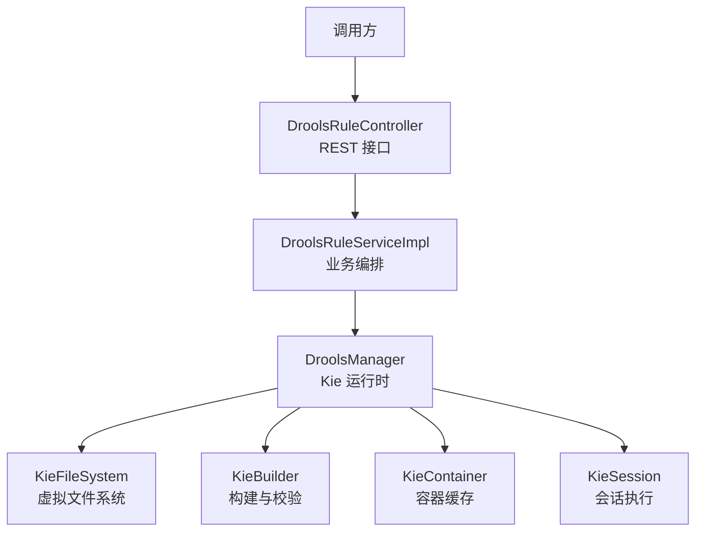
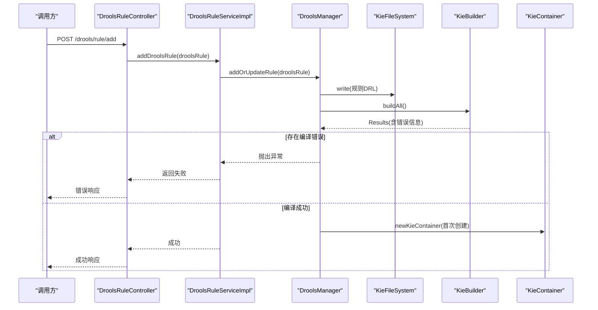
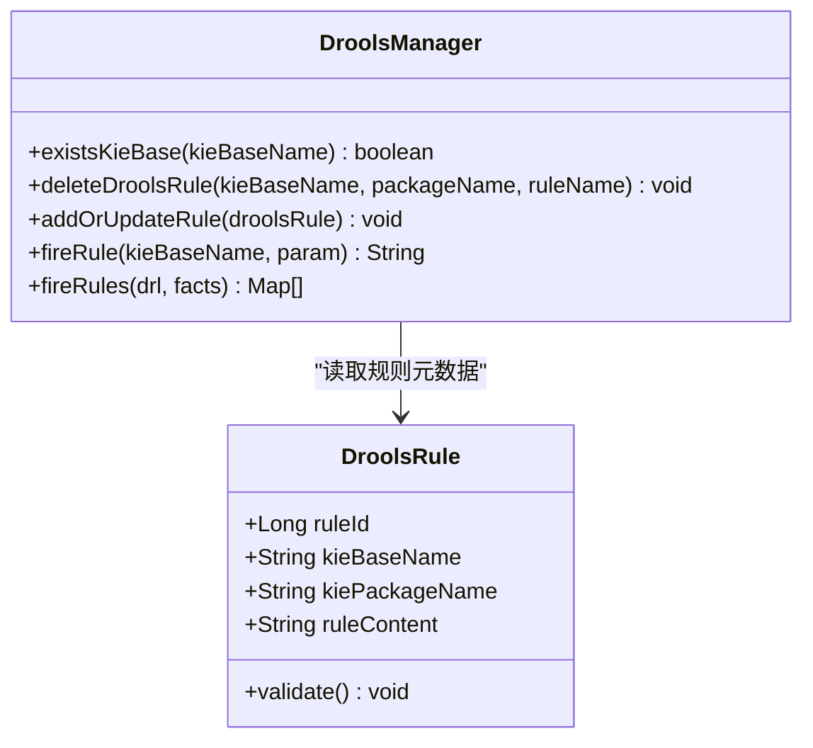
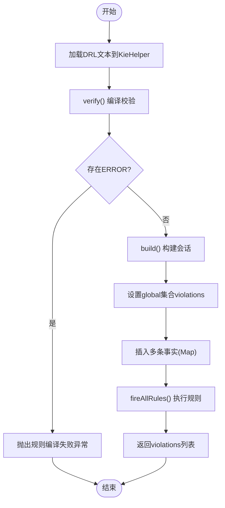
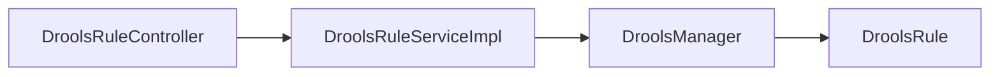

# 规则类型扩展

<cite>
**本文引用的文件**   
- [DroolsManager.java](file://ruoyi-modules/ruoyi-dqservice/src/main/java/com/ruoyi/dqservice/connecter/DroolsManager.java)
- [DroolsRuleController.java](file://ruoyi-modules/ruoyi-dqservice/src/main/java/com/ruoyi/dqservice/controller/DroolsRuleController.java)
- [DroolsRule.java](file://ruoyi-modules/ruoyi-dqservice/src/main/java/com/ruoyi/dqservice/domain/DroolsRule.java)
- [DroolsRuleService.java](file://ruoyi-modules/ruoyi-dqservice/src/main/java/com/ruoyi/dqservice/service/DroolsRuleService.java)
- [DroolsRuleServiceImpl.java](file://ruoyi-modules/ruoyi-dqservice/src/main/java/com/ruoyi/dqservice/service/impl/DroolsRuleServiceImpl.java)
- [pom.xml](file://pom.xml)
</cite>

## 目录
1. [引言](#引言)
2. [项目结构](#项目结构)
3. [核心组件](#核心组件)
4. [架构总览](#架构总览)
5. [详细组件分析](#详细组件分析)
6. [依赖关系分析](#依赖关系分析)
7. [性能与优化](#性能与优化)
8. [测试与验证](#测试与验证)
9. [常见问题排查](#常见问题排查)
10. [结论](#结论)

## 引言
本指南面向需要在现有规则引擎基础上扩展“自定义规则类型”的开发者。围绕数据质量服务中的 Drools 集成，文档从规则定义格式、验证逻辑、执行流程、解析器扩展点、以及常见场景（完整性检查、准确性验证、一致性校验）出发，提供端到端的实现路径与最佳实践。同时给出测试建议与性能调优策略，帮助你在不破坏既有能力的前提下，安全地扩展新的规则类型。

## 项目结构
本项目采用微服务模块化组织，规则引擎相关代码集中在 dqservice 模块中，主要包含控制器、领域模型、服务层与 Drools 连接器：
- 控制器：对外暴露规则管理接口与触发入口
- 领域模型：承载规则元数据与 DRL 文本
- 服务层：封装规则增删改查与持久化模拟
- 连接器：封装 KieBase/KieSession 生命周期、规则编译与执行

**图表来源**
- [DroolsRuleController.java:13-48](file://ruoyi-modules/ruoyi-dqservice/src/main/java/com/ruoyi/dqservice/controller/DroolsRuleController.java#L13-L48)
- [DroolsRuleServiceImpl.java:11-47](file://ruoyi-modules/ruoyi-dqservice/src/main/java/com/ruoyi/dqservice/service/impl/DroolsRuleServiceImpl.java#L11-L47)
- [DroolsManager.java:22-120](file://ruoyi-modules/ruoyi-dqservice/src/main/java/com/ruoyi/dqservice/connecter/DroolsManager.java#L22-L120)

**章节来源**
- [DroolsRuleController.java:13-48](file://ruoyi-modules/ruoyi-dqservice/src/main/java/com/ruoyi/dqservice/controller/DroolsRuleController.java#L13-L48)
- [DroolsRuleServiceImpl.java:11-47](file://ruoyi-modules/ruoyi-dqservice/src/main/java/com/ruoyi/dqservice/service/impl/DroolsRuleServiceImpl.java#L11-L47)
- [DroolsManager.java:22-120](file://ruoyi-modules/ruoyi-dqservice/src/main/java/com/ruoyi/dqservice/connecter/DroolsManager.java#L22-L120)

## 核心组件
- DroolsRuleController：提供规则的查询、新增、更新、删除与触发接口
- DroolsRule：规则领域对象，封装 kieBaseName、kiePackageName、ruleContent 等元数据，并提供基础参数校验
- DroolsRuleService / DroolsRuleServiceImpl：规则的业务编排层，负责参数校验、内存存储与调用连接器
- DroolsManager：Drools 运行时封装，负责 KieFileSystem/KieModuleModel/KieBuilder/KieContainer/KieSession 的管理与规则编译、执行

关键职责边界：
- 控制器仅做请求路由与简单返回
- 服务层负责业务编排与状态维护
- 连接器专注 Drools API 使用与资源管理

**章节来源**
- [DroolsRuleController.java:13-48](file://ruoyi-modules/ruoyi-dqservice/src/main/java/com/ruoyi/dqservice/controller/DroolsRuleController.java#L13-L48)
- [DroolsRule.java:5-31](file://ruoyi-modules/ruoyi-dqservice/src/main/java/com/ruoyi/dqservice/domain/DroolsRule.java#L5-L31)
- [DroolsRuleService.java:7-15](file://ruoyi-modules/ruoyi-dqservice/src/main/java/com/ruoyi/dqservice/service/DroolsRuleService.java#L7-L15)
- [DroolsRuleServiceImpl.java:11-47](file://ruoyi-modules/ruoyi-dqservice/src/main/java/com/ruoyi/dqservice/service/impl/DroolsRuleServiceImpl.java#L11-L47)
- [DroolsManager.java:22-120](file://ruoyi-modules/ruoyi-dqservice/src/main/java/com/ruoyi/dqservice/connecter/DroolsManager.java#L22-L120)

## 架构总览
下图展示一次“添加/更新规则”的完整调用链，以及规则在 Drools 内部的构建与缓存过程。

**图表来源**
- [DroolsRuleController.java:27-31](file://ruoyi-modules/ruoyi-dqservice/src/main/java/com/ruoyi/dqservice/controller/DroolsRuleController.java#L27-L31)
- [DroolsRuleServiceImpl.java:27-31](file://ruoyi-modules/ruoyi-dqservice/src/main/java/com/ruoyi/dqservice/service/impl/DroolsRuleServiceImpl.java#L27-L31)
- [DroolsManager.java:63-120](file://ruoyi-modules/ruoyi-dqservice/src/main/java/com/ruoyi/dqservice/connecter/DroolsManager.java#L63-L120)

## 详细组件分析

### 规则定义与验证
- 字段说明
  - ruleId：规则标识
  - kieBaseName：KieBase 名称，用于隔离不同规则集
  - kiePackageName：包名，对应 Drools 规则包路径
  - ruleContent：DRL 规则文本
- 校验逻辑
  - 必填项校验：ruleId、kieBaseName、kiePackageName、ruleContent 非空
  - 若校验失败，抛出运行时异常

扩展建议：
- 可引入 JSON Schema 或自定义注解进行更严格的语义校验
- 对 DRL 语法进行预检（例如通过 KieHelper.verify）以减少运行期错误

**章节来源**
- [DroolsRule.java:5-31](file://ruoyi-modules/ruoyi-dqservice/src/main/java/com/ruoyi/dqservice/domain/DroolsRule.java#L5-L31)

### 规则服务层
- 功能
  - 查询所有规则
  - 新增/更新规则：先校验，再写入内存存储，最后调用连接器
  - 删除规则：从内存移除并通知连接器删除
- 设计要点
  - 将“业务编排”与“Drools 运行时细节”解耦
  - 当前使用内存 Map 作为持久化替代，便于演示

扩展建议：
- 接入数据库或配置中心，实现规则版本管理与灰度发布
- 增加审计日志与变更追踪

**章节来源**
- [DroolsRuleService.java:7-15](file://ruoyi-modules/ruoyi-dqservice/src/main/java/com/ruoyi/dqservice/service/DroolsRuleService.java#L7-L15)
- [DroolsRuleServiceImpl.java:11-47](file://ruoyi-modules/ruoyi-dqservice/src/main/java/com/ruoyi/dqservice/service/impl/DroolsRuleServiceImpl.java#L11-L47)

### Drools 连接器
- 关键能力
  - 判断 KieBase 是否存在
  - 删除指定包下的规则
  - 添加/更新规则：动态写入虚拟文件系统、生成 kmodule.xml、构建并缓存 KieContainer
  - 触发规则：基于 KieSession 插入事实并执行
  - 批量执行：fireRules 支持任意数量的 Map 事实，并通过 global 收集违规明细
- 资源管理
  - KieFileSystem 全局复用，避免重复构建导致的状态丢失
  - KieContainer 单例缓存，减少重复创建开销
  - KieSession 每次执行新建并在 finally 中释放

**图表来源**
- [DroolsManager.java:22-187](file://ruoyi-modules/ruoyi-dqservice/src/main/java/com/ruoyi/dqservice/connecter/DroolsManager.java#L22-L187)
- [DroolsRule.java:5-31](file://ruoyi-modules/ruoyi-dqservice/src/main/java/com/ruoyi/dqservice/domain/DroolsRule.java#L5-L31)

**章节来源**
- [DroolsManager.java:22-187](file://ruoyi-modules/ruoyi-dqservice/src/main/java/com/ruoyi/dqservice/connecter/DroolsManager.java#L22-L187)

### 规则解析器扩展方法
- 语法分析与编译
  - 使用 KieHelper.addContent 加载 DRL 文本
  - 通过 verify 获取编译结果，提取 ERROR 级别消息
- 语义验证
  - 在 fireRules 中要求规则声明 global java.util.List violations，否则抛出可读异常
  - 可在服务层增加规则模板与白名单校验，限制危险函数或外部访问
- 编译优化
  - 对于频繁执行的规则，优先使用 KieContainer 缓存；对一次性规则使用 KieHelper 临时编译
  - 合理划分 KieBase 与包，降低冲突与重建成本

**图表来源**
- [DroolsManager.java:149-186](file://ruoyi-modules/ruoyi-dqservice/src/main/java/com/ruoyi/dqservice/connecter/DroolsManager.java#L149-L186)

**章节来源**
- [DroolsManager.java:149-186](file://ruoyi-modules/ruoyi-dqservice/src/main/java/com/ruoyi/dqservice/connecter/DroolsManager.java#L149-L186)

### Drools 规则编写规范与语法要求
- 命名与包
  - 使用清晰的 kieBaseName 与 kiePackageName，避免跨规则集污染
- 事实模型
  - 推荐使用强类型 POJO；若使用 Map，需保证字段名稳定且可被规则引用
- Global 变量
  - 如需收集违规明细，请在 DRL 中声明 global java.util.List violations，并在 then 块追加记录
- 条件与动作
  - 条件部分尽量简洁，复杂计算下沉至 Java 方法或工具类
  - 动作部分避免副作用，保持幂等性
- 错误处理
  - 在规则中捕获异常并记录到 violations，避免中断整批执行

提示：以上为通用规范，结合项目中 fireRules 的实现，建议在规则中统一产出结构化违规条目，便于后续统计与报告。

**章节来源**
- [DroolsManager.java:149-186](file://ruoyi-modules/ruoyi-dqservice/src/main/java/com/ruoyi/dqservice/connecter/DroolsManager.java#L149-L186)

### 常见规则类型开发示例
- 完整性检查
  - 目标：确保关键字段非空、长度合法、枚举值有效
  - 实现思路：在 then 中将缺失字段或非法值加入 violations
- 准确性验证
  - 目标：数值范围、格式校验（如邮箱、手机号）、时间先后顺序
  - 实现思路：使用正则与内置函数进行校验，命中则记录违规
- 一致性校验
  - 目标：跨表/跨行的一致性（如订单金额与明细合计一致）
  - 实现思路：通过多事实匹配或聚合后比较，不一致时记录违规

落地建议：
- 将常用校验逻辑封装为 Java 工具类，供 DRL 调用
- 为每类规则提供模板与样例，降低上手成本

[本节为概念性指导，不直接分析具体文件]

## 依赖关系分析
- 模块内依赖
  - DroolsRuleController 依赖 DroolsRuleService 与 DroolsManager
  - DroolsRuleServiceImpl 依赖 DroolsManager
  - DroolsManager 依赖 DroolsRule（读取元数据）
- 外部依赖
  - Drools API（org.kie.*）由运行时提供，项目通过 Spring Boot 生态引入

**图表来源**
- [DroolsRuleController.java:13-48](file://ruoyi-modules/ruoyi-dqservice/src/main/java/com/ruoyi/dqservice/controller/DroolsRuleController.java#L13-L48)
- [DroolsRuleServiceImpl.java:11-47](file://ruoyi-modules/ruoyi-dqservice/src/main/java/com/ruoyi/dqservice/service/impl/DroolsRuleServiceImpl.java#L11-L47)
- [DroolsManager.java:22-120](file://ruoyi-modules/ruoyi-dqservice/src/main/java/com/ruoyi/dqservice/connecter/DroolsManager.java#L22-L120)

**章节来源**
- [DroolsRuleController.java:13-48](file://ruoyi-modules/ruoyi-dqservice/src/main/java/com/ruoyi/dqservice/controller/DroolsRuleController.java#L13-L48)
- [DroolsRuleServiceImpl.java:11-47](file://ruoyi-modules/ruoyi-dqservice/src/main/java/com/ruoyi/dqservice/service/impl/DroolsRuleServiceImpl.java#L11-L47)
- [DroolsManager.java:22-120](file://ruoyi-modules/ruoyi-dqservice/src/main/java/com/ruoyi/dqservice/connecter/DroolsManager.java#L22-L120)

## 性能与优化
- 容器与会话
  - KieContainer 全局缓存，避免重复创建
  - KieSession 短生命周期，使用后及时 dispose
- 规则构建
  - 频繁更新的规则建议使用 KieHelper 临时编译，避免影响其他规则
  - 稳定的规则集放入 KieContainer，提升执行效率
- 事实与全局变量
  - 批量插入事实，减少多次 insert 开销
  - 使用 global 集合收集违规明细，避免规则内部复杂状态
- 资源隔离
  - 按业务域划分 KieBase 与包，降低冲突与重建成本
- 监控与度量
  - 记录规则编译耗时、执行耗时、命中率与违规数，辅助容量规划

[本节为通用指导，不直接分析具体文件]

## 测试与验证
- 单元测试
  - 针对 DroolsRule.validate 的参数校验分支
  - 针对 DroolsManager.fireRules 的编译失败与正常执行分支
- 集成测试
  - 通过 REST 接口触发 add/update/delete/fireRule，验证端到端流程
- 回归测试
  - 覆盖完整性、准确性、一致性三类典型规则
- 性能测试
  - 大事实量压测，观察 KieContainer 复用效果与 GC 行为

[本节为通用指导，不直接分析具体文件]

## 常见问题排查
- 规则编译失败
  - 现象：fireRules 抛出“规则编译失败”
  - 排查：检查 DRL 语法、global 声明、导入包是否正确
- 未声明 global violations
  - 现象：抛出“规则未声明 global java.util.List violations”
  - 排查：在 DRL 中声明 global 并使用其收集违规
- 规则未生效或旧规则残留
  - 现象：更新规则后仍执行旧逻辑
  - 排查：确认 KieContainer 是否复用；必要时重启服务或清理容器
- 并发与线程安全
  - 现象：多线程下出现会话竞争
  - 排查：确保每个线程使用独立 KieSession，避免共享可变状态

**章节来源**
- [DroolsManager.java:149-186](file://ruoyi-modules/ruoyi-dqservice/src/main/java/com/ruoyi/dqservice/connecter/DroolsManager.java#L149-L186)

## 结论
通过控制器、服务层与连接器的分层设计，本项目提供了可扩展的规则引擎集成方案。借助 Drools 的动态编译与执行能力，开发者可以以 DRL 形式快速表达数据质量规则，并通过 global 机制收集违规明细，支撑后续的统计与报告。未来可进一步引入规则版本管理、可视化编辑与在线沙箱，持续提升规则开发与运维体验。

[本节为总结性内容，不直接分析具体文件]