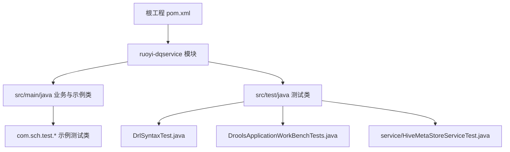
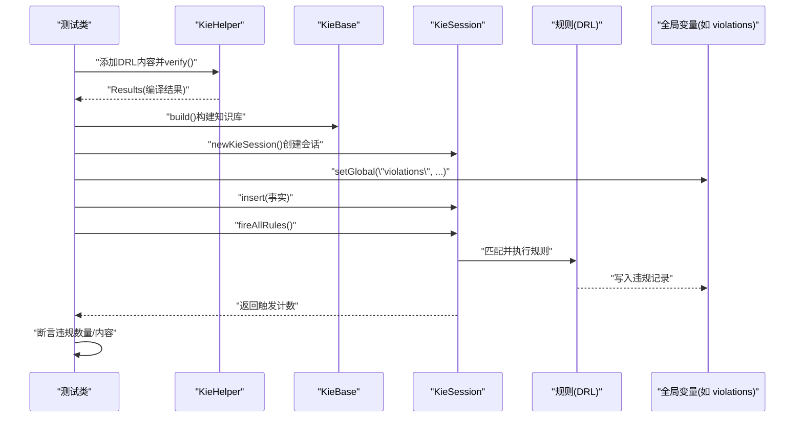
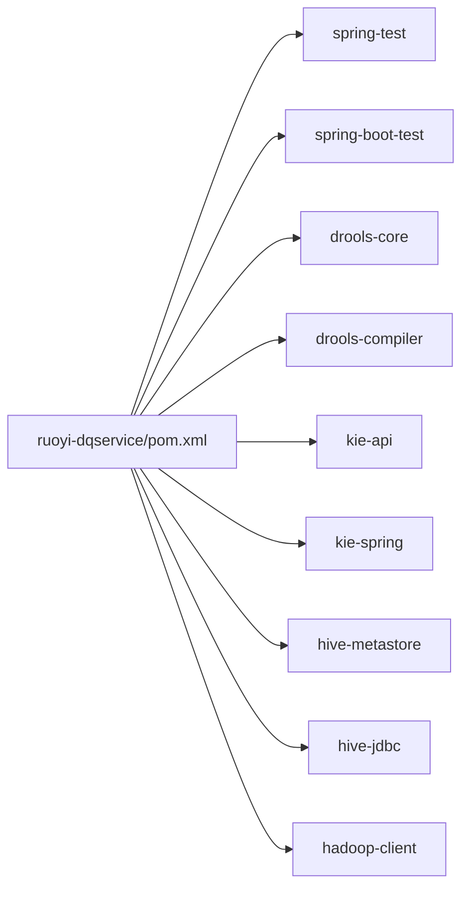

# 测试指南

<cite>
**本文引用的文件**   
- [pom.xml](file://pom.xml)
- [ruoyi-dqservice/pom.xml](file://ruoyi-modules/ruoyi-dqservice/pom.xml)
- [DrlSyntaxTest.java](file://ruoyi-modules/ruoyi-dqservice/src/test/java/com/ruoyi/dqservice/DrlSyntaxTest.java)
- [DroolsApplicationWorkBenchTests.java](file://ruoyi-modules/ruoyi-dqservice/src/test/java/com/ruoyi/dqservice/DroolsApplicationWorkBenchTests.java)
- [TestDFA.java](file://ruoyi-modules/ruoyi-dqservice/src/main/java/com/sch/test/TestDFA.java)
- [TestDrools.java](file://ruoyi-modules/ruoyi-dqservice/src/main/java/com/sch/test/TestDrools.java)
- [TestDrools2.java](file://ruoyi-modules/ruoyi-dqservice/src/main/java/com/sch/test/TestDrools2.java)
- [TestDroolsLocal.java](file://ruoyi-modules/ruoyi-dqservice/src/main/java/com/sch/test/TestDroolsLocal.java)
- [HiveMetaStoreServiceTest.java](file://ruoyi-modules/ruoyi-dqservice/src/test/java/com/ruoyi/dqservice/service/HiveMetaStoreServiceTest.java)
</cite>

## 目录
1. [引言](#引言)
2. [项目结构](#项目结构)
3. [核心组件](#核心组件)
4. [架构总览](#架构总览)
5. [详细组件分析](#详细组件分析)
6. [依赖关系分析](#依赖关系分析)
7. [性能与覆盖率建议](#性能与覆盖率建议)
8. [故障排查指南](#故障排查指南)
9. [结论](#结论)
10. [附录：快速上手清单](#附录快速上手清单)

## 引言
本指南面向数据质量规则引擎（基于 Drools）的单元测试、集成测试与端到端测试实践，结合仓库中已有的测试样例与依赖配置，给出可落地的编写规范、策略与最佳实践。重点覆盖：
- JUnit 测试用例编写与断言选择
- Mock 对象使用与外部依赖隔离
- 数据库与外部服务模拟策略
- Drools 规则测试方法（DRL 语法验证、业务场景验证、远程 Workbench 集成）
- 测试环境搭建、测试数据准备与结果分析
- 测试覆盖率目标与质量标准

## 项目结构
本项目为若依微服务架构，数据质量相关逻辑集中在 ruoyi-dqservice 模块。测试代码主要位于该模块的 test 目录，同时存在部分以 main 方式运行的 Drools 示例类，便于本地调试与演示。



**图表来源**
- [pom.xml:244-251](file://pom.xml#L244-L251)
- [ruoyi-dqservice/pom.xml:12-14](file://ruoyi-modules/ruoyi-dqservice/pom.xml#L12-L14)

**章节来源**
- [pom.xml:244-251](file://pom.xml#L244-L251)
- [ruoyi-dqservice/pom.xml:12-14](file://ruoyi-modules/ruoyi-dqservice/pom.xml#L12-L14)

## 核心组件
围绕测试体系的核心要素如下：
- 测试框架与断言
  - JUnit 4/5 混用：既有 JUnit 4 注解，也有 JUnit 5 注解；断言统一采用对应版本的 Assertions。
  - Spring Boot Test：提供 @SpringBootTest 能力，用于集成测试。
- Drools 测试工具
  - KieHelper：不启动 Spring 上下文，直接编译并执行 DRL，适合语法与轻量场景验证。
  - KieServices/KieContainer/KieSession：加载规则包、创建会话、插入事实、触发规则。
  - UrlResource：从远程或本地 URL 加载规则包，支持基本认证。
- 外部依赖
  - Hive Metastore/JDBC：通过 hadoop-client、hive-metastore、hive-jdbc 访问元数据与数据源。
  - Nacos/Sentinel/Actuator/Swagger：微服务治理与文档能力。

**章节来源**
- [ruoyi-dqservice/pom.xml:320-384](file://ruoyi-modules/ruoyi-dqservice/pom.xml#L320-L384)
- [DrlSyntaxTest.java:1-29](file://ruoyi-modules/ruoyi-dqservice/src/test/java/com/ruoyi/dqservice/DrlSyntaxTest.java#L1-L29)
- [DroolsApplicationWorkBenchTests.java:1-19](file://ruoyi-modules/ruoyi-dqservice/src/test/java/com/ruoyi/dqservice/DroolsApplicationWorkBenchTests.java#L1-L19)

## 架构总览
下图展示测试在 Drools 规则引擎中的典型调用链：测试类负责构造输入事实、注入全局变量、触发规则并断言输出。



**图表来源**
- [DrlSyntaxTest.java:36-83](file://ruoyi-modules/ruoyi-dqservice/src/test/java/com/ruoyi/dqservice/DrlSyntaxTest.java#L36-L83)

## 详细组件分析

### 单元测试编写规范（JUnit + 断言）
- 测试命名
  - 以“被测功能_场景”命名，例如 syntaxA_indexAccess、syntaxC_multiFieldMultiRule。
- 用例组织
  - 将不同语法/场景拆分为独立方法，保证每个用例职责单一、可独立运行。
- 断言选择
  - JUnit 5：使用 org.junit.jupiter.api.Assertions 的 assertEquals、assertTrue、assertFalse。
  - JUnit 4：使用 org.junit.Assert 或对应版本提供的断言。
- 输入构造
  - 使用辅助方法集中构造 Map 行数据，避免重复样板代码。
- 资源清理
  - 每次测试结束需 dispose KieSession，避免状态残留。

参考实现路径：
- [DrlSyntaxTest.java:85-102](file://ruoyi-modules/ruoyi-dqservice/src/test/java/com/ruoyi/dqservice/DrlSyntaxTest.java#L85-L102)
- [DrlSyntaxTest.java:104-121](file://ruoyi-modules/ruoyi-dqservice/src/test/java/com/ruoyi/dqservice/DrlSyntaxTest.java#L104-L121)
- [DrlSyntaxTest.java:123-146](file://ruoyi-modules/ruoyi-dqservice/src/test/java/com/ruoyi/dqservice/DrlSyntaxTest.java#L123-L146)
- [DrlSyntaxTest.java:148-168](file://ruoyi-modules/ruoyi-dqservice/src/test/java/com/ruoyi/dqservice/DrlSyntaxTest.java#L148-L168)

**章节来源**
- [DrlSyntaxTest.java:1-179](file://ruoyi-modules/ruoyi-dqservice/src/test/java/com/ruoyi/dqservice/DrlSyntaxTest.java#L1-L179)

### Mock 对象使用与外部依赖隔离
- 原则
  - 对数据库、网络、文件系统、第三方 SDK 等外部依赖进行隔离，优先使用 Mock 或内存替代。
- 推荐方案
  - Mockito：用于 Mock Service、DAO、HTTP Client 等。
  - Embedded DB：如 H2/Embedded PostgreSQL，用于轻量级数据库测试。
  - WireMock/MockServer：用于 HTTP 接口模拟。
- 当前仓库现状
  - 未发现 Mockito 依赖与使用；建议在需要时引入并在测试中隔离外部依赖。

**章节来源**
- [ruoyi-dqservice/pom.xml:320-384](file://ruoyi-modules/ruoyi-dqservice/pom.xml#L320-L384)

### 集成测试策略（数据库、外部服务、端到端）
- 数据库测试
  - 使用 @SpringBootTest 启动最小化上下文，配合嵌入式数据库或测试库实例。
  - 使用事务回滚保证用例间数据隔离。
- 外部服务模拟
  - 对于 Hive Metastore/JDBC，建议使用容器化测试环境或 Mock 客户端。
  - 对于远程规则仓库（Workbench），可使用固定 URL 与凭据，或在 CI 中启动 Mock 服务。
- 端到端测试
  - 覆盖“请求入口 -> 规则引擎 -> 结果输出”的完整链路，断言最终业务结果。

参考实现路径：
- [HiveMetaStoreServiceTest.java:12-16](file://ruoyi-modules/ruoyi-dqservice/src/test/java/com/ruoyi/dqservice/service/HiveMetaStoreServiceTest.java#L12-L16)
- [DroolsApplicationWorkBenchTests.java:20-48](file://ruoyi-modules/ruoyi-dqservice/src/test/java/com/ruoyi/dqservice/DroolsApplicationWorkBenchTests.java#L20-L48)

**章节来源**
- [HiveMetaStoreServiceTest.java:12-16](file://ruoyi-modules/ruoyi-dqservice/src/test/java/com/ruoyi/dqservice/service/HiveMetaStoreServiceTest.java#L12-L16)
- [DroolsApplicationWorkBenchTests.java:20-48](file://ruoyi-modules/ruoyi-dqservice/src/test/java/com/ruoyi/dqservice/DroolsApplicationWorkBenchTests.java#L20-L48)

### Drools 规则测试方法
- 规则文件测试（DRL 语法校验）
  - 使用 KieHelper.addContent 与 verify 快速验证 DRL 是否可编译。
  - 针对 Map fact 的属性访问、多字段条件、多规则命中等场景分别设计用例。
- 业务场景验证
  - 构造符合业务语义的事实集合，设置全局变量收集违规信息，断言命中数与违规详情。
- 远程 Workbench 集成
  - 通过 UrlResource 从远程 Maven 仓库拉取规则包，建立 KieContainer 并执行规则。
  - 注意处理网络异常与认证信息。

参考实现路径：
- [DrlSyntaxTest.java:36-83](file://ruoyi-modules/ruoyi-dqservice/src/test/java/com/ruoyi/dqservice/DrlSyntaxTest.java#L36-L83)
- [DrlSyntaxTest.java:85-168](file://ruoyi-modules/ruoyi-dqservice/src/test/java/com/ruoyi/dqservice/DrlSyntaxTest.java#L85-L168)
- [DroolsApplicationWorkBenchTests.java:20-48](file://ruoyi-modules/ruoyi-dqservice/src/test/java/com/ruoyi/dqservice/DroolsApplicationWorkBenchTests.java#L20-L48)

#### 流程示意：DRL 语法与场景验证
```mermaid
flowchart TD
Start(["开始"]) --> AddDRL["添加DRL内容"]
AddDRL --> Verify["verify()检查编译错误"]
Verify --> HasError{"有错误?"}
HasError --> |是| Fail["抛出异常/打印错误"]
HasError --> |否| Build["build()构建KieBase"]
Build --> NewSession["newKieSession()"]
NewSession --> SetGlobal["setGlobal(\"violations\", ...)"]
SetGlobal --> InsertFacts["insert(事实)"]
InsertFacts --> Fire["fireAllRules()"]
Fire --> Assert["断言违规数量/详情"]
Assert --> End(["结束"])
```

**图表来源**
- [DrlSyntaxTest.java:36-83](file://ruoyi-modules/ruoyi-dqservice/src/test/java/com/ruoyi/dqservice/DrlSyntaxTest.java#L36-L83)

**章节来源**
- [DrlSyntaxTest.java:1-179](file://ruoyi-modules/ruoyi-dqservice/src/test/java/com/ruoyi/dqservice/DrlSyntaxTest.java#L1-L179)
- [DroolsApplicationWorkBenchTests.java:1-49](file://ruoyi-modules/ruoyi-dqservice/src/test/java/com/ruoyi/dqservice/DroolsApplicationWorkBenchTests.java#L1-L49)

### 示例类与本地调试
仓库中存在若干以 main 方式运行的示例类，便于本地快速验证规则与数据流：
- TestDFA：DFA 相关示例
- TestDrools：基础 Drools 用法
- TestDrools2：从远程 URL 加载规则包
- TestDroolsLocal：本地 resource 下 kmodule.xml 与 DRL 的规则工作空间

这些示例展示了如何：
- 获取 KieServices/KieContainer
- 从 URL 或 classpath 加载规则
- 插入事实并触发规则
- 统计触发次数与耗时

参考实现路径：
- [TestDFA.java:6](file://ruoyi-modules/ruoyi-dqservice/src/main/java/com/sch/test/TestDFA.java#L6)
- [TestDrools.java:43-66](file://ruoyi-modules/ruoyi-dqservice/src/main/java/com/sch/test/TestDrools.java#L43-L66)
- [TestDrools2.java:25-86](file://ruoyi-modules/ruoyi-dqservice/src/main/java/com/sch/test/TestDrools2.java#L25-L86)
- [TestDroolsLocal.java:27-43](file://ruoyi-modules/ruoyi-dqservice/src/main/java/com/sch/test/TestDroolsLocal.java#L27-L43)

**章节来源**
- [TestDFA.java:6](file://ruoyi-modules/ruoyi-dqservice/src/main/java/com/sch/test/TestDFA.java#L6)
- [TestDrools.java:43-66](file://ruoyi-modules/ruoyi-dqservice/src/main/java/com/sch/test/TestDrools.java#L43-L66)
- [TestDrools2.java:25-86](file://ruoyi-modules/ruoyi-dqservice/src/main/java/com/sch/test/TestDrools2.java#L25-L86)
- [TestDroolsLocal.java:27-43](file://ruoyi-modules/ruoyi-dqservice/src/main/java/com/sch/test/TestDroolsLocal.java#L27-L43)

## 依赖关系分析
测试相关的依赖主要集中在 ruoyi-dqservice 模块的 pom 中，包括：
- spring-test、spring-boot-test：集成测试支撑
- drools-core、drools-compiler、kie-api、kie-spring：规则引擎核心
- hive-metastore、hive-jdbc、hadoop-client：数据源与元数据访问
- junit、spring-boot-starter-test：测试框架与工具



**图表来源**
- [ruoyi-dqservice/pom.xml:320-384](file://ruoyi-modules/ruoyi-dqservice/pom.xml#L320-L384)

**章节来源**
- [ruoyi-dqservice/pom.xml:320-384](file://ruoyi-modules/ruoyi-dqservice/pom.xml#L320-L384)

## 性能与覆盖率建议
- 性能优化
  - 复用 KieContainer：避免频繁重建，减少规则加载开销。
  - 批量 insert：合并事实插入，降低会话操作次数。
  - 控制 fireAllRules 范围：必要时使用 agenda-group 或 rule-flow 限制触发面。
- 覆盖率目标
  - 建议分支覆盖率 ≥ 80%，语句覆盖率 ≥ 90%。
  - 对 Drools 规则侧，至少覆盖关键分支与边界条件（空值、越界、非法类型）。
- 报告与分析
  - 使用 JaCoCo 生成覆盖率报告，CI 中阻断低于阈值的变更。
  - 对失败用例保留日志与中间状态，便于定位问题。

[本节为通用建议，不直接分析具体文件]

## 故障排查指南
- DRL 编译失败
  - 现象：verify() 返回包含 ERROR 级别消息。
  - 排查：打印 Message 文本，确认语法与导入是否正确。
  - 参考：[DrlSyntaxTest.java:36-52](file://ruoyi-modules/ruoyi-dqservice/src/test/java/com/ruoyi/dqservice/DrlSyntaxTest.java#L36-L52)
- 远程规则包下载失败
  - 现象：UrlResource.getInputStream() 抛 IO 异常。
  - 排查：检查 URL、用户名密码、网络连通性；确保 Workbench 已部署并可访问。
  - 参考：[DroolsApplicationWorkBenchTests.java:20-48](file://ruoyi-modules/ruoyi-dqservice/src/test/java/com/ruoyi/dqservice/DroolsApplicationWorkBenchTests.java#L20-L48)
- 会话未释放导致内存泄漏
  - 现象：多次 fireAllRules 后内存增长。
  - 排查：确保每次测试 dispose KieSession。
  - 参考：[DrlSyntaxTest.java:74-83](file://ruoyi-modules/ruoyi-dqservice/src/test/java/com/ruoyi/dqservice/DrlSyntaxTest.java#L74-L83)

**章节来源**
- [DrlSyntaxTest.java:36-52](file://ruoyi-modules/ruoyi-dqservice/src/test/java/com/ruoyi/dqservice/DrlSyntaxTest.java#L36-L52)
- [DrlSyntaxTest.java:74-83](file://ruoyi-modules/ruoyi-dqservice/src/test/java/com/ruoyi/dqservice/DrlSyntaxTest.java#L74-L83)
- [DroolsApplicationWorkBenchTests.java:20-48](file://ruoyi-modules/ruoyi-dqservice/src/test/java/com/ruoyi/dqservice/DroolsApplicationWorkBenchTests.java#L20-L48)

## 结论
本指南基于仓库现有测试样例与依赖配置，总结了 Drools 规则测试的最佳实践：
- 使用 KieHelper 进行轻量级 DRL 语法与场景验证
- 使用 KieServices/KieContainer/KieSession 进行规则包加载与会话管理
- 通过 UrlResource 对接远程 Workbench，完成端到端规则验证
- 对外部依赖进行 Mock 或容器化隔离，提升测试稳定性
- 制定明确的覆盖率目标与质量门禁，保障规则质量与可维护性

[本节为总结性内容，不直接分析具体文件]

## 附录：快速上手清单
- 环境准备
  - 安装 JDK 8+、Maven
  - 启动 Nacos（如需）、MySQL（如需）、Hive Metastore（如需）
- 运行测试
  - 单测：mvn test -pl ruoyi-modules/ruoyi-dqservice
  - 指定用例：mvn test -pl ruoyi-modules/ruoyi-dqservice -Dtest=DrlSyntaxTest
- 覆盖率报告
  - mvn test jacoco:report -pl ruoyi-modules/ruoyi-dqservice
- 常见问题
  - DRL 编译错误：查看 verify() 返回的错误消息
  - 远程规则包不可达：检查 URL 与认证信息
  - 会话未释放：确保 dispose KieSession

[本节为通用指导，不直接分析具体文件]