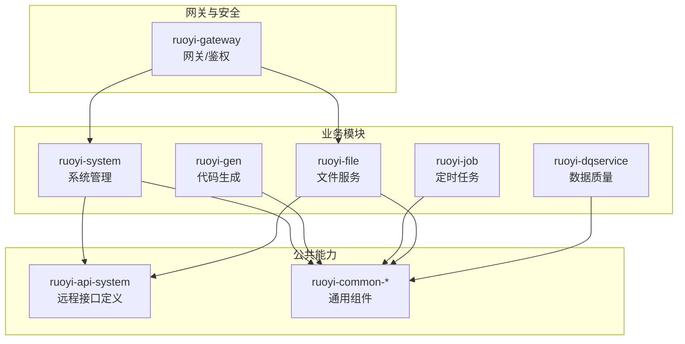
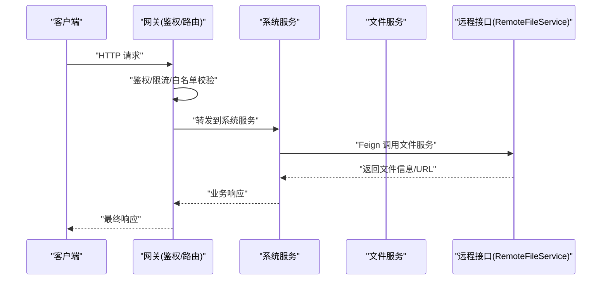
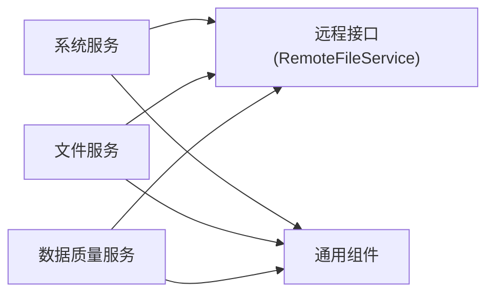

# 业务服务

<cite>
**本文引用的文件**   
- [pom.xml](file://ruoyi-modules/pom.xml)
- [RuoYiFileApplication.java](file://ruoyi-modules/ruoyi-file/src/main/java/com/ruoyi/file/RuoYiFileApplication.java)
- [RuoYiSystemApplication.java](file://ruoyi-modules/ruoyi-system/src/main/java/com/ruoyi/system/RuoYiSystemApplication.java)
- [bootstrap.yml（文件服务）](file://ruoyi-modules/ruoyi-file/src/main/resources/bootstrap.yml)
- [bootstrap.yml（系统服务）](file://ruoyi-modules/ruoyi-system/src/main/resources/bootstrap.yml)
- [SysFileController.java](file://ruoyi-modules/ruoyi-file/src/main/java/com/ruoyi/file/controller/SysFileController.java)
- [ISysFileService.java](file://ruoyi-modules/ruoyi-file/src/main/java/com/ruoyi/file/service/ISysFileService.java)
- [LocalSysFileServiceImpl.java](file://ruoyi-modules/ruoyi-file/src/main/java/com/ruoyi/file/service/LocalSysFileServiceImpl.java)
- [MinioSysFileServiceImpl.java](file://ruoyi-modules/ruoyi-file/src/main/java/com/ruoyi/file/service/MinioSysFileServiceImpl.java)
- [FastDfsSysFileServiceImpl.java](file://ruoyi-modules/ruoyi-file/src/main/java/com/ruoyi/file/service/FastDfsSysFileServiceImpl.java)
- [MinioConfig.java](file://ruoyi-modules/ruoyi-file/src/main/java/com/ruoyi/file/config/MinioConfig.java)
- [ResourcesConfig.java](file://ruoyi-modules/ruoyi-file/src/main/java/com/ruoyi/file/config/ResourcesConfig.java)
- [RemoteFileService.java](file://ruoyi-api/ruoyi-api-system/src/main/java/com/ruoyi/system/api/RemoteFileService.java)
- [RemoteUserFallbackFactory.java](file://ruoyi-api/ruoyi-api-system/src/main/java/com/ruoyi/system/api/factory/RemoteUserFallbackFactory.java)
- [RemoteLogFallbackFactory.java](file://ruoyi-api/ruoyi-api-system/src/main/java/com/ruoyi/system/api/factory/RemoteLogFallbackFactory.java)
- [RemoteFileFallbackFactory.java](file://ruoyi-api/ruoyi-api-system/src/main/java/com/ruoyi/system/api/factory/RemoteFileFallbackFactory.java)
- [SecurityConstants.java](file://ruoyi-common/ruoyi-common-core/src/main/java/com/ruoyi/common/core/constant/SecurityConstants.java)
- [ServiceNameConstants.java](file://ruoyi-common/ruoyi-common-core/src/main/java/com/ruoyi/common/core/constant/ServiceNameConstants.java)
- [GlobalException.java](file://ruoyi-common/ruoyi-common-core/src/main/java/com/ruoyi/common/core/exception/GlobalException.java)
- [ServiceException.java](file://ruoyi-common/ruoyi-common-core/src/main/java/com/ruoyi/common/core/exception/ServiceException.java)
- [AuthFilter.java](file://ruoyi-gateway/src/main/java/com/ruoyi/gateway/filter/AuthFilter.java)
- [GatewayExceptionHandler.java](file://ruoyi-gateway/src/main/java/com/ruoyi/gateway/handler/GatewayExceptionHandler.java)
- [ry_dqservice_20261026.sql](file://sql/ry_dqservice_20261026.sql)
</cite>

## 目录
1. [简介](#简介)
2. [项目结构](#项目结构)
3. [核心组件](#核心组件)
4. [架构总览](#架构总览)
5. [详细组件分析](#详细组件分析)
6. [依赖关系分析](#依赖关系分析)
7. [性能与扩展性](#性能与扩展性)
8. [故障排查指南](#故障排查指南)
9. [结论](#结论)
10. [附录](#附录)

## 简介
本文件面向“业务服务”模块，聚焦系统管理、数据质量、文件服务等核心业务微服务的职责划分、启动配置、依赖关系、API接口设计，以及跨服务调用（Feign）、数据隔离、事务处理等企业级特性。同时提供部署与扩展的最佳实践，帮助读者快速理解并高效运维该微服务集群。

## 项目结构
本项目采用多模块Maven工程组织，业务微服务位于 ruoyi-modules 下，包含：
- 系统管理服务：ruoyi-system
- 代码生成服务：ruoyi-gen
- 定时任务服务：ruoyi-job
- 文件服务：ruoyi-file
- 数据质量服务：ruoyi-dqservice



图表来源
- [pom.xml:11-17](file://ruoyi-modules/pom.xml#L11-L17)

章节来源
- [pom.xml:1-27](file://ruoyi-modules/pom.xml#L1-L27)

## 核心组件
- 系统管理服务（ruoyi-system）
  - 职责：用户、角色、菜单、字典、部门等基础系统能力的管理与维护。
  - 入口：应用主类 RuoYiSystemApplication。
  - 配置：通过 bootstrap.yml 接入注册中心与配置中心。
- 文件服务（ruoyi-file）
  - 职责：统一文件上传、下载、预览、删除等能力，支持本地存储、MinIO、FastDFS等多种后端。
  - 入口：应用主类 RuoYiFileApplication。
  - 配置：通过 bootstrap.yml 与 MinioConfig 等配置类完成存储后端切换。
- 数据质量服务（ruoyi-dqservice）
  - 职责：数据质量规则、任务编排、执行与结果统计等。
  - 入口：应用主类（包路径 com.ruoyi.dqservice）。
  - 配置：通过 application.properties 与 bootstrap.yml 进行运行时配置。

章节来源
- [RuoYiSystemApplication.java](file://ruoyi-modules/ruoyi-system/src/main/java/com/ruoyi/system/RuoYiSystemApplication.java)
- [RuoYiFileApplication.java](file://ruoyi-modules/ruoyi-file/src/main/java/com/ruoyi/file/RuoYiFileApplication.java)

## 架构总览
整体采用“网关 + 微服务 + 公共API + 基础设施”的分层架构。外部请求经网关统一鉴权与路由，转发至具体业务微服务；微服务之间通过 Feign 进行远程调用，共享 ruoyi-api-system 中定义的远程接口与降级工厂；通用能力（安全、日志、Redis、Swagger等）由 ruoyi-common-* 提供。



图表来源
- [AuthFilter.java](file://ruoyi-gateway/src/main/java/com/ruoyi/gateway/filter/AuthFilter.java)
- [RemoteFileService.java](file://ruoyi-api/ruoyi-api-system/src/main/java/com/ruoyi/system/api/RemoteFileService.java)

## 详细组件分析

### 文件服务（ruoyi-file）
- 职责边界
  - 对外暴露统一的文件操作REST接口，屏蔽底层存储差异。
  - 支持多种存储实现：本地磁盘、MinIO、FastDFS，通过策略模式切换。
- 关键类与关系
```mermaid
classDiagram
class SysFileController {
"+upload(file)"
"+download(fileName)"
"+delete(fileName)"
}
class ISysFileService {
"<<interface>>"
"+upload(file)"
"+download(fileName)"
"+delete(fileName)"
}
class LocalSysFileServiceImpl
class MinioSysFileServiceImpl
class FastDfsSysFileServiceImpl
class MinioConfig
class ResourcesConfig
SysFileController --> ISysFileService : "调用"
ISysFileService <|.. LocalSysFileServiceImpl
ISysFileService <|.. MinioSysFileServiceImpl
ISysFileService <|.. FastDfsSysFileServiceImpl
MinioSysFileServiceImpl --> MinioConfig : "使用"
SysFileController --> ResourcesConfig : "静态资源映射"
```

图表来源
- [SysFileController.java](file://ruoyi-modules/ruoyi-file/src/main/java/com/ruoyi/file/controller/SysFileController.java)
- [ISysFileService.java](file://ruoyi-modules/ruoyi-file/src/main/java/com/ruoyi/file/service/ISysFileService.java)
- [LocalSysFileServiceImpl.java](file://ruoyi-modules/ruoyi-file/src/main/java/com/ruoyi/file/service/LocalSysFileServiceImpl.java)
- [MinioSysFileServiceImpl.java](file://ruoyi-modules/ruoyi-file/src/main/java/com/ruoyi/file/service/MinioSysFileServiceImpl.java)
- [FastDfsSysFileServiceImpl.java](file://ruoyi-modules/ruoyi-file/src/main/java/com/ruoyi/file/service/FastDfsSysFileServiceImpl.java)
- [MinioConfig.java](file://ruoyi-modules/ruoyi-file/src/main/java/com/ruoyi/file/config/MinioConfig.java)
- [ResourcesConfig.java](file://ruoyi-modules/ruoyi-file/src/main/java/com/ruoyi/file/config/ResourcesConfig.java)

- 启动配置要点
  - 通过 bootstrap.yml 指定服务名、端口、注册中心地址等。
  - MinIO 相关参数在 MinioConfig 中注入，便于动态切换存储后端。
  - 静态资源访问通过 ResourcesConfig 配置路径映射。

- API接口设计
  - 上传：接收文件流或字节数组，返回文件标识与访问URL。
  - 下载：根据文件名获取并返回文件流。
  - 删除：按文件名删除对应文件。
  - 建议：统一错误码与响应体结构，遵循全局异常处理规范。

- 跨服务调用（Feign）
  - 其他服务通过 RemoteFileService 远程调用文件服务，配合 FallbackFactory 实现容错降级。
  - 建议在调用处增加重试与熔断策略，提升可用性。

- 数据隔离与事务
  - 文件服务通常不涉及复杂事务，但需保证上传原子性与一致性（如分片上传的合并与回滚）。
  - 若涉及数据库元数据写入，应结合分布式事务方案（如Seata）确保跨库一致性。

章节来源
- [RuoYiFileApplication.java](file://ruoyi-modules/ruoyi-file/src/main/java/com/ruoyi/file/RuoYiFileApplication.java)
- [bootstrap.yml（文件服务）](file://ruoyi-modules/ruoyi-file/src/main/resources/bootstrap.yml)
- [MinioConfig.java](file://ruoyi-modules/ruoyi-file/src/main/java/com/ruoyi/file/config/MinioConfig.java)
- [ResourcesConfig.java](file://ruoyi-modules/ruoyi-file/src/main/java/com/ruoyi/file/config/ResourcesConfig.java)
- [SysFileController.java](file://ruoyi-modules/ruoyi-file/src/main/java/com/ruoyi/file/controller/SysFileController.java)
- [ISysFileService.java](file://ruoyi-modules/ruoyi-file/src/main/java/com/ruoyi/file/service/ISysFileService.java)
- [LocalSysFileServiceImpl.java](file://ruoyi-modules/ruoyi-file/src/main/java/com/ruoyi/file/service/LocalSysFileServiceImpl.java)
- [MinioSysFileServiceImpl.java](file://ruoyi-modules/ruoyi-file/src/main/java/com/ruoyi/file/service/MinioSysFileServiceImpl.java)
- [FastDfsSysFileServiceImpl.java](file://ruoyi-modules/ruoyi-file/src/main/java/com/ruoyi/file/service/FastDfsSysFileServiceImpl.java)

### 系统管理服务（ruoyi-system）
- 职责边界
  - 提供用户、角色、菜单、字典、部门、操作日志等系统管理能力。
  - 作为权限与认证的核心支撑，为其他业务服务提供基础数据与鉴权上下文。
- 启动配置要点
  - 通过 bootstrap.yml 接入注册中心与配置中心，加载数据库连接、缓存等运行参数。
- 跨服务调用（Feign）
  - 通过 RemoteFileService 调用文件服务，用于附件上传、预览等场景。
  - 使用 SecurityConstants 与 ServiceNameConstants 统一管理安全头与服务发现名称。
- 数据隔离与事务
  - 基于租户/部门的数据范围控制（DataScope），结合注解切面实现行级数据隔离。
  - 对涉及多表写操作的流程，建议使用分布式事务框架保障一致性。

章节来源
- [RuoYiSystemApplication.java](file://ruoyi-modules/ruoyi-system/src/main/java/com/ruoyi/system/RuoYiSystemApplication.java)
- [bootstrap.yml（系统服务）](file://ruoyi-modules/ruoyi-system/src/main/resources/bootstrap.yml)
- [RemoteFileService.java](file://ruoyi-api/ruoyi-api-system/src/main/java/com/ruoyi/system/api/RemoteFileService.java)
- [SecurityConstants.java](file://ruoyi-common/ruoyi-common-core/src/main/java/com/ruoyi/common/core/constant/SecurityConstants.java)
- [ServiceNameConstants.java](file://ruoyi-common/ruoyi-common-core/src/main/java/com/ruoyi/common/core/constant/ServiceNameConstants.java)

### 数据质量服务（ruoyi-dqservice）
- 职责边界
  - 负责数据质量规则建模、任务调度、执行引擎与结果报表。
  - 与系统服务协作获取用户/角色权限，与文件服务协作导出报告或附件。
- 启动配置要点
  - 通过 application.properties 与 bootstrap.yml 配置数据库、缓存、任务线程池等。
- 跨服务调用（Feign）
  - 通过 RemoteFileService 拉取/推送文件，通过系统服务提供的远程接口获取基础数据。
- 数据隔离与事务
  - 针对批量导入与规则执行，建议采用分批次提交与补偿机制，避免长事务。
  - 与外部系统交互时，结合消息队列与幂等设计保障最终一致性。

章节来源
- [application.properties（数据质量服务）](file://ruoyi-modules/ruoyi-dqservice/src/main/resources/application.properties)
- [bootstrap.yml（数据质量服务）](file://ruoyi-modules/ruoyi-dqservice/src/main/resources/bootstrap.yml)
- [ry_dqservice_20261026.sql](file://sql/ry_dqservice_20261026.sql)

## 依赖关系分析
- 模块内聚与耦合
  - 各业务模块依赖 ruoyi-common-* 提供通用能力，降低重复开发成本。
  - 模块间通过 ruoyi-api-system 暴露的远程接口解耦，避免直接依赖对方实现。
- 外部依赖
  - 注册中心/配置中心：通过 bootstrap.yml 统一接入。
  - 存储后端：MinIO、FastDFS 等通过配置类注入。
- 潜在循环依赖
  - 通过接口抽象与分层设计避免循环依赖；Feign 客户端仅依赖接口定义。



图表来源
- [RemoteFileService.java](file://ruoyi-api/ruoyi-api-system/src/main/java/com/ruoyi/system/api/RemoteFileService.java)
- [pom.xml:11-17](file://ruoyi-modules/pom.xml#L11-L17)

章节来源
- [pom.xml:1-27](file://ruoyi-modules/pom.xml#L1-L27)
- [RemoteFileService.java](file://ruoyi-api/ruoyi-api-system/src/main/java/com/ruoyi/system/api/RemoteFileService.java)

## 性能与扩展性
- 文件服务
  - 大文件上传：建议启用分片上传与断点续传，减少超时风险。
  - 存储后端：优先选择对象存储（如MinIO）以获得更好的水平扩展能力。
  - 静态资源：合理配置 CDN 与缓存策略，减轻服务压力。
- 系统服务
  - 鉴权与权限：引入缓存（如Redis）减少频繁查询，提升鉴权性能。
  - 分页与索引：对高频查询字段建立合适索引，避免全表扫描。
- 数据质量服务
  - 任务调度：合理设置线程池大小与批处理大小，避免内存溢出。
  - 异步化：将耗时计算与I/O操作异步化，提高吞吐。
- 通用优化
  - 连接池：数据库与Redis连接池参数调优。
  - 监控与告警：接入链路追踪与指标采集，及时发现瓶颈。

[本节为通用指导，不直接分析具体文件]

## 故障排查指南
- 网关层
  - 鉴权失败：检查 AuthFilter 中的令牌校验逻辑与黑名单配置。
  - 全局异常：查看 GatewayExceptionHandler 的统一错误输出，定位上游服务异常。
- 业务服务
  - 全局异常：参考 GlobalException 与 ServiceException 的错误码与消息规范，快速定位问题。
  - 远程调用失败：检查 FallbackFactory（RemoteFileFallbackFactory、RemoteUserFallbackFactory、RemoteLogFallbackFactory）是否生效，确认网络连通性与服务注册状态。
- 常见问题
  - 服务无法注册：核对 bootstrap.yml 中的注册中心地址与凭据。
  - 文件上传失败：确认存储后端配置（MinIO/FastDFS）与权限，检查磁盘空间与配额。

章节来源
- [AuthFilter.java](file://ruoyi-gateway/src/main/java/com/ruoyi/gateway/filter/AuthFilter.java)
- [GatewayExceptionHandler.java](file://ruoyi-gateway/src/main/java/com/ruoyi/gateway/handler/GatewayExceptionHandler.java)
- [GlobalException.java](file://ruoyi-common/ruoyi-common-core/src/main/java/com/ruoyi/common/core/exception/GlobalException.java)
- [ServiceException.java](file://ruoyi-common/ruoyi-common-core/src/main/java/com/ruoyi/common/core/exception/ServiceException.java)
- [RemoteFileFallbackFactory.java](file://ruoyi-api/ruoyi-api-system/src/main/java/com/ruoyi/system/api/factory/RemoteFileFallbackFactory.java)
- [RemoteUserFallbackFactory.java](file://ruoyi-api/ruoyi-api-system/src/main/java/com/ruoyi/system/api/factory/RemoteUserFallbackFactory.java)
- [RemoteLogFallbackFactory.java](file://ruoyi-api/ruoyi-api-system/src/main/java/com/ruoyi/system/api/factory/RemoteLogFallbackFactory.java)

## 结论
本业务服务集群以清晰的职责划分与解耦的远程接口为基础，结合网关统一鉴权与通用组件，形成稳定可扩展的微服务体系。文件服务通过策略模式支持多存储后端，系统服务提供基础权限与数据支撑，数据质量服务专注规则与任务编排。在生产环境中，建议重点完善可观测性、容错降级与容量规划，确保高可用与高性能。

[本节为总结性内容，不直接分析具体文件]

## 附录
- 部署建议
  - 容器化：每个微服务独立镜像，配合编排平台（Kubernetes/Docker Compose）进行扩缩容。
  - 配置管理：集中化管理配置项，区分环境（dev/test/prod）与敏感信息加密。
  - 灰度发布：结合网关路由与蓝绿/金丝雀策略，逐步放量。
- 最佳实践
  - 接口契约：严格遵循 OpenAPI/Swagger 文档，保持前后端一致。
  - 安全加固：最小权限原则、输入校验、防重放与防XSS。
  - 数据治理：定期备份与恢复演练，建立数据质量监控与告警。

[本节为通用指导，不直接分析具体文件]