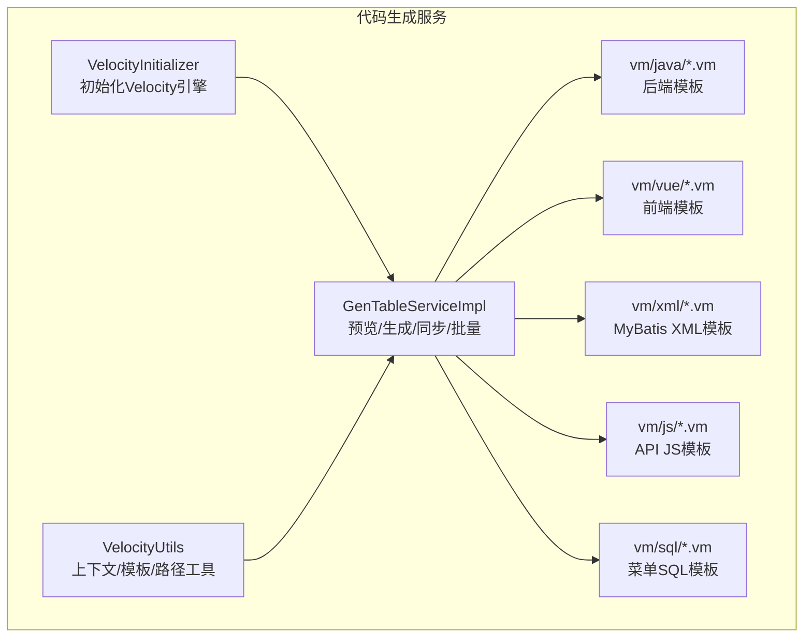
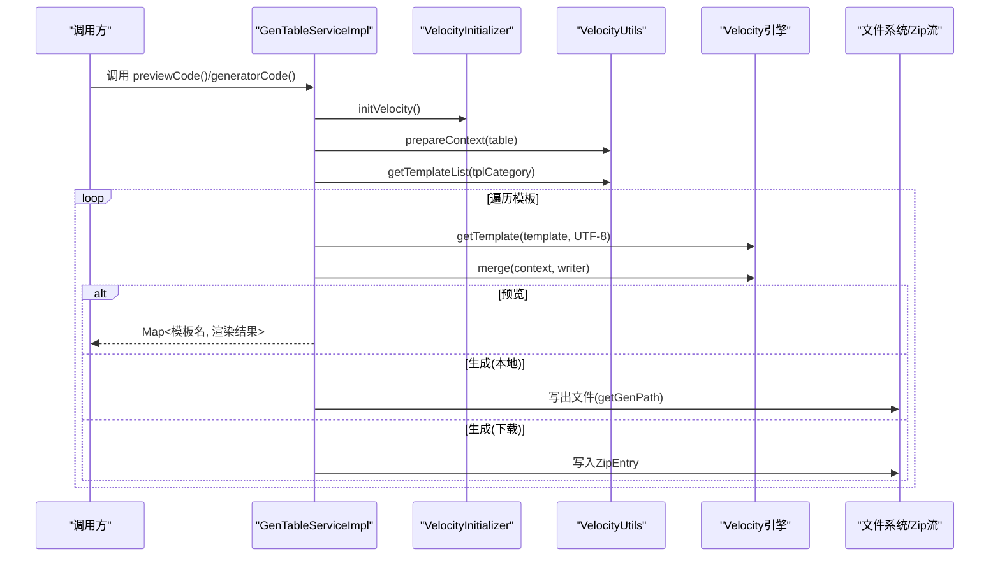
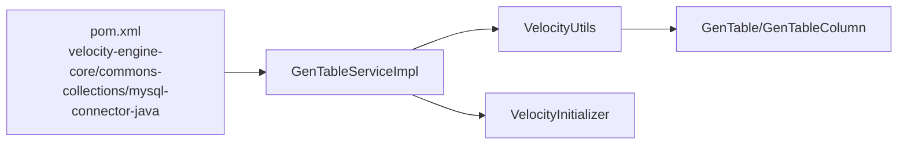
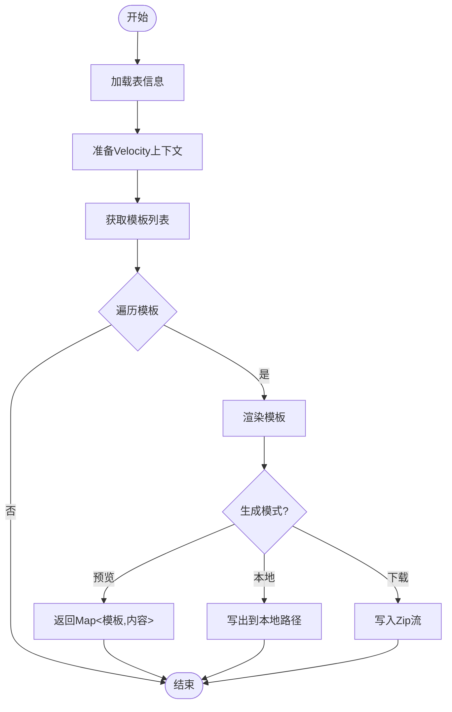

# 代码生成服务

<cite>
**本文引用的文件**   
- [pom.xml](file://ruoyi-modules/ruoyi-gen/pom.xml)
- [GenTableServiceImpl.java](file://ruoyi-modules/ruoyi-gen/src/main/java/com/ruoyi/gen/service/GenTableServiceImpl.java)
- [VelocityInitializer.java](file://ruoyi-modules/ruoyi-gen/src/main/java/com/ruoyi/gen/util/VelocityInitializer.java)
- [VelocityUtils.java](file://ruoyi-modules/ruoyi-gen/src/main/java/com/ruoyi/gen/util/VelocityUtils.java)
- [domain.java.vm](file://ruoyi-modules/ruoyi-gen/src/main/resources/vm/java/domain.java.vm)
- [controller.java.vm](file://ruoyi-modules/ruoyi-gen/src/main/resources/vm/java/controller.java.vm)
- [index.vue.vm](file://ruoyi-modules/ruoyi-gen/src/main/resources/vm/vue/index.vue.vm)
</cite>

## 目录
1. [简介](#简介)
2. [项目结构](#项目结构)
3. [核心组件](#核心组件)
4. [架构总览](#架构总览)
5. [详细组件分析](#详细组件分析)
6. [依赖关系分析](#依赖关系分析)
7. [性能与扩展性](#性能与扩展性)
8. [故障排查指南](#故障排查指南)
9. [结论](#结论)
10. [附录：模板与规则说明](#附录模板与规则说明)

## 简介
本代码生成服务基于 Apache Velocity 模板引擎，提供从数据库表结构到前后端代码的一键生成能力。支持实体类、Controller、Service、Mapper、XML、SQL、前端 Vue 页面与 API 接口等模板的批量生成、在线预览与下载。同时提供主子表、树形菜单、字典映射、权限前缀等高级特性，便于快速构建标准 CRUD 应用。

## 项目结构
代码生成服务位于模块 ruoyi-modules-gen 中，核心由“配置初始化 + 工具类 + 业务服务 + 模板资源”组成：
- 配置初始化：Velocity 引擎初始化与字符集设置
- 工具类：上下文准备、模板列表、文件名计算、导入包与字典集合推导
- 业务服务：表结构导入、预览、生成（本地写入或打包下载）、同步数据库、批量生成
- 模板资源：Java/Vue/XML/JS/SQL 等多语言模板

图表来源
- [VelocityInitializer.java:17-33](file://ruoyi-modules/ruoyi-gen/src/main/java/com/ruoyi/gen/util/VelocityInitializer.java#L17-L33)
- [VelocityUtils.java:36-153](file://ruoyi-modules/ruoyi-gen/src/main/java/com/ruoyi/gen/util/VelocityUtils.java#L36-L153)
- [GenTableServiceImpl.java:194-391](file://ruoyi-modules/ruoyi-gen/src/main/java/com/ruoyi/gen/service/GenTableServiceImpl.java#L194-L391)

章节来源
- [pom.xml:51-67](file://ruoyi-modules/ruoyi-gen/pom.xml#L51-L67)

## 核心组件
- VelocityInitializer：负责初始化 Velocity 引擎，设置资源加载器为 classpath，并指定输入编码为 UTF-8。
- VelocityUtils：负责准备 VelocityContext 变量、选择模板列表、计算输出文件名、推导导入包与字典类型、权限前缀、树形字段等。
- GenTableServiceImpl：对外暴露预览、生成、同步、批量生成等能力；内部协调 Velocity 渲染与文件落盘/压缩。

章节来源
- [VelocityInitializer.java:17-33](file://ruoyi-modules/ruoyi-gen/src/main/java/com/ruoyi/gen/util/VelocityInitializer.java#L17-L33)
- [VelocityUtils.java:36-153](file://ruoyi-modules/ruoyi-gen/src/main/java/com/ruoyi/gen/util/VelocityUtils.java#L36-L153)
- [GenTableServiceImpl.java:194-391](file://ruoyi-modules/ruoyi-gen/src/main/java/com/ruoyi/gen/service/GenTableServiceImpl.java#L194-L391)

## 架构总览
下图展示一次“预览/生成”的调用链路与数据流向：

图表来源
- [GenTableServiceImpl.java:194-277](file://ruoyi-modules/ruoyi-gen/src/main/java/com/ruoyi/gen/service/GenTableServiceImpl.java#L194-L277)
- [GenTableServiceImpl.java:356-391](file://ruoyi-modules/ruoyi-gen/src/main/java/com/ruoyi/gen/service/GenTableServiceImpl.java#L356-L391)
- [VelocityInitializer.java:17-33](file://ruoyi-modules/ruoyi-gen/src/main/java/com/ruoyi/gen/util/VelocityInitializer.java#L17-L33)
- [VelocityUtils.java:36-153](file://ruoyi-modules/ruoyi-gen/src/main/java/com/ruoyi/gen/util/VelocityUtils.java#L36-L153)

## 详细组件分析

### 组件一：Velocity 引擎初始化
- 功能要点
  - 使用 ClasspathResourceLoader 加载 vm 模板
  - 统一设置输入编码为 UTF-8
  - 通过 Velocity.init(Properties) 完成引擎初始化
- 关键点
  - 异常处理直接抛出运行时异常，便于上层感知配置错误
  - 每次生成前调用 initVelocity()，确保引擎状态正确

章节来源
- [VelocityInitializer.java:17-33](file://ruoyi-modules/ruoyi-gen/src/main/java/com/ruoyi/gen/util/VelocityInitializer.java#L17-L33)

### 组件二：模板上下文与模板清单
- 功能要点
  - prepareContext：将表信息、包名、作者、日期、主键列、导入包、权限前缀、字典集合、菜单/树/子表相关变量注入 VelocityContext
  - getTemplateList：根据 tplCategory 返回不同模板组合（CRUD/树/主子表）
  - getFileName：根据模板类型与表信息计算输出路径与文件名
  - getImportList/getDicts：按列类型推导导入包与字典类型集合
  - getPermissionPrefix：生成权限前缀 moduleName:businessName
- 关键点
  - 树形模式需要 treeCode/treeParentCode/treeName 等参数
  - 主子表模式会额外注入 subTable 相关变量
  - 默认上级菜单 ID 有兜底值

章节来源
- [VelocityUtils.java:36-153](file://ruoyi-modules/ruoyi-gen/src/main/java/com/ruoyi/gen/util/VelocityUtils.java#L36-L153)
- [VelocityUtils.java:158-220](file://ruoyi-modules/ruoyi-gen/src/main/java/com/ruoyi/gen/util/VelocityUtils.java#L158-L220)
- [VelocityUtils.java:240-312](file://ruoyi-modules/ruoyi-gen/src/main/java/com/ruoyi/gen/util/VelocityUtils.java#L240-L312)
- [VelocityUtils.java:320-400](file://ruoyi-modules/ruoyi-gen/src/main/java/com/ruoyi/gen/util/VelocityUtils.java#L320-L400)

### 组件三：代码生成服务（预览/生成/同步/批量）
- 功能要点
  - previewCode：查询表信息、设置主子表与主键列、初始化 Velocity、准备上下文、渲染所有模板并返回 Map
  - generatorCode(tableName)：渲染模板并写回本地文件系统（跳过 sql/api.js/vue 等前端模板）
  - downloadCode(tableName)/downloadCode(tableNames[])：渲染模板并打包为 Zip 字节流
  - synchDb：对比数据库实际列与已保存列，增量更新/插入/删除
  - validateEdit：树形/主子表必填校验
  - setPkColumn/setSubTable/setTableFromOptions：辅助方法完善表元数据
- 关键点
  - 本地生成时通过 getGenPath 决定输出目录，支持相对 user.dir 与自定义 genPath
  - 批量下载通过 ZipOutputStream 逐模板写入
  - 同步逻辑保留用户编辑过的显示/必填/字典等选项

章节来源
- [GenTableServiceImpl.java:194-277](file://ruoyi-modules/ruoyi-gen/src/main/java/com/ruoyi/gen/service/GenTableServiceImpl.java#L194-L277)
- [GenTableServiceImpl.java:279-332](file://ruoyi-modules/ruoyi-gen/src/main/java/com/ruoyi/gen/service/GenTableServiceImpl.java#L279-L332)
- [GenTableServiceImpl.java:334-391](file://ruoyi-modules/ruoyi-gen/src/main/java/com/ruoyi/gen/service/GenTableServiceImpl.java#L334-L391)
- [GenTableServiceImpl.java:393-520](file://ruoyi-modules/ruoyi-gen/src/main/java/com/ruoyi/gen/service/GenTableServiceImpl.java#L393-L520)

### 组件四：模板示例与定制点

#### 后端实体模板（domain.java.vm）
- 生成内容
  - 自动引入 Date/BigDecimal 等必要包
  - 继承 BaseEntity/TreeEntity 取决于模板类别
  - 根据列生成属性、Getter/Setter、toString
  - 主子表模式下包含子表集合字段
- 定制建议
  - 调整注解策略（如 @Excel/@JsonFormat）
  - 扩展字段注释解析逻辑
  - 增加 Lombok 注解开关

章节来源
- [domain.java.vm:1-106](file://ruoyi-modules/ruoyi-gen/src/main/resources/vm/java/domain.java.vm#L1-L106)

#### 后端控制器模板（controller.java.vm）
- 生成内容
  - 标准 REST 接口：list/add/edit/remove/export
  - 权限控制注解与日志注解
  - 分页/导出集成
- 定制建议
  - 替换权限注解实现
  - 增加 Swagger/OpenAPI 注解
  - 调整响应包装体

章节来源
- [controller.java.vm:1-117](file://ruoyi-modules/ruoyi-gen/src/main/resources/vm/java/controller.java.vm#L1-L117)

#### 前端页面模板（index.vue.vm）
- 生成内容
  - 查询表单、表格、分页、对话框
  - 字典下拉/单选/多选、时间范围查询
  - 主子表行内编辑
  - 按钮权限 v-hasPermi 与 API 调用
- 定制建议
  - 替换 UI 组件库样式
  - 增强表单校验规则
  - 扩展上传/富文本等控件

章节来源
- [index.vue.vm:1-599](file://ruoyi-modules/ruoyi-gen/src/main/resources/vm/vue/index.vue.vm#L1-L599)

## 依赖关系分析
- Maven 依赖
  - velocity-engine-core：模板引擎核心
  - commons-collections：集合工具
  - mysql-connector-java：数据库连接（用于读取表结构）
  - ruoyi-common-log / ruoyi-common-swagger：日志与文档
- 内部依赖
  - GenTableServiceImpl 依赖 VelocityInitializer 与 VelocityUtils
  - VelocityUtils 依赖常量与字符串工具、日期工具、领域对象 GenTable/GenTableColumn

图表来源
- [pom.xml:51-79](file://ruoyi-modules/ruoyi-gen/pom.xml#L51-L79)
- [GenTableServiceImpl.java:194-391](file://ruoyi-modules/ruoyi-gen/src/main/java/com/ruoyi/gen/service/GenTableServiceImpl.java#L194-L391)
- [VelocityUtils.java:36-153](file://ruoyi-modules/ruoyi-gen/src/main/java/com/ruoyi/gen/util/VelocityUtils.java#L36-L153)

章节来源
- [pom.xml:51-79](file://ruoyi-modules/ruoyi-gen/pom.xml#L51-L79)

## 性能与扩展性
- 性能要点
  - 预览/生成流程对每个模板进行渲染，模板数量随 tplCategory 变化
  - 批量下载通过 ZipOutputStream 顺序写入，避免中间文件 IO
  - 本地生成时跳过前端模板以减少 IO
- 优化建议
  - 缓存 Velocity 引擎实例（当前每次调用 initVelocity，可考虑单例化）
  - 对大表生成进行异步化与进度反馈
  - 模板渲染失败重试与断点续传

[本节为通用指导，不直接分析具体文件]

## 故障排查指南
- 常见问题
  - 模板未找到：检查 resource.loader.file.class 与 vm 路径是否正确
  - 中文乱码：确认 Velocity 输入编码设置为 UTF-8
  - 生成路径异常：检查 table.genPath 是否为空或非法
  - 同步失败：确认原表结构存在且数据库连接正常
- 定位思路
  - 查看预览输出是否包含目标模板
  - 检查 VelocityUtils.getTemplateList 返回的模板集合
  - 核对 getFileName 生成的路径是否符合预期
  - 关注同步逻辑中的列差异判断与保留字段策略

章节来源
- [VelocityInitializer.java:17-33](file://ruoyi-modules/ruoyi-gen/src/main/java/com/ruoyi/gen/util/VelocityInitializer.java#L17-L33)
- [VelocityUtils.java:128-220](file://ruoyi-modules/ruoyi-gen/src/main/java/com/ruoyi/gen/util/VelocityUtils.java#L128-L220)
- [GenTableServiceImpl.java:279-332](file://ruoyi-modules/ruoyi-gen/src/main/java/com/ruoyi/gen/service/GenTableServiceImpl.java#L279-L332)

## 结论
该代码生成服务以 Velocity 为核心，围绕“表结构 -> 模板上下文 -> 模板渲染 -> 文件输出”的主线，提供了完善的 CRUD 代码生成能力。通过灵活的模板体系与上下文变量，可覆盖 Java 后端、Vue 前端、MyBatis XML、SQL 脚本等多种产物，满足企业级快速开发需求。

[本节为总结性内容，不直接分析具体文件]

## 附录：模板与规则说明

### 模板类别与产物
- CRUD：生成 domain/mapper/service/serviceImpl/controller/xml/sql/js/vue
- 树形：在 CRUD 基础上生成树形相关模板
- 主子表：额外生成子表 domain 与对应前端交互

章节来源
- [VelocityUtils.java:128-153](file://ruoyi-modules/ruoyi-gen/src/main/java/com/ruoyi/gen/util/VelocityUtils.java#L128-L153)

### 关键上下文变量
- 基础：tplCategory、tableName、functionName、ClassName、className、moduleName、BusinessName、businessName、basePackage、packageName、author、datetime
- 数据：pkColumn、importList、columns、table、dicts
- 权限：permissionPrefix
- 树形：treeCode、treeParentCode、treeName、expandColumn
- 主子表：subTable、subTableName、subTableFkName、subClassName、subclassName、subImportList

章节来源
- [VelocityUtils.java:36-121](file://ruoyi-modules/ruoyi-gen/src/main/java/com/ruoyi/gen/util/VelocityUtils.java#L36-L121)

### 生成流程时序图（含批量）

图表来源
- [GenTableServiceImpl.java:194-277](file://ruoyi-modules/ruoyi-gen/src/main/java/com/ruoyi/gen/service/GenTableServiceImpl.java#L194-L277)
- [GenTableServiceImpl.java:356-391](file://ruoyi-modules/ruoyi-gen/src/main/java/com/ruoyi/gen/service/GenTableServiceImpl.java#L356-L391)