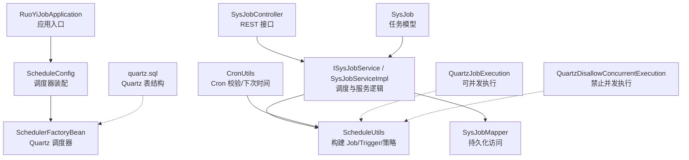
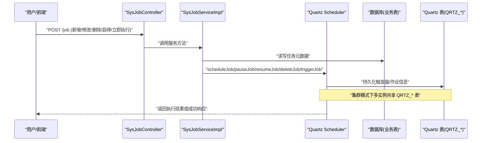
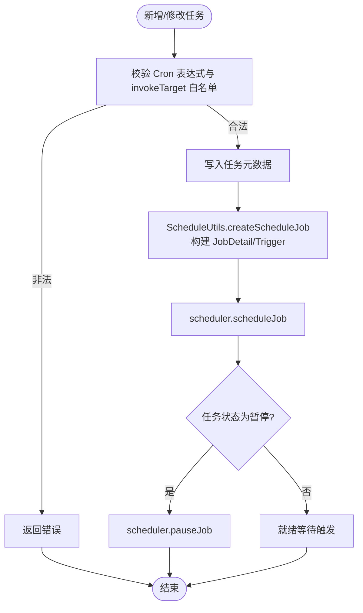
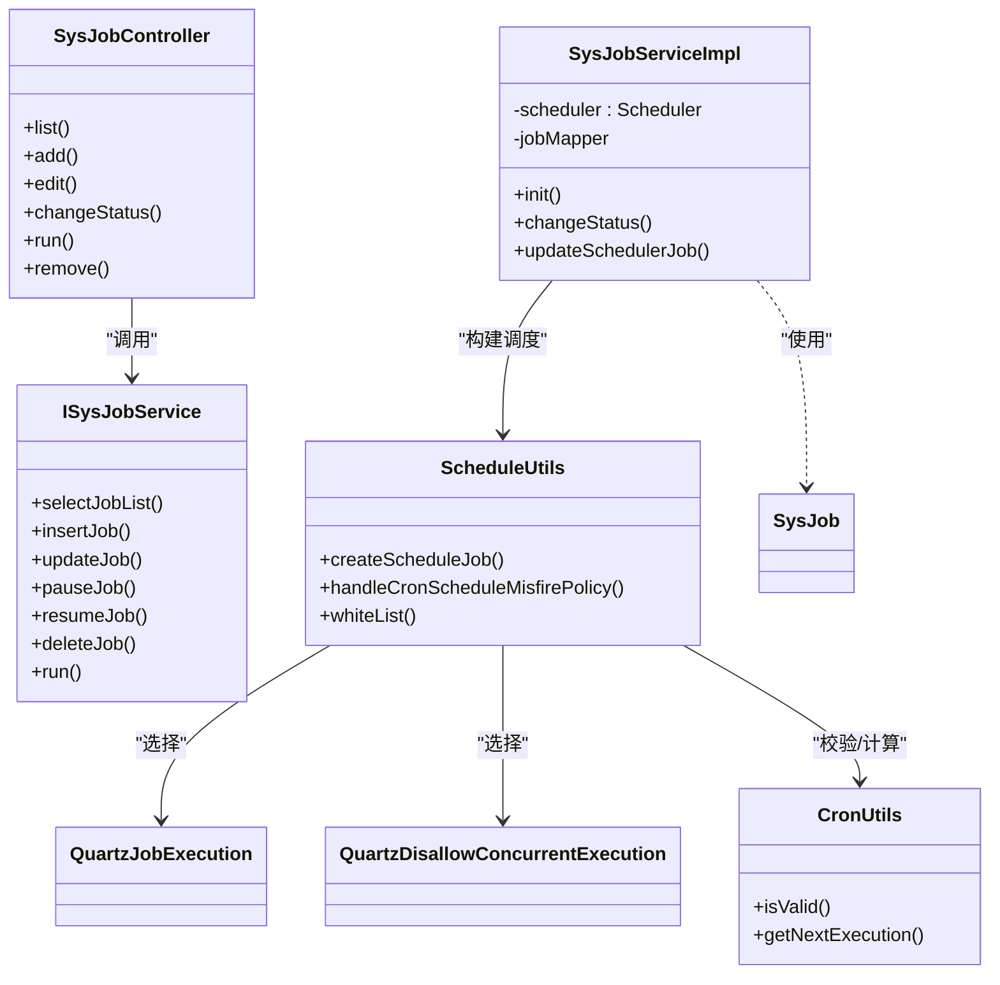

# 定时任务服务

<cite>
**本文引用的文件**   
- [RuoYiJobApplication.java](file://ruoyi-modules/ruoyi-job/src/main/java/com/ruoyi/job/RuoYiJobApplication.java)
- [ScheduleConfig.java](file://ruoyi-modules/ruoyi-job/src/main/java/com/ruoyi/job/config/ScheduleConfig.java)
- [SysJobController.java](file://ruoyi-modules/ruoyi-job/src/main/java/com/ruoyi/job/controller/SysJobController.java)
- [ISysJobService.java](file://ruoyi-modules/ruoyi-job/src/main/java/com/ruoyi/job/service/ISysJobService.java)
- [SysJobServiceImpl.java](file://ruoyi-modules/ruoyi-job/src/main/java/com/ruoyi/job/service/SysJobServiceImpl.java)
- [SysJob.java](file://ruoyi-modules/ruoyi-job/src/main/java/com/ruoyi/job/domain/SysJob.java)
- [ScheduleUtils.java](file://ruoyi-modules/ruoyi-job/src/main/java/com/ruoyi/job/util/ScheduleUtils.java)
- [CronUtils.java](file://ruoyi-modules/ruoyi-job/src/main/java/com/ruoyi/job/util/CronUtils.java)
- [QuartzJobExecution.java](file://ruoyi-modules/ruoyi-job/src/main/java/com/ruoyi/job/util/QuartzJobExecution.java)
- [QuartzDisallowConcurrentExecution.java](file://ruoyi-modules/ruoyi-job/src/main/java/com/ruoyi/job/util/QuartzDisallowConcurrentExecution.java)
- [quartz.sql](file://sql/quartz.sql)
</cite>

## 目录
1. [简介](#简介)
2. [项目结构](#项目结构)
3. [核心组件](#核心组件)
4. [架构总览](#架构总览)
5. [详细组件分析](#详细组件分析)
6. [依赖关系分析](#依赖关系分析)
7. [性能与高可用特性](#性能与高可用特性)
8. [故障排查指南](#故障排查指南)
9. [结论](#结论)
10. [附录](#附录)

## 简介
本模块基于 Quartz 提供分布式定时任务调度能力，覆盖任务创建、调度、执行、监控的完整生命周期。支持 Cron 表达式配置、任务状态管理、执行日志记录、失败重试策略（通过失火策略与业务层重试实现），并提供集群部署、负载均衡与故障转移等高可用特性。同时给出自定义任务开发与调优的最佳实践建议。

## 项目结构
- 应用入口：RuoYiJobApplication 启动 Spring Boot 应用并启用相关注解
- 调度配置：ScheduleConfig 装配 SchedulerFactoryBean，配置线程池、持久化 JobStore、集群参数等
- 控制器层：SysJobController 暴露任务增删改查、启停、立即执行等 REST API
- 服务层：ISysJobService 与 SysJobServiceImpl 封装调度器操作与数据库同步逻辑
- 领域模型：SysJob 描述任务元数据（名称、组名、Cron、并发、状态等）
- 工具类：ScheduleUtils 负责构建 Job/Trigger、处理失火策略、白名单校验；CronUtils 负责 Cron 校验与下次执行时间计算
- 执行器：QuartzJobExecution 与 QuartzDisallowConcurrentExecution 分别对应允许并发与禁止并发的任务执行入口
- 数据库：quartz.sql 提供 Quartz 集群所需的表结构

图表来源
- [RuoYiJobApplication.java:1-35](file://ruoyi-modules/ruoyi-job/src/main/java/com/ruoyi/job/RuoYiJobApplication.java#L1-L35)
- [ScheduleConfig.java:1-58](file://ruoyi-modules/ruoyi-job/src/main/java/com/ruoyi/job/config/ScheduleConfig.java#L1-L58)
- [SysJobController.java:1-187](file://ruoyi-modules/ruoyi-job/src/main/java/com/ruoyi/job/controller/SysJobController.java#L1-L187)
- [ISysJobService.java:1-102](file://ruoyi-modules/ruoyi-job/src/main/java/com/ruoyi/job/service/ISysJobService.java#L1-L102)
- [SysJobServiceImpl.java:1-253](file://ruoyi-modules/ruoyi-job/src/main/java/com/ruoyi/job/service/SysJobServiceImpl.java#L1-L253)
- [SysJob.java:1-171](file://ruoyi-modules/ruoyi-job/src/main/java/com/ruoyi/job/domain/SysJob.java#L1-L171)
- [ScheduleUtils.java:1-134](file://ruoyi-modules/ruoyi-job/src/main/java/com/ruoyi/job/util/ScheduleUtils.java#L1-L134)
- [CronUtils.java:1-64](file://ruoyi-modules/ruoyi-job/src/main/java/com/ruoyi/job/util/CronUtils.java#L1-L64)
- [quartz.sql:1-174](file://sql/quartz.sql#L1-L174)

章节来源
- [RuoYiJobApplication.java:1-35](file://ruoyi-modules/ruoyi-job/src/main/java/com/ruoyi/job/RuoYiJobApplication.java#L1-L35)
- [ScheduleConfig.java:1-58](file://ruoyi-modules/ruoyi-job/src/main/java/com/ruoyi/job/config/ScheduleConfig.java#L1-L58)

## 核心组件
- 调度器装配：通过 ScheduleConfig 注入 DataSource，设置 Quartz 属性（实例名、线程池大小、JobStore、集群开关、检查间隔、事务隔离级别、misfire 阈值、表前缀等），并开启自动启动与覆盖已有任务。
- 任务模型：SysJob 包含任务标识、名称、组名、调用目标、Cron 表达式、失火策略、并发控制、状态等字段，并提供下一次有效执行时间的计算。
- 调度服务：ISysJobService/SysJobServiceImpl 提供任务的查询、暂停、恢复、删除、批量删除、状态切换、立即执行、新增与更新等能力，并在启动时从数据库加载任务到调度器。
- 调度工具：ScheduleUtils 负责根据并发配置选择执行器类、构建 JobDetail 与 Trigger、处理失火策略、生成 JobKey/TriggerKey、以及白名单校验。
- Cron 工具：CronUtils 提供表达式合法性校验与下次执行时间计算。
- 执行器：QuartzJobExecution 与 QuartzDisallowConcurrentExecution 作为 Quartz Job 的具体实现，分别对应允许并发与禁止并发场景。

章节来源
- [ScheduleConfig.java:17-55](file://ruoyi-modules/ruoyi-job/src/main/java/com/ruoyi/job/config/ScheduleConfig.java#L17-L55)
- [SysJob.java:21-171](file://ruoyi-modules/ruoyi-job/src/main/java/com/ruoyi/job/domain/SysJob.java#L21-L171)
- [ISysJobService.java:13-102](file://ruoyi-modules/ruoyi-job/src/main/java/com/ruoyi/job/service/ISysJobService.java#L13-L102)
- [SysJobServiceImpl.java:24-253](file://ruoyi-modules/ruoyi-job/src/main/java/com/ruoyi/job/service/SysJobServiceImpl.java#L24-L253)
- [ScheduleUtils.java:27-134](file://ruoyi-modules/ruoyi-job/src/main/java/com/ruoyi/job/util/ScheduleUtils.java#L27-L134)
- [CronUtils.java:13-64](file://ruoyi-modules/ruoyi-job/src/main/java/com/ruoyi/job/util/CronUtils.java#L13-L64)

## 架构总览
下图展示从用户请求到任务执行的端到端流程，包括控制器、服务层、调度器与数据库之间的交互。

图表来源
- [SysJobController.java:78-187](file://ruoyi-modules/ruoyi-job/src/main/java/com/ruoyi/job/controller/SysJobController.java#L78-L187)
- [SysJobServiceImpl.java:36-253](file://ruoyi-modules/ruoyi-job/src/main/java/com/ruoyi/job/service/SysJobServiceImpl.java#L36-L253)
- [ScheduleConfig.java:17-55](file://ruoyi-modules/ruoyi-job/src/main/java/com/ruoyi/job/config/ScheduleConfig.java#L17-L55)
- [quartz.sql:1-174](file://sql/quartz.sql#L1-L174)

## 详细组件分析

### 调度器装配与集群配置
- 关键配置项：
  - 实例名与实例ID：instanceName、instanceId=AUTO
  - 线程池：SimpleThreadPool，线程数=20，优先级=5
  - JobStore：LocalDataSourceJobStore，使用数据库持久化
  - 集群：isClustered=true，clusterCheckinInterval=15000ms
  - 事务隔离：selectWithLockSQL 可选，txIsolationLevelSerializable=true
  - misfireThreshold=12000ms，tablePrefix=QRTZ_
  - 自动启动与覆盖已有任务：autoStartup=true，overwriteExistingJobs=true
- 作用：确保多实例环境下任务调度的一致性、幂等性与容错性。

章节来源
- [ScheduleConfig.java:17-55](file://ruoyi-modules/ruoyi-job/src/main/java/com/ruoyi/job/config/ScheduleConfig.java#L17-L55)

### 任务模型与状态管理
- 字段说明：
  - jobId、jobName、jobGroup：任务唯一标识与分组
  - invokeTarget：调用目标字符串（需走白名单校验）
  - cronExpression：Cron 表达式
  - misfirePolicy：失火策略（默认/忽略/立即执行一次/不触发）
  - concurrent：是否允许并发（0=允许，1=禁止）
  - status：任务状态（0=正常，1=暂停）
- 行为：
  - getNextValidTime() 基于 Cron 表达式计算下一次有效执行时间
  - 状态变更通过服务层同步至数据库与调度器

章节来源
- [SysJob.java:21-171](file://ruoyi-modules/ruoyi-job/src/main/java/com/ruoyi/job/domain/SysJob.java#L21-L171)

### 调度服务与生命周期
- 启动初始化：@PostConstruct 清空调度器并从数据库加载所有任务，逐个注册到调度器
- 任务操作：
  - 暂停/恢复：更新数据库状态并调用 scheduler.pauseJob/resumeJob
  - 删除：删除数据库记录并移除调度器中的 Job/Trigger
  - 立即执行：构造 JobDataMap 传入任务对象，调用 triggerJob
  - 新增/更新：先写库，再调用 ScheduleUtils.createScheduleJob 注册或重建触发器
- 事务保障：关键方法加 @Transactional，保证数据库与调度器一致性

章节来源
- [SysJobServiceImpl.java:36-253](file://ruoyi-modules/ruoyi-job/src/main/java/com/ruoyi/job/service/SysJobServiceImpl.java#L36-L253)

### Cron 表达式与失火策略
- Cron 校验：CronUtils.isValid 使用 Quartz CronExpression 校验
- 下次执行时间：CronUtils.getNextExecution 计算下一个有效时间点
- 失火策略：ScheduleUtils.handleCronScheduleMisfirePolicy 根据任务配置的 misfirePolicy 设置对应的处理指令（忽略/立即执行一次/不触发）

章节来源
- [CronUtils.java:13-64](file://ruoyi-modules/ruoyi-job/src/main/java/com/ruoyi/job/util/CronUtils.java#L13-L64)
- [ScheduleUtils.java:98-115](file://ruoyi-modules/ruoyi-job/src/main/java/com/ruoyi/job/util/ScheduleUtils.java#L98-L115)

### 任务执行器与并发控制
- 并发控制：
  - 当 concurrent=0（允许并发）：使用 QuartzJobExecution
  - 当 concurrent=1（禁止并发）：使用 QuartzDisallowConcurrentExecution
- 执行流程：
  - ScheduleUtils.getQuartzJobClass 根据并发配置选择具体执行器类
  - JobDetail 中注入任务属性（SysJob），便于执行器获取上下文

章节来源
- [ScheduleUtils.java:35-39](file://ruoyi-modules/ruoyi-job/src/main/java/com/ruoyi/job/util/ScheduleUtils.java#L35-L39)
- [ScheduleUtils.java:60-93](file://ruoyi-modules/ruoyi-job/src/main/java/com/ruoyi/job/util/ScheduleUtils.java#L60-L93)

### 安全与白名单机制
- 控制器层对 invokeTarget 进行多重校验：
  - 不允许 rmi/ldap(s)/http(s) 等危险协议
  - 不允许包含常量定义的错误字符串集合
  - 必须通过 ScheduleUtils.whiteList 校验包名是否在允许的白名单内
- 目的：防止任意类反射调用导致的安全风险

章节来源
- [SysJobController.java:84-111](file://ruoyi-modules/ruoyi-job/src/main/java/com/ruoyi/job/controller/SysJobController.java#L84-L111)
- [SysJobController.java:120-148](file://ruoyi-modules/ruoyi-job/src/main/java/com/ruoyi/job/controller/SysJobController.java#L120-L148)
- [ScheduleUtils.java:123-133](file://ruoyi-modules/ruoyi-job/src/main/java/com/ruoyi/job/util/ScheduleUtils.java#L123-L133)

### 任务创建与调度时序

图表来源
- [SysJobController.java:84-111](file://ruoyi-modules/ruoyi-job/src/main/java/com/ruoyi/job/controller/SysJobController.java#L84-L111)
- [SysJobServiceImpl.java:192-203](file://ruoyi-modules/ruoyi-job/src/main/java/com/ruoyi/job/service/SysJobServiceImpl.java#L192-L203)
- [ScheduleUtils.java:60-93](file://ruoyi-modules/ruoyi-job/src/main/java/com/ruoyi/job/util/ScheduleUtils.java#L60-L93)

## 依赖关系分析
- 控制器依赖服务层接口 ISysJobService
- 服务层依赖调度器 Scheduler 与 Mapper（数据库访问）
- 工具类 ScheduleUtils 依赖 Quartz API 与 Spring 工具类
- CronUtils 依赖 Quartz CronExpression
- 执行器 QuartzJobExecution/QuartzDisallowConcurrentExecution 由 ScheduleUtils 动态选择

图表来源
- [SysJobController.java:1-187](file://ruoyi-modules/ruoyi-job/src/main/java/com/ruoyi/job/controller/SysJobController.java#L1-L187)
- [ISysJobService.java:1-102](file://ruoyi-modules/ruoyi-job/src/main/java/com/ruoyi/job/service/ISysJobService.java#L1-L102)
- [SysJobServiceImpl.java:1-253](file://ruoyi-modules/ruoyi-job/src/main/java/com/ruoyi/job/service/SysJobServiceImpl.java#L1-L253)
- [ScheduleUtils.java:1-134](file://ruoyi-modules/ruoyi-job/src/main/java/com/ruoyi/job/util/ScheduleUtils.java#L1-L134)
- [CronUtils.java:1-64](file://ruoyi-modules/ruoyi-job/src/main/java/com/ruoyi/job/util/CronUtils.java#L1-L64)
- [SysJob.java:1-171](file://ruoyi-modules/ruoyi-job/src/main/java/com/ruoyi/job/domain/SysJob.java#L1-L171)

## 性能与高可用特性
- 线程池与并发：
  - 线程池大小=20，可根据任务量调整
  - 任务级并发控制：concurrent=0 允许并发，=1 禁止并发
- 持久化与集群：
  - 使用 LocalDataSourceJobStore 将任务与触发器持久化到数据库
  - isClustered=true 启用集群模式，多实例共享 QRTZ_* 表
  - clusterCheckinInterval=15000ms 心跳检测间隔
  - misfireThreshold=12000ms 失火阈值，避免长时间未触发的任务堆积
- 事务隔离：
  - txIsolationLevelSerializable=true 提升集群下一致性
- 启动行为：
  - autoStartup=true 自动启动调度器
  - overwriteExistingJobs=true 启动时覆盖已有任务，便于热更新

章节来源
- [ScheduleConfig.java:23-55](file://ruoyi-modules/ruoyi-job/src/main/java/com/ruoyi/job/config/ScheduleConfig.java#L23-L55)
- [SysJob.java:45-55](file://ruoyi-modules/ruoyi-job/src/main/java/com/ruoyi/job/domain/SysJob.java#L45-L55)
- [quartz.sql:1-174](file://sql/quartz.sql#L1-L174)

## 故障排查指南
- Cron 表达式无效：
  - 现象：新增/修改任务时报错
  - 排查：使用 CronUtils.isValid 校验表达式
  - 参考：[CronUtils.java:21-24](file://ruoyi-modules/ruoyi-job/src/main/java/com/ruoyi/job/util/CronUtils.java#L21-L24)
- 任务无法触发：
  - 检查任务状态是否为“暂停”
  - 确认调度器已启动且数据库连接正常
  - 查看 QRTZ_TRIGGERS/QRTZ_JOB_DETAILS 表状态
  - 参考：[SysJobServiceImpl.java:76-89](file://ruoyi-modules/ruoyi-job/src/main/java/com/ruoyi/job/service/SysJobServiceImpl.java#L76-L89)
- 失火处理异常：
  - 检查 misfirePolicy 配置是否正确
  - 调整 misfireThreshold 与集群心跳间隔
  - 参考：[ScheduleUtils.java:98-115](file://ruoyi-modules/ruoyi-job/src/main/java/com/ruoyi/job/util/ScheduleUtils.java#L98-L115)
- 安全拦截：
  - invokeTarget 不在白名单或被禁止协议命中
  - 参考：[SysJobController.java:84-111](file://ruoyi-modules/ruoyi-job/src/main/java/com/ruoyi/job/controller/SysJobController.java#L84-L111)
- 并发问题：
  - 若出现重复执行或资源竞争，将 concurrent 设为“禁止”
  - 参考：[ScheduleUtils.java:35-39](file://ruoyi-modules/ruoyi-job/src/main/java/com/ruoyi/job/util/ScheduleUtils.java#L35-L39)

章节来源
- [CronUtils.java:21-24](file://ruoyi-modules/ruoyi-job/src/main/java/com/ruoyi/job/util/CronUtils.java#L21-L24)
- [SysJobServiceImpl.java:76-89](file://ruoyi-modules/ruoyi-job/src/main/java/com/ruoyi/job/service/SysJobServiceImpl.java#L76-L89)
- [ScheduleUtils.java:98-115](file://ruoyi-modules/ruoyi-job/src/main/java/com/ruoyi/job/util/ScheduleUtils.java#L98-L115)
- [SysJobController.java:84-111](file://ruoyi-modules/ruoyi-job/src/main/java/com/ruoyi/job/controller/SysJobController.java#L84-L111)
- [ScheduleUtils.java:35-39](file://ruoyi-modules/ruoyi-job/src/main/java/com/ruoyi/job/util/ScheduleUtils.java#L35-L39)

## 结论
该定时任务模块以 Quartz 为核心，结合数据库持久化与集群配置，提供了稳定可靠的分布式调度能力。通过完善的任务模型、严格的白名单校验、灵活的失火策略与并发控制，能够满足大多数生产场景的需求。建议在集群环境中合理配置线程池与心跳间隔，并结合业务层重试机制完善失败处理。

## 附录

### Cron 表达式最佳实践
- 尽量使用简洁明确的表达式，避免过于复杂的组合条件
- 在测试环境验证表达式后再上线
- 利用 CronUtils.getNextExecution 预览下一次执行时间

章节来源
- [CronUtils.java:51-62](file://ruoyi-modules/ruoyi-job/src/main/java/com/ruoyi/job/util/CronUtils.java#L51-L62)

### 自定义任务开发指南
- 在 invokeTarget 中声明目标 Bean 的方法签名，并确保包名在白名单内
- 如需禁止并发，设置 concurrent=1；否则设置为 0
- 在任务体中做好异常捕获与日志记录，必要时实现业务层重试

章节来源
- [ScheduleUtils.java:123-133](file://ruoyi-modules/ruoyi-job/src/main/java/com/ruoyi/job/util/ScheduleUtils.java#L123-L133)
- [SysJob.java:45-55](file://ruoyi-modules/ruoyi-job/src/main/java/com/ruoyi/job/domain/SysJob.java#L45-L55)

### 任务调优建议
- 线程池大小：根据 CPU 核数与任务 IO 特征调整（默认 20）
- 失火阈值：根据系统延迟与集群心跳间隔设置合适的 misfireThreshold
- 集群心跳：clusterCheckinInterval 不宜过小，避免频繁锁竞争
- 事务隔离：在高一致要求场景保持 Serializable 隔离级别

章节来源
- [ScheduleConfig.java:27-41](file://ruoyi-modules/ruoyi-job/src/main/java/com/ruoyi/job/config/ScheduleConfig.java#L27-L41)