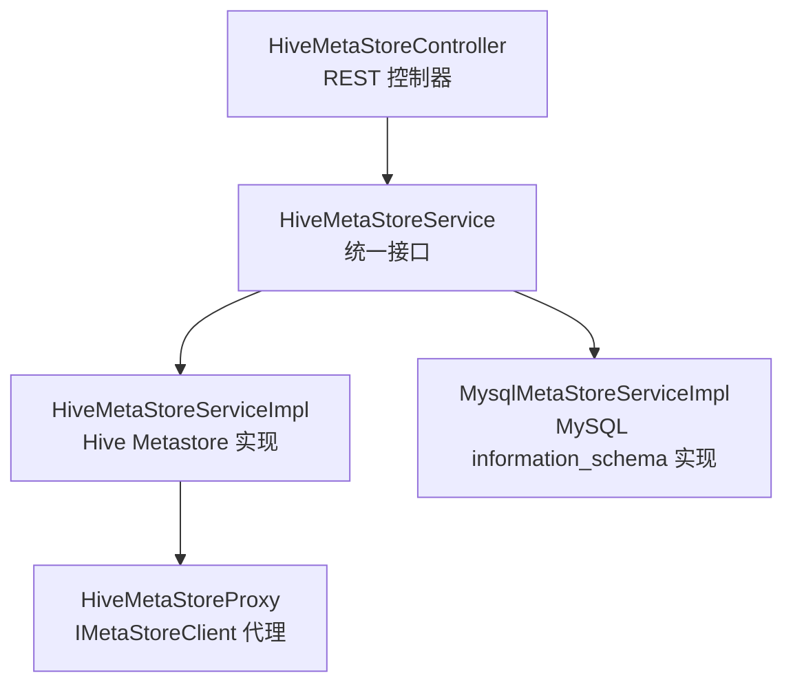
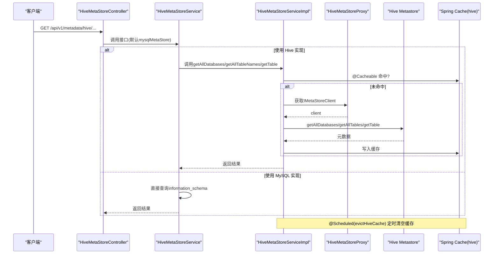
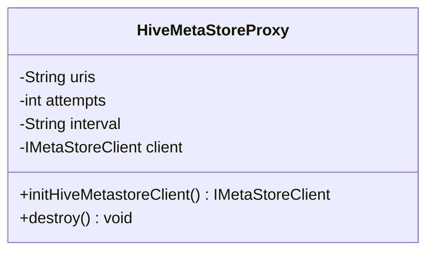
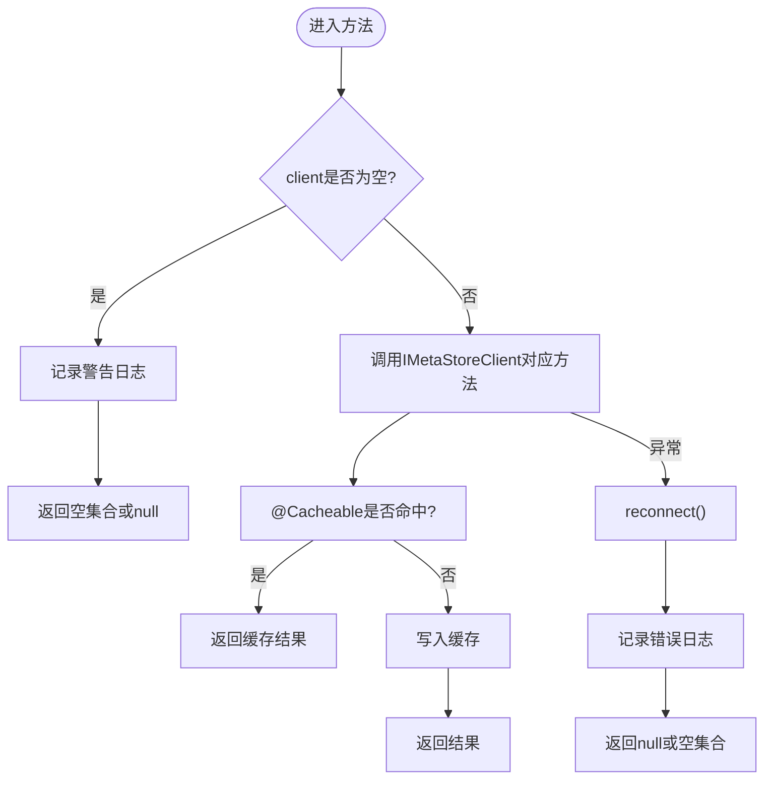
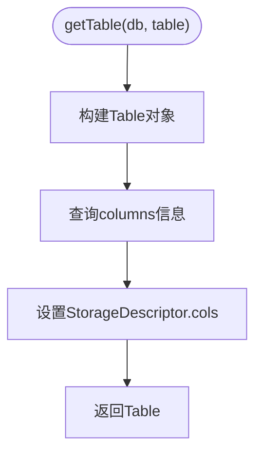
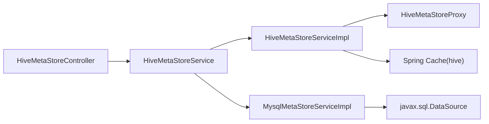

# 元数据管理

<cite>
**本文引用的文件**   
- [HiveMetaStoreService.java](file://ruoyi-modules/ruoyi-dqservice/src/main/java/com/ruoyi/dqservice/service/HiveMetaStoreService.java)
- [HiveMetaStoreServiceImpl.java](file://ruoyi-modules/ruoyi-dqservice/src/main/java/com/ruoyi/dqservice/service/impl/HiveMetaStoreServiceImpl.java)
- [MysqlMetaStoreServiceImpl.java](file://ruoyi-modules/ruoyi-dqservice/src/main/java/com/ruoyi/dqservice/service/impl/MysqlMetaStoreServiceImpl.java)
- [HiveMetaStoreProxy.java](file://ruoyi-modules/ruoyi-dqservice/src/main/java/com/ruoyi/dqservice/connecter/HiveMetaStoreProxy.java)
- [HiveMetaStoreController.java](file://ruoyi-modules/ruoyi-dqservice/src/main/java/com/ruoyi/dqservice/controller/HiveMetaStoreController.java)
- [HiveMetaStoreServiceJdbcImpl.java](file://ruoyi-modules/ruoyi-dqservice/src/main/java/com/ruoyi/dqservice/service/impl/HiveMetaStoreServiceJdbcImpl.java)
</cite>

## 目录
1. [简介](#简介)
2. [项目结构](#项目结构)
3. [核心组件](#核心组件)
4. [架构总览](#架构总览)
5. [详细组件分析](#详细组件分析)
6. [依赖关系分析](#依赖关系分析)
7. [性能与缓存策略](#性能与缓存策略)
8. [变更检测与一致性](#变更检测与一致性)
9. [故障排查](#故障排查)
10. [结论](#结论)

## 简介
本模块提供统一的元数据管理能力，支持两种元数据源：
- Hive Metastore：通过 IMetaStoreClient 访问 Hive 的库、表、字段等元数据，并提供基于 Spring Cache 的缓存与定时清理。
- MySQL：通过 information_schema 直接查询当前 MySQL 实例的库、表、字段信息，返回结构与 Hive 实现保持一致，便于前端复用。

该设计将“数据源差异”隐藏在统一接口之下，对外暴露一致的 REST API，用于规则制作向导、数据预览等场景。

## 项目结构
元数据管理相关代码集中在 ruoyi-dqservice 模块中，采用“控制器-服务-连接代理”的分层组织方式：
- 控制器层：对外暴露 /api/v1/metadata/hive 下的 REST 接口。
- 服务层：定义统一接口 HiveMetaStoreService，并提供 Hive 与 MySQL 两套实现。
- 连接代理：负责创建并管理 HiveMetastoreClient 生命周期。

图表来源
- [HiveMetaStoreController.java:16-57](file://ruoyi-modules/ruoyi-dqservice/src/main/java/com/ruoyi/dqservice/controller/HiveMetaStoreController.java#L16-L57)
- [HiveMetaStoreService.java:8-23](file://ruoyi-modules/ruoyi-dqservice/src/main/java/com/ruoyi/dqservice/service/HiveMetaStoreService.java#L8-L23)
- [HiveMetaStoreServiceImpl.java:27-47](file://ruoyi-modules/ruoyi-dqservice/src/main/java/com/ruoyi/dqservice/service/impl/HiveMetaStoreServiceImpl.java#L27-L47)
- [MysqlMetaStoreServiceImpl.java:35-56](file://ruoyi-modules/ruoyi-dqservice/src/main/java/com/ruoyi/dqservice/service/impl/MysqlMetaStoreServiceImpl.java#L35-L56)
- [HiveMetaStoreProxy.java:14-55](file://ruoyi-modules/ruoyi-dqservice/src/main/java/com/ruoyi/dqservice/connecter/HiveMetaStoreProxy.java#L14-L55)

章节来源
- [HiveMetaStoreController.java:16-57](file://ruoyi-modules/ruoyi-dqservice/src/main/java/com/ruoyi/dqservice/controller/HiveMetaStoreController.java#L16-L57)
- [HiveMetaStoreService.java:8-23](file://ruoyi-modules/ruoyi-dqservice/src/main/java/com/ruoyi/dqservice/service/HiveMetaStoreService.java#L8-L23)

## 核心组件
- 统一接口：HiveMetaStoreService
  - 提供获取数据库列表、表名列表、表结构、全量表信息等能力。
  - 提供 evictHiveCache 方法，供外部触发缓存失效（对 Hive 实现有效）。
- Hive 实现：HiveMetaStoreServiceImpl
  - 使用 IMetaStoreClient 调用 Hive Metastore。
  - 使用 @CacheConfig/@Cacheable 进行结果缓存，@Scheduled + @CacheEvict 定时清理缓存。
  - 异常时尝试 reconnect 提升可用性。
- MySQL 实现：MysqlMetaStoreServiceImpl
  - 通过 DataSource 访问 information_schema.schemata/tables/columns。
  - 过滤系统库，仅返回业务库。
  - 不缓存，实时查询；evictHiveCache 为空实现。
- 连接代理：HiveMetaStoreProxy
  - 根据配置初始化 IMetaStoreClient，设置重试参数，并在应用销毁时关闭客户端。
- 控制器：HiveMetaStoreController
  - 对外暴露 /api/v1/metadata/hive 下多个 GET 接口，默认注入 mysqlMetaStore 实现。

章节来源
- [HiveMetaStoreService.java:8-23](file://ruoyi-modules/ruoyi-dqservice/src/main/java/com/ruoyi/dqservice/service/HiveMetaStoreService.java#L8-L23)
- [HiveMetaStoreServiceImpl.java:27-199](file://ruoyi-modules/ruoyi-dqservice/src/main/java/com/ruoyi/dqservice/service/impl/HiveMetaStoreServiceImpl.java#L27-L199)
- [MysqlMetaStoreServiceImpl.java:23-191](file://ruoyi-modules/ruoyi-dqservice/src/main/java/com/ruoyi/dqservice/service/impl/MysqlMetaStoreServiceImpl.java#L23-L191)
- [HiveMetaStoreProxy.java:14-63](file://ruoyi-modules/ruoyi-dqservice/src/main/java/com/ruoyi/dqservice/connecter/HiveMetaStoreProxy.java#L14-L63)
- [HiveMetaStoreController.java:16-57](file://ruoyi-modules/ruoyi-dqservice/src/main/java/com/ruoyi/dqservice/controller/HiveMetaStoreController.java#L16-L57)

## 架构总览
下图展示从 HTTP 请求到元数据源的完整调用链，以及缓存与定时清理机制。

图表来源
- [HiveMetaStoreController.java:16-57](file://ruoyi-modules/ruoyi-dqservice/src/main/java/com/ruoyi/dqservice/controller/HiveMetaStoreController.java#L16-L57)
- [HiveMetaStoreServiceImpl.java:49-159](file://ruoyi-modules/ruoyi-dqservice/src/main/java/com/ruoyi/dqservice/service/impl/HiveMetaStoreServiceImpl.java#L49-L159)
- [HiveMetaStoreProxy.java:39-55](file://ruoyi-modules/ruoyi-dqservice/src/main/java/com/ruoyi/dqservice/connecter/HiveMetaStoreProxy.java#L39-L55)

## 详细组件分析

### 统一接口：HiveMetaStoreService
- 职责：抽象元数据访问能力，屏蔽 Hive 与 MySQL 的差异。
- 关键方法：
  - getAllDatabases：获取所有数据库。
  - getAllTableNames(dbName)：获取指定库的所有表名。
  - getAllTable(dbName)：获取指定库的所有表对象。
  - getTable(dbName, tableName)：获取单表结构。
  - evictHiveCache：触发缓存失效（Hive 实现生效）。

章节来源
- [HiveMetaStoreService.java:8-23](file://ruoyi-modules/ruoyi-dqservice/src/main/java/com/ruoyi/dqservice/service/HiveMetaStoreService.java#L8-L23)

### Hive Metastore 客户端代理：HiveMetaStoreProxy
- 职责：根据配置构建 HiveConf，创建 IMetaStoreClient，并管理其生命周期。
- 关键点：
  - 读取 hive.metastore.uris、hive.hmshandler.retry.attempts、hive.hmshandler.retry.interval。
  - 设置 METASTORETHRIFTCONNECTIONRETRIES、HMSHANDLERATTEMPTS、HMSHANDLERINTERVAL。
  - 使用 newSynchronizedClient 包装客户端，保证线程安全。
  - PreDestroy 中关闭客户端。

图表来源
- [HiveMetaStoreProxy.java:14-63](file://ruoyi-modules/ruoyi-dqservice/src/main/java/com/ruoyi/dqservice/connecter/HiveMetaStoreProxy.java#L14-L63)

章节来源
- [HiveMetaStoreProxy.java:14-63](file://ruoyi-modules/ruoyi-dqservice/src/main/java/com/ruoyi/dqservice/connecter/HiveMetaStoreProxy.java#L14-L63)

### Hive 元数据服务实现：HiveMetaStoreServiceImpl
- 职责：封装 IMetaStoreClient 调用，提供缓存与定时清理。
- 关键行为：
  - getAllDatabases/getAllTableNames/getTable：均带 @Cacheable，避免重复远程调用。
  - getAllTable/db 级聚合：遍历库和表，组装 Table 列表。
  - evictHiveCache：@Scheduled 定时清空 hive 缓存。
  - 异常处理：捕获异常后调用 reconnect 尝试恢复连接。
  - 默认库名：当传入 dbName 为空时使用配置中的默认库。

图表来源
- [HiveMetaStoreServiceImpl.java:49-159](file://ruoyi-modules/ruoyi-dqservice/src/main/java/com/ruoyi/dqservice/service/impl/HiveMetaStoreServiceImpl.java#L49-L159)

章节来源
- [HiveMetaStoreServiceImpl.java:27-199](file://ruoyi-modules/ruoyi-dqservice/src/main/java/com/ruoyi/dqservice/service/impl/HiveMetaStoreServiceImpl.java#L27-L199)

### MySQL 元数据服务实现：MysqlMetaStoreServiceImpl
- 职责：通过 information_schema 查询当前 MySQL 实例的库、表、字段信息。
- 关键点：
  - 过滤系统库：information_schema、mysql、performance_schema、sys。
  - SQL 语句：
    - 库列表：information_schema.schemata
    - 表列表：information_schema.tables（仅 BASE TABLE）
    - 列信息：information_schema.columns（按 ordinal_position 排序）
  - 返回结构：构造 org.apache.hadoop.hive.metastore.api.Table 与 StorageDescriptor/FieldSchema，保持与 Hive 实现一致。
  - 无缓存：evictHiveCache 为空实现。

图表来源
- [MysqlMetaStoreServiceImpl.java:121-144](file://ruoyi-modules/ruoyi-dqservice/src/main/java/com/ruoyi/dqservice/service/impl/MysqlMetaStoreServiceImpl.java#L121-L144)
- [MysqlMetaStoreServiceImpl.java:168-189](file://ruoyi-modules/ruoyi-dqservice/src/main/java/com/ruoyi/dqservice/service/impl/MysqlMetaStoreServiceImpl.java#L168-L189)

章节来源
- [MysqlMetaStoreServiceImpl.java:23-191](file://ruoyi-modules/ruoyi-dqservice/src/main/java/com/ruoyi/dqservice/service/impl/MysqlMetaStoreServiceImpl.java#L23-L191)

### JDBC 方式的 Hive 元数据实现（补充）
- 说明：存在一个基于 JDBC 的 Hive 元数据实现，通过 SHOW CREATE TABLE 解析建表语句，提取 location 与字段信息。
- 特点：
  - 支持 Kerberos 认证配置。
  - 使用字符串解析方式提取位置与列信息。
  - 该方法更偏演示与兼容，非主流程。

章节来源
- [HiveMetaStoreServiceJdbcImpl.java:40-292](file://ruoyi-modules/ruoyi-dqservice/src/main/java/com/ruoyi/dqservice/service/impl/HiveMetaStoreServiceJdbcImpl.java#L40-L292)

### REST 控制器：HiveMetaStoreController
- 路径前缀：/api/v1/metadata/hive
- 主要接口：
  - GET /dbs：获取数据库列表
  - GET /tables/names?db=xxx：获取某库的表名列表
  - GET /tables?db=xxx：获取某库的表对象列表
  - GET /dbs/tables：获取所有库的表对象映射
  - GET /dbs/tables/names：获取所有库的表名映射
  - GET /table?db=xxx&table=yyy：获取单表结构
- 默认注入：mysqlMetaStore 实现，便于本地演示无需 Hive 环境。

章节来源
- [HiveMetaStoreController.java:16-57](file://ruoyi-modules/ruoyi-dqservice/src/main/java/com/ruoyi/dqservice/controller/HiveMetaStoreController.java#L16-L57)

## 依赖关系分析
- 控制器依赖服务接口，服务接口由具体实现类提供。
- Hive 实现依赖 IMetaStoreClient，由 HiveMetaStoreProxy 装配。
- MySQL 实现依赖 javax.sql.DataSource，直接访问 information_schema。
- 缓存依赖 Spring Cache，命名空间为 hive，键生成器为 cacheKeyGenerator。

图表来源
- [HiveMetaStoreController.java:16-57](file://ruoyi-modules/ruoyi-dqservice/src/main/java/com/ruoyi/dqservice/controller/HiveMetaStoreController.java#L16-L57)
- [HiveMetaStoreServiceImpl.java:27-47](file://ruoyi-modules/ruoyi-dqservice/src/main/java/com/ruoyi/dqservice/service/impl/HiveMetaStoreServiceImpl.java#L27-L47)
- [MysqlMetaStoreServiceImpl.java:35-56](file://ruoyi-modules/ruoyi-dqservice/src/main/java/com/ruoyi/dqservice/service/impl/MysqlMetaStoreServiceImpl.java#L35-L56)
- [HiveMetaStoreProxy.java:39-55](file://ruoyi-modules/ruoyi-dqservice/src/main/java/com/ruoyi/dqservice/connecter/HiveMetaStoreProxy.java#L39-L55)

章节来源
- [HiveMetaStoreController.java:16-57](file://ruoyi-modules/ruoyi-dqservice/src/main/java/com/ruoyi/dqservice/controller/HiveMetaStoreController.java#L16-L57)
- [HiveMetaStoreServiceImpl.java:27-199](file://ruoyi-modules/ruoyi-dqservice/src/main/java/com/ruoyi/dqservice/service/impl/HiveMetaStoreServiceImpl.java#L27-L199)
- [MysqlMetaStoreServiceImpl.java:23-191](file://ruoyi-modules/ruoyi-dqservice/src/main/java/com/ruoyi/dqservice/service/impl/MysqlMetaStoreServiceImpl.java#L23-L191)
- [HiveMetaStoreProxy.java:14-63](file://ruoyi-modules/ruoyi-dqservice/src/main/java/com/ruoyi/dqservice/connecter/HiveMetaStoreProxy.java#L14-L63)

## 性能与缓存策略
- Hive 实现缓存：
  - 使用 @CacheConfig(cacheNames = "hive", keyGenerator = "cacheKeyGenerator") 全局配置。
  - 方法级 @Cacheable(unless = "#result==null" 或 isEmpty) 控制缓存写入条件。
  - 定时任务 @Scheduled(fixedRateString = "${cache.evict.hive.fixedRate.in.milliseconds}") 配合 @CacheEvict(allEntries = true, beforeInvocation = true) 定期清空缓存。
- MySQL 实现：
  - 无缓存，每次请求实时查询 information_schema。
  - 适合本地演示与轻量场景；生产环境若需优化，可考虑引入 Redis 或本地内存缓存，并结合版本号或时间戳做增量更新。

建议优化点：
- 对 Hive 端 getAllTable(db) 与 getAllTable() 之间的缓存复用进行优化，减少重复远程调用。
- 对 MySQL 端增加二级缓存（如按库+表的维度），并支持按需刷新。
- 在高频访问场景下，考虑分页与懒加载，避免一次性拉取全量表结构。

章节来源
- [HiveMetaStoreServiceImpl.java:27-159](file://ruoyi-modules/ruoyi-dqservice/src/main/java/com/ruoyi/dqservice/service/impl/HiveMetaStoreServiceImpl.java#L27-L159)
- [MysqlMetaStoreServiceImpl.java:131-135](file://ruoyi-modules/ruoyi-dqservice/src/main/java/com/ruoyi/dqservice/service/impl/MysqlMetaStoreServiceImpl.java#L131-L135)

## 变更检测与一致性
- 变更检测：
  - Hive：通过定时任务 evictHiveCache 主动清空缓存，从而在下一次请求时重新拉取最新元数据。
  - MySQL：无缓存，天然具备“最新性”，但代价是每次请求都查库。
- 一致性保证：
  - Hive：缓存过期后重新拉取，保证最终一致性；异常时 reconnect 提升可用性。
  - MySQL：直接读 source of truth，强一致。
- 增量同步：
  - 当前实现为全量拉取（getAllTable/db 级聚合）。如需增量，可在上层引入版本标记（如 last_modified_time）或监听 Metastore 事件（需要额外扩展）。

章节来源
- [HiveMetaStoreServiceImpl.java:147-159](file://ruoyi-modules/ruoyi-dqservice/src/main/java/com/ruoyi/dqservice/service/impl/HiveMetaStoreServiceImpl.java#L147-L159)
- [HiveMetaStoreServiceImpl.java:191-197](file://ruoyi-modules/ruoyi-dqservice/src/main/java/com/ruoyi/dqservice/service/impl/HiveMetaStoreServiceImpl.java#L191-L197)
- [MysqlMetaStoreServiceImpl.java:131-135](file://ruoyi-modules/ruoyi-dqservice/src/main/java/com/ruoyi/dqservice/service/impl/MysqlMetaStoreServiceImpl.java#L131-L135)

## 故障排查
常见问题与建议：
- Hive 客户端不可用：
  - 现象：日志中出现 “Failed to connect hive metastore...” 或 “Hive client is null”。
  - 原因：HiveConf 静态初始化失败或配置不正确（如 hive.metastore.uris）。
  - 处理：检查配置项 hive.metastore.uris、hive.hmshandler.retry.attempts、hive.hmshandler.retry.interval；确认网络可达与权限。
- 无法获取数据库或表：
  - 现象：getAllDatabases/getAllTableNames 返回空或异常。
  - 原因：HMS 连接异常或权限不足。
  - 处理：查看 reconnect 后的错误日志；必要时重启 HMS 或调整重试参数。
- MySQL 元数据查询失败：
  - 现象：日志出现 “查询 MySQL 库列表失败/查询表列表失败/查询字段信息失败”。
  - 原因：DataSource 配置错误或权限不足。
  - 处理：校验 DataSource 配置与用户权限，确保能访问 information_schema。

章节来源
- [HiveMetaStoreProxy.java:49-55](file://ruoyi-modules/ruoyi-dqservice/src/main/java/com/ruoyi/dqservice/connecter/HiveMetaStoreProxy.java#L49-L55)
- [HiveMetaStoreServiceImpl.java:49-85](file://ruoyi-modules/ruoyi-dqservice/src/main/java/com/ruoyi/dqservice/service/impl/HiveMetaStoreServiceImpl.java#L49-L85)
- [MysqlMetaStoreServiceImpl.java:58-80](file://ruoyi-modules/ruoyi-dqservice/src/main/java/com/ruoyi/dqservice/service/impl/MysqlMetaStoreServiceImpl.java#L58-L80)
- [MysqlMetaStoreServiceImpl.java:146-189](file://ruoyi-modules/ruoyi-dqservice/src/main/java/com/ruoyi/dqservice/service/impl/MysqlMetaStoreServiceImpl.java#L146-L189)

## 结论
本模块通过统一接口抽象了 Hive 与 MySQL 两类元数据源，既能在有 Hive 环境的场景下高效访问 Hive Metastore，也能在无 Hive 环境下通过 MySQL information_schema 快速浏览库表结构。结合 Spring Cache 与定时清理，实现了较好的性能与一致性平衡。后续可按需引入增量同步、二级缓存与更细粒度的变更检测机制，以支撑更大规模的生产场景。