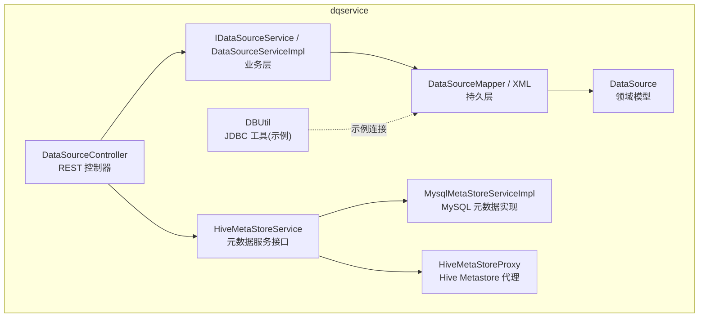
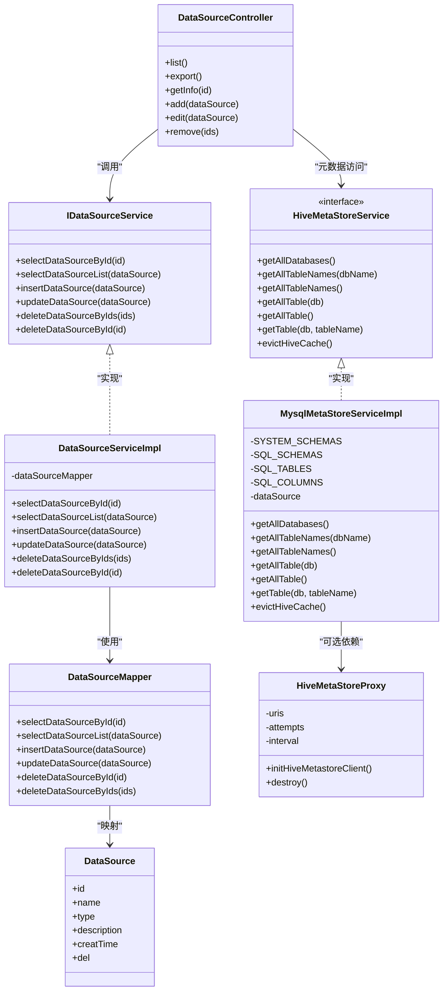
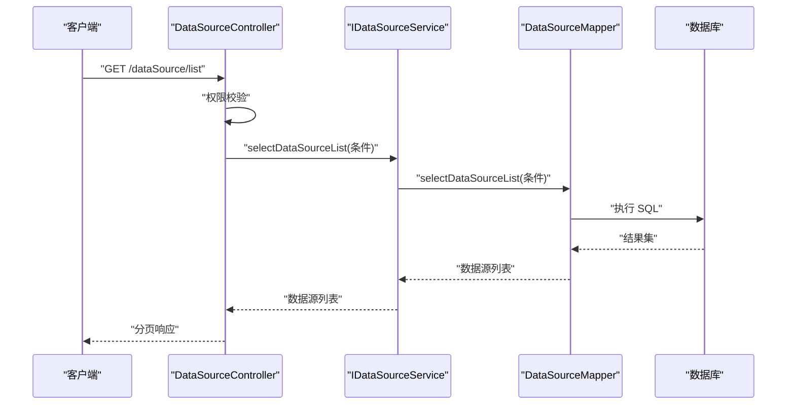
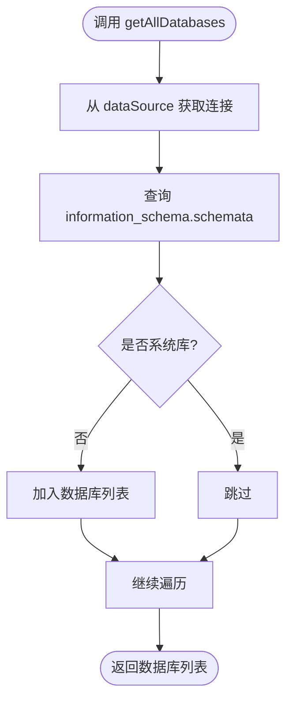
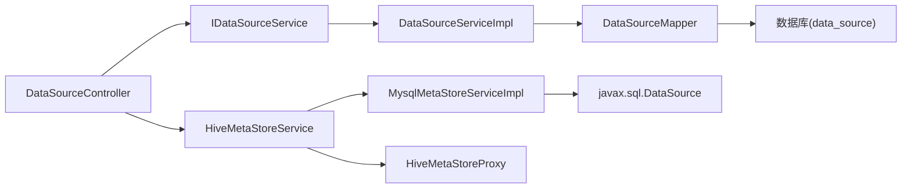

# 数据源管理模块

<cite>
**本文引用的文件**   
- [DataSourceController.java](file://ruoyi-modules/ruoyi-dqservice/src/main/java/com/ruoyi/dqservice/controller/DataSourceController.java)
- [IDataSourceService.java](file://ruoyi-modules/ruoyi-dqservice/src/main/java/com/ruoyi/dqservice/service/IDataSourceService.java)
- [DataSourceServiceImpl.java](file://ruoyi-modules/ruoyi-dqservice/src/main/java/com/ruoyi/dqservice/service/impl/DataSourceServiceImpl.java)
- [DataSourceMapper.java](file://ruoyi-modules/ruoyi-dqservice/src/main/java/com/ruoyi/dqservice/mapper/DataSourceMapper.java)
- [DataSourceMapper.xml](file://ruoyi-modules/ruoyi-dqservice/src/main/resources/mapper/DataSourceMapper.xml)
- [DataSource.java](file://ruoyi-modules/ruoyi-dqservice/src/main/java/com/ruoyi/dqservice/domain/DataSource.java)
- [DBUtil.java](file://ruoyi-modules/ruoyi-dqservice/src/main/java/com/ruoyi/dqservice/connecter/DBUtil.java)
- [HiveMetaStoreProxy.java](file://ruoyi-modules/ruoyi-dqservice/src/main/java/com/ruoyi/dqservice/connecter/HiveMetaStoreProxy.java)
- [HiveMetaStoreService.java](file://ruoyi-modules/ruoyi-dqservice/src/main/java/com/ruoyi/dqservice/service/HiveMetaStoreService.java)
- [MysqlMetaStoreServiceImpl.java](file://ruoyi-modules/ruoyi-dqservice/src/main/java/com/ruoyi/dqservice/service/impl/MysqlMetaStoreServiceImpl.java)
</cite>

## 目录
1. [简介](#简介)
2. [项目结构](#项目结构)
3. [核心组件](#核心组件)
4. [架构总览](#架构总览)
5. [详细组件分析](#详细组件分析)
6. [依赖关系分析](#依赖关系分析)
7. [性能与连接池优化](#性能与连接池优化)
8. [安全与权限控制](#安全与权限控制)
9. [多类型数据源适配策略](#多类型数据源适配策略)
10. [新数据源接入指南](#新数据源接入指南)
11. [故障排除](#故障排除)
12. [结论](#结论)

## 简介
本模块提供数据源的统一管理能力，包括数据源的增删改查、元数据浏览（库/表/字段）、以及面向 Hive Metastore 的代理与 MySQL information_schema 的替代实现。当前代码已具备：
- 数据源基础信息的管理接口（CRUD）
- 基于 Spring 注入的 javax.sql.DataSource 访问系统主库以获取元数据
- Hive Metastore 客户端代理与重试配置
- 面向规则引擎的执行工具（DroolsManager），用于后续规则执行扩展

注意：当前仓库未包含“连接测试”“动态多数据源切换”“连接池参数化配置”等完整实现，文档将基于现有代码给出可落地的演进建议与最佳实践。

## 项目结构
数据源管理相关代码集中在 ruoyi-dqservice 模块中，分层清晰：
- controller: 对外暴露 REST 接口
- service/impl: 业务逻辑封装
- mapper + xml: MyBatis 持久层
- domain: 领域模型
- connecter: 外部系统连接与代理（Hive、DBUtil）
- service: 抽象服务接口（如 HiveMetaStoreService）

图表来源
- [DataSourceController.java:31-105](file://ruoyi-modules/ruoyi-dqservice/src/main/java/com/ruoyi/dqservice/controller/DataSourceController.java#L31-L105)
- [IDataSourceService.java:12-61](file://ruoyi-modules/ruoyi-dqservice/src/main/java/com/ruoyi/dqservice/service/IDataSourceService.java#L12-L61)
- [DataSourceServiceImpl.java:17-95](file://ruoyi-modules/ruoyi-dqservice/src/main/java/com/ruoyi/dqservice/service/impl/DataSourceServiceImpl.java#L17-L95)
- [DataSourceMapper.java:12-61](file://ruoyi-modules/ruoyi-dqservice/src/main/java/com/ruoyi/dqservice/mapper/DataSourceMapper.java#L12-L61)
- [DataSourceMapper.xml:31-56](file://ruoyi-modules/ruoyi-dqservice/src/main/resources/mapper/DataSourceMapper.xml#L31-L56)
- [DataSource.java:16-73](file://ruoyi-modules/ruoyi-dqservice/src/main/java/com/ruoyi/dqservice/domain/DataSource.java#L16-L73)
- [HiveMetaStoreProxy.java:14-63](file://ruoyi-modules/ruoyi-dqservice/src/main/java/com/ruoyi/dqservice/connecter/HiveMetaStoreProxy.java#L14-L63)
- [HiveMetaStoreService.java:8-23](file://ruoyi-modules/ruoyi-dqservice/src/main/java/com/ruoyi/dqservice/service/HiveMetaStoreService.java#L8-L23)
- [MysqlMetaStoreServiceImpl.java:35-191](file://ruoyi-modules/ruoyi-dqservice/src/main/java/com/ruoyi/dqservice/service/impl/MysqlMetaStoreServiceImpl.java#L35-L191)
- [DBUtil.java:7-33](file://ruoyi-modules/ruoyi-dqservice/src/main/java/com/ruoyi/dqservice/connecter/DBUtil.java#L7-L33)

章节来源
- [DataSourceController.java:31-105](file://ruoyi-modules/ruoyi-dqservice/src/main/java/com/ruoyi/dqservice/controller/DataSourceController.java#L31-L105)
- [DataSourceServiceImpl.java:17-95](file://ruoyi-modules/ruoyi-dqservice/src/main/java/com/ruoyi/dqservice/service/impl/DataSourceServiceImpl.java#L17-L95)
- [DataSourceMapper.java:12-61](file://ruoyi-modules/ruoyi-dqservice/src/main/java/com/ruoyi/dqservice/mapper/DataSourceMapper.java#L12-L61)
- [DataSourceMapper.xml:31-56](file://ruoyi-modules/ruoyi-dqservice/src/main/resources/mapper/DataSourceMapper.xml#L31-L56)
- [DataSource.java:16-73](file://ruoyi-modules/ruoyi-dqservice/src/main/java/com/ruoyi/dqservice/domain/DataSource.java#L16-L73)
- [HiveMetaStoreProxy.java:14-63](file://ruoyi-modules/ruoyi-dqservice/src/main/java/com/ruoyi/dqservice/connecter/HiveMetaStoreProxy.java#L14-L63)
- [HiveMetaStoreService.java:8-23](file://ruoyi-modules/ruoyi-dqservice/src/main/java/com/ruoyi/dqservice/service/HiveMetaStoreService.java#L8-L23)
- [MysqlMetaStoreServiceImpl.java:35-191](file://ruoyi-modules/ruoyi-dqservice/src/main/java/com/ruoyi/dqservice/service/impl/MysqlMetaStoreServiceImpl.java#L35-L191)
- [DBUtil.java:7-33](file://ruoyi-modules/ruoyi-dqservice/src/main/java/com/ruoyi/dqservice/connecter/DBUtil.java#L7-L33)

## 核心组件
- 数据源控制器：提供数据源列表查询、导出、详情、新增、修改、删除等 REST 接口，并带有权限注解。
- 数据源服务层：封装 CRUD 业务，更新时自动填充更新时间。
- 数据源持久层：MyBatis Mapper 与 XML 映射，完成数据源记录的增删改查。
- 数据源领域模型：描述数据源的基本属性（名称、类型、描述、创建时间等）。
- 元数据服务接口与实现：定义统一的库/表/字段访问能力；提供基于 MySQL information_schema 的实现。
- Hive Metastore 代理：封装 HiveConf 与 IMetaStoreClient 的初始化、重试参数与销毁。
- JDBC 工具类：示例化的驱动加载与连接获取（演示用途）。

章节来源
- [DataSourceController.java:31-105](file://ruoyi-modules/ruoyi-dqservice/src/main/java/com/ruoyi/dqservice/controller/DataSourceController.java#L31-L105)
- [IDataSourceService.java:12-61](file://ruoyi-modules/ruoyi-dqservice/src/main/java/com/ruoyi/dqservice/service/IDataSourceService.java#L12-L61)
- [DataSourceServiceImpl.java:17-95](file://ruoyi-modules/ruoyi-dqservice/src/main/java/com/ruoyi/dqservice/service/impl/DataSourceServiceImpl.java#L17-L95)
- [DataSourceMapper.java:12-61](file://ruoyi-modules/ruoyi-dqservice/src/main/java/com/ruoyi/dqservice/mapper/DataSourceMapper.java#L12-L61)
- [DataSourceMapper.xml:31-56](file://ruoyi-modules/ruoyi-dqservice/src/main/resources/mapper/DataSourceMapper.xml#L31-L56)
- [DataSource.java:16-73](file://ruoyi-modules/ruoyi-dqservice/src/main/java/com/ruoyi/dqservice/domain/DataSource.java#L16-L73)
- [HiveMetaStoreService.java:8-23](file://ruoyi-modules/ruoyi-dqservice/src/main/java/com/ruoyi/dqservice/service/HiveMetaStoreService.java#L8-L23)
- [MysqlMetaStoreServiceImpl.java:35-191](file://ruoyi-modules/ruoyi-dqservice/src/main/java/com/ruoyi/dqservice/service/impl/MysqlMetaStoreServiceImpl.java#L35-L191)
- [HiveMetaStoreProxy.java:14-63](file://ruoyi-modules/ruoyi-dqservice/src/main/java/com/ruoyi/dqservice/connecter/HiveMetaStoreProxy.java#L14-L63)
- [DBUtil.java:7-33](file://ruoyi-modules/ruoyi-dqservice/src/main/java/com/ruoyi/dqservice/connecter/DBUtil.java#L7-L33)

## 架构总览
数据源管理采用典型三层架构，并在元数据访问层引入适配器模式，屏蔽不同后端（Hive Metastore 或 MySQL information_schema）的差异。

图表来源
- [DataSourceController.java:31-105](file://ruoyi-modules/ruoyi-dqservice/src/main/java/com/ruoyi/dqservice/controller/DataSourceController.java#L31-L105)
- [IDataSourceService.java:12-61](file://ruoyi-modules/ruoyi-dqservice/src/main/java/com/ruoyi/dqservice/service/IDataSourceService.java#L12-L61)
- [DataSourceServiceImpl.java:17-95](file://ruoyi-modules/ruoyi-dqservice/src/main/java/com/ruoyi/dqservice/service/impl/DataSourceServiceImpl.java#L17-L95)
- [DataSourceMapper.java:12-61](file://ruoyi-modules/ruoyi-dqservice/src/main/java/com/ruoyi/dqservice/mapper/DataSourceMapper.java#L12-L61)
- [DataSource.java:16-73](file://ruoyi-modules/ruoyi-dqservice/src/main/java/com/ruoyi/dqservice/domain/DataSource.java#L16-L73)
- [HiveMetaStoreService.java:8-23](file://ruoyi-modules/ruoyi-dqservice/src/main/java/com/ruoyi/dqservice/service/HiveMetaStoreService.java#L8-L23)
- [MysqlMetaStoreServiceImpl.java:35-191](file://ruoyi-modules/ruoyi-dqservice/src/main/java/com/ruoyi/dqservice/service/impl/MysqlMetaStoreServiceImpl.java#L35-L191)
- [HiveMetaStoreProxy.java:14-63](file://ruoyi-modules/ruoyi-dqservice/src/main/java/com/ruoyi/dqservice/connecter/HiveMetaStoreProxy.java#L14-L63)

## 详细组件分析

### 数据源控制器（DataSourceController）
- 职责：接收 HTTP 请求，进行权限校验与日志记录，委托 Service 层处理业务。
- 关键接口：
  - GET /dataSource/list：分页查询数据源列表
  - POST /dataSource/export：导出数据源列表为 Excel
  - GET /dataSource/{id}：获取数据源详情
  - POST /dataSource：新增数据源
  - PUT /dataSource：修改数据源
  - DELETE /dataSource/{ids}：批量删除数据源
- 权限控制：通过 @RequiresPermissions 注解限定操作权限。

图表来源
- [DataSourceController.java:31-105](file://ruoyi-modules/ruoyi-dqservice/src/main/java/com/ruoyi/dqservice/controller/DataSourceController.java#L31-L105)
- [IDataSourceService.java:12-61](file://ruoyi-modules/ruoyi-dqservice/src/main/java/com/ruoyi/dqservice/service/IDataSourceService.java#L12-L61)
- [DataSourceServiceImpl.java:17-95](file://ruoyi-modules/ruoyi-dqservice/src/main/java/com/ruoyi/dqservice/service/impl/DataSourceServiceImpl.java#L17-L95)
- [DataSourceMapper.java:12-61](file://ruoyi-modules/ruoyi-dqservice/src/main/java/com/ruoyi/dqservice/mapper/DataSourceMapper.java#L12-L61)

章节来源
- [DataSourceController.java:31-105](file://ruoyi-modules/ruoyi-dqservice/src/main/java/com/ruoyi/dqservice/controller/DataSourceController.java#L31-L105)

### 数据源服务层（IDataSourceService / DataSourceServiceImpl）
- 职责：封装数据源的业务逻辑，维护更新时间等通用字段。
- 关键点：
  - updateDataSource 中自动设置 updateTime
  - 所有方法透传至 Mapper 层

章节来源
- [IDataSourceService.java:12-61](file://ruoyi-modules/ruoyi-dqservice/src/main/java/com/ruoyi/dqservice/service/IDataSourceService.java#L12-L61)
- [DataSourceServiceImpl.java:17-95](file://ruoyi-modules/ruoyi-dqservice/src/main/java/com/ruoyi/dqservice/service/impl/DataSourceServiceImpl.java#L17-L95)

### 数据源持久层（DataSourceMapper / DataSourceMapper.xml）
- 职责：定义数据源表的 CRUD 操作，XML 中实现动态 SQL。
- 关键点：
  - insert/update 使用 <if> 动态拼接字段
  - select 支持按条件过滤

章节来源
- [DataSourceMapper.java:12-61](file://ruoyi-modules/ruoyi-dqservice/src/main/java/com/ruoyi/dqservice/mapper/DataSourceMapper.java#L12-L61)
- [DataSourceMapper.xml:31-56](file://ruoyi-modules/ruoyi-dqservice/src/main/resources/mapper/DataSourceMapper.xml#L31-L56)

### 数据源领域模型（DataSource）
- 字段：id、name、type、description、creatTime、del
- 用途：承载数据源基本信息，参与分页、导出、表单绑定

章节来源
- [DataSource.java:16-73](file://ruoyi-modules/ruoyi-dqservice/src/main/java/com/ruoyi/dqservice/domain/DataSource.java#L16-L73)

### 元数据服务接口与实现（HiveMetaStoreService / MysqlMetaStoreServiceImpl）
- 接口定义：统一提供 getAllDatabases/getAllTableNames/getTable 等方法。
- MySQL 实现：
  - 通过注入的 javax.sql.DataSource 访问系统主库
  - 使用 information_schema.schemata/tables/columns 查询库/表/字段
  - 过滤系统库（information_schema/mysql/performance_schema/sys）
  - 返回结构与 Hive Metastore API 兼容，便于前端复用

图表来源
- [MysqlMetaStoreServiceImpl.java:58-80](file://ruoyi-modules/ruoyi-dqservice/src/main/java/com/ruoyi/dqservice/service/impl/MysqlMetaStoreServiceImpl.java#L58-L80)

章节来源
- [HiveMetaStoreService.java:8-23](file://ruoyi-modules/ruoyi-dqservice/src/main/java/com/ruoyi/dqservice/service/HiveMetaStoreService.java#L8-L23)
- [MysqlMetaStoreServiceImpl.java:35-191](file://ruoyi-modules/ruoyi-dqservice/src/main/java/com/ruoyi/dqservice/service/impl/MysqlMetaStoreServiceImpl.java#L35-L191)

### Hive Metastore 代理（HiveMetaStoreProxy）
- 职责：根据配置初始化 HiveConf 与 IMetaStoreClient，设置重试次数与间隔，应用销毁时关闭客户端。
- 容错：捕获异常并记录错误，不影响其他功能启动。

章节来源
- [HiveMetaStoreProxy.java:14-63](file://ruoyi-modules/ruoyi-dqservice/src/main/java/com/ruoyi/dqservice/connecter/HiveMetaStoreProxy.java#L14-L63)

### JDBC 工具类（DBUtil）
- 说明：示例化的 JDBC 连接工具，硬编码驱动与连接串，仅供演示。
- 风险：不适合生产环境（无连接池、无参数化、无安全认证）。

章节来源
- [DBUtil.java:7-33](file://ruoyi-modules/ruoyi-dqservice/src/main/java/com/ruoyi/dqservice/connecter/DBUtil.java#L7-L33)

## 依赖关系分析
- 控制器依赖服务接口，服务实现依赖 Mapper，Mapper 依赖数据库。
- 元数据访问通过接口解耦，MySQL 实现依赖 Spring 管理的 javax.sql.DataSource。
- Hive 元数据访问通过代理类初始化客户端，但当前 MySQL 实现未直接使用该代理。

图表来源
- [DataSourceController.java:31-105](file://ruoyi-modules/ruoyi-dqservice/src/main/java/com/ruoyi/dqservice/controller/DataSourceController.java#L31-L105)
- [IDataSourceService.java:12-61](file://ruoyi-modules/ruoyi-dqservice/src/main/java/com/ruoyi/dqservice/service/IDataSourceService.java#L12-L61)
- [DataSourceServiceImpl.java:17-95](file://ruoyi-modules/ruoyi-dqservice/src/main/java/com/ruoyi/dqservice/service/impl/DataSourceServiceImpl.java#L17-L95)
- [DataSourceMapper.java:12-61](file://ruoyi-modules/ruoyi-dqservice/src/main/java/com/ruoyi/dqservice/mapper/DataSourceMapper.java#L12-L61)
- [HiveMetaStoreService.java:8-23](file://ruoyi-modules/ruoyi-dqservice/src/main/java/com/ruoyi/dqservice/service/HiveMetaStoreService.java#L8-L23)
- [MysqlMetaStoreServiceImpl.java:35-191](file://ruoyi-modules/ruoyi-dqservice/src/main/java/com/ruoyi/dqservice/service/impl/MysqlMetaStoreServiceImpl.java#L35-L191)
- [HiveMetaStoreProxy.java:14-63](file://ruoyi-modules/ruoyi-dqservice/src/main/java/com/ruoyi/dqservice/connecter/HiveMetaStoreProxy.java#L14-L63)

## 性能与连接池优化
现状与建议：
- 当前元数据访问直接使用 javax.sql.DataSource，通常由 Spring Boot 默认连接池（如 HikariCP）管理，具备较好的性能与并发特性。
- 建议在后续扩展中：
  - 对频繁访问的元数据进行缓存（例如按 schema/table 维度），减少重复查询
  - 对 Hive Metastore 客户端启用合理的重试与超时配置（已在代理类中预留）
  - 避免在循环中频繁创建 Connection，尽量复用 PreparedStatement 或使用批处理
  - 对大数据量元数据查询增加分页与限制行数

[本节为通用指导，不直接分析具体文件]

## 安全与权限控制
- 接口级权限：控制器方法通过 @RequiresPermissions 注解进行权限校验，确保只有具备相应权限的用户才能访问数据源管理接口。
- 建议增强：
  - 对敏感字段（如密码、密钥）进行脱敏存储与展示
  - 对数据源连接参数进行加密存储（如使用 Jasypt）
  - 对连接测试与元数据读取进行审计日志记录

章节来源
- [DataSourceController.java:41-100](file://ruoyi-modules/ruoyi-dqservice/src/main/java/com/ruoyi/dqservice/controller/DataSourceController.java#L41-L100)

## 多类型数据源适配策略
- 适配器模式：通过 HiveMetaStoreService 接口统一抽象，当前提供基于 MySQL information_schema 的实现，未来可扩展更多后端（如 Oracle、PostgreSQL、ClickHouse 等）。
- 连接参数配置：
  - 当前 MySQL 元数据访问使用 Spring 注入的 javax.sql.DataSource，连接参数由外部配置中心或 application.yml 提供
  - Hive Metastore 客户端通过 HiveMetaStoreProxy 读取 hive.metastore.uris 等配置
- 连接测试：
  - 当前未实现独立的“连接测试”接口，可在 Service 层增加一个 testConnection 方法，尝试获取连接并执行简单查询（如 SELECT 1）
- 权限控制：
  - 在新增/修改数据源时，校验用户是否具备对应数据源的访问权限（结合系统权限模型）

章节来源
- [HiveMetaStoreService.java:8-23](file://ruoyi-modules/ruoyi-dqservice/src/main/java/com/ruoyi/dqservice/service/HiveMetaStoreService.java#L8-L23)
- [MysqlMetaStoreServiceImpl.java:35-191](file://ruoyi-modules/ruoyi-dqservice/src/main/java/com/ruoyi/dqservice/service/impl/MysqlMetaStoreServiceImpl.java#L35-L191)
- [HiveMetaStoreProxy.java:14-63](file://ruoyi-modules/ruoyi-dqservice/src/main/java/com/ruoyi/dqservice/connecter/HiveMetaStoreProxy.java#L14-L63)

## 新数据源接入指南
步骤建议：
1. 定义新的元数据服务实现类，实现 HiveMetaStoreService 接口
2. 在该实现中注入对应的 javax.sql.DataSource（或通过连接工厂获取连接）
3. 实现 getAllDatabases/getAllTableNames/getTable 等方法，适配目标数据源的元数据结构
4. 在需要的位置注册该实现（如通过 @Service 指定 bean 名）
5. 如需连接测试，新增 Service 方法，尝试建立连接并执行轻量查询
6. 在控制器中暴露必要的接口，并进行权限校验与日志记录

注意事项：
- 保持返回结构与 Hive Metastore API 一致，以便前端无需改动
- 对系统库/隐藏表进行过滤，避免干扰
- 对异常进行捕获与日志记录，保证服务稳定性

[本节为通用指导，不直接分析具体文件]

## 故障排除
常见问题与排查要点：
- 无法连接 Hive Metastore：检查 hive.metastore.uris 配置是否正确，确认网络可达与服务状态
- MySQL 元数据查询失败：检查注入的 DataSource 是否指向正确的数据库，确认用户权限
- 连接测试失败：确认用户名、密码、URL、驱动类名正确，网络连通性正常
- 权限不足：检查用户角色与菜单权限配置，确保具备 dqservice:dataSource:* 相关权限

章节来源
- [HiveMetaStoreProxy.java:40-54](file://ruoyi-modules/ruoyi-dqservice/src/main/java/com/ruoyi/dqservice/connecter/HiveMetaStoreProxy.java#L40-L54)
- [MysqlMetaStoreServiceImpl.java:75-78](file://ruoyi-modules/ruoyi-dqservice/src/main/java/com/ruoyi/dqservice/service/impl/MysqlMetaStoreServiceImpl.java#L75-L78)
- [DataSourceController.java:41-100](file://ruoyi-modules/ruoyi-dqservice/src/main/java/com/ruoyi/dqservice/controller/DataSourceController.java#L41-L100)

## 结论
本模块提供了数据源的基础管理能力与元数据访问的统一抽象。当前实现以 MySQL information_schema 为主，配合 Hive Metastore 代理，具备良好的扩展性。建议在后续迭代中完善连接测试、参数加密、缓存与监控等能力，进一步提升系统的可用性与安全性。