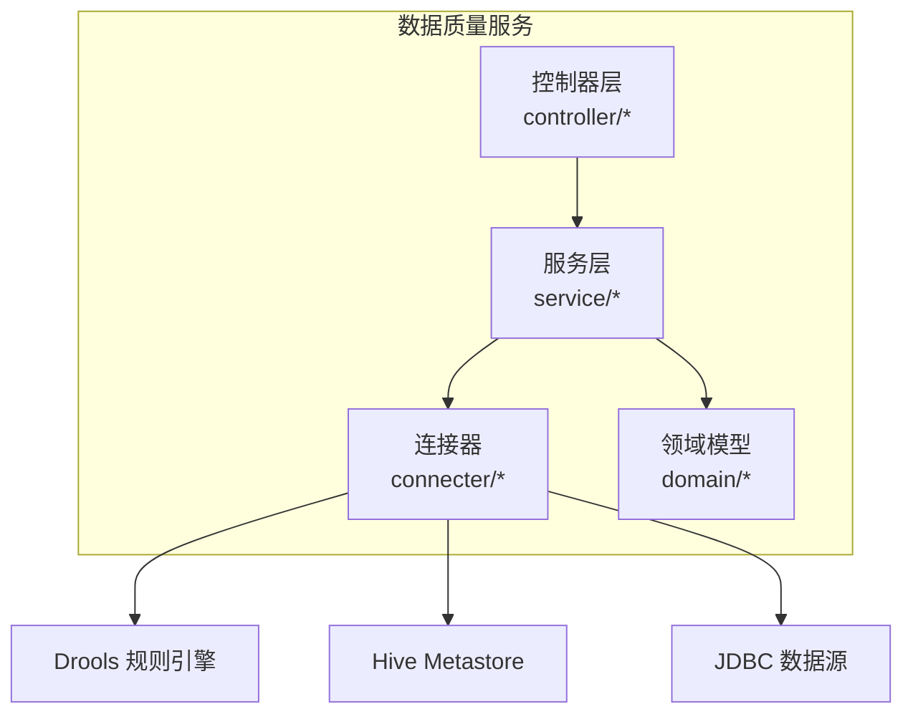
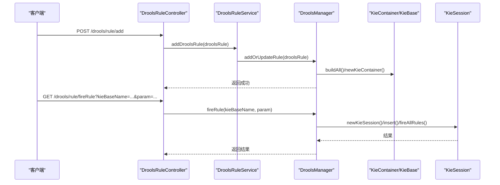
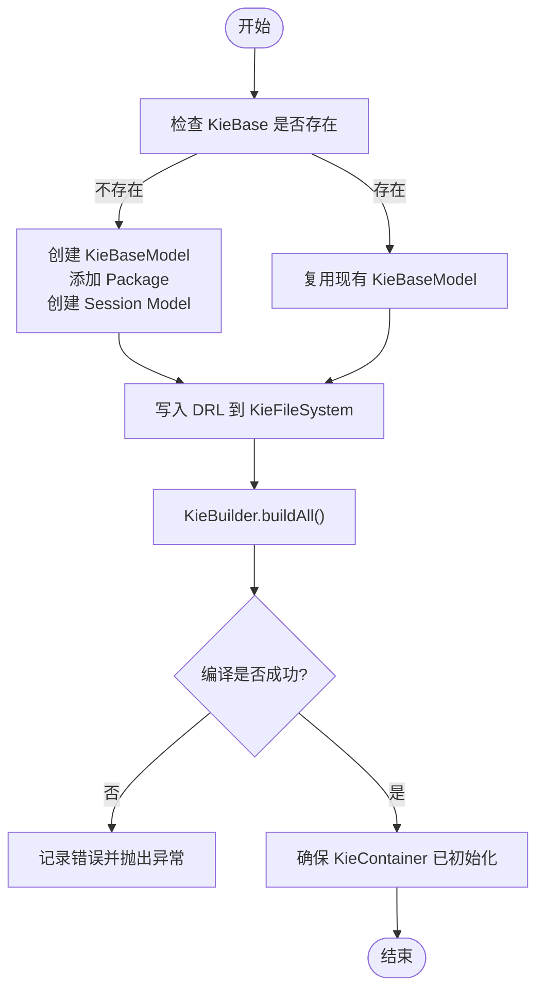
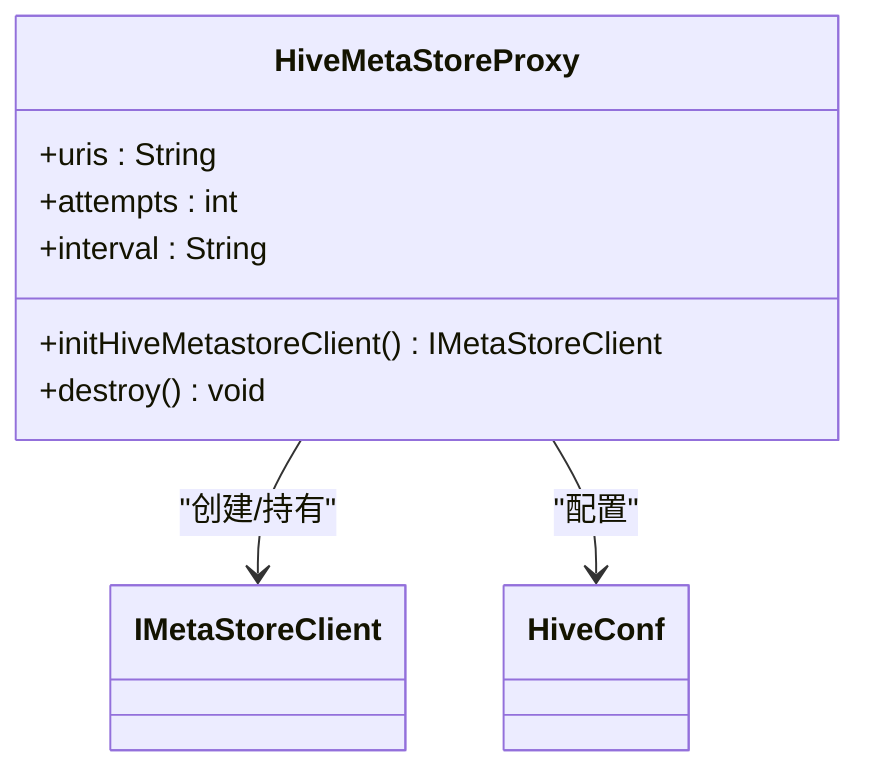
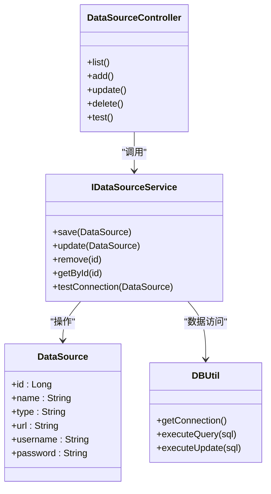
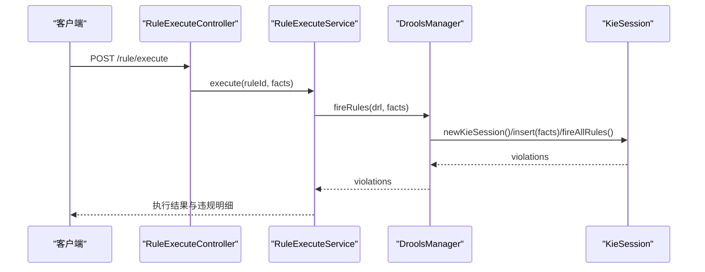
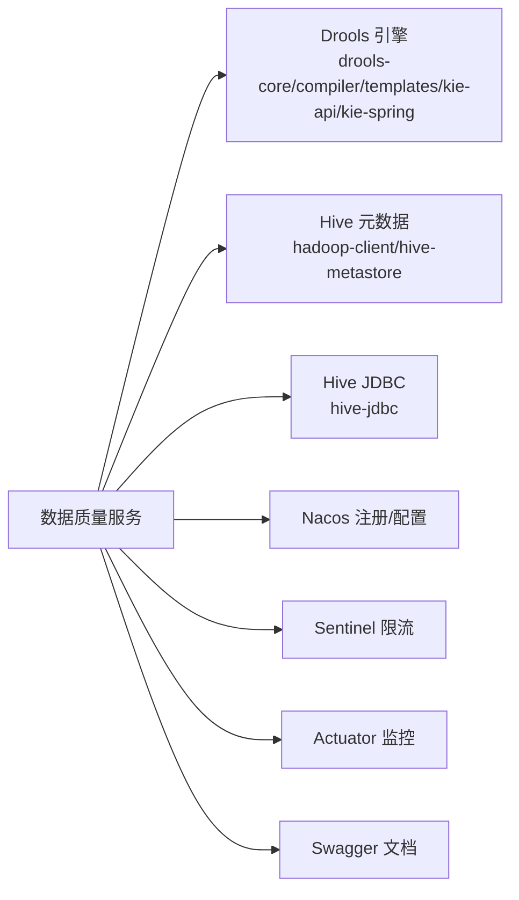

# 数据质量服务

<cite>
**本文引用的文件**   
- [pom.xml](file://ruoyi-modules/ruoyi-dqservice/pom.xml)
- [DroolsManager.java](file://ruoyi-modules/ruoyi-dqservice/src/main/java/com/ruoyi/dqservice/connecter/DroolsManager.java)
- [HiveMetaStoreProxy.java](file://ruoyi-modules/ruoyi-dqservice/src/main/java/com/ruoyi/dqservice/connecter/HiveMetaStoreProxy.java)
- [DBUtil.java](file://ruoyi-modules/ruoyi-dqservice/src/main/java/com/ruoyi/dqservice/connecter/DBUtil.java)
- [DroolsRuleController.java](file://ruoyi-modules/ruoyi-dqservice/src/main/java/com/ruoyi/dqservice/controller/DroolsRuleController.java)
- [DataSourceController.java](file://ruoyi-modules/ruoyi-dqservice/src/main/java/com/ruoyi/dqservice/controller/DataSourceController.java)
- [HiveMetaStoreController.java](file://ruoyi-modules/ruoyi-dqservice/src/main/java/com/ruoyi/dqservice/controller/HiveMetaStoreController.java)
- [ReportController.java](file://ruoyi-modules/ruoyi-dqservice/src/main/java/com/ruoyi/dqservice/controller/ReportController.java)
- [RuleController.java](file://ruoyi-modules/ruoyi-dqservice/src/main/java/com/ruoyi/dqservice/controller/RuleController.java)
- [RuleExecuteController.java](file://ruoyi-modules/ruoyi-dqservice/src/main/java/com/ruoyi/dqservice/controller/RuleExecuteController.java)
- [TestController.java](file://ruoyi-modules/ruoyi-dqservice/src/main/java/com/ruoyi/dqservice/controller/TestController.java)
- [DroolsRuleService.java](file://ruoyi-modules/ruoyi-dqservice/src/main/java/com/ruoyi/dqservice/service/DroolsRuleService.java)
- [HiveMetaStoreService.java](file://ruoyi-modules/ruoyi-dqservice/src/main/java/com/ruoyi/dqservice/service/HiveMetaStoreService.java)
- [IDataSourceService.java](file://ruoyi-modules/ruoyi-dqservice/src/main/java/com/ruoyi/dqservice/service/IDataSourceService.java)
- [IRuleService.java](file://ruoyi-modules/ruoyi-dqservice/src/main/java/com/ruoyi/dqservice/service/IRuleService.java)
- [ReportService.java](file://ruoyi-modules/ruoyi-dqservice/src/main/java/com/ruoyi/dqservice/service/ReportService.java)
- [RuleExecuteService.java](file://ruoyi-modules/ruoyi-dqservice/src/main/java/com/ruoyi/dqservice/service/RuleExecuteService.java)
- [DataSource.java](file://ruoyi-modules/ruoyi-dqservice/src/main/java/com/ruoyi/dqservice/domain/DataSource.java)
- [DroolsRule.java](file://ruoyi-modules/ruoyi-dqservice/src/main/java/com/ruoyi/dqservice/domain/DroolsRule.java)
- [ExecutionRecord.java](file://ruoyi-modules/ruoyi-dqservice/src/main/java/com/ruoyi/dqservice/domain/ExecutionRecord.java)
- [ExecutionViolation.java](file://ruoyi-modules/ruoyi-dqservice/src/main/java/com/ruoyi/dqservice/domain/ExecutionViolation.java)
- [Rule.java](file://ruoyi-modules/ruoyi-dqservice/src/main/java/com/ruoyi/dqservice/domain/Rule.java)
</cite>

## 目录
1. [简介](#简介)
2. [项目结构](#项目结构)
3. [核心组件](#核心组件)
4. [架构总览](#架构总览)
5. [详细组件分析](#详细组件分析)
6. [依赖关系分析](#依赖关系分析)
7. [性能与优化](#性能与优化)
8. [故障排查指南](#故障排查指南)
9. [结论](#结论)
10. [附录](#附录)

## 简介
本文件面向“数据质量服务”模块，聚焦基于 Drools 规则引擎的数据质量检测能力。文档围绕以下主题展开：
- 规则定义与模板管理（DRL、KieBase/KieSession、KieHelper 动态编译）
- 数据源管理与多类型适配器（JDBC/Hive 等）
- Hive 元数据存储访问与同步
- 规则执行与监控（批量事实插入、违规明细收集）
- 扩展与自定义开发指南

该模块以 Spring Boot + Spring Cloud Alibaba 为基础，集成 Nacos 注册配置、Sentinel 限流、Swagger 接口文档，并通过 Hive Metastore/JDBC 对接 Hive 数据仓库。

## 项目结构
数据质量服务位于 ruoyi-modules/ruoyi-dqservice 子模块中，采用典型的分层架构：
- controller：对外暴露 REST 接口（规则管理、数据源管理、Hive 元数据、报表、规则执行等）
- service：业务编排与领域逻辑
- domain：领域模型（数据源、规则、执行记录、违规明细等）
- connecter：外部系统连接器（Drools 引擎、Hive Metastore、JDBC 工具）
- util/config/mapper：工具类、配置、持久化映射（如有）

图表来源
- [DroolsRuleController.java:13-48](file://ruoyi-modules/ruoyi-dqservice/src/main/java/com/ruoyi/dqservice/controller/DroolsRuleController.java#L13-L48)
- [DroolsManager.java:22-187](file://ruoyi-modules/ruoyi-dqservice/src/main/java/com/ruoyi/dqservice/connecter/DroolsManager.java#L22-L187)
- [HiveMetaStoreProxy.java:14-63](file://ruoyi-modules/ruoyi-dqservice/src/main/java/com/ruoyi/dqservice/connecter/HiveMetaStoreProxy.java#L14-L63)

章节来源
- [pom.xml:12-14](file://ruoyi-modules/ruoyi-dqservice/pom.xml#L12-L14)

## 核心组件
- DroolsManager：封装 Drools 的 KieServices/KieFileSystem/KieModuleModel/KieContainer/KieHelper，提供规则的增删改查、动态编译与执行。
- HiveMetaStoreProxy：封装 Hive Metastore 客户端连接与重试策略，提供 IMetaStoreClient Bean。
- 控制器层：DroolsRuleController、DataSourceController、HiveMetaStoreController、RuleExecuteController、ReportController 等，负责请求路由与参数校验。
- 服务层：DroolsRuleService、HiveMetaStoreService、IDataSourceService、IRuleService、ReportService、RuleExecuteService 等，承载业务编排。
- 领域模型：DataSource、DroolsRule、Rule、ExecutionRecord、ExecutionViolation 等，描述数据源、规则、执行与违规信息。

章节来源
- [DroolsManager.java:22-187](file://ruoyi-modules/ruoyi-dqservice/src/main/java/com/ruoyi/dqservice/connecter/DroolsManager.java#L22-L187)
- [HiveMetaStoreProxy.java:14-63](file://ruoyi-modules/ruoyi-dqservice/src/main/java/com/ruoyi/dqservice/connecter/HiveMetaStoreProxy.java#L14-L63)
- [DroolsRuleController.java:13-48](file://ruoyi-modules/ruoyi-dqservice/src/main/java/com/ruoyi/dqservice/controller/DroolsRuleController.java#L13-L48)

## 架构总览
数据质量服务整体调用链如下：
- 规则管理：通过 DroolsRuleController 调用 DroolsRuleService，最终由 DroolsManager 完成规则文件的写入、KieModule 构建与 KieContainer 缓存。
- 规则执行：RuleExecuteController 或 DroolsRuleController.fireRule 触发 DroolsManager 执行；批量场景使用 fireRules 方法，将多条记录作为 Map 事实插入并收集 violations。
- 元数据同步：HiveMetaStoreController 调用 HiveMetaStoreService，底层通过 HiveMetaStoreProxy 获取 IMetaStoreClient 进行元数据查询/同步。
- 数据读取：通过 JDBC（如 Hive JDBC）或 Metastore 接口拉取表结构与数据，供规则引擎消费。

图表来源
- [DroolsRuleController.java:27-48](file://ruoyi-modules/ruoyi-dqservice/src/main/java/com/ruoyi/dqservice/controller/DroolsRuleController.java#L27-L48)
- [DroolsManager.java:63-134](file://ruoyi-modules/ruoyi-dqservice/src/main/java/com/ruoyi/dqservice/connecter/DroolsManager.java#L63-L134)

## 详细组件分析

### Drools 规则引擎与模板管理
- 规则生命周期
  - 新增/更新：addOrUpdateRule 将 DRL 内容写入虚拟文件系统，生成 kmodule.xml，构建 KieModule，并将 KieContainer 缓存为全局单例，避免重复创建导致的会话冲突。
  - 删除：deleteDroolsRule 从 KieBase 移除指定包下的规则。
  - 执行：fireRule 针对已有 KieBase 创建 KieSession，插入 fact 并触发规则；fireRules 支持批量 Map 事实，每次独立编译，错误隔离，通过 global List 收集违规明细。
- 模板与动态编译
  - 使用 KieHelper.addContent 对 DRL 文本进行即时编译，适用于热更新与批量检测场景。
  - 通过 KieFileSystem.write 与 writeKModuleXML 实现无磁盘落盘的规则装配。
- 错误处理
  - 编译阶段收集 Message.Level.ERROR，抛出 ServiceException，便于上层统一处理。
  - 若规则未声明 global violations，给出明确提示，避免运行时异常难以定位。

图表来源
- [DroolsManager.java:63-120](file://ruoyi-modules/ruoyi-dqservice/src/main/java/com/ruoyi/dqservice/connecter/DroolsManager.java#L63-L120)

章节来源
- [DroolsManager.java:22-187](file://ruoyi-modules/ruoyi-dqservice/src/main/java/com/ruoyi/dqservice/connecter/DroolsManager.java#L22-L187)
- [DroolsRuleController.java:27-48](file://ruoyi-modules/ruoyi-dqservice/src/main/java/com/ruoyi/dqservice/controller/DroolsRuleController.java#L27-L48)

### Hive 元数据存储访问与同步
- 连接与重试
  - 通过 @Value 注入 hive.metastore.uris、hive.hmshandler.retry.attempts、hive.hmshandler.retry.interval。
  - 使用 HiveConf 设置远程 Metastore、连接重试次数与间隔，构造 IMetaStoreClient 并以 synchronized 包装。
- 生命周期
  - initHiveMetastoreClient 作为 Bean 暴露客户端实例；@PreDestroy 关闭连接，避免资源泄漏。
  - 当 Hive 环境不可用时，捕获异常并记录日志，不影响其他功能启动。

图表来源
- [HiveMetaStoreProxy.java:14-63](file://ruoyi-modules/ruoyi-dqservice/src/main/java/com/ruoyi/dqservice/connecter/HiveMetaStoreProxy.java#L14-L63)

章节来源
- [HiveMetaStoreProxy.java:14-63](file://ruoyi-modules/ruoyi-dqservice/src/main/java/com/ruoyi/dqservice/connecter/HiveMetaStoreProxy.java#L14-L63)

### 数据源管理与多类型适配器
- 数据源模型
  - DataSource 用于描述数据源连接信息（如类型、URL、用户名、密码等），具体字段以领域模型为准。
- 控制器与服务
  - DataSourceController 暴露数据源的增删改查与连接测试等接口。
  - IDataSourceService 定义数据源管理能力，具体实现可包含多类型适配（JDBC、Hive、HDFS 等）。
- 数据访问
  - DBUtil 提供基础 JDBC 工具（示例中包含 Hive JDBC URL 常量），可用于直连数据源执行 SQL 或元数据操作。

图表来源
- [DataSource.java](file://ruoyi-modules/ruoyi-dqservice/src/main/java/com/ruoyi/dqservice/domain/DataSource.java)
- [DataSourceController.java](file://ruoyi-modules/ruoyi-dqservice/src/main/java/com/ruoyi/dqservice/controller/DataSourceController.java)
- [IDataSourceService.java](file://ruoyi-modules/ruoyi-dqservice/src/main/java/com/ruoyi/dqservice/service/IDataSourceService.java)
- [DBUtil.java:10-10](file://ruoyi-modules/ruoyi-dqservice/src/main/java/com/ruoyi/dqservice/connecter/DBUtil.java#L10-L10)

章节来源
- [DataSource.java](file://ruoyi-modules/ruoyi-dqservice/src/main/java/com/ruoyi/dqservice/domain/DataSource.java)
- [DataSourceController.java](file://ruoyi-modules/ruoyi-dqservice/src/main/java/com/ruoyi/dqservice/controller/DataSourceController.java)
- [IDataSourceService.java](file://ruoyi-modules/ruoyi-dqservice/src/main/java/com/ruoyi/dqservice/service/IDataSourceService.java)
- [DBUtil.java:10-10](file://ruoyi-modules/ruoyi-dqservice/src/main/java/com/ruoyi/dqservice/connecter/DBUtil.java#L10-L10)

### 规则执行与监控
- 执行入口
  - RuleExecuteController 提供规则执行的 REST 接口，接收 kieBaseName、fact 列表等参数。
  - DroolsRuleController.fireRule 提供简单样例执行（单个 Integer fact）。
- 批量执行
  - DroolsManager.fireRules 支持传入 Collection<Map<String,Object>> 作为事实集合，每条记录一个 Map；通过 global List violations 收集 then 块产出的违规明细。
  - 每次调用使用独立的 KieHelper 编译，避免全局 KieFileSystem 污染，提升容错性与热更新能力。
- 监控与记录
  - ExecutionRecord/ExecutionViolation 用于记录执行上下文与违规详情，可由 RuleExecuteService 或 ReportService 聚合统计。

图表来源
- [RuleExecuteController.java](file://ruoyi-modules/ruoyi-dqservice/src/main/java/com/ruoyi/dqservice/controller/RuleExecuteController.java)
- [RuleExecuteService.java](file://ruoyi-modules/ruoyi-dqservice/src/main/java/com/ruoyi/dqservice/service/RuleExecuteService.java)
- [DroolsManager.java:149-187](file://ruoyi-modules/ruoyi-dqservice/src/main/java/com/ruoyi/dqservice/connecter/DroolsManager.java#L149-L187)

章节来源
- [RuleExecuteController.java](file://ruoyi-modules/ruoyi-dqservice/src/main/java/com/ruoyi/dqservice/controller/RuleExecuteController.java)
- [RuleExecuteService.java](file://ruoyi-modules/ruoyi-dqservice/src/main/java/com/ruoyi/dqservice/service/RuleExecuteService.java)
- [DroolsManager.java:149-187](file://ruoyi-modules/ruoyi-dqservice/src/main/java/com/ruoyi/dqservice/connecter/DroolsManager.java#L149-L187)

### 报表与统计
- ReportController 与 ReportService 提供执行结果的汇总、导出与可视化支撑，可与 ExecutionRecord/ExecutionViolation 关联统计。

章节来源
- [ReportController.java](file://ruoyi-modules/ruoyi-dqservice/src/main/java/com/ruoyi/dqservice/controller/ReportController.java)
- [ReportService.java](file://ruoyi-modules/ruoyi-dqservice/src/main/java/com/ruoyi/dqservice/service/ReportService.java)

## 依赖关系分析
- 规则引擎依赖
  - drools-core、drools-compiler、drools-templates、kie-api、kie-spring 提供规则编译、运行与 Spring 集成能力。
- 数据访问依赖
  - hadoop-client、hive-metastore、hive-jdbc 用于访问 Hive 元数据与数据。
- 基础设施依赖
  - spring-cloud-alibaba-nacos-discovery/config、sentinel、actuator、swagger-ui 提供注册发现、配置、限流、健康检查与接口文档。

图表来源
- [pom.xml:18-35](file://ruoyi-modules/ruoyi-dqservice/pom.xml#L18-L35)
- [pom.xml:79-238](file://ruoyi-modules/ruoyi-dqservice/pom.xml#L79-L238)
- [pom.xml:240-352](file://ruoyi-modules/ruoyi-dqservice/pom.xml#L240-L352)

章节来源
- [pom.xml:18-35](file://ruoyi-modules/ruoyi-dqservice/pom.xml#L18-L35)
- [pom.xml:79-238](file://ruoyi-modules/ruoyi-dqservice/pom.xml#L79-L238)
- [pom.xml:240-352](file://ruoyi-modules/ruoyi-dqservice/pom.xml#L240-L352)

## 性能与优化
- 规则引擎优化
  - 全局 KieContainer 缓存：避免频繁重建容器导致内存抖动与会话冲突。
  - 增量构建：仅在新增/更新规则时重新构建 KieModule，减少不必要的编译开销。
  - 批量事实插入：fireRules 一次性 insert 多条记录，降低会话交互次数。
  - 独立编译：fireRules 使用 KieHelper 独立编译，错误隔离，避免影响全局规则集。
- 数据访问优化
  - 连接池与批处理：在 JDBC 侧启用连接池与批量提交，减少网络往返。
  - 元数据缓存：对 Hive Metastore 的常用元数据（库/表/分区）做本地缓存，降低远端调用压力。
- 并发与限流
  - 结合 Sentinel 对热点接口（如规则执行、元数据同步）进行限流与熔断保护。
- 资源回收
  - KieSession 使用后及时 dispose；Hive Metastore 客户端在应用销毁时关闭。

[本节为通用指导，不直接分析具体文件]

## 故障排查指南
- 规则编译失败
  - 现象：抛出 ServiceException，日志包含规则编译错误信息。
  - 排查：检查 DRL 语法、global 声明是否正确；确认规则包路径与文件名一致。
  - 参考：DroolsManager.fireRules 的错误收集与提示。
- 无法连接 Hive Metastore
  - 现象：initHiveMetastoreClient 捕获异常并记录日志，Hive 功能不可用。
  - 排查：核对 hive.metastore.uris、重试参数配置；检查网络连通性与权限。
  - 参考：HiveMetaStoreProxy.initHiveMetastoreClient。
- 规则执行结果为空
  - 现象：violations 为空或未命中。
  - 排查：确认 fact 字段名与规则条件匹配；检查规则优先级与条件逻辑。
- 数据源连接失败
  - 现象：JDBC 连接异常或超时。
  - 排查：核对 DataSource 配置（类型、URL、账号密码）、驱动依赖与网络连通性。

章节来源
- [DroolsManager.java:149-187](file://ruoyi-modules/ruoyi-dqservice/src/main/java/com/ruoyi/dqservice/connecter/DroolsManager.java#L149-L187)
- [HiveMetaStoreProxy.java:39-55](file://ruoyi-modules/ruoyi-dqservice/src/main/java/com/ruoyi/dqservice/connecter/HiveMetaStoreProxy.java#L39-L55)

## 结论
数据质量服务以 Drools 为核心，提供灵活的规则定义、动态编译与批量执行能力；通过 Hive Metastore/JDBC 实现对 Hive 生态的元数据与数据访问；配合 Nacos/Sentinel/Actuator/Swagger 形成完整的微服务基础设施。建议在大规模规则与高并发场景下，结合连接池、元数据缓存与限流熔断策略，进一步提升稳定性与吞吐。

[本节为总结性内容，不直接分析具体文件]

## 附录
- 关键 API 概览
  - 规则管理：/drools/rule/add、/drools/rule/update、/drools/rule/deleteRule、/drools/rule/findAll、/drools/rule/fireRule
  - 数据源管理：/datasource/*（由 DataSourceController 提供）
  - Hive 元数据：/hive/meta/*（由 HiveMetaStoreController 提供）
  - 规则执行：/rule/execute（由 RuleExecuteController 提供）
  - 报表统计：/report/*（由 ReportController 提供）

章节来源
- [DroolsRuleController.java:22-48](file://ruoyi-modules/ruoyi-dqservice/src/main/java/com/ruoyi/dqservice/controller/DroolsRuleController.java#L22-L48)
- [DataSourceController.java](file://ruoyi-modules/ruoyi-dqservice/src/main/java/com/ruoyi/dqservice/controller/DataSourceController.java)
- [HiveMetaStoreController.java](file://ruoyi-modules/ruoyi-dqservice/src/main/java/com/ruoyi/dqservice/controller/HiveMetaStoreController.java)
- [RuleExecuteController.java](file://ruoyi-modules/ruoyi-dqservice/src/main/java/com/ruoyi/dqservice/controller/RuleExecuteController.java)
- [ReportController.java](file://ruoyi-modules/ruoyi-dqservice/src/main/java/com/ruoyi/dqservice/controller/ReportController.java)