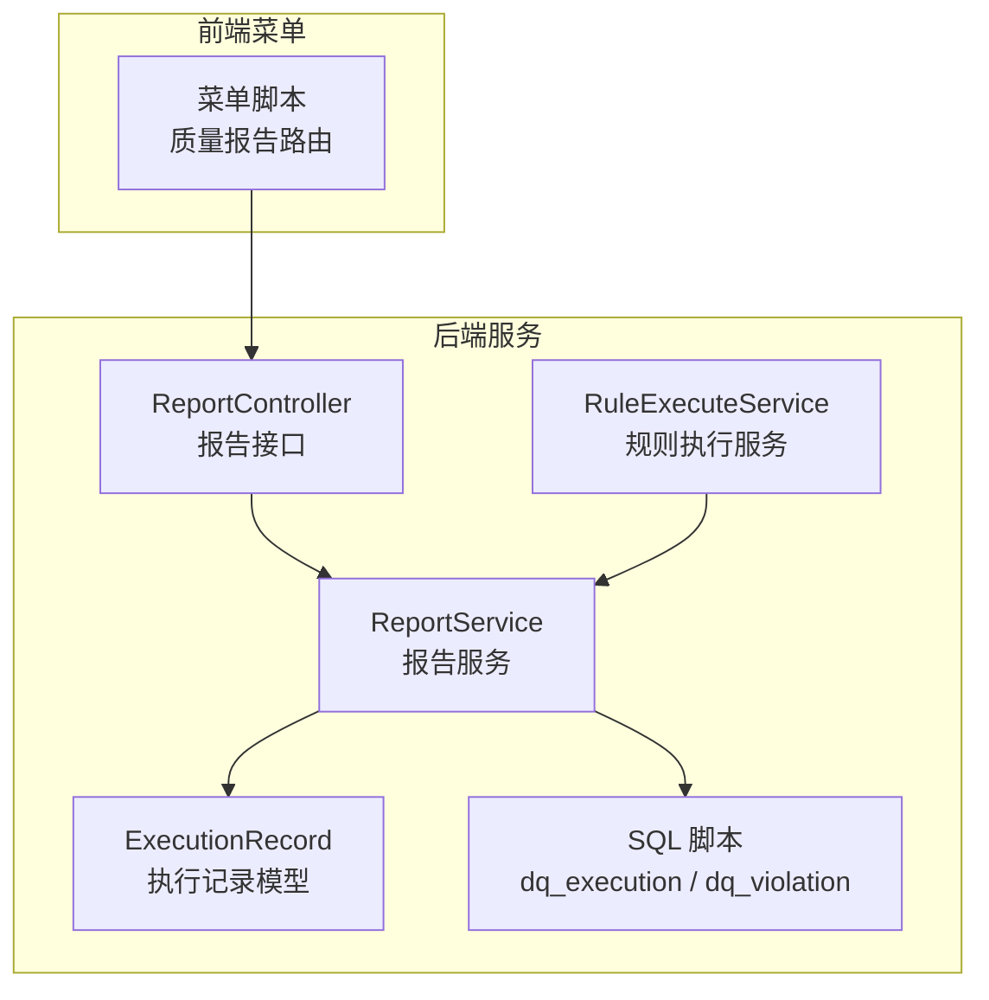
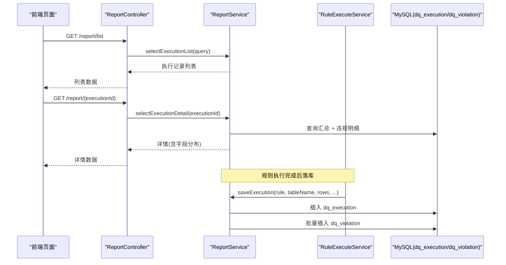
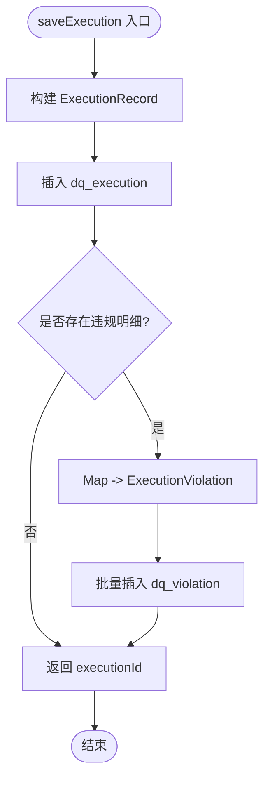
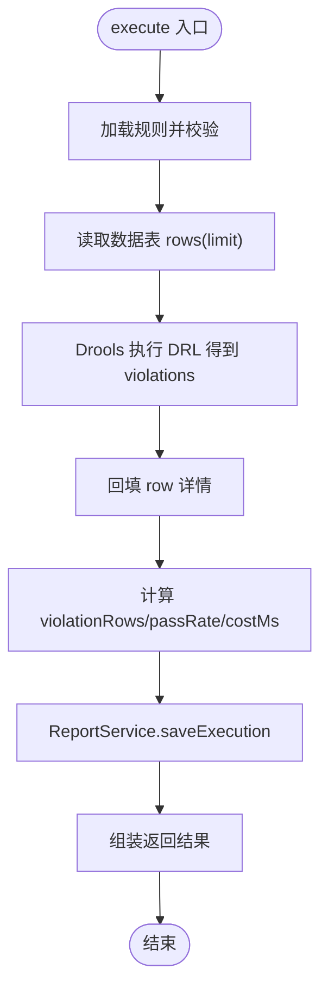
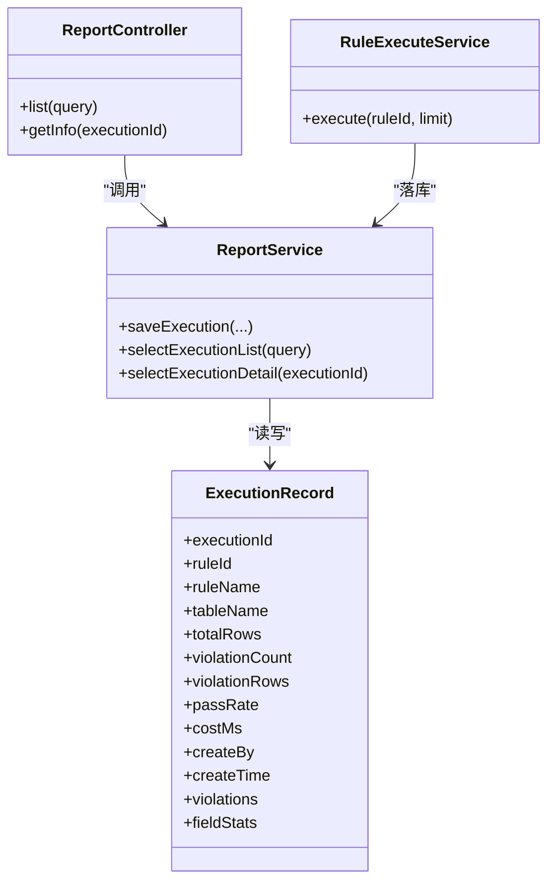

# 监控报告

<cite>
**本文引用的文件**   
- [ReportController.java](file://ruoyi-modules/ruoyi-dqservice/src/main/java/com/ruoyi/dqservice/controller/ReportController.java)
- [ReportService.java](file://ruoyi-modules/ruoyi-dqservice/src/main/java/com/ruoyi/dqservice/service/ReportService.java)
- [RuleExecuteService.java](file://ruoyi-modules/ruoyi-dqservice/src/main/java/com/ruoyi/dqservice/service/RuleExecuteService.java)
- [ExecutionRecord.java](file://ruoyi-modules/ruoyi-dqservice/src/main/java/com/ruoyi/dqservice/domain/ExecutionRecord.java)
- [ry_dq_report_20261026.sql](file://sql/ry_dq_report_20261026.sql)
- [ry_dq_report_menu_20261026.sql](file://sql/ry_dq_report_menu_20261026.sql)
</cite>

## 目录
1. [引言](#引言)
2. [项目结构](#项目结构)
3. [核心组件](#核心组件)
4. [架构总览](#架构总览)
5. [详细组件分析](#详细组件分析)
6. [依赖关系分析](#依赖关系分析)
7. [性能与优化](#性能与优化)
8. [故障排查](#故障排查)
9. [结论](#结论)
10. [附录](#附录)

## 引言
本模块面向数据质量规则执行后的“监控报告”能力，提供：
- 实时监控面板：展示最近执行的汇总指标、通过率、违规条数、字段分布等。
- 执行历史记录：按规则、时间范围分页查询历史执行记录。
- 质量指标统计：计算通过率、命中行数、违规明细、字段维度统计。
- 报告导出：为后续扩展 Excel/PDF 导出提供统一的数据模型与接口基础。
- 自定义配置与告警通知：基于现有规则与执行结果，可扩展阈值告警与通知渠道。

## 项目结构
监控报告相关代码集中在 dqservice 模块中，包含控制器、服务层、领域模型与数据库脚本；菜单脚本将“质量报告”挂载到系统菜单下。

图表来源
- [ReportController.java:23-49](file://ruoyi-modules/ruoyi-dqservice/src/main/java/com/ruoyi/dqservice/controller/ReportController.java#L23-L49)
- [ReportService.java:28-109](file://ruoyi-modules/ruoyi-dqservice/src/main/java/com/ruoyi/dqservice/service/ReportService.java#L28-L109)
- [RuleExecuteService.java:69-113](file://ruoyi-modules/ruoyi-dqservice/src/main/java/com/ruoyi/dqservice/service/RuleExecuteService.java#L69-L113)
- [ExecutionRecord.java:17-72](file://ruoyi-modules/ruoyi-dqservice/src/main/java/com/ruoyi/dqservice/domain/ExecutionRecord.java#L17-L72)
- [ry_dq_report_20261026.sql:11-39](file://sql/ry_dq_report_20261026.sql#L11-L39)
- [ry_dq_report_menu_20261026.sql:10-13](file://sql/ry_dq_report_menu_20261026.sql#L10-L13)

章节来源
- [ReportController.java:23-49](file://ruoyi-modules/ruoyi-dqservice/src/main/java/com/ruoyi/dqservice/controller/ReportController.java#L23-L49)
- [ry_dq_report_menu_20261026.sql:10-13](file://sql/ry_dq_report_menu_20261026.sql#L10-L13)

## 核心组件
- 报告控制器 ReportController：暴露“执行记录列表”和“执行详情”两个接口，作为监控面板与历史查询的统一入口。
- 报告服务 ReportService：负责执行结果的持久化、详情聚合（含违规明细与字段分布）、异常处理。
- 规则执行服务 RuleExecuteService：读取数据表、执行 Drools 规则、计算通过率与字段统计，并调用 ReportService 落库。
- 执行记录模型 ExecutionRecord：承载 dq_execution 的汇总字段以及非表字段 violations、fieldStats。
- 数据库脚本：定义 dq_execution 与 dq_violation 两张表的结构与索引。

章节来源
- [ReportController.java:23-49](file://ruoyi-modules/ruoyi-dqservice/src/main/java/com/ruoyi/dqservice/controller/ReportController.java#L23-L49)
- [ReportService.java:28-109](file://ruoyi-modules/ruoyi-dqservice/src/main/java/com/ruoyi/dqservice/service/ReportService.java#L28-L109)
- [RuleExecuteService.java:69-113](file://ruoyi-modules/ruoyi-dqservice/src/main/java/com/ruoyi/dqservice/service/RuleExecuteService.java#L69-L113)
- [ExecutionRecord.java:17-72](file://ruoyi-modules/ruoyi-dqservice/src/main/java/com/ruoyi/dqservice/domain/ExecutionRecord.java#L17-L72)
- [ry_dq_report_20261026.sql:11-39](file://sql/ry_dq_report_20261026.sql#L11-L39)

## 架构总览
监控报告的整体流程如下：
- 前端通过菜单进入“质量报告”，调用后端接口获取执行记录列表或详情。
- 规则执行时，RuleExecuteService 从主数据源拉取数据，交给 DroolsManager 执行 DRL，得到违规明细。
- RuleExecuteService 计算通过率、命中行数、字段分布，并调用 ReportService.saveExecution 写入 dq_execution 与 dq_violation。
- ReportService.selectExecutionDetail 聚合违规明细与字段分布，供前端渲染实时面板与详情页。

图表来源
- [ReportController.java:32-49](file://ruoyi-modules/ruoyi-dqservice/src/main/java/com/ruoyi/dqservice/controller/ReportController.java#L32-L49)
- [ReportService.java:58-109](file://ruoyi-modules/ruoyi-dqservice/src/main/java/com/ruoyi/dqservice/service/ReportService.java#L58-L109)
- [RuleExecuteService.java:87-113](file://ruoyi-modules/ruoyi-dqservice/src/main/java/com/ruoyi/dqservice/service/RuleExecuteService.java#L87-L113)
- [ry_dq_report_20261026.sql:11-39](file://sql/ry_dq_report_20261026.sql#L11-L39)

## 详细组件分析

### 报告控制器 ReportController
职责与接口
- GET /report/list：分页查询执行记录列表，支持按规则、时间等条件过滤。
- GET /report/{executionId}：查询某次执行的详情，包含违规明细与字段分布。

权限控制
- 使用权限标识 dqservice:report:list 进行访问控制。

返回结构
- 列表接口返回 TableDataInfo，包含分页信息与记录集合。
- 详情接口返回 AjaxResult，封装执行汇总、违规明细与字段分布。

章节来源
- [ReportController.java:23-49](file://ruoyi-modules/ruoyi-dqservice/src/main/java/com/ruoyi/dqservice/controller/ReportController.java#L23-L49)

### 报告服务 ReportService
核心能力
- 保存执行结果：在事务内写入 dq_execution 与 dq_violation，保证汇总与明细一致性。
- 查询执行列表：委托 Mapper 查询 dq_execution 列表。
- 查询执行详情：根据 executionId 查询汇总与违规明细，并计算字段分布。
- 字段分布统计：对违规明细按 field_name 聚合计数，降序排列。

关键逻辑
- 用户上下文：优先从安全上下文获取用户名，失败时回退为 system。
- 字符串截断：对 record_id、field_name、rule_name、field_value 做长度限制，避免超长写入失败。
- 空表保护：当无违规明细时，不写入 dq_violation，减少无效数据。

图表来源
- [ReportService.java:58-89](file://ruoyi-modules/ruoyi-dqservice/src/main/java/com/ruoyi/dqservice/service/ReportService.java#L58-L89)

章节来源
- [ReportService.java:58-109](file://ruoyi-modules/ruoyi-dqservice/src/main/java/com/ruoyi/dqservice/service/ReportService.java#L58-L109)
- [ReportService.java:131-149](file://ruoyi-modules/ruoyi-dqservice/src/main/java/com/ruoyi/dqservice/service/ReportService.java#L131-L149)
- [ReportService.java:156-177](file://ruoyi-modules/ruoyi-dqservice/src/main/java/com/ruoyi/dqservice/service/ReportService.java#L156-L177)

### 规则执行服务 RuleExecuteService
执行流程
- 校验规则：检查 ruleId、tableName、DRL 是否合法。
- 数据读取：按白名单校验表名后，select * from {table} limit N，每行转为 Map，并注入 rowId。
- 规则执行：调用 DroolsManager.fireRules 执行 DRL，产出违规明细。
- 关联回填：将违规明细与原始行关联，便于前端展示具体字段值。
- 指标计算：计算 violationRows、passRate、costMs、fieldStats。
- 结果落库：调用 ReportService.saveExecution 持久化。

图表来源
- [RuleExecuteService.java:69-113](file://ruoyi-modules/ruoyi-dqservice/src/main/java/com/ruoyi/dqservice/service/RuleExecuteService.java#L69-L113)
- [RuleExecuteService.java:120-149](file://ruoyi-modules/ruoyi-dqservice/src/main/java/com/ruoyi/dqservice/service/RuleExecuteService.java#L120-L149)
- [RuleExecuteService.java:154-183](file://ruoyi-modules/ruoyi-dqservice/src/main/java/com/ruoyi/dqservice/service/RuleExecuteService.java#L154-L183)
- [RuleExecuteService.java:190-218](file://ruoyi-modules/ruoyi-dqservice/src/main/java/com/ruoyi/dqservice/service/RuleExecuteService.java#L190-L218)

章节来源
- [RuleExecuteService.java:69-113](file://ruoyi-modules/ruoyi-dqservice/src/main/java/com/ruoyi/dqservice/service/RuleExecuteService.java#L69-L113)
- [RuleExecuteService.java:120-149](file://ruoyi-modules/ruoyi-dqservice/src/main/java/com/ruoyi/dqservice/service/RuleExecuteService.java#L120-L149)
- [RuleExecuteService.java:154-183](file://ruoyi-modules/ruoyi/dqservice/service/RuleExecuteService.java#L154-L183)
- [RuleExecuteService.java:190-218](file://ruoyi-modules/ruoyi-dqservice/src/main/java/com/ruoyi/dqservice/service/RuleExecuteService.java#L190-L218)

### 执行记录模型 ExecutionRecord
字段说明
- 汇总字段：executionId、ruleId、ruleName、dbName、tableName、totalRows、violationCount、violationRows、passRate、costMs、createBy、createTime。
- 非表字段：violations（违规明细列表）、fieldStats（字段维度的违规计数）。

用途
- 作为 dq_execution 的映射对象，同时承载详情接口所需的附加字段。

章节来源
- [ExecutionRecord.java:17-72](file://ruoyi-modules/ruoyi-dqservice/src/main/java/com/ruoyi/dqservice/domain/ExecutionRecord.java#L17-L72)

### 数据库存储结构
表结构与索引
- dq_execution：记录每次规则执行的汇总信息，包含 rule_id、table_name、total_rows、violation_count、violation_rows、pass_rate、cost_ms、create_by、create_time，并对 rule_id、create_time 建索引。
- dq_violation：记录该次执行的逐条违规明细，包含 execution_id、row_id、record_id、field_name、rule_name、field_value，并对 execution_id 建索引。

设计要点
- 使用 CREATE TABLE IF NOT EXISTS，重复执行脚本不会清空历史数据。
- 字段长度与 Java 侧 truncate 保持一致，避免写入异常。

章节来源
- [ry_dq_report_20261026.sql:11-39](file://sql/ry_dq_report_20261026.sql#L11-L39)

## 依赖关系分析
- ReportController 依赖 ReportService 提供数据查询能力。
- RuleExecuteService 依赖 ReportService 完成执行结果落库。
- ReportService 依赖 ExecutionRecordMapper 与 ExecutionViolationMapper（由框架生成）访问数据库。
- 菜单脚本将“质量报告”挂载到系统菜单，权限标识为 dqservice:report:list。

图表来源
- [ReportController.java:23-49](file://ruoyi-modules/ruoyi-dqservice/src/main/java/com/ruoyi/dqservice/controller/ReportController.java#L23-L49)
- [ReportService.java:28-109](file://ruoyi-modules/ruoyi-dqservice/src/main/java/com/ruoyi/dqservice/service/ReportService.java#L28-L109)
- [RuleExecuteService.java:69-113](file://ruoyi-modules/ruoyi-dqservice/src/main/java/com/ruoyi/dqservice/service/RuleExecuteService.java#L69-L113)
- [ExecutionRecord.java:17-72](file://ruoyi-modules/ruoyi-dqservice/src/main/java/com/ruoyi/dqservice/domain/ExecutionRecord.java#L17-L72)

章节来源
- [ry_dq_report_menu_20261026.sql:10-13](file://sql/ry_dq_report_menu_20261026.sql#L10-L13)

## 性能与优化
- 扫描行数限制：默认 LIMIT=1000，最大上限 MAX_LIMIT=10000，避免大表拖慢演示环境。
- 字段分布统计：内存中使用 LinkedHashMap 聚合计数，并按 count 降序排序，适合前端图表渲染。
- 批量写入：违规明细采用批量插入，降低数据库交互次数。
- 索引优化：dq_execution.rule_id、dq_execution.create_time、dq_violation.execution_id 提升查询效率。
- 空表保护：当 totalRows<=0 时 passRate 直接返回 100%，避免除零错误。

建议
- 对于高频查询的执行记录列表，可结合缓存（如 Redis）缓存热点规则的最新一次执行结果。
- 对 dq_violation 大表可按 execution_id 分片或归档策略，减轻查询压力。
- 报表导出建议在异步任务中生成，避免阻塞请求线程。

[本节为通用性能建议，不涉及具体文件分析]

## 故障排查
常见问题与定位
- 规则不存在：RuleExecuteService 抛出 ServiceException，需检查 ruleId 是否正确。
- 规则未绑定合法数据表：tableName 未通过白名单校验，需修正规则中的表名。
- 规则内容为空：DRL 为空导致无法执行，需补充规则内容。
- 读取数据表失败：SQLException 被捕获并包装为 ServiceException，需检查数据源连接与表权限。
- 执行记录不存在：ReportService.selectExecutionDetail 抛错，需确认 executionId 有效。

日志与诊断
- 规则执行完成日志包含 ruleName、tableName、totalRows、violationCount、violationRows、costMs、executionId，便于快速定位问题批次。
- 报告落库日志包含 executionId、ruleName、violationCount，用于验证数据一致性。

章节来源
- [RuleExecuteService.java:71-85](file://ruoyi-modules/ruoyi-dqservice/src/main/java/com/ruoyi/dqservice/service/RuleExecuteService.java#L71-L85)
- [RuleExecuteService.java:143-147](file://ruoyi-modules/ruoyi-dqservice/src/main/java/com/ruoyi/dqservice/service/RuleExecuteService.java#L143-L147)
- [ReportService.java:101-104](file://ruoyi-modules/ruoyi-dqservice/src/main/java/com/ruoyi/dqservice/service/ReportService.java#L101-L104)
- [RuleExecuteService.java:98-99](file://ruoyi-modules/ruoyi-dqservice/src/main/java/com/ruoyi/dqservice/service/RuleExecuteService.java#L98-L99)
- [ReportService.java:86-87](file://ruoyi-modules/ruoyi-dqservice/src/main/java/com/ruoyi/dqservice/service/ReportService.java#L86-L87)

## 结论
监控报告模块以 ReportController 为入口，ReportService 为核心，RuleExecuteService 驱动规则执行与指标计算，配合 dq_execution 与 dq_violation 两张表实现执行记录的持久化与查询。当前已具备实时监控面板所需的基础数据与接口，并为后续 Excel/PDF 导出、阈值告警与通知提供了良好的扩展点。

[本节为总结性内容，不涉及具体文件分析]

## 附录

### 实时监控面板
- 数据来源：GET /report/list 返回列表，GET /report/{executionId} 返回详情。
- 展示指标：totalRows、violationCount、violationRows、passRate、costMs、fieldStats。
- 更新机制：可在前端定时轮询最新执行记录，或在规则执行完成后主动刷新。

章节来源
- [ReportController.java:32-49](file://ruoyi-modules/ruoyi-dqservice/src/main/java/com/ruoyi/dqservice/controller/ReportController.java#L32-L49)
- [ReportService.java:91-109](file://ruoyi-modules/ruoyi-dqservice/src/main/java/com/ruoyi/dqservice/service/ReportService.java#L91-L109)

### 执行历史记录
- 查询方式：通过 ReportController.list 分页查询，支持按规则、时间等条件过滤。
- 历史优化：利用 dq_execution.rule_id、dq_execution.create_time 索引加速查询。

章节来源
- [ReportController.java:32-39](file://ruoyi-modules/ruoyi-dqservice/src/main/java/com/ruoyi/dqservice/controller/ReportController.java#L32-L39)
- [ry_dq_report_20261026.sql:24-26](file://sql/ry_dq_report_20261026.sql#L24-L26)

### 质量指标统计
- 通过率：passRate = (totalRows - violationRows) / totalRows * 100%，保留一位小数；空表视为 100%。
- 字段分布：按 field_name 聚合违规条数，降序排列，便于前端可视化。

章节来源
- [RuleExecuteService.java:190-197](file://ruoyi-modules/ruoyi-dqservice/src/main/java/com/ruoyi/dqservice/service/RuleExecuteService.java#L190-L197)
- [RuleExecuteService.java:200-218](file://ruoyi-modules/ruoyi-dqservice/src/main/java/com/ruoyi/dqservice/service/RuleExecuteService.java#L200-L218)
- [ReportService.java:131-149](file://ruoyi-modules/ruoyi-dqservice/src/main/java/com/ruoyi/dqservice/service/ReportService.java#L131-L149)

### 报告导出（Excel/PDF）
- 数据基础：ExecutionRecord 与 ExecutionViolation 已提供结构化数据，可直接映射到导出模板。
- 技术实现建议：
  - Excel：复用现有 Excel 注解与工具类，将 ExecutionRecord 与 FieldStat 映射到列。
  - PDF：基于 HTML 模板或绘图库生成图表与表格，再转换为 PDF。
- 异步导出：建议将导出任务放入异步队列，避免阻塞请求线程。

[本节为通用实现建议，不涉及具体文件分析]

### 监控指标自定义配置与告警通知
- 指标配置：可在规则或外部配置中心定义阈值（如 passRate < 95%），在执行完成后评估。
- 告警触发：在 ReportService.saveExecution 或 RuleExecuteService.execute 完成后，根据阈值判断是否触发告警。
- 通知渠道：可扩展邮件、短信、企业微信、钉钉等通知方式，统一接入消息中心。

[本节为通用方案建议，不涉及具体文件分析]