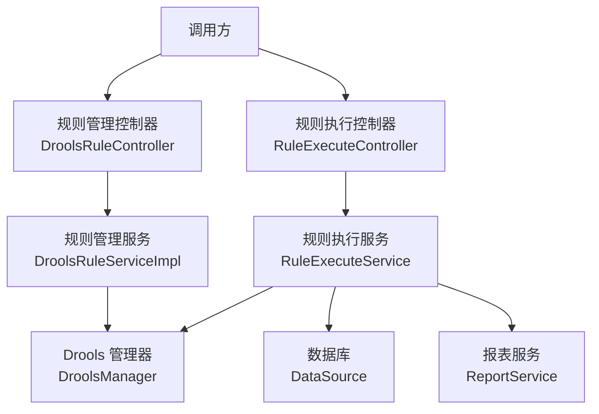
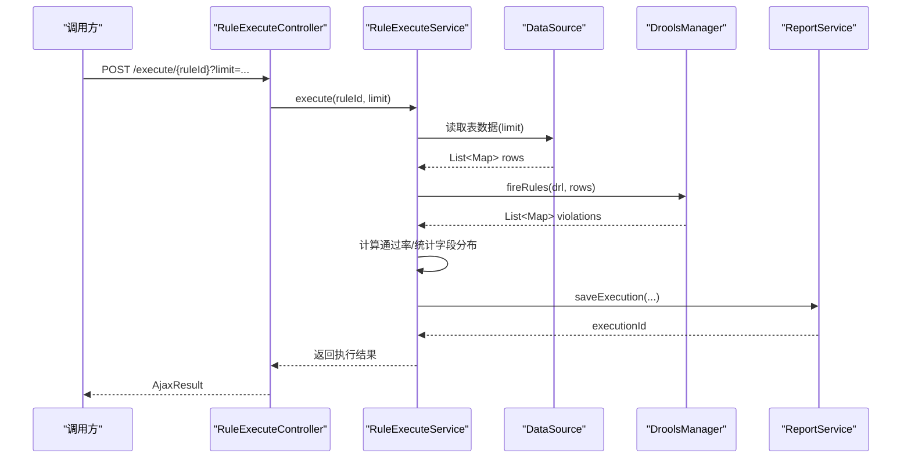
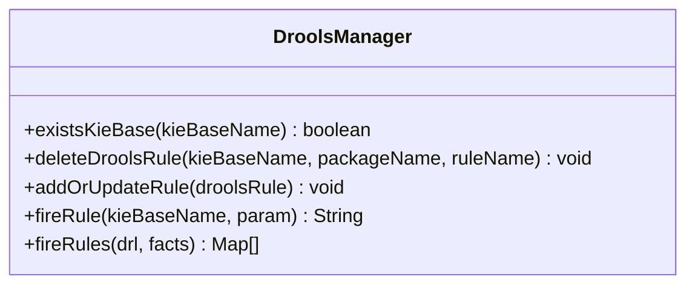
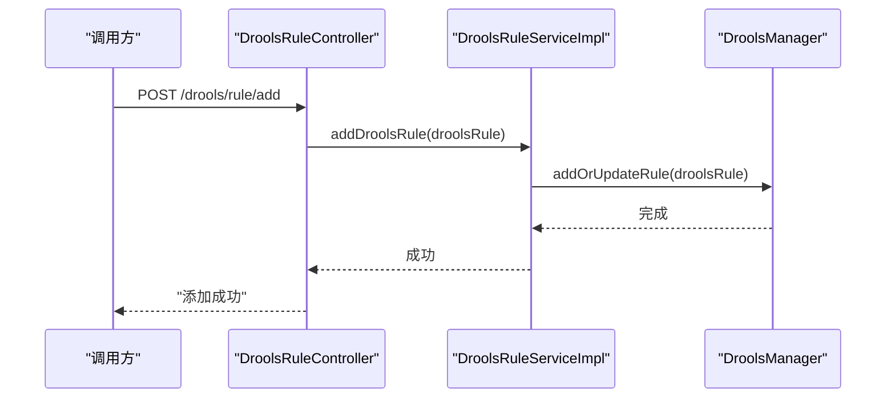
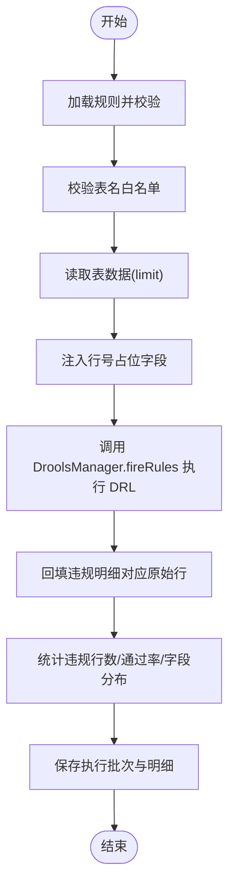
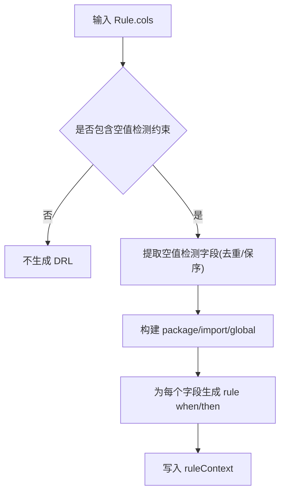
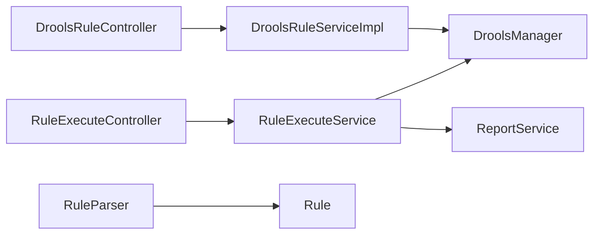

# 规则执行引擎

<cite>
**本文引用的文件**   
- [DroolsManager.java](file://ruoyi-modules/ruoyi-dqservice/src/main/java/com/ruoyi/dqservice/connecter/DroolsManager.java)
- [DroolsRuleController.java](file://ruoyi-modules/ruoyi-dqservice/src/main/java/com/ruoyi/dqservice/controller/DroolsRuleController.java)
- [RuleExecuteController.java](file://ruoyi-modules/ruoyi-dqservice/src/main/java/com/ruoyi/dqservice/controller/RuleExecuteController.java)
- [DroolsRuleServiceImpl.java](file://ruoyi-modules/ruoyi-dqservice/src/main/java/com/ruoyi/dqservice/service/impl/DroolsRuleServiceImpl.java)
- [RuleExecuteService.java](file://ruoyi-modules/ruoyi-dqservice/src/main/java/com/ruoyi/dqservice/service/RuleExecuteService.java)
- [RuleParser.java](file://ruoyi-modules/ruoyi-dqservice/src/main/java/com/ruoyi/dqservice/util/RuleParser.java)
- [ReportService.java](file://ruoyi-modules/ruoyi-dqservice/src/main/java/com/ruoyi/dqservice/service/ReportService.java)
</cite>

## 目录
1. [引言](#引言)
2. [项目结构](#项目结构)
3. [核心组件](#核心组件)
4. [架构总览](#架构总览)
5. [详细组件分析](#详细组件分析)
6. [依赖关系分析](#依赖关系分析)
7. [性能与内存优化](#性能与内存优化)
8. [监控指标与调试方法](#监控指标与调试方法)
9. [故障排查指南](#故障排查指南)
10. [结论](#结论)

## 引言
本文件面向数据质量服务中的规则执行引擎，重点说明 Drools 规则引擎的集成架构、规则编译与执行流程、批量数据处理机制，以及 DroolsManager 的管理器设计、规则加载策略与会话管理机制。文档同时给出性能优化、内存管理、并发处理建议，并提供监控指标、调试方法与调优建议，帮助读者在生产环境中稳定、高效地使用规则引擎。

## 项目结构
规则执行引擎位于 ruoyi-dqservice 模块中，围绕“规则定义—规则编译—会话创建—数据读取—规则执行—结果汇总—报告持久化”形成完整链路：
- 控制器层暴露规则管理与执行接口
- 服务层负责业务编排、数据访问与结果聚合
- 连接层封装 Drools 构建、编译与会话生命周期
- 工具层提供 DRL 生成与解析能力
- 报表服务负责执行批次的持久化与统计

**图表来源**
- [DroolsRuleController.java:13-48](file://ruoyi-modules/ruoyi-dqservice/src/main/java/com/ruoyi/dqservice/controller/DroolsRuleController.java#L13-L48)
- [RuleExecuteController.java:21-39](file://ruoyi-modules/ruoyi-dqservice/src/main/java/com/ruoyi/dqservice/controller/RuleExecuteController.java#L21-L39)
- [DroolsRuleServiceImpl.java:11-47](file://ruoyi-modules/ruoyi-dqservice/src/main/java/com/ruoyi/dqservice/service/impl/DroolsRuleServiceImpl.java#L11-L47)
- [DroolsManager.java:22-187](file://ruoyi-modules/ruoyi-dqservice/src/main/java/com/ruoyi/dqservice/connecter/DroolsManager.java#L22-L187)
- [RuleExecuteService.java:36-114](file://ruoyi-modules/ruoyi-dqservice/src/main/java/com/ruoyi/dqservice/service/RuleExecuteService.java#L36-L114)
- [ReportService.java:41-72](file://ruoyi-modules/ruoyi-dqservice/src/main/java/com/ruoyi/dqservice/service/ReportService.java#L41-L72)

**章节来源**
- [DroolsRuleController.java:13-48](file://ruoyi-modules/ruoyi-dqservice/src/main/java/com/ruoyi/dqservice/controller/DroolsRuleController.java#L13-L48)
- [RuleExecuteController.java:21-39](file://ruoyi-modules/ruoyi-dqservice/src/main/java/com/ruoyi/dqservice/controller/RuleExecuteController.java#L21-L39)

## 核心组件
- DroolsManager：封装 KieServices/KieFileSystem/KieModuleModel/KieContainer/KieSession/KieHelper，负责规则动态构建、编译、KieBase 管理、会话创建与销毁，以及批量规则执行。
- DroolsRuleController：对外暴露规则的查询、新增、更新、删除与简单触发接口。
- DroolsRuleServiceImpl：维护规则对象集合（示例实现），在增删改时联动 DroolsManager 进行规则同步。
- RuleExecuteController：对外暴露规则执行接口，支持 limit 参数控制扫描行数。
- RuleExecuteService：将规则与数据打通，从数据源读取行记录，转换为 Map 事实集，交给 DroolsManager 执行 DRL，并汇总通过率、违规明细等指标，最终写入报表服务。
- RuleParser：根据列约束生成空值检测 DRL，或从已有 DRL 中解析生效字段，辅助前端回显与编辑。
- ReportService：保存一次规则执行的批次信息，包含扫描行数、违规条数、命中率、耗时等指标。

**章节来源**
- [DroolsManager.java:22-187](file://ruoyi-modules/ruoyi-dqservice/src/main/java/com/ruoyi/dqservice/connecter/DroolsManager.java#L22-L187)
- [DroolsRuleController.java:13-48](file://ruoyi-modules/ruoyi-dqservice/src/main/java/com/ruoyi/dqservice/controller/DroolsRuleController.java#L13-L48)
- [DroolsRuleServiceImpl.java:11-47](file://ruoyi-modules/ruoyi-dqservice/src/main/java/com/ruoyi/dqservice/service/impl/DroolsRuleServiceImpl.java#L11-L47)
- [RuleExecuteController.java:21-39](file://ruoyi-modules/ruoyi-dqservice/src/main/java/com/ruoyi/dqservice/controller/RuleExecuteController.java#L21-L39)
- [RuleExecuteService.java:36-114](file://ruoyi-modules/ruoyi-dqservice/src/main/java/com/ruoyi/dqservice/service/RuleExecuteService.java#L36-L114)
- [RuleParser.java:16-98](file://ruoyi-modules/ruoyi-dqservice/src/main/java/com/ruoyi/dqservice/util/RuleParser.java#L16-L98)
- [ReportService.java:41-72](file://ruoyi-modules/ruoyi-dqservice/src/main/java/com/ruoyi/dqservice/service/ReportService.java#L41-L72)

## 架构总览
规则执行引擎采用分层架构：
- 接入层：REST 控制器接收请求，校验权限与参数
- 业务层：服务类编排数据读取、规则编译执行、结果聚合与报告持久化
- 引擎层：DroolsManager 统一封装 Drools API，屏蔽 KieFileSystem/KieContainer/KieSession 的生命周期细节
- 数据层：通过 DataSource 直接读取目标表，每行转为 Map 作为 Drools 事实

**图表来源**
- [RuleExecuteController.java:21-39](file://ruoyi-modules/ruoyi-dqservice/src/main/java/com/ruoyi/dqservice/controller/RuleExecuteController.java#L21-L39)
- [RuleExecuteService.java:69-114](file://ruoyi-modules/ruoyi-dqservice/src/main/java/com/ruoyi/dqservice/service/RuleExecuteService.java#L69-L114)
- [DroolsManager.java:149-187](file://ruoyi-modules/ruoyi-dqservice/src/main/java/com/ruoyi/dqservice/connecter/DroolsManager.java#L149-L187)
- [ReportService.java:41-72](file://ruoyi-modules/ruoyi-dqservice/src/main/java/com/ruoyi/dqservice/service/ReportService.java#L41-L72)

## 详细组件分析

### DroolsManager：规则引擎管理器
职责与特性：
- 单例容器：KieServices、KieFileSystem、KieModuleModel 为实例字段，避免重复构建
- KieContainer 全局唯一：首次构建后复用，减少会话创建开销
- KieBase 存在性检查：按需创建 KieBase 与 KieSessionModel，并注册包路径
- 规则写入与编译：将 DRL 文本写入虚拟文件系统，构建 KieModule，校验错误并抛出异常
- 会话管理：fireRule 使用命名 session；fireRules 使用 KieHelper 临时编译，隔离语法错误影响
- 批量执行：fireRules 接受 Collection<Map<String,Object>>，每条记录作为独立 fact 插入，并通过 global 收集违规明细

关键流程要点：
- addOrUpdateRule：判断 KieBase 是否存在，不存在则创建并设置默认 false，添加包路径，生成 kmodule.xml，写入 DRL，构建并校验
- deleteDroolsRule：从 KieBase 移除指定包和规则名
- fireRule：创建命名 KieSession，插入 Integer 事实，触发规则，回收结果
- fireRules：每次新建 KieHelper，编译 DRL，创建独立 KieSession，插入所有 Map 事实，fireAllRules，回收 violations，finally 释放会话

**图表来源**
- [DroolsManager.java:22-187](file://ruoyi-modules/ruoyi-dqservice/src/main/java/com/ruoyi/dqservice/connecter/DroolsManager.java#L22-L187)

**章节来源**
- [DroolsManager.java:22-187](file://ruoyi-modules/ruoyi-dqservice/src/main/java/com/ruoyi/dqservice/connecter/DroolsManager.java#L22-L187)

### DroolsRuleController 与 DroolsRuleServiceImpl：规则管理
- Controller 暴露 REST 接口：查询、新增、更新、删除规则，以及简单触发规则
- Service 维护规则对象集合（示例实现），在增删改时调用 DroolsManager 同步规则到引擎

**图表来源**
- [DroolsRuleController.java:27-31](file://ruoyi-modules/ruoyi-dqservice/src/main/java/com/ruoyi/dqservice/controller/DroolsRuleController.java#L27-L31)
- [DroolsRuleServiceImpl.java:27-31](file://ruoyi-modules/ruoyi-dqservice/src/main/java/com/ruoyi/dqservice/service/impl/DroolsRuleServiceImpl.java#L27-L31)
- [DroolsManager.java:63-120](file://ruoyi-modules/ruoyi-dqservice/src/main/java/com/ruoyi/dqservice/connecter/DroolsManager.java#L63-L120)

**章节来源**
- [DroolsRuleController.java:13-48](file://ruoyi-modules/ruoyi-dqservice/src/main/java/com/ruoyi/dqservice/controller/DroolsRuleController.java#L13-L48)
- [DroolsRuleServiceImpl.java:11-47](file://ruoyi-modules/ruoyi-dqservice/src/main/java/com/ruoyi/dqservice/service/impl/DroolsRuleServiceImpl.java#L11-L47)

### RuleExecuteController 与 RuleExecuteService：规则执行与批量处理
- Controller 暴露 /execute/{ruleId} 接口，支持可选 limit 参数
- Service 负责：
  - 校验规则与表名合法性
  - 限制单次扫描行数（默认与上限）
  - 从 DataSource 读取表数据，每行转 Map，注入行号占位字段
  - 调用 DroolsManager.fireRules 执行 DRL，收集违规明细
  - 回填原始行数据，统计违规行数、通过率、字段分布
  - 持久化执行批次与明细至报表服务

**图表来源**
- [RuleExecuteController.java:21-39](file://ruoyi-modules/ruoyi-dqservice/src/main/java/com/ruoyi/dqservice/controller/RuleExecuteController.java#L21-L39)
- [RuleExecuteService.java:69-114](file://ruoyi-modules/ruoyi-dqservice/src/main/java/com/ruoyi/dqservice/service/RuleExecuteService.java#L69-L114)
- [RuleExecuteService.java:120-149](file://ruoyi-modules/ruoyi-dqservice/src/main/java/com/ruoyi/dqservice/service/RuleExecuteService.java#L120-L149)
- [RuleExecuteService.java:154-197](file://ruoyi-modules/ruoyi-dqservice/src/main/java/com/ruoyi/dqservice/service/RuleExecuteService.java#L154-L197)
- [ReportService.java:41-72](file://ruoyi-modules/ruoyi-dqservice/src/main/java/com/ruoyi/dqservice/service/ReportService.java#L41-L72)

**章节来源**
- [RuleExecuteController.java:21-39](file://ruoyi-modules/ruoyi-dqservice/src/main/java/com/ruoyi/dqservice/controller/RuleExecuteController.java#L21-L39)
- [RuleExecuteService.java:36-114](file://ruoyi-modules/ruoyi-dqservice/src/main/java/com/ruoyi/dqservice/service/RuleExecuteService.java#L36-L114)

### RuleParser：DRL 生成与解析
- nullCountParser：根据列约束生成空值检测 DRL，每个检测字段一条规则，then 块产出违规明细到 global violations
- parseNullColumns/fillDetectColumns：从已有 DRL 解析生效字段，用于前端回显与编辑
- 其他工具方法：文件读写、CSV 解析等（测试用途）

**图表来源**
- [RuleParser.java:41-98](file://ruoyi-modules/ruoyi-dqservice/src/main/java/com/ruoyi/dqservice/util/RuleParser.java#L41-L98)
- [RuleParser.java:131-159](file://ruoyi-modules/ruoyi-dqservice/src/main/java/com/ruoyi/dqservice/util/RuleParser.java#L131-L159)

**章节来源**
- [RuleParser.java:16-98](file://ruoyi-modules/ruoyi-dqservice/src/main/java/com/ruoyi/dqservice/util/RuleParser.java#L16-L98)
- [RuleParser.java:131-159](file://ruoyi-modules/ruoyi-dqservice/src/main/java/com/ruoyi/dqservice/util/RuleParser.java#L131-L159)

## 依赖关系分析
- 控制器依赖服务：DroolsRuleController → DroolsRuleServiceImpl；RuleExecuteController → RuleExecuteService
- 服务依赖引擎与管理：DroolsRuleServiceImpl → DroolsManager；RuleExecuteService → DroolsManager、ReportService
- 工具依赖领域模型：RuleParser → Rule、ColInfo（DTO）
- 外部依赖：DataSource（JDBC）、Drools API（KieServices/KieFileSystem/KieContainer/KieSession/KieHelper）

**图表来源**
- [DroolsRuleController.java:13-48](file://ruoyi-modules/ruoyi-dqservice/src/main/java/com/ruoyi/dqservice/controller/DroolsRuleController.java#L13-L48)
- [DroolsRuleServiceImpl.java:11-47](file://ruoyi-modules/ruoyi-dqservice/src/main/java/com/ruoyi/dqservice/service/impl/DroolsRuleServiceImpl.java#L11-L47)
- [RuleExecuteController.java:21-39](file://ruoyi-modules/ruoyi-dqservice/src/main/java/com/ruoyi/dqservice/controller/RuleExecuteController.java#L21-L39)
- [RuleExecuteService.java:36-114](file://ruoyi-modules/ruoyi-dqservice/src/main/java/com/ruoyi/dqservice/service/RuleExecuteService.java#L36-L114)
- [RuleParser.java:16-98](file://ruoyi-modules/ruoyi-dqservice/src/main/java/com/ruoyi/dqservice/util/RuleParser.java#L16-L98)

**章节来源**
- [DroolsRuleController.java:13-48](file://ruoyi-modules/ruoyi-dqservice/src/main/java/com/ruoyi/dqservice/controller/DroolsRuleController.java#L13-L48)
- [DroolsRuleServiceImpl.java:11-47](file://ruoyi-modules/ruoyi-dqservice/src/main/java/com/ruoyi/dqservice/service/impl/DroolsRuleServiceImpl.java#L11-L47)
- [RuleExecuteController.java:21-39](file://ruoyi-modules/ruoyi-dqservice/src/main/java/com/ruoyi/dqservice/controller/RuleExecuteController.java#L21-L39)
- [RuleExecuteService.java:36-114](file://ruoyi-modules/ruoyi-dqservice/src/main/java/com/ruoyi/dqservice/service/RuleExecuteService.java#L36-L114)
- [RuleParser.java:16-98](file://ruoyi-modules/ruoyi-dqservice/src/main/java/com/ruoyi/dqservice/util/RuleParser.java#L16-L98)

## 性能与内存优化
- 会话生命周期管理
  - fireRule：每次创建命名 KieSession，并在 finally 前 dispose，避免会话泄漏
  - fireRules：每次新建 KieHelper 编译，创建独立 KieSession，finally 确保 dispose
  - 建议：在高并发场景下，结合线程池限制并发度，避免大量会话同时存在导致内存压力

- 规则构建与缓存
  - KieContainer 全局唯一，避免频繁重建导致的资源抖动
  - KieFileSystem 与 KieModuleModel 复用，减少重复构建成本
  - 建议：对热点规则可考虑预构建 KieBase，减少运行时编译开销

- 批量数据处理
  - RuleExecuteService 默认限制扫描行数（DEFAULT_LIMIT/MAX_LIMIT），防止大表拖慢系统
  - 建议：按业务需求调整 limit，或使用分页/增量扫描策略

- 事实建模
  - 使用 Map 作为事实，避免 declare 动态类型，提升灵活性
  - 建议：复杂规则可引入轻量 POJO 以提升匹配性能

- 编译隔离
  - fireRules 使用 KieHelper 独立编译，单条规则语法错误不影响其它规则
  - 建议：对规则进行预校验，失败快速返回，减少无效执行

- 日志与监控
  - 关键步骤记录日志（如规则编译失败、执行耗时、扫描行数、违规条数）
  - 建议：接入指标采集（如 Prometheus），统计 QPS、P95/P99 延迟、会话数量、GC 情况

**章节来源**
- [DroolsManager.java:122-187](file://ruoyi-modules/ruoyi-dqservice/src/main/java/com/ruoyi/dqservice/connecter/DroolsManager.java#L122-L187)
- [RuleExecuteService.java:40-44](file://ruoyi-modules/ruoyi-dqservice/src/main/java/com/ruoyi/dqservice/service/RuleExecuteService.java#L40-L44)
- [RuleExecuteService.java:87-114](file://ruoyi-modules/ruoyi-dqservice/src/main/java/com/ruoyi/dqservice/service/RuleExecuteService.java#L87-L114)

## 监控指标与调试方法
- 监控指标
  - 执行批次 ID（executionId）
  - 规则 ID/名称、数据表名
  - 扫描行数、违规条数、命中违规行数
  - 通过率（保留一位小数）
  - 执行耗时（毫秒）
  - 字段维度违规统计（field/count）

- 调试方法
  - 查看 DroolsManager.fireRules 编译错误日志，定位 DRL 语法问题
  - 检查 RuleExecuteService 的表名校验与 SQL 执行日志
  - 通过 ReportService 持久化的执行批次与明细，回溯历史执行情况
  - 使用 RuleParser.parseNullColumns 验证生效字段是否与预期一致

- 性能调优建议
  - 合理设置 limit，避免一次性扫描过大表
  - 对高频规则进行预热（预构建 KieBase）
  - 控制并发度，避免会话爆炸
  - 优化 DRL 条件表达式，减少不必要的 join 与复杂逻辑
  - 关注 JVM GC 与堆内存使用，必要时调整堆大小与 GC 策略

**章节来源**
- [RuleExecuteService.java:87-114](file://ruoyi-modules/ruoyi-dqservice/src/main/java/com/ruoyi/dqservice/service/RuleExecuteService.java#L87-L114)
- [ReportService.java:41-72](file://ruoyi-modules/ruoyi-dqservice/src/main/java/com/ruoyi/dqservice/service/ReportService.java#L41-L72)
- [RuleParser.java:131-159](file://ruoyi-modules/ruoyi-dqservice/src/main/java/com/ruoyi/dqservice/util/RuleParser.java#L131-L159)

## 故障排查指南
- 规则编译失败
  - 现象：DroolsManager.fireRules 抛出 ServiceException，包含编译错误详情
  - 排查：检查 DRL 语法、global 声明是否正确（violations 列表）
  - 处理：修正 DRL 后重试执行

- 会话未释放
  - 现象：内存持续增长，GC 频繁
  - 排查：确认 fireRule/fireRules 的 finally 分支是否执行 dispose
  - 处理：修复代码路径，确保会话释放

- 数据读取异常
  - 现象：RuleExecuteService.queryRows 抛出 ServiceException
  - 排查：检查表名白名单、SQL 语句、DataSource 配置
  - 处理：修正表名或数据源配置

- 规则未生效
  - 现象：执行结果无违规明细
  - 排查：检查 RuleParser 生成的 DRL 是否包含期望字段；确认 then 块是否向 violations 添加明细
  - 处理：调整列约束或 DRL 逻辑

**章节来源**
- [DroolsManager.java:149-187](file://ruoyi-modules/ruoyi-dqservice/src/main/java/com/ruoyi/dqservice/connecter/DroolsManager.java#L149-L187)
- [RuleExecuteService.java:120-149](file://ruoyi-modules/ruoyi-dqservice/src/main/java/com/ruoyi/dqservice/service/RuleExecuteService.java#L120-L149)
- [RuleParser.java:41-98](file://ruoyi-modules/ruoyi-dqservice/src/main/java/com/ruoyi/dqservice/util/RuleParser.java#L41-L98)

## 结论
该规则执行引擎以 DroolsManager 为核心，统一管理规则构建、编译与会话生命周期，配合 RuleExecuteService 实现规则与数据的打通，并通过 ReportService 沉淀执行指标。整体设计清晰、职责分明，具备较好的可扩展性与可观测性。生产环境建议重点关注会话管理、批量数据限制、规则预热与并发控制，并结合日志与指标持续优化性能与稳定性。