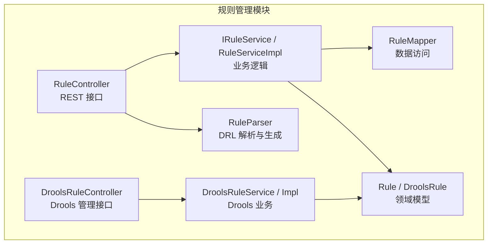
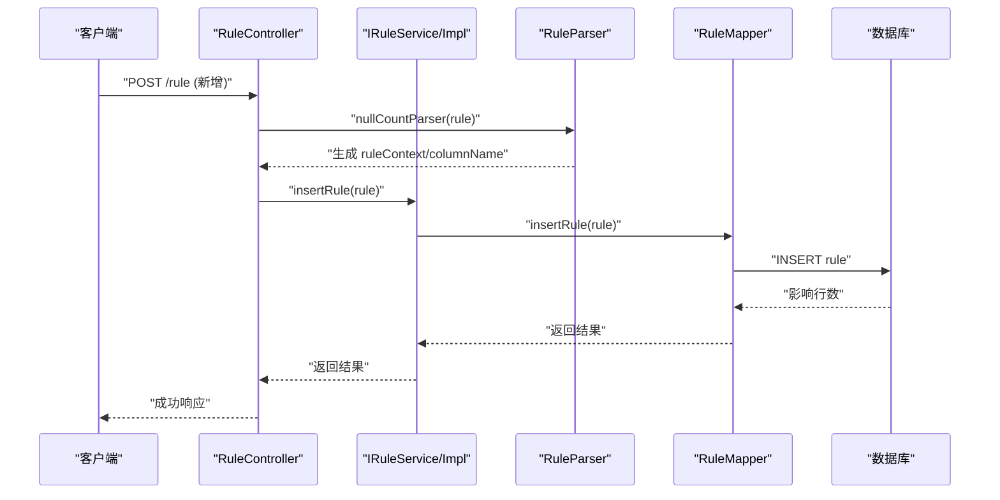
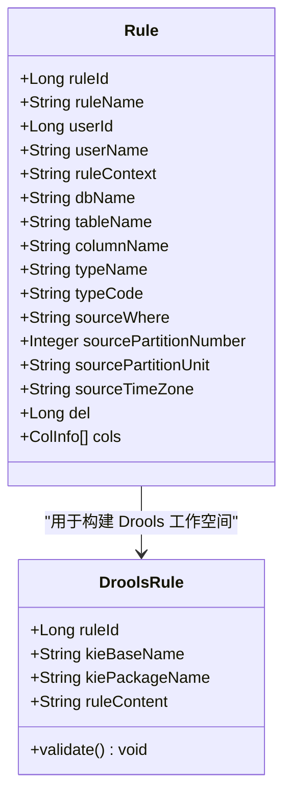
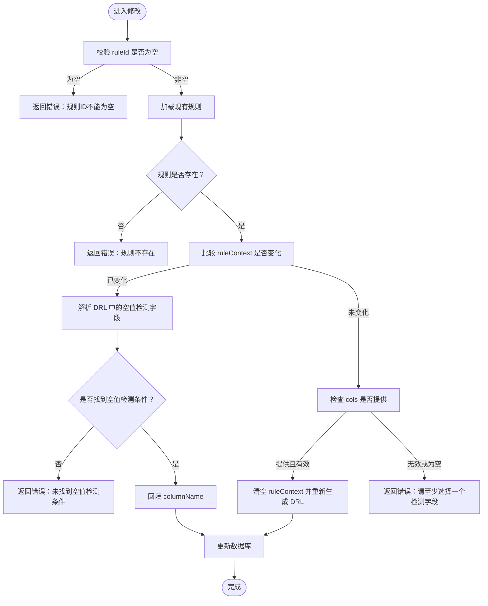
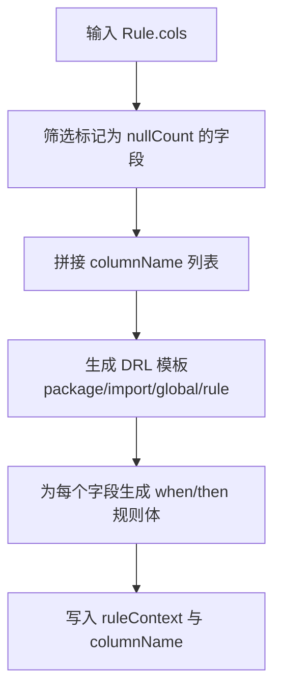
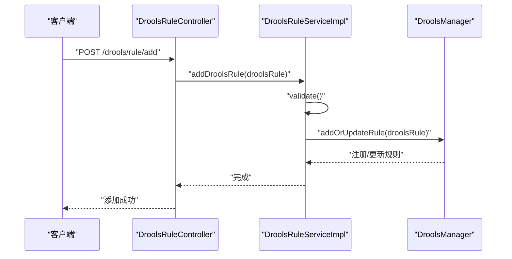
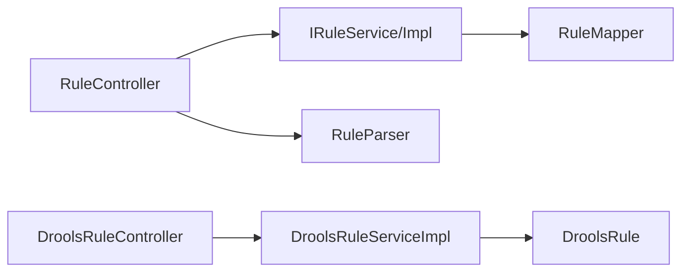
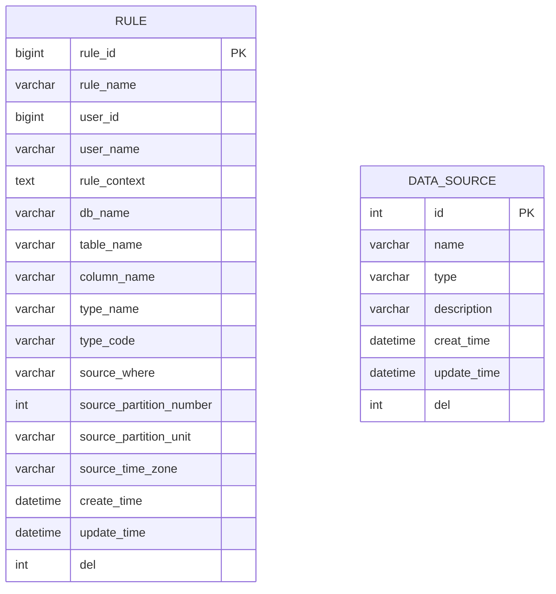

# 规则管理模块

<cite>
**本文引用的文件**   
- [RuleController.java](file://ruoyi-modules/ruoyi-dqservice/src/main/java/com/ruoyi/dqservice/controller/RuleController.java)
- [IRuleService.java](file://ruoyi-modules/ruoyi-dqservice/src/main/java/com/ruoyi/dqservice/service/IRuleService.java)
- [RuleServiceImpl.java](file://ruoyi-modules/ruoyi-dqservice/src/main/java/com/ruoyi/dqservice/service/impl/RuleServiceImpl.java)
- [RuleMapper.java](file://ruoyi-modules/ruoyi-dqservice/src/main/java/com/ruoyi/dqservice/mapper/RuleMapper.java)
- [Rule.java](file://ruoyi-modules/ruoyi-dqservice/src/main/java/com/ruoyi/dqservice/domain/Rule.java)
- [DroolsRule.java](file://ruoyi-modules/ruoyi-dqservice/src/main/java/com/ruoyi/dqservice/domain/DroolsRule.java)
- [RuleParser.java](file://ruoyi-modules/ruoyi-dqservice/src/main/java/com/ruoyi/dqservice/util/RuleParser.java)
- [DroolsRuleController.java](file://ruoyi-modules/ruoyi-dqservice/src/main/java/com/ruoyi/dqservice/controller/DroolsRuleController.java)
- [DroolsRuleService.java](file://ruoyi-modules/ruoyi-dqservice/src/main/java/com/ruoyi/dqservice/service/DroolsRuleService.java)
- [DroolsRuleServiceImpl.java](file://ruoyi-modules/ruoyi-dqservice/src/main/java/com/ruoyi/dqservice/service/impl/DroolsRuleServiceImpl.java)
- [ry_dqservice_20261026.sql](file://sql/ry_dqservice_20261026.sql)
</cite>

## 目录
1. [简介](#简介)
2. [项目结构](#项目结构)
3. [核心组件](#核心组件)
4. [架构总览](#架构总览)
5. [详细组件分析](#详细组件分析)
6. [依赖关系分析](#依赖关系分析)
7. [性能与扩展性](#性能与扩展性)
8. [故障排查指南](#故障排查指南)
9. [结论](#结论)
10. [附录](#附录)

## 简介
本模块提供数据质量规则的完整生命周期管理能力，包括规则的增删改查、基于 DRL 的规则模板生成与校验、字段映射配置、批量导入导出，以及与 Drools 引擎的集成。规则以实体形式持久化到数据库，并通过解析器将“列约束”自动转换为可执行的 DRL 片段，供执行阶段使用。

## 项目结构
规则管理模块位于 ruoyi-dqservice 子模块中，采用典型的 Controller-Service-Mapper 分层：
- 控制器层：对外暴露 REST API，负责权限校验、日志记录、参数预处理与结果封装。
- 服务层：实现业务逻辑，协调解析器、持久层与外部引擎。
- 持久层：通过 Mapper 接口对接数据库。
- 领域模型：规则实体与 Drools 规则对象。
- 工具类：DRL 解析与生成、字段映射回填等。

图示来源
- [RuleController.java:1-154](file://ruoyi-modules/ruoyi-dqservice/src/main/java/com/ruoyi/dqservice/controller/RuleController.java#L1-L154)
- [IRuleService.java:1-62](file://ruoyi-modules/ruoyi-dqservice/src/main/java/com/ruoyi/dqservice/service/IRuleService.java#L1-L62)
- [RuleServiceImpl.java:1-97](file://ruoyi-modules/ruoyi-dqservice/src/main/java/com/ruoyi/dqservice/service/impl/RuleServiceImpl.java#L1-L97)
- [RuleMapper.java:1-62](file://ruoyi-modules/ruoyi-dqservice/src/main/java/com/ruoyi/dqservice/mapper/RuleMapper.java#L1-L62)
- [Rule.java:1-87](file://ruoyi-modules/ruoyi-dqservice/src/main/java/com/ruoyi/dqservice/domain/Rule.java#L1-L87)
- [DroolsRule.java:1-33](file://ruoyi-modules/ruoyi-dqservice/src/main/java/com/ruoyi/dqservice/domain/DroolsRule.java#L1-L33)
- [RuleParser.java:1-241](file://ruoyi-modules/ruoyi-dqservice/src/main/java/com/ruoyi/dqservice/util/RuleParser.java#L1-L241)
- [DroolsRuleController.java:1-50](file://ruoyi-modules/ruoyi-dqservice/src/main/java/com/ruoyi/dqservice/controller/DroolsRuleController.java#L1-L50)
- [DroolsRuleService.java:1-16](file://ruoyi-modules/ruoyi-dqservice/src/main/java/com/ruoyi/dqservice/service/DroolsRuleService.java#L1-L16)
- [DroolsRuleServiceImpl.java:1-49](file://ruoyi-modules/ruoyi-dqservice/src/main/java/com/ruoyi/dqservice/service/impl/DroolsRuleServiceImpl.java#L1-L49)

章节来源
- [RuleController.java:1-154](file://ruoyi-modules/ruoyi-dqservice/src/main/java/com/ruoyi/dqservice/controller/RuleController.java#L1-L154)
- [IRuleService.java:1-62](file://ruoyi-modules/ruoyi-dqservice/src/main/java/com/ruoyi/dqservice/service/IRuleService.java#L1-L62)
- [RuleServiceImpl.java:1-97](file://ruoyi-modules/ruoyi-dqservice/src/main/java/com/ruoyi/dqservice/service/impl/RuleServiceImpl.java#L1-L97)
- [RuleMapper.java:1-62](file://ruoyi-modules/ruoyi-dqservice/src/main/java/com/ruoyi/dqservice/mapper/RuleMapper.java#L1-L62)
- [Rule.java:1-87](file://ruoyi-modules/ruoyi-dqservice/src/main/java/com/ruoyi/dqservice/domain/Rule.java#L1-L87)
- [DroolsRule.java:1-33](file://ruoyi-modules/ruoyi-dqservice/src/main/java/com/ruoyi/dqservice/domain/DroolsRule.java#L1-L33)
- [RuleParser.java:1-241](file://ruoyi-modules/ruoyi-dqservice/src/main/java/com/ruoyi/dqservice/util/RuleParser.java#L1-L241)
- [DroolsRuleController.java:1-50](file://ruoyi-modules/ruoyi-dqservice/src/main/java/com/ruoyi/dqservice/controller/DroolsRuleController.java#L1-L50)
- [DroolsRuleService.java:1-16](file://ruoyi-modules/ruoyi-dqservice/src/main/java/com/ruoyi/dqservice/service/DroolsRuleService.java#L1-L16)
- [DroolsRuleServiceImpl.java:1-49](file://ruoyi-modules/ruoyi-dqservice/src/main/java/com/ruoyi/dqservice/service/impl/DroolsRuleServiceImpl.java#L1-L49)

## 核心组件
- 规则实体 Rule：承载规则元信息（名称、创建者）、目标数据源（库名、表名、字段名）、过滤与分区参数、删除标志以及用于前端编辑的字段映射数组。
- Drools 规则对象 DroolsRule：面向 Drools 工作空间构建，包含 kieBaseName、kiePackageName、ruleContent，并提供基础参数校验。
- 规则解析器 RuleParser：根据列约束自动生成空值检测 DRL；从已有 DRL 中解析生效字段；为前端回显填充字段映射。
- 规则控制器 RuleController：提供规则列表查询、详情获取、新增、修改、删除、导出等能力，并在更新时处理 DRL 与字段映射的一致性。
- 规则服务 IRuleService / RuleServiceImpl：封装 CRUD 业务，维护创建/更新时间等通用字段。
- 规则持久化 RuleMapper：定义规则数据的查询与写入接口。
- Drools 管理相关：DroolsRuleController、DroolsRuleService、DroolsRuleServiceImpl 提供对 Drools 规则对象的增删改查与触发入口。

章节来源
- [Rule.java:1-87](file://ruoyi-modules/ruoyi-dqservice/src/main/java/com/ruoyi/dqservice/domain/Rule.java#L1-L87)
- [DroolsRule.java:1-33](file://ruoyi-modules/ruoyi-dqservice/src/main/java/com/ruoyi/dqservice/domain/DroolsRule.java#L1-L33)
- [RuleParser.java:1-241](file://ruoyi-modules/ruoyi-dqservice/src/main/java/com/ruoyi/dqservice/util/RuleParser.java#L1-L241)
- [RuleController.java:1-154](file://ruoyi-modules/ruoyi-dqservice/src/main/java/com/ruoyi/dqservice/controller/RuleController.java#L1-L154)
- [IRuleService.java:1-62](file://ruoyi-modules/ruoyi-dqservice/src/main/java/com/ruoyi/dqservice/service/IRuleService.java#L1-L62)
- [RuleServiceImpl.java:1-97](file://ruoyi-modules/ruoyi-dqservice/src/main/java/com/ruoyi/dqservice/service/impl/RuleServiceImpl.java#L1-L97)
- [RuleMapper.java:1-62](file://ruoyi-modules/ruoyi-dqservice/src/main/java/com/ruoyi/dqservice/mapper/RuleMapper.java#L1-L62)
- [DroolsRuleController.java:1-50](file://ruoyi-modules/ruoyi-dqservice/src/main/java/com/ruoyi/dqservice/controller/DroolsRuleController.java#L1-L50)
- [DroolsRuleService.java:1-16](file://ruoyi-modules/ruoyi-dqservice/src/main/java/com/ruoyi/dqservice/service/DroolsRuleService.java#L1-L16)
- [DroolsRuleServiceImpl.java:1-49](file://ruoyi-modules/ruoyi-dqservice/src/main/java/com/ruoyi/dqservice/service/impl/DroolsRuleServiceImpl.java#L1-L49)

## 架构总览
规则管理模块的整体调用链如下：

图示来源
- [RuleController.java:82-93](file://ruoyi-modules/ruoyi-dqservice/src/main/java/com/ruoyi/dqservice/controller/RuleController.java#L82-L93)
- [RuleParser.java:41-68](file://ruoyi-modules/ruoyi-dqservice/src/main/java/com/ruoyi/dqservice/util/RuleParser.java#L41-L68)
- [RuleServiceImpl.java:53-58](file://ruoyi-modules/ruoyi-dqservice/src/main/java/com/ruoyi/dqservice/service/impl/RuleServiceImpl.java#L53-L58)
- [RuleMapper.java:30-36](file://ruoyi-modules/ruoyi-dqservice/src/main/java/com/ruoyi/dqservice/mapper/RuleMapper.java#L30-L36)

## 详细组件分析

### 规则实体与数据结构
- Rule 实体包含规则标识、名称、创建者信息、规则文本、目标库/表/字段、类型编码、过滤条件、分区参数、删除标志以及用于前端编辑的字段映射数组。
- DroolsRule 实体用于构建 Drools 工作空间，包含 kieBaseName、kiePackageName、ruleContent，并提供 validate 方法校验必填项。

图示来源
- [Rule.java:1-87](file://ruoyi-modules/ruoyi-dqservice/src/main/java/com/ruoyi/dqservice/domain/Rule.java#L1-L87)
- [DroolsRule.java:1-33](file://ruoyi-modules/ruoyi-dqservice/src/main/java/com/ruoyi/dqservice/domain/DroolsRule.java#L1-L33)

章节来源
- [Rule.java:1-87](file://ruoyi-modules/ruoyi-dqservice/src/main/java/com/ruoyi/dqservice/domain/Rule.java#L1-L87)
- [DroolsRule.java:1-33](file://ruoyi-modules/ruoyi-dqservice/src/main/java/com/ruoyi/dqservice/domain/DroolsRule.java#L1-L33)

### 规则 CRUD 流程
- 列表查询：支持分页与过滤条件，返回列表。
- 详情获取：返回规则详情，并回填检测字段以便编辑弹窗展示。
- 新增：设置当前用户 ID，解析并生成 DRL，插入数据库。
- 修改：区分三种场景（直接改动 DRL、仅调整检测字段、两者均未变），保证 DRL 与字段映射一致。
- 删除：支持批量删除。

图示来源
- [RuleController.java:103-141](file://ruoyi-modules/ruoyi-dqservice/src/main/java/com/ruoyi/dqservice/controller/RuleController.java#L103-L141)
- [RuleParser.java:131-159](file://ruoyi-modules/ruoyi-dqservice/src/main/java/com/ruoyi/dqservice/util/RuleParser.java#L131-L159)

章节来源
- [RuleController.java:41-152](file://ruoyi-modules/ruoyi-dqservice/src/main/java/com/ruoyi/dqservice/controller/RuleController.java#L41-L152)
- [RuleServiceImpl.java:29-95](file://ruoyi-modules/ruoyi-dqservice/src/main/java/com/ruoyi/dqservice/service/impl/RuleServiceImpl.java#L29-L95)

### DRL 语法验证与模板生成
- 空值检测模板：根据列约束自动生成 DRL，每条违规字段对应一条规则，命中后将违规明细写入全局集合 violations。
- 字段提取与回填：从已有 DRL 中提取实际生效的空值检测字段，并回填到前端编辑所需的字段映射数组。
- 转义处理：对规则名与字段名进行字符串字面量转义，避免破坏 DRL 语法。

图示来源
- [RuleParser.java:41-98](file://ruoyi-modules/ruoyi-dqservice/src/main/java/com/ruoyi/dqservice/util/RuleParser.java#L41-L98)
- [RuleParser.java:100-159](file://ruoyi-modules/ruoyi-dqservice/src/main/java/com/ruoyi/dqservice/util/RuleParser.java#L100-L159)

章节来源
- [RuleParser.java:1-241](file://ruoyi-modules/ruoyi-dqservice/src/main/java/com/ruoyi/dqservice/util/RuleParser.java#L1-L241)

### 字段映射配置
- 前端通过 ColInfo 数组配置字段及其约束（如 nullCount）。
- 后端在新增/修改时，若提供 cols，则根据约束生成 DRL；若仅提供 DRL，则解析 DRL 回填 cols 以供编辑。
- 该机制确保“可视化字段配置”和“手写 DRL”两种方式的一致性。

章节来源
- [RuleController.java:66-79](file://ruoyi-modules/ruoyi-dqservice/src/main/java/com/ruoyi/dqservice/controller/RuleController.java#L66-L79)
- [RuleController.java:118-139](file://ruoyi-modules/ruoyi-dqservice/src/main/java/com/ruoyi/dqservice/controller/RuleController.java#L118-L139)
- [RuleParser.java:100-159](file://ruoyi-modules/ruoyi-dqservice/src/main/java/com/ruoyi/dqservice/util/RuleParser.java#L100-L159)

### 批量导入导出
- 导出：基于 ExcelUtil 将规则列表导出为 Excel 文件，便于离线归档与共享。
- 导入：当前代码未提供导入接口；可在 Controller 层增加上传解析逻辑，复用 Rule 与 RuleParser 的能力。

章节来源
- [RuleController.java:53-64](file://ruoyi-modules/ruoyi-dqservice/src/main/java/com/ruoyi/dqservice/controller/RuleController.java#L53-L64)

### Drools 规则管理
- DroolsRuleController 暴露规则对象的增删改查与触发接口。
- DroolsRuleServiceImpl 使用内存 Map 模拟存储，并调用 DroolsManager 动态管理规则。
- DroolsRule.validate 校验必要字段，防止无效规则注入引擎。

图示来源
- [DroolsRuleController.java:27-31](file://ruoyi-modules/ruoyi-dqservice/src/main/java/com/ruoyi/dqservice/controller/DroolsRuleController.java#L27-L31)
- [DroolsRuleServiceImpl.java:26-31](file://ruoyi-modules/ruoyi-dqservice/src/main/java/com/ruoyi/dqservice/service/impl/DroolsRuleServiceImpl.java#L26-L31)
- [DroolsRule.java:23-31](file://ruoyi-modules/ruoyi-dqservice/src/main/java/com/ruoyi/dqservice/domain/DroolsRule.java#L23-L31)

章节来源
- [DroolsRuleController.java:1-50](file://ruoyi-modules/ruoyi-dqservice/src/main/java/com/ruoyi/dqservice/controller/DroolsRuleController.java#L1-L50)
- [DroolsRuleService.java:1-16](file://ruoyi-modules/ruoyi-dqservice/src/main/java/com/ruoyi/dqservice/service/DroolsRuleService.java#L1-L16)
- [DroolsRuleServiceImpl.java:1-49](file://ruoyi-modules/ruoyi-dqservice/src/main/java/com/ruoyi/dqservice/service/impl/DroolsRuleServiceImpl.java#L1-L49)
- [DroolsRule.java:1-33](file://ruoyi-modules/ruoyi-dqservice/src/main/java/com/ruoyi/dqservice/domain/DroolsRule.java#L1-L33)

## 依赖关系分析
- 控制器依赖服务接口，服务实现依赖 Mapper 与工具类。
- RuleParser 被 RuleController 调用，用于 DRL 生成与解析。
- Drools 管理链路独立于规则持久化，通过 DroolsManager 动态管理规则。

图示来源
- [RuleController.java:1-154](file://ruoyi-modules/ruoyi-dqservice/src/main/java/com/ruoyi/dqservice/controller/RuleController.java#L1-L154)
- [RuleServiceImpl.java:1-97](file://ruoyi-modules/ruoyi-dqservice/src/main/java/com/ruoyi/dqservice/service/impl/RuleServiceImpl.java#L1-L97)
- [RuleMapper.java:1-62](file://ruoyi-modules/ruoyi-dqservice/src/main/java/com/ruoyi/dqservice/mapper/RuleMapper.java#L1-L62)
- [RuleParser.java:1-241](file://ruoyi-modules/ruoyi-dqservice/src/main/java/com/ruoyi/dqservice/util/RuleParser.java#L1-L241)
- [DroolsRuleController.java:1-50](file://ruoyi-modules/ruoyi-dqservice/src/main/java/com/ruoyi/dqservice/controller/DroolsRuleController.java#L1-L50)
- [DroolsRuleServiceImpl.java:1-49](file://ruoyi-modules/ruoyi-dqservice/src/main/java/com/ruoyi/dqservice/service/impl/DroolsRuleServiceImpl.java#L1-L49)

章节来源
- [RuleController.java:1-154](file://ruoyi-modules/ruoyi-dqservice/src/main/java/com/ruoyi/dqservice/controller/RuleController.java#L1-L154)
- [RuleServiceImpl.java:1-97](file://ruoyi-modules/ruoyi-dqservice/src/main/java/com/ruoyi/dqservice/service/impl/RuleServiceImpl.java#L1-L97)
- [RuleMapper.java:1-62](file://ruoyi-modules/ruoyi-dqservice/src/main/java/com/ruoyi/dqservice/mapper/RuleMapper.java#L1-L62)
- [RuleParser.java:1-241](file://ruoyi-modules/ruoyi-dqservice/src/main/java/com/ruoyi/dqservice/util/RuleParser.java#L1-L241)
- [DroolsRuleController.java:1-50](file://ruoyi-modules/ruoyi-dqservice/src/main/java/com/ruoyi/dqservice/controller/DroolsRuleController.java#L1-L50)
- [DroolsRuleServiceImpl.java:1-49](file://ruoyi-modules/ruoyi-dqservice/src/main/java/com/ruoyi/dqservice/service/impl/DroolsRuleServiceImpl.java#L1-L49)

## 性能与扩展性
- DRL 生成复杂度：按选中字段数量线性生成规则条目，时间复杂度 O(n)，n 为有效字段数。
- 解析开销：正则匹配 DRL 中的空值条件，复杂度与 DRL 长度线性相关。
- 可扩展点：
  - 在 RuleParser 中扩展更多约束类型（如格式校验、范围校验），统一生成 DRL。
  - 引入规则版本控制表，保存历史 DRL 与变更审计。
  - 将 Drools 规则持久化至数据库或规则仓库，替代内存 Map。

[本节为通用指导，不直接分析具体文件]

## 故障排查指南
- 修改规则时报错“未找到空值检测条件”：检查 DRL 中是否包含 this["字段"] == null 形式的条件。
- 修改规则时报错“请至少选择一个检测字段”：确保前端提供的 cols 中至少有一个字段启用了 nullCount 约束。
- 新增/修改后 DRL 与字段不一致：优先以 DRL 为准同步回填字段名，或清空 ruleContext 由解析器重建。
- Drools 规则添加失败：确认 DroolsRule.validate 的必要字段（ruleId、kieBaseName、kiePackageName、ruleContent）均非空。

章节来源
- [RuleController.java:118-139](file://ruoyi-modules/ruoyi-dqservice/src/main/java/com/ruoyi/dqservice/controller/RuleController.java#L118-L139)
- [DroolsRule.java:23-31](file://ruoyi-modules/ruoyi-dqservice/src/main/java/com/ruoyi/dqservice/domain/DroolsRule.java#L23-L31)

## 结论
规则管理模块通过清晰的层次划分与解析器机制，实现了“可视化字段配置”与“手写 DRL”的双模式一致性，提供了完整的 CRUD、导出、DRL 生成与校验能力，并与 Drools 引擎解耦集成。建议在后续迭代中补充规则版本控制、导入功能与更丰富的约束类型，以提升可维护性与扩展性。

[本节为总结性内容，不直接分析具体文件]

## 附录

### 数据库表结构
- rule 表：存储规则元数据、规则文本、目标库/表/字段、过滤与分区参数、审计字段与删除标志。
- data_source 表：存储数据源基本信息（名称、类型、描述、审计字段、删除标志）。

图示来源
- [ry_dqservice_20261026.sql:8-27](file://sql/ry_dqservice_20261026.sql#L8-L27)
- [ry_dqservice_20261026.sql:29-39](file://sql/ry_dqservice_20261026.sql#L29-L39)

章节来源
- [ry_dqservice_20261026.sql:1-40](file://sql/ry_dqservice_20261026.sql#L1-L40)