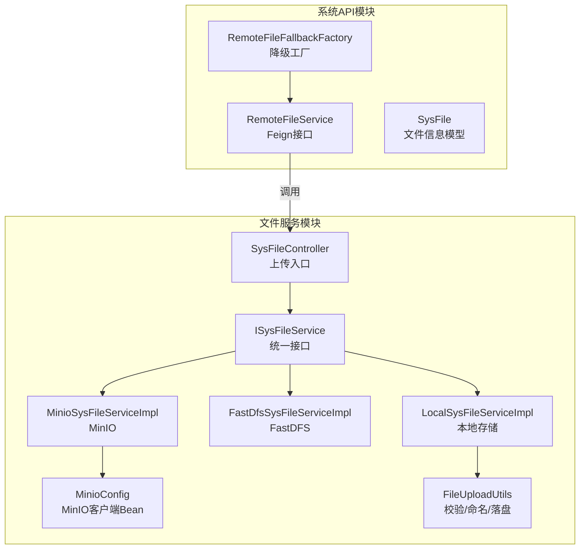
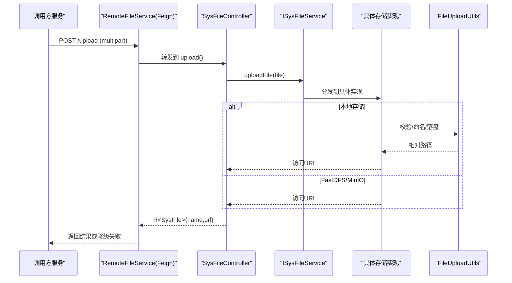
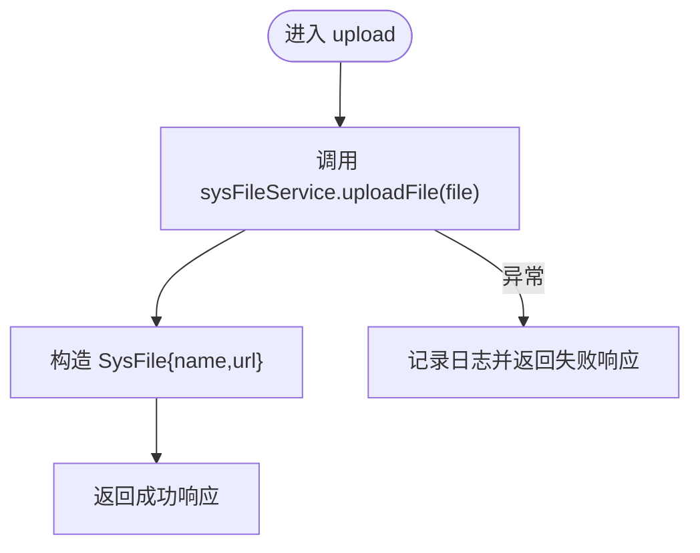
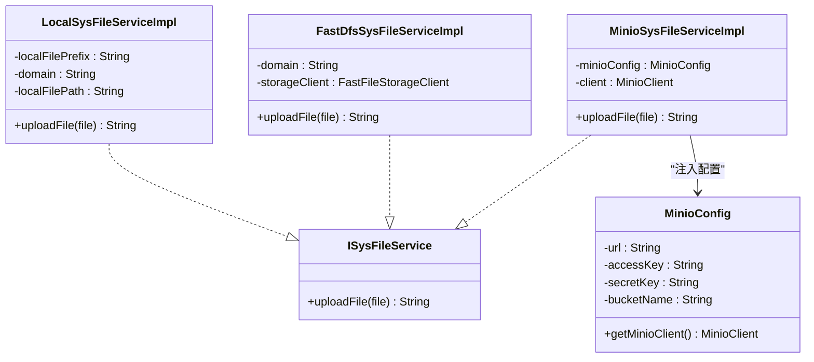
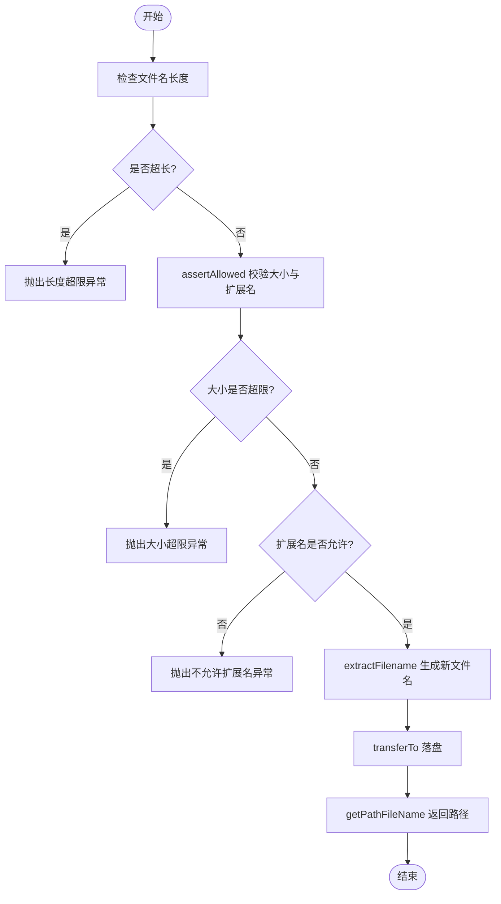
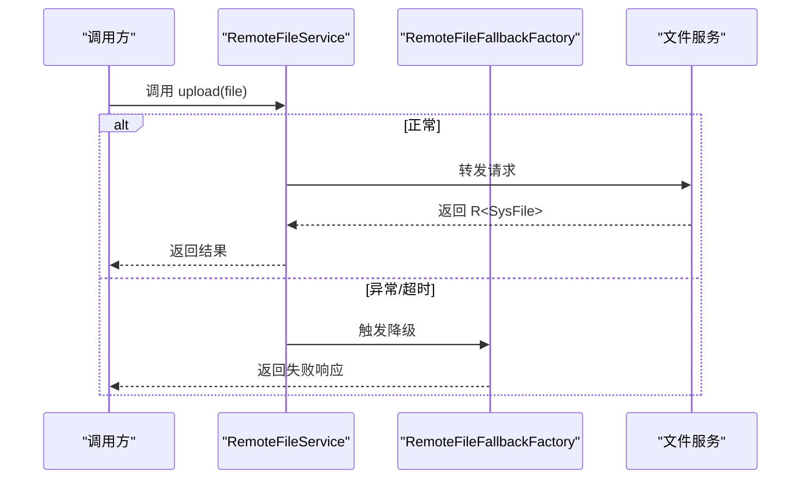
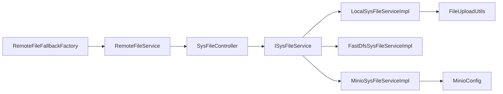

# 文件存储服务

<cite>
**本文引用的文件**   
- [SysFileController.java](file://ruoyi-modules/ruoyi-file/src/main/java/com/ruoyi/file/controller/SysFileController.java)
- [ISysFileService.java](file://ruoyi-modules/ruoyi-file/src/main/java/com/ruoyi/file/service/ISysFileService.java)
- [LocalSysFileServiceImpl.java](file://ruoyi-modules/ruoyi-file/src/main/java/com/ruoyi/file/service/LocalSysFileServiceImpl.java)
- [FastDfsSysFileServiceImpl.java](file://ruoyi-modules/ruoyi-file/src/main/java/com/ruoyi/file/service/FastDfsSysFileServiceImpl.java)
- [MinioSysFileServiceImpl.java](file://ruoyi-modules/ruoyi-file/src/main/java/com/ruoyi/file/service/MinioSysFileServiceImpl.java)
- [MinioConfig.java](file://ruoyi-modules/ruoyi-file/src/main/java/com/ruoyi/file/config/MinioConfig.java)
- [FileUploadUtils.java](file://ruoyi-modules/ruoyi-file/src/main/java/com/ruoyi/file/utils/FileUploadUtils.java)
- [RemoteFileService.java](file://ruoyi-api/ruoyi-api-system/src/main/java/com/ruoyi/system\api/RemoteFileService.java)
- [RemoteFileFallbackFactory.java](file://ruoyi-api/ruoyi-api-system/src/main/java/com/ruoyi/system/api/factory/RemoteFileFallbackFactory.java)
- [SysFile.java](file://ruoyi-api/ruoyi-api-system/src/main/java/com/ruoyi/system/api/domain/SysFile.java)
</cite>

## 目录
1. [简介](#简介)
2. [项目结构](#项目结构)
3. [核心组件](#核心组件)
4. [架构总览](#架构总览)
5. [详细组件分析](#详细组件分析)
6. [依赖关系分析](#依赖关系分析)
7. [性能与容量管理](#性能与容量管理)
8. [故障排查指南](#故障排查指南)
9. [结论](#结论)
10. [附录：配置项与扩展指南](#附录配置项与扩展指南)

## 简介
本文件存储服务提供统一的多后端文件管理能力，支持本地存储、FastDFS、MinIO等多种存储方案。服务通过统一的上传接口对外暴露，内部根据策略选择具体实现，完成文件校验、命名、持久化与访问地址生成。同时提供 Feign 远程调用与降级能力，便于在微服务环境中被其他模块调用。

当前仓库已实现的特性包括：
- 多后端存储：本地、FastDFS、MinIO
- 统一上传接口：返回文件名与可访问 URL
- 基础安全校验：文件大小限制、扩展名白名单、MIME 类型推断
- 远程调用与降级：Feign 客户端 + FallbackFactory
- 可扩展的存储策略：基于接口的实现切换

未在当前代码中直接实现的功能（但可在现有基础上扩展）：
- 分片上传与断点续传
- 文件预览（服务端侧）
- 存储空间配额与使用统计

## 项目结构
文件服务位于 ruoyi-modules/ruoyi-file 模块，主要包含控制器、服务接口与多种后端实现、配置类与工具类；系统 API 层提供远程调用接口与数据模型。

**图表来源**
- [SysFileController.java:19-48](file://ruoyi-modules/ruoyi-file/src/main/java/com/ruoyi/file/controller/SysFileController.java#L19-L48)
- [ISysFileService.java:10-20](file://ruoyi-modules/ruoyi-file/src/main/java/com/ruoyi/file/service/ISysFileService.java#L10-L20)
- [LocalSysFileServiceImpl.java:14-49](file://ruoyi-modules/ruoyi-file/src/main/java/com/ruoyi/file/service/LocalSysFileServiceImpl.java#L14-L49)
- [FastDfsSysFileServiceImpl.java:16-41](file://ruoyi-modules/ruoyi-file/src/main/java/com/ruoyi/file/service/FastDfsSysFileServiceImpl.java#L16-L41)
- [MinioSysFileServiceImpl.java:16-44](file://ruoyi-modules/ruoyi-file/src/main/java/com/ruoyi/file/service/MinioSysFileServiceImpl.java#L16-L44)
- [MinioConfig.java:13-81](file://ruoyi-modules/ruoyi-file/src/main/java/com/ruoyi/file/config/MinioConfig.java#L13-L81)
- [FileUploadUtils.java:22-195](file://ruoyi-modules/ruoyi-file/src/main/java/com/ruoyi/file/utils/FileUploadUtils.java#L22-L195)
- [RemoteFileService.java:18-28](file://ruoyi-api/ruoyi-api-system/src/main/java/com/ruoyi/system/api/RemoteFileService.java#L18-L28)
- [RemoteFileFallbackFactory.java:17-34](file://ruoyi-api/ruoyi-api-system/src/main/java/com/ruoyi/system/api/factory/RemoteFileFallbackFactory.java#L17-L34)
- [SysFile.java:11-50](file://ruoyi-api/ruoyi-api-system/src/main/java/com/ruoyi/system/api/domain/SysFile.java#L11-L50)

**章节来源**
- [SysFileController.java:19-48](file://ruoyi-modules/ruoyi-file/src/main/java/com/ruoyi/file/controller/SysFileController.java#L19-L48)
- [ISysFileService.java:10-20](file://ruoyi-modules/ruoyi-file/src/main/java/com/ruoyi/file/service/ISysFileService.java#L10-L20)
- [LocalSysFileServiceImpl.java:14-49](file://ruoyi-modules/ruoyi-file/src/main/java/com/ruoyi/file/service/LocalSysFileServiceImpl.java#L14-L49)
- [FastDfsSysFileServiceImpl.java:16-41](file://ruoyi-modules/ruoyi-file/src/main/java/com/ruoyi/file/service/FastDfsSysFileServiceImpl.java#L16-L41)
- [MinioSysFileServiceImpl.java:16-44](file://ruoyi-modules/ruoyi-file/src/main/java/com/ruoyi/file/service/MinioSysFileServiceImpl.java#L16-L44)
- [MinioConfig.java:13-81](file://ruoyi-modules/ruoyi-file/src/main/java/com/ruoyi/file/config/MinioConfig.java#L13-L81)
- [FileUploadUtils.java:22-195](file://ruoyi-modules/ruoyi-file/src/main/java/com/ruoyi/file/utils/FileUploadUtils.java#L22-L195)
- [RemoteFileService.java:18-28](file://ruoyi-api/ruoyi-api-system/src/main/java/com/ruoyi/system/api/RemoteFileService.java#L18-L28)
- [RemoteFileFallbackFactory.java:17-34](file://ruoyi-api/ruoyi-api-system/src/main/java/com/ruoyi/system/api/factory/RemoteFileFallbackFactory.java#L17-L34)
- [SysFile.java:11-50](file://ruoyi-api/ruoyi-api-system/src/main/java/com/ruoyi/system/api/domain/SysFile.java#L11-L50)

## 核心组件
- 控制器 SysFileController：接收上传请求，调用 ISysFileService 完成存储，封装 SysFile 返回结果。
- 服务接口 ISysFileService：定义统一的 uploadFile 方法，屏蔽不同存储后端差异。
- 本地实现 LocalSysFileServiceImpl：默认主实现，将文件写入本地磁盘并拼接访问 URL。
- FastDFS 实现 FastDfsSysFileServiceImpl：通过 FastDFS 客户端上传并拼接访问 URL。
- MinIO 实现 MinioSysFileServiceImpl：通过 MinIO 客户端上传并拼接访问 URL。
- MinIO 配置 MinioConfig：读取 minio.* 配置，构建 MinioClient Bean。
- 工具类 FileUploadUtils：负责大小校验、扩展名校验、MIME 类型推断、文件命名与落盘。
- 远程调用 RemoteFileService：Feign 客户端，供其他服务调用文件服务。
- 降级工厂 RemoteFileFallbackFactory：当文件服务不可用时返回失败响应。
- 数据模型 SysFile：包含 name 与 url 字段。

**章节来源**
- [SysFileController.java:19-48](file://ruoyi-modules/ruoyi-file/src/main/java/com/ruoyi/file/controller/SysFileController.java#L19-L48)
- [ISysFileService.java:10-20](file://ruoyi-modules/ruoyi-file/src/main/java/com/ruoyi/file/service/ISysFileService.java#L10-L20)
- [LocalSysFileServiceImpl.java:14-49](file://ruoyi-modules/ruoyi-file/src/main/java/com/ruoyi/file/service/LocalSysFileServiceImpl.java#L14-L49)
- [FastDfsSysFileServiceImpl.java:16-41](file://ruoyi-modules/ruoyi-file/src/main/java/com/ruoyi/file/service/FastDfsSysFileServiceImpl.java#L16-L41)
- [MinioSysFileServiceImpl.java:16-44](file://ruoyi-modules/ruoyi-file/src/main/java/com/ruoyi/file/service/MinioSysFileServiceImpl.java#L16-L44)
- [MinioConfig.java:13-81](file://ruoyi-modules/ruoyi-file/src/main/java/com/ruoyi/file/config/MinioConfig.java#L13-L81)
- [FileUploadUtils.java:22-195](file://ruoyi-modules/ruoyi-file/src/main/java/com/ruoyi/file/utils/FileUploadUtils.java#L22-L195)
- [RemoteFileService.java:18-28](file://ruoyi-api/ruoyi-api-system/src/main/java/com/ruoyi/system/api/RemoteFileService.java#L18-L28)
- [RemoteFileFallbackFactory.java:17-34](file://ruoyi-api/ruoyi-api-system/src/main/java/com/ruoyi/system/api/factory/RemoteFileFallbackFactory.java#L17-L34)
- [SysFile.java:11-50](file://ruoyi-api/ruoyi-api-system/src/main/java/com/ruoyi/system/api/domain/SysFile.java#L11-L50)

## 架构总览
文件服务采用“控制器 + 接口 + 多实现”的分层设计，结合 Spring 的 @Primary 注解选择默认实现，并通过 Feign 暴露给其他微服务。

**图表来源**
- [RemoteFileService.java:18-28](file://ruoyi-api/ruoyi-api-system/src/main/java/com/ruoyi/system/api/RemoteFileService.java#L18-L28)
- [SysFileController.java:24-48](file://ruoyi-modules/ruoyi-file/src/main/java/com/ruoyi/file/controller/SysFileController.java#L24-L48)
- [ISysFileService.java:10-20](file://ruoyi-modules/ruoyi-file/src/main/java/com/ruoyi/file/service/ISysFileService.java#L10-L20)
- [LocalSysFileServiceImpl.java:43-49](file://ruoyi-modules/ruoyi-file/src/main/java/com/ruoyi/file/service/LocalSysFileServiceImpl.java#L43-L49)
- [FastDfsSysFileServiceImpl.java:35-41](file://ruoyi-modules/ruoyi-file/src/main/java/com/ruoyi/file/service/FastDfsSysFileServiceImpl.java#L35-L41)
- [MinioSysFileServiceImpl.java:32-44](file://ruoyi-modules/ruoyi-file/src/main/java/com/ruoyi/file/service/MinioSysFileServiceImpl.java#L32-L44)
- [FileUploadUtils.java:42-83](file://ruoyi-modules/ruoyi-file/src/main/java/com/ruoyi/file/utils/FileUploadUtils.java#L42-L83)

## 详细组件分析

### 控制器层：SysFileController
- 职责：接收 multipart 上传请求，调用 ISysFileService 完成存储，构造 SysFile 对象返回。
- 异常处理：捕获异常并返回失败响应，记录错误日志。
- 关键流程：解析文件 -> 调用服务 -> 组装结果。

**图表来源**
- [SysFileController.java:24-48](file://ruoyi-modules/ruoyi-file/src/main/java/com/ruoyi/file/controller/SysFileController.java#L24-L48)

**章节来源**
- [SysFileController.java:24-48](file://ruoyi-modules/ruoyi-file/src/main/java/com/ruoyi/file/controller/SysFileController.java#L24-L48)

### 服务接口与实现：ISysFileService 及其实现
- ISysFileService：定义统一的 uploadFile 方法，屏蔽后端差异。
- LocalSysFileServiceImpl：默认主实现（@Primary），使用 FileUploadUtils 进行本地落盘，拼接 domain + prefix + name 作为访问 URL。
- FastDfsSysFileServiceImpl：通过 FastFileStorageClient 上传，拼接域名与完整路径。
- MinioSysFileServiceImpl：通过 MinioClient 上传至指定桶，拼接 endpoint/bucket/object 作为访问 URL。

**图表来源**
- [ISysFileService.java:10-20](file://ruoyi-modules/ruoyi-file/src/main/java/com/ruoyi/file/service/ISysFileService.java#L10-L20)
- [LocalSysFileServiceImpl.java:14-49](file://ruoyi-modules/ruoyi-file/src/main/java/com/ruoyi/file/service/LocalSysFileServiceImpl.java#L14-L49)
- [FastDfsSysFileServiceImpl.java:16-41](file://ruoyi-modules/ruoyi-file/src/main/java/com/ruoyi/file/service/FastDfsSysFileServiceImpl.java#L16-L41)
- [MinioSysFileServiceImpl.java:16-44](file://ruoyi-modules/ruoyi-file/src/main/java/com/ruoyi/file/service/MinioSysFileServiceImpl.java#L16-L44)
- [MinioConfig.java:13-81](file://ruoyi-modules/ruoyi-file/src/main/java/com/ruoyi/file/config/MinioConfig.java#L13-L81)

**章节来源**
- [ISysFileService.java:10-20](file://ruoyi-modules/ruoyi-file/src/main/java/com/ruoyi/file/service/ISysFileService.java#L10-L20)
- [LocalSysFileServiceImpl.java:14-49](file://ruoyi-modules/ruoyi-file/src/main/java/com/ruoyi/file/service/LocalSysFileServiceImpl.java#L14-L49)
- [FastDfsSysFileServiceImpl.java:16-41](file://ruoyi-modules/ruoyi-file/src/main/java/com/ruoyi/file/service/FastDfsSysFileServiceImpl.java#L16-L41)
- [MinioSysFileServiceImpl.java:16-44](file://ruoyi-modules/ruoyi-file/src/main/java/com/ruoyi/file/service/MinioSysFileServiceImpl.java#L16-L44)
- [MinioConfig.java:13-81](file://ruoyi-modules/ruoyi-file/src/main/java/com/ruoyi/file/config/MinioConfig.java#L13-L81)

### 工具类：FileUploadUtils
- 功能：
  - 文件大小校验：超过默认阈值抛出异常
  - 扩展名校验：依据允许列表判断 MIME 类型
  - 文件命名：按日期路径 + 原文件名 + 序列号 + 后缀
  - 落盘：创建目录并写入文件
- 复杂度：
  - 时间复杂度：O(n) 遍历允许扩展名列表
  - 空间复杂度：O(1)，仅临时变量与 IO 流

**图表来源**
- [FileUploadUtils.java:42-83](file://ruoyi-modules/ruoyi-file/src/main/java/com/ruoyi/file/utils/FileUploadUtils.java#L42-L83)
- [FileUploadUtils.java:121-159](file://ruoyi-modules/ruoyi-file/src/main/java/com/ruoyi/file/utils/FileUploadUtils.java#L121-L159)
- [FileUploadUtils.java:88-92](file://ruoyi-modules/ruoyi-file/src/main/java/com/ruoyi/file/utils/FileUploadUtils.java#L88-L92)
- [FileUploadUtils.java:108-112](file://ruoyi-modules/ruoyi-file/src/main/java/com/ruoyi/file/utils/FileUploadUtils.java#L108-L112)

**章节来源**
- [FileUploadUtils.java:22-195](file://ruoyi-modules/ruoyi-file/src/main/java/com/ruoyi/file/utils/FileUploadUtils.java#L22-L195)

### 远程调用与降级：RemoteFileService 与 RemoteFileFallbackFactory
- RemoteFileService：定义 Feign 客户端，POST /upload，返回 R<SysFile>。
- RemoteFileFallbackFactory：当文件服务不可用时，返回失败响应并记录日志。

**图表来源**
- [RemoteFileService.java:18-28](file://ruoyi-api/ruoyi-api-system/src/main/java/com/ruoyi/system/api/RemoteFileService.java#L18-L28)
- [RemoteFileFallbackFactory.java:17-34](file://ruoyi-api/ruoyi-api-system/src/main/java/com/ruoyi/system/api/factory/RemoteFileFallbackFactory.java#L17-L34)

**章节来源**
- [RemoteFileService.java:18-28](file://ruoyi-api/ruoyi-api-system/src/main/java/com/ruoyi/system/api/RemoteFileService.java#L18-L28)
- [RemoteFileFallbackFactory.java:17-34](file://ruoyi-api/ruoyi-api-system/src/main/java/com/ruoyi/system/api/factory/RemoteFileFallbackFactory.java#L17-L34)

### 数据模型：SysFile
- 字段：name（文件名）、url（访问地址）
- 用途：统一封装上传结果，便于前端展示与下载

**章节来源**
- [SysFile.java:11-50](file://ruoyi-api/ruoyi-api-system/src/main/java/com/ruoyi/system/api/domain/SysFile.java#L11-L50)

## 依赖关系分析
- 控制器依赖服务接口，服务接口由多个实现类提供，Spring 通过 @Primary 选择默认实现。
- MinIO 实现依赖 MinioConfig 提供的 MinioClient Bean。
- 本地实现依赖 FileUploadUtils 完成校验与落盘。
- 远程调用依赖 Feign 与 FallbackFactory 保证服务可用性。

**图表来源**
- [SysFileController.java:24-48](file://ruoyi-modules/ruoyi-file/src/main/java/com/ruoyi/file/controller/SysFileController.java#L24-L48)
- [ISysFileService.java:10-20](file://ruoyi-modules/ruoyi-file/src/main/java/com/ruoyi/file/service/ISysFileService.java#L10-L20)
- [LocalSysFileServiceImpl.java:14-49](file://ruoyi-modules/ruoyi-file/src/main/java/com/ruoyi/file/service/LocalSysFileServiceImpl.java#L14-L49)
- [FastDfsSysFileServiceImpl.java:16-41](file://ruoyi-modules/ruoyi-file/src/main/java/com/ruoyi/file/service/FastDfsSysFileServiceImpl.java#L16-L41)
- [MinioSysFileServiceImpl.java:16-44](file://ruoyi-modules/ruoyi-file/src/main/java/com/ruoyi/file/service/MinioSysFileServiceImpl.java#L16-L44)
- [MinioConfig.java:13-81](file://ruoyi-modules/ruoyi-file/src/main/java/com/ruoyi/file/config/MinioConfig.java#L13-L81)
- [FileUploadUtils.java:22-195](file://ruoyi-modules/ruoyi-file/src/main/java/com/ruoyi/file/utils/FileUploadUtils.java#L22-L195)
- [RemoteFileService.java:18-28](file://ruoyi-api/ruoyi-api-system/src/main/java/com/ruoyi/system/api/RemoteFileService.java#L18-L28)
- [RemoteFileFallbackFactory.java:17-34](file://ruoyi-api/ruoyi-api-system/src/main/java/com/ruoyi/system/api/factory/RemoteFileFallbackFactory.java#L17-L34)

**章节来源**
- [SysFileController.java:24-48](file://ruoyi-modules/ruoyi-file/src/main/java/com/ruoyi/file/controller/SysFileController.java#L24-L48)
- [ISysFileService.java:10-20](file://ruoyi-modules/ruoyi-file/src/main/java/com/ruoyi/file/service/ISysFileService.java#L10-L20)
- [LocalSysFileServiceImpl.java:14-49](file://ruoyi-modules/ruoyi-file/src/main/java/com/ruoyi/file/service/LocalSysFileServiceImpl.java#L14-L49)
- [FastDfsSysFileServiceImpl.java:16-41](file://ruoyi-modules/ruoyi-file/src/main/java/com/ruoyi/file/service/FastDfsSysFileServiceImpl.java#L16-L41)
- [MinioSysFileServiceImpl.java:16-44](file://ruoyi-modules/ruoyi-file/src/main/java/com/ruoyi/file/service/MinioSysFileServiceImpl.java#L16-L44)
- [MinioConfig.java:13-81](file://ruoyi-modules/ruoyi-file/src/main/java/com/ruoyi/file/config/MinioConfig.java#L13-L81)
- [FileUploadUtils.java:22-195](file://ruoyi-modules/ruoyi-file/src/main/java/com/ruoyi/file/utils/FileUploadUtils.java#L22-L195)
- [RemoteFileService.java:18-28](file://ruoyi-api/ruoyi-api-system/src/main/java/com/ruoyi/system/api/RemoteFileService.java#L18-L28)
- [RemoteFileFallbackFactory.java:17-34](file://ruoyi-api/ruoyi-api-system/src/main/java/com/ruoyi/system/api/factory/RemoteFileFallbackFactory.java#L17-L34)

## 性能与容量管理
- 上传性能：
  - 本地存储：受限于磁盘 IO 与 CPU（压缩/校验），建议合理设置线程池与异步处理。
  - FastDFS/MinIO：受网络带宽与远端集群性能影响，建议开启连接池与重试机制。
- 容量管理：
  - 当前代码未内置配额与用量统计，可在服务层增加计数器与定时任务汇总。
  - 建议在网关层对 multipart 大小做统一限制，避免大文件阻塞。
- 优化建议：
  - 引入分片上传与断点续传（需新增接口与状态存储）。
  - 对图片/视频等媒体文件在服务端生成缩略图或转码，提升预览体验。
  - 为不同业务域划分桶/目录，配合 CDN 加速静态资源访问。

[本节为通用指导，不直接分析具体文件]

## 故障排查指南
- 常见异常：
  - 文件大小超限：抛出大小超限异常，检查 DEFAULT_MAX_SIZE 与业务需求。
  - 扩展名不允许：抛出不允许扩展名异常，检查 allowedExtension 与 MIME 类型。
  - 文件名过长：抛出长度超限异常，调整默认长度限制。
  - 远程调用失败：Feign 触发降级，查看 FallbackFactory 日志。
- 定位步骤：
  - 查看控制器日志输出与异常堆栈。
  - 检查各后端配置是否正确（如 MinIO endpoint、credentials、bucket）。
  - 确认文件系统权限与磁盘空间。
  - 验证网关层对 multipart 的限制是否与业务一致。

**章节来源**
- [FileUploadUtils.java:121-159](file://ruoyi-modules/ruoyi-file/src/main/java/com/ruoyi/file/utils/FileUploadUtils.java#L121-L159)
- [RemoteFileFallbackFactory.java:17-34](file://ruoyi-api/ruoyi-api-system/src/main/java/com/ruoyi/system/api/factory/RemoteFileFallbackFactory.java#L17-L34)

## 结论
该文件存储服务以清晰的接口抽象与多实现策略，提供了稳定、可扩展的文件管理能力。通过统一的上传接口与远程调用封装，既满足单体场景下的快速集成，也适配微服务环境中的跨服务调用与降级保护。当前版本已具备基础的安全校验与多后端支持，后续可按需扩展分片上传、断点续传与预览等功能。

[本节为总结性内容，不直接分析具体文件]

## 附录：配置项与扩展指南

### 配置项说明
- MinIO 相关（前缀 minio）：
  - url：MinIO 服务地址
  - accessKey：访问密钥
  - secretKey：秘密密钥
  - bucketName：存储桶名称
- 本地存储相关：
  - file.domain：访问域名或本机地址
  - file.prefix：资源映射路径前缀
  - file.path：本地根目录路径
- FastDFS 相关：
  - fdfs.domain：FastDFS 访问域名或地址

**章节来源**
- [MinioConfig.java:13-81](file://ruoyi-modules/ruoyi-file/src/main/java/com/ruoyi/file/config/MinioConfig.java#L13-L81)
- [LocalSysFileServiceImpl.java:21-34](file://ruoyi-modules/ruoyi-file/src/main/java/com/ruoyi/file/service/LocalSysFileServiceImpl.java#L21-L34)
- [FastDfsSysFileServiceImpl.java:22-26](file://ruoyi-modules/ruoyi-file/src/main/java/com/ruoyi/file/service/FastDfsSysFileServiceImpl.java#L22-L26)

### 自定义存储实现指南
- 新建实现类实现 ISysFileService 接口，并在类上添加 @Service 注解。
- 如需设为默认实现，添加 @Primary 注解。
- 在 uploadFile 方法中完成文件校验、命名与持久化，返回可访问 URL。
- 若需要外部依赖（如 SDK 客户端），通过 @Autowired 注入或在配置类中提供 Bean。
- 更新配置项，确保域名、路径、凭据等正确无误。

**章节来源**
- [ISysFileService.java:10-20](file://ruoyi-modules/ruoyi-file/src/main/java/com/ruoyi/file/service/ISysFileService.java#L10-L20)
- [LocalSysFileServiceImpl.java:14-49](file://ruoyi-modules/ruoyi-file/src/main/java/com/ruoyi/file/service/LocalSysFileServiceImpl.java#L14-L49)