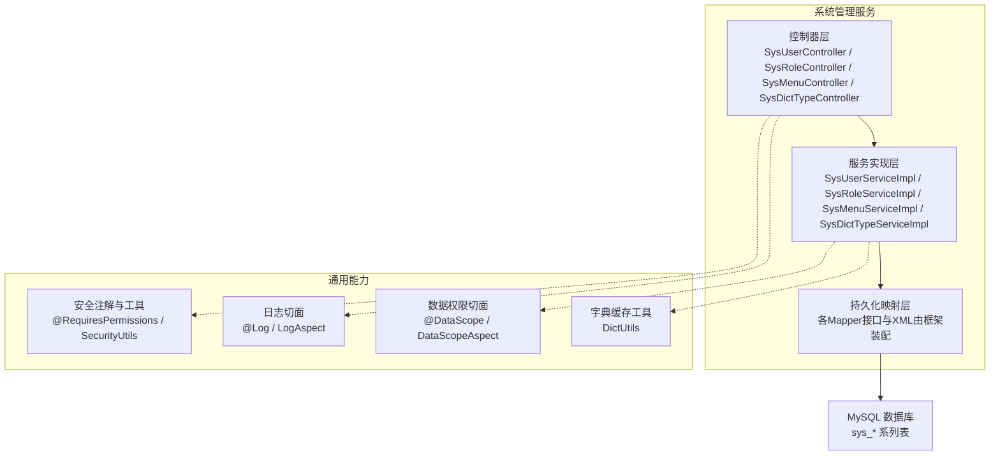
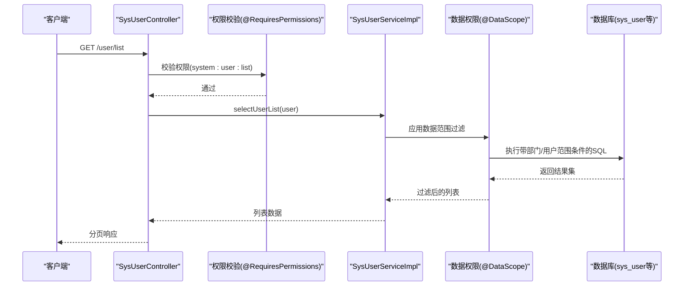
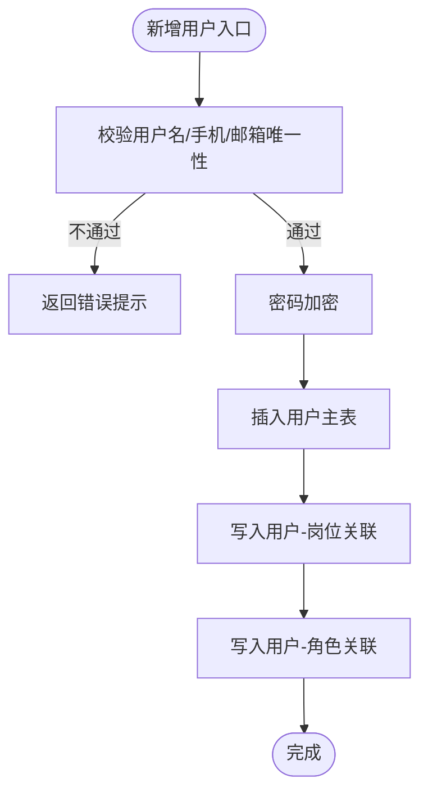
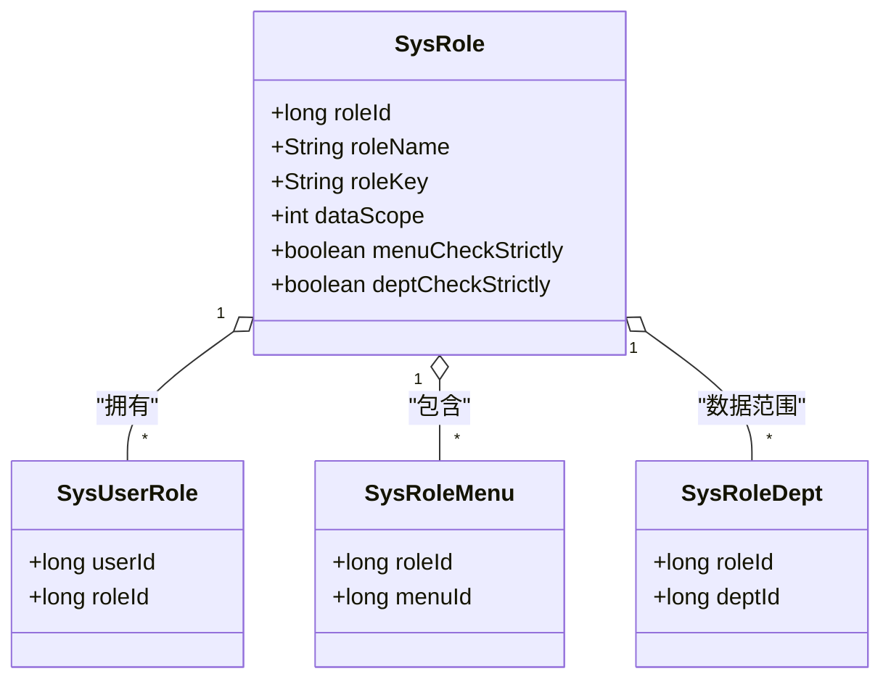
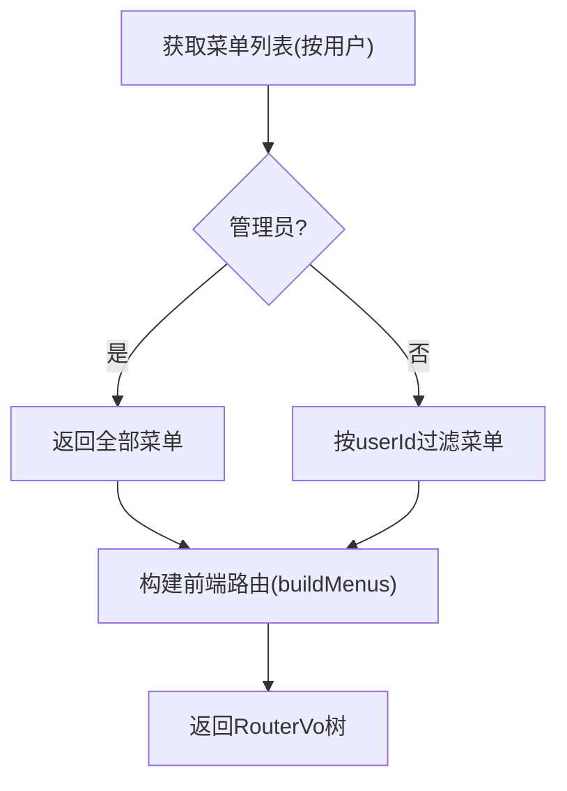
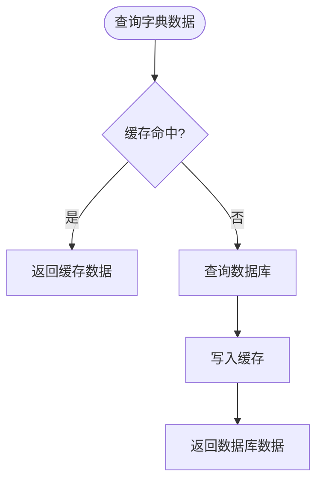
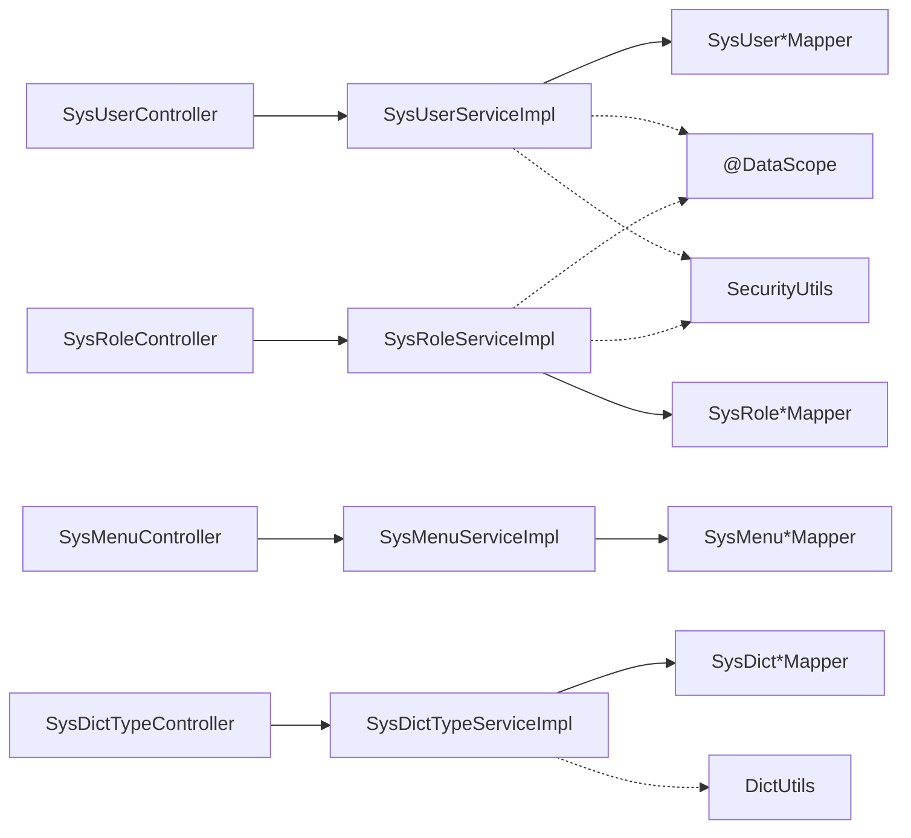

# 系统管理服务

<cite>
**本文引用的文件**   
- [SysUserController.java](file://ruoyi-modules/ruoyi-system/src/main/java/com/ruoyi/system/controller/SysUserController.java)
- [SysRoleController.java](file://ruoyi-modules/ruoyi-system/src/main/java/com/ruoyi/system/controller/SysRoleController.java)
- [SysMenuController.java](file://ruoyi-modules/ruoyi-system/src/main/java/com/ruoyi/system/controller/SysMenuController.java)
- [SysDictTypeController.java](file://ruoyi-modules/ruoyi-system/src/main/java/com/ruoyi/system/controller/SysDictTypeController.java)
- [SysUserServiceImpl.java](file://ruoyi-modules/ruoyi-system/src/main/java/com/ruoyi/system/service/impl/SysUserServiceImpl.java)
- [SysRoleServiceImpl.java](file://ruoyi-modules/ruoyi-system/src/main/java/com/ruoyi/system/service/impl/SysRoleServiceImpl.java)
- [SysMenuServiceImpl.java](file://ruoyi-modules/ruoyi-system/src/main/java/com/ruoyi/system/service/impl/SysMenuServiceImpl.java)
- [SysDictTypeServiceImpl.java](file://ruoyi-modules/ruoyi-system/src/main/java/com/ruoyi/system/service/impl/SysDictTypeServiceImpl.java)
- [ry_20210908.sql](file://sql/ry_20210908.sql)
</cite>

## 目录
1. [简介](#简介)
2. [项目结构](#项目结构)
3. [核心组件](#核心组件)
4. [架构总览](#架构总览)
5. [详细组件分析](#详细组件分析)
6. [依赖关系分析](#依赖关系分析)
7. [性能与扩展性](#性能与扩展性)
8. [故障排查指南](#故障排查指南)
9. [结论](#结论)
10. [附录：API接口规范与数据模型](#附录api接口规范与数据模型)

## 简介
本文件面向“系统管理服务”（用户管理、角色权限、菜单配置、字典管理等）提供系统化文档，覆盖服务启动配置、数据库表结构设计、API接口规范、RBAC权限模型、数据权限控制、操作日志记录、系统配置管理、部门管理与通知公告等能力。读者可据此快速理解模块职责、调用链路、数据流转与最佳实践。

## 项目结构
系统管理服务位于 ruoyi-modules/ruoyi-system 模块，采用典型的 Controller-Service-Mapper 分层架构；公共能力（安全、日志、数据权限、缓存等）由通用模块提供；数据库脚本集中于 sql 目录。

图表来源
- [SysUserController.java:1-313](file://ruoyi-modules/ruoyi-system/src/main/java/com/ruoyi/system/controller/SysUserController.java#L1-L313)
- [SysRoleController.java:1-222](file://ruoyi-modules/ruoyi-system/src/main/java/com/ruoyi/system/controller/SysRoleController.java#L1-L222)
- [SysMenuController.java:1-159](file://ruoyi-modules/ruoyi-system/src/main/java/com/ruoyi/system/controller/SysMenuController.java#L1-L159)
- [SysDictTypeController.java:1-134](file://ruoyi-modules/ruoyi-system/src/main/java/com/ruoyi/system/controller/SysDictTypeController.java#L1-L134)
- [SysUserServiceImpl.java:1-564](file://ruoyi-modules/ruoyi-system/src/main/java/com/ruoyi/system/service/impl/SysUserServiceImpl.java#L1-L564)
- [SysRoleServiceImpl.java:1-425](file://ruoyi-modules/ruoyi-system/src/main/java/com/ruoyi/system/service/impl/SysRoleServiceImpl.java#L1-L425)
- [SysMenuServiceImpl.java:1-515](file://ruoyi-modules/ruoyi-system/src/main/java/com/ruoyi/system/service/impl/SysMenuServiceImpl.java#L1-L515)
- [SysDictTypeServiceImpl.java:1-224](file://ruoyi-modules/ruoyi-system/src/main/java/com/ruoyi/system/service/impl/SysDictTypeServiceImpl.java#L1-L224)

章节来源
- [SysUserController.java:1-313](file://ruoyi-modules/ruoyi-system/src/main/java/com/ruoyi/system/controller/SysUserController.java#L1-L313)
- [SysRoleController.java:1-222](file://ruoyi-modules/ruoyi-system/src/main/java/com/ruoyi/system/controller/SysRoleController.java#L1-L222)
- [SysMenuController.java:1-159](file://ruoyi-modules/ruoyi-system/src/main/java/com/ruoyi/system/controller/SysMenuController.java#L1-L159)
- [SysDictTypeController.java:1-134](file://ruoyi-modules/ruoyi-system/src/main/java/com/ruoyi/system/controller/SysDictTypeController.java#L1-L134)

## 核心组件
- 用户管理：提供用户CRUD、导入导出、授权角色、状态变更、密码重置、当前用户信息获取等能力。
- 角色权限：提供角色CRUD、菜单与部门授权、数据范围控制、用户授权/取消授权等能力。
- 菜单配置：提供菜单树构建、路由生成、按用户过滤菜单、按钮级权限标识维护。
- 字典管理：提供字典类型与数据的增删改查、缓存刷新、初始化加载。
- 辅助能力：基于注解的权限校验、操作日志、数据权限切面、字典缓存。

章节来源
- [SysUserController.java:65-311](file://ruoyi-modules/ruoyi-system/src/main/java/com/ruoyi/system/controller/SysUserController.java#L65-L311)
- [SysRoleController.java:45-221](file://ruoyi-modules/ruoyi-system/src/main/java/com/ruoyi/system/controller/SysRoleController.java#L45-L221)
- [SysMenuController.java:37-158](file://ruoyi-modules/ruoyi-system/src/main/java/com/ruoyi/system/controller/SysMenuController.java#L37-L158)
- [SysDictTypeController.java:39-132](file://ruoyi-modules/ruoyi-system/src/main/java/com/ruoyi/system/controller/SysDictTypeController.java#L39-L132)

## 架构总览
下图展示一次典型的用户信息查询请求在系统中的流转路径，包括权限校验、数据权限过滤与服务内部处理。

图表来源
- [SysUserController.java:68-75](file://ruoyi-modules/ruoyi-system/src/main/java/com/ruoyi/system/controller/SysUserController.java#L68-L75)
- [SysUserServiceImpl.java:70-75](file://ruoyi-modules/ruoyi-system/src/main/java/com/ruoyi/system/service/impl/SysUserServiceImpl.java#L70-L75)

## 详细组件分析

### 用户管理（SysUserController / SysUserServiceImpl）
- 功能要点
  - 用户列表查询、分页、导出、导入模板与导入数据。
  - 新增/修改/删除用户，含唯一性校验（用户名、手机号、邮箱）。
  - 授权角色、批量授权、状态变更、密码重置。
  - 当前用户信息与内部服务获取用户详情（含角色与权限集合）。
- 关键流程
  - 新增用户：参数校验 → 唯一性检查 → 密码加密 → 插入用户 → 写入岗位与角色关联。
  - 更新用户：权限与数据范围校验 → 唯一性检查 → 更新主表 → 重建角色与岗位关联。
  - 导入用户：读取Excel → 逐条校验/插入或更新 → 汇总成功/失败消息。
- 数据权限
  - 使用 @DataScope 对查询方法自动注入部门/用户维度过滤条件。
- 事务与一致性
  - 涉及多表写操作的方法使用事务保证一致性。

图表来源
- [SysUserController.java:193-215](file://ruoyi-modules/ruoyi-system/src/main/java/com/ruoyi/system/controller/SysUserController.java#L193-L215)
- [SysUserServiceImpl.java:254-265](file://ruoyi-modules/ruoyi-system/src/main/java/com/ruoyi/system/service/impl/SysUserServiceImpl.java#L254-L265)

章节来源
- [SysUserController.java:65-311](file://ruoyi-modules/ruoyi-system/src/main/java/com/ruoyi/system/controller/SysUserController.java#L65-L311)
- [SysUserServiceImpl.java:64-564](file://ruoyi-modules/ruoyi-system/src/main/java/com/ruoyi/system/service/impl/SysUserServiceImpl.java#L64-L564)

### 角色权限（SysRoleController / SysRoleServiceImpl）
- 功能要点
  - 角色CRUD、唯一性校验（名称、权限字符串）。
  - 菜单授权、部门授权（数据权限）、状态变更、批量授权/取消授权用户。
  - 根据用户ID查询角色与权限集合。
- RBAC模型
  - 用户-角色、角色-菜单、角色-部门三张关联表支撑权限与数据范围。
- 数据权限
  - 通过角色数据范围字段与角色-部门关联，结合 @DataScope 实现行级数据隔离。

图表来源
- [SysRoleServiceImpl.java:230-332](file://ruoyi-modules/ruoyi-system/src/main/java/com/ruoyi/system/service/impl/SysRoleServiceImpl.java#L230-L332)
- [ry_20210908.sql:262-392](file://sql/ry_20210908.sql#L262-L392)

章节来源
- [SysRoleController.java:45-221](file://ruoyi-modules/ruoyi-system/src/main/java/com/ruoyi/system/controller/SysRoleController.java#L45-L221)
- [SysRoleServiceImpl.java:48-425](file://ruoyi-modules/ruoyi-system/src/main/java/com/ruoyi/system/service/impl/SysRoleServiceImpl.java#L48-L425)

### 菜单配置（SysMenuController / SysMenuServiceImpl）
- 功能要点
  - 菜单树构建、按用户过滤菜单、按钮级权限标识 perms 维护。
  - 前端路由构建（RouterVo/MetaVo），支持外链、内链、父视图等场景。
  - 菜单唯一性校验、父子关系校验、删除前子节点与角色占用检查。
- 路由生成
  - 根据菜单类型与属性动态生成前端路由结构，适配不同打开方式。

图表来源
- [SysMenuServiceImpl.java:66-122](file://ruoyi-modules/ruoyi-system/src/main/java/com/ruoyi/system/service/impl/SysMenuServiceImpl.java#L66-L122)
- [SysMenuServiceImpl.java:144-193](file://ruoyi-modules/ruoyi-system/src/main/java/com/ruoyi/system/service/impl/SysMenuServiceImpl.java#L144-L193)

章节来源
- [SysMenuController.java:37-158](file://ruoyi-modules/ruoyi-system/src/main/java/com/ruoyi/system/controller/SysMenuController.java#L37-L158)
- [SysMenuServiceImpl.java:47-515](file://ruoyi-modules/ruoyi-system/src/main/java/com/ruoyi/system/service/impl/SysMenuServiceImpl.java#L47-L515)

### 字典管理（SysDictTypeController / SysDictTypeServiceImpl）
- 功能要点
  - 字典类型与字典数据CRUD、唯一性校验、批量删除。
  - 启动时加载字典到缓存，支持刷新/清空缓存。
  - 查询字典数据优先走缓存，未命中再落库并回填缓存。
- 缓存策略
  - 使用 DictUtils 进行字典缓存读写，提升高频读取性能。

图表来源
- [SysDictTypeServiceImpl.java:74-88](file://ruoyi-modules/ruoyi-system/src/main/java/com/ruoyi/system/service/impl/SysDictTypeServiceImpl.java#L74-L88)
- [SysDictTypeServiceImpl.java:137-166](file://ruoyi-modules/ruoyi-system/src/main/java/com/ruoyi/system/service/impl/SysDictTypeServiceImpl.java#L137-L166)

章节来源
- [SysDictTypeController.java:39-132](file://ruoyi-modules/ruoyi-system/src/main/java/com/ruoyi/system/controller/SysDictTypeController.java#L39-L132)
- [SysDictTypeServiceImpl.java:35-224](file://ruoyi-modules/ruoyi-system/src/main/java/com/ruoyi/system/service/impl/SysDictTypeServiceImpl.java#L35-L224)

### 企业级特性说明
- RBAC权限模型
  - 通过用户-角色、角色-菜单、角色-部门三张关联表实现细粒度权限控制。
- 数据权限控制
  - 基于 @DataScope 注解在服务方法上声明数据范围，底层AOP自动拼接SQL条件，实现部门/用户维度的数据隔离。
- 操作日志记录
  - 使用 @Log 注解在控制器方法上记录业务类型、操作人、URL、参数、结果等，统一落库 sys_oper_log。
- 系统配置管理
  - 通过 sys_config 表维护系统参数，如是否开启注册、初始密码等，供业务逻辑动态读取。
- 部门管理与通知公告
  - 部门表 sys_dept 与公告表 sys_notice 提供基础组织与公告能力，配合对应控制器与菜单项使用。

章节来源
- [SysUserServiceImpl.java:70-75](file://ruoyi-modules/ruoyi-system/src/main/java/com/ruoyi/system/service/impl/SysUserServiceImpl.java#L70-L75)
- [SysRoleServiceImpl.java:274-284](file://ruoyi-modules/ruoyi-system/src/main/java/com/ruoyi/system/service/impl/SysRoleServiceImpl.java#L274-L284)
- [SysUserController.java:77-97](file://ruoyi-modules/ruoyi-system/src/main/java/com/ruoyi/system/controller/SysUserController.java#L77-L97)
- [ry_20210908.sql:521-537](file://sql/ry_20210908.sql#L521-L537)
- [ry_20210908.sql:603-625](file://sql/ry_20210908.sql#L603-L625)

## 依赖关系分析
- 控制器依赖服务接口，服务实现依赖Mapper与通用工具类。
- 权限校验与安全上下文由通用安全模块提供；日志与数据权限通过AOP横切。
- 字典缓存依赖 DictUtils，启动时加载字典数据。

图表来源
- [SysUserController.java:1-313](file://ruoyi-modules/ruoyi-system/src/main/java/com/ruoyi/system/controller/SysUserController.java#L1-L313)
- [SysRoleController.java:1-222](file://ruoyi-modules/ruoyi-system/src/main/java/com/ruoyi/system/controller/SysRoleController.java#L1-L222)
- [SysMenuController.java:1-159](file://ruoyi-modules/ruoyi-system/src/main/java/com/ruoyi/system/controller/SysMenuController.java#L1-L159)
- [SysDictTypeController.java:1-134](file://ruoyi-modules/ruoyi-system/src/main/java/com/ruoyi/system/controller/SysDictTypeController.java#L1-L134)
- [SysUserServiceImpl.java:1-564](file://ruoyi-modules/ruoyi-system/src/main/java/com/ruoyi/system/service/impl/SysUserServiceImpl.java#L1-L564)
- [SysRoleServiceImpl.java:1-425](file://ruoyi-modules/ruoyi-system/src/main/java/com/ruoyi/system/service/impl/SysRoleServiceImpl.java#L1-L425)
- [SysMenuServiceImpl.java:1-515](file://ruoyi-modules/ruoyi-system/src/main/java/com/ruoyi/system/service/impl/SysMenuServiceImpl.java#L1-L515)
- [SysDictTypeServiceImpl.java:1-224](file://ruoyi-modules/ruoyi-system/src/main/java/com/ruoyi/system/service/impl/SysDictTypeServiceImpl.java#L1-L224)

## 性能与扩展性
- 字典缓存：启动加载+按需刷新，减少重复IO，提升读性能。
- 数据权限：通过AOP在SQL层追加条件，避免业务代码侵入，便于扩展新的数据范围策略。
- 事务边界：对用户/角色/菜单等复合写操作设置事务，确保一致性。
- 可扩展点
  - 新增数据范围类型：扩展 @DataScope 解析逻辑与SQL片段。
  - 新增权限维度：在角色-菜单/部门关联基础上扩展新关联表与校验逻辑。
  - 日志扩展：在 @Log 切面中扩展更多审计字段。

[本节为通用指导，无需具体文件引用]

## 故障排查指南
- 权限不足
  - 现象：访问受控接口返回无权限。
  - 排查：确认用户已分配对应角色且角色具备相应菜单/按钮权限标识。
  - 参考：控制器上的 @RequiresPermissions 与菜单 perms 字段。
- 数据越权
  - 现象：非管理员无法查看目标用户/角色数据。
  - 排查：检查数据范围配置与 @DataScope 生效情况。
- 字典显示异常
  - 现象：字典值未正确渲染。
  - 排查：确认字典类型存在且启用，必要时调用刷新缓存接口。
- 导入失败
  - 现象：导入用户/角色数据报错。
  - 排查：检查Excel格式、必填字段、唯一性冲突与默认密码配置。

章节来源
- [SysUserController.java:68-97](file://ruoyi-modules/ruoyi-system/src/main/java/com/ruoyi/system/controller/SysUserController.java#L68-L97)
- [SysDictTypeController.java:112-122](file://ruoyi-modules/ruoyi-system/src/main/java/com/ruoyi/system/controller/SysDictTypeController.java#L112-L122)
- [SysUserServiceImpl.java:502-561](file://ruoyi-modules/ruoyi-system/src/main/java/com/ruoyi/system/service/impl/SysUserServiceImpl.java#L502-L561)

## 结论
系统管理服务以RBAC为核心，结合数据权限、操作日志、字典缓存等企业级能力，提供了完善的管理后台基础。通过清晰的层次划分与注解式横切关注点，既保证了功能的完备性，也具备良好的扩展性与可维护性。

[本节为总结性内容，无需具体文件引用]

## 附录：API接口规范与数据模型

### API接口规范（节选）
- 用户管理
  - GET /user/list：分页查询用户列表，需权限 system:user:list
  - POST /user/export：导出用户数据，需权限 system:user:export
  - POST /user/importData：导入用户数据，需权限 system:user:import
  - GET /user/info：获取当前用户信息（含角色与权限）
  - POST /user：新增用户，需权限 system:user:add
  - PUT /user：修改用户，需权限 system:user:edit
  - DELETE /user/{userIds}：删除用户，需权限 system:user:remove
  - PUT /user/resetPwd：重置密码，需权限 system:user:edit
  - PUT /user/changeStatus：状态修改，需权限 system:user:edit
  - GET /user/authRole/{userId}：获取用户已授权角色
  - PUT /user/authRole：为用户授权角色，需权限 system:user:edit
- 角色管理
  - GET /role/list：分页查询角色列表，需权限 system:role:list
  - POST /role/export：导出角色数据，需权限 system:role:export
  - GET /role/{roleId}：查询角色详情，需权限 system:role:query
  - POST /role：新增角色，需权限 system:role:add
  - PUT /role：修改角色，需权限 system:role:edit
  - PUT /role/dataScope：修改数据权限，需权限 system:role:edit
  - PUT /role/changeStatus：状态修改，需权限 system:role:edit
  - DELETE /role/{roleIds}：删除角色，需权限 system:role:remove
  - GET /role/optionselect：角色选择框列表
  - GET /role/authUser/allocatedList：已分配用户列表
  - GET /role/authUser/unallocatedList：未分配用户列表
  - PUT /role/authUser/cancel：取消授权用户
  - PUT /role/authUser/cancelAll：批量取消授权用户
  - PUT /role/authUser/selectAll：批量选择用户授权
- 菜单管理
  - GET /menu/list：按用户获取菜单列表
  - GET /menu/{menuId}：查询菜单详情
  - GET /menu/treeselect：菜单下拉树
  - GET /menu/roleMenuTreeselect/{roleId}：角色菜单树（含选中项）
  - POST /menu：新增菜单
  - PUT /menu：修改菜单
  - DELETE /menu/{menuId}：删除菜单
  - GET /menu/getRouters：获取前端路由
- 字典管理
  - GET /dict/type/list：分页查询字典类型
  - POST /dict/type/export：导出字典类型
  - GET /dict/type/{dictId}：查询字典类型详情
  - POST /dict/type：新增字典类型
  - PUT /dict/type：修改字典类型
  - DELETE /dict/type/{dictIds}：删除字典类型
  - DELETE /dict/type/refreshCache：刷新字典缓存
  - GET /dict/type/optionselect：字典类型选择框列表

章节来源
- [SysUserController.java:68-311](file://ruoyi-modules/ruoyi-system/src/main/java/com/ruoyi/system/controller/SysUserController.java#L68-L311)
- [SysRoleController.java:45-221](file://ruoyi-modules/ruoyi-system/src/main/java/com/ruoyi/system/controller/SysRoleController.java#L45-L221)
- [SysMenuController.java:37-158](file://ruoyi-modules/ruoyi-system/src/main/java/com/ruoyi/system/controller/SysMenuController.java#L37-L158)
- [SysDictTypeController.java:39-132](file://ruoyi-modules/ruoyi-system/src/main/java/com/ruoyi/system/controller/SysDictTypeController.java#L39-L132)

### 数据库表结构（核心表）
- 部门表 sys_dept
- 用户信息表 sys_user
- 岗位信息表 sys_post
- 角色信息表 sys_role
- 菜单权限表 sys_menu
- 用户和角色关联表 sys_user_role
- 角色和菜单关联表 sys_role_menu
- 角色和部门关联表 sys_role_dept
- 用户与岗位关联表 sys_user_post
- 操作日志记录 sys_oper_log
- 字典类型表 sys_dict_type
- 字典数据表 sys_dict_data
- 参数配置表 sys_config
- 系统访问记录 sys_logininfor
- 定时任务调度表 sys_job
- 定时任务调度日志表 sys_job_log
- 通知公告表 sys_notice

章节来源
- [ry_20210908.sql:1-686](file://sql/ry_20210908.sql#L1-L686)