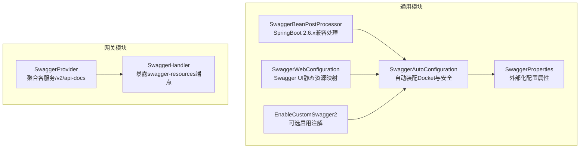
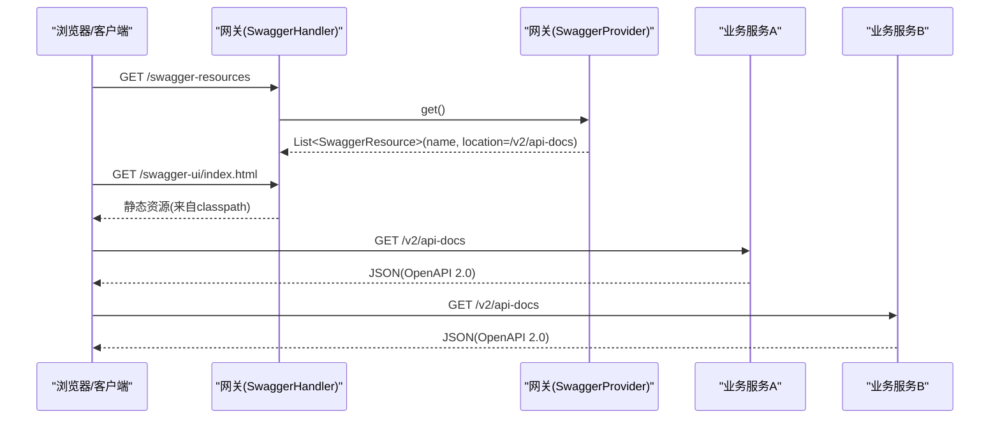
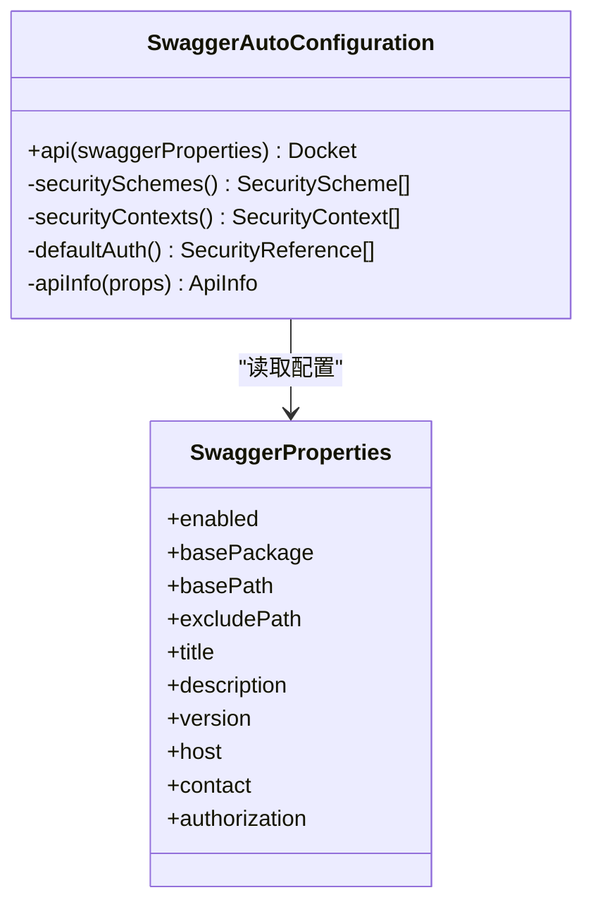
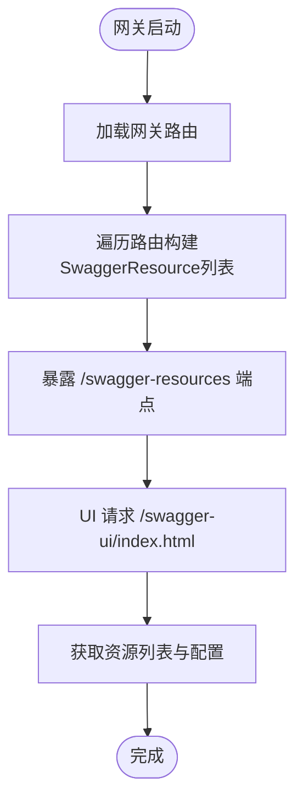
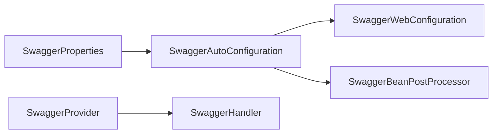

# API文档组件

<cite>
**本文引用的文件**   
- [SwaggerAutoConfiguration.java](file://ruoyi-common/ruoyi-common-swagger/src/main/java/com/ruoyi/common/swagger/config/SwaggerAutoConfiguration.java)
- [SwaggerProperties.java](file://ruoyi-common/ruoyi-common-swagger/src/main/java/com/ruoyi/common/swagger/config/SwaggerProperties.java)
- [SwaggerBeanPostProcessor.java](file://ruoyi-common/ruoyi-common-swagger/src/main/java/com/ruoyi/common/swagger/config/SwaggerBeanPostProcessor.java)
- [SwaggerWebConfiguration.java](file://ruoyi-common/ruoyi-common-swagger/src/main/java/com/ruoyi/common/swagger/config/SwaggerWebConfiguration.java)
- [EnableCustomSwagger2.java](file://ruoyi-common/ruoyi-common-swagger/src/main/java/com/ruoyi/common/swagger/annotation/EnableCustomSwagger2.java)
- [SwaggerProvider.java](file://ruoyi-gateway/src/main/java/com/ruoyi/gateway/config/SwaggerProvider.java)
- [SwaggerHandler.java](file://ruoyi-gateway/src/main/java/com/ruoyi/gateway/handler/SwaggerHandler.java)
</cite>

## 目录
1. [简介](#简介)
2. [项目结构](#项目结构)
3. [核心组件](#核心组件)
4. [架构总览](#架构总览)
5. [详细组件分析](#详细组件-analysis)
6. [依赖关系分析](#依赖关系分析)
7. [性能与优化建议](#性能与优化建议)
8. [故障排查指南](#故障排查指南)
9. [结论](#结论)
10. [附录：配置项速查](#附录配置项速查)

## 简介
本模块基于 Springfox（Swagger2）为系统提供统一的API文档能力，包含服务端的自动装配、属性配置、资源映射、网关聚合等。通过可配置的开关、包扫描路径、基础路径过滤、排除路径、安全认证头以及UI资源映射，实现开箱即用且可扩展的API文档体验。同时，在网关层聚合各子服务的接口文档，便于统一访问。

## 项目结构
该功能主要分布在两个位置：
- 通用模块 ruoyi-common-swagger：提供 Swagger2 自动装配、配置属性、兼容处理与静态资源映射
- 网关模块 gateway：提供多服务文档聚合与 UI 资源暴露

**图表来源**
- [SwaggerAutoConfiguration.java:27-75](file://ruoyi-common/ruoyi-common-swagger/src/main/java/com/ruoyi/common/swagger/config/SwaggerAutoConfiguration.java#L27-L75)
- [SwaggerProperties.java:8-10](file://ruoyi-common/ruoyi-common-swagger/src/main/java/com/ruoyi/common/swagger/config/SwaggerProperties.java#L8-L10)
- [SwaggerBeanPostProcessor.java:19-30](file://ruoyi-common/ruoyi-common-swagger/src/main/java/com/ruoyi/common/swagger/config/SwaggerBeanPostProcessor.java#L19-L30)
- [SwaggerWebConfiguration.java:12-21](file://ruoyi-common/ruoyi-common-swagger/src/main/java/com/ruoyi/common/swagger/config/SwaggerWebConfiguration.java#L12-L21)
- [EnableCustomSwagger2.java:12-17](file://ruoyi-common/ruoyi-common-swagger/src/main/java/com/ruoyi/common/swagger/annotation/EnableCustomSwagger2.java#L12-L17)
- [SwaggerProvider.java:20-57](file://ruoyi-gateway/src/main/java/com/ruoyi/gateway/config/SwaggerProvider.java#L20-L57)
- [SwaggerHandler.java:17-55](file://ruoyi-gateway/src/main/java/com/ruoyi/gateway/handler/SwaggerHandler.java#L17-L55)

**章节来源**
- [SwaggerAutoConfiguration.java:27-75](file://ruoyi-common/ruoyi-common-swagger/src/main/java/com/ruoyi/common/swagger/config/SwaggerAutoConfiguration.java#L27-L75)
- [SwaggerProperties.java:8-10](file://ruoyi-common/ruoyi-common-swagger/src/main/java/com/ruoyi/common/swagger/config/SwaggerProperties.java#L8-L10)
- [SwaggerProvider.java:20-57](file://ruoyi-gateway/src/main/java/com/ruoyi/gateway/config/SwaggerProvider.java#L20-L57)

## 核心组件
- SwaggerAutoConfiguration：基于 @EnableSwagger2 创建 Docket，配置扫描包、基础路径、排除路径、全局安全头、ApiInfo元信息
- SwaggerProperties：以 swagger.* 前缀的外部化配置，控制开关、包路径、路径规则、标题描述版本、联系人、鉴权策略等
- SwaggerBeanPostProcessor：修复 Spring Boot 2.6.x 下 Springfox 不兼容问题（过滤掉带 PatternParser 的 HandlerMapping）
- SwaggerWebConfiguration：将 /swagger-ui/** 映射到 classpath 下的 springfox-swagger-ui 静态资源
- EnableCustomSwagger2：可选的自定义注解，导入自动装配类
- SwaggerProvider：网关侧聚合各子服务的 /v2/api-docs 资源列表
- SwaggerHandler：网关侧暴露 /swagger-resources 相关端点，供 UI 获取资源与配置

**章节来源**
- [SwaggerAutoConfiguration.java:27-128](file://ruoyi-common/ruoyi-common-swagger/src/main/java/com/ruoyi/common/swagger/config/SwaggerAutoConfiguration.java#L27-L128)
- [SwaggerProperties.java:8-345](file://ruoyi-common/ruoyi-common-swagger/src/main/java/com/ruoyi/common/swagger/config/SwaggerProperties.java#L8-L345)
- [SwaggerBeanPostProcessor.java:19-53](file://ruoyi-common/ruoyi-common-swagger/src/main/java/com/ruoyi/common/swagger/config/SwaggerBeanPostProcessor.java#L19-L53)
- [SwaggerWebConfiguration.java:12-21](file://ruoyi-common/ruoyi-common-swagger/src/main/java/com/ruoyi/common/swagger/config/SwaggerWebConfiguration.java#L12-L21)
- [EnableCustomSwagger2.java:12-17](file://ruoyi-common/ruoyi-common-swagger/src/main/java/com/ruoyi/common/swagger/annotation/EnableCustomSwagger2.java#L12-L17)
- [SwaggerProvider.java:20-75](file://ruoyi-gateway/src/main/java/com/ruoyi/gateway/config/SwaggerProvider.java#L20-L75)
- [SwaggerHandler.java:17-55](file://ruoyi-gateway/src/main/java/com/ruoyi/gateway/handler/SwaggerHandler.java#L17-L55)

## 架构总览
下图展示了从网关入口到各业务服务，最终由 Springfox 生成并聚合文档的整体流程。

**图表来源**
- [SwaggerHandler.java:17-55](file://ruoyi-gateway/src/main/java/com/ruoyi/gateway/handler/SwaggerHandler.java#L17-L55)
- [SwaggerProvider.java:20-75](file://ruoyi-gateway/src/main/java/com/ruoyi/gateway/config/SwaggerProvider.java#L20-L75)
- [SwaggerWebConfiguration.java:12-21](file://ruoyi-common/ruoyi-common-swagger/src/main/java/com/ruoyi/common/swagger/config/SwaggerWebConfiguration.java#L12-L21)

## 详细组件分析

### SwaggerAutoConfiguration（自动装配与Docket构建）
- 作用
  - 启用 Swagger2 并创建 Docket Bean
  - 根据 SwaggerProperties 配置 basePackage/basePath/excludePath/host
  - 设置 ApiInfo（标题、描述、版本、许可证、联系人等）
  - 配置全局安全方案 Authorization 头，使所有接口默认需要鉴权
- 关键逻辑
  - 若未配置 basePath，则默认 /**
  - 若未配置 excludePath，则默认排除 /error 与 /actuator/**
  - 使用 RequestHandlerSelectors.basePackage 限定扫描范围
  - 通过 securitySchemes/securityContexts 注入全局鉴权
- 扩展点
  - 可通过覆盖 apiInfo 方法或替换 SecurityScheme 来定制文档信息与鉴权方式

**图表来源**
- [SwaggerAutoConfiguration.java:40-75](file://ruoyi-common/ruoyi-common-swagger/src/main/java/com/ruoyi/common/swagger/config/SwaggerAutoConfiguration.java#L40-L75)
- [SwaggerAutoConfiguration.java:81-128](file://ruoyi-common/ruoyi-common-swagger/src/main/java/com/ruoyi/common/swagger/config/SwaggerAutoConfiguration.java#L81-L128)
- [SwaggerProperties.java:8-345](file://ruoyi-common/ruoyi-common-swagger/src/main/java/com/ruoyi/common/swagger/config/SwaggerProperties.java#L8-L345)

**章节来源**
- [SwaggerAutoConfiguration.java:27-128](file://ruoyi-common/ruoyi-common-swagger/src/main/java/com/ruoyi/common/swagger/config/SwaggerAutoConfiguration.java#L27-L128)

### SwaggerProperties（外部化配置）
- 作用
  - 以 swagger.* 前缀绑定配置项，控制文档行为
- 主要字段
  - enabled：是否启用文档
  - basePackage：扫描的Controller包路径
  - basePath：包含的路径规则（支持ant表达式）
  - excludePath：从basePath中排除的路径规则
  - title/description/version/license/licenseUrl/termsOfServiceUrl/host：文档元信息
  - contact：联系人信息
  - authorization：鉴权策略（名称、正则匹配、作用域、tokenURL列表）
- 注意
  - 默认 basePath 为空时会被填充为 /**
  - 默认 excludePath 会加入 /error 和 /actuator/**

**章节来源**
- [SwaggerProperties.java:8-345](file://ruoyi-common/ruoyi-common-swagger/src/main/java/com/ruoyi/common/swagger/config/SwaggerProperties.java#L8-L345)

### SwaggerBeanPostProcessor（Spring Boot 2.6.x 兼容）
- 作用
  - 在Bean初始化后，对 WebMvcRequestHandlerProvider/WebFluxRequestHandlerProvider 进行处理
  - 过滤掉带有 PatternParser 的 HandlerMapping，解决 Springfox 在 Spring Boot 2.6.x 上的兼容性问题
- 影响
  - 避免启动时报错或文档无法加载

**章节来源**
- [SwaggerBeanPostProcessor.java:19-53](file://ruoyi-common/ruoyi-common-swagger/src/main/java/com/ruoyi/common/swagger/config/SwaggerBeanPostProcessor.java#L19-L53)

### SwaggerWebConfiguration（静态资源映射）
- 作用
  - 将 /swagger-ui/** 映射到 classpath:/META-INF/resources/webjars/springfox-swagger-ui/
- 结果
  - 可通过 /swagger-ui/index.html 访问文档界面

**章节来源**
- [SwaggerWebConfiguration.java:12-21](file://ruoyi-common/ruoyi-common-swagger/src/main/java/com/ruoyi/common/swagger/config/SwaggerWebConfiguration.java#L12-L21)

### EnableCustomSwagger2（可选启用注解）
- 作用
  - 通过 @Import 引入 SwaggerAutoConfiguration，便于按需启用
- 使用场景
  - 当希望更细粒度地控制何时启用文档时使用

**章节来源**
- [EnableCustomSwagger2.java:12-17](file://ruoyi-common/ruoyi-common-swagger/src/main/java/com/ruoyi/common/swagger/annotation/EnableCustomSwagger2.java#L12-L17)

### 网关聚合：SwaggerProvider 与 SwaggerHandler
- SwaggerProvider
  - 实现 SwaggerResourcesProvider，动态收集网关路由中的服务，构造 SwaggerResource 列表
  - 将每个服务的 /v2/api-docs 作为 location 暴露给 UI
- SwaggerHandler
  - 暴露 /swagger-resources 相关端点，返回资源列表与UI/安全配置
- 效果
  - 在网关层统一展示所有子服务的API文档，无需逐个访问

**图表来源**
- [SwaggerProvider.java:20-75](file://ruoyi-gateway/src/main/java/com/ruoyi/gateway/config/SwaggerProvider.java#L20-L75)
- [SwaggerHandler.java:17-55](file://ruoyi-gateway/src/main/java/com/ruoyi/gateway/handler/SwaggerHandler.java#L17-L55)

**章节来源**
- [SwaggerProvider.java:20-75](file://ruoyi-gateway/src/main/java/com/ruoyi/gateway/config/SwaggerProvider.java#L20-L75)
- [SwaggerHandler.java:17-55](file://ruoyi-gateway/src/main/java/com/ruoyi/gateway/handler/SwaggerHandler.java#L17-L55)

## 依赖关系分析
- 组件耦合
  - SwaggerAutoConfiguration 强依赖 SwaggerProperties
  - SwaggerWebConfiguration 与 Spring MVC 资源映射机制耦合
  - SwaggerBeanPostProcessor 与 Springfox 内部类型耦合，用于兼容性修复
  - 网关层 SwaggerProvider 依赖 Spring Cloud Gateway 的路由发现能力
- 外部依赖
  - Springfox（Swagger2）：提供 Docket、ApiInfo、SecurityScheme 等
  - Spring Boot：自动装配、条件装配、WebMvc/WebFlux 配置
  - Spring Cloud Gateway：路由聚合

**图表来源**
- [SwaggerAutoConfiguration.java:27-75](file://ruoyi-common/ruoyi-common-swagger/src/main/java/com/ruoyi/common/swagger/config/SwaggerAutoConfiguration.java#L27-L75)
- [SwaggerWebConfiguration.java:12-21](file://ruoyi-common/ruoyi-common-swagger/src/main/java/com/ruoyi/common/swagger/config/SwaggerWebConfiguration.java#L12-L21)
- [SwaggerBeanPostProcessor.java:19-53](file://ruoyi-common/ruoyi-common-swagger/src/main/java/com/ruoyi/common/swagger/config/SwaggerBeanPostProcessor.java#L19-L53)
- [SwaggerProvider.java:20-75](file://ruoyi-gateway/src/main/java/com/ruoyi/gateway/config/SwaggerProvider.java#L20-L75)
- [SwaggerHandler.java:17-55](file://ruoyi-gateway/src/main/java/com/ruoyi/gateway/handler/SwaggerHandler.java#L17-L55)

**章节来源**
- [SwaggerAutoConfiguration.java:27-75](file://ruoyi-common/ruoyi-common-swagger/src/main/java/com/ruoyi/common/swagger/config/SwaggerAutoConfiguration.java#L27-L75)
- [SwaggerProvider.java:20-75](file://ruoyi-gateway/src/main/java/com/ruoyi/gateway/config/SwaggerProvider.java#L20-L75)

## 性能与优化建议
- 控制扫描范围
  - 合理设置 basePackage，仅扫描必要的 Controller 包，减少反射开销
- 精确路径过滤
  - 使用 basePath 与 excludePath 精准控制纳入/排除的路径，避免无关接口进入文档
- 关闭不必要的环境
  - 通过 swagger.enabled=false 在非生产环境禁用文档，降低内存与启动开销
- 网关聚合优化
  - 确保网关路由稳定，避免频繁变更导致资源列表抖动
- UI 静态资源
  - 保持 /swagger-ui/** 映射正确，避免额外拦截器影响静态资源访问

[本节为通用建议，不涉及具体代码片段]

## 故障排查指南
- 文档页面空白或无法加载
  - 检查 /swagger-ui/** 静态资源映射是否正确
  - 确认网关层 SwaggerHandler 与 SwaggerProvider 已生效
- 接口未出现在文档中
  - 检查 basePackage 是否包含对应 Controller 包
  - 检查 basePath/excludePath 是否误排除了目标路径
- 鉴权失败或提示缺少Authorization头
  - 当前默认全局安全方案要求 Authorization 头，请在调用时携带
- Spring Boot 2.6.x 启动报错
  - 确认 SwaggerBeanPostProcessor 已生效，用于兼容处理
- 网关聚合缺失某些服务
  - 检查网关路由配置，确保服务ID未被过滤（如示例中排除了特定ID）

**章节来源**
- [SwaggerWebConfiguration.java:12-21](file://ruoyi-common/ruoyi-common-swagger/src/main/java/com/ruoyi/common/swagger/config/SwaggerWebConfiguration.java#L12-L21)
- [SwaggerHandler.java:17-55](file://ruoyi-gateway/src/main/java/com/ruoyi/gateway/handler/SwaggerHandler.java#L17-L55)
- [SwaggerProvider.java:20-75](file://ruoyi-gateway/src/main/java/com/ruoyi/gateway/config/SwaggerProvider.java#L20-L75)
- [SwaggerBeanPostProcessor.java:19-53](file://ruoyi-common/ruoyi-common-swagger/src/main/java/com/ruoyi/common/swagger/config/SwaggerBeanPostProcessor.java#L19-L53)
- [SwaggerAutoConfiguration.java:81-115](file://ruoyi-common/ruoyi-common-swagger/src/main/java/com/ruoyi/common/swagger/config/SwaggerAutoConfiguration.java#L81-L115)

## 结论
本模块通过 SwaggerAutoConfiguration 与 SwaggerProperties 实现了可配置化的 Swagger2 文档能力，结合 SwaggerBeanPostProcessor 解决了常见兼容性问题，并通过网关层的 SwaggerProvider/SwaggerHandler 实现了多服务文档的统一聚合。开发者只需关注业务接口的注解与配置，即可获得完整的API文档体验。

[本节为总结性内容，不涉及具体代码片段]

## 附录：配置项速查
- 开关
  - swagger.enabled：是否启用文档
- 扫描与路径
  - swagger.basePackage：扫描的Controller包路径
  - swagger.basePath：包含的路径规则（支持ant表达式）
  - swagger.excludePath：从basePath中排除的路径规则
- 文档元信息
  - swagger.title/description/version/license/licenseUrl/termsOfServiceUrl/host
- 联系人
  - swagger.contact.name/url/email
- 鉴权策略
  - swagger.authorization.name/authRegex/authorizationScopeList/tokenUrlList

**章节来源**
- [SwaggerProperties.java:8-345](file://ruoyi-common/ruoyi-common-swagger/src/main/java/com/ruoyi/common/swagger/config/SwaggerProperties.java#L8-L345)