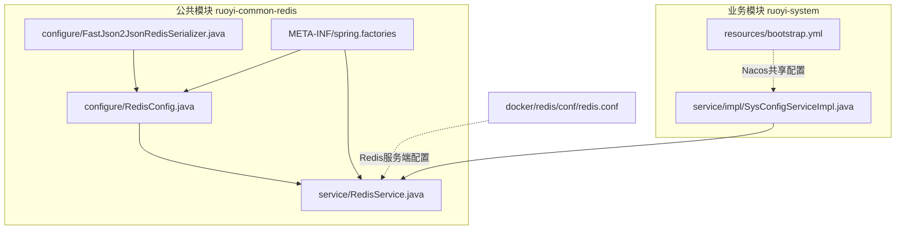
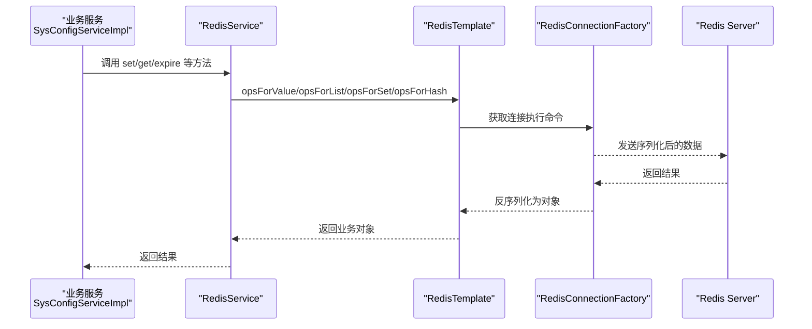
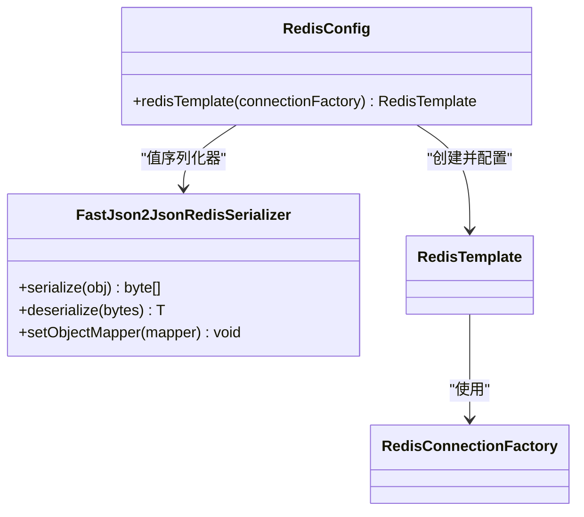
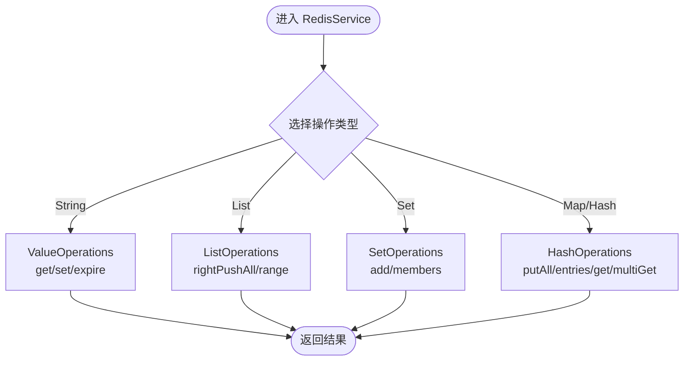
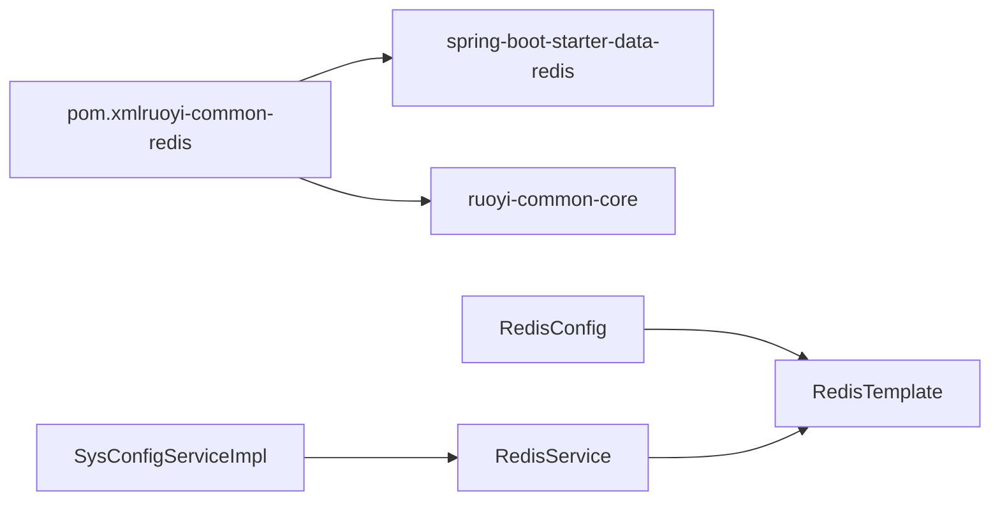
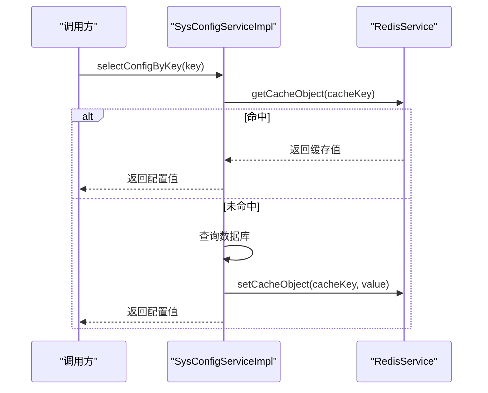

# Redis缓存组件

<cite>
**本文引用的文件**   
- [RedisConfig.java](file://ruoyi-common/ruoyi-common-redis/src/main/java/com/ruoyi/common/redis/configure/RedisConfig.java)
- [FastJson2JsonRedisSerializer.java](file://ruoyi-common/ruoyi-common-redis/src/main/java/com/ruoyi/common/redis/configure/FastJson2JsonRedisSerializer.java)
- [RedisService.java](file://ruoyi-common/ruoyi-common-redis/src/main/java/com/ruoyi/common/redis/service/RedisService.java)
- [spring.factories](file://ruoyi-common/ruoyi-common-redis/src/main/resources/META-INF/spring.factories)
- [pom.xml（ruoyi-common-redis）](file://ruoyi-common/ruoyi-common-redis/pom.xml)
- [SysConfigServiceImpl.java](file://ruoyi-modules/ruoyi-system/src/main/java/com/ruoyi/system/service/impl/SysConfigServiceImpl.java)
- [bootstrap.yml（ruoyi-system）](file://ruoyi-modules/ruoyi-system/src/main/resources/bootstrap.yml)
- [redis.conf](file://docker/redis/conf/redis.conf)
</cite>

## 目录
1. [简介](#简介)
2. [项目结构](#项目结构)
3. [核心组件](#核心组件)
4. [架构总览](#架构总览)
5. [详细组件分析](#详细组件分析)
6. [依赖关系分析](#依赖关系分析)
7. [性能与连接池配置](#性能与连接池配置)
8. [使用示例与最佳实践](#使用示例与最佳实践)
9. [常见问题排查](#常见问题排查)
10. [结论](#结论)

## 简介
本章节概述 Redis 缓存组件在系统中的定位与职责：提供统一的 Redis 访问封装、序列化策略、缓存注解支持，并在业务模块中作为通用缓存能力被复用。该组件基于 Spring Boot Starter Data Redis，结合自定义序列化器与工具类，屏蔽底层差异，简化上层调用。

## 项目结构
Redis 缓存相关代码位于公共模块 ruoyi-common-redis 下，主要包含：
- 配置层：Redis 配置与序列化器定义
- 服务层：对 RedisTemplate 的常用操作进行封装
- 自动装配：通过 spring.factories 暴露 Bean

图表来源
- [RedisConfig.java:1-51](file://ruoyi-common/ruoyi-common-redis/src/main/java/com/ruoyi/common/redis/configure/RedisConfig.java#L1-L51)
- [FastJson2JsonRedisSerializer.java:1-72](file://ruoyi-common/ruoyi-common-redis/src/main/java/com/ruoyi/common/redis/configure/FastJson2JsonRedisSerializer.java#L1-L72)
- [RedisService.java:1-257](file://ruoyi-common/ruoyi-common-redis/src/main/java/com/ruoyi/common/redis/service/RedisService.java#L1-L257)
- [spring.factories:1-5](file://ruoyi-common/ruoyi-common-redis/src/main/resources/META-INF/spring.factories#L1-L5)
- [SysConfigServiceImpl.java:1-107](file://ruoyi-modules/ruoyi-system/src/main/java/com/ruoyi/system/service/impl/SysConfigServiceImpl.java#L1-L107)
- [bootstrap.yml（ruoyi-system）:1-26](file://ruoyi-modules/ruoyi-system/src/main/resources/bootstrap.yml#L1-L26)
- [redis.conf:1-1](file://docker/redis/conf/redis.conf#L1-L1)

章节来源
- [pom.xml（ruoyi-common-redis）:1-33](file://ruoyi-common/ruoyi-common-redis/pom.xml#L1-L33)

## 核心组件
- RedisConfig：启用缓存注解，创建并配置 RedisTemplate，统一 Key/Value 序列化策略。
- FastJson2JsonRedisSerializer：基于 Fastjson 的对象序列化/反序列化实现，配合 Jackson ObjectMapper 以支持类型信息。
- RedisService：对 RedisTemplate 的常用操作进行封装，包括 String/List/Set/Map/Hash 等数据结构的基础读写、过期时间管理、批量删除与键扫描。
- spring.factories：将 RedisConfig 与 RedisService 注册为自动装配 Bean。

章节来源
- [RedisConfig.java:1-51](file://ruoyi-common/ruoyi-common-redis/src/main/java/com/ruoyi/common/redis/configure/RedisConfig.java#L1-L51)
- [FastJson2JsonRedisSerializer.java:1-72](file://ruoyi-common/ruoyi-common-redis/src/main/java/com/ruoyi/common/redis/configure/FastJson2JsonRedisSerializer.java#L1-L72)
- [RedisService.java:1-257](file://ruoyi-common/ruoyi-common-redis/src/main/java/com/ruoyi/common/redis/service/RedisService.java#L1-L257)
- [spring.factories:1-5](file://ruoyi-common/ruoyi-common-redis/src/main/resources/META-INF/spring.factories#L1-L5)

## 架构总览
下图展示了从业务模块到 Redis 的整体调用链路：业务服务通过 RedisService 访问缓存；RedisService 内部委托给 RedisTemplate；RedisTemplate 由 RedisConfig 配置序列化策略；Spring Boot 通过 starter-data-redis 完成连接工厂与连接池的初始化；Redis 服务端由 docker/redis/conf/redis.conf 控制基础参数。

图表来源
- [SysConfigServiceImpl.java:1-107](file://ruoyi-modules/ruoyi-system/src/main/java/com/ruoyi/system/service/impl/SysConfigServiceImpl.java#L1-L107)
- [RedisService.java:1-257](file://ruoyi-common/ruoyi-common-redis/src/main/java/com/ruoyi/common/redis/service/RedisService.java#L1-L257)
- [RedisConfig.java:1-51](file://ruoyi-common/ruoyi-common-redis/src/main/java/com/ruoyi/common/redis/configure/RedisConfig.java#L1-L51)

## 详细组件分析

### RedisConfig 配置类
- 功能要点
  - 启用 @EnableCaching，允许使用 Spring Cache 注解。
  - 创建 RedisTemplate<Object, Object>，注入 RedisConnectionFactory。
  - 设置 Key/HashKey 使用 StringRedisSerializer，保证键可读性。
  - Value/HashValue 使用自定义 FastJson2JsonRedisSerializer，并通过 Jackson ObjectMapper 开启默认类型信息写入，提升复杂对象的反序列化能力。
- 设计考量
  - 统一序列化策略，避免业务侧重复配置。
  - 通过 afterPropertiesSet() 确保属性设置完成后生效。

图表来源
- [RedisConfig.java:1-51](file://ruoyi-common/ruoyi-common-redis/src/main/java/com/ruoyi/common/redis/configure/RedisConfig.java#L1-L51)
- [FastJson2JsonRedisSerializer.java:1-72](file://ruoyi-common/ruoyi-common-redis/src/main/java/com/ruoyi/common/redis/configure/FastJson2JsonRedisSerializer.java#L1-L72)

章节来源
- [RedisConfig.java:1-51](file://ruoyi-common/ruoyi-common-redis/src/main/java/com/ruoyi/common/redis/configure/RedisConfig.java#L1-L51)

### FastJson2JsonRedisSerializer 序列化器
- 功能要点
  - 使用 Fastjson 的 JSON.toJSONString 进行序列化，开启 WriteClassName 以保留类型信息。
  - 反序列化时根据字节流还原为指定泛型类型。
  - 全局开启 ParserConfig AutoTypeSupport，便于多态类型的反序列化。
  - 提供 setObjectMapper 方法，供外部注入 Jackson ObjectMapper 以增强类型解析能力。
- 注意事项
  - 由于同时引入 Jackson ObjectMapper，需确保两者版本兼容，避免冲突。
  - AutoTypeSupport 打开后需注意安全限制，生产环境建议限定白名单或关闭自动类型解析。

章节来源
- [FastJson2JsonRedisSerializer.java:1-72](file://ruoyi-common/ruoyi-common-redis/src/main/java/com/ruoyi/common/redis/configure/FastJson2JsonRedisSerializer.java#L1-L72)

### RedisService 工具类
- 功能要点
  - 封装常见数据结构操作：String、List、Set、Map、Hash。
  - 提供过期时间设置与查询、键存在性判断、批量删除、键模式匹配扫描等能力。
  - 所有方法均基于 RedisTemplate 的对应 Operations 接口。
- 复杂度与行为
  - keys(pattern) 会触发全库扫描，在大键空间场景下可能带来性能压力，应谨慎使用。
  - 列表、集合、哈希的操作均为 O(n) 级别遍历或批量读取，注意数据规模。

图表来源
- [RedisService.java:1-257](file://ruoyi-common/ruoyi-common-redis/src/main/java/com/ruoyi/common/redis/service/RedisService.java#L1-L257)

章节来源
- [RedisService.java:1-257](file://ruoyi-common/ruoyi-common-redis/src/main/java/com/ruoyi/common/redis/service/RedisService.java#L1-L257)

### 自动装配与依赖注入
- spring.factories 将 RedisConfig 与 RedisService 声明为自动装配 Bean，使引入依赖后即可直接使用。
- 业务模块通过 @Autowired 注入 RedisService，无需关心底层连接与序列化细节。

章节来源
- [spring.factories:1-5](file://ruoyi-common/ruoyi-common-redis/src/main/resources/META-INF/spring.factories#L1-L5)

## 依赖关系分析
- 模块依赖
  - ruoyi-common-redis 依赖 spring-boot-starter-data-redis 与 ruoyi-common-core。
- 运行时依赖
  - RedisTemplate 依赖 RedisConnectionFactory（由 Spring Boot 自动装配）。
  - RedisService 依赖 RedisTemplate。
  - SysConfigServiceImpl 依赖 RedisService，用于系统配置的缓存读写。

图表来源
- [pom.xml（ruoyi-common-redis）:1-33](file://ruoyi-common/ruoyi-common-redis/pom.xml#L1-L33)
- [RedisConfig.java:1-51](file://ruoyi-common/ruoyi-common-redis/src/main/java/com/ruoyi/common/redis/configure/RedisConfig.java#L1-L51)
- [RedisService.java:1-257](file://ruoyi-common/ruoyi-common-redis/src/main/java/com/ruoyi/common/redis/service/RedisService.java#L1-L257)
- [SysConfigServiceImpl.java:1-107](file://ruoyi-modules/ruoyi-system/src/main/java/com/ruoyi/system/service/impl/SysConfigServiceImpl.java#L1-L107)

章节来源
- [pom.xml（ruoyi-common-redis）:1-33](file://ruoyi-common/ruoyi-common-redis/pom.xml#L1-L33)

## 性能与连接池配置
- 连接池
  - 当前 RedisConfig 未显式配置连接池参数；连接池由 Spring Boot Starter Data Redis 默认提供。
  - 如需调整连接池大小、超时、重试等，可在应用配置文件中覆盖 redis.* 相关属性（例如 lettuce 或 jedis 的连接池参数），或通过自定义 RedisConnectionFactory Bean 进行精细控制。
- 序列化开销
  - 值序列化采用 Fastjson + Jackson 类型信息，适合复杂对象但会带来一定序列化/反序列化开销。对于热点小对象，可考虑更轻量的序列化方案或减少对象层级。
- 键空间扫描
  - RedisService.keys(pattern) 会触发全库扫描，建议在大数据量场景下避免频繁调用，或使用带前缀的命名空间与精确键名。
- 过期策略
  - 建议为缓存键设置合理的过期时间，避免内存膨胀；可通过 RedisService.expire 统一管理。
- 持久化
  - Redis 持久化由服务端配置决定（如 AOF/RDB）。仓库中 redis.conf 仅包含注释化的 requirepass，其他持久化参数需根据实际部署环境补充。

章节来源
- [RedisConfig.java:1-51](file://ruoyi-common/ruoyi-common-redis/src/main/java/com/ruoyi/common/redis/configure/RedisConfig.java#L1-L51)
- [RedisService.java:1-257](file://ruoyi-common/ruoyi-common-redis/src/main/java/com/ruoyi/common/redis/service/RedisService.java#L1-L257)
- [redis.conf:1-1](file://docker/redis/conf/redis.conf#L1-L1)

## 使用示例与最佳实践
- 基本用法
  - 在业务 Service 中注入 RedisService，调用 setCacheObject/getCacheObject 存取对象，调用 expire 设置过期时间。
  - 使用 setCacheList/getCacheList 缓存列表数据；使用 setCacheSet/getCacheSet 缓存集合；使用 setCacheMap/getCacheMap 缓存 Map。
- 典型流程（系统配置缓存）
  - 启动时加载配置到缓存；读取时优先查缓存，未命中则回源数据库并回填缓存；更新配置后同步写缓存。

图表来源
- [SysConfigServiceImpl.java:1-107](file://ruoyi-modules/ruoyi-system/src/main/java/com/ruoyi/system/service/impl/SysConfigServiceImpl.java#L1-L107)
- [RedisService.java:1-257](file://ruoyi-common/ruoyi-common-redis/src/main/java/com/ruoyi/common/redis/service/RedisService.java#L1-L257)

- 最佳实践
  - 键命名规范：使用前缀区分业务域，便于管理与清理。
  - 合理设置过期时间：避免长期驻留导致内存增长。
  - 避免大对象：尽量拆分或压缩，减少网络传输与序列化成本。
  - 谨慎使用 keys：用 scan 或按前缀维护索引替代全库扫描。
  - 异常处理：对 Redis 不可用场景做降级与兜底，保障主流程可用。

## 常见问题排查
- 无法连接 Redis
  - 检查 bootstrap.yml 中的 Nacos 配置是否正确，确认 Redis 连接信息是否通过 Nacos 下发。
  - 检查 Redis 服务端是否运行，端口与密码是否正确（参考 redis.conf）。
- 序列化/反序列化异常
  - 检查对象是否实现了必要的序列化接口或具备无参构造。
  - 若使用多态类型，确认 Fastjson 的 AutoTypeSupport 与 Jackson 的类型信息配置一致。
- 缓存未命中或脏读
  - 确认过期时间是否过短；检查是否存在并发更新未加锁导致的竞态条件。
- 性能问题
  - 排查是否频繁调用 keys(pattern)。
  - 评估对象体积与序列化开销，必要时优化数据结构或序列化策略。
  - 调整连接池参数与网络超时，观察慢日志与监控指标。

章节来源
- [bootstrap.yml（ruoyi-system）:1-26](file://ruoyi-modules/ruoyi-system/src/main/resources/bootstrap.yml#L1-L26)
- [redis.conf:1-1](file://docker/redis/conf/redis.conf#L1-L1)
- [RedisService.java:1-257](file://ruoyi-common/ruoyi-common-redis/src/main/java/com/ruoyi/common/redis/service/RedisService.java#L1-L257)

## 结论
本 Redis 缓存组件通过统一的配置与工具类，为业务模块提供了稳定、易用的缓存能力。其核心价值在于：
- 统一序列化策略，降低业务侧复杂度
- 封装常用数据结构操作，提高开发效率
- 借助 Spring Cache 注解，支持声明式缓存
在实际使用中，建议结合业务特性完善连接池与持久化配置，遵循键命名与过期策略的最佳实践，并对高频路径进行性能调优与监控，以获得更稳定的缓存体验。