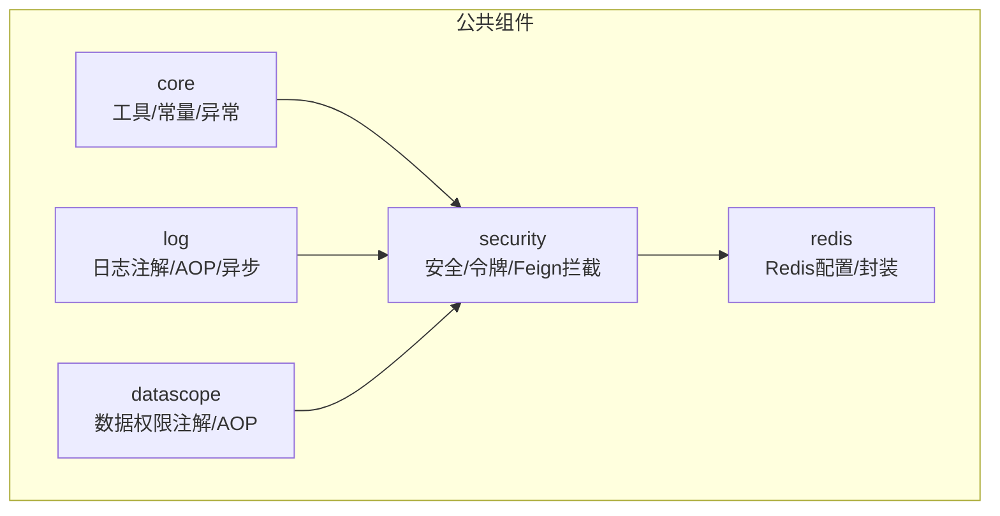
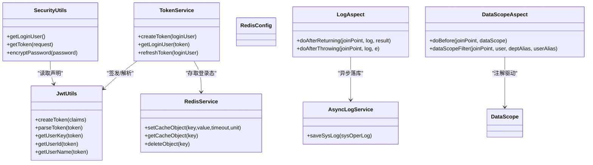
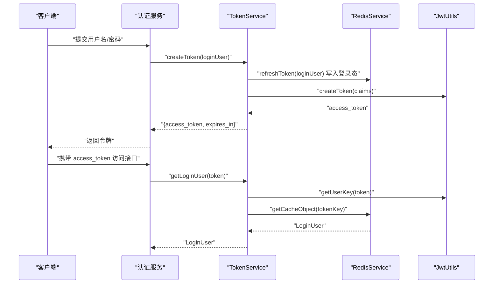
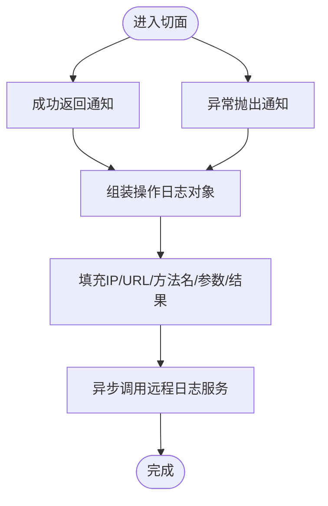
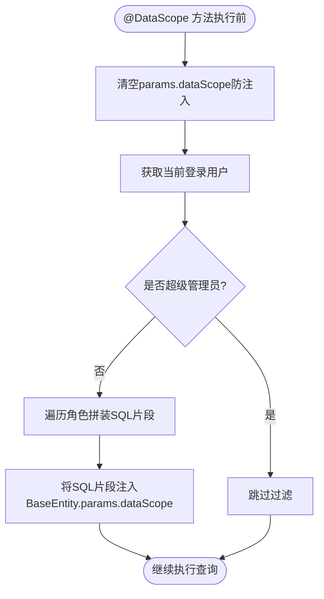
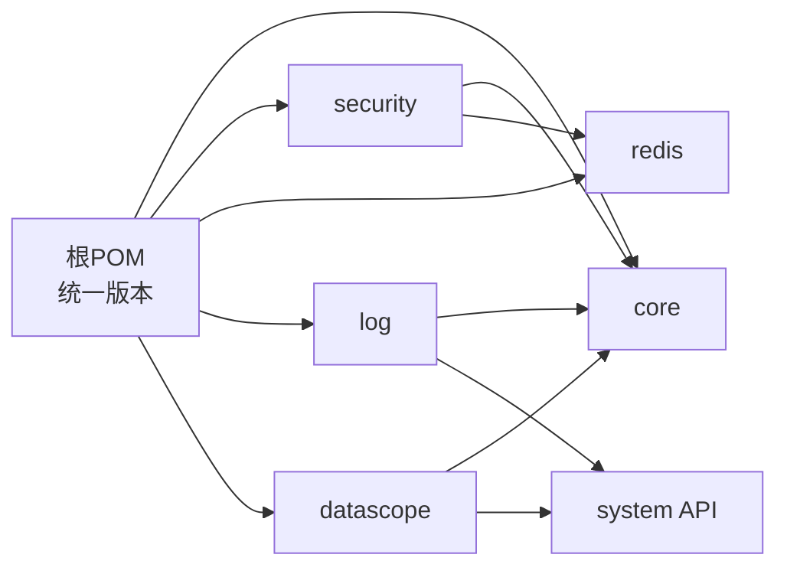

# 公共组件

<cite>
**本文引用的文件**   
- [pom.xml](file://pom.xml)
- [JwtUtils.java](file://ruoyi-common/ruoyi-common-core/src/main/java/com/ruoyi/common/core/utils/JwtUtils.java)
- [StringUtils.java](file://ruoyi-common/ruoyi-common-core/src/main/java/com/ruoyi/common/core/utils/StringUtils.java)
- [SecurityUtils.java](file://ruoyi-common/ruoyi-common-security/src/main/java/com/ruoyi/common/security/utils/SecurityUtils.java)
- [TokenService.java](file://ruoyi-common/ruoyi-common-security/src/main/java/com/ruoyi/common/security/service/TokenService.java)
- [RedisConfig.java](file://ruoyi-common/ruoyi-common-redis/src/main/java/com/ruoyi/common/redis/configure/RedisConfig.java)
- [RedisService.java](file://ruoyi-common/ruoyi-common-redis/src/main/java/com/ruoyi/common/redis/service/RedisService.java)
- [LogAspect.java](file://ruoyi-common/ruoyi-common-log/src/main/java/com/ruoyi/common/log/aspect/LogAspect.java)
- [AsyncLogService.java](file://ruoyi-common/ruoyi-common-log/src/main/java/com/ruoyi/common/log/service/AsyncLogService.java)
- [DataScopeAspect.java](file://ruoyi-common/ruoyi-common-datascope/src/main/java/com/ruoyi/common/datascope/aspect/DataScopeAspect.java)
- [DataScope.java](file://ruoyi-common/ruoyi-common-datascope/src/main/java/com/ruoyi/common/datascope/annotation/DataScope.java)
</cite>

## 目录
1. [简介](#简介)
2. [项目结构](#项目结构)
3. [核心组件](#核心组件)
4. [架构总览](#架构总览)
5. [详细组件分析](#详细组件分析)
6. [依赖关系分析](#依赖关系分析)
7. [性能与容量规划](#性能与容量规划)
8. [故障排查指南](#故障排查指南)
9. [最佳实践](#最佳实践)
10. [结论](#结论)

## 简介
本章节面向“公共组件”模块，聚焦以下通用能力：
- 核心工具类：字符串、JWT、上下文等
- 安全组件：令牌签发与校验、用户上下文、Feign 内部调用鉴权
- Redis 缓存：统一封装与序列化配置
- 日志记录：操作日志 AOP 切面与异步落库
- 数据权限：基于角色与部门的数据范围过滤

这些组件以 Maven 多模块方式组织在 ruoyi-common 下，被网关、认证、业务模块共同复用。

## 项目结构
公共组件位于 ruoyi-common 下，按能力拆分为多个子模块：
- ruoyi-common-core：常量、异常、通用工具（含 JWT、字符串、上下文）
- ruoyi-common-security：安全相关注解、AOP、Feign 拦截器、Token 服务
- ruoyi-common-redis：Redis 配置与统一封装
- ruoyi-common-log：操作日志注解、AOP、异步保存
- ruoyi-common-datascope：数据权限注解与 AOP
- ruoyi-common-swagger：接口文档自动装配（本文不展开）
- ruoyi-common-datasource：主从注解（本文不展开）

图表来源
- [pom.xml:185-232](file://pom.xml#L185-L232)

章节来源
- [pom.xml:185-232](file://pom.xml#L185-L232)

## 核心组件
本节概述各公共模块的职责边界与对外暴露的关键能力。

- 核心工具类（core）
  - 提供字符串处理、JSON/类型转换、IP 获取、UUID 生成、Servlet 辅助等基础能力
  - 提供 JWT 工具类，用于签发与解析令牌中的声明字段
- 安全组件（security）
  - TokenService：令牌创建、刷新、校验；结合 Redis 存储登录态
  - SecurityUtils：从请求头提取 token、从上下文获取当前用户信息
  - Feign 内部调用拦截：为微服务间调用注入内部鉴权标识
- Redis 缓存（redis）
  - RedisConfig：统一序列化策略（Key 使用 String，Value 使用 FastJson2）
  - RedisService：对 Value/List/Set/Map 的常用操作封装
- 日志记录（log）
  - LogAspect：通过 @Log 注解采集控制器方法入参、出参、异常、IP、URL 等
  - AsyncLogService：异步调用远程日志服务持久化
- 数据权限（datascope）
  - DataScope 注解：声明查询时的部门/用户别名
  - DataScopeAspect：根据角色数据权限拼接 SQL 片段并注入到分页参数中

章节来源
- [JwtUtils.java:16-123](file://ruoyi-common/ruoyi-common-core/src/main/java/com/ruoyi/common/core/utils/JwtUtils.java#L16-L123)
- [StringUtils.java:15-530](file://ruoyi-common/ruoyi-common-core/src/main/java/com/ruoyi/common/core/utils/StringUtils.java#L15-L530)
- [SecurityUtils.java:17-117](file://ruoyi-common/ruoyi-common-security/src/main/java/com/ruoyi/common/security/utils/SecurityUtils.java#L17-L117)
- [TokenService.java:25-168](file://ruoyi-common/ruoyi-common-security/src/main/java/com/ruoyi/common/security/service/TokenService.java#L25-L168)
- [RedisConfig.java:21-49](file://ruoyi-common/ruoyi-common-redis/src/main/java/com/ruoyi/common/redis/configure/RedisConfig.java#L21-L49)
- [RedisService.java:23-256](file://ruoyi-common/ruoyi-common-redis/src/main/java/com/ruoyi/common/redis/service/RedisService.java#L23-L256)
- [LogAspect.java:33-211](file://ruoyi-common/ruoyi-common-log/src/main/java/com/ruoyi/common/log/aspect/LogAspect.java#L33-L211)
- [AsyncLogService.java:15-29](file://ruoyi-common/ruoyi-common-log/src/main/java/com/ruoyi/common/log/service/AsyncLogService.java#L15-L29)
- [DataScopeAspect.java:20-150](file://ruoyi-common/ruoyi-common-datascope/src/main/java/com/ruoyi/common/datascope/aspect/DataScopeAspect.java#L20-L150)
- [DataScope.java:14-28](file://ruoyi-common/ruoyi-common-datascope/src/main/java/com/ruoyi/common/datascope/annotation/DataScope.java#L14-L28)

## 架构总览
下图展示公共组件之间的关键交互：安全组件依赖核心工具与 Redis；日志与数据权限通过 AOP 切面增强业务方法，并分别依赖安全上下文与系统 API。

图表来源
- [JwtUtils.java:16-123](file://ruoyi-common/ruoyi-common-core/src/main/java/com/ruoyi/common/core/utils/JwtUtils.java#L16-L123)
- [SecurityUtils.java:17-117](file://ruoyi-common/ruoyi-common-security/src/main/java/com/ruoyi/common/security/utils/SecurityUtils.java#L17-L117)
- [TokenService.java:25-168](file://ruoyi-common/ruoyi-common-security/src/main/java/com/ruoyi/common/security/service/TokenService.java#L25-L168)
- [RedisConfig.java:21-49](file://ruoyi-common/ruoyi-common-redis/src/main/java/com/ruoyi/common/redis/configure/RedisConfig.java#L21-L49)
- [RedisService.java:23-256](file://ruoyi-common/ruoyi-common-redis/src/main/java/com/ruoyi/common/redis/service/RedisService.java#L23-L256)
- [LogAspect.java:33-211](file://ruoyi-common/ruoyi-common-log/src/main/java/com/ruoyi/common/log/aspect/LogAspect.java#L33-L211)
- [AsyncLogService.java:15-29](file://ruoyi-common/ruoyi-common-log/src/main/java/com/ruoyi/common/log/service/AsyncLogService.java#L15-L29)
- [DataScopeAspect.java:20-150](file://ruoyi-common/ruoyi-common-datascope/src/main/java/com/ruoyi/common/datascope/aspect/DataScopeAspect.java#L20-L150)
- [DataScope.java:14-28](file://ruoyi-common/ruoyi-common-datascope/src/main/java/com/ruoyi/common/datascope/annotation/DataScope.java#L14-L28)

## 详细组件分析

### 核心工具类（core）
- 职责
  - 提供跨模块复用的基础能力：字符串处理、格式化工具、IP 获取、UUID 生成、Servlet 辅助、异常体系、常量定义等
  - 提供 JWT 工具类，负责令牌的签发与解析，以及从 Claims 中提取用户标识、用户名等
- 关键点
  - JwtUtils 使用 HS512 算法签名，密钥来源于常量配置
  - StringUtils 扩展了 Apache Commons Lang 的字符串能力，包含驼峰/下划线转换、AntPathMatcher 匹配等
- 使用方式
  - 直接调用静态方法，无需额外装配
- 扩展点
  - 可替换底层 JSON 序列化实现或扩展更多格式化方法

章节来源
- [JwtUtils.java:16-123](file://ruoyi-common/ruoyi-common-core/src/main/java/com/ruoyi/common/core/utils/JwtUtils.java#L16-L123)
- [StringUtils.java:15-530](file://ruoyi-common/ruoyi-common-core/src/main/java/com/ruoyi/common/core/utils/StringUtils.java#L15-L530)

### 安全组件（security）
- 职责
  - TokenService：负责登录态管理，包括创建令牌、刷新过期时间、从 Redis 获取登录用户、删除登录态
  - SecurityUtils：从请求头提取 token、从上下文获取当前用户、密码加密与比对
  - Feign 内部调用拦截：为微服务间调用注入内部鉴权标识（见 pom 依赖）
- 关键流程（令牌创建与校验）

图表来源
- [TokenService.java:44-111](file://ruoyi-common/ruoyi-common-security/src/main/java/com/ruoyi/common/security/service/TokenService.java#L44-L111)
- [JwtUtils.java:26-53](file://ruoyi-common/ruoyi-common-core/src/main/java/com/ruoyi/common/core/utils/JwtUtils.java#L26-L53)
- [RedisService.java:34-109](file://ruoyi-common/ruoyi-common-redis/src/main/java/com/ruoyi/common/redis/service/RedisService.java#L34-L109)

- 配置与使用
  - 通过 SecurityUtils.getToken(request) 获取 token，SecurityUtils.getLoginUser() 获取当前用户
  - 密码加密/校验使用 BCryptPasswordEncoder
- 扩展点
  - 可自定义 TokenService 行为（如增加设备指纹、黑名单校验）
  - 可替换 SecurityConstants/TokenConstants 的配置值

章节来源
- [SecurityUtils.java:17-117](file://ruoyi-common/ruoyi-common-security/src/main/java/com/ruoyi/common/security/utils/SecurityUtils.java#L17-L117)
- [TokenService.java:25-168](file://ruoyi-common/ruoyi-common-security/src/main/java/com/ruoyi/common/security/service/TokenService.java#L25-L168)

### Redis 缓存（redis）
- 职责
  - RedisConfig：统一配置 RedisTemplate 的序列化策略（Key 使用 String，Value 使用 FastJson2），启用 Spring Cache
  - RedisService：封装常用 Redis 操作（String/List/Set/Map/过期时间/批量删除/keys 扫描）
- 关键点
  - 所有对象序列化采用 FastJson2，避免反序列化兼容问题
  - 支持设置过期时间与单位，便于会话与热点数据管理
- 使用方式
  - 注入 RedisService 后调用 set/get/delete 等方法
- 扩展点
  - 可替换序列化器或增加分布式锁封装

章节来源
- [RedisConfig.java:21-49](file://ruoyi-common/ruoyi-common-redis/src/main/java/com/ruoyi/common/redis/configure/RedisConfig.java#L21-L49)
- [RedisService.java:23-256](file://ruoyi-common/ruoyi-common-redis/src/main/java/com/ruoyi/common/redis/service/RedisService.java#L23-L256)

### 日志记录（log）
- 职责
  - LogAspect：通过 @Log 注解捕获控制器方法的入参、出参、异常、IP、URL、方法名等，并异步保存
  - AsyncLogService：异步调用远程日志服务进行持久化
- 处理流程

图表来源
- [LogAspect.java:47-105](file://ruoyi-common/ruoyi-common-log/src/main/java/com/ruoyi/common/log/aspect/LogAspect.java#L47-L105)
- [AsyncLogService.java:24-28](file://ruoyi-common/ruoyi-common-log/src/main/java/com/ruoyi/common/log/service/AsyncLogService.java#L24-L28)

- 使用方式
  - 在 Controller 方法上添加 @Log 注解，按需开启是否记录请求/响应数据
- 扩展点
  - 可自定义日志字段、脱敏规则、存储后端（例如接入 ELK）

章节来源
- [LogAspect.java:33-211](file://ruoyi-common/ruoyi-common-log/src/main/java/com/ruoyi/common/log/aspect/LogAspect.java#L33-L211)
- [AsyncLogService.java:15-29](file://ruoyi-common/ruoyi-common-log/src/main/java/com/ruoyi/common/log/service/AsyncLogService.java#L15-L29)

### 数据权限（datascope）
- 职责
  - DataScope 注解：声明查询时部门表/用户表的别名
  - DataScopeAspect：根据当前用户的角色数据权限，动态拼接 SQL 条件片段，注入到分页参数中
- 权限范围
  - 全部、自定义（角色-部门关联）、本部门、本部门及以下、仅本人
- 处理流程

图表来源
- [DataScopeAspect.java:54-149](file://ruoyi-common/ruoyi-common-datascope/src/main/java/com/ruoyi/common/datascope/aspect/DataScopeAspect.java#L54-L149)
- [DataScope.java:14-28](file://ruoyi-common/ruoyi-common-datascope/src/main/java/com/ruoyi/common/datascope/annotation/DataScope.java#L14-L28)

- 使用方式
  - 在需要数据权限控制的 Service 方法上添加 @DataScope(deptAlias="d", userAlias="u")
  - 确保查询参数继承 BaseEntity，并在 MyBatis XML 中使用 ${params.dataScope}
- 扩展点
  - 可扩展新的数据权限类型或合并策略

章节来源
- [DataScopeAspect.java:20-150](file://ruoyi-common/ruoyi-common-datascope/src/main/java/com/ruoyi/common/datascope/aspect/DataScopeAspect.java#L20-L150)
- [DataScope.java:14-28](file://ruoyi-common/ruoyi-common-datascope/src/main/java/com/ruoyi/common/datascope/annotation/DataScope.java#L14-L28)

## 依赖关系分析
- 版本管理
  - 根 POM 统一管理 Spring Boot、Spring Cloud、Nacos、MyBatis、Swagger、Fastjson、JWT、POI 等依赖版本
  - 公共模块版本由 ruoyi.version 控制，保证一致性
- 模块耦合
  - security 依赖 core（工具/常量）与 redis（登录态）
  - log 依赖 core（工具/上下文）与 system API（日志实体）
  - datascope 依赖 core（工具/BaseEntity）与 system API（用户/角色模型）
- 外部依赖
  - Redis：通过 RedisTemplate 访问
  - Fastjson/Fastjson2：序列化
  - JJWT：JWT 签发与解析
  - Spring AOP：日志与数据权限切面

图表来源
- [pom.xml:15-42](file://pom.xml#L15-L42)
- [pom.xml:185-232](file://pom.xml#L185-L232)

章节来源
- [pom.xml:15-42](file://pom.xml#L15-L42)
- [pom.xml:185-232](file://pom.xml#L185-L232)

## 性能与容量规划
- Redis
  - 合理设置键空间与过期时间，避免大 Key/热 Key
  - 使用 RedisService 的带过期时间的写入方法，配合业务 TTL
- JWT
  - 仅承载必要声明，避免过大负载
  - 服务端校验优先从 Redis 取登录态，减少数据库压力
- 日志
  - 使用异步保存，降低接口延迟
  - 控制请求/响应体大小，避免日志膨胀
- 数据权限
  - 合理使用别名，避免生成复杂 SQL
  - 对高频查询建立合适索引

[本节为通用指导，不涉及具体文件]

## 故障排查指南
- 无法获取当前用户
  - 检查请求头是否携带正确的 Authorization 前缀
  - 确认 TokenService 能从 Redis 中读取到登录态
- 登录态频繁失效
  - 检查 Redis 连接与序列化配置是否正确
  - 核对 TokenService 的过期时间计算逻辑
- 日志未落库
  - 确认 @Log 注解已添加且切面生效
  - 检查异步线程池与远程日志服务可用性
- 数据权限不生效
  - 确认方法上添加了 @DataScope 且传入正确的别名
  - 检查 BaseParams 中 dataScope 是否被正确注入

章节来源
- [SecurityUtils.java:52-80](file://ruoyi-common/ruoyi-common-security/src/main/java/com/ruoyi/common/security/utils/SecurityUtils.java#L52-L80)
- [TokenService.java:95-111](file://ruoyi-common/ruoyi-common-security/src/main/java/com/ruoyi/common/security/service/TokenService.java#L95-L111)
- [RedisConfig.java:21-49](file://ruoyi-common/ruoyi-common-redis/src/main/java/com/ruoyi/common/redis/configure/RedisConfig.java#L21-L49)
- [LogAspect.java:65-105](file://ruoyi-common/ruoyi-common-log/src/main/java/com/ruoyi/common/log/aspect/LogAspect.java#L65-L105)
- [DataScopeAspect.java:127-149](file://ruoyi-common/ruoyi-common-datascope/src/main/java/com/ruoyi/common/datascope/aspect/DataScopeAspect.java#L127-L149)

## 最佳实践
- 安全
  - 统一通过 SecurityUtils 获取用户信息，避免自行解析请求头
  - 敏感信息不要放入 JWT Claims
- Redis
  - 统一使用 RedisService，避免直接操作 RedisTemplate
  - 为热点数据设置合理的过期时间，避免内存泄漏
- 日志
  - 仅在必要时记录请求/响应体，避免泄露敏感信息
  - 对异常信息进行脱敏后再落库
- 数据权限
  - 明确标注 deptAlias/userAlias，避免 SQL 注入风险
  - 对复杂权限场景，考虑在 SQL 层做二次过滤

[本节为通用指导，不涉及具体文件]

## 结论
公共组件围绕“工具、安全、缓存、日志、数据权限”五大能力构建，形成稳定、可复用的基础设施层。通过统一的版本管理与清晰的模块边界，既保证了跨模块的一致性，也为后续扩展提供了良好支点。建议在实际使用中遵循上述最佳实践，并结合业务特性进行适度扩展。