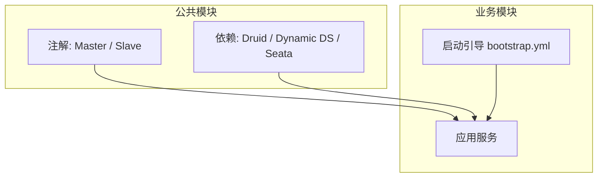
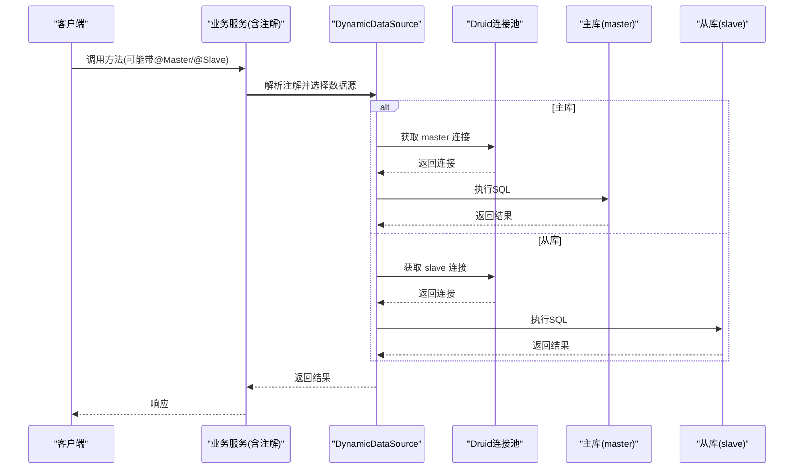
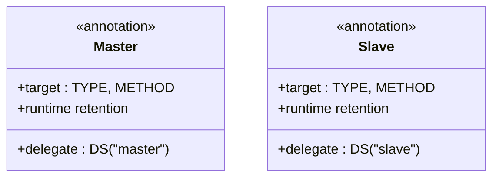
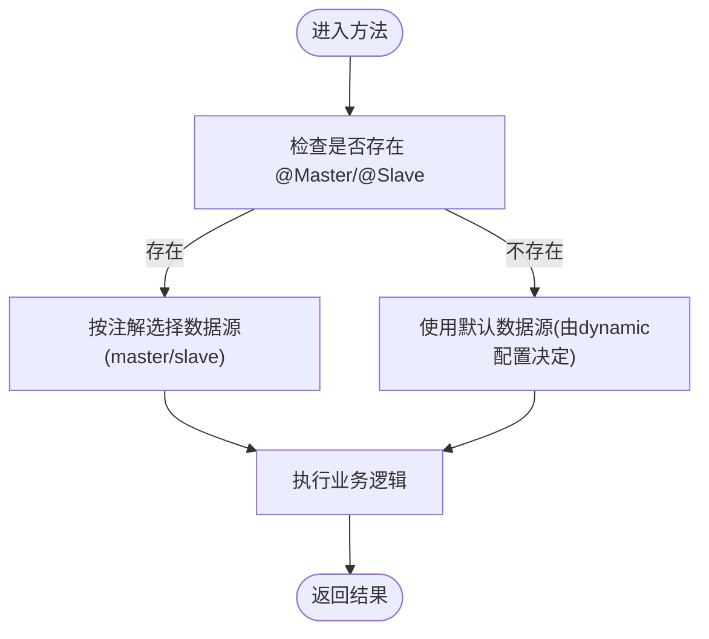
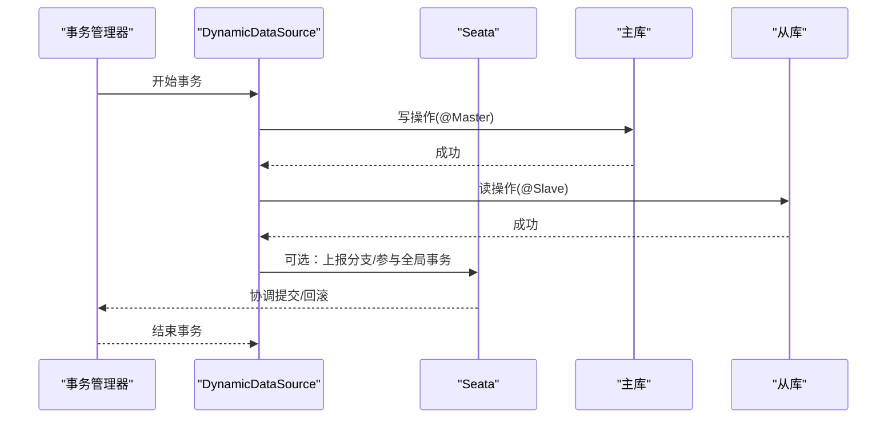
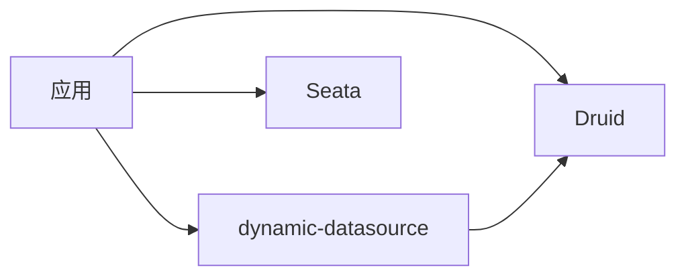

# 多数据源组件

<cite>
**本文引用的文件**   
- [Master.java](file://ruoyi-common/ruoyi-common-datasource/src/main/java/com/ruoyi/common/datasource/annotation/Master.java)
- [Slave.java](file://ruoyi-common/ruoyi-common-datasource/src/main/java/com/ruoyi/common/datasource/annotation/Slave.java)
- [pom.xml（ruoyi-common-datasource）](file://ruoyi-common/ruoyi-common-datasource/pom.xml)
- [ry_config_20220424.sql](file://sql/ry_config_20220424.sql)
- [bootstrap.yml（ruoyi-system）](file://ruoyi-modules/ruoyi-system/src/main/resources/bootstrap.yml)
</cite>

## 目录
1. [简介](#简介)
2. [项目结构](#项目结构)
3. [核心组件](#核心组件)
4. [架构总览](#架构总览)
5. [详细组件分析](#详细组件分析)
6. [依赖关系分析](#依赖关系分析)
7. [性能考虑](#性能考虑)
8. [故障排查指南](#故障排查指南)
9. [结论](#结论)
10. [附录：配置示例与最佳实践](#附录配置示例与最佳实践)

## 简介
本模块提供基于注解的多数据源能力，支持主从读写分离、动态数据源切换与分布式事务集成。通过自定义注解 @Master 与 @Slave，结合第三方动态数据源框架，实现方法级或类级的数据源路由；同时集成 Seata，为跨库操作提供分布式事务保障。

## 项目结构
多数据源相关代码集中在公共模块 ruoyi-common-datasource 中，主要包含：
- 注解定义：@Master、@Slave
- 依赖管理：引入 Druid、dynamic-datasource-spring-boot-starter、Seata
- 运行时由业务模块（如 ruoyi-system）通过 Nacos 配置中心加载 dynamic 数据源配置

图表来源
- [Master.java:1-22](file://ruoyi-common/ruoyi-common-datasource/src/main/java/com/ruoyi/common/datasource/annotation/Master.java#L1-L22)
- [Slave.java:1-22](file://ruoyi-common/ruoyi-common-datasource/src/main/java/com/ruoyi/common/datasource/annotation/Slave.java#L1-L22)
- [pom.xml（ruoyi-common-datasource）:18-40](file://ruoyi-common/ruoyi-common-datasource/pom.xml#L18-L40)
- [bootstrap.yml（ruoyi-system）:1-26](file://ruoyi-modules/ruoyi-system/src/main/resources/bootstrap.yml#L1-L26)

章节来源
- [Master.java:1-22](file://ruoyi-common/ruoyi-common-datasource/src/main/java/com/ruoyi/common/datasource/annotation/Master.java#L1-L22)
- [Slave.java:1-22](file://ruoyi-common/ruoyi-common-datasource/src/main/java/com/ruoyi/common/datasource/annotation/Slave.java#L1-L22)
- [pom.xml（ruoyi-common-datasource）:18-40](file://ruoyi-common/ruoyi-common-datasource/pom.xml#L18-L40)
- [bootstrap.yml（ruoyi-system）:1-26](file://ruoyi-modules/ruoyi-system/src/main/resources/bootstrap.yml#L1-L26)

## 核心组件
- 注解 @Master：标注在类或方法上，表示该作用域使用“master”数据源（写库）。
- 注解 @Slave：标注在类或方法上，表示该作用域使用“slave”数据源（读库）。
- 动态数据源：基于 dynamic-datasource-spring-boot-starter，根据注解自动切换数据源。
- 连接池：Druid，提供连接池监控与统计。
- 分布式事务：Seata，支持跨数据源事务一致性。

章节来源
- [Master.java:1-22](file://ruoyi-common/ruoyi-common-datasource/src/main/java/com/ruoyi/common/datasource/annotation/Master.java#L1-L22)
- [Slave.java:1-22](file://ruoyi-common/ruoyi-common-datasource/src/main/java/com/ruoyi/common/datasource/annotation/Slave.java#L1-L22)
- [pom.xml（ruoyi-common-datasource）:18-40](file://ruoyi-common/ruoyi-common-datasource/pom.xml#L18-L40)

## 架构总览
下图展示了从业务调用到数据源选择的整体流程：注解驱动 + 动态数据源框架完成路由，Druid 负责连接池，Seata 可选开启以支持分布式事务。

图表来源
- [Master.java:1-22](file://ruoyi-common/ruoyi-common-datasource/src/main/java/com/ruoyi/common/datasource/annotation/Master.java#L1-L22)
- [Slave.java:1-22](file://ruoyi-common/ruoyi-common-datasource/src/main/java/com/ruoyi/common/datasource/annotation/Slave.java#L1-L22)
- [pom.xml（ruoyi-common-datasource）:18-40](file://ruoyi-common/ruoyi-common-datasource/pom.xml#L18-L40)

## 详细组件分析

### 注解 @Master 与 @Slave
- 目标位置：类与方法
- 生命周期：运行时可见
- 行为：内部委托给 dynamic-datasource 的 @DS 注解，分别绑定数据源名称 “master” 与 “slave”

图表来源
- [Master.java:1-22](file://ruoyi-common/ruoyi-common-datasource/src/main/java/com/ruoyi/common/datasource/annotation/Master.java#L1-L22)
- [Slave.java:1-22](file://ruoyi-common/ruoyi-common-datasource/src/main/java/com/ruoyi/common/datasource/annotation/Slave.java#L1-L22)

章节来源
- [Master.java:1-22](file://ruoyi-common/ruoyi-common-datasource/src/main/java/com/ruoyi/common/datasource/annotation/Master.java#L1-L22)
- [Slave.java:1-22](file://ruoyi-common/ruoyi-common-datasource/src/main/java/com/ruoyi/common/datasource/annotation/Slave.java#L1-L22)

### 动态数据源切换与路由策略
- 路由触发点：方法或类上的 @Master/@Slave 注解
- 路由键：注解内嵌的 DS 值，即 “master” 或 “slave”
- 默认行为：未标注时采用 dynamic-datasource 的默认数据源（需结合实际配置）
- 优先级：方法级注解优先于类级注解

图表来源
- [Master.java:1-22](file://ruoyi-common/ruoyi-common-datasource/src/main/java/com/ruoyi/common/datasource/annotation/Master.java#L1-L22)
- [Slave.java:1-22](file://ruoyi-common/ruoyi-common-datasource/src/main/java/com/ruoyi/common/datasource/annotation/Slave.java#L1-L22)

章节来源
- [Master.java:1-22](file://ruoyi-common/ruoyi-common-datasource/src/main/java/com/ruoyi/common/datasource/annotation/Master.java#L1-L22)
- [Slave.java:1-22](file://ruoyi-common/ruoyi-common-datasource/src/main/java/com/ruoyi/common/datasource/annotation/Slave.java#L1-L22)

### 事务管理与分布式事务
- 本地事务：Spring 声明式事务与动态数据源可协同工作，但需注意在同一事务内避免随意切换数据源导致不一致。
- 分布式事务：集成 Seata，可通过配置开关控制是否启用代理；当需要跨库事务时，建议统一在主库进行写操作，并通过注解将读操作路由至从库。

图表来源
- [pom.xml（ruoyi-common-datasource）:34-40](file://ruoyi-common/ruoyi-common-datasource/pom.xml#L34-L40)
- [ry_config_20220424.sql:39-80](file://sql/ry_config_20220424.sql#L39-L80)

章节来源
- [pom.xml（ruoyi-common-datasource）:34-40](file://ruoyi-common/ruoyi-common-datasource/pom.xml#L34-L40)
- [ry_config_20220424.sql:39-80](file://sql/ry_config_20220424.sql#L39-L80)

## 依赖关系分析
- Druid：连接池与监控
- dynamic-datasource-spring-boot-starter：动态数据源与注解路由
- spring-cloud-starter-alibaba-seata：分布式事务

图表来源
- [pom.xml（ruoyi-common-datasource）:18-40](file://ruoyi-common/ruoyi-common-datasource/pom.xml#L18-L40)

章节来源
- [pom.xml（ruoyi-common-datasource）:18-40](file://ruoyi-common/ruoyi-common-datasource/pom.xml#L18-L40)

## 性能考虑
- 连接池参数调优：合理设置初始大小、最大连接数、空闲回收等参数，避免连接泄漏与频繁创建销毁。
- 慢查询与监控：开启 Druid 统计与慢 SQL 阈值，定位热点 SQL。
- 读写分离收益：将只读查询路由到从库，降低主库压力；注意主从延迟对一致性的影响。
- 事务边界：尽量缩小事务范围，避免长事务占用连接；跨库写操作应谨慎设计。
- 缓存配合：对高频读场景引入缓存，减少数据库访问。

[本节为通用指导，不直接分析具体文件]

## 故障排查指南
- 数据源未生效
  - 检查是否正确添加 @Master/@Slave 注解
  - 确认 dynamic 数据源配置已加载（Nacos 配置项）
- 路由错误
  - 检查注解是否误加在类或方法上
  - 核对数据源名称是否与配置一致（master/slave）
- 事务异常
  - 检查是否在同一事务中混用不同数据源
  - 若启用 Seata，确认 Seata 配置与服务分组映射正确
- 连接池问题
  - 观察 Druid 监控页面，检查连接数、等待时间、慢 SQL
  - 调整连接池参数与超时配置

章节来源
- [Master.java:1-22](file://ruoyi-common/ruoyi-common-datasource/src/main/java/com/ruoyi/common/datasource/annotation/Master.java#L1-L22)
- [Slave.java:1-22](file://ruoyi-common/ruoyi-common-datasource/src/main/java/com/ruoyi/common/datasource/annotation/Slave.java#L1-L22)
- [ry_config_20220424.sql:39-80](file://sql/ry_config_20220424.sql#L39-L80)

## 结论
本模块通过轻量注解与成熟的动态数据源框架，实现了主从读写分离与动态数据源切换，并在必要时借助 Seata 提供分布式事务能力。配合 Druid 的连接池与监控能力，可满足大多数企业级应用的读写分离与高可用需求。

[本节为总结性内容，不直接分析具体文件]

## 附录：配置示例与最佳实践

### 数据源配置要点（来自配置中心示例）
- dynamic.datasource.master：主库连接信息
- dynamic.datasource.slave：从库连接信息（按需启用）
- dynamic.druid.*：连接池参数（初始大小、最大连接数、验证查询等）
- seata.enabled：是否启用 Seata 代理（默认关闭）

章节来源
- [ry_config_20220424.sql:39-80](file://sql/ry_config_20220424.sql#L39-L80)

### 使用建议
- 明确读写边界：写操作一律走 @Master，读操作使用 @Slave
- 类级与注解组合：对仅读 Service 类使用 @Slave，提升可读性与维护性
- 事务内谨慎切换：尽量避免在同一个事务中切换数据源
- 监控与告警：开启 Druid 监控，关注慢 SQL 与连接池指标
- 灰度与回滚：新增从库时先接入读流量，逐步放量

[本节为通用指导，不直接分析具体文件]