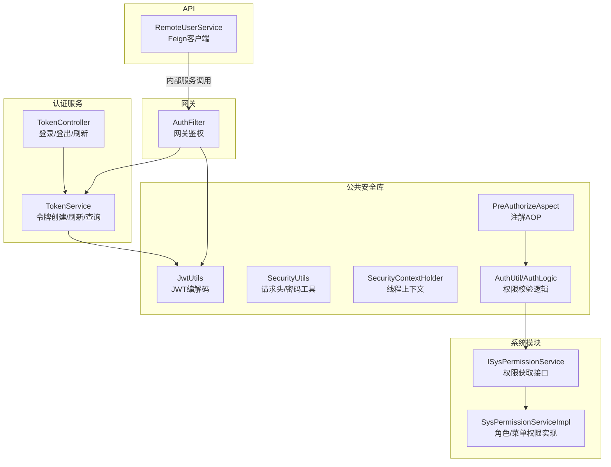
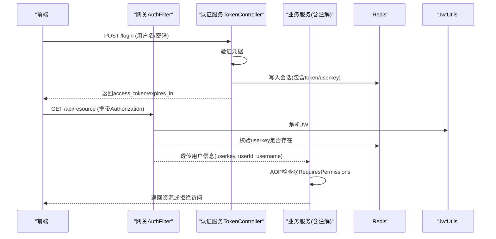
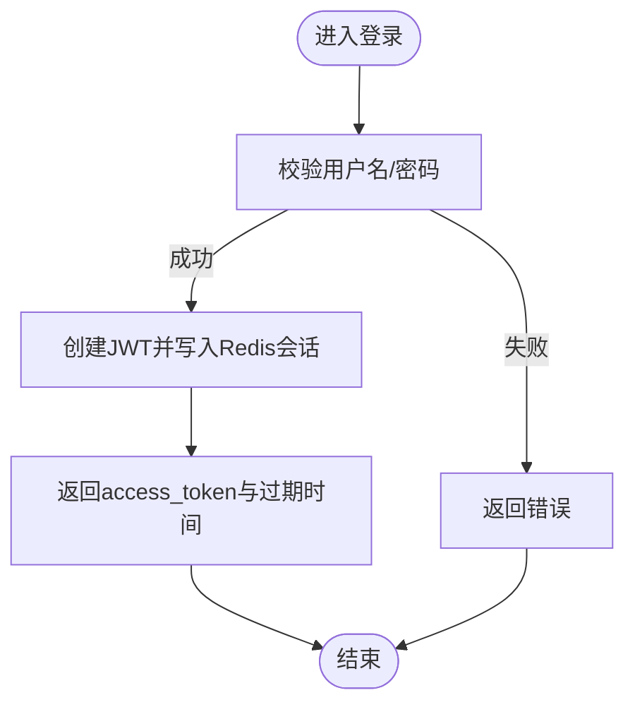
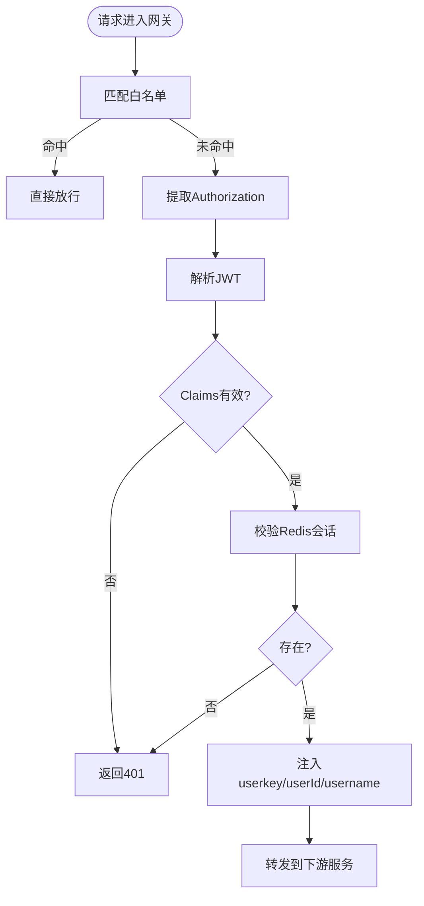
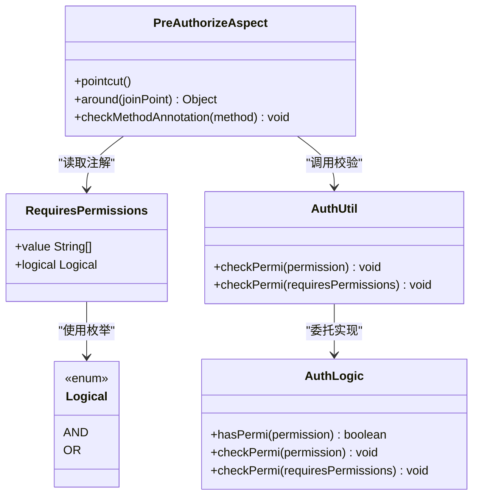
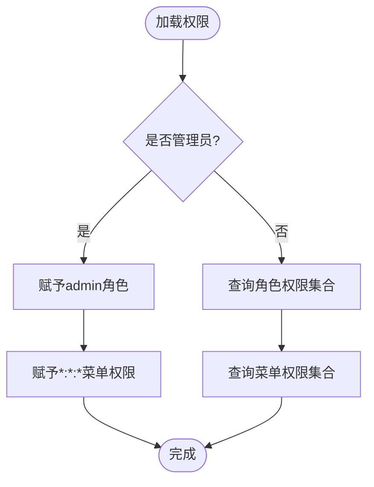
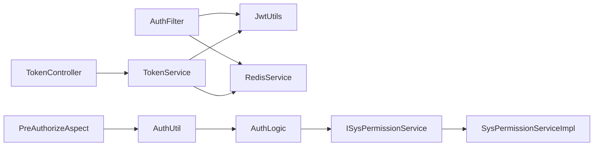

# 安全组件

<cite>
**本文引用的文件**   
- [TokenController.java](file://ruoyi-auth/src/main/java/com/ruoyi/auth/controller/TokenController.java)
- [AuthFilter.java](file://ruoyi-gateway/src/main/java/com/ruoyi/gateway/filter/AuthFilter.java)
- [JwtUtils.java](file://ruoyi-common/ruoyi-common-core/src/main/java/com/ruoyi/common/core/utils/JwtUtils.java)
- [TokenService.java](file://ruoyi-common/ruoyi-common-security/src/main/java/com/ruoyi/common/security/service/TokenService.java)
- [SecurityUtils.java](file://ruoyi-common/ruoyi-common-security/src/main/java/com/ruoyi/common/security/utils/SecurityUtils.java)
- [PreAuthorizeAspect.java](file://ruoyi-common/ruoyi-common-security/src/main/java/com/ruoyi/common/security/aspect/PreAuthorizeAspect.java)
- [RequiresPermissions.java](file://ruoyi-common/ruoyi-common-security/src/main/java/com/ruoyi/common/security/annotation/RequiresPermissions.java)
- [Logical.java](file://ruoyi-common/ruoyi-common-security/src/main/java/com/ruoyi/common/security/annotation/Logical.java)
- [AuthUtil.java](file://ruoyi-common/ruoyi-common-security/src/main/java/com/ruoyi/common/security/auth/AuthUtil.java)
- [AuthLogic.java](file://ruoyi-common/ruoyi-common-security/src/main/java/com/ruoyi/common/security/auth/AuthLogic.java)
- [ISysPermissionService.java](file://ruoyi-modules/ruoyi-system/src/main/java/com/ruoyi/system/service/ISysPermissionService.java)
- [SysPermissionServiceImpl.java](file://ruoyi-modules/ruoyi-system/src/main/java/com/ruoyi/system/service/impl/SysPermissionServiceImpl.java)
- [SecurityContextHolder.java](file://ruoyi-common/ruoyi-common-core/src/main/java/com/ruoyi/common/core/context/SecurityContextHolder.java)
- [EnableRyFeignClients.java](file://ruoyi-common/ruoyi-common-security/src/main/java/com/ruoyi/common/security/annotation/EnableRyFeignClients.java)
- [RemoteUserService.java](file://ruoyi-api/ruoyi-api-system/src/main/java/com/ruoyi/system/api/RemoteUserService.java)
- [DataSourceController.java](file://ruoyi-modules/ruoyi-dqservice/src/main/java/com/ruoyi/dqservice/controller/DataSourceController.java)
</cite>

## 目录
1. [简介](#简介)
2. [项目结构](#项目结构)
3. [核心组件](#核心组件)
4. [架构总览](#架构总览)
5. [详细组件分析](#详细组件分析)
6. [依赖关系分析](#依赖关系分析)
7. [性能与可扩展性](#性能与可扩展性)
8. [故障排查指南](#故障排查指南)
9. [结论](#结论)

## 简介
本章节面向“安全组件”的完整实现，覆盖认证授权机制、JWT令牌管理、权限注解使用、角色权限控制、内部服务认证、安全拦截器、全局异常处理、Feign客户端安全配置等。文档以代码级视角解析关键流程，并提供可视化图示与排错建议，帮助读者快速理解并落地安全能力。

## 项目结构
安全相关能力分布在以下模块：
- 网关层：统一鉴权、白名单放行、用户信息透传
- 认证服务：登录/注册/登出/刷新令牌
- 公共安全库：令牌服务、权限校验、上下文工具、注解与AOP切面
- 业务模块：通过注解进行方法级权限控制
- API定义：Feign客户端接口（用于内部服务调用）

图表来源
- [AuthFilter.java:42-84](file://ruoyi-gateway/src/main/java/com/ruoyi/gateway/filter/AuthFilter.java#L42-L84)
- [TokenController.java:34-41](file://ruoyi-auth/src/main/java/com/ruoyi/auth/controller/TokenController.java#L34-L41)
- [TokenService.java:44-66](file://ruoyi-common/ruoyi-common-security/src/main/java/com/ruoyi/common/security/service/TokenService.java#L44-L66)
- [JwtUtils.java:26-40](file://ruoyi-common/ruoyi-common-core/src/main/java/com/ruoyi/common/core/utils/JwtUtils.java#L26-L40)
- [PreAuthorizeAspect.java:53-96](file://ruoyi-common/ruoyi-common-security/src/main/java/com/ruoyi/common/security/aspect/PreAuthorizeAspect.java#L53-L96)
- [AuthUtil.java:118-140](file://ruoyi-common/ruoyi-common-security/src/main/java/com/ruoyi/common/security/auth/AuthUtil.java#L118-L140)
- [ISysPermissionService.java:5-22](file://ruoyi-modules/ruoyi-system/src/main/java/com/ruoyi/system/service/ISysPermissionService.java#L5-L22)
- [SysPermissionServiceImpl.java:27-63](file://ruoyi-modules/ruoyi-system/src/main/java/com/ruoyi/system/service/impl/SysPermissionServiceImpl.java#L27-L63)
- [RemoteUserService.java:1-21](file://ruoyi-api/ruoyi-api-system/src/main/java/com/ruoyi/system/api/RemoteUserService.java#L1-L21)

章节来源
- [AuthFilter.java:42-84](file://ruoyi-gateway/src/main/java/com/ruoyi/gateway/filter/AuthFilter.java#L42-L84)
- [TokenController.java:34-41](file://ruoyi-auth/src/main/java/com/ruoyi/auth/controller/TokenController.java#L34-L41)
- [TokenService.java:44-66](file://ruoyi-common/ruoyi-common-security/src/main/java/com/ruoyi/common/security/service/TokenService.java#L44-L66)
- [JwtUtils.java:26-40](file://ruoyi-common/ruoyi-common-core/src/main/java/com/ruoyi/common/core/utils/JwtUtils.java#L26-L40)
- [PreAuthorizeAspect.java:53-96](file://ruoyi-common/ruoyi-common-security/src/main/java/com/ruoyi/common/security/aspect/PreAuthorizeAspect.java#L53-L96)
- [AuthUtil.java:118-140](file://ruoyi-common/ruoyi-common-security/src/main/java/com/ruoyi/common/security/auth/AuthUtil.java#L118-L140)
- [ISysPermissionService.java:5-22](file://ruoyi-modules/ruoyi-system/src/main/java/com/ruoyi/system/service/ISysPermissionService.java#L5-L22)
- [SysPermissionServiceImpl.java:27-63](file://ruoyi-modules/ruoyi-system/src/main/java/com/ruoyi/system/service/impl/SysPermissionServiceImpl.java#L27-L63)
- [RemoteUserService.java:1-21](file://ruoyi-api/ruoyi-api-system/src/main/java/com/ruoyi/system/api/RemoteUserService.java#L1-L21)

## 核心组件
- 网关鉴权过滤器：统一校验JWT、校验Redis会话、透传用户信息到下游服务
- 认证控制器与服务：负责登录、注册、登出、刷新令牌，生成JWT并维护Redis会话
- JWT工具类：基于HS512算法签发与解析令牌
- 令牌服务：封装令牌创建、刷新、过期校验、Redis缓存键管理
- 权限注解与AOP：@RequiresPermissions/@RequiresRoles/@RequiresLogin，通过AOP执行权限校验
- 权限校验逻辑：从当前用户上下文中读取角色/权限集合，支持AND/OR模式
- 权限数据服务：根据用户ID获取角色权限与菜单权限
- 安全上下文：基于TransmittableThreadLocal存储用户ID、用户名、UserKey等
- Feign客户端与安全：自定义@EnableRyFeignClients启用Feign；内部服务调用需携带安全头

章节来源
- [AuthFilter.java:42-84](file://ruoyi-gateway/src/main/java/com/ruoyi/gateway/filter/AuthFilter.java#L42-L84)
- [TokenController.java:34-77](file://ruoyi-auth/src/main/java/com/ruoyi/auth/controller/TokenController.java#L34-L77)
- [JwtUtils.java:26-40](file://ruoyi-common/ruoyi-common-core/src/main/java/com/ruoyi/common/core/utils/JwtUtils.java#L26-L40)
- [TokenService.java:44-163](file://ruoyi-common/ruoyi-common-security/src/main/java/com/ruoyi/common/security/service/TokenService.java#L44-L163)
- [PreAuthorizeAspect.java:53-96](file://ruoyi-common/ruoyi-common-security/src/main/java/com/ruoyi/common/security/aspect/PreAuthorizeAspect.java#L53-L96)
- [AuthUtil.java:118-140](file://ruoyi-common/ruoyi-common-security/src/main/java/com/ruoyi/common/security/auth/AuthUtil.java#L118-L140)
- [AuthLogic.java:105-145](file://ruoyi-common/ruoyi-common-security/src/main/java/com/ruoyi/common/security/auth/AuthLogic.java#L105-L145)
- [ISysPermissionService.java:5-22](file://ruoyi-modules/ruoyi-system/src/main/java/com/ruoyi/system/service/ISysPermissionService.java#L5-L22)
- [SysPermissionServiceImpl.java:27-63](file://ruoyi-modules/ruoyi-system/src/main/java/com/ruoyi/system/service/impl/SysPermissionServiceImpl.java#L27-L63)
- [SecurityContextHolder.java:18-87](file://ruoyi-common/ruoyi-common-core/src/main/java/com/ruoyi/common/core/context/SecurityContextHolder.java#L18-L87)
- [EnableRyFeignClients.java:12-27](file://ruoyi-common/ruoyi-common-security/src/main/java/com/ruoyi/common/security/annotation/EnableRyFeignClients.java#L12-L27)

## 架构总览
下图展示一次受保护接口的端到端调用链：前端携带令牌访问网关，网关校验JWT与Redis会话，通过后注入用户信息至请求头，再转发到具体业务服务；业务服务通过注解进行方法级权限校验。

图表来源
- [TokenController.java:34-41](file://ruoyi-auth/src/main/java/com/ruoyi/auth/controller/TokenController.java#L34-L41)
- [TokenService.java:44-66](file://ruoyi-common/ruoyi-common-security/src/main/java/com/ruoyi/common/security/service/TokenService.java#L44-L66)
- [AuthFilter.java:42-84](file://ruoyi-gateway/src/main/java/com/ruoyi/gateway/filter/AuthFilter.java#L42-L84)
- [JwtUtils.java:26-40](file://ruoyi-common/ruoyi-common-core/src/main/java/com/ruoyi/common/core/utils/JwtUtils.java#L26-L40)
- [PreAuthorizeAspect.java:53-96](file://ruoyi-common/ruoyi-common-security/src/main/java/com/ruoyi/common/security/aspect/PreAuthorizeAspect.java#L53-L96)

## 详细组件分析

### 认证与令牌管理（登录/登出/刷新）
- 登录流程：控制器接收用户名/密码，调用登录服务，成功后通过令牌服务创建JWT并返回
- 登出流程：从请求中取令牌，删除Redis会话，记录退出日志
- 刷新流程：根据请求中的令牌获取登录用户，刷新Redis会话有效期

图表来源
- [TokenController.java:34-41](file://ruoyi-auth/src/main/java/com/ruoyi/auth/controller/TokenController.java#L34-L41)
- [TokenService.java:44-66](file://ruoyi-common/ruoyi-common-security/src/main/java/com/ruoyi/common/security/service/TokenService.java#L44-L66)

章节来源
- [TokenController.java:34-77](file://ruoyi-auth/src/main/java/com/ruoyi/auth/controller/TokenController.java#L34-L77)
- [TokenService.java:44-163](file://ruoyi-common/ruoyi-common-security/src/main/java/com/ruoyi/common/security/service/TokenService.java#L44-L163)

### 网关鉴权与安全头透传
- 白名单匹配：跳过无需鉴权的URL
- 令牌解析：从请求头提取Authorization，去除前缀后解析JWT
- Redis校验：根据userkey判断是否已登录
- 头注入：将userkey、userId、username注入下游请求头，并清理内部来源标记

图表来源
- [AuthFilter.java:42-84](file://ruoyi-gateway/src/main/java/com/ruoyi/gateway/filter/AuthFilter.java#L42-L84)
- [JwtUtils.java:26-40](file://ruoyi-common/ruoyi-common-core/src/main/java/com/ruoyi/common/core/utils/JwtUtils.java#L26-L40)

章节来源
- [AuthFilter.java:42-84](file://ruoyi-gateway/src/main/java/com/ruoyi/gateway/filter/AuthFilter.java#L42-L84)

### 权限注解与AOP校验
- 注解定义：@RequiresPermissions(value, logical)，logical支持AND/OR
- AOP切面：拦截带有@RequiresLogin/@RequiresRoles/@RequiresPermissions的方法，依次执行校验
- 校验逻辑：从当前用户上下文获取权限集合，按逻辑模式判定是否允许访问

图表来源
- [PreAuthorizeAspect.java:53-96](file://ruoyi-common/ruoyi-common-security/src/main/java/com/ruoyi/common/security/aspect/PreAuthorizeAspect.java#L53-L96)
- [RequiresPermissions.java:14-27](file://ruoyi-common/ruoyi-common-security/src/main/java/com/ruoyi/common/security/annotation/RequiresPermissions.java#L14-L27)
- [Logical.java:9-20](file://ruoyi-common/ruoyi-common-security/src/main/java/com/ruoyi/common/security/annotation/Logical.java#L9-L20)
- [AuthUtil.java:118-140](file://ruoyi-common/ruoyi-common-security/src/main/java/com/ruoyi/common/security/auth/AuthUtil.java#L118-L140)
- [AuthLogic.java:105-145](file://ruoyi-common/ruoyi-common-security/src/main/java/com/ruoyi/common/security/auth/AuthLogic.java#L105-L145)

章节来源
- [PreAuthorizeAspect.java:53-96](file://ruoyi-common/ruoyi-common-security/src/main/java/com/ruoyi/common/security/aspect/PreAuthorizeAspect.java#L53-L96)
- [RequiresPermissions.java:14-27](file://ruoyi-common/ruoyi-common-security/src/main/java/com/ruoyi/common/security/annotation/RequiresPermissions.java#L14-L27)
- [Logical.java:9-20](file://ruoyi-common/ruoyi-common-security/src/main/java/com/ruoyi/common/security/annotation/Logical.java#L9-L20)
- [AuthUtil.java:118-140](file://ruoyi-common/ruoyi-common-security/src/main/java/com/ruoyi/common/security/auth/AuthUtil.java#L118-L140)
- [AuthLogic.java:105-145](file://ruoyi-common/ruoyi-common-security/src/main/java/com/ruoyi/common/security/auth/AuthLogic.java#L105-L145)

### 角色与菜单权限数据加载
- 角色权限：管理员拥有所有权限，否则从角色服务获取
- 菜单权限：管理员拥有通配符权限，否则从菜单服务获取
- 接口抽象：提供获取角色权限与菜单权限的统一入口

图表来源
- [SysPermissionServiceImpl.java:27-63](file://ruoyi-modules/ruoyi-system/src/main/java/com/ruoyi/system/service/impl/SysPermissionServiceImpl.java#L27-L63)
- [ISysPermissionService.java:5-22](file://ruoyi-modules/ruoyi-system/src/main/java/com/ruoyi/system/service/ISysPermissionService.java#L5-L22)

章节来源
- [SysPermissionServiceImpl.java:27-63](file://ruoyi-modules/ruoyi-system/src/main/java/com/ruoyi/system/service/impl/SysPermissionServiceImpl.java#L27-L63)
- [ISysPermissionService.java:5-22](file://ruoyi-modules/ruoyi-system/src/main/java/com/ruoyi/system/service/ISysPermissionService.java#L5-L22)

### 安全上下文与工具类
- SecurityContextHolder：基于TransmittableThreadLocal保存userId、userName、userKey等
- SecurityUtils：提供从请求头获取token、密码加密与比对、管理员判断等工具方法

章节来源
- [SecurityContextHolder.java:18-87](file://ruoyi-common/ruoyi-common-core/src/main/java/com/ruoyi/common/core/context/SecurityContextHolder.java#L18-L87)
- [SecurityUtils.java:54-80](file://ruoyi-common/ruoyi-common-security/src/main/java/com/ruoyi/common/security/utils/SecurityUtils.java#L54-L80)
- [SecurityUtils.java:99-116](file://ruoyi-common/ruoyi-common-security/src/main/java/com/ruoyi/common/security/utils/SecurityUtils.java#L99-L116)

### Feign客户端与安全配置
- 自定义注解@EnableRyFeignClients：简化Feign客户端扫描路径配置
- RemoteUserService：声明式远程调用接口，配合fallbackFactory实现容错
- 内部服务认证：由网关统一鉴权，下游服务通过SecurityContextHolder获取用户信息

章节来源
- [EnableRyFeignClients.java:12-27](file://ruoyi-common/ruoyi-common-security/src/main/java/com/ruoyi/common/security/annotation/EnableRyFeignClients.java#L12-L27)
- [RemoteUserService.java:1-21](file://ruoyi-api/ruoyi-api-system/src/main/java/com/ruoyi/system/api/RemoteUserService.java#L1-L21)
- [SecurityContextHolder.java:18-87](file://ruoyi-common/ruoyi-common-core/src/main/java/com/ruoyi/common/core/context/SecurityContextHolder.java#L18-L87)

### 权限控制示例与最佳实践
- 在控制器方法上使用@RequiresPermissions指定权限码，如“dqservice:dataSource:list”
- 复杂场景可使用Logical.OR组合多个权限码，满足“任一即可”的场景
- 对敏感操作建议使用@RequiresRoles限制角色范围

章节来源
- [DataSourceController.java:41-98](file://ruoyi-modules/ruoyi-dqservice/src/main/java/com/ruoyi/dqservice/controller/DataSourceController.java#L41-L98)
- [RequiresPermissions.java:14-27](file://ruoyi-common/ruoyi-common-security/src/main/java/com/ruoyi/common/security/annotation/RequiresPermissions.java#L14-L27)

## 依赖关系分析
- 网关AuthFilter依赖JwtUtils解析令牌，依赖RedisService校验会话，依赖常量定义安全头字段
- 认证TokenController依赖TokenService生成JWT，依赖SysLoginService完成业务登录
- TokenService依赖JwtUtils生成JWT，依赖RedisService维护会话
- AOP PreAuthorizeAspect依赖AuthUtil/AuthLogic执行权限校验
- 权限数据由ISysPermissionService与SysPermissionServiceImpl提供

图表来源
- [AuthFilter.java:42-84](file://ruoyi-gateway/src/main/java/com/ruoyi/gateway/filter/AuthFilter.java#L42-L84)
- [TokenController.java:34-41](file://ruoyi-auth/src/main/java/com/ruoyi/auth/controller/TokenController.java#L34-L41)
- [TokenService.java:44-66](file://ruoyi-common/ruoyi-common-security/src/main/java/com/ruoyi/common/security/service/TokenService.java#L44-L66)
- [PreAuthorizeAspect.java:53-96](file://ruoyi-common/ruoyi-common-security/src/main/java/com/ruoyi/common/security/aspect/PreAuthorizeAspect.java#L53-L96)
- [AuthUtil.java:118-140](file://ruoyi-common/ruoyi-common-security/src/main/java/com/ruoyi/common/security/auth/AuthUtil.java#L118-L140)
- [ISysPermissionService.java:5-22](file://ruoyi-modules/ruoyi-system/src/main/java/com/ruoyi/system/service/ISysPermissionService.java#L5-L22)
- [SysPermissionServiceImpl.java:27-63](file://ruoyi-modules/ruoyi-system/src/main/java/com/ruoyi/system/service/impl/SysPermissionServiceImpl.java#L27-L63)

章节来源
- [AuthFilter.java:42-84](file://ruoyi-gateway/src/main/java/com/ruoyi/gateway/filter/AuthFilter.java#L42-L84)
- [TokenController.java:34-41](file://ruoyi-auth/src/main/java/com/ruoyi/auth/controller/TokenController.java#L34-L41)
- [TokenService.java:44-66](file://ruoyi-common/ruoyi-common-security/src/main/java/com/ruoyi/common/security/service/TokenService.java#L44-L66)
- [PreAuthorizeAspect.java:53-96](file://ruoyi-common/ruoyi-common-security/src/main/java/com/ruoyi/common/security/aspect/PreAuthorizeAspect.java#L53-L96)
- [AuthUtil.java:118-140](file://ruoyi-common/ruoyi-common-security/src/main/java/com/ruoyi/common/security/auth/AuthUtil.java#L118-L140)
- [ISysPermissionService.java:5-22](file://ruoyi-modules/ruoyi-system/src/main/java/com/ruoyi/system/service/ISysPermissionService.java#L5-L22)
- [SysPermissionServiceImpl.java:27-63](file://ruoyi-modules/ruoyi-system/src/main/java/com/ruoyi/system/service/impl/SysPermissionServiceImpl.java#L27-L63)

## 性能与可扩展性
- JWT无状态校验：网关侧仅做轻量解析，避免频繁数据库查询
- Redis会话缓存：集中管理登录态，支持分布式环境下的会话一致性
- AOP权限校验：方法级细粒度控制，扩展性强，可结合缓存优化权限集合获取
- 建议：
  - 对高频权限校验可缓存用户权限集合，降低重复计算
  - 合理设置JWT过期时间与自动刷新策略，平衡安全性与用户体验
  - 网关白名单最小化，减少安全风险面

[本节为通用指导，不直接分析具体文件]

## 故障排查指南
- 令牌为空或无效：检查前端是否正确传递Authorization头，确认网关是否被加入白名单
- 登录状态已过期：检查Redis中对应userkey是否存在，确认TokenService刷新逻辑是否生效
- 权限不足：确认用户是否具备对应权限码，检查@RequiresPermissions注解配置是否正确
- 内部服务调用失败：确保网关已注入用户信息头，下游服务能从SecurityContextHolder获取用户信息

章节来源
- [AuthFilter.java:102-106](file://ruoyi-gateway/src/main/java/com/ruoyi/gateway/filter/AuthFilter.java#L102-L106)
- [TokenService.java:141-163](file://ruoyi-common/ruoyi-common-security/src/main/java/com/ruoyi/common/security/service/TokenService.java#L141-L163)
- [PreAuthorizeAspect.java:74-96](file://ruoyi-common/ruoyi-common-security/src/main/java/com/ruoyi/common/security/aspect/PreAuthorizeAspect.java#L74-L96)
- [SecurityContextHolder.java:54-87](file://ruoyi-common/ruoyi-common-core/src/main/java/com/ruoyi/common/core/context/SecurityContextHolder.java#L54-L87)

## 结论
本项目通过网关统一鉴权、JWT无状态令牌、Redis会话管理与AOP方法级权限控制，构建了完整的安全体系。配合统一的权限数据服务与上下文工具，既保证了安全性，也具备良好的可扩展性与可维护性。建议在业务开发中严格遵循权限注解规范，并结合缓存与监控提升整体性能与可观测性。