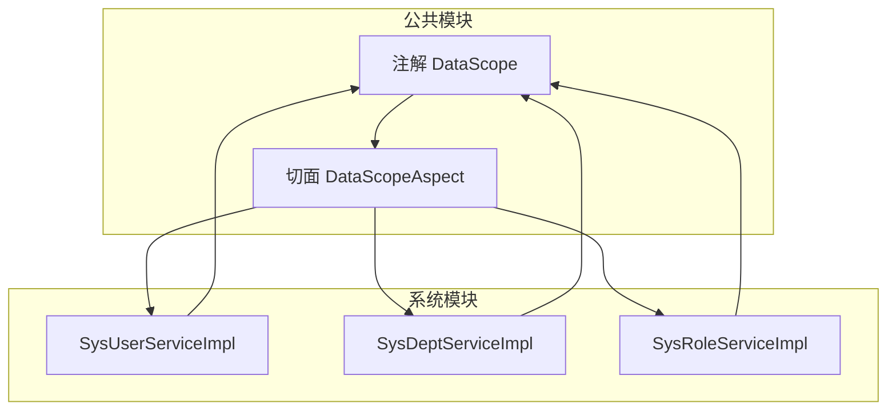
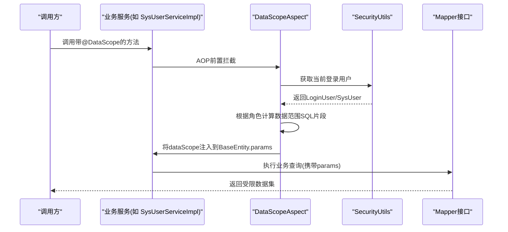
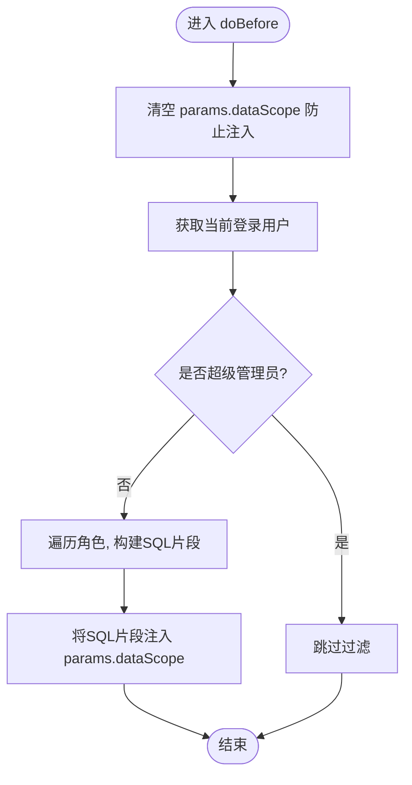
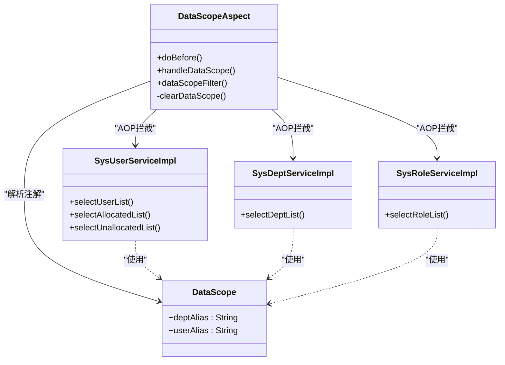

# 数据权限组件

<cite>
**本文引用的文件**   
- [DataScope.java](file://ruoyi-common/ruoyi-common-datascope/src/main/java/com/ruoyi/common/datascope/annotation/DataScope.java)
- [DataScopeAspect.java](file://ruoyi-common/ruoyi-common-datascope/src/main/java/com/ruoyi/common/datascope/aspect/DataScopeAspect.java)
- [SysUserServiceImpl.java](file://ruoyi-modules/ruoyi-system/src/main/java/com/ruoyi/system/service/impl/SysUserServiceImpl.java)
- [SysDeptServiceImpl.java](file://ruoyi-modules/ruoyi-system/src/main/java/com/ruoyi/system/service/impl/SysDeptServiceImpl.java)
- [SysRoleServiceImpl.java](file://ruoyi-modules/ruoyi-system/src/main/java/com/ruoyi/system/service/impl/SysRoleServiceImpl.java)
</cite>

## 目录
1. [简介](#简介)
2. [项目结构](#项目结构)
3. [核心组件](#核心组件)
4. [架构总览](#架构总览)
5. [详细组件分析](#详细组件分析)
6. [依赖关系分析](#依赖关系分析)
7. [性能与扩展性](#性能与扩展性)
8. [故障排查指南](#故障排查指南)
9. [结论](#结论)
10. [附录：配置与最佳实践](#附录配置与最佳实践)

## 简介
本章节面向“数据权限组件”，系统性说明其设计目标、适用范围与核心价值。该组件通过注解+AOP的方式，在业务方法执行前自动注入基于角色与部门的数据范围条件，从而实现对查询结果集的行级访问控制。典型能力包括：
- 基于角色的数据范围（全部、自定义、本部门、本部门及以下、仅本人）
- 自动拼接SQL过滤条件并注入到分页参数中
- 支持传入表别名以适配不同Mapper SQL中的部门/用户表关联
- 对超级管理员免过滤，保证管理操作不受限

## 项目结构
数据权限相关代码集中在公共模块与系统模块中：
- 公共模块：定义注解与切面逻辑
- 系统模块：在服务实现类上标注注解，配合Mapper完成带权限的查询

图表来源
- [DataScope.java:1-29](file://ruoyi-common/ruoyi-common-datascope/src/main/java/com/ruoyi/common/datascope/annotation/DataScope.java#L1-L29)
- [DataScopeAspect.java:1-151](file://ruoyi-common/ruoyi-common-datascope/src/main/java/com/ruoyi/common/datascope/aspect/DataScopeAspect.java#L1-L151)
- [SysUserServiceImpl.java:71-100](file://ruoyi-modules/ruoyi-system/src/main/java/com/ruoyi/system/service/impl/SysUserServiceImpl.java#L71-L100)
- [SysDeptServiceImpl.java:45-49](file://ruoyi-modules/ruoyi-system/src/main/java/com/ruoyi/system/service/impl/SysDeptServiceImpl.java#L45-L49)
- [SysRoleServiceImpl.java:55-59](file://ruoyi-modules/ruoyi-system/src/main/java/com/ruoyi/system/service/impl/SysRoleServiceImpl.java#L55-L59)

章节来源
- [DataScope.java:1-29](file://ruoyi-common/ruoyi-common-datascope/src/main/java/com/ruoyi/common/datascope/annotation/DataScope.java#L1-L29)
- [DataScopeAspect.java:1-151](file://ruoyi-common/ruoyi-common-datascope/src/main/java/com/ruoyi/common/datascope/aspect/DataScopeAspect.java#L1-L151)
- [SysUserServiceImpl.java:71-100](file://ruoyi-modules/ruoyi-system/src/main/java/com/ruoyi/system/service/impl/SysUserServiceImpl.java#L71-L100)
- [SysDeptServiceImpl.java:45-49](file://ruoyi-modules/ruoyi-system/src/main/java/com/ruoyi/system/service/impl/SysDeptServiceImpl.java#L45-L49)
- [SysRoleServiceImpl.java:55-59](file://ruoyi-modules/ruoyi-system/src/main/java/com/ruoyi/system/service/impl/SysRoleServiceImpl.java#L55-L59)

## 核心组件
- 注解 DataScope：用于标记需要数据权限控制的业务方法，支持传入部门表别名与用户表别名。
- 切面 DataScopeAspect：拦截带有 @DataScope 的方法，根据当前登录用户的角色与部门信息，生成SQL过滤条件并注入到请求参数的params.dataScope字段中。

关键要点
- 数据范围常量：全部、自定义、本部门、本部门及以下、仅本人
- 安全策略：超级管理员不触发过滤；仅本人模式若未提供userAlias则返回空结果
- 注入位置：BaseEntity.params.dataScope，供MyBatis XML使用

章节来源
- [DataScope.java:1-29](file://ruoyi-common/ruoyi-common-datascope/src/main/java/com/ruoyi/common/datascope/annotation/DataScope.java#L1-L29)
- [DataScopeAspect.java:24-52](file://ruoyi-common/ruoyi-common-datascope/src/main/java/com/ruoyi/common/datascope/aspect/DataScopeAspect.java#L24-L52)
- [DataScopeAspect.java:54-75](file://ruoyi-common/ruoyi-common-datascope/src/main/java/com/ruoyi/common/datascope/aspect/DataScopeAspect.java#L54-L75)
- [DataScopeAspect.java:85-136](file://ruoyi-common/ruoyi-common-datascope/src/main/java/com/ruoyi/common/datascope/aspect/DataScopeAspect.java#L85-L136)

## 架构总览
下图展示从业务方法调用到SQL条件注入的整体流程。

图表来源
- [DataScopeAspect.java:54-75](file://ruoyi-common/ruoyi-common-datascope/src/main/java/com/ruoyi/common/datascope/aspect/DataScopeAspect.java#L54-L75)
- [DataScopeAspect.java:85-136](file://ruoyi-common/ruoyi-common-datascope/src/main/java/com/ruoyi/common/datascope/aspect/DataScopeAspect.java#L85-L136)
- [SysUserServiceImpl.java:71-100](file://ruoyi-modules/ruoyi-system/src/main/java/com/ruoyi/system/service/impl/SysUserServiceImpl.java#L71-L100)

## 详细组件分析

### 注解 DataScope
职责
- 声明式启用数据权限控制
- 允许传入部门表别名与用户表别名，以便切面在拼接SQL时正确引用表

属性
- deptAlias：部门表别名
- userAlias：用户表别名

使用示例（路径）
- [SysUserServiceImpl.java:71-100](file://ruoyi-modules/ruoyi-system/src/main/java/com/ruoyi/system/service/impl/SysUserServiceImpl.java#L71-L100)
- [SysDeptServiceImpl.java:45-49](file://ruoyi-modules/ruoyi-system/src/main/java/com/ruoyi/system/service/impl/SysDeptServiceImpl.java#L45-L49)
- [SysRoleServiceImpl.java:55-59](file://ruoyi-modules/ruoyi-system/src/main/java/com/ruoyi/system/service/impl/SysRoleServiceImpl.java#L55-L59)

章节来源
- [DataScope.java:1-29](file://ruoyi-common/ruoyi-common-datascope/src/main/java/com/ruoyi/common/datascope/annotation/DataScope.java#L1-L29)
- [SysUserServiceImpl.java:71-100](file://ruoyi-modules/ruoyi-system/src/main/java/com/ruoyi/system/service/impl/SysUserServiceImpl.java#L71-L100)
- [SysDeptServiceImpl.java:45-49](file://ruoyi-modules/ruoyi-system/src/main/java/com/ruoyi/system/service/impl/SysDeptServiceImpl.java#L45-L49)
- [SysRoleServiceImpl.java:55-59](file://ruoyi-modules/ruoyi-system/src/main/java/com/ruoyi/system/service/impl/SysRoleServiceImpl.java#L55-L59)

### 切面 DataScopeAspect
职责
- 拦截所有被 @DataScope 标注的方法
- 读取当前用户及其角色，按规则生成SQL过滤片段
- 将过滤片段写入 BaseEntity.params.dataScope，供后续SQL拼接使用

处理流程

图表来源
- [DataScopeAspect.java:54-75](file://ruoyi-common/ruoyi-common-datascope/src/main/java/com/ruoyi/common/datascope/aspect/DataScopeAspect.java#L54-L75)
- [DataScopeAspect.java:85-136](file://ruoyi-common/ruoyi-common-datascope/src/main/java/com/ruoyi/common/datascope/aspect/DataScopeAspect.java#L85-L136)
- [DataScopeAspect.java:141-149](file://ruoyi-common/ruoyi-common-datascope/src/main/java/com/ruoyi/common/datascope/aspect/DataScopeAspect.java#L141-L149)

数据范围规则
- 全部：忽略其他限制，直接返回全量数据
- 自定义：限定为角色-部门关联表中配置的部门集合
- 本部门：限定为用户所在部门
- 本部门及以下：包含用户所在部门及其祖先链上的所有下级部门
- 仅本人：限定为用户本人；若未提供userAlias，则返回空结果

章节来源
- [DataScopeAspect.java:24-52](file://ruoyi-common/ruoyi-common-datascope/src/main/java/com/ruoyi/common/datascope/aspect/DataScopeAspect.java#L24-L52)
- [DataScopeAspect.java:54-75](file://ruoyi-common/ruoyi-common-datascope/src/main/java/com/ruoyi/common/datascope/aspect/DataScopeAspect.java#L54-L75)
- [DataScopeAspect.java:85-136](file://ruoyi-common/ruoyi-common-datascope/src/main/java/com/ruoyi/common/datascope/aspect/DataScopeAspect.java#L85-L136)
- [DataScopeAspect.java:141-149](file://ruoyi-common/ruoyi-common-datascope/src/main/java/com/ruoyi/common/datascope/aspect/DataScopeAspect.java#L141-L149)

### 业务服务中的使用
- 用户服务：在列表查询等方法上使用 @DataScope(deptAlias = "d", userAlias = "u")，结合Mapper SQL中对部门与用户表的别名引用，实现多表场景下的数据权限控制。
- 部门服务：在部门列表查询上使用 @DataScope(deptAlias = "d")，实现基于部门的行级过滤。
- 角色服务：在角色列表查询上使用 @DataScope(deptAlias = "d")，确保非管理员只能看到授权范围内的角色数据。

章节来源
- [SysUserServiceImpl.java:71-100](file://ruoyi-modules/ruoyi-system/src/main/java/com/ruoyi/system/service/impl/SysUserServiceImpl.java#L71-L100)
- [SysDeptServiceImpl.java:45-49](file://ruoyi-modules/ruoyi-system/src/main/java/com/ruoyi/system/service/impl/SysDeptServiceImpl.java#L45-L49)
- [SysRoleServiceImpl.java:55-59](file://ruoyi-modules/ruoyi-system/src/main/java/com/ruoyi/system/service/impl/SysRoleServiceImpl.java#L55-L59)

## 依赖关系分析
- 注解与切面位于公共模块，被系统模块的服务类引用
- 切面依赖安全上下文获取当前用户，以及系统API中的用户/角色领域模型
- 业务服务通过注解声明数据范围，切面在运行时动态注入SQL片段

图表来源
- [DataScope.java:1-29](file://ruoyi-common/ruoyi-common-datascope/src/main/java/com/ruoyi/common/datascope/annotation/DataScope.java#L1-L29)
- [DataScopeAspect.java:1-151](file://ruoyi-common/ruoyi-common-datascope/src/main/java/com/ruoyi/common/datascope/aspect/DataScopeAspect.java#L1-L151)
- [SysUserServiceImpl.java:71-100](file://ruoyi-modules/ruoyi-system/src/main/java/com/ruoyi/system/service/impl/SysUserServiceImpl.java#L71-L100)
- [SysDeptServiceImpl.java:45-49](file://ruoyi-modules/ruoyi-system/src/main/java/com/ruoyi/system/service/impl/SysDeptServiceImpl.java#L45-L49)
- [SysRoleServiceImpl.java:55-59](file://ruoyi-modules/ruoyi-system/src/main/java/com/ruoyi/system/service/impl/SysRoleServiceImpl.java#L55-L59)

章节来源
- [DataScope.java:1-29](file://ruoyi-common/ruoyi-common-datascope/src/main/java/com/ruoyi/common/datascope/annotation/DataScope.java#L1-L29)
- [DataScopeAspect.java:1-151](file://ruoyi-common/ruoyi-common-datascope/src/main/java/com/ruoyi/common/datascope/aspect/DataScopeAspect.java#L1-L151)
- [SysUserServiceImpl.java:71-100](file://ruoyi-modules/ruoyi-system/src/main/java/com/ruoyi/system/service/impl/SysUserServiceImpl.java#L71-L100)
- [SysDeptServiceImpl.java:45-49](file://ruoyi-modules/ruoyi-system/src/main/java/com/ruoyi/system/service/impl/SysDeptServiceImpl.java#L45-L49)
- [SysRoleServiceImpl.java:55-59](file://ruoyi-modules/ruoyi-system/src/main/java/com/ruoyi/system/service/impl/SysRoleServiceImpl.java#L55-L59)

## 性能与扩展性
- 性能影响
  - AOP前置拦截开销较小，主要成本在于角色数量与SQL片段复杂度
  - “本部门及以下”可能涉及递归或祖先链查询，需关注数据库索引与语句优化
- 可扩展点
  - 新增数据范围类型：在切面中扩展常量与分支逻辑，并在XML中增加对应条件
  - 多租户隔离：可在切面中结合租户上下文，追加租户ID过滤条件到params.dataScope
  - 更复杂的部门树：可替换为闭包表或物化路径等方案以提升查询效率

[本节为通用指导，不涉及具体文件分析]

## 故障排查指南
常见问题与定位建议
- 查询结果为空
  - 检查是否使用了“仅本人”且未设置userAlias，此时会强制返回空结果
  - 确认Mapper SQL是否正确引用了userAlias对应的用户主键字段
- 权限未生效
  - 确认方法已标注 @DataScope，且第一个参数为 BaseEntity 或其子类
  - 检查当前用户是否为超级管理员（会被跳过过滤）
- 注入参数被覆盖
  - 切面会在执行前清空 params.dataScope，避免被外部篡改；如需自定义，请在XML中拼接时使用该key

章节来源
- [DataScopeAspect.java:113-124](file://ruoyi-common/ruoyi-common-datascope/src/main/java/com/ruoyi/common/datascope/aspect/DataScopeAspect.java#L113-L124)
- [DataScopeAspect.java:141-149](file://ruoyi-common/ruoyi-common-datascope/src/main/java/com/ruoyi/common/datascope/aspect/DataScopeAspect.java#L141-L149)

## 结论
数据权限组件通过声明式注解与AOP切面，实现了低侵入、高内聚的数据范围控制。它围绕角色与部门维度自动生成SQL过滤条件，并将结果注入到请求参数中，既保证了安全性，又提升了开发效率。对于复杂场景（如多租户、深度部门树），可在现有基础上进行扩展与优化。

[本节为总结性内容，不涉及具体文件分析]

## 附录：配置与最佳实践

### 数据范围级别与含义
- 全部：不限制数据范围
- 自定义：限定为角色-部门关联表指定的部门集合
- 本部门：仅限用户所属部门
- 本部门及以下：包含用户部门及其所有下级部门
- 仅本人：仅限当前用户；未提供userAlias时将返回空结果

章节来源
- [DataScopeAspect.java:24-52](file://ruoyi-common/ruoyi-common-datascope/src/main/java/com/ruoyi/common/datascope/aspect/DataScopeAspect.java#L24-L52)
- [DataScopeAspect.java:85-136](file://ruoyi-common/ruoyi-common-datascope/src/main/java/com/ruoyi/common/datascope/aspect/DataScopeAspect.java#L85-L136)

### @DataScope 使用方法
- 在需要数据权限的业务方法上添加注解
- 根据Mapper SQL中的表别名，填写 deptAlias 与 userAlias
- 确保方法第一个参数为 BaseEntity 或其子类，以便切面注入 dataScope

参考路径
- [SysUserServiceImpl.java:71-100](file://ruoyi-modules/ruoyi-system/src/main/java/com/ruoyi/system/service/impl/SysUserServiceImpl.java#L71-L100)
- [SysDeptServiceImpl.java:45-49](file://ruoyi-modules/ruoyi-system/src/main/java/com/ruoyi/system/service/impl/SysDeptServiceImpl.java#L45-L49)
- [SysRoleServiceImpl.java:55-59](file://ruoyi-modules/ruoyi-system/src/main/java/com/ruoyi/system/service/impl/SysRoleServiceImpl.java#L55-L59)

### SQL条件自动生成与注入
- 切面根据角色数据范围拼装SQL片段
- 将片段写入 BaseEntity.params.dataScope
- 在Mapper XML中使用该参数拼接WHERE条件

参考路径
- [DataScopeAspect.java:85-136](file://ruoyi-common/ruoyi-common-datascope/src/main/java/com/ruoyi/common/datascope/aspect/DataScopeAspect.java#L85-L136)

### 多租户数据隔离（扩展建议）
- 在切面中读取租户上下文，追加 tenant_id 条件到 params.dataScope
- 或在XML层统一拼接租户过滤条件，与 dataScope 组合

[本节为概念性扩展建议，不涉及具体文件分析]

### 权限控制最佳实践
- 明确每个方法的可见范围，谨慎使用“全部”
- 优先使用“本部门及以下”而非“自定义”，减少维护成本
- 对“仅本人”务必提供 userAlias，否则会导致无数据返回
- 在Mapper XML中集中拼接 dataScope，保持SQL可读性与一致性
- 对高频查询，关注部门祖先链与IN子句的性能，必要时引入索引或物化路径

[本节为通用最佳实践，不涉及具体文件分析]