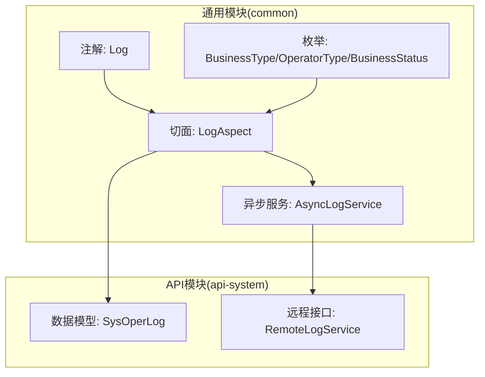
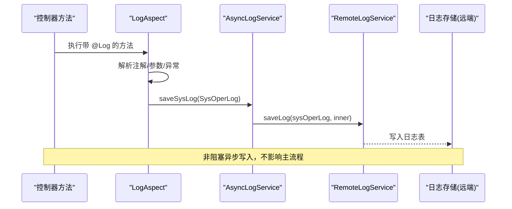
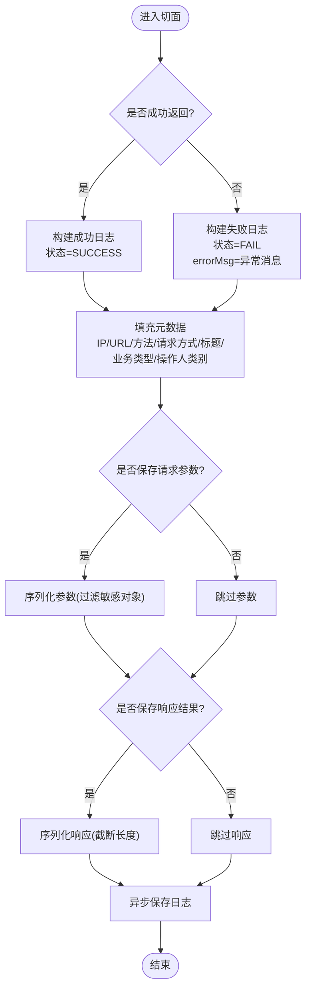
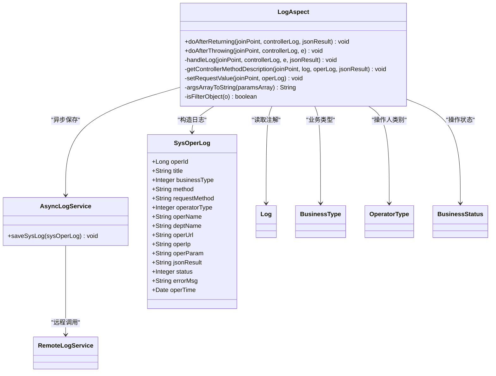

# 日志记录组件

<cite>
**本文引用的文件**   
- [Log.java](file://ruoyi-common/ruoyi-common-log/src/main/java/com/ruoyi/common/log/annotation/Log.java)
- [LogAspect.java](file://ruoyi-common/ruoyi-common-log/src/main/java/com/ruoyi/common/log/aspect/LogAspect.java)
- [AsyncLogService.java](file://ruoyi-common/ruoyi-common-log/src/main/java/com/ruoyi/common/log/service/AsyncLogService.java)
- [BusinessStatus.java](file://ruoyi-common/ruoyi-common-log/src/main/java/com/ruoyi/common/log/enums/BusinessStatus.java)
- [BusinessType.java](file://ruoyi-common/ruoyi-common-log/src/main/java/com/ruoyi/common/log/enums/BusinessType.java)
- [OperatorType.java](file://ruoyi-common/ruoyi-common-log/src/main/java/com/ruoyi/common/log/enums/OperatorType.java)
- [SysOperLog.java](file://ruoyi-api/ruoyi-api-system/src/main/java/com/ruoyi/system/api/domain/SysOperLog.java)
- [RemoteLogService.java](file://ruoyi-api/ruoyi-api-system/src/main/java/com/ruoyi/system\api/RemoteLogService.java)
</cite>

## 目录
1. [简介](#简介)
2. [项目结构](#项目结构)
3. [核心组件](#核心组件)
4. [架构总览](#架构总览)
5. [详细组件分析](#详细组件分析)
6. [依赖关系分析](#依赖关系分析)
7. [性能与异步处理](#性能与异步处理)
8. [配置与自定义格式](#配置与自定义格式)
9. [故障排查指南](#故障排查指南)
10. [结论](#结论)

## 简介
本章节面向“日志记录组件”的使用者与扩展者，系统性说明操作日志的自动记录机制、注解驱动方式、异步持久化流程、切面实现要点、枚举定义与服务接口契约。文档同时给出日志配置建议、自定义日志格式思路以及日志分析最佳实践，帮助你在不侵入业务代码的前提下，稳定、高效地采集与归档系统操作日志。

## 项目结构
日志相关能力集中在通用模块中，并通过 API 模块暴露数据模型与远程服务接口：
- 注解与切面：位于 common-log 模块，提供 @Log 注解与 LogAspect 切面
- 枚举定义：BusinessType、OperatorType、BusinessStatus
- 异步服务：AsyncLogService 负责将日志对象异步提交到远程日志服务
- 数据模型：SysOperLog 描述操作日志实体
- 远程接口：RemoteLogService 定义跨服务保存日志的契约

图表来源
- [Log.java:1-47](file://ruoyi-common/ruoyi-common-log/src/main/java/com/ruoyi/common/log/annotation/Log.java#L1-L47)
- [LogAspect.java:1-212](file://ruoyi-common/ruoyi-common-log/src/main/java/com/ruoyi/common/log/aspect/LogAspect.java#L1-L212)
- [AsyncLogService.java:1-30](file://ruoyi-common/ruoyi-common-log/src/main/java/com/ruoyi/common/log/service/AsyncLogService.java#L1-L30)
- [SysOperLog.java:1-242](file://ruoyi-api/ruoyi-api-system/src/main/java/com/ruoyi/system/api/domain/SysOperLog.java#L1-L242)
- [RemoteLogService.java](file://ruoyi-api/ruoyi-api-system/src/main/java/com/ruoyi/system\api/RemoteLogService.java)

章节来源
- [Log.java:1-47](file://ruoyi-common/ruoyi-common-log/src/main/java/com/ruoyi/common/log/annotation/Log.java#L1-L47)
- [LogAspect.java:1-212](file://ruoyi-common/ruoyi-common-log/src/main/java/com/ruoyi/common/log/aspect/LogAspect.java#L1-L212)
- [AsyncLogService.java:1-30](file://ruoyi-common/ruoyi-common-log/src/main/java/com/ruoyi/common/log/service/AsyncLogService.java#L1-L30)
- [SysOperLog.java:1-242](file://ruoyi-api/ruoyi-api-system/src/main/java/com/ruoyi/system/api/domain/SysOperLog.java#L1-L242)

## 核心组件
- 日志注解 @Log：用于声明需要被切面捕获的方法或参数，支持设置标题、业务类型、操作人类别、是否保存请求/响应数据等
- 日志切面 LogAspect：拦截带 @Log 的方法，在成功返回或抛出异常时组装 SysOperLog 并异步保存
- 异步服务 AsyncLogService：通过 @Async 将日志持久化调用委托给远程日志服务
- 枚举定义：BusinessType（业务类型）、OperatorType（操作人类别）、BusinessStatus（操作状态）
- 数据模型 SysOperLog：承载操作日志字段，如方法名、请求方式、IP、URL、参数、结果、状态、错误信息等
- 远程接口 RemoteLogService：定义跨服务保存日志的接口契约

章节来源
- [Log.java:1-47](file://ruoyi-common/ruoyi-common-log/src/main/java/com/ruoyi/common/log/annotation/Log.java#L1-L47)
- [LogAspect.java:1-212](file://ruoyi-common/ruoyi-common-log/src/main/java/com/ruoyi/common/log/aspect/LogAspect.java#L1-L212)
- [AsyncLogService.java:1-30](file://ruoyi-common/ruoyi-common-log/src/main/java/com/ruoyi/common/log/service/AsyncLogService.java#L1-L30)
- [BusinessType.java:1-60](file://ruoyi-common/ruoyi-common-log/src/main/java/com/ruoyi/common/log/enums/BusinessType.java#L1-L60)
- [OperatorType.java:1-25](file://ruoyi-common/ruoyi-common-log/src/main/java/com/ruoyi/common/log/enums/OperatorType.java#L1-L25)
- [BusinessStatus.java:1-21](file://ruoyi-common/ruoyi-common-log/src/main/java/com/ruoyi/common/log/enums/BusinessStatus.java#L1-L21)
- [SysOperLog.java:1-242](file://ruoyi-api/ruoyi-api-system/src/main/java/com/ruoyi/system/api/domain/SysOperLog.java#L1-L242)

## 架构总览
下图展示了从控制器方法到日志落库的整体流程：注解触发切面，切面收集上下文信息，异步服务调用远程日志服务完成持久化。

图表来源
- [LogAspect.java:47-105](file://ruoyi-common/ruoyi-common-log/src/main/java/com/ruoyi/common/log/aspect/LogAspect.java#L47-L105)
- [AsyncLogService.java:21-28](file://ruoyi-common/ruoyi-common-log/src/main/java/com/ruoyi/common/log/service/AsyncLogService.java#L21-L28)
- [RemoteLogService.java](file://ruoyi-api/ruoyi-api-system/src/main/java/com/ruoyi/system\api/RemoteLogService.java)

## 详细组件分析

### 日志注解 @Log
- 作用目标与方法：可标注于方法与参数，运行时可见
- 关键属性
  - title：模块标题
  - businessType：业务类型（新增/修改/删除/导出/导入等）
  - operatorType：操作人类别（后台用户/手机端用户等）
  - isSaveRequestData：是否保存请求参数
  - isSaveResponseData：是否保存响应结果

使用建议
- 对写操作（增删改）明确标注 businessType
- 对敏感接口谨慎开启 isSaveRequestData/isSaveResponseData，避免泄露敏感信息

章节来源
- [Log.java:17-46](file://ruoyi-common/ruoyi-common-log/src/main/java/com/ruoyi/common/log/annotation/Log.java#L17-L46)

### 日志切面 LogAspect
职责
- 拦截带 @Log 的方法，分别在成功返回与异常抛出时统一处理
- 组装 SysOperLog：包括 IP、URL、用户名、方法签名、请求方式、业务类型、标题、操作人类别、请求参数、响应结果、状态与错误消息
- 过滤敏感参数：排除 MultipartFile、HttpServletRequest、HttpServletResponse、BindingResult 等
- 异步落库：通过 AsyncLogService.saveSysLog 提交

关键流程
- 成功路径：@AfterReturning -> handleLog -> getControllerMethodDescription -> setRequestValue -> asyncLogService.saveSysLog
- 异常路径：@AfterThrowing -> handleLog -> 标记失败并记录错误消息 -> asyncLogService.saveSysLog
- 本地异常兜底：若切面自身抛异常，记录本地日志并打印堆栈

图表来源
- [LogAspect.java:47-105](file://ruoyi-common/ruoyi-common-log/src/main/java/com/ruoyi/common/log/aspect/LogAspect.java#L47-L105)
- [LogAspect.java:114-133](file://ruoyi-common/ruoyi-common-log/src/main/java/com/ruoyi/common/log/aspect/LogAspect.java#L114-L133)
- [LogAspect.java:141-175](file://ruoyi-common/ruoyi-common-log/src/main/java/com/ruoyi/common/log/aspect/LogAspect.java#L141-L175)
- [LogAspect.java:184-210](file://ruoyi-common/ruoyi-common-log/src/main/java/com/ruoyi/common/log/aspect/LogAspect.java#L184-L210)

章节来源
- [LogAspect.java:1-212](file://ruoyi-common/ruoyi-common-log/src/main/java/com/ruoyi/common/log/aspect/LogAspect.java#L1-L212)

### 异步服务 AsyncLogService
- 使用 @Async 将日志保存逻辑异步化，避免影响主线程性能
- 内部调用 RemoteLogService.saveLog，并附带内部调用标识

章节来源
- [AsyncLogService.java:1-30](file://ruoyi-common/ruoyi-common-log/src/main/java/com/ruoyi/common/log/service/AsyncLogService.java#L1-L30)

### 枚举定义
- BusinessType：业务类型（其它/新增/修改/删除/授权/导出/导入/强退/生成代码/清空数据）
- OperatorType：操作人类别（其它/后台用户/手机端用户）
- BusinessStatus：操作状态（成功/失败）

用途
- 为 SysOperLog 中的业务类型、操作人类别、状态字段提供标准化取值

章节来源
- [BusinessType.java:1-60](file://ruoyi-common/ruoyi-common-log/src/main/java/com/ruoyi/common/log/enums/BusinessType.java#L1-L60)
- [OperatorType.java:1-25](file://ruoyi-common/ruoyi-common-log/src/main/java/com/ruoyi/common/log/enums/OperatorType.java#L1-L25)
- [BusinessStatus.java:1-21](file://ruoyi-common/ruoyi-common-log/src/main/java/com/ruoyi/common/log/enums/BusinessStatus.java#L1-L21)

### 数据模型 SysOperLog
关键字段
- operId：日志主键
- title：模块标题
- businessType：业务类型
- method：方法全限定名+方法名
- requestMethod：HTTP 方法
- operatorType：操作人类别
- operName：操作人员
- deptName：部门名称
- operUrl：请求地址
- operIp：操作地址
- operParam：请求参数
- jsonResult：返回结果
- status：状态（正常/异常）
- errorMsg：错误消息
- operTime：操作时间

章节来源
- [SysOperLog.java:1-242](file://ruoyi-api/ruoyi-api-system/src/main/java/com/ruoyi/system/api/domain/SysOperLog.java#L1-L242)

### 远程接口 RemoteLogService
- 定义跨服务保存日志的接口契约
- AsyncLogService 通过该接口将 SysOperLog 提交至远端服务进行持久化

章节来源
- [RemoteLogService.java](file://ruoyi-api/ruoyi-api-system/src/main/java/com/ruoyi/system\api/RemoteLogService.java)

## 依赖关系分析
- LogAspect 依赖
  - 注解 @Log：读取业务类型、标题、操作人类别、是否保存请求/响应
  - 工具类：ServletUtils、StringUtils、IpUtils、SecurityUtils
  - 数据模型 SysOperLog：构造日志对象
  - 异步服务 AsyncLogService：异步保存
- AsyncLogService 依赖
  - 远程接口 RemoteLogService：跨服务保存日志
- 枚举与模型
  - BusinessType/OperatorType/BusinessStatus 为日志字段提供标准值域
  - SysOperLog 作为统一的日志载体

图表来源
- [LogAspect.java:1-212](file://ruoyi-common/ruoyi-common-log/src/main/java/com/ruoyi/common/log/aspect/LogAspect.java#L1-L212)
- [AsyncLogService.java:1-30](file://ruoyi-common/ruoyi-common-log/src/main/java/com/ruoyi/common/log/service/AsyncLogService.java#L1-L30)
- [SysOperLog.java:1-242](file://ruoyi-api/ruoyi-api-system/src/main/java/com/ruoyi/system/api/domain/SysOperLog.java#L1-L242)
- [Log.java:1-47](file://ruoyi-common/ruoyi-common-log/src/main/java/com/ruoyi/common/log/annotation/Log.java#L1-L47)
- [BusinessType.java:1-60](file://ruoyi-common/ruoyi-common-log/src/main/java/com/ruoyi/common/log/enums/BusinessType.java#L1-L60)
- [OperatorType.java:1-25](file://ruoyi-common/ruoyi-common-log/src/main/java/com/ruoyi/common/log/enums/OperatorType.java#L1-L25)
- [BusinessStatus.java:1-21](file://ruoyi-common/ruoyi-common-log/src/main/java/com/ruoyi/common/log/enums/BusinessStatus.java#L1-L21)

章节来源
- [LogAspect.java:1-212](file://ruoyi-common/ruoyi-common-log/src/main/java/com/ruoyi/common/log/aspect/LogAspect.java#L1-L212)
- [AsyncLogService.java:1-30](file://ruoyi-common/ruoyi-common-log/src/main/java/com/ruoyi/common/log/service/AsyncLogService.java#L1-L30)
- [SysOperLog.java:1-242](file://ruoyi-api/ruoyi-api-system/src/main/java/com/ruoyi/system/api/domain/SysOperLog.java#L1-L242)

## 性能与异步处理
- 异步落库：AsyncLogService 使用 @Async 将日志持久化移出主线程，降低接口响应延迟
- 参数与响应序列化：仅在注解允许时进行 JSON 序列化，并对超长字符串进行截断，减少内存占用
- 敏感对象过滤：自动过滤文件上传、请求/响应对象、校验结果等，避免无意义日志体积膨胀
- 异常隔离：切面内部异常被捕获并记录本地日志，确保业务主流程不受日志记录失败影响

优化建议
- 合理控制 isSaveRequestData/isSaveResponseData，避免大对象序列化
- 对高频接口考虑关闭响应体保存，仅保留必要参数
- 关注异步线程池配置，避免队列堆积导致日志丢失

章节来源
- [LogAspect.java:114-175](file://ruoyi-common/ruoyi-common-log/src/main/java/com/ruoyi/common/log/aspect/LogAspect.java#L114-L175)
- [AsyncLogService.java:21-28](file://ruoyi-common/ruoyi-common-log/src/main/java/com/ruoyi/common/log/service/AsyncLogService.java#L21-L28)

## 配置与自定义格式
- 日志框架：各模块均包含 logback.xml，可用于调整日志级别、输出格式、滚动策略等
- 自定义格式：可在 logback.xml 中定义 PatternLayout，加入业务维度字段（如 traceId、userId、module），便于后续分析
- 日志开关：通过 @Log 的属性精细控制是否记录请求/响应数据，平衡可观测性与性能

示例指引
- 查看各模块 resources/logback.xml 以了解当前日志输出配置
- 根据业务需求扩展日志字段（例如增加租户、环境、链路追踪 ID）

章节来源
- [logback.xml（多模块）](file://ruoyi-auth/src/main/resources/logback.xml)
- [logback.xml（多模块）](file://ruoyi-gateway/src/main/resources/logback.xml)
- [logback.xml（多模块）](file://ruoyi-modules/ruoyi-dqservice/src/main/resources/logback.xml)
- [logback.xml（多模块）](file://ruoyi-modules/ruoyi-file/src/main/resources/logback.xml)
- [logback.xml（多模块）](file://ruoyi-modules/ruoyi-gen/src/main/resources/logback.xml)
- [logback.xml（多模块）](file://ruoyi-modules/ruoyi-job/src/main/resources/logback.xml)
- [logback.xml（多模块）](file://ruoyi-modules/ruoyi-system/src/main/resources/logback.xml)
- [logback.xml（多模块）](file://ruoyi-visual/ruoyi-monitor/src/main/resources/logback.xml)

## 故障排查指南
常见问题与定位思路
- 未产生日志
  - 检查方法是否正确标注 @Log
  - 确认切面已启用且未被代理绕过
- 日志缺失请求/响应
  - 检查 isSaveRequestData/isSaveResponseData 是否为 true
  - 注意大对象会被截断，必要时调整截断阈值
- 日志中包含敏感信息
  - 确认敏感对象（MultipartFile、HttpServletRequest、HttpServletResponse、BindingResult）已被过滤
- 异步日志丢失
  - 检查异步线程池配置与队列容量
  - 观察远程日志服务是否可用

定位要点
- 切面内部异常会被捕获并记录本地日志，优先检查应用本地日志输出
- 远程日志服务调用失败通常由网络或服务不可用引起，需结合网关/服务注册中心排查

章节来源
- [LogAspect.java:98-104](file://ruoyi-common/ruoyi-common-log/src/main/java/com/ruoyi/common/log/aspect/LogAspect.java#L98-L104)
- [LogAspect.java:184-210](file://ruoyi-common/ruoyi-common-log/src/main/java/com/ruoyi/common/log/aspect/LogAspect.java#L184-L210)

## 结论
日志记录组件通过注解与切面实现了“无侵入式”的操作日志采集，借助异步服务与远程接口保证了对主流程的低干扰与高吞吐。配合标准化的枚举与数据模型，开发者可以便捷地为任意方法添加结构化日志，并在生产环境中灵活调整日志格式与输出策略。建议在业务侧合理使用注解属性，避免过度记录；在生产侧完善日志分析与告警体系，提升问题定位效率。